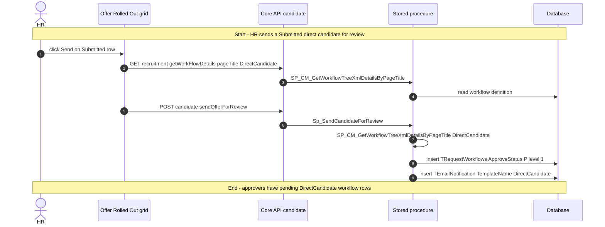
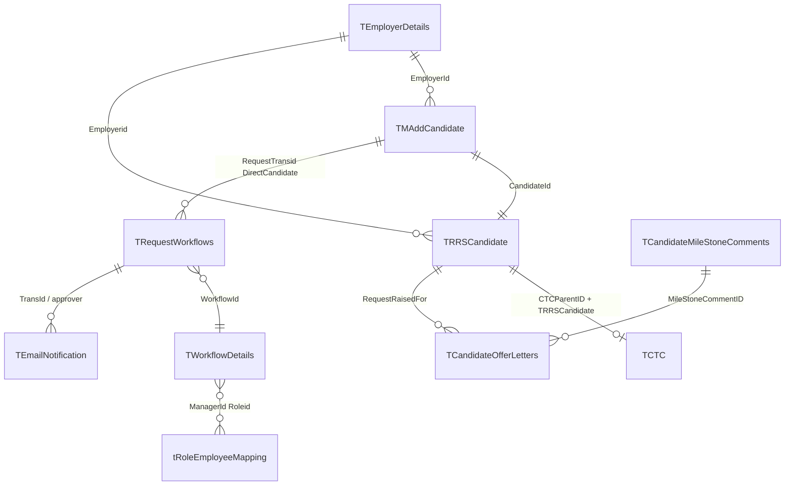

# Offer Rolled Out

## Overview

An HR user opens **Employee Management → Offer Rolled Out** when they need to add a candidate who was never on a requisition shortlist, prepare an offer letter, send that offer through the **DirectCandidate** workflow, and eventually email the letter to the candidate. The left-nav item (MenuId **301**) loads a React shell titled Offer Rolled Out. The user works a grid of direct-added candidates, opens an add/edit form, generates a PDF offer from a document template, sends the row for multi-level review, and after final approval shares the letter by email.

**Who's involved:**

- **HR / employee-management user** — creates and edits direct candidates, generates the offer PDF, sends for review when status is `Submitted`, and emails the letter after status is `Approved`.
- **Workflow approver** (role rows on `TWorkflowDetails` for page title `DirectCandidate`) — opens the approve/reject shell (often from a notification deep link) and comments while approving or rejecting.
- **Global-access user** (`IsGlobalAccess = Y`) — organisation multi-select so the grid can span employers.

Live DEV `tMenuDetails` for MenuId **301** (all 215 employer rows) uses NavigateURL `/HRM/CandidateManagement_React/AddCandidate.aspx` (`PageName` `AddCandidate.aspx`). That matches seed DML `63712_DML_Offer Rolled Out Menu.sql` and `AddCandidate.aspx.cs` activity `CandidateManagementOfferRolledOut`. The older WebForms `Recruitment/OfferLetterApproval.aspx` and React `Recruitment_React/OfferLetterApproval_New.aspx` are **not** this menu item; they serve recruitment offer-letter approval from notifications.

There is **no** `llm-wiki/domain` lifecycle page for this screen. Table one-liners for `TMAddCandidate`, `TRRSCandidate`, and `TRequestWorkflows` live in `llm-wiki/reference/tables/hrms.md`. Approval routing reuses the shared pattern in `llm-wiki/domain/approval-workflow.md`. This guide is the application call chain those catalogs do not cover.

Sibling left-nav work under Employee Management (for example Pre-Onboarding Candidate) is separate. Recruitment dashboards and **Recruitment → Notifications** may deep-link into approve/reject or offer screens; they are not this menu entry.

## Workflow

```mermaid
flowchart TD
  Nav["Employee Management left-nav Offer Rolled Out"] --> ASPX["CandidateManagement_React AddCandidate.aspx"]
  ASPX --> SPA["CandidateList / AddCandidate / SendOfferLetter"]

  SPA --> Org["GET /candidate/GetGlobalAccessEmployerList"]
  Org --> OrgSP["SP_GetGlobalAccessEmployerList"]

  SPA --> Grid["GET /candidate/getCandidatesList"]
  Grid --> GridSP["SP_GetDirectAddedCandidates"]
  GridSP --> TMAdd[("TMAddCandidate")]
  GridSP --> Enc["Sp_OpenEncryptionKeys / DecryptSql / SP_CloseEncryptionKey"]

  SPA --> Save["POST /candidate/submitCandidateDetails"]
  Save --> SaveSP["Sp_InsertDirectCandidate"]
  SaveSP --> Cand[("TRRSCandidate")]
  SaveSP --> TMAdd
  SaveSP --> CtcSP["USP_TCTC_SaveUpdate"]
  CtcSP --> Ctc[("TCTC")]

  SPA --> OfferPdf["POST /candidate/createOfferRolledOutLetter"]
  OfferPdf --> Hdr["SP_GetHeaderFooterForOfferLetter"]
  OfferPdf --> Body["SP_RRS_GetTempDocForEmailNotification"]
  OfferPdf --> Ess["USP_RRS_ESS_GetTempDocForEmailNotification"]
  OfferPdf --> PathSP["SP_CM_GetEmailTemplatesDocumentPath"]
  OfferPdf --> UpdOffer["Sp_RRS_UpdateCandidateOffer"]
  UpdOffer --> Cand
  UpdOffer --> Mile["USP_TCandidateMileStoneComments_Save"]

  SPA --> Review["POST /candidate/sendOfferForReview"]
  Review --> ReviewSP["Sp_SendCandidateForReview"]
  ReviewSP --> WfTree["SP_CM_GetWorkflowTreeXmlDetailsByPageTitle"]
  ReviewSP --> TRW[("TRequestWorkflows")]
  ReviewSP --> MailQ[("TEmailNotification")]

  ApprovePage["ApproveCandidate.aspx"] --> ApprUI["ApproveRejectComponent"]
  ApprUI --> Pending["GET /candidate/getPendingOfferRolledOut"]
  Pending --> PendSP["SP_GetPendingOfferRolledOut"]
  ApprUI --> Decide["POST /candidate/approveRejectCandidate"]
  Decide --> DecideSP["Sp_ApproveRejectOfferRolledOut"]
  DecideSP --> WfTree
  DecideSP --> TRW
  DecideSP --> Cand
  DecideSP --> TMAdd

  SPA --> Share["POST /candidate/sendOfferLetterToCandidate"]
  Share --> EmailSP["SP_SendEmail"]
  EmailSP --> Temail[("TEmail")]
```

Lookups (roles/designations, locations, business units, offer templates, document paths, workflow existence check, page config `AddDirectCandidate`) go through `/recruitment/*` and `/assets/*` helpers shared with Recruitment. They are supporting reads, not the DirectCandidate write path.

## Request journey

The characteristic write is **sending a submitted direct candidate for DirectCandidate workflow review**. It starts when HR clicks send on a `Submitted` row and ends with pending `TRequestWorkflows` rows and `TEmailNotification` rows for level-1 approvers.

Approvers later POST `candidate/approveRejectCandidate` → `Sp_ApproveRejectOfferRolledOut`. Final approve sets `TMAddCandidate.CandidateStatus` to `Approved` and `TRRSCandidate.Status` to `NotifiedForJoining`. Reject sets both to `Rejected`. Intermediate approve inserts the next routing level and another notification batch.

## Entry points

Live menu **301** points only at the Add Candidate React shell. Approve/reject is a second ASPX in the same React app, usually opened with an encrypted `candidateID` query string (notifications / pending queue), not from the left-nav URL itself.

| Entry | Purpose |
|---|---|
| `HRMS.Web/HRMS.Web/HRM/CandidateManagement_React/AddCandidate.aspx` | Left-nav Offer Rolled Out host; logs `CandidateManagementOfferRolledOut` |
| `HRMS.Web/HRMS.Web/HRM/CandidateManagement_React/ApproveCandidate.aspx` | Approve/reject shell for DirectCandidate workflow |
| `Recruitment/OfferLetterApproval.aspx` / `Recruitment_React/OfferLetterApproval_New.aspx` | Not MenuId 301 — recruitment offer approval from notifications |

## Code → database call chain

| UI / route | App layer (`file:line`) | Stored procedure |
|---|---|---|
| Grid load | `candidateManagementDAL.js:28-36` `GetCandidatesList` | `SP_GetDirectAddedCandidates` |
| Pending queue (approve page) | `candidateManagementDAL.js:43-48` `GetPendingOfferRolledOut` | `SP_GetPendingOfferRolledOut` |
| Save / status update on form | `candidateManagementDAL.js:55-87` `SubmitCandidateDetails` | `Sp_InsertDirectCandidate` → `USP_TCTC_SaveUpdate` |
| Reporting-manager info | `candidateManagementDAL.js:98-104` `GetEmployeeInfo` | `usp_rrs_EmployeeInfo` |
| Send for review | `candidateManagementDAL.js:111-121` `SendOfferForReview` | `Sp_SendCandidateForReview` → `SP_CM_GetWorkflowTreeXmlDetailsByPageTitle` |
| Approve / reject | `candidateManagementDAL.js:150-162` `ApproveRejectCandidate` | `Sp_ApproveRejectOfferRolledOut` → `SP_CM_GetWorkflowTreeXmlDetailsByPageTitle` |
| Approval history on view | `candidateManagementDAL.js:172-179` `GetApproveRejectDetails` | `SP_GetCandidateApproveRejectDetails` |
| Template mandatory flag | `candidateManagementDAL.js:186-191` `GetEmployerDetails` | `SP_OfferRolled_GetEmployerDetails` |
| Global org list | `candidateManagementDAL.js:16-21` `GetGlobalAccessEmployerList` | `SP_GetGlobalAccessEmployerList` |
| Generate offer PDF | `candidateManagementController.js:253+` / DAL `198-209`, `219-228`, `293-304`, `315-329`, `238-283` | `SP_GetHeaderFooterForOfferLetter`, `SP_CM_GetEmailTemplatesDocumentPath`, `SP_RRS_GetTempDocForEmailNotification`, `USP_RRS_ESS_GetTempDocForEmailNotification`, `Sp_RRS_UpdateCandidateOffer` → `USP_TCTC_SaveUpdate`, `USP_TCandidateMileStoneComments_Save` |
| Email offer to candidate | `candidateManagementDAL.js:128-141` `SendOfferLetterToCandidate` | `SP_SendEmail` |
| Workflow exists check (UI) | `recruitmentDAL.js:172` | `SP_CM_GetWorkflowTreeXmlDetailsByPageTitle` |
| Document path / templates (UI) | `recruitmentDAL.js:1019`, `4746`, `10532` | `SP_CM_GetEmailTemplatesDocumentPath`, `SP_RRS_GetDocTemplate`, `SP_AdminRM_GetDocTemplates` |

Legacy .NET mirrors for pending/approve also exist in `HRMS.Shared/HRMS.DataAccessLayer/Recruitment/AddCandidateDAL.cs` (`SP_GetPendingOfferRolledOut`, `Sp_ApproveRejectOfferRolledOut`); the React Offer Rolled Out shell uses the Node `/candidate` routes above.

## API endpoints

Mounted under `/candidate` from `Routes/CandidateManagementRoutes.js` (Authorize). No WebForms postback on the React shells.

| Verb | Route | Parameters | Purpose | Source |
|---|---|---|---|---|
| GET | `/candidate/getCandidatesList` | `employerId` (req), `employeeId` (opt, tokenized), `candidateId` (opt), `employerIds` (opt) | Direct-candidate grid | `candidateManagementController.js:47` |
| GET | `/candidate/getPendingOfferRolledOut` | (employee from token) | Pending DirectCandidate approvals | `candidateManagementController.js:60` |
| POST | `/candidate/submitCandidateDetails` | body field wrappers (`candidateId`, names, CTC, paths, `employerId`, `candidateStatus`, …) | Insert/update direct candidate | `candidateManagementController.js:70` |
| POST | `/candidate/sendOfferForReview` | `candidateId`, `employerId`, `workflowId`, `requestType`, `candidateEmployerId` | Start DirectCandidate workflow | `candidateManagementController.js:146` |
| POST | `/candidate/approveRejectCandidate` | `candidateId`, `employerId`, `requestType`, `status`, `comments` | Approve or reject | `candidateManagementController.js:194` |
| GET | `/candidate/getApproveRejectDetails` | `employerId`, `candidateId`, `workflowId` | Prior approve/reject comments | `candidateManagementController.js:205` |
| GET | `/candidate/getEmployerDetails` | `employerId` | `IsOfferRolledOutTemplateMandatory` | `candidateManagementController.js:225` |
| GET | `/candidate/getEmployeeInfo` | `employeeId`, `employerId` | Reporting manager display | `candidateManagementController.js:215` |
| GET | `/candidate/GetGlobalAccessEmployerList` | (employee from token) | Org picker | `candidateManagementController.js:34` |
| POST | `/candidate/createOfferRolledOutLetter` | template/path/candidate body | Build PDF + persist offer path | `candidateManagementController.js:253` |
| POST | `/candidate/sendOfferLetterToCandidate` | email body/to/cc/from/attachment | Queue email | `candidateManagementController.js:185` |
| POST | `/candidate/uploadFile` | multipart upload | File to disk (no SP) | `candidateManagementController.js:86` |
| GET | `/candidate/downloadFile` | `docPath` | Stream file (no SP) | `candidateManagementController.js:157` |

Supporting `/recruitment/*` lookup GETs are shared with Recruitment dashboards (workflow tree, document path, templates, org list, page config).

## Stored procedures & tables involved

| Object | File | Purpose |
|---|---|---|
| `SP_GetDirectAddedCandidates` | `HRMS-DATABASE/HRMS/STOREPROCEDURE/SP_GetDirectAddedCandidates.sql` | Grid / single-candidate read from `TMAddCandidate` |
| `SP_GetPendingOfferRolledOut` | `…/SP_GetPendingOfferRolledOut.sql` | Pending DirectCandidate rows for an approver |
| `Sp_InsertDirectCandidate` | `…/Sp_InsertDirectCandidate.sql` | Insert/update `TRRSCandidate` + `TMAddCandidate` |
| `USP_TCTC_SaveUpdate` | `…/USP_TCTC_SaveUpdate.sql` | Nested CTC row for the candidate |
| `Sp_SendCandidateForReview` | `…/Sp_SendCandidateForReview.sql` | Level-1 workflow + notification insert |
| `Sp_ApproveRejectOfferRolledOut` | `…/Sp_ApproveRejectOfferRolledOut.sql` | Approve/reject routing and status |
| `SP_CM_GetWorkflowTreeXmlDetailsByPageTitle` | `…/SP_CM_GetWorkflowTreeXmlDetailsByPageTitle.sql` | Resolve DirectCandidate workflow |
| `SP_GetCandidateApproveRejectDetails` | *live DEV only — not in Liquibase inventory* | Completed approval comments |
| `SP_OfferRolled_GetEmployerDetails` | *live DEV only — not in Liquibase inventory* | Template-mandatory employer flag |
| `usp_rrs_EmployeeInfo` | *live DEV only — not in Liquibase inventory* | Reporting manager designation/locations |
| `SP_SendEmail` | `…/SP_SendEmail.sql` | Insert `TEmail` |
| `SP_GetHeaderFooterForOfferLetter` | inventoried | Offer PDF header/footer |
| `SP_CM_GetEmailTemplatesDocumentPath` | inventoried | Document base paths |
| `SP_RRS_GetTempDocForEmailNotification` | `…/SP_RRS_GetTempDocForEmailNotification.sql` | Offer template field values (direct-candidate view) |
| `USP_RRS_ESS_GetTempDocForEmailNotification` | `…/USP_RRS_ESS_GetTempDocForEmailNotification.sql` | Salary-structure / placeholder table values |
| `Sp_RRS_UpdateCandidateOffer` | `…/Sp_RRS_UpdateCandidateOffer.sql` | Persist generated offer path on `TRRSCandidate` |
| `USP_TCandidateMileStoneComments_Save` | `…/USP_TCandidateMileStoneComments_Save.sql` | Nested milestone comment for offer prepared |
| `usp_rrs_GetNextSequenceNumber` | *live DEV (PBI 154306)* | Nested reference-number sequence |

Primary tables: `TMAddCandidate`, `TRRSCandidate`, `TCTC`, `TRequestWorkflows`, `TEmailNotification`, `TEmail`, `TWorkflowDetails`, `tRoleEmployeeMapping`, `TEmployerDetails`, `TDocumentTemplates`, `TCandidateOfferLetters`, `TCandidateMileStoneComments`.

## Table relationships

Declared FKs on these recruitment tables are sparse; the diagram follows join keys used by the procedures above (same style as `llm-wiki` catalogs).

## Known gaps

- **Menu candidates vs live URL.** User-supplied candidates `OfferLetterApproval.aspx` / `OfferLetterApproval_New.aspx` are not MenuId 301. Live DEV NavigateURL is exclusively `CandidateManagement_React/AddCandidate.aspx`.
- **Three procedures missing from Liquibase inventory** (`SP_GetCandidateApproveRejectDetails`, `SP_OfferRolled_GetEmployerDetails`, `usp_rrs_EmployeeInfo`) exist in DEV `sys.sql_modules` but have no `HRMS-DATABASE` script path. Documented from live definition.
- **`usp_rrs_GetNextSequenceNumber`** is used by `SP_RRS_GetTempDocForEmailNotification` (PBI 154306) and was read from DEV; no matching inventoried file was found under `STOREPROCEDURE/` / `FUNCTIONS/`.
- **`Sp_SendCandidateForReview` does not update `TMAddCandidate.CandidateStatus`.** The React grid sets local status to `Pending Review` after a successful POST; a refresh may still show `Submitted` until another save/approve path writes status.
- **`Sp_RRS_UpdateCandidateOffer` parameter surface.** Node `saveOfferDetails` binds more inputs (mapping id, reporting lines, …) than the inventoried SQL file header lists — likely live SP drift vs repo script.
- **OfferLetterApproval paths** remain in the product for recruitment notifications; do not treat them as this left-nav feature.
- Shared `/recruitment` lookup procedures are listed in the call chain but were not given new database pages in this pass (several already exist).

## Reference

Confidence is **medium**: live menu URL and the Node DAL→SP chain are confirmed; three feature procedures lack repo scripts, and offer-PDF generation shares recruitment offer-letter procedures whose live signatures may outrun inventory.

### SourceCode

- `HRMS.Web/HRMS.Web/HRM/CandidateManagement_React/AddCandidate.aspx(.cs)`
- `HRMS.Web/HRMS.Web/HRM/CandidateManagement_React/ApproveCandidate.aspx(.cs)`
- `HRMS.Web/HRMS.Web/HRM/CandidateManagement_React/Areas/Candidate/Components/{CandidateListComponent,AddCandidateComponent,ApproveRejectComponent,SendOfferLetterComponent}.js`
- `HRMS.Web/HRMS.Web/HRM/CandidateManagement_React/Common/apiURLConstants.js`
- `HRMS.CoreAPI/HRMS.Core.WebAPI.Node/Routes/CandidateManagementRoutes.js`
- `HRMS.CoreAPI/HRMS.Core.WebAPI.Node/Controllers/candidateManagementController.js`
- `HRMS.CoreAPI/HRMS.Core.WebAPI.Node/Core/DataAccessLayer/candidateManagementDAL.js`
- `HRMS.Shared/HRMS.DataAccessLayer/Recruitment/AddCandidateDAL.cs` (legacy mirror)

### TDG HRMS DB

- `HRMS-DATABASE/HRMS/DML/63712_DML_Offer Rolled Out Menu.sql`
- `HRMS-DATABASE/HRMS/STOREPROCEDURE/SP_GetDirectAddedCandidates.sql`
- `HRMS-DATABASE/HRMS/STOREPROCEDURE/Sp_InsertDirectCandidate.sql`
- `HRMS-DATABASE/HRMS/STOREPROCEDURE/SP_GetPendingOfferRolledOut.sql`
- `HRMS-DATABASE/HRMS/STOREPROCEDURE/Sp_SendCandidateForReview.sql`
- `HRMS-DATABASE/HRMS/STOREPROCEDURE/Sp_ApproveRejectOfferRolledOut.sql`
- `HRMS-DATABASE/HRMS/STOREPROCEDURE/SP_SendEmail.sql`
- `HRMS-DATABASE/HRMS/STOREPROCEDURE/Sp_RRS_UpdateCandidateOffer.sql`
- `HRMS-DATABASE/HRMS/STOREPROCEDURE/SP_RRS_GetTempDocForEmailNotification.sql`
- `HRMS-DATABASE/HRMS/STOREPROCEDURE/USP_RRS_ESS_GetTempDocForEmailNotification.sql`
- `HRMS-DATABASE/HRMS/STOREPROCEDURE/USP_TCandidateMileStoneComments_Save.sql`
- `content/llm-wiki/reference/tables/hrms.md` (`TMAddCandidate`, `TRRSCandidate`, `TRequestWorkflows`)
- `content/llm-wiki/domain/approval-workflow.md`
