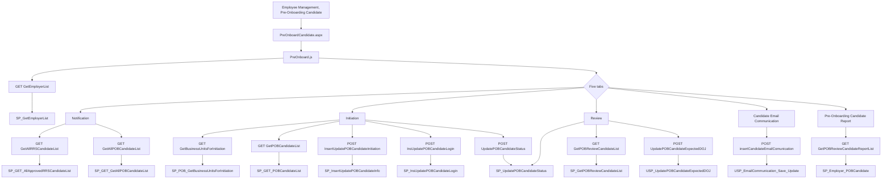
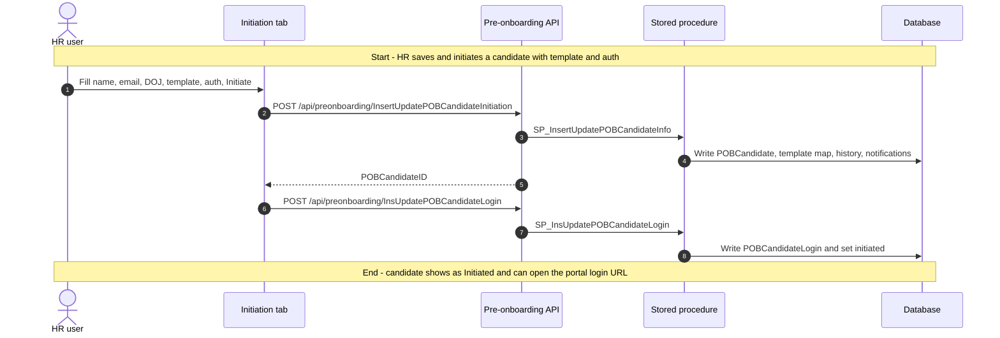
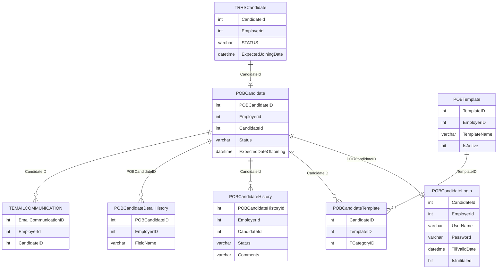

# Pre-Onboarding Candidate

## Overview

An HR user opens **Employee Management → Pre-Onboarding Candidate** when they need to move a hire from recruitment (or a manual entry) into pre-onboarding, watch who still needs action, review submitted packs, email the candidate, or export a report. The page is a five-tab React shell hosted by `PreOnboardCandidate.aspx`. The organisation dropdown at the top scopes every tab to one employer under the signed-in user’s root employer family.

On **Notification** they see recruitment candidates waiting to join and existing POB candidates still in Draft, Initiated, or Submitted. **Initiation** is where they pick a business unit and candidate (or start from an RRS row), choose a template and authentication method, save a draft, initiate (create login credentials and send the candidate into the portal flow), resend, or close. **Review** is where HR approves, rejects, or closes a submitted candidate and can change expected date of joining. **Candidate Email Communication** sends ad-hoc mail with optional attachments. **Pre-Onboarding Candidate Report** filters initiated candidates by date window and status for export-style grids.

SystemModel-2 does not name this screen. Table blurbs for `POBCandidate`, `POBCandidateLogin`, `POBCandidateTemplate`, `POBCandidateHistory`, `POBTemplate`, and related child tables are in `llm-wiki/reference/tables/hrms.md`. Candidate self-service after initiation is a different left-nav shell (`CandidateDashBoard.aspx`), not this menu item. Admin template setup is **Admin Configuration → Pre-Onboarding Configure Setup**.

**Who's involved:**

- **HR / employee-management user** — owns initiation, review, email, and report on this page.
- **Pre-onboarding candidate** — never opens this page; they use the candidate portal after initiation.
- **Recruitment** — supplies RRS candidates with joining-notified statuses that Notification and Initiation can pick up.

## Workflow

## Request journey

### HR user — initiate a candidate

Save-only (no initiate) stops after `SP_InsertUpdatePOBCandidateInfo`. Close and Review approve/reject reuse `SP_UpdatePOBCandidateStatus`. Expected-DOJ changes on Review call `USP_UpdatePOBCandidateExpectedDOJ`.

## Entry points

`PreOnboardCandidate.aspx` is a host. It stamps session user values into hidden fields, loads `BuildJS/preonboarding.min.js`, and leaves `div#root`. `Areas/routes.js` matches `/HRM/PreOnBoarding/PreOnboardCandidate.aspx` and renders `PreOnboard.js`. Code-behind only logs activity (`ActivityDescription.PreOnboardCandidate`) and fills the hidden fields; it does not post back business data.

| UI page | Purpose |
|---|---|
| `HRM/PreOnBoarding/PreOnboardCandidate.aspx` | Host for the React screen |
| `Areas/PreOnboard/Containers/PreOnboard.js` | Organisation picker and five tabs |
| `Areas/PreOnboard/Components/Notification.js` | Pending RRS and in-flight POB lists |
| `Areas/PreOnboard/Components/Initiation.js` | Save, initiate, resend, close |
| `Areas/PreOnboard/Components/Review.js` | Review grid, status, expected DOJ |
| `Areas/PreOnboard/Components/CandidateEmailCommunication.js` | Ad-hoc candidate email |
| `Areas/PreOnboard/Components/CandidateReport.js` | Filtered report grid |

## Code → database call chain

Exported URL constants are the unversioned `/preonboarding/...` paths. `routeIndex.js` mounts those on `/api/preonboarding`.

| Entry | Method | Stored procedure |
|---|---|---|
| Organisation picker | `populateOrganization` (`PreOnboard.js:39`) → `GetEmployerList` (`preOnBoardingController.js:429`) → `preOnBoardingDAL.js:717` | `SP_GetEmployerList` |
| Notification RRS list | `populateRRSCandidateList` (`Notification.js:62`) → `GetAllRRSCandidateList` (`preOnBoardingController.js:700`) → `preOnBoardingDAL.js:1345` | `SP_GET_AllApprovedRRSCandidateList` |
| Notification POB list | `populatePOBCandidateList` (`Notification.js:100`) → `GetAllPOBCandidateList` (`preOnBoardingController.js:709`) → `preOnBoardingDAL.js:1360` | `SP_GET_GetAllPOBCandidateList` |
| Notification history | `Notification.js:212` → `GetPOBCandidateHistory` (`preOnBoardingController.js:1027`) → `preOnBoardingDAL.js:1678` | `SP_GetPOBCandidateHistory` |
| Initiation business units | `Initiation.js:274` → `GetBusinessUnitsForInitiation` (`preOnBoardingController.js:688`) → `preOnBoardingDAL.js:1331` | `SP_POB_GetBusinessUnitsForInitiation` |
| Initiation candidate list | `Initiation.js:346` → `GetPOBCandidateList` (`preOnBoardingController.js:622`) → `preOnBoardingDAL.js:1227` | `SP_GET_POBCandidateList` |
| Template list | `Initiation.js:359` / `CandidateReport.js:134` → `GetPOBAllTemplate` (`preOnBoardingController.js:578`) → `preOnBoardingDAL.js:1130` | `SP_GetAllTemplates` |
| Auth options | `Initiation.js:372` → `GetAuthenticationOptionList` (`preOnBoardingController.js:647`) → `preOnBoardingDAL.js:1262` | `Sp_GetAuthenticationOptionList` |
| Prefill from RRS | `Initiation.js:391` → `GetselectCandidateDetails` (`preOnBoardingController.js:635`) → `preOnBoardingDAL.js:1245` | `Sp_RRS_GetselectCandidateDetails` |
| Saved / initiated list | `Initiation.js:426` → `GetPOBCandidateInfo` (`preOnBoardingController.js:676`) → `preOnBoardingDAL.js:1315` | `SP_GetPOBCandidateInfo` |
| Save / soft-delete initiation | `insertUpdateCandidate` (`Initiation.js:702`) → `InsertUpdatePOBCandidateInitiation` (`preOnBoardingController.js:658`) → `preOnBoardingDAL.js:1277` | `SP_InsertUpdatePOBCandidateInfo` |
| Initiate / resend login | `initiatePOBCandidate` (`Initiation.js:764`) → `InsUpdatePOBCandidateLogin` (`preOnBoardingController.js:316`) → `preOnBoardingDAL.js:475` | `SP_InsUpdatePOBCandidateLogin` |
| Close candidate | `closePOBCandidate` (`Initiation.js:795`) → `UpdatePOBCandidateStatus` (`preOnBoardingController.js:798`) → `preOnBoardingDAL.js:1549` | `SP_UpdatePOBCandidateStatus` |
| Expected-DOJ history | `Initiation.js:999` / `Review.js:574` → `getPOBCandidateHistroyList` (`preOnBoardingController.js:1816`) → `preOnBoardingDAL.js:2989` | `USP_Candidate_ExpectedDOJ_History_List` |
| Email list (side panel) | `Initiation.js:1068` / `Review.js:1198` → `GetEmailCommunicationList` (`preOnBoardingController.js:1891`) → `preOnBoardingDAL.js:3053` | `USP_EmailCommunication_List` |
| Review grid | `Review.js:134` → `GetPOBReviewCandidateList` (`preOnBoardingController.js:819`) → `preOnBoardingDAL.js:1608` | `SP_GetPOBReviewCandidateList` |
| Open template | `Review.js:258` → `GetViewTemplateDetails` (`preOnBoardingController.js:600`) → `preOnBoardingDAL.js:1211` and `1810` | `SP_GetTemplateDetailsByID`, `SP_GetAllPOBTemplateForms` |
| Custom field values | `Review.js:274` → `GetCustomValues` (`preOnBoardingController.js:1941`) → `preOnBoardingDAL.js:3146` | `SP_MyDetails_GetCustomFieldValue` |
| Review status change | `Review.js:297` → `UpdatePOBCandidateStatus` (`preOnBoardingController.js:798`) → `preOnBoardingDAL.js:1549` | `SP_UpdatePOBCandidateStatus` |
| Review expected DOJ | `Review.js:333` → `UpdatePOBCandidateExpectedDOJ` (`preOnBoardingController.js:1807`) → `preOnBoardingDAL.js:2960` | `USP_UpdatePOBCandidateExpectedDOJ` |
| Email candidates | `CandidateEmailCommunication.js:119` → `GetCandidateList` (`preOnBoardingController.js:1900`) → `preOnBoardingDAL.js:3067` | `USP_Candidate_List` |
| Email employees | `CandidateEmailCommunication.js:133` → `GetEmployeeList` (`preOnBoardingController.js:1825`) → `preOnBoardingDAL.js:3005` | `USP_Employees_List` |
| Email history | `CandidateEmailCommunication.js:151` → `GetEmailCommunicationList` (`preOnBoardingController.js:1891`) → `preOnBoardingDAL.js:3053` | `USP_EmailCommunication_List` |
| Email attachment upload | `CandidateEmailCommunication.js:318` → `UploadEmailAttachment` (`preOnBoardingController.js:1834`) | File store only — no stored procedure |
| Email save / send | `CandidateEmailCommunication.js:416` → `InsertCandidateEmailCommunication` (`preOnBoardingController.js:1882`) → `preOnBoardingDAL.js:3018` | `USP_EmailCommunication_Save_Update` |
| Report grid | `CandidateReport.js:170` → `GetPOBReviewCandidateReportList` (`preOnBoardingController.js:829`) → `preOnBoardingDAL.js:1621` | `SP_Employer_POBCandidate` |

`InsertUpdatePOBCandidateInitiation`, login, status, expected DOJ, and email save begin a SQL transaction in the DAL and commit after the procedure returns. RRS candidates under revise hiring are blocked in the controller before `SP_InsertUpdatePOBCandidateInfo`.

## API endpoints

Most of these routes use `Authorize` in `PreOnBoardingRoutes.js`. `GetViewTemplateDetails`, `UpdatePOBCandidateStatus`, `GetPOBCandidateHistory`, `uploadEmailAttachment`, `insertCandidateEmailComunication`, `getEmailCommunicationList`, `getCandidateList`, and `GetCustomValues` are registered without `Authorize` on the unversioned router (still behind the API host auth stack where configured).

| Verb | Route | Parameters | Purpose | Source |
|---|---|---|---|---|
| GET | `/api/preonboarding/GetEmployerList` | `employeeId` query (controller uses session `EID`) | Organisation dropdown | `PreOnBoardingRoutes.js:8`, `preOnBoardingController.js:429` |
| GET | `/api/preonboarding/GetAllRRSCandidateList` | `Employerid` query | Notification RRS pending | `PreOnBoardingRoutes.js:24`, `preOnBoardingController.js:700` |
| GET | `/api/preonboarding/GetAllPOBCandidateList` | `Employerid` query | Notification POB in-flight | `PreOnBoardingRoutes.js:27`, `preOnBoardingController.js:709` |
| GET | `/api/preonboarding/GetPOBCandidateHistory` | `EmployerId`, `CandidateId` query | Status history popup | `PreOnBoardingRoutes.js:85`, `preOnBoardingController.js:1027` |
| GET | `/api/preonboarding/GetBusinessUnitsForInitiation` | `EmployerId`, `EmployeeId` query | Business unit multi-select | `PreOnBoardingRoutes.js:26`, `preOnBoardingController.js:688` |
| GET | `/api/preonboarding/GetPOBCandidateList` | `employerid`, `BusinessUnitIds` query | Initiation candidate picker | `PreOnBoardingRoutes.js:20`, `preOnBoardingController.js:622` |
| GET | `/api/preonboarding/GetPOBAllTemplate` | `Employerid` query | Template dropdown | `PreOnBoardingRoutes.js:16`, `preOnBoardingController.js:578` |
| GET | `/api/preonboarding/GetAuthenticationOptionList` | `employerid` query | Auth method dropdown | `PreOnBoardingRoutes.js:22`, `preOnBoardingController.js:647` |
| GET | `/api/preonboarding/GetselectCandidateDetails` | `candidateid`, `employerid` query | Prefill from RRS | `PreOnBoardingRoutes.js:21`, `preOnBoardingController.js:635` |
| GET | `/api/preonboarding/GetPOBCandidateInfo` | `Employerid`, `CandidateId` query | Saved / initiated rows | `PreOnBoardingRoutes.js:23`, `preOnBoardingController.js:676` |
| POST | `/api/preonboarding/InsertUpdatePOBCandidateInitiation` | JSON initiation fields | Save or soft-delete | `PreOnBoardingRoutes.js:30`, `preOnBoardingController.js:658` |
| POST | `/api/preonboarding/InsUpdatePOBCandidateLogin` | JSON login fields | Initiate / resend | `PreOnBoardingRoutes.js:31`, `preOnBoardingController.js:316` |
| POST | `/api/preonboarding/UpdatePOBCandidateStatus` | JSON `EmployerId`, `EmployeeId`, `CandidateId`, `Comment`, `Status` | Close / approve / reject | `PreOnBoardingRoutes.js:32`, `preOnBoardingController.js:798` |
| GET | `/api/preonboarding/getPOBCandidateHistroyList` | `POBCandidateID`, `EmployerID` query | Expected-DOJ history | `PreOnBoardingRoutes.js:146`, `preOnBoardingController.js:1816` |
| GET | `/api/preonboarding/GetPOBReviewCandidateList` | `employerId` query | Review grid | `PreOnBoardingRoutes.js:28`, `preOnBoardingController.js:819` |
| GET | `/api/preonboarding/GetViewTemplateDetails` | `employerid`, `Templateid` query | Template fields and forms | `PreOnBoardingRoutes.js:17`, `preOnBoardingController.js:600` |
| GET | `/api/preonboarding/GetCustomValues` | `employerId` query | Custom field value list | `PreOnBoardingRoutes.js:157`, `preOnBoardingController.js:1941` |
| POST | `/api/preonboarding/UpdatePOBCandidateExpectedDOJ` | JSON DOJ fields | Change expected joining date | `PreOnBoardingRoutes.js:145`, `preOnBoardingController.js:1807` |
| GET | `/api/preonboarding/getCandidateList` | `employerId` query | Email candidate picker | `PreOnBoardingRoutes.js:152`, `preOnBoardingController.js:1900` |
| GET | `/api/preonboarding/getEmployeeList` | `employerId` query | Email employee picker | `PreOnBoardingRoutes.js:148`, `preOnBoardingController.js:1825` |
| GET | `/api/preonboarding/getEmailCommunicationList` | `employerId`, `candidateId` query | Email history | `PreOnBoardingRoutes.js:151`, `preOnBoardingController.js:1891` |
| POST | `/api/preonboarding/uploadEmailAttachment` | multipart file | Store attachment bytes | `PreOnBoardingRoutes.js:149`, `preOnBoardingController.js:1834` |
| POST | `/api/preonboarding/insertCandidateEmailComunication` | JSON email fields | Save / send email row | `PreOnBoardingRoutes.js:150`, `preOnBoardingController.js:1882` |
| GET | `/api/preonboarding/GetPOBReviewCandidateReportList` | `employerId`, optional `fromDate`, `toDate`, `status` | Report grid | `PreOnBoardingRoutes.js:29`, `preOnBoardingController.js:829` |

There is no WebForms postback for business data on this page.

## Stored procedures & tables involved

Pages for these objects are under `/docs/database/hrms/`. Nested helpers used by initiation, encryption, and the report are linked from those pages.

| Object | File | Purpose |
|---|---|---|
| [`SP_GetEmployerList`](/docs/database/hrms/SP_GetEmployerList) | `HRMS-DATABASE/HRMS/STOREPROCEDURE/SP_GetEmployerList.sql` | Employers under the same root |
| [`SP_GET_AllApprovedRRSCandidateList`](/docs/database/hrms/SP_GET_AllApprovedRRSCandidateList) | `HRMS-DATABASE/HRMS/STOREPROCEDURE/SP_GET_AllApprovedRRSCandidateList.sql` | RRS candidates pending pre-onboarding |
| [`SP_GET_GetAllPOBCandidateList`](/docs/database/hrms/SP_GET_GetAllPOBCandidateList) | `HRMS-DATABASE/HRMS/STOREPROCEDURE/SP_GET_GetAllPOBCandidateList.sql` | In-flight POB candidates for Notification |
| [`SP_GetPOBCandidateHistory`](/docs/database/hrms/SP_GetPOBCandidateHistory) | `HRMS-DATABASE/HRMS/STOREPROCEDURE/SP_GetPOBCandidateHistory.sql` | Status history rows |
| [`SP_POB_GetBusinessUnitsForInitiation`](/docs/database/hrms/SP_POB_GetBusinessUnitsForInitiation) | `HRMS-DATABASE/HRMS/STOREPROCEDURE/SP_POB_GetBusinessUnitsForInitiation.sql` | Active business units |
| [`SP_GET_POBCandidateList`](/docs/database/hrms/SP_GET_POBCandidateList) | `HRMS-DATABASE/HRMS/STOREPROCEDURE/SP_GET_POBCandidateList.sql` | Initiation candidate picker |
| [`SP_GetAllTemplates`](/docs/database/hrms/SP_GetAllTemplates) | `HRMS-DATABASE/HRMS/STOREPROCEDURE/SP_GetAllTemplates.sql` | Active templates |
| [`Sp_GetAuthenticationOptionList`](/docs/database/hrms/Sp_GetAuthenticationOptionList) | `HRMS-DATABASE/HRMS/STOREPROCEDURE/Sp_GetAuthenticationOptionList.sql` | Auth options |
| [`Sp_RRS_GetselectCandidateDetails`](/docs/database/hrms/Sp_RRS_GetselectCandidateDetails) | `HRMS-DATABASE/HRMS/STOREPROCEDURE/Sp_RRS_GetselectCandidateDetails.sql` | Prefill from RRS |
| [`SP_GetPOBCandidateInfo`](/docs/database/hrms/SP_GetPOBCandidateInfo) | `HRMS-DATABASE/HRMS/STOREPROCEDURE/SP_GetPOBCandidateInfo.sql` | Saved / initiated candidates |
| [`SP_InsertUpdatePOBCandidateInfo`](/docs/database/hrms/SP_InsertUpdatePOBCandidateInfo) | `HRMS-DATABASE/HRMS/STOREPROCEDURE/SP_InsertUpdatePOBCandidateInfo.sql` | Create or update initiation |
| [`SP_InsUpdatePOBCandidateLogin`](/docs/database/hrms/SP_InsUpdatePOBCandidateLogin) | `HRMS-DATABASE/HRMS/STOREPROCEDURE/SP_InsUpdatePOBCandidateLogin.sql` | Login credentials on initiate |
| [`SP_UpdatePOBCandidateStatus`](/docs/database/hrms/SP_UpdatePOBCandidateStatus) | `HRMS-DATABASE/HRMS/STOREPROCEDURE/SP_UpdatePOBCandidateStatus.sql` | Status transitions |
| [`USP_Candidate_ExpectedDOJ_History_List`](/docs/database/hrms/USP_Candidate_ExpectedDOJ_History_List) | `HRMS-DATABASE/HRMS/STOREPROCEDURE/USP_Candidate_ExpectedDOJ_History_List.sql` | Expected-DOJ history |
| [`USP_UpdatePOBCandidateExpectedDOJ`](/docs/database/hrms/USP_UpdatePOBCandidateExpectedDOJ) | `HRMS-DATABASE/HRMS/STOREPROCEDURE/USP_UpdatePOBCandidateExpectedDOJ.sql` | Update expected DOJ |
| [`SP_GetPOBReviewCandidateList`](/docs/database/hrms/SP_GetPOBReviewCandidateList) | `HRMS-DATABASE/HRMS/STOREPROCEDURE/SP_GetPOBReviewCandidateList.sql` | Review grid |
| [`SP_GetTemplateDetailsByID`](/docs/database/hrms/SP_GetTemplateDetailsByID) | `HRMS-DATABASE/HRMS/STOREPROCEDURE/SP_GetTemplateDetailsByID.sql` | Template fields |
| [`SP_GetAllPOBTemplateForms`](/docs/database/hrms/SP_GetAllPOBTemplateForms) | `HRMS-DATABASE/HRMS/STOREPROCEDURE/SP_GetAllPOBTemplateForms.sql` | Template form files |
| [`SP_MyDetails_GetCustomFieldValue`](/docs/database/hrms/SP_MyDetails_GetCustomFieldValue) | `HRMS-DATABASE/HRMS/STOREPROCEDURE/SP_MyDetails_GetCustomFieldValue.sql` | Custom field values |
| [`USP_Candidate_List`](/docs/database/hrms/USP_Candidate_List) | `HRMS-DATABASE/HRMS/STOREPROCEDURE/USP_Candidate_List.sql` | Email candidate picker |
| [`USP_Employees_List`](/docs/database/hrms/USP_Employees_List) | `HRMS-DATABASE/HRMS/STOREPROCEDURE/USP_Employees_List.sql` | Email employee picker |
| [`USP_EmailCommunication_List`](/docs/database/hrms/USP_EmailCommunication_List) | `HRMS-DATABASE/HRMS/STOREPROCEDURE/USP_EmailCommunication_List.sql` | Email history |
| [`USP_EmailCommunication_Save_Update`](/docs/database/hrms/USP_EmailCommunication_Save_Update) | `HRMS-DATABASE/HRMS/STOREPROCEDURE/USP_EmailCommunication_Save_Update.sql` | Save email row |
| [`SP_Employer_POBCandidate`](/docs/database/hrms/SP_Employer_POBCandidate) | `HRMS-DATABASE/HRMS/STOREPROCEDURE/SP_Employer_POBCandidate.sql` | Report result sets |

`POBCandidate`, `POBCandidateLogin`, `POBCandidateTemplate`, `POBCandidateHistory`, `POBTemplate`, `POBTemplateFields`, `POBTemplateForms`, and `POBCandidateAuthenticationType` are described in `llm-wiki/reference/tables/hrms.md`. Email tables used by `USP_EmailCommunication_*` and `POBCandidateDetailHistory` are not fully catalogued in that list.

## Table relationships

No foreign key in the table scripts was required to map this page’s joins. Initiation writes `POBCandidate` and `POBCandidateTemplate`; login writes `POBCandidateLogin`; status history uses `POBCandidateHistory`; RRS rows come from `TRRSCandidate`.

## Known gaps

- SystemModel-2 has no workflow page for this left-nav item; behaviour is taken from the live Web + Core API sources.
- `GetEmployerList` is invoked with a query `employeeId` from the UI, but the controller executes with session `req.EID`.
- Several email and history routes are registered without `Authorize` on `PreOnBoardingRoutes.js`.
- `uploadEmailAttachment` stores files only; attachment metadata lands later through `USP_EmailCommunication_Save_Update`.
- Candidate portal (`CandidateDashBoard.aspx`) and admin configure (`ConfigureTemplate.aspx`) are sibling shells, not documented here.
- `POBCandidateDetailHistory` and email communication tables are lightly covered in `llm-wiki/reference/tables/hrms.md` compared with core `POBCandidate*` tables.
- V2 controllers/DAL (`preOnBoardingController_V2.js` / `preOnBoardingDAL_V2.js`) mirror many methods; this page’s live constants use the unversioned `/preonboarding` routes.

## Reference

Confidence is high for the UI → API → procedure chain on this page. Nested procedure pages for encryption, history helpers, and the report helper are linked from the object pages under `/docs/database/hrms/`.

### SourceCode

- `HRMS.Web/HRMS.Web/HRM/PreOnBoarding/PreOnboardCandidate.aspx`
- `HRMS.Web/HRMS.Web/HRM/PreOnBoarding/PreOnboardCandidate.aspx.cs`
- `HRMS.Web/HRMS.Web/HRM/PreOnBoarding/Areas/routes.js`
- `HRMS.Web/HRMS.Web/HRM/PreOnBoarding/Areas/PreOnboard/Containers/PreOnboard.js`
- `HRMS.Web/HRMS.Web/HRM/PreOnBoarding/Areas/PreOnboard/Components/Notification.js`
- `HRMS.Web/HRMS.Web/HRM/PreOnBoarding/Areas/PreOnboard/Components/Initiation.js`
- `HRMS.Web/HRMS.Web/HRM/PreOnBoarding/Areas/PreOnboard/Components/Review.js`
- `HRMS.Web/HRMS.Web/HRM/PreOnBoarding/Areas/PreOnboard/Components/CandidateEmailCommunication.js`
- `HRMS.Web/HRMS.Web/HRM/PreOnBoarding/Areas/PreOnboard/Components/CandidateReport.js`
- `HRMS.Web/HRMS.Web/HRM/PreOnBoarding/Common/apiURLConstants.js`
- `HRMS.CoreAPI/HRMS.Core.WebAPI.Node/Routes/PreOnBoardingRoutes.js`
- `HRMS.CoreAPI/HRMS.Core.WebAPI.Node/Controllers/preOnBoardingController.js`
- `HRMS.CoreAPI/HRMS.Core.WebAPI.Node/Core/DataAccessLayer/preOnBoardingDAL.js`

### TDG HRMS DB

- `HRMS-DATABASE/HRMS/STOREPROCEDURE/` objects listed above
- `llm-wiki/reference/tables/hrms.md` (`POBCandidate*` and related rows)
