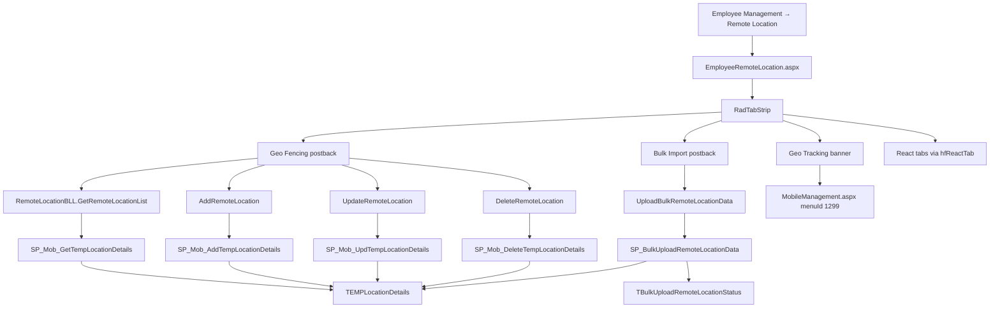
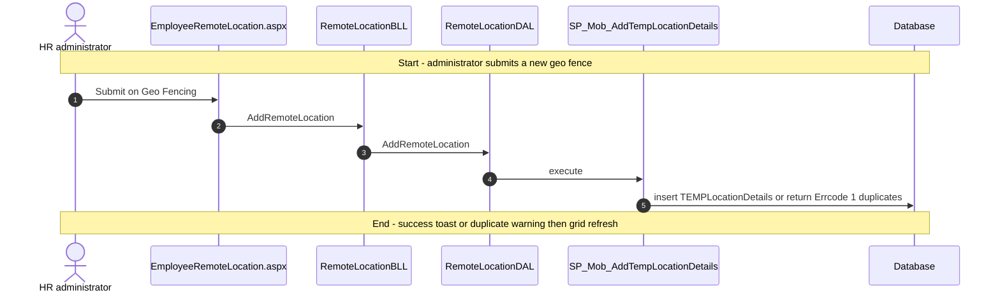
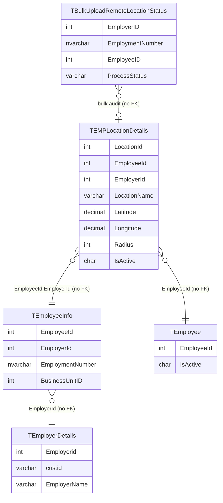

# Remote Location

## Overview

An HR administrator maintains employee geo-fence locations used by mobile attendance. They open **Employee Management → Remote Location** (`~/HRM/Employee/EmployeeRemoteLocation.aspx`). The host is a WebForms tab strip: **Geo Fencing** (create / edit / delete / filter / export), **Bulk Import Location Details** (Excel upload), **Geo Tracking** (banner that points to Mobile Management), and three React-hosted tabs (**User Device Management**, **Geo Tagging Report**, **Manage Geo Tagging**) that mount the dashboard React bundle via `hfReactTab`.

The story this guide follows is the WebForms geo-fence path. On load the page binds employees, business units, master locations, and the remote-location grid through `RemoteLocationBLL.GetRemoteLocationList` → `SP_Mob_GetTempLocationDetails`. Submitting a new fence calls `SP_Mob_AddTempLocationDetails`, which either inserts into `TEMPLocationDetails` or returns duplicate employee names. Update and multi-select delete use `SP_Mob_UpdTempLocationDetails` and `SP_Mob_DeleteTempLocationDetails`. Bulk import reads an Excel template, optionally geocodes blank lat/long with Google Maps, then calls `SP_BulkUploadRemoteLocationData` with UDT `UDT_TBulkUploadRemoteLocation`.

No SystemModel-2 domain page for this screen was found in this checkout. Geo Tracking configuration on this page is a relocate banner to `MobileManagement.aspx?menuId=1299` when the user has that menu.

**Who's involved:**

- **HR administrator** — maintains geo fences and bulk-imports location rows for the selected organisation. A global-access user can switch organisation on Geo Fencing / Bulk Import / Geo Tracking tabs.
- **Employee** — does not open this screen; their mobile check-in uses the stored fence rows.
- **Mobile Management user** — owns the enhanced Geo Tracking configuration after the relocate banner.

## Workflow

## Request journey

### HR administrator — submit a new geo fence

When the button text is `Update`, the same Save click calls `UpdateRemoteLocation` → `SP_Mob_UpdTempLocationDetails` instead of insert.

## Entry points

The left-nav URL is `~/HRM/Employee/EmployeeRemoteLocation.aspx`. `Page_Load` logs activity `EmployeeRemoteLocation`, resolves the React dashboard bundle under `~/HRM/DashBoard_React/BuildJS/`, binds `MenuPage.REMOTE_LOCATION` tabs, and on first load fills employee / BU / location dropdowns and the fence grid. Optional query `selectedTab` selects an accessible tab. Organisation switch via `ucGlobalAccessEmployer` redirects back to the same page.

| UI page | Purpose |
|---|---|
| `HRM/Employee/EmployeeRemoteLocation.aspx` | Host and WebForms tabs |
| `HRM/MobileManagement/MobileManagement.aspx?menuId=1299` | Enhanced Geo Tracking target when menu access exists |
| Dashboard React root (`hfReactTab` = `USER_DEVICE_MANAGEMENT` / `GEO_TAGGING_REPORT` / `MANAGE_GEO_TAGGING`) | React tabs on the same URL |

## Code → database call chain

| Entry | Method | Stored procedure |
|---|---|---|
| Geo Fencing grid load / filter / edit load | `getRemoteLocationList` / `getRemoteLocationDetails` (`EmployeeRemoteLocation.aspx.cs:287`, `:487`) → `RemoteLocationBLL.GetRemoteLocationList` (`RemoteLocationBLL.cs:15`) → `RemoteLocationDAL.GetRemoteLocationList` (`RemoteLocationDAL.cs:20`) | `SP_Mob_GetTempLocationDetails` |
| Geo Fencing Submit | `btnSave_Click` (`EmployeeRemoteLocation.aspx.cs:356`) → `AddRemoteLocation` (`RemoteLocationBLL.cs:25`) → `RemoteLocationDAL.AddRemoteLocation` (`RemoteLocationDAL.cs:41`) | `SP_Mob_AddTempLocationDetails` |
| Geo Fencing Update | `UpdateRemoteLocation` (`EmployeeRemoteLocation.aspx.cs:409`) → `RemoteLocationBLL.UpdateRemoteLocation` (`RemoteLocationBLL.cs:40`) → `RemoteLocationDAL.UpdateRemoteLocation` (`RemoteLocationDAL.cs:68`) | `SP_Mob_UpdTempLocationDetails` |
| Geo Fencing Remove selected | `btnRemoveSelectedLocationDetails` (`EmployeeRemoteLocation.aspx.cs:419`) → `DeleteRemoteLocation` (`RemoteLocationBLL.cs:30`) → `RemoteLocationDAL.DeleteRemoteLocation` (`RemoteLocationDAL.cs:93`) | `SP_Mob_DeleteTempLocationDetails` |
| Bulk Import Upload | `btnUpload_Click` (`EmployeeRemoteLocation.aspx.cs:728`) → `UploadBulkRemoteLocationData` (`RemoteLocationBLL.cs:50`) → `RemoteLocationDAL.UploadBulkRemoteLocation` (`RemoteLocationDAL.cs:107`) | `SP_BulkUploadRemoteLocationData` |
| Employee multi-select (assign) | `bindEmployeeList` (`EmployeeRemoteLocation.aspx.cs:258`) → `EmployeeDal.GetAllActiveEmployee` (`EmployeeDAL.cs:1545`) | `SP_BGV_GetAllActiveEmployee` |
| Employee filter dropdown | `LoadEmployeeDropdown` (`EmployeeRemoteLocation.aspx.cs:265`) → `EmployeeDal.GetAllEmployeeInfoForReports` (`EmployeeDAL.cs:307`) | `SP_RPT_GETALLEMPLOYEEDETAILS` |
| Business unit filter | `LoadBusinessUnitDropdown` (`EmployeeRemoteLocation.aspx.cs:272`) → `DBHelper.GetBusinessUnitsByEmployer` (`DBHelper.cs:1678`) | `SP_AdminWM_GetBusinessUnitByEmployeeId` |
| Location name combo | `bindLocation` (`EmployeeRemoteLocation.aspx.cs:479`) → `CommonDAL.GetLocationsByEmployeeId` (`CommonDAL.cs:360`) | `SP_AdminWM_GetLocationByEmployeeId` |
| Bulk customer-number check | `validateUploadedFile` (`EmployeeRemoteLocation.aspx.cs:844`) → `LoginDal.GetCustomerNumberByEmployerId` (`LoginDAL.cs:196`) | `SP_LOG_GetCustomerNumberViaEmployerId` |
| Optional Google geocode key | `btnUpload_Click` → `DBHelper.GetCustomerSettings` (`DBHelper.cs:3427`) | `SP_GetCustomerSettings` |
| Enhanced Geo Tracking menu check | `ResolveMobileManagementGeoTrackingAccess` (`EmployeeRemoteLocation.aspx.cs:212`) → `DashboardBLL.GetMenuItems` → `DashboardDAL.GetMenuItems` (`DashboardDAL.cs:241`) | dynamic menu SP (`DASHBOARD_GET_DYNAMIC_MENU_ITEMS`) |

Constants for the Mob_* procedures live in `HRMS.Shared/HRMS.DataAccessLayer/DBConstant.cs`. Calls use Enterprise Library `GetStoredProcCommand` except bulk upload, which opens `HrmsConnectionString` and executes `SP_BulkUploadRemoteLocationData` with a structured TVP.

## API endpoints

The Geo Fencing and Bulk Import tabs are ASP.NET postbacks. They do not call `HRMS.CoreAPI`.

The React tabs on the same host set `hfReactTab` and show `#root`. Their Node/dashboard routes were not expanded in this pass.

## Stored procedures & tables involved

| Object | File | Purpose |
|---|---|---|
| `SP_Mob_GetTempLocationDetails` | `HRMS-DATABASE/HRMS/STOREPROCEDURE/SP_Mob_GetTempLocationDetails.sql` | List / load geo fences scoped by employer, location, employees, BU, and login BU access |
| `SP_Mob_AddTempLocationDetails` | `HRMS-DATABASE/HRMS/STOREPROCEDURE/SP_Mob_AddTempLocationDetails.sql` | Insert fence rows per employee, or return duplicates |
| `SP_Mob_UpdTempLocationDetails` | `HRMS-DATABASE/HRMS/STOREPROCEDURE/SP_Mob_UpdTempLocationDetails.sql` | Update one fence by `LocationId` |
| `SP_Mob_DeleteTempLocationDetails` | `HRMS-DATABASE/HRMS/STOREPROCEDURE/SP_Mob_DeleteTempLocationDetails.sql` | Delete fences by comma-separated ids |
| `SP_BulkUploadRemoteLocationData` | `HRMS-DATABASE/HRMS/STOREPROCEDURE/SP_BulkUploadRemoteLocationData.sql` | Validate TVP rows, write status, insert new fences |
| `TEMPLocationDetails` | `HRMS-DATABASE/HRMS/TABLES/TEMPLocationDetails.sql` | Geo-fence storage |
| `TBulkUploadRemoteLocationStatus` | `HRMS-DATABASE/HRMS/TABLES/TBulkUploadRemoteLocationStatus.sql` | Bulk process audit rows |
| `UDT_TBulkUploadRemoteLocation` | `HRMS-DATABASE/HRMS/UDT/UDT_TBulkUploadRemoteLocation.sql` | Bulk upload table type |
| `Sp_OpenEncryptionKeys` / `SP_CloseEncryptionKey` | existing Backstage pages | Nested around encrypted name reads on get / duplicate add |
| `FN_LocationBU_GetEmployeeDetails` / `Fn_GetEmployeeName` / `Split` / `Fn_DecryptData` | existing Backstage pages | Nested helpers on get / add |

## Table relationships

No foreign keys were declared in the `TEMPLocationDetails` create script. Joins are by `EmployeeId`, `EmployerId`, and lat/long duplicate checks.

## Known gaps

- User Device Management, Geo Tagging Report, and Manage Geo Tagging only set `hfReactTab` and show the React root. Their dashboard routes and procedures were not traced.
- Legacy Geo Tracking WebForms save/list code is commented out; the tab is a relocate banner. Mobile Management Geo Tracking needs its own guide.
- Supporting lookup procedures (`SP_BGV_GetAllActiveEmployee`, `SP_RPT_GETALLEMPLOYEEDETAILS`, `SP_AdminWM_GetBusinessUnitByEmployeeId`, `SP_AdminWM_GetLocationByEmployeeId`, `SP_LOG_GetCustomerNumberViaEmployerId`, `SP_GetCustomerSettings`, dashboard menu SP) are named in the call chain but not given new database pages in this pass.
- ShapeMode / VerticesJson exist on add/update SQL and get results; the WebForms form does not send polygon vertices (defaults to circle).
- No SystemModel-2 domain page for Remote Location was found.

## Reference

Confidence is medium because the WebForms geo-fence and bulk paths and the five direct Mob/Bulk procedure bodies were read. React-tab APIs and Mobile Management Geo Tracking were not.

### SourceCode

- `HRMS.Web/HRMS.Web/HRM/Employee/EmployeeRemoteLocation.aspx`
- `HRMS.Web/HRMS.Web/HRM/Employee/EmployeeRemoteLocation.aspx.cs`
- `HRMS.Shared/HRMS.BusinessLayer/RemoteLocation/RemoteLocationBLL.cs`
- `HRMS.Shared/HRMS.DataAccessLayer/RemoteLocation/RemoteLocationDAL.cs`
- `HRMS.Shared/HRMS.DataAccessLayer/DBConstant.cs`
- `HRMS.Shared/HRMS.DataContract/RemoteLocation/RemoteLocation.cs`
- `HRMS.Shared/HRMS.DataAccessLayer/Employee/EmployeeDAL.cs`
- `HRMS.Shared/HRMS.DataAccessLayer/CommonDAL.cs`
- `HRMS.Shared/HRMS.DataAccessLayer/DBHelper.cs`
- `HRMS.Shared/HRMS.DataAccessLayer/Login/LoginDAL.cs`
- `HRMS.Shared/HRMS.DataAccessLayer/DashboardDAL.cs`

### TDG HRMS DB

- `HRMS-DATABASE/HRMS/STOREPROCEDURE/SP_Mob_GetTempLocationDetails.sql`
- `HRMS-DATABASE/HRMS/STOREPROCEDURE/SP_Mob_AddTempLocationDetails.sql`
- `HRMS-DATABASE/HRMS/STOREPROCEDURE/SP_Mob_UpdTempLocationDetails.sql`
- `HRMS-DATABASE/HRMS/STOREPROCEDURE/SP_Mob_DeleteTempLocationDetails.sql`
- `HRMS-DATABASE/HRMS/STOREPROCEDURE/SP_BulkUploadRemoteLocationData.sql`
- `HRMS-DATABASE/HRMS/TABLES/TEMPLocationDetails.sql`
- `HRMS-DATABASE/HRMS/TABLES/TBulkUploadRemoteLocationStatus.sql`
- `HRMS-DATABASE/HRMS/UDT/UDT_TBulkUploadRemoteLocation.sql`
