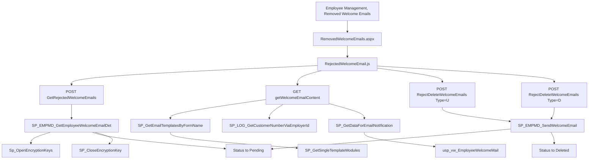
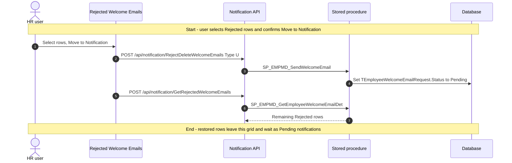
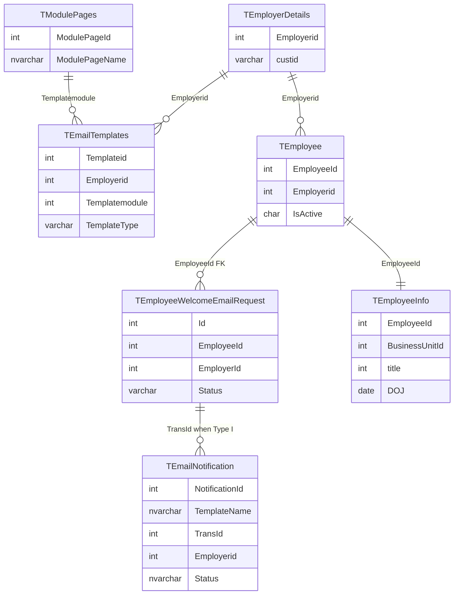

# Removed Welcome Emails

## Overview

An HR user needs to clear or restore welcome-email requests that were earlier rejected from the home-page notification queue. They open **Employee Management → Removed Welcome Emails** (`~/HRM/PreOnBoarding/RemovedWelcomeEmails.aspx`). The WebForms host only stamps session fields into hidden inputs, logs activity `RemovedWelcomeEmails` (361), and loads the pre-onboarding React bundle. The React screen `RejectedWelcomeEmail.js` lists rows whose `TEmployeeWelcomeEmailRequest.Status` is `Rejected`, lets the user preview the HTML welcome-mail body, move selected rows back to `Pending` (so they reappear in notifications), or soft-delete them to `Deleted`.

List and mutate calls go through Core Node `/api/notification`. Preview uses the .NET Web API `GET api/dashboard/getWelcomeEmailContent/{employerId}/{transId}`, which loads the `EmployeeWelcomeMail` email template and fills placeholders from the welcome-mail request id. There is no SystemModel-2 page for this screen. Table blurbs for `TEmployeeWelcomeEmailRequest` and `TEmailNotification` are in `content/llm-wiki/reference/tables/hrms.md`.

**Who's involved:**

- **HR administrator / employee-management user** — opens the left-nav page, previews, restores to notifications, or deletes rejected welcome-email rows.
- **Home-page / notification senders** — do not open this screen. They create and reject welcome-email requests elsewhere; this screen only works on `Status = Rejected`.
- **New joiner** — never opens this page. They are the employee named on each request row.

## Workflow

## Request journey

### HR user — move rejected welcome emails back to notifications

Delete uses the same mutate endpoint with `Type` `D` (status `Deleted`). Preview is a separate .NET GET that does not change status.

## Entry points

`RemovedWelcomeEmails.aspx` is a host. It stamps session user values into hidden fields, loads `BuildJS/preonboarding.min.js`, and leaves `div#root`. `setupUser.js` loads customer web config, then `Areas/routes.js` matches `/HRM/PreOnBoarding/RemovedWelcomeEmails.aspx` and renders `RejectedWelcomeEmail.js`. Code-behind only logs activity and fills the hidden fields; it does not post back business data.

| UI page | Purpose |
|---|---|
| `HRM/PreOnBoarding/RemovedWelcomeEmails.aspx` | Host for the React screen |
| `Areas/Candidate/Components/RejectedWelcomeEmail.js` | Rejected-welcome-email grid, preview modal, restore / delete |
| `Areas/routes.js` | Routes the ASPX path to `RejectedWelcomeEmail` |

## Code → database call chain

Live URL constants in `apiURLConstants.js` are the unversioned `/notification/...` paths (the `/V2/notification/...` block is commented out). `routeIndex.js` mounts those on `/api/notification` via `NotificationRoutes.js` and `NotificationController.js` (body `EmployeeId`, not JWT `EID`). Preview uses `APIHelper.getNetApi` against the .NET Web API.

| Entry | Method | Stored procedure |
|---|---|---|
| Customer web config (shell) | `getEmployerWebConfig` (`setupUser.js:43`) → `GetEmployerWebConfig` → `preOnBoardingDAL.js:107` | `SP_GetCustomerSettings` |
| Load rejected grid | `getAllRejectedEmails` (`RejectedWelcomeEmail.js:59`) → `GetRejectedWelcomeEmails` (`NotificationController.js:201`) → `NotificationDAL.js:348` | `SP_EMPMD_GetEmployeeWelcomeEmailDet` |
| Restore to notifications | `updateWelcomeEmail('Revert')` (`RejectedWelcomeEmail.js:86`) → `RejectDeleteWelcomeEmails` (`NotificationController.js:210`) → `NotificationDAL.js:361` with `Type` `U` | `SP_EMPMD_SendWelcomeEmail` |
| Soft-delete | `updateWelcomeEmail('Delete')` (`RejectedWelcomeEmail.js:115`) → same mutate path with `Type` `D` | `SP_EMPMD_SendWelcomeEmail` |
| Preview body | `handleClick` (`RejectedWelcomeEmail.js:52`) → `WelcomeEmail` (`DashboardController.cs:75`) → `DBHelper.GetHtmlTemplateByPage` (`DBHelper.cs:2400`) | `SP_GetEmailTemplatesByFormName` |
| Preview customer folder | `ReplaceEmailTemplatePlaceHolder` (`DashboardController.cs:1111`) → `LoginDal.GetCustomerNumberByEmployerId` | `SP_LOG_GetCustomerNumberViaEmployerId` |
| Preview placeholders | `FormatEmailBodyWithDynamicContent` (`DashboardController.cs:1152`) → `EmailHelper.GetEmailBodyFieldValues` (`EmailHelper.cs:306`) | `SP_GetDataForEmailNotIfication` (then `usp_vw_EmployeeWelcomeMail` when `@RequestType` is `EmployeeWelcomeMail`) |

`SP_EMPMD_GetEmployeeWelcomeEmailDet` opens encryption keys, selects active employees in the caller's employer scope with `Status = @NotificationType` (`Rejected` from this UI), and closes keys. `SP_EMPMD_SendWelcomeEmail` with `Type` `I` (send / queue `TEmailNotification`) is used by other callers; this screen only posts `U` and `D`.

## API endpoints

This screen does not post back the WebForms form for welcome-email data. List and mutate use Core Node notification routes. Preview uses the .NET dashboard route.

| Verb | Route | Parameters | Purpose | Source |
|---|---|---|---|---|
| POST | `/api/notification/GetRejectedWelcomeEmails` | body `EmployeeId` (int, required), `NotificationType` (string, required; UI sends `Rejected`) | Rejected welcome-email grid | `NotificationRoutes.js:27`, `NotificationController.js:201` |
| POST | `/api/notification/RejectDeleteWelcomeEmails` | body `Id`, `EmployeeId`, `EmailSentBy`, `EmployerId`, `Type` (`U` restore / `D` delete) | Status update per selected row | `NotificationRoutes.js:28`, `NotificationController.js:210` |
| GET | `/api/dashboard/getWelcomeEmailContent/{employerId}/{transId}` | route `employerId`, `transId` (welcome-request `Id`) | HTML preview of welcome email | `DashboardController.cs:74` |

V2/V3 notification routes and DALs also exist (`NotificationRoutes_V2.js`, `NotificationDAL_V2.js`) and pass JWT `EID`. This React constant set resolves to the unversioned `/notification` routes above. Both require `Authorize`.

## Stored procedures & tables involved

Direct procedures this page executes, plus one nested level. Pages are under `/docs/database/hrms/`.

| Object | File | Purpose |
|---|---|---|
| `SP_EMPMD_GetEmployeeWelcomeEmailDet` | `HRMS-DATABASE/HRMS/STOREPROCEDURE/SP_EMPMD_GetEmployeeWelcomeEmailDet.sql` | Lists welcome-email requests for the caller's employer scope filtered by status. [SP_EMPMD_GetEmployeeWelcomeEmailDet](/docs/database/hrms/SP_EMPMD_GetEmployeeWelcomeEmailDet) |
| `SP_EMPMD_SendWelcomeEmail` | `HRMS-DATABASE/HRMS/STOREPROCEDURE/SP_EMPMD_SendWelcomeEmail.sql` | Sets status (`I`/`R`/`D`/`U`); `I` also queues `TEmailNotification`. [SP_EMPMD_SendWelcomeEmail](/docs/database/hrms/SP_EMPMD_SendWelcomeEmail) |
| `SP_GetEmailTemplatesByFormName` | `HRMS-DATABASE/HRMS/STOREPROCEDURE/SP_GetEmailTemplatesByFormName.sql` | Loads `EmployeeWelcomeMail` template metadata for preview. [SP_GetEmailTemplatesByFormName](/docs/database/hrms/SP_GetEmailTemplatesByFormName) |
| `SP_GetSingleTemplateModules` | `HRMS-DATABASE/HRMS/STOREPROCEDURE/SP_GetSingleTemplateModules.sql` | Nested module-page ids (includes `EmployeeWelcomeMail`) used when matching templates without a workflow id. [SP_GetSingleTemplateModules](/docs/database/hrms/SP_GetSingleTemplateModules) |
| `SP_LOG_GetCustomerNumberViaEmployerId` | `HRMS-DATABASE/HRMS/STOREPROCEDURE/SP_LOG_GetCustomerNumberViaEmployerId.sql` | Customer id for per-customer HTML template folder. [SP_LOG_GetCustomerNumberViaEmployerId](/docs/database/hrms/SP_LOG_GetCustomerNumberViaEmployerId) |
| `SP_GetDataForEmailNotIfication` | `HRMS-DATABASE/HRMS/STOREPROCEDURE/SP_GetDataForEmailNotIfication.sql` | Dispatcher for email placeholder datasets; welcome preview uses `EmployeeWelcomeMail`. [SP_GetDataForEmailNotIfication](/docs/database/hrms/SP_GetDataForEmailNotIfication) |
| `usp_vw_EmployeeWelcomeMail` | `HRMS-DATABASE/HRMS/STOREPROCEDURE/usp_vw_EmployeeWelcomeMail.sql` | Nested placeholder row for one welcome-email request id. [usp_vw_EmployeeWelcomeMail](/docs/database/hrms/usp_vw_EmployeeWelcomeMail) |
| `Sp_OpenEncryptionKeys` | `HRMS-DATABASE/HRMS/STOREPROCEDURE/Sp_OpenEncryptionKeys.sql` | Nested open-key step in list and email-data procedures. [Sp_OpenEncryptionKeys](/docs/database/hrms/Sp_OpenEncryptionKeys) |
| `SP_CloseEncryptionKey` | `HRMS-DATABASE/HRMS/STOREPROCEDURE/SP_CloseEncryptionKey.sql` | Nested close-key step. [SP_CloseEncryptionKey](/docs/database/hrms/SP_CloseEncryptionKey) |
| `Fn_GetEmployeeName` | `HRMS-DATABASE/HRMS/FUNCTIONS/Fn_GetEmployeeName.sql` | Nested display-name function on list and welcome-mail view. [Fn_GetEmployeeName](/docs/database/hrms/Fn_GetEmployeeName) |
| `SP_GetCustomerSettings` | `HRMS-DATABASE/HRMS/STOREPROCEDURE/SP_GetCustomerSettings.sql` | Shell customer web config only. [SP_GetCustomerSettings](/docs/database/hrms/SP_GetCustomerSettings) |

Tables those scripts touch for this screen: `TEmployeeWelcomeEmailRequest`, `TEmployee`, `TEmployeeInfo`, `TUsers`, `TUserEmployee`, `TOrgHierarchyDetails`, `TTitle`, `TEducationDetails`, `TQualificationName`, `TEmailTemplates`, `TModulePages`, `TEmailNotification` (only on `Type` `I`, not this UI), `TEmployerDetails`, plus placeholder sources read by `usp_vw_EmployeeWelcomeMail` (`TEmpWelcomeMail`, `TPastEmploymentDetails`, and related). Catalog blurbs for `TEmployeeWelcomeEmailRequest` and `TEmailNotification` are in `content/llm-wiki/reference/tables/hrms.md`.

## Table relationships

`TEmployeeWelcomeEmailRequest` declares an FK to `TEmployee`. List joins add employment profile and org display fields. Preview template resolution joins `TEmailTemplates` to `TModulePages` by module page name `EmployeeWelcomeMail`. Mutate with `Type` `I` (other screens) inserts `TEmailNotification` with `TemplateName` `EmployeeWelcomeMail` and `TransId` = request id.

## Known gaps

- `updateWelcomeEmail` filters selected rows with `row.row_selected === true`, while checkbox handling only pushes row objects into `selectedRow`. If the grid never sets `row_selected`, Move / Delete can toast success with no DAL calls.
- Restore and delete fire one POST per selected id without awaiting a batch; the success toast runs immediately after starting the loop.
- This UI never posts `Type` `I` or `R`. Send / reject-from-notifications live on other screens that call the same mutate procedure.
- Preview warns that HTML is for testing only; placeholder fill depends on file-system templates under the customer folder plus `SP_GetDataForEmailNotIfication`.
- `SP_GetDataForEmailNotIfication` is a large multi-module dispatcher; only the `EmployeeWelcomeMail` branch is on this page's path.
- Live constants use unversioned `/notification` (V1 controller/DAL). V2/V3 routes exist but are not selected by the active `apiURLConstants` export.
- No SystemModel-2 document names this left-nav item.
- `usp_vw_EmployeeWelcomeMail.sql` still contains a `USE [HRM-CL-Prod]` header in the inventoried script; Liquibase deploy context should not rely on that database name.

## Reference

Confidence is high for the React → Node list/mutate path and the .NET preview template lookup; medium for checkbox selection behaviour and the full placeholder-fill surface inside `SP_GetDataForEmailNotIfication`.

### SourceCode

- `HRMS.Web/HRMS.Web/HRM/PreOnBoarding/RemovedWelcomeEmails.aspx`
- `HRMS.Web/HRMS.Web/HRM/PreOnBoarding/RemovedWelcomeEmails.aspx.cs`
- `HRMS.Web/HRMS.Web/HRM/PreOnBoarding/Areas/Candidate/Components/RejectedWelcomeEmail.js`
- `HRMS.Web/HRMS.Web/HRM/PreOnBoarding/Areas/routes.js`
- `HRMS.Web/HRMS.Web/HRM/PreOnBoarding/Common/apiURLConstants.js`
- `HRMS.Web/HRMS.Web/HRM/PreOnBoarding/Common/apiHelper.js`
- `HRMS.CoreAPI/HRMS.Core.WebAPI.Node/Routes/NotificationRoutes.js`
- `HRMS.CoreAPI/HRMS.Core.WebAPI.Node/Controllers/NotificationController.js`
- `HRMS.CoreAPI/HRMS.Core.WebAPI.Node/Core/DataAccessLayer/NotificationDAL.js`
- `HRMS.Shared/HRMS.WebAPI/Controllers/DashboardController.cs`
- `HRMS.Shared/HRMS.DataAccessLayer/DBHelper.cs`
- `HRMS.Shared/HRMS.DataAccessLayer/EmailHelper.cs`
- `HRMS.Shared/HRMS.DataAccessLayer/Login/LoginDAL.cs`

### TDG HRMS DB

- `HRMS-DATABASE/HRMS/STOREPROCEDURE/SP_EMPMD_GetEmployeeWelcomeEmailDet.sql`
- `HRMS-DATABASE/HRMS/STOREPROCEDURE/SP_EMPMD_SendWelcomeEmail.sql`
- `HRMS-DATABASE/HRMS/STOREPROCEDURE/SP_GetEmailTemplatesByFormName.sql`
- `HRMS-DATABASE/HRMS/STOREPROCEDURE/SP_GetSingleTemplateModules.sql`
- `HRMS-DATABASE/HRMS/STOREPROCEDURE/SP_LOG_GetCustomerNumberViaEmployerId.sql`
- `HRMS-DATABASE/HRMS/STOREPROCEDURE/SP_GetDataForEmailNotIfication.sql`
- `HRMS-DATABASE/HRMS/STOREPROCEDURE/usp_vw_EmployeeWelcomeMail.sql`
- `HRMS-DATABASE/HRMS/TABLES/TEmployeeWelcomeEmailRequest.sql`
- `content/llm-wiki/reference/tables/hrms.md` (`TEmployeeWelcomeEmailRequest`, `TEmailNotification`, `TEmailTemplates`, `TModulePages`)
