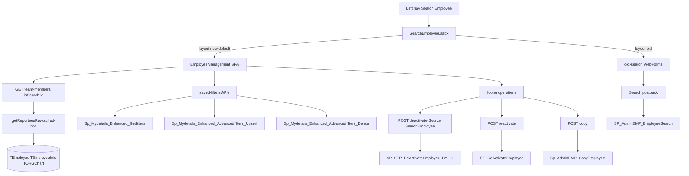
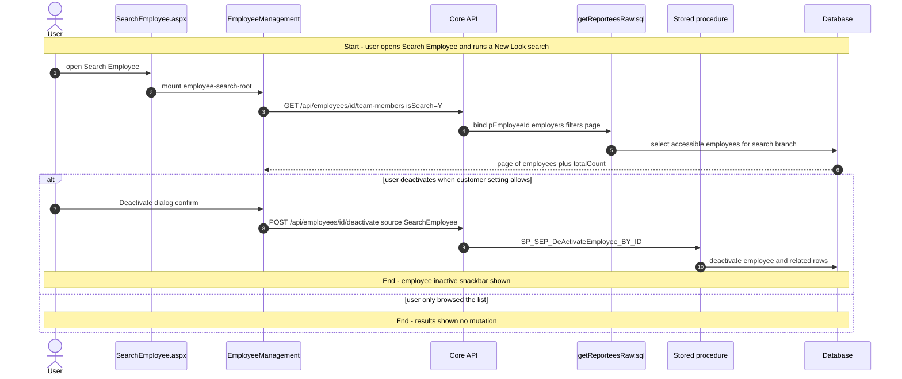
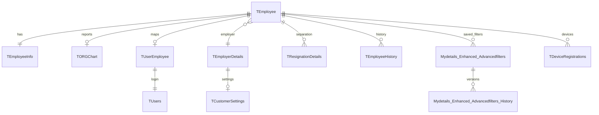

# Search Employee

## Overview

HR and managers open **Employee Management → Search Employee** (`~/HRM/Employee/SearchEmployee.aspx`) to find people across organisations they can access, then act on a selection (open My Details, apply leave, copy, deactivate/reactivate, toggle birthday/anniversary notifications).

Default UI is **New Look** (`localStorage` key `employee-search-layout`, default `new`). The ASPX mounts the Vite `EmployeeManagement` SPA into `#employee-search-root`. That SPA lists people through Core API `GET /api/employees/{id}/team-members` with `isSearch=Y`, which runs the ad-hoc batch `getReporteesRaw.sql` (inlined from `Sp_CM_Mydetails_DirectIndirectReports` + `Sp_CM_Revamp_SearchEmployee`) — not a live `EXEC` of those procedure names. Select-all / badge counts use `getReporteesIdsRaw.sql`. Saved advanced filters use the `Sp_Mydetails_Enhanced_*` filter procedures. Mutating footer actions call Operation APIs (`deactivate`, `deactivate-with-assets`, `reactivate`, `copy`, birthday/anniversary toggle).

Switching layout to classic shows `#old-search` (Telerik filters + grid). That path posts back to `SearchEmployee.aspx.cs` and searches with `SP_AdminEMP_EmployeeSearch` via `EmployeeDal.EmployeeSearch`. Optional search-purpose logging writes `SP_AdminMstr_InsEmpSearchPurposeDetails`. Classic deactivate still goes through `ResignationBLL` / separation DAL rather than the Node Operation APIs.

**Who's involved:**

- **HR / admin** — primary operators of Search Employee; may deactivate when `IsAllowDeactivationFromSearchEmployee` allows.
- **Manager** — searches reportees / accessible orgs depending on access mapping.
- **Employee (subject)** — selected row; Update Employee redirects into My Details with `from=SearchEmployee`.

## Workflow

## Request journey

Classic search (when layout is `old`) is a WebForms postback to the same ASPX; `getEmployeeSearchData` → `EmployeeDal.EmployeeSearch` → `SP_AdminEMP_EmployeeSearch`. That path does not use the team-members API.

## Entry points

| UI page / route | Purpose |
|---|---|
| `/HRM/Employee/SearchEmployee.aspx` | Left-nav **Search Employee**. Hosts `#employee-search-root` (New Look) and `#old-search` (classic). |
| `/HRM/EmployeeManagement/BuildJs/` | Built SPA assets loaded by the ASPX when New Look is active. |
| Vite standalone `:8001` | Local `EmployeeManagement` without ASPX host (dev only). |

Adjacent redirects from footer operations: My Details (`PersonalInformation.aspx?from=SearchEmployee`), Apply Leave (`AttendanceLeave.aspx`). Admin flag `IsAllowDeactivationFromSearchEmployee` lives on customer settings, not on this menu item.

## Code → database call chain

New Look list/count/ids do **not** `EXEC` `Sp_CM_Mydetails_DirectIndirectReports` / `Sp_CM_Revamp_SearchEmployee`; logic was migrated into ORM SQL files. Classic search still uses `SP_AdminEMP_EmployeeSearch`.

| Entry point | DAL / BLL / service (`file:line`) | Stored procedure / SQL |
|---|---|---|
| New Look list (`useTeamMembers`, `isSearch: "Y"`) | `getReporteesRaw` (`ORM/Data/getReporteesRaw.js:96`) via TeamMembers `Service.js` | ad-hoc `getReporteesRaw.sql` (inlined search SPs) |
| New Look select-all / status badge counts | `getReporteesIdsRaw` (`ORM/Data/getReporteesIdsRaw.js:55`) | ad-hoc `getReporteesIdsRaw.sql` |
| Saved filters GET | `getTeamMemberSavedFilters` (`ORM/Data/teamMemberSavedFilters.js:10`) | `Sp_Mydetails_Enhanced_Getfilters` |
| Saved filters create/update | `createTeamMemberSavedFilter` / `updateTeamMemberSavedFilter` (`teamMemberSavedFilters.js:137` / `:186`) | `Sp_Mydetails_Enhanced_Advancedfilters_Upsert` |
| Saved filters delete | `deleteTeamMemberSavedFilter` (`teamMemberSavedFilters.js:231`) | `Sp_Mydetails_Enhanced_Advancedfilters_Delete` |
| Deactivate | `deactivateEmployee` (`ORM/Data/deactivateEmployee.js:48`) | `SP_SEP_DeActivateEmployee_BY_ID` (`@Source='SearchEmployee'`) |
| Deactivate with assets follow-up | `deactivateEmployeeWithAssets` (`ORM/Data/deactivateEmployeeWithAssets.js`) | `SP_SEP_DeActivateEmployeeWithAssets` (after BY_ID) |
| Reactivate | `reactivateEmployee` (`ORM/Data/reactivateEmployee.js:70`) | `SP_ReActivateEmployee` |
| Copy employee | `copyEmployee` (`ORM/Data/copyEmployee.js:14`) | `Sp_AdminEMP_CopyEmployee` |
| Birthday / anniversary toggle | `toggleBirthdayAnniversaryNotification` (`ORM/Data/toggleBirthdayAnniversaryNotification.js`) | `SP_AdminEMP_DisBDayAnnivrNotification` |
| Classic Search click | `EmployeeDal.EmployeeSearch` (`EmployeeDAL.cs:1299`) from `getEmployeeSearchData` (`SearchEmployee.aspx.cs:818`) | `SP_AdminEMP_EmployeeSearch` |
| Classic search-purpose log | `SetupMasterDAL.InsertEmployeeSearchPurposeDetails` (`SetupMasterDAL.cs:1320`) | `SP_AdminMstr_InsEmpSearchPurposeDetails` |
| Classic root email check (copy-related) | `EmployeeDal.EmployeeSearchRoot` (`EmployeeDAL.cs:2233`) | `SP_AdminEMP_RootEmployerEmployeeSearch` |

## API endpoints

New Look talks to Core API (not ASPX postbacks) for list and mutations:

| Method | Path | Role |
|---|---|---|
| GET | `/api/employees/{employeeId}/team-members` | Paged search list (`isSearch=Y`) |
| GET | `/api/employees/{employeeId}/team-members/ids` | Matching ids / select-all |
| GET | `/api/employees/{employeeId}/team-members/count` | Count helper |
| GET/POST | `/api/employees/{employeeId}/team-members/saved-filters` | List / create saved filters |
| PUT/DELETE | `/api/employees/{employeeId}/team-members/saved-filters/{filterId}` | Update / delete |
| POST | `/api/employees/{employeeId}/deactivate` | Deactivate (`source: SearchEmployee`) |
| POST | `/api/employees/{employeeId}/deactivate-with-assets` | Follow-up when assets block |
| POST | `/api/employees/{employeeId}/reactivate` | Reactivate |
| POST | `/api/employees/{employeeId}/copy` | Copy employee |
| GET | `/api/employees/{employeeId}/copy-eligibility` | Preflight before copy |

Classic `#old-search` uses **WebForms postbacks** on `SearchEmployee.aspx` (RadAjaxPanel) — no REST for the grid search itself.

## Stored procedures & tables involved

| Object | Role |
|---|---|
| `getReporteesRaw.sql` / `getReporteesIdsRaw.sql` | New Look search membership and paging (ad-hoc) |
| `Sp_Mydetails_Enhanced_Getfilters` | Load private + public saved filters |
| `Sp_Mydetails_Enhanced_Advancedfilters_Upsert` | Add/update saved filter |
| `Sp_Mydetails_Enhanced_Advancedfilters_Delete` | Soft-delete saved filter |
| `SP_SEP_DeActivateEmployee_BY_ID` | Deactivate from Search (skips checklist when `@Source=SearchEmployee`) |
| `SP_SEP_GetDeactivationChecklist` | Nested checklist when `@Source` is not Search Employee |
| `USP_ProcessEmployeeLeaveSeparationAdjustment` | Nested leave pro-rata on deactivate |
| `SP_DeviceRegistrations_DeleteByEmployee` | Nested device cleanup on deactivate |
| `SP_SEP_DeActivateEmployeeWithAssets` | Asset-aware deactivate follow-up |
| `SP_ReActivateEmployee` | Reactivate inactive employee |
| `Sp_AdminEMP_CopyEmployee` | Clone employee + satellite rows |
| `SP_AdminEMP_DisBDayAnnivrNotification` | Toggle ShowBirthday / ShowAnniversary |
| `SP_AdminEMP_EmployeeSearch` | Classic grid search |
| `SP_AdminMstr_InsEmpSearchPurposeDetails` | Classic search-purpose audit rows |
| `SP_AdminEMP_RootEmployerEmployeeSearch` | Classic root-org email lookup |

Primary tables: `TEmployee`, `TEmployeeInfo`, `TORGChart`, `TUsers` / `TUserEmployee`, `Mydetails_Enhanced_Advancedfilters` (+ history), `TCustomerSettings`, `TResignationDetails`, `TEmployeeHistory` / `TEmployeeInfoHistory`, `TDeviceRegistrations`.

## Table relationships

## Known gaps

- New Look list/count path has **no live stored-procedure page** for the search itself — only ad-hoc SQL derived from `Sp_CM_Mydetails_DirectIndirectReports` / `Sp_CM_Revamp_SearchEmployee`. Those procedure scripts still exist in Liquibase but are not what Search Employee executes today.
- Classic lookup combo fills (`CommonDAL.GetTitleList`, skills, visa types, org XML) and classic `ResignationBLL.DeActivateEmployee` separation stack are not fully traced to individual SP pages here.
- `Sp_AdminEMP_CopyEmployee` nests many `SP_BulkUpdateProfile_InsertEmployee*History` helpers; those nested pages were not written in this pass.
- Encryption open/close helpers (`Sp_OpenEncryptionKeys*`) are treated as infrastructure, not feature SPs.
- No SystemModel-2 workflow page was found for Search Employee in the SourceCode tree searched for this guide.

## Reference

- Host page: `HRMS.Web/HRM/Employee/SearchEmployee.aspx` (+ `.aspx.cs`)
- New Look SPA: `HRMS.Web/HRM/EmployeeManagement/src/features/employee-search/`
- Team members API: `HRMS.Core.WebAPI.Node/Features/Employee/MyDetails/TeamMembers/`
- Operations API: `HRMS.Core.WebAPI.Node/Features/Employee/Operation/`
- ORM: `getReporteesRaw.js`, `getReporteesIdsRaw.js`, `teamMemberSavedFilters.js`, `deactivateEmployee.js`, `reactivateEmployee.js`, `copyEmployee.js`
- Classic DAL: `HRMS.DataAccessLayer/Employee/EmployeeDAL.cs` (`EmployeeSearch`, `EmployeeSearchRoot`)
- Database docs: `/docs/database/hrms/SP_AdminEMP_EmployeeSearch`, `/docs/database/hrms/SP_SEP_DeActivateEmployee_BY_ID`, `/docs/database/hrms/Sp_AdminEMP_CopyEmployee`, `/docs/database/hrms/Sp_Mydetails_Enhanced_Getfilters`
