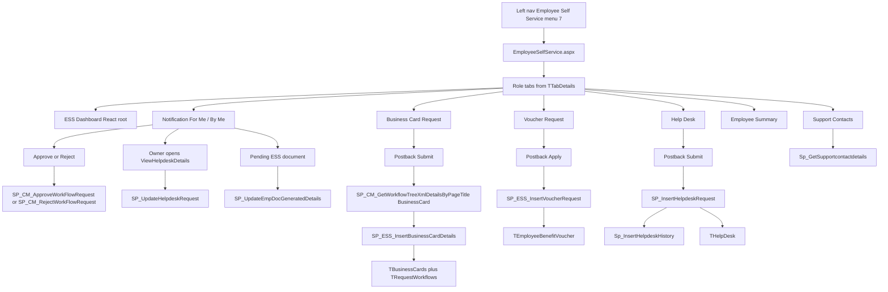
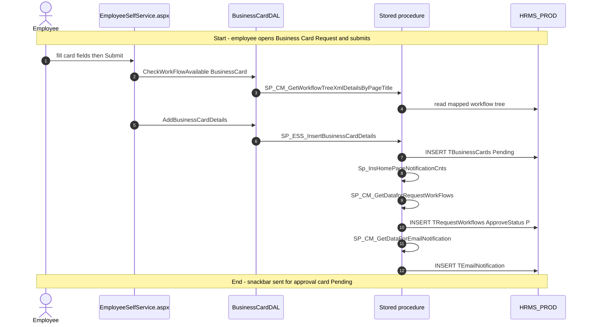
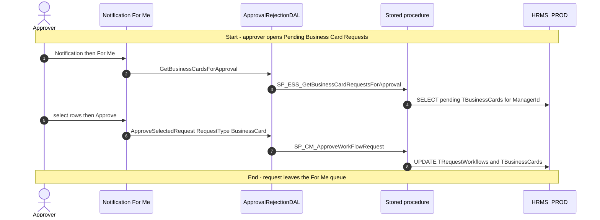
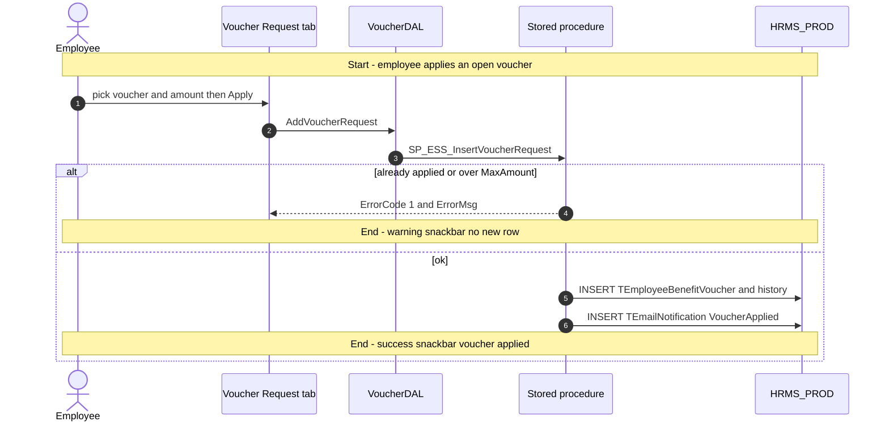
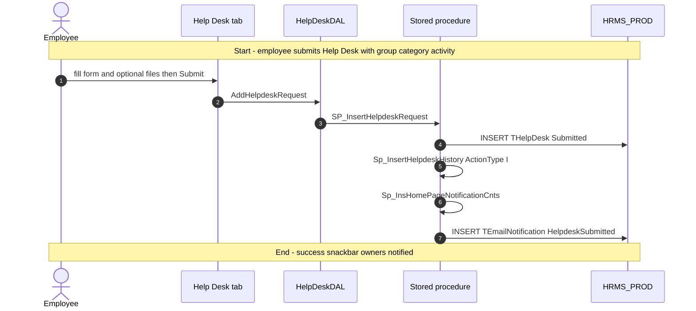
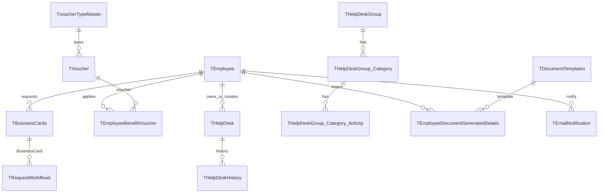

# Employee Self Service

## Overview

An employee opens the left-nav item **Employee Self Service** (menu id **7**) and lands on WebForms host `~/HRM/EmployeeSelfService/EmployeeSelfService.aspx`. Role and user tab rights from `TTabDetails` decide which of the seven RadTabs they see: **ESS Dashboard**, **Notification**, **Business Card Request**, **Voucher Request**, **Help Desk**, **Employee Summary**, and **Support Contacts**. Inactive employees keep view grids but lose submit / approve controls.

Typical work on this page:

- **Business Card Request** — employee fills card fields and submits. When a workflow is mapped for page title `BusinessCard`, the insert creates `TBusinessCards` plus `TRequestWorkflows` rows and queues email / WhatsApp. Approvers act on **Notification → For Me → Pending Business Card Requests** via the shared approve / reject engine.
- **Voucher Request** — employee picks an open voucher and amount. Apply writes `TEmployeeBenefitVoucher` (with lifetime max-amount guards). Cancel / update rewrites status and history; there is no `TRequestWorkflows` path for vouchers on this screen.
- **Help Desk** — employee picks group / category / activity, optional owners, details, and support files. Insert writes `THelpDesk`, history, home-page notification counts, and email. Owners update status from the detail popup (`ViewHelpdeskDetails.aspx`). Overdue TAT rows appear under Notification For Me.
- **Notification** — For Me / By Me panels for pending business cards, vouchers, help desk, overdue TAT, and generated documents waiting for employee accept / decline / acknowledge.
- **Support Contacts** — read-only department contact list for the employer.
- **Employee Summary** — shared `ucEmployeeSummary` when opened with `EmpSummary=true` (impersonation / summary deep link).
- **ESS Dashboard** — toggles `#root` and loads the shared `dashboard_react` bundle. React routes do **not** register `EmployeeSelfService.aspx`, so this tab is not a reliable chart surface (see Known gaps). Charts labelled “Employee Self Service” on **Management Dashboard** are a different host.

Admin setup for voucher masters, letter templates, help-desk group trees, and support-contact masters lives under **Admin Configuration → Setup Employee Self Service** (`SetupEmployeeSelfService.aspx`) — documented separately; not this menu.

**Who's involved:**

- **Employee** — submits business card, voucher, and help-desk requests; accepts or declines ESS letters; reads support contacts.
- **Manager / workflow approver** — approves or rejects business-card requests on Notification For Me.
- **Help-desk activity owner** — updates help-desk status and comments from the detail popup.
- **HR / admin** — configures masters and workflows on Setup Employee Self Service; may open ESS with `EmpSummary` for another employee.

There is no dedicated `llm-wiki/domain` lifecycle page for ESS. Shared workflow behaviour is in `llm-wiki/domain/approval-workflow.md`. Table one-liners live in `llm-wiki/reference/tables/hrms.md`.

## Workflow

## Request journey

The employee-started journeys that create work for someone else are **Business Card submit** (workflow approver) and **Help Desk submit** (activity owner). Voucher apply notifies admins via email templates without a workflow queue. Document accept / decline is employee-only.

### Employee — submit a business card for approval

### Approver — approve a pending business card

### Employee — apply a voucher

### Employee — submit a help-desk request

## Entry points

| Entry | How |
|---|---|
| Left nav **Employee Self Service** | Menu id **7** → `~/HRM/EmployeeSelfService/EmployeeSelfService.aspx` |
| Home / bell notifications | Deep links with `NotificationId=RPI_PendingBusinesscard`, `RPI_PendingVouchers`, `RPI_PendingHelpdeskRequest`, `RPI_PendingEmployeeDocumentApproval`, `RPI_OverDueTATHelpDeskRequests` |
| Employee Summary | `?EmpSummary=true&Id=` encrypted employee id |
| Tab deep link | `?selectedTab=` tab id from `TTabDetails` |
| Voucher deep link | Encrypted `TabName` + `SelectedVoucher` query pair |
| Help-desk detail popup | `ViewHelpdeskDetails.aspx` / history / support-document viewers opened from grids |
| Admin setup (not this menu) | `~/HRM/MasterSetup/SetupEmployeeSelfService.aspx` |

## Code → database call chain

| Path | Chain |
|---|---|
| Business card submit | `ucBusinessCardRequest.ascx.cs:56` → `BusinessCardBLL.AddBusinessCardDetails` (`BusinessCardBLL.cs:16`) → `BusinessCardDAL.AddBusinessCardDetails` (`BusinessCardDAL.cs:24`) → **`SP_ESS_InsertBusinessCardDetails`** (nested `Sp_InsHomePageNotificationCnts`, `SP_CM_GetDataforRequestWorkFlows`, `SP_CM_GetDataForEmailNotification`) |
| Business card workflow check | `ucBusinessCardRequest.ascx.cs:65` → `GenericWorkFlowDal.CheckWorkFlowAvailable` (`GenericWorkFlowDAL.cs:14`) → **`SP_CM_GetWorkflowTreeXmlDetailsByPageTitle`** |
| Business card status grid | `BusinessCardDAL.GetBusinessCardDetails` (`BusinessCardDAL.cs:59`) → **`SP_ESS_GetBusinessCardDetails`** |
| Pending business cards For Me | `ucPendingBusinessCardRequestForMe.ascx.cs:136` → `BusinessCardDAL.GetBusinessCardsForApproval` (`BusinessCardDAL.cs:76`) → **`SP_ESS_GetBusinessCardRequestsForApproval`** |
| Approve / reject business card | `ucPendingBusinessCardRequestForMe.ascx.cs:120` → `CommonBLL.ApproveSelectedRequest` / `RejectSelectedRequest` (`CommonBLL.cs:87`) → `ApprovalRejectionDAL` (`ApprovalRejectionDAL.cs:22`) → **`SP_CM_ApproveWorkFlowRequest`** / **`SP_CM_RejectWorkFlowRequest`** |
| Voucher apply | `ucVoucherRequest.ascx.cs:199` → `VoucherBLL.AddVoucherRequest` (`VoucherBLL.cs:16`) → `VoucherDAL.AddVoucherRequest` (`VoucherDAL.cs:26`) → **`SP_ESS_InsertVoucherRequest`** |
| Voucher update / cancel | `VoucherDAL.UpdateVoucherRequest` (`VoucherDAL.cs:52`) → **`SP_ESS_UpdateVoucherRequest`** |
| Open vouchers / status | `VoucherDAL.GetVoucherNotification` (`VoucherDAL.cs:77`) → **`SP_ESS_GetVoucherNotification`**; `GetVoucherRequestStatus` (`VoucherDAL.cs:94`) → **`SP_ESS_GetVoucherRequestStatus`**; types via **`SP_AdminESS_GetVoucherTypes`** |
| Help desk submit | `ucHelpDeskRequest.ascx.cs:260` → `HelpDeskBLL.AddHelpdeskRequest` (`HelpDeskBLL.cs:31`) → `HelpDeskDAL.AddHelpdeskRequest` (`HelpDeskDAL.cs:56`) → **`SP_InsertHelpdeskRequest`** → nested **`Sp_InsertHelpdeskHistory`**, **`Sp_InsHomePageNotificationCnts`** |
| Help desk update | `ViewHelpdeskDetails.aspx.cs:62` → `HelpDeskDAL.UpdateHelpDeskRequest` (`HelpDeskDAL.cs:161`) → **`SP_UpdateHelpdeskRequest`** → nested **`Sp_InsertHelpdeskHistory`** |
| Help desk lists | Status **`SP_GetHRHelpDeskRequestStatus`**; For Me **`SP_GetHRHelpDeskNotification`**; overdue **`SP_GetOverDueTATHelpDeskNotification`** (`EmployeeSelfService.aspx.cs:520`); details **`SP_GetHelpdeskRequestDetails`**; history **`SP_GetEmployeeHelpdeskHistory`**; dropdowns **`SP_HelpDeskGroup`** / **`SP_HelpDeskGroup_Category`** / **`SP_HelpDeskGroup_Category_Activity`**; owner search **`SP_ESS_CrossBUEmployeeAssignmentUserDefined`** (`EmployeeDAL.cs:214`) |
| ESS document accept / decline | `EmployeeSelfService.aspx.cs:661` → `EmployeeDal.UpdateEmpDocGeneratedDetails` (`EmployeeDAL.cs:1776`) → **`SP_UpdateEmpDocGeneratedDetails`**; pending list **`SP_GetPendingGeneratedDocumentApprovalList`** (`EmployeeDAL.cs:2224`); view **`SP_GetEmpDocGeneratedDetails`** (`EmployeeDAL.cs:650`) |
| Support contacts | `EmployeeSelfService.aspx.cs:553` → `EmployeeDal.GetDepartmentAndSupportContactsList` (`EmployeeDAL.cs:1647`) → **`Sp_GetSupportcontactdetails`** |

## API endpoints

Primary ESS actions on this page are **WebForms postbacks** (RadAjaxPanel / button clicks), not Core API REST. Nested popups (`ViewHelpdeskDetails.aspx`) are also postback-driven.

Related Node routes that are **not** this page’s primary path:

| Route | Used by |
|---|---|
| `GET /dashBoard/getVoucherType` → `SP_AdminESS_GetVouchers` | Management Dashboard ESS charts |
| `GET /dashBoard/VoucherRequestStatusDistribution` → `SP_EmployeeSelfService_VoucherRequestStatus_GlobalFilter` | Management Dashboard |
| `GET /dashBoard/SurveyStatusDistribution` / `PassportHolders` | Management Dashboard charts labelled Employee Self Service |
| `/helpdesk/*` React helpdesk setup | **Setup** Employee Self Service Helpdesk tab, not this menu |

ESS Dashboard only shows `#root` and loads `dashboard_react.*.min.js`; there is no `Route` for `EmployeeSelfService.aspx` in `DashBoard_React/Areas/routes.js`.

## Stored procedures & tables involved

| Procedure | Role on this page |
|---|---|
| `SP_ESS_InsertBusinessCardDetails` | Create business-card request + workflow + email |
| `SP_ESS_GetBusinessCardDetails` | Employee’s business-card status grid |
| `SP_ESS_GetBusinessCardRequestsForApproval` | Approver For Me grid |
| `SP_CM_GetWorkflowTreeXmlDetailsByPageTitle` | Detect mapped `BusinessCard` workflow |
| `SP_CM_ApproveWorkFlowRequest` / `SP_CM_RejectWorkFlowRequest` | Approve / reject business card |
| `SP_ESS_InsertVoucherRequest` / `SP_ESS_UpdateVoucherRequest` | Apply / update / cancel voucher |
| `SP_ESS_GetVoucherNotification` / `SP_ESS_GetVoucherRequestStatus` | Open vouchers and status |
| `SP_AdminESS_GetVoucherTypes` | Voucher type list |
| `SP_InsertHelpdeskRequest` / `SP_UpdateHelpdeskRequest` | Create / update help desk |
| `Sp_InsertHelpdeskHistory` | Help-desk history rows |
| `SP_GetHRHelpDeskRequestStatus` / `SP_GetHRHelpDeskNotification` / `SP_GetOverDueTATHelpDeskNotification` | Status and notification grids |
| `SP_GetHelpdeskRequestDetails` / `SP_GetEmployeeHelpdeskHistory` | Detail popup |
| `SP_HelpDeskGroup` / `_Category` / `_Category_Activity` | Cascading dropdowns |
| `SP_ESS_CrossBUEmployeeAssignmentUserDefined` | Activity-owner employee picker |
| `SP_GetPendingGeneratedDocumentApprovalList` / `SP_GetEmpDocGeneratedDetails` / `SP_UpdateEmpDocGeneratedDetails` | ESS letter accept / decline |
| `Sp_GetSupportcontactdetails` | Support Contacts grid |
| `Sp_InsHomePageNotificationCnts` | Nested notification counters |

| Table | Role |
|---|---|
| `TBusinessCards` | Business-card requests |
| `TRequestWorkflows` | Business-card (and letter) approval rows |
| `TEmployeeBenefitVoucher` / `TEmployeeBenefitVoucherHistory` | Voucher applications |
| `TVoucher` / `TvoucherTypeMaster` / `TVoucherAmount` | Open vouchers and caps |
| `THelpDesk` / `THelpDeskHistory` | Help-desk requests and history |
| `THelpDeskGroup` / `THelpDeskGroup_Category` / `THelpDeskGroup_Category_Activity` | Help-desk tree |
| `TEmployeeDocumentGeneratedDetails` / `TDocumentTemplates` | ESS letters pending employee action |
| `TEmpSupportContact` (via support-contact SPs) | Support Contacts |
| `TEmailNotification` / `TWhatsAppNotification` | Outbound notify queues |
| `THomePageNotifications` (via `Sp_InsHomePageNotificationCnts`) | Bell / For Me counts |

## Table relationships

## Known gaps

- **ESS Dashboard tab** loads `dashboard_react` into `#root`, but `Areas/routes.js` has no route for `/HRM/EmployeeSelfService/EmployeeSelfService.aspx`, so the tab is unlikely to render Management Dashboard charts. ESS-labelled charts live on Management Dashboard APIs instead.
- **Voucher “For Me”** notification uses `SP_ESS_GetVoucherNotification` (open vouchers for the employee), not a manager approval queue — naming is historical.
- **Business-card approve** shares the giant `SP_CM_ApproveWorkFlowRequest` engine; only the `BusinessCard` branch is exercised from this page.
- Scheduler-only SPs `SP_ESS_OverDueEmailScheduler` / `SP_ESS_EmailReminder_Scheduler` are not called from the page UI.
- `docs/SystemModels/SystemModel-2/` has no ESS surface page in this checkout.
- Confidence is **medium** because ESS Dashboard React behaviour is unresolved and voucher admin credit flows sit on Setup ESS, not here.

## Reference

- `HRMS.Web/HRM/EmployeeSelfService/EmployeeSelfService.aspx` (+ `.cs`)
- `HRMS.Web/HRM/EmployeeSelfService/ucBusinessCardRequest.ascx.cs`
- `HRMS.Web/HRM/EmployeeSelfService/ucPendingBusinessCardRequestForMe.ascx.cs`
- `HRMS.Web/HRM/EmployeeSelfService/ucVoucherRequest.ascx.cs`
- `HRMS.Web/HRM/EmployeeSelfService/ucPendingVoucherRequestForMe.ascx.cs`
- `HRMS.Web/HRM/EmployeeSelfService/ucHelpDeskRequest.ascx.cs`
- `HRMS.Web/HRM/EmployeeSelfService/ViewHelpdeskDetails.aspx.cs`
- `HRMS.Shared/HRMS.DataAccessLayer/BusinessCardDAL.cs`
- `HRMS.Shared/HRMS.DataAccessLayer/EmployeeSelfService/VoucherDAL.cs`
- `HRMS.Shared/HRMS.DataAccessLayer/HelpDeskDAL.cs`
- `HRMS.Shared/HRMS.DataAccessLayer/ApprovalRejectionDAL.cs`
- `HRMS.Shared/HRMS.DataAccessLayer/Employee/EmployeeDAL.cs`
- `HRMS.Shared/HRMS.DataAccessLayer/DBConstant.cs`
- `HRMS.Web/HRM/DashBoard_React/Areas/routes.js`
- Sibling guide: [Setup Employee Self Service](/docs/guides/admin-configuration/setup-employee-self-service)
- `llm-wiki/domain/approval-workflow.md`
- `llm-wiki/reference/tables/hrms.md`
