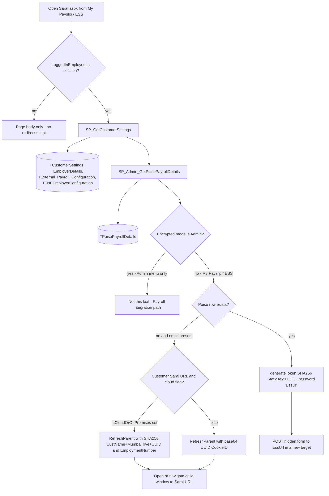
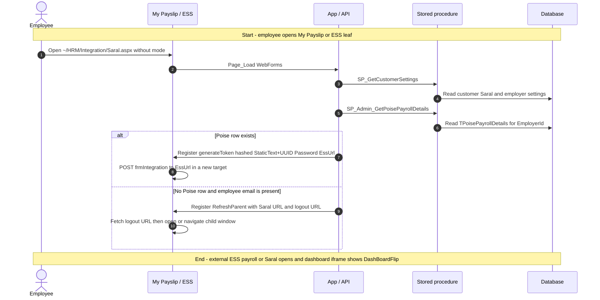
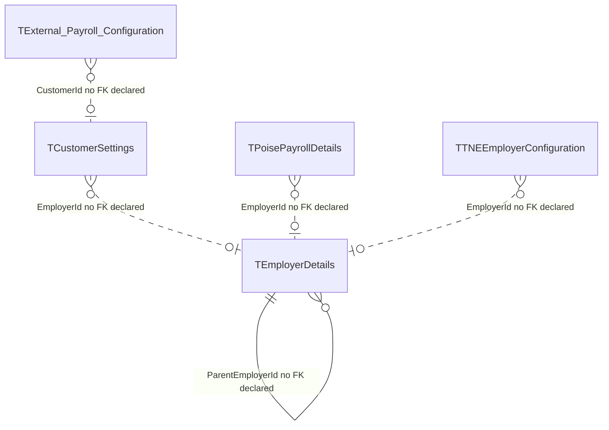

# My Payslip

## Overview

An employee opens the left-nav leaf **My Payslip** (also labelled **ESS** on many employers) and lands on `~/HRM/Integration/Saral.aspx` with **no** `mode` query string. Live catalog rows for menu id **180** use that NavigateURL for both display names (`TMenuDetails` employer `0` has both `My Payslip` and `ESS` pointing at the same page). The employer-0 hierarchy node text is **ESS** (`TDynamicMenuHierarchy` value `180`); customers often rename the leaf to **My Payslip**.

This is the **employee payslip launcher**, not the admin SSO path. **Admin Configuration → Payroll Integration** uses the same `Saral.aspx` host but with an encrypted `mode` that decrypts to `Admin` (menu id 1152) — documented separately at `/docs/guides/admin-configuration/payroll-integration`. Do not treat that guide as this leaf.

On load with a session user, `Saral.aspx.cs` reads customer Saral settings and Poise payroll credentials via `DBHelper` only (no BLL, no Core API). Because `mode` is absent, the Admin branch is skipped. If a Poise row exists, the page posts a hashed ESS login (`SHA-256` of `StaticText` + session `UUID`, plus `Password`) to `EssUrl`. If no Poise row exists and the employee has an email, it opens the Saral/SPP cloud or on-premises URL (customer overrides and token shape from `TCustomerSettings`) in a child window after a best-effort logout fetch. The dashboard iframe then shows `DashBoardFlip.aspx`.

`docs/SystemModels/SystemModel-2` has no workflow page for My Payslip / ESS. Table blurbs for `TPoisePayrollDetails` and `TCustomerSettings` are in `llm-wiki/reference/tables/hrms.md`.

## Workflow

## Request journey

## Entry points

The live left-nav leaf is menu id **180**. Employer-0 `TMenuDetails` stores NavigateURL `~/HRM/Integration/Saral.aspx` under both **My Payslip** and **ESS** names. The seeded hierarchy shows a top-level **ESS** node with value `180` and no children.

| Entry | Purpose |
|---|---|
| `~/HRM/Integration/Saral.aspx` | Employee My Payslip / ESS launcher. No encrypted `mode` on this leaf. |
| `~/HRM/Integration/Saral.aspx?mode=…` (Admin) | **Not this feature.** Admin Configuration → Payroll Integration (menu 1152). |
| `~/HRM/Integration/PayrolIntegration.aspx` | Older Admin Configuration → Payroll Details sibling. Not the My Payslip leaf. |

`docs/SystemModels/SystemModel-2` does not name a second live page for this item.

## Code → database call chain

No HRMS.Shared BLL type is on this path. Both database calls use Enterprise Library `GetStoredProcCommand` through `DBHelper.m_returnDbObject`.

| Entry | Method | Database |
|---|---|---|
| Every load with a session user, `Saral.aspx.cs:20` | `DBHelper.GetCustomerSettings` (`DBHelper.cs:3427`) | `SP_GetCustomerSettings`. Reads `TCustomerSettings`, `TEmployerDetails`, `TExternal_Payroll_Configuration`, `TTNEEmployerConfiguration`. This leaf uses `SaralIntegrationURL`, `SaralIntegrationLogoutURL`, `IsCloudOrOnPremises`, and `CustName`. |
| Every load with a session user, `Saral.aspx.cs:25` | `DBHelper.GetPoisePayrollDetails` (`DBHelper.cs:3720`) | `SP_Admin_GetPoisePayrollDetails`. Reads `UserName`, `Password`, `RedirectionUrl`, `StaticText`, `EssUrl` from `TPoisePayrollDetails` for `@EmployerId`. |
| Admin branch, `Saral.aspx.cs:26-39` | Decrypt `Request.QueryString["mode"]` when present | **Skipped** for My Payslip / ESS (no `mode`). Covered by Payroll Integration. |
| ESS branch, `Saral.aspx.cs:52-59` | `ComputeSha256Hash(StaticText + UUID)` and register `generateToken` | No further stored procedure. Client posts to `EssUrl`. |
| Saral fallback, `Saral.aspx.cs:61-86` | Build URL from `Web.config` `SaralIntegration` and optional customer overrides; register `RefreshParent` | No further stored procedure. Client opens the external URL. |

`Saral.aspx.cs` does not call `CommonUtil.LogActivity`. Nested procedures under either SP are none.

## API endpoints

This feature has no HRMS Core API, PageMethod, or Web API layer. The screen is a WebForms `Page_Load` that emits JavaScript. The browser then either POSTs the hidden `frmIntegration` form to the external ESS payroll URL or opens a Saral/SPP URL in a child window (`Saral.aspx` script `generateToken` / `RefreshParent`). Default Saral base URL comes from `Web.config` key `SaralIntegration`. HivePay Core API payslip routes (`/api/hivePay/GetPayslips`, `DownloadPayslip`) are a separate product path and are not called by this page.

## Stored procedures & tables involved

| Object | File | Purpose | Wiki |
|---|---|---|---|
| `SP_GetCustomerSettings` | `HRMS-DATABASE/HRMS/STOREPROCEDURE/SP_GetCustomerSettings.sql` | Customer settings including Saral URL columns for the fallback path. | `llm-wiki/reference/tables/hrms.md` (`TCustomerSettings`) |
| `SP_Admin_GetPoisePayrollDetails` | Not present under `HRMS-DATABASE/HRMS/STOREPROCEDURE/` (live DEV definition only) | Returns Poise/payroll SSO fields for one employer; ESS path uses `StaticText`, `Password`, `EssUrl`. | `llm-wiki/reference/tables/hrms.md` (`TPoisePayrollDetails`) |
| `TPoisePayrollDetails` | `HRMS-DATABASE/HRMS/TABLES/TPoisePayrollDetails.sql` | Employer payroll SSO user name, password, redirect and ESS URLs, static text. | `llm-wiki/reference/tables/hrms.md` |
| `TCustomerSettings` | `HRMS-DATABASE/HRMS/TABLES/TCustomerSettings.sql` | Saral integration flags and URLs, customer display name. | `llm-wiki/reference/tables/hrms.md` |
| `TEmployerDetails` | `HRMS-DATABASE/HRMS/TABLES/TEmployerDetails.sql` | Joined by `SP_GetCustomerSettings` for employer flags and parent overrides. | `llm-wiki/reference/tables/hrms.md` |
| `TExternal_Payroll_Configuration` | (joined by `SP_GetCustomerSettings`; catalogued in wiki) | External payroll API key/base URL columns returned by the settings SP; unused by `Saral.aspx.cs` ESS branches. | `llm-wiki/reference/tables/hrms.md` |
| `TTNEEmployerConfiguration` | (joined by `SP_GetCustomerSettings`) | Travel and expense employer flags returned by the settings SP; unused by this page. | — |

Database pages already published: [`SP_GetCustomerSettings`](/docs/database/hrms/SP_GetCustomerSettings), [`SP_Admin_GetPoisePayrollDetails`](/docs/database/hrms/SP_Admin_GetPoisePayrollDetails).

## Table relationships

`llm-wiki/reference/tables/hrms.md` lists these tables and does not declare foreign keys among them. The diagram below uses the `CREATE TABLE` scripts and the joins the procedures perform. A join the page or procedure uses is shown only as a declared FK when the script has one; otherwise it is labeled as not declared.

`TPoisePayrollDetails` has no primary-key or foreign-key script in `TABLES/TPoisePayrollDetails.sql`. Live DEV also has `EssUrl` and `ApplicationInstanceId` columns that are not on that baseline `CREATE TABLE` script.

## Known gaps

- **No SystemModel-2 page.** Nothing under `docs/SystemModels/SystemModel-2` names My Payslip, ESS menu 180, or this employee use of `Saral.aspx`.
- **Dual employer-0 menu names.** Menu id 180 appears as both `My Payslip` and `ESS` in employer-0 `TMenuDetails` with the same NavigateURL; hierarchy XML text is `ESS`. Customer copies may show either label.
- **`SP_Admin_GetPoisePayrollDetails` is not in Liquibase inventory.** `DBHelper` and `TDataCatalog_DML` name it, and DEV has the object, but there is no `STOREPROCEDURE/SP_Admin_GetPoisePayrollDetails.sql` under `HRMS-DATABASE/HRMS`.
- **`EssUrl` is used by the page but missing from the baseline table script.** Live DEV `TPoisePayrollDetails` includes `EssUrl`; `TABLES/TPoisePayrollDetails.sql` and `DDL/67752_Createtable_TPoisePayrollDetails.sql` do not.
- **No activity log on this menu page.** Sibling `PayrolIntegration.aspx.cs` calls `CommonUtil.LogActivity` with `ActivityDescription.PayrollDetails` (341). `Saral.aspx.cs` does not.
- **Empty Poise result with no email is a no-op.** When Poise returns no rows and `employee.Email` is empty, the page registers no redirect script.
- **Null session employee.** `GetCustomerSettings` runs before the `employee != null` guard (`Saral.aspx.cs:19-21`), so a missing session can throw before the empty body path.
- **Credentials in client script.** The ESS branch embeds the hashed user name and password into `ScriptManager.RegisterStartupScript` and posts them from the browser.
- **HivePay payslip APIs are out of scope.** Core API `GetPayslips` / `DownloadPayslip` are not called by this WebForms leaf.
- **Scheduler SP is out of scope.** `SP_Get_PoisePayRollDetails` is used by `HRMS.PoisePayroll` and is not called by this page or by `SP_Admin_GetPoisePayrollDetails`.

## Reference

Confidence is **high** for the WebForms page and `DBHelper` path traced here. The Poise procedure body was confirmed from DEV because it is absent from the Liquibase SQL tree. `docs/SystemModels/SystemModel-2` does not cover this screen. Foreign keys are only those declared on table scripts; none of the joins above are declared.

### SourceCode

- `HRMS.Web/HRMS.Web/HRM/Integration/Saral.aspx`
- `HRMS.Web/HRMS.Web/HRM/Integration/Saral.aspx.cs`
- `HRMS.Web/HRMS.Web/HRM/Integration/PayrolIntegration.aspx.cs` (Payroll Details sibling only)
- `HRMS.Shared/HRMS.DataAccessLayer/DBHelper.cs`
- `HRMS.Web/HRMS.Web/Web.config` (`SaralIntegration`)

### TDG HRMS DB

- `llm-wiki/reference/tables/hrms.md`
- `HRMS-DATABASE/HRMS/STOREPROCEDURE/SP_GetCustomerSettings.sql`
- `HRMS-DATABASE/HRMS/TABLES/TPoisePayrollDetails.sql`
- `HRMS-DATABASE/HRMS/TABLES/TCustomerSettings.sql`
- Live DEV `dbo.TMenuDetails` menu id 180 (`NavigateURL` = `~/HRM/Integration/Saral.aspx`)
- Live DEV `dbo.SP_Admin_GetPoisePayrollDetails` (not inventoried as a SQL file)

### Related guides

- `/docs/guides/admin-configuration/payroll-integration` — same page, Admin `mode` leaf (menu 1152)
- `/docs/guides/admin-configuration/payroll-details` — `PayrolIntegration.aspx` (menu 413)
