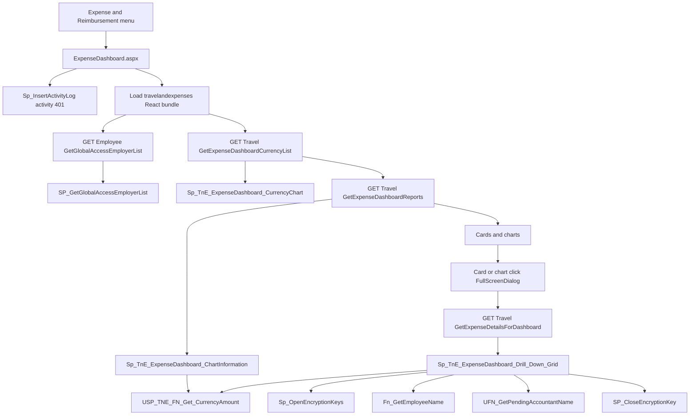
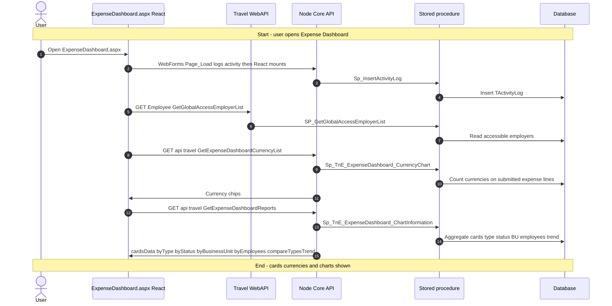
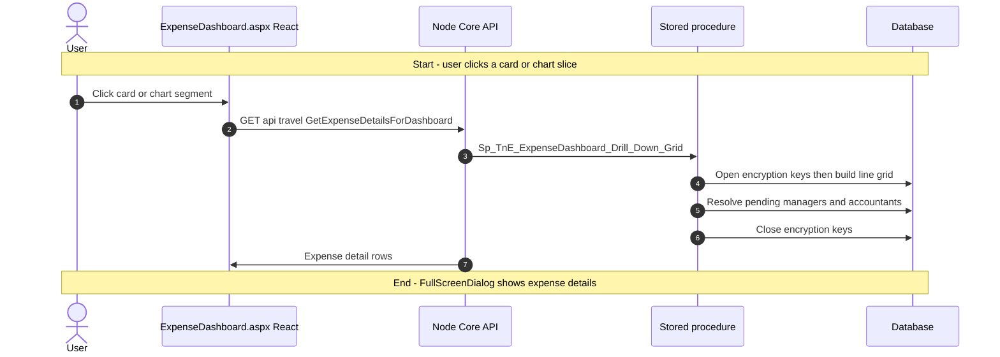
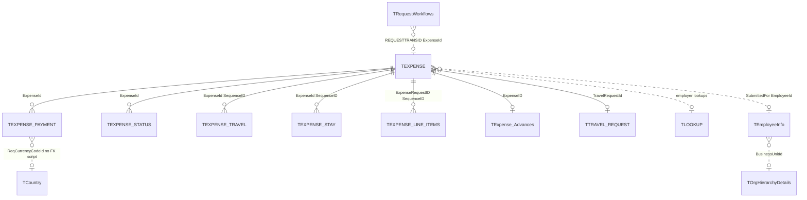

# Expense Dashboard

## Overview

A Travel & Expense user opens **Expense & Reimbursement → Expense Dashboard** to see submitted expense metrics for an organisation and date window: four summary cards (requested, approved, payments pending, payments processed), currency chips, and charts by type, status, business unit, employees, and expense-type trend. The left-nav leaf maps to `~/HRM/TravelAndExpense/ExpenseDashboard.aspx` (`RouteConstants.EXPENSE_DASHBOARD_CHART`). The React H1 and breadcrumb say **Expense Dashboard**.

The host is a WebForms shell that seeds session identity into hidden fields, logs activity `ExpenseDashboard` (401), and loads the webpack Travel & Expense React bundle into `#root`. Chart and drill-down data are Axios GETs via `APIHelper.getCore` to Core Node `/api/travel/*` against the Travel & Expense database (`tneDbConfig`). Organisation picker uses `APIHelper.get` to the Travel WebAPI `/Employee/GetGlobalAccessEmployerList`. The code-behind does not bind report data.

Sibling host `Expense_Dashboard.aspx` (underscore) is an older alternate shell in the same folder; the React route and menu leaf use `ExpenseDashboard.aspx`. There is no `docs/SystemModels/SystemModel-2` page for this screen.

## Workflow

This page is a React SPA hosted in WebForms. Report traffic uses JWT/`Authorization` on Core Node travel routes. No WebForms postback binds the charts.

## Request journey

Reads only. There is no save path on this leaf.

### Load dashboard — org list, currencies, charts

### Drill-down from a card or chart slice

## Entry points

| Entry | Purpose |
|---|---|
| `~/HRM/TravelAndExpense/ExpenseDashboard.aspx` | Menu leaf **Expense Dashboard**. Host for the React dashboard. |
| React route `RouteConstants.EXPENSE_DASHBOARD_CHART` | Same path; mounts `ExpenseDashboard` container (`Areas/routes.js`). |
| `~/HRM/TravelAndExpense/Expense_Dashboard.aspx` | Older underscore ASPX in the same folder. Not the React route constant. |

## Code → database call chain

| Entry | Method | Database |
|---|---|---|
| Page load, `ExpenseDashboard.aspx.cs:36` | `CommonUtil.LogActivity` → activity helpers | `Sp_InsertActivityLog`. Activity type `ExpenseDashboard` = 401 (`Enums.cs`). HRMS DB. |
| Mount, `ExpenseDashboard.js:159-174` | `getOrganizationList` → `APIHelper.get(GET_ALL_EMPLOYER_LIST)` → Travel `EmployeeController.GetGlobalAccessEmployerList` → `EmployeeDAL.GetGlobalAccessEmployerList` | `SP_GetGlobalAccessEmployerList` (HRMS). |
| Mount / Search, `ExpenseDashboard.js:53-68` | `getCurrencyList` → `APIHelper.getCore(GET_EXPENSE_DASHBOARD_CURRENCY_LIST)` → `travelNExpenseController.GetExpenseDashboardCurrencyList:58` → `travelNExpenseDAL.GetExpenseDashboardCurrencyList:80` | `Sp_TnE_ExpenseDashboard_CurrencyChart` (`travelNExpenseDAL.js:89`). T&E DB. |
| Mount / Search / currency chip, `ExpenseDashboard.js:125-141` | `getChartData` → `GET_EXPENSE_DASHBOARD_REPORTS` → `GetExpenseDashboardReports:40` → `GetExpenseDashboardReports:64` | `Sp_TnE_ExpenseDashboard_ChartInformation` (`travelNExpenseDAL.js:74`). Nested `USP_TNE_FN_Get_CurrencyAmount`. |
| Card / chart click, `ExpenseDashboard.js:82-114` | `getExpenseDetails` → `GET_EXPENSE_DETAILS_FOR_DASHBOARD` → `GetExpenseDetailsForDashboard:68` → `GetExpenseDetailsForDashboard:96` | `Sp_TnE_ExpenseDashboard_Drill_Down_Grid` (`travelNExpenseDAL.js:118`). Nested `Sp_OpenEncryptionKeys`, `USP_TNE_FN_Get_CurrencyAmount`, `Fn_GetEmployeeName`, `UFN_GetPendingAccountantName`, `SP_CloseEncryptionKey`. |

## API endpoints

No WebForms postback binds report data. Dashboard charts use Core Node under `/api/travel` (`Authorize`). Organisation list uses the Travel WebAPI base (`API_URL`), not Core.

| Verb | Route | Parameters | Purpose | Source |
|---|---|---|---|---|
| GET | `/api/travel/GetExpenseDashboardCurrencyList` | `employeeId`, `employerId`, `fromDate`, `toDate`, `reportDataBasedOn` | Currency chips with counts. | `TravelNExpenseRoutes.js:11` |
| GET | `/api/travel/GetExpenseDashboardReports` | `employeeId`, `employerId`, `fromDate`, `toDate`, `reportDataBasedOn`, `currency` | Six recordsets mapped to cards and charts. | `TravelNExpenseRoutes.js:10` |
| GET | `/api/travel/GetExpenseDetailsForDashboard` | `employeeId`, `employerId`, dates, `reportDataBasedOn`, `currency`, `statusId`, `expenseType`, `cardType`, optional group/type/currency ids | Drill-down grid for dialog. | `TravelNExpenseRoutes.js:12` |
| GET | `/Employee/GetGlobalAccessEmployerList` | `employeeId` | Organisation dropdown. Travel WebAPI, not Core. | `apiURLConstants.js:31` |

UI constants use `/Travel/...` paths; Core mounts the router at `/api/travel`.

## Stored procedures & tables involved

| Object | File | Purpose | Wiki |
|---|---|---|---|
| `Sp_InsertActivityLog` | `HRMS/STOREPROCEDURE/Sp_InsertActivityLog.sql` | Page-access log. | [Sp_InsertActivityLog](/docs/database/hrms/Sp_InsertActivityLog) |
| `SP_GetGlobalAccessEmployerList` | `HRMS/STOREPROCEDURE/SP_GetGlobalAccessEmployerList.sql` | Organisation picker. | [SP_GetGlobalAccessEmployerList](/docs/database/hrms/SP_GetGlobalAccessEmployerList) |
| `Sp_TnE_ExpenseDashboard_CurrencyChart` | `HRMS_TRAVELNEXPENSE/STOREPROCEDURE/Sp_TnE_ExpenseDashboard_CurrencyChart.sql` | Currencies present in the filter window. | [Sp_TnE_ExpenseDashboard_CurrencyChart](/docs/database/hrms-travelnexpense/Sp_TnE_ExpenseDashboard_CurrencyChart) |
| `Sp_TnE_ExpenseDashboard_ChartInformation` | `HRMS_TRAVELNEXPENSE/STOREPROCEDURE/Sp_TnE_ExpenseDashboard_ChartInformation.sql` | Cards plus five chart result sets. | [Sp_TnE_ExpenseDashboard_ChartInformation](/docs/database/hrms-travelnexpense/Sp_TnE_ExpenseDashboard_ChartInformation) |
| `Sp_TnE_ExpenseDashboard_Drill_Down_Grid` | `HRMS_TRAVELNEXPENSE/STOREPROCEDURE/Sp_TnE_ExpenseDashboard_Drill_Down_Grid.sql` | Expense line drill-down. | [Sp_TnE_ExpenseDashboard_Drill_Down_Grid](/docs/database/hrms-travelnexpense/Sp_TnE_ExpenseDashboard_Drill_Down_Grid) |
| `USP_TNE_FN_Get_CurrencyAmount` | `HRMS_TRAVELNEXPENSE/FUNCTIONS/USP_TNE_FN_Get_CurrencyAmount.sql` | Culture-aware amount text. | [USP_TNE_FN_Get_CurrencyAmount](/docs/database/hrms-travelnexpense/USP_TNE_FN_Get_CurrencyAmount) |
| `Sp_OpenEncryptionKeys` / `SP_CloseEncryptionKey` | HRMS STOREPROCEDURE (synonyms on T&E) | Open/close keys around encrypted name reads. | existing HRMS pages |
| `Fn_GetEmployeeName` | HRMS FUNCTIONS (synonym on T&E) | Employee display name. | [Fn_GetEmployeeName](/docs/database/hrms/Fn_GetEmployeeName) |
| `UFN_GetPendingAccountantName` | `HRMS_TRAVELNEXPENSE/FUNCTIONS/UFN_GetPendingAccountantName.sql` | Accountant pending-with text. | [UFN_GetPendingAccountantName](/docs/database/hrms-travelnexpense/UFN_GetPendingAccountantName) |
| `TEXPENSE`, `TEXPENSE_PAYMENT`, `TEXPENSE_STATUS`, `TEXPENSE_*` type tables, `TEXPENSE_LINE_ITEMS`, `TLOOKUP` / `TCountry`, `TExpense_Advances`, `TTRAVEL_REQUEST`, workflow / email tables | matching T&E scripts / synonyms | Expense header, lines, status, lookups. | T&E catalog partial |

## Table relationships

Declared FKs from CREATE TABLE scripts are sparse. The diagram shows joins the dashboard procedures actually use; undeclared links are dotted.

## Known gaps

- **No SystemModel-2 page** for Expense Dashboard.
- **`@LoginEmployeeId` is unused** in all three dashboard SPs; any employer in the picker is aggregated without login-scoped row filtering in SQL.
- **Organisation change does not auto-refresh**; `handleChangeOrganization` only sets state until Search runs (`ExpenseDashboard.js:169-174`).
- **`Sp_TnE_ExpenseDashboard_Drill_Down_Grid` filters `#ExpenseLineDetails` with `ExpenseTypeID = TRY_CAST(@ExpenseTypeID AS INT)`**; the UI does not pass `ExpenseTypeID`, so NULL equality can empty the drill grid.
- **Currency resolve from `@Currency` is commented out** in the drill SP; UI sends currency text but not `CurrencyId` on card/chart clicks.
- **`@pExpenseType` / `@ExpenseGroupId` / `@ExpenseGroupName` filters are unused or commented**; type-pie drill relies on status/card params only.
- **Drill `#TEXPE` does not require `IsSubmitted = 1`**, unlike CurrencyChart and ChartInformation.
- **Sibling `Expense_Dashboard.aspx`** remains in tree but is not the React route constant.
- **`USP_TNE_FN_Get_CurrencyAmount.sql` still has `USE [TravelNExpense_Prod]`** at the top of the script file.

## Reference

Confidence is **high** for the ASPX host, React container, Core travel routes/DAL, and the three T&E STOREPROCEDURE scripts. Organisation list is Travel WebAPI → HRMS `SP_GetGlobalAccessEmployerList`.

### SourceCode

- `HRMS.Web/HRMS.Web/HRM/TravelAndExpense/ExpenseDashboard.aspx`
- `HRMS.Web/HRMS.Web/HRM/TravelAndExpense/ExpenseDashboard.aspx.cs`
- `HRMS.Web/HRMS.Web/HRM/TravelAndExpense/Expense_Dashboard.aspx`
- `HRMS.Web/HRMS.Web/HRM/TravelAndExpense/Areas/Expense/Containers/ExpenseDashboard.js`
- `HRMS.Web/HRMS.Web/HRM/TravelAndExpense/Areas/Expense/Components/ExpenseDashboard/`
- `HRMS.Web/HRMS.Web/HRM/TravelAndExpense/Common/apiURLConstants.js`
- `HRMS.Web/HRMS.Web/HRM/TravelAndExpense/Common/apiHelper.js`
- `HRMS.Web/HRMS.Web/HRM/TravelAndExpense/Common/routeConstants.js`
- `HRMS.Web/HRMS.Web/HRM/TravelAndExpense/Areas/routes.js`
- `HRMS.CoreAPI/HRMS.Core.WebAPI.Node/Controllers/travelNExpenseController.js`
- `HRMS.CoreAPI/HRMS.Core.WebAPI.Node/Core/DataAccessLayer/travelNExpenseDAL.js`
- `HRMS.CoreAPI/HRMS.Core.WebAPI.Node/Routes/TravelNExpenseRoutes.js`
- `HRMS.CoreAPI/HRMS.Core.WebAPI.Node/Routes/routeIndex.js`
- `HRMS.Shared/HRMS.DataContract/Common/Enums.cs`
- `HRMS.TravelAndExpense/HRMS.TravelAndExpense.DAL/Employee/EmployeeDAL.cs`

### TDG HRMS DB

- `HRMS-DATABASE/HRMS_TRAVELNEXPENSE/STOREPROCEDURE/Sp_TnE_ExpenseDashboard_ChartInformation.sql`
- `HRMS-DATABASE/HRMS_TRAVELNEXPENSE/STOREPROCEDURE/Sp_TnE_ExpenseDashboard_CurrencyChart.sql`
- `HRMS-DATABASE/HRMS_TRAVELNEXPENSE/STOREPROCEDURE/Sp_TnE_ExpenseDashboard_Drill_Down_Grid.sql`
- `HRMS-DATABASE/HRMS_TRAVELNEXPENSE/FUNCTIONS/USP_TNE_FN_Get_CurrencyAmount.sql`
- `HRMS-DATABASE/HRMS_TRAVELNEXPENSE/FUNCTIONS/UFN_GetPendingAccountantName.sql`
- `HRMS-DATABASE/HRMS/STOREPROCEDURE/Sp_InsertActivityLog.sql`
- `HRMS-DATABASE/HRMS/STOREPROCEDURE/SP_GetGlobalAccessEmployerList.sql`
