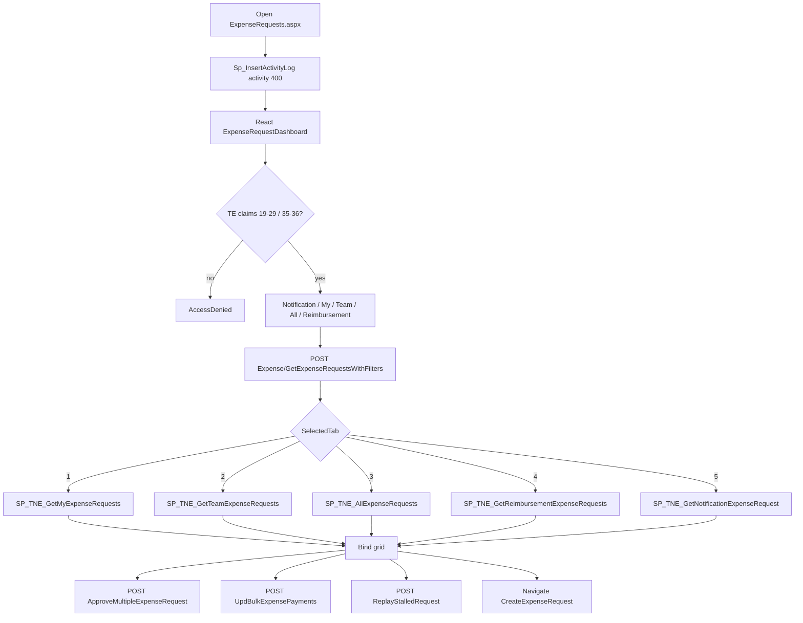
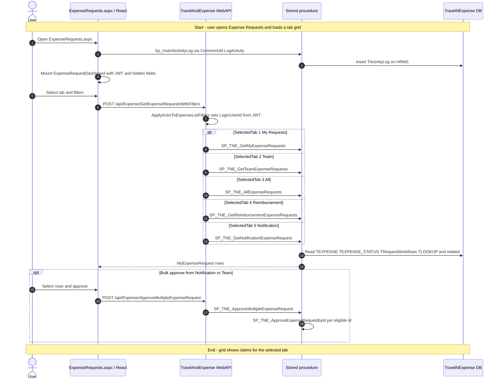
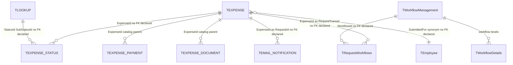

# Expense Requests

## Overview

**Expense & Reimbursement → Expense Requests** is the Travel & Expense list hub for expense claims. `ExpenseRequests.aspx` is a thin WebForms host: it logs activity, injects session employee/employer/role into hidden fields and JWT into `localStorage`, and loads the webpack Travel & Expense React bundle. The React dashboard (`expenseRequestDashboard.js`) renders claim-gated tabs — Notification, My Requests, Team Requests, All Requests, Reimbursement Requests — plus a Create New Request tab that navigates away to the create screen.

Each list tab loads through one Travel & Expense WebAPI POST, `Expense/GetExpenseRequestsWithFilters`, with `SelectedTab` 1–5. The DAL picks a tab-specific stored procedure in the Travel & Expense database (`hrms-travelnexpense`). Approvers can bulk-approve from Notification/Team; accountants can mark payments on Reimbursement; stalled rows can be replayed from See All Updates. Create, edit, and full view of a single claim are separate routes (`CreateExpenseRequest`, `ViewExpenseRequest`) and are only entry/exit points here.

`docs/SystemModels/SystemModel-2` has no dedicated Expense Requests page. Table blurbs live in `llm-wiki/reference/tables/travelnexpense.md`.

## Workflow

## Request journey

## Entry points

| Entry | Purpose |
|---|---|
| `~/HRM/TravelAndExpense/ExpenseRequests.aspx` | Left-nav **Expense Requests**. React route `EXPENSE_REQUEST_DASHBOARD`. |
| `ExpenseRequests.aspx?FilterType=…` | Deep link into Notification / Reimbursement (`AP`) via `hdnFilterType`. |
| `ExpenseRequests.aspx?displayType=…` | Passed as `hdnDisplayType` for display variants. |
| Create New Request tab | Client navigate to `CREATE_EXPENSE_REQUEST` (out of scope for list SPs). |
| View / edit claim | Separate `ViewExpenseRequest` / `EditExpenseRequest` routes from row actions. |

Activity type id is `ActivityDescription.ExpenseRequests` = `400`. Module access requires TE claim ids 19–29, 35, or 36; tab visibility uses `CNST_VIEW_MY_EXPENSEREQUEST`, `CNST_VIEW_TEAM_EXPENSEREQUEST`, `CNST_VIEW_ALL_EXPENSEREQUEST`, `CNST_VIEW_REIMBURSEMENT_REQ`, `CNST_CREATE_EXPENSEREQUEST`.

## Code → database call chain

ASP.NET page only logs activity and bootstraps React. List data and actions go through `HRMS.TravelAndExpense.WebAPI` → `ExpenseBLL` → `ExpenseDAL` against `DBSource.TravelAndExpense`.

| Entry | Method | Database |
|---|---|---|
| Every page load, `ExpenseRequests.aspx.cs:38` | `CommonUtil.LogActivity` → activity helpers | `Sp_InsertActivityLog` (HRMS). Activity type `400`. |
| Tab load / Apply filters, `ExpenseGridFilterContainer.js:167`, `:193` | `POST /api/Expense/GetExpenseRequestsWithFilters` (`ExpenseController.cs:779`) → `ExpenseBLL.GetExpenseRequestsWithFilters` (`ExpenseBLL.cs:960`) → `ExpenseDAL.GetExpenseRequestsWithFilters` (`ExpenseDAL.cs:2449`) | Tab 1 `SP_TNE_GetMyExpenseRequests` (`:2476`); tab 2 `SP_TNE_GetTeamExpenseRequests` (`:2486`); tab 3 `SP_TNE_AllExpenseRequests` (`:2496`); tab 4 `SP_TNE_GetReimbursementExpenseRequests` (`:2506`); tab 5 `SP_TNE_GetNotificationExpenseRequest` (`:2516`). Nested commonly `Sp_OpenEncryptionKeys`, `Fn_GetEmployeeName`; reimbursement also `FN_LocationBU_GetEmployeeDetails`; pending-accountant `UFN_Expense_GetPendingAccountantName`. |
| Actor binding, `ExpenseController.cs:58` | `ApplyActorToExpenseListFilters` | Overwrites `LoginUserId` from JWT; for tab 1 forces `EmployeeId` to the actor. |
| Status filter options, `StatusFilter.js:15` | `GET /api/Expense/GetAllLookupRequestStatus` (`ExpenseController.cs:744`) → `ExpenseDAL.GetAllLookupRequestStatus` (`ExpenseDAL.cs:2401`) | `SP_TNE_TLookupRequestStatus`. |
| Employee filter by BU, `EmployeesBasedonBUFilter.js:22` | `POST /api/Expense/GetEmployeesBasedOnMultipleBU` (`ExpenseController.cs:729`) → `ExpenseDAL.GetEmployeesBasedOnMultipleBU` (`ExpenseDAL.cs:2374`) | `SP_TNE_GetEmployeesBasedOnMultipleBU`. |
| Team employee filter, `EmployeesBasedonBUFilter.js:40` | `GET /api/Expense/GetTeamMembersOfEmployee` (`ExpenseController.cs:759`) → `ExpenseDAL.GetTeamMembersOfEmployee` (`ExpenseDAL.cs:2425`) | `SP_TNE_TeamMembersOfEmployee` → nested `FN_LocationBU_GetEmployeeDetails`. |
| Bulk approve, `notificationExpenseRequest.js:625` / `managerExpenseRequests.js:596` | `POST /api/Expense/ApproveMultipleExpenseRequest` (`ExpenseController.cs:890`) → `ExpenseDAL.ApproveMultipleExpenseRequest` (`ExpenseDAL.cs:2752`) | `SP_TNE_ApproveMultipleExpenseRequest` → nested `SP_TNE_ApproveExpenseRequestbyId`. |
| See All Updates timeline, `StatusTimelineRefactored.js:111` | `GET /api/Expense/GetRequestStatusForSeeAllUpdates` (`ExpenseController.cs:813`) → `ExpenseDAL.GetRequestStatusForSeeAllUpdates` (`ExpenseDAL.cs:2545`) | `SP_TNE_GetRequestStatusForSeeAllUpdatesNew` (DAL constant). Nested `Sp_OpenEncryptionKeys`, `UFN_CM_GetWorkflowTreeXmlDetailsByPageTitle`. |
| Replay stalled, `StatusTimelineRefactored.js:165` | `POST /api/Expense/ReplayStalledRequest` (`ExpenseController.cs:827`) → `ExpenseDAL.StalledRequestResponse` (`ExpenseDAL.cs:2605`) | `SP_TNE_ReplayStalledRequest` → nested `UFN_CM_GetWorkflowTreeXmlDetailsByPageTitle`, `USP_TFN_WorkFlow_Routing_Levels`. |
| Bulk mark paid, `accountExpenseRequests.js:421` | `POST /api/Expense/UpdBulkExpensePayments` (`ExpenseController.cs:624`) → `ExpenseDAL` execute (`ExpenseDAL.cs:2176`) | `Sp_TnE_UpdBulkExpensePayments`. |

Legacy `GET /Expense/GetAllExpense` still appears in older helpers on admin/account components but the filter container path above is what the tab grids use after mount.

## API endpoints

This screen is not a WebForms postback for list data. The host page is ASP.NET; the SPA calls the Travel & Expense WebAPI (`api/Expense/{action}`) with the JWT from `localStorage`.

| Method | Path | Purpose | Source |
|---|---|---|---|
| Page load | `ExpenseRequests.aspx` | Activity log + React bootstrap | `ExpenseRequests.aspx.cs:36` |
| POST | `/api/Expense/GetExpenseRequestsWithFilters` | Tab grids | `ExpenseController.cs:779` |
| GET | `/api/Expense/GetAllLookupRequestStatus` | Status filter lookups | `ExpenseController.cs:744` |
| POST | `/api/Expense/GetEmployeesBasedOnMultipleBU` | Employee filter | `ExpenseController.cs:729` |
| GET | `/api/Expense/GetTeamMembersOfEmployee` | Team member filter | `ExpenseController.cs:759` |
| POST | `/api/Expense/ApproveMultipleExpenseRequest` | Bulk approve | `ExpenseController.cs:890` |
| GET | `/api/Expense/GetRequestStatusForSeeAllUpdates` | Status timeline | `ExpenseController.cs:813` |
| GET | `/api/Expense/GetRequestStatusForSeeAllUpdatesNew` | Alternate pending-with payload | `ExpenseController.cs:836` |
| POST | `/api/Expense/ReplayStalledRequest` | Replay stalled workflow | `ExpenseController.cs:827` |
| POST | `/api/Expense/UpdBulkExpensePayments` | Accountant bulk paid | `ExpenseController.cs:624` |

Core Node `TravelNExpenseRoutes` expense dashboard endpoints are for the separate Expense Dashboard screen, not this list.

## Stored procedures & tables involved

Direct procedures are the strings in `ExpenseDAL` for this screen. Nested objects are one level deep. Database slug for Travel & Expense is `hrms-travelnexpense` unless noted.

| Object | File | Purpose | Wiki |
|---|---|---|---|
| [SP_TNE_GetMyExpenseRequests](/docs/database/hrms-travelnexpense/SP_TNE_GetMyExpenseRequests) | `HRMS_TRAVELNEXPENSE/STOREPROCEDURE/SP_TNE_GetMyExpenseRequests.sql` | My Requests grid | `TEXPENSE` |
| [SP_TNE_GetTeamExpenseRequests](/docs/database/hrms-travelnexpense/SP_TNE_GetTeamExpenseRequests) | `…/SP_TNE_GetTeamExpenseRequests.sql` | Team Requests grid | `TEXPENSE` |
| [SP_TNE_AllExpenseRequests](/docs/database/hrms-travelnexpense/SP_TNE_AllExpenseRequests) | `…/SP_TNE_AllExpenseRequests.sql` | All Requests grid; `@isInactive` | `TEXPENSE` |
| [SP_TNE_GetReimbursementExpenseRequests](/docs/database/hrms-travelnexpense/SP_TNE_GetReimbursementExpenseRequests) | `…/SP_TNE_GetReimbursementExpenseRequests.sql` | Reimbursement / accounts grid | `TEXPENSE` |
| [SP_TNE_GetNotificationExpenseRequest](/docs/database/hrms-travelnexpense/SP_TNE_GetNotificationExpenseRequest) | `…/SP_TNE_GetNotificationExpenseRequest.sql` | Pending approver queue via `TRequestWorkflows` | `TEXPENSE`, `TRequestWorkflows` |
| [SP_TNE_ApproveMultipleExpenseRequest](/docs/database/hrms-travelnexpense/SP_TNE_ApproveMultipleExpenseRequest) | `…/SP_TNE_ApproveMultipleExpenseRequest.sql` | Bulk approve loop | `TEXPENSE`, `TRequestWorkflows` |
| [SP_TNE_ApproveExpenseRequestbyId](/docs/database/hrms-travelnexpense/SP_TNE_ApproveExpenseRequestbyId) | `…/SP_TNE_ApproveExpenseRequestbyId.sql` | Nested single-request approve | payments / notifications |
| [SP_TNE_TLookupRequestStatus](/docs/database/hrms-travelnexpense/SP_TNE_TLookupRequestStatus) | `…/SP_TNE_TLookupRequestStatus.sql` | Status filter options by tab | `TLOOKUP` |
| [SP_TNE_GetEmployeesBasedOnMultipleBU](/docs/database/hrms-travelnexpense/SP_TNE_GetEmployeesBasedOnMultipleBU) | `…/SP_TNE_GetEmployeesBasedOnMultipleBU.sql` | Employee filter | synonym employee tables |
| [SP_TNE_TeamMembersOfEmployee](/docs/database/hrms-travelnexpense/SP_TNE_TeamMembersOfEmployee) | `…/SP_TNE_TeamMembersOfEmployee.sql` | Team filter | `TORGChart`, functional manager |
| [SP_TNE_GetRequestStatusForSeeAllUpdatesNew](/docs/database/hrms-travelnexpense/SP_TNE_GetRequestStatusForSeeAllUpdatesNew) | `…/SP_TNE_GetRequestStatusForSeeAllUpdatesNew.sql` | See All Updates timeline | `TEXPENSE_STATUS`, workflows |
| [SP_TNE_ReplayStalledRequest](/docs/database/hrms-travelnexpense/SP_TNE_ReplayStalledRequest) | `…/SP_TNE_ReplayStalledRequest.sql` | Replay stalled approval | `TRequestWorkflows` |
| [Sp_TnE_UpdBulkExpensePayments](/docs/database/hrms-travelnexpense/Sp_TnE_UpdBulkExpensePayments) | `…/Sp_TnE_UpdBulkExpensePayments.sql` | Bulk amount paid + complete | `TEXPENSE_PAYMENT`, `TEXPENSE_STATUS` |
| [UFN_Expense_GetPendingAccountantName](/docs/database/hrms-travelnexpense/UFN_Expense_GetPendingAccountantName) | `…/FUNCTIONS/UFN_Expense_GetPendingAccountantName.sql` | Nested pending accountant label | claim assignment |
| [Sp_OpenEncryptionKeys](/docs/database/hrms/Sp_OpenEncryptionKeys) | HRMS | Nested open keys on list SPs | — |
| [Fn_GetEmployeeName](/docs/database/hrms/Fn_GetEmployeeName) | HRMS (synonym in T&E) | Nested display names | — |
| [FN_LocationBU_GetEmployeeDetails](/docs/database/hrms-travelnexpense/FN_LocationBU_GetEmployeeDetails) | synonym → HRMS | Nested scope for reimbursement / team | — |
| [UFN_CM_GetWorkflowTreeXmlDetailsByPageTitle](/docs/database/hrms/UFN_CM_GetWorkflowTreeXmlDetailsByPageTitle) | HRMS | Nested workflow id for timeline / replay | — |
| [USP_TFN_WorkFlow_Routing_Levels](/docs/database/hrms/USP_TFN_WorkFlow_Routing_Levels) | HRMS | Nested managers for replay | — |
| [Sp_InsertActivityLog](/docs/database/hrms/Sp_InsertActivityLog) | HRMS | Page open activity | `TActivityLog` |
| `TEXPENSE` | header claim | — | `travelnexpense.md` |
| `TEXPENSE_STATUS` | status history | — | `travelnexpense.md` |
| `TEXPENSE_PAYMENT` | payment lines | — | `travelnexpense.md` |
| `TEXPENSE_DOCUMENT` | attachment counts | — | `travelnexpense.md` |
| `TRequestWorkflows` | approval queue | — | snapshots listed in wiki |
| `TEMAIL_NOTIFICATION` | mail / stall / module page name | — | `travelnexpense.md` |
| `TLOOKUP` | status / sub-status text | — | — |
| `TTNEEmployerConfiguration` | accountant skip flags on timeline | — | `travelnexpense.md` |

## Table relationships

Edges follow joins used by the list and approve procedures. Wiki catalog parents for expense child tables point at `TEXPENSE`; workflow and employee tables are cross-database synonyms without FK scripts in the Travel & Expense baseline.

## Known gaps

- **No SystemModel-2 page** for Expense Requests; call chain is from ASPX + React + TravelAndExpense WebAPI.
- **List SPs open encryption keys and never call `SP_CloseEncryptionKey`** in the script bodies reviewed (`SP_TNE_GetMyExpenseRequests` and siblings).
- **`SP_TNE_GetNotificationExpenseRequest` does not call `Sp_OpenEncryptionKeys`** but still uses `Fn_GetEmployeeName`, which historically expected open keys.
- **Create / View / Edit claim** are separate screens; their insert/update SPs are not inventoried here.
- **Legacy `GetAllExpense`** remains in some list components alongside the filter POST; which path wins depends on which helper runs.
- **Hardcoded `USE [TravelNExpense_Prod]`** appears in several SP scripts (e.g. approve multiple, lookup status) even though Liquibase deploy should be environment-agnostic.
- **Bulk approve nests payment and notification SPs** (`Sp_TnE_UpdateExpensePaymentsWeb`, `Sp_TnE_UpdatePendingCount`, `Sp_TnE_InsertNotificationDetails`) at a second nested level; those pages are out of the one-level scope for this pass.

## Reference

Confidence is high for the list hub because `ExpenseRequests.aspx(.cs)`, the React dashboard and filter container, `ExpenseController` / `ExpenseDAL` filter routing, and the five tab procedure headers were read. Create/view detail flows were not fully walked.

### SourceCode

- `HRMS.Web/HRMS.Web/HRM/TravelAndExpense/ExpenseRequests.aspx`
- `HRMS.Web/HRMS.Web/HRM/TravelAndExpense/ExpenseRequests.aspx.cs`
- `HRMS.Web/HRMS.Web/HRM/TravelAndExpense/Areas/Expense/Containers/expenseRequestDashboard.js`
- `HRMS.Web/HRMS.Web/HRM/TravelAndExpense/Areas/Expense/Components/ExpenseRequestsList/ExpenseGridFilters/ExpenseGridFilterContainer.js`
- `HRMS.Web/HRMS.Web/HRM/TravelAndExpense/Areas/Expense/Components/ExpenseRequestsList/myExpenseRequests.js`
- `HRMS.Web/HRMS.Web/HRM/TravelAndExpense/Areas/Expense/Components/ExpenseRequestsList/managerExpenseRequests.js`
- `HRMS.Web/HRMS.Web/HRM/TravelAndExpense/Areas/Expense/Components/ExpenseRequestsList/adminExpenseRequests.js`
- `HRMS.Web/HRMS.Web/HRM/TravelAndExpense/Areas/Expense/Components/ExpenseRequestsList/accountExpenseRequests.js`
- `HRMS.Web/HRMS.Web/HRM/TravelAndExpense/Areas/Expense/Components/ExpenseRequestsList/notificationExpenseRequest.js`
- `HRMS.Web/HRMS.Web/HRM/TravelAndExpense/Common/apiURLConstants.js`
- `HRMS.Web/HRMS.Web/HRM/TravelAndExpense/Common/routeConstants.js`
- `HRMS.TravelAndExpense/HRMS.TravelAndExpense.WebAPI/Controllers/ExpenseController.cs`
- `HRMS.TravelAndExpense/HRMS.TravelAndExpense.BLL/Expense/ExpenseBLL.cs`
- `HRMS.TravelAndExpense/HRMS.TravelAndExpense.DAL/Expense/ExpenseDAL.cs`
- `HRMS.Shared/HRMS.DataContract/Common/Enums.cs` (`ExpenseRequests` 400)

### TDG HRMS DB

- `HRMS-DATABASE/HRMS_TRAVELNEXPENSE/STOREPROCEDURE/SP_TNE_GetMyExpenseRequests.sql`
- `HRMS-DATABASE/HRMS_TRAVELNEXPENSE/STOREPROCEDURE/SP_TNE_GetTeamExpenseRequests.sql`
- `HRMS-DATABASE/HRMS_TRAVELNEXPENSE/STOREPROCEDURE/SP_TNE_AllExpenseRequests.sql`
- `HRMS-DATABASE/HRMS_TRAVELNEXPENSE/STOREPROCEDURE/SP_TNE_GetReimbursementExpenseRequests.sql`
- `HRMS-DATABASE/HRMS_TRAVELNEXPENSE/STOREPROCEDURE/SP_TNE_GetNotificationExpenseRequest.sql`
- `HRMS-DATABASE/HRMS_TRAVELNEXPENSE/STOREPROCEDURE/SP_TNE_ApproveMultipleExpenseRequest.sql`
- `HRMS-DATABASE/HRMS_TRAVELNEXPENSE/STOREPROCEDURE/SP_TNE_ApproveExpenseRequestbyId.sql`
- `HRMS-DATABASE/HRMS_TRAVELNEXPENSE/STOREPROCEDURE/SP_TNE_TLookupRequestStatus.sql`
- `HRMS-DATABASE/HRMS_TRAVELNEXPENSE/STOREPROCEDURE/SP_TNE_GetEmployeesBasedOnMultipleBU.sql`
- `HRMS-DATABASE/HRMS_TRAVELNEXPENSE/STOREPROCEDURE/SP_TNE_TeamMembersOfEmployee.sql`
- `HRMS-DATABASE/HRMS_TRAVELNEXPENSE/STOREPROCEDURE/SP_TNE_GetRequestStatusForSeeAllUpdatesNew.sql`
- `HRMS-DATABASE/HRMS_TRAVELNEXPENSE/STOREPROCEDURE/SP_TNE_ReplayStalledRequest.sql`
- `HRMS-DATABASE/HRMS_TRAVELNEXPENSE/STOREPROCEDURE/Sp_TnE_UpdBulkExpensePayments.sql`
- `HRMS-DATABASE/HRMS_TRAVELNEXPENSE/FUNCTIONS/UFN_Expense_GetPendingAccountantName.sql`
- `llm-wiki/reference/tables/travelnexpense.md`
