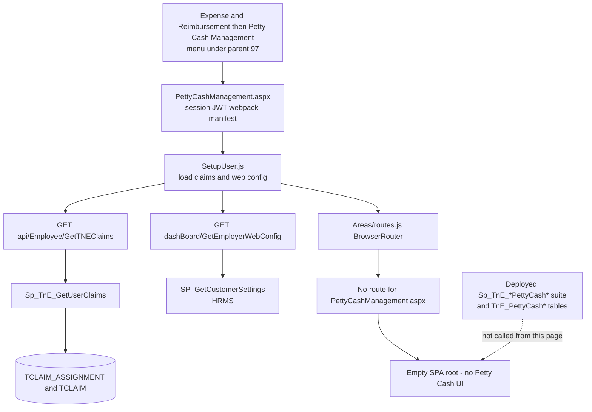
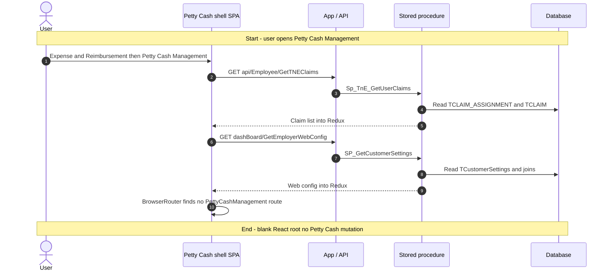
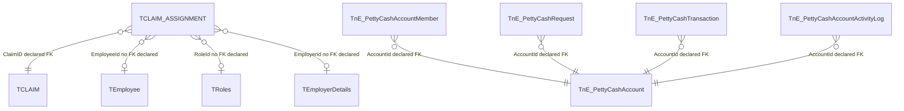

# Petty Cash Management

## Overview

An expense administrator or custodian opens **Expense & Reimbursement → Petty Cash Management** expecting to manage imprest / petty-cash accounts, members, top-ups, replenishment requests, and account activity. The left-nav item (DML menu name **Petty Cash Management**, NavigateURL `~/HRM/TravelAndExpense/PettyCashManagement.aspx`) is live under parent menu **97** (Expense & Reimbursement).

What actually runs today is only the shared Travel & Expense WebForms shell. `PettyCashManagement.aspx` stamps the signed-in employee into hidden fields, puts a JWT in `localStorage`, and loads the same webpack bundles as Expense Requests / Permission Setup (`travelandexpenses.js` and vendors). The React app then boots `SetupUser`, which loads T&E claims and customer web config. After that, `Areas/routes.js` has **no** route for `/HRM/TravelAndExpense/PettyCashManagement.aspx`, so the SPA mounts an empty router match — no account grid, no top-up, no replenishment UI.

On the database side, `HRMS_TRAVELNEXPENSE` already has Petty Cash tables (`TnE_PettyCashAccount`, members, transactions, requests, activity log) and a full `Sp_TnE_*PettyCash*` procedure suite. None of those procedures are referenced from SourceCode (no React container, no T&E WebAPI controller action, no CoreAPI route). Until that app layer lands, this menu leaf is a **shell + bootstrap only**.

**Who's involved:**

- **Signed-in employee** — can open the menu item; sees loading then a blank React root.
- **Custodian / expense admin (intended)** — would manage accounts and requests once UI/API exist.
- **Permission Setup admin** — still controls generic T&E claims via `TCLAIM` / `TCLAIM_ASSIGNMENT`; there is no Petty Cash–specific claim wiring in the current SPA for this page.

There is no SystemModel-2 or llm-wiki domain page for Petty Cash yet. Claim-catalog table blurbs remain in `llm-wiki/reference/tables/travelnexpense.md`.

## Workflow

## Request journey

This menu leaf does not create or decide a petty-cash request. The only journey that starts here today is **page open → shared T&E bootstrap → no matching React route**.

## Entry points

> Live entry point is the WebForms shell only. The Travel & Expense React router does not register this `.aspx` path. Built `travelandexpenses.min.js` route constants match Expense/Travel pages, not Petty Cash.

| Entry point | Purpose | Live? |
|---|---|---|
| `HRM/TravelAndExpense/PettyCashManagement.aspx` (+ `.cs`) | WebForms shell; session → hidden fields; JWT; webpack bundles | Yes |
| `setupUser.js` → `Areas/routes.js` | Shared T&E SPA bootstrap then router | Yes — bootstrap; **no** Petty Cash route |
| `EmployeeController.GetTNEClaims` (T&E WebAPI) | Effective T&E claims for Authorization HOC / Redux | Yes — shared, not Petty Cash–specific |
| `dashBoard/GetEmployerWebConfig` (Node CoreAPI) | Customer web configuration | Yes — shared |
| React Petty Cash containers / API clients | Account list, top-up, transfer, replenishment | **No** — not in SourceCode |
| T&E WebAPI / CoreAPI Petty Cash actions | Call `Sp_TnE_*PettyCash*` | **No** — not in SourceCode |
| Menu DML `DML_Tmenudetails_Pettycash.sql` | Inserts menu under parent **97** | Yes (deployed DML) |

## Code → database call chain

`GetTNEClaims` overwrites the query `employeeId` from the JWT (`JwtEmployeeIdentity.TryGetEmployeeId`). `GetEmployerWebConfig` uses the customer number from the shell hidden field.

| Step | Entry point | App code | Stored procedure |
|---|---|---|---|
| Page load | `PettyCashManagement.aspx` | `Page_Load` (`PettyCashManagement.aspx.cs:35-59`) — session → properties / hidden fields; JWT into `localStorage`; `LoadWebpackManifest` (`:61-121`) | none |
| Mount SPA | `App.js` → `SetupUser` | `setupUser.js:18-61` reads `hdnEmpRoleId` / employer / employee / customer | none |
| T&E claims | `setupUser.js:64-78` | `APIHelper.get` → `EmployeeController.GetTNEClaims` (`EmployeeController.cs:36-54`) → `EmployeeBLL.GetTNEClaims` → `EmployeeDAL.GetTNEClaims` (`EmployeeDAL.cs:56-89`, const `SP_GET_USERCLAIMS` at `:18`) | `Sp_TnE_GetUserClaims` |
| Web config | `setupUser.js:81-93` | `APIHelper.getCore` → `dashBoard/GetEmployerWebConfig` → `dashboardController.GetEmployerWebConfig` (`dashboardController.js:1096`) → `dashBoardDAL.GetEmployerWebConfig` (`dashBoardDAL.js:1075-1086`) | `SP_GetCustomerSettings` (HRMS) |
| Router | `Areas/routes.js:36-133` | `BrowserRouter` routes for Travel / Expense / Permissions / Reports only — **no** `PettyCashManagement` path | none |
| Petty Cash domain | — | No SourceCode caller | Deployed but unwired: `Sp_TnE_GetPettyCashAccounts`, `Sp_TnE_InsertPettyCashAccount`, `Sp_TnE_UpdatePettyCashAccount`, `Sp_TnE_TopUpPettyCashAccount`, `Sp_TnE_TransferPettyCashAccount`, `Sp_TnE_SetPettyCashAccountStatus`, `Sp_TnE_ClosePettyCashAccount`, `Sp_TnE_SavePettyCashRequest`, `Sp_TnE_GetPettyCashRequests`, `Sp_TnE_CancelPettyCashRequest`, and siblings |

## API endpoints

There are no `[WebMethod]` / PageMethods on `PettyCashManagement.aspx`. The page only runs the shared T&E bootstrap APIs. There is **no** Petty Cash–specific HTTP API in SourceCode.

### Shared bootstrap (this page)

| Verb | Route | Parameters | Purpose | Source |
|---|---|---|---|---|
| `GET` | `api/Employee/GetTNEClaims` | `roleid`, `employerId`, `employeeId` (query; `employeeId` overwritten from JWT) | Load T&E claim codes into Redux before routes render | `EmployeeController.cs:36-54` |
| `GET` | `dashBoard/GetEmployerWebConfig` | `CustomerId` (query) | Customer / employer web settings | `dashboardController.js:1096` → `SP_GetCustomerSettings` |

### Petty Cash domain

No controller actions, routes, or React `apiURLConstants` entries for Petty Cash accounts, top-ups, transfers, or replenishment requests were found under `HRMS.TravelAndExpense`, `HRMS.CoreAPI`, or `HRM/TravelAndExpense`.

## Stored procedures & tables involved

| Object | Path | Role | llm-wiki |
|---|---|---|---|
| `Sp_TnE_GetUserClaims` | `HRMS-DATABASE/HRMS_TRAVELNEXPENSE/STOREPROCEDURE/Sp_TnE_GetUserClaims.sql` | Effective claims for the signed-in employee (employee assignments first, else role) | — → [Sp_TnE_GetUserClaims](/docs/database/hrms-travelnexpense/Sp_TnE_GetUserClaims) |
| `SP_GetCustomerSettings` | `HRMS-DATABASE/HRMS/STOREPROCEDURE/SP_GetCustomerSettings.sql` | Customer web config for SetupUser | — → [SP_GetCustomerSettings](/docs/database/hrms/SP_GetCustomerSettings) |
| `TCLAIM` / `TCLAIM_ASSIGNMENT` | `…/TABLES/` | Claim catalog read by bootstrap | `llm-wiki/reference/tables/travelnexpense.md` |
| `TCustomerSettings` (+ joins) | HRMS tables | Web config read | — |
| `TnE_PettyCashAccount` | `…/DDL/DDL_01TnE_PettyCashAccount.sql` | Account header (IM / PC types, balance, float) | — (not called from this page) |
| `TnE_PettyCashAccountMember` | `…/DDL/DDL_02TnE_PettyCashAccountMember.sql` | Members / custodian / owner flags (`FK` to Account) | — |
| `TnE_PettyCashTransaction` | `…/DDL/DDL_03TnE_PettyCashTransaction.sql` | Ledger rows for top-up / use / release | — |
| `TnE_PettyCashAccountActivityLog` | `…/DDL/DDL_04TnE_PettyCashAccountActivityLog.sql` | Account activity history | — |
| `TnE_PettyCashRequest` | `…/DDL/DDL_05TnE_PettyCashRequest.sql` | TOPUP / REPLENISHMENT requests (`FK` to Account) | — |
| `Sp_TnE_*PettyCash*` suite | `…/STOREPROCEDURE/` | Full account / request / expense-use API at DB layer | — (no app caller) |

## Table relationships

Live bootstrap only joins `TCLAIM_ASSIGNMENT` to `TCLAIM`. Petty Cash tables below are deployed with declared FKs but are **not** reached from this page’s call chain.

`Sp_TnE_GetUserClaims` prefers rows where `TCLAIM_ASSIGNMENT.EmployeeId = @pEmployeeId`; if none, it falls back to `RoleId = @pRoleId` for the same employer. It does not nest other procedures.

## Known gaps

- **No React route.** `Areas/routes.js` and `Common/routeConstants.js` omit `PettyCashManagement.aspx`. Opening the menu yields an empty `#root` after bootstrap.
- **No app → Petty Cash SP chain.** Grep across SourceCode finds only the three `.aspx` / `.cs` shell files for Petty Cash; zero WebAPI/DAL/React references to `Sp_TnE_*PettyCash*` or `TnE_PettyCash*`.
- **DB ahead of UI.** Account, member, transaction, request, and activity-log DDL plus ~24 `Sp_TnE_*PettyCash*` procedures exist under `HRMS_TRAVELNEXPENSE` but are unreachable from this leaf.
- **No Petty Cash claim codes** documented on this page path; bootstrap still loads generic T&E claims via `Sp_TnE_GetUserClaims`.
- **Hardcoded DB name** in `Sp_TnE_GetUserClaims.sql` header (`USE [TravelNExpense_Prod]`).
- **No llm-wiki / SystemModel-2** Petty Cash domain page yet.
- **Querystring `FilterType` / `displayType`** are stamped into hidden fields (`PettyCashManagement.aspx.cs:57-58`) but nothing in the SPA reads them for this path.

## Reference

Confidence is **medium**: the shell → `SetupUser` → `Sp_TnE_GetUserClaims` / `SP_GetCustomerSettings` chain is file:line verified; the Petty Cash product surface itself is absent from SourceCode while DB objects are present.

### SourceCode

- `HRMS.Web/HRMS.Web/HRM/TravelAndExpense/PettyCashManagement.aspx` (+ `.cs`, `.designer.cs`)
- `HRMS.Web/HRMS.Web/HRM/TravelAndExpense/setupUser.js`, `App.js`
- `HRMS.Web/HRMS.Web/HRM/TravelAndExpense/Areas/routes.js`, `Common/routeConstants.js`, `Common/apiHelper.js`, `Common/apiURLConstants.js`
- `HRMS.TravelAndExpense/HRMS.TravelAndExpense.WebAPI/Controllers/EmployeeController.cs`
- `HRMS.TravelAndExpense/HRMS.TravelAndExpense.BLL/Employee/EmployeeBLL.cs`
- `HRMS.TravelAndExpense/HRMS.TravelAndExpense.DAL/Employee/EmployeeDAL.cs`
- `HRMS.CoreAPI/HRMS.Core.WebAPI.Node/Controllers/dashboardController.js`, `Core/DataAccessLayer/dashBoardDAL.js`

### TDG HRMS DB

- `HRMS-DATABASE/HRMS/DML/DML_Tmenudetails_Pettycash.sql`
- `HRMS-DATABASE/HRMS_TRAVELNEXPENSE/STOREPROCEDURE/Sp_TnE_GetUserClaims.sql`
- `HRMS-DATABASE/HRMS/STOREPROCEDURE/SP_GetCustomerSettings.sql`
- `HRMS-DATABASE/HRMS_TRAVELNEXPENSE/DDL/DDL_01TnE_PettyCashAccount.sql` … `DDL_05TnE_PettyCashRequest.sql` and related
- `HRMS-DATABASE/HRMS_TRAVELNEXPENSE/STOREPROCEDURE/Sp_TnE_*PettyCash*.sql`
- `llm-wiki/reference/tables/travelnexpense.md` (claim tables only)
