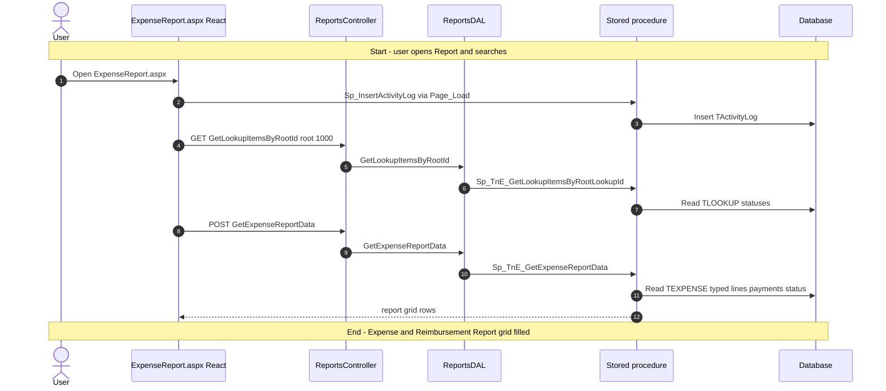
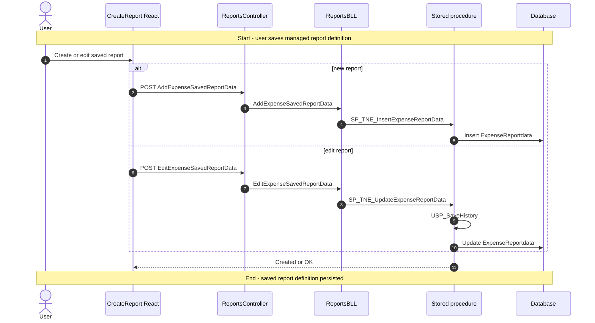
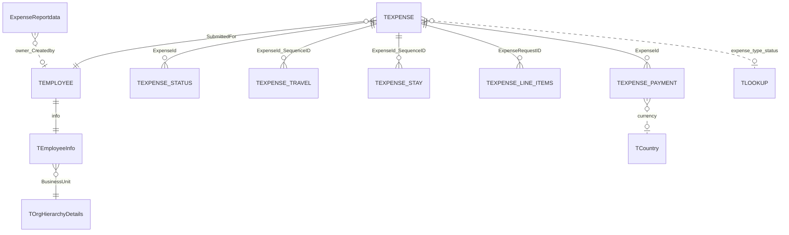

# Report

## Overview

A Travel & Expense user with claim `TE033` (`CNST_GENERATE_ER_REPORTS`) opens **Expense & Reimbursement → Report**. The left-nav leaf loads `~/HRM/TravelAndExpense/ExpenseReport.aspx` (`RouteConstants.ERREPORTS`). The host stamps session identity into hidden fields (including `hdnDisplayType=ER`), logs activity `ExpenseReport` (402), and mounts the webpack Travel & Expense React bundle into `#root`.

The live UI is `staticReports` (imported as `ViewReports`). For `displayType === "ER"`, employer web config (`ReportConfig.UCCReports` / `EcomakReports`) picks one of three tab layouts:

- **TDG (default)** — Expense & Reimbursement Report, optional Saved Reports, optional Pay Expenses.
- **UCC** — adds ERP Expense Report and Project Expense Report tabs.
- **Ecomak** — adds Expense SAP Report (still posts `GetExpenseReportData`) and Pay Expenses.

Search runs through the T&E WebAPI `api/Reports/{action}` (JWT actor applied in the controller). Filter dropdowns also hit Travel/Employee endpoints. The ASPX code-behind does not bind report grids. There is no SystemModel-2 page for this leaf in the SourceCode checkout. Runtime database slug is **hrms-travelnexpense** (plus a few HRMSCore filter procedures).

## Workflow

```mermaid
flowchart TD
  Nav["Expense and Reimbursement to Report"] --> Page["ExpenseReport.aspx"]
  Page --> Log["Sp_InsertActivityLog activity 402"]
  Page --> Bundle["travelandexpenses React bundle"]
  Bundle --> Auth["CNST_GENERATE_ER_REPORTS TE033"]
  Auth --> Tabs["staticReports displayType ER"]
  Tabs --> Main["Expense and Reimbursement Report tab"]
  Main --> Filters["status type currency payment report-based"]
  Filters --> LookRoot["GET Reports GetLookupItemsByRootId"]
  LookRoot --> LookRootSp["Sp_TnE_GetLookupItemsByRootLookupId"]
  Filters --> LookType["GET Travel GetLookupItemsByType"]
  LookType --> LookName["Sp_TnE_GetLookupItemsByName"]
  Filters --> Curr["GET Travel GetAllCurrency"]
  Curr --> CurrSp["Sp_TnE_GetAllCurrency"]
  Filters --> Proj["GET Employee GetProjectNamesandCodes"]
  Proj --> ProjSp["USP_TNE_GetAllLookupDetails"]
  Filters --> Budget["GET Employee GetBudgetCodes"]
  Budget --> BudgetSp["USP_GetDonorBudgetID"]
  Filters --> Loc["GET Employee GetWorkLocation"]
  Loc --> LocSp["SP_AdminWM_GetLocation"]
  Main --> Search["POST Reports GetExpenseReportData"]
  Search --> MainSp["Sp_TnE_GetExpenseReportData"]
  MainSp --> FnAmt["USP_TNE_FN_Get_CurrencyAmount"]
  MainSp --> FnLimit["FN_GetMaxLimitForAutoApprove"]
  MainSp --> FnL12["USP_TFN_Expense_L1L2Approval"]
  Tabs --> Saved["Saved Reports CRUD"]
  Saved --> SavedGet["Sp_TnE_GetSavedExpenseReportData"]
  Saved --> SavedIns["SP_TNE_InsertExpenseReportData"]
  Saved --> SavedUpd["SP_TNE_UpdateExpenseReportData"]
  Saved --> SavedDel["SP_TNE_DeleteExpenseReportData"]
  SavedUpd --> Hist["USP_SaveHistory synonym"]
  SavedDel --> Hist
  Tabs --> Erp["ERP or Advance or Project tabs"]
  Erp --> ErpSp["Sp_TnE_GetExpenseReport"]
  Erp --> AdvSp["Sp_TnE_GetAdvanceExpenseReport"]
  Erp --> ProjRpt["Sp_TnE_GetExpenseReportForProject"]
  ErpSp --> Enc["Sp_OpenEncryptionKeys then SP_CloseEncryptionKey"]
  Tabs --> Pay["Pay Expenses tab"]
  Pay --> PaySp["SP_TNE_GetPayExpenseReportDetails"]
```

No WebForms `__doPostBack` binds the report grids. Report traffic uses the TravelAndExpense API base (`API_URL`), not Core Node `/api/travel` stubs.

## Request journey

### Employee or admin — run Expense and Reimbursement Report

### Saved report owner — create or update a managed report

## Entry points

| UI / API | Purpose |
|---|---|
| `HRM/TravelAndExpense/ExpenseReport.aspx` | Left-nav host; `hdnDisplayType=ER`. |
| React route `RouteConstants.ERREPORTS` | `AuthroizedExpenseReport` → `staticReports`. |
| Claim `CNST_GENERATE_ER_REPORTS` (`TE033`) | Gate to open the page. |
| Claim `CNST_EXPENSE_SAVED_REPORTS` (`TE038`) | Saved Reports tab. |
| Claim `CNST_CREATE_SAVED_REPORTS` (`TE037`) | Create New Report button. |
| Claim `CNST_EXPENSE_PAY_REPORT` (`TE034`) | Pay Expenses tab. |
| `api/Reports/*` | Report search and saved-report CRUD. |
| `api/Travel/GetLookupItemsByType`, `GetAllCurrency` | Filter lookups and currencies. |
| `api/Employee/GetProjectNamesandCodes`, `GetBudgetCodes`, `GetWorkLocation`, `getRRSDonorDetailsSettings` | Project, budget, location, donor-budget UI flags. |

## Code → database call chain

| Entry point | DAL / BLL method | Stored procedure |
|---|---|---|
| `ExpenseReport.aspx.cs:32` `Page_Load` | `CommonUtil.LogActivity(ExpenseReport)` | `Sp_InsertActivityLog` (HRMS; activity 402) |
| `expenseStaticReports.js:310` → `GET GetLookupItemsByRootId` (`ReportsController.cs:61`) | `ReportsDAL.GetLookupItemsByRootId` (`ReportsDAL.cs:22`) | `Sp_TnE_GetLookupItemsByRootLookupId` |
| `expenseStaticReports.js:332` / payment / report-based → `GET GetLookupItemsByType` (`TravelController.cs:316`) | `TravelDAL.GetLookupItemsByType` → `GetLookupItemsByName` (`TravelDAL.cs:148`, `162`) | `Sp_TnE_GetLookupItemsByName` |
| `expenseStaticReports.js:479` → `GET GetAllCurrency` (`TravelController.cs:1116`) | `TravelDAL.GetAllCurrency` (`TravelDAL.cs:2807`) | `Sp_TnE_GetAllCurrency` |
| `expenseStaticReports.js:380` → `GET GetProjectNamesandCodes` (`EmployeeController.cs:214`) | `EmployeeDAL.GetProjectNamesandCodes` (`EmployeeDAL.cs:499`) | `USP_TNE_GetAllLookupDetails` |
| `expenseStaticReports.js:403` → `GET GetBudgetCodes` (`EmployeeController.cs:277`) | `EmployeeDAL.GetBudgetCodes` (`EmployeeDAL.cs:563`) | `USP_GetDonorBudgetID` (HRMS) |
| `expenseStaticReports.js:366` → `GET GetWorkLocation` (`EmployeeController.cs:293`) | `EmployeeDAL.GetWorkLocation` (`EmployeeDAL.cs:595`) | `SP_AdminWM_GetLocation` (HRMS) |
| `expenseStaticReports.js:355` → `GET getRRSDonorDetailsSettings` (`EmployeeController.cs:260`) | `EmployeeDAL.getRRSDonorDetailsSettings` (`EmployeeDAL.cs:531`) | `SP_GetRRSDonorDetailsSettings` (HRMS) |
| `expenseStaticReports.js:613` → `POST GetExpenseReportData` (`ReportsController.cs:116`) | `ReportsDAL.GetExpenseReportData` (`ReportsDAL.cs:246`) | `Sp_TnE_GetExpenseReportData` |
| `expenseSapReport.js:345` → same `GetExpenseReportData` | same | `Sp_TnE_GetExpenseReportData` |
| `expenseERPUCCStaticReports.js:309` → `POST GetERPExpenseReportData` (`ReportsController.cs:240`) | `ReportsDAL.GetERPExpenseReportData` (`ReportsDAL.cs:433`) | `Sp_TnE_GetExpenseReport` |
| `expenseERPUCCStaticReports.js:292` → `POST GetAdvanceExpenseReportData` (`ReportsController.cs:282`) | `ReportsDAL.GetAdvanceExpenseReportData` (`ReportsDAL.cs:517`) | `Sp_TnE_GetAdvanceExpenseReport` |
| `expenseUCCStaticReports.js:259` → `POST GetUCCExpenseReportData` (`ReportsController.cs:261`) | `ReportsDAL.GetUCCExpenseReportData` (`ReportsDAL.cs:475`) | `Sp_TnE_GetExpenseReportForProject` |
| `expensePayReports.js:245` → `POST GetPayExpenseReportData` (`ReportsController.cs:302`) | `ReportsDAL.GetPayExpenseReportData` (`ReportsDAL.cs:558`) | `SP_TNE_GetPayExpenseReportDetails` |
| Saved list / createReport / hooks → `POST GetExpenseSavedReportData` (`ReportsController.cs:170`) | `ReportsDAL.GetExpenseSavedReportData` (`ReportsDAL.cs:372`) | `Sp_TnE_GetSavedExpenseReportData` |
| `createReport.js:589` → `POST AddExpenseSavedReportData` (`ReportsController.cs:189`) | `ReportsDAL.AddExpenseSavedReportData` (`ReportsDAL.cs:400`) | `SP_TNE_InsertExpenseReportData` |
| `createReport.js:576` → `POST EditExpenseSavedReportData` (`ReportsController.cs:208`) | `ReportsDAL.EditExpenseSavedReportData` (`ReportsDAL.cs:212`) | `SP_TNE_UpdateExpenseReportData` (+ nested `USP_SaveHistory`) |
| savedReportHooks / managed → `POST DeleteExpenseSavedReport` (`ReportsController.cs:227`) | `ReportsDAL.DeleteExpenseSavedReportData` (`ReportsDAL.cs:186`) | `SP_TNE_DeleteExpenseReportData` (+ nested `USP_SaveHistory`) |

Nested from `Sp_TnE_GetExpenseReportData`: [`USP_TNE_FN_Get_CurrencyAmount`](/docs/database/hrms-travelnexpense/USP_TNE_FN_Get_CurrencyAmount), [`FN_GetMaxLimitForAutoApprove`](/docs/database/hrms-travelnexpense/FN_GetMaxLimitForAutoApprove), [`USP_TFN_Expense_L1L2Approval`](/docs/database/hrms-travelnexpense/USP_TFN_Expense_L1L2Approval), [`FN_LocationBU_GetEmployeeDetails`](/docs/database/hrms/FN_LocationBU_GetEmployeeDetails), [`Fn_GetEmployeeName`](/docs/database/hrms/Fn_GetEmployeeName). ERP/Project/Advance open/close keys via [`Sp_OpenEncryptionKeys`](/docs/database/hrms/Sp_OpenEncryptionKeys) / [`SP_CloseEncryptionKey`](/docs/database/hrms/SP_CloseEncryptionKey).

## API endpoints

T&E WebAPI route prefixes `api/Reports/{action}`, `api/Travel/{action}`, `api/Employee/{action}`. ClaimsAuthorize `TnE` / `HRMS`. Actor employee id is overwritten from JWT on report posts.

| Method | Path | Role on this page |
|---|---|---|
| GET | `/Reports/GetLookupItemsByRootId` | Status filter (root 1000) |
| POST | `/Reports/GetExpenseReportData` | Main / SAP report search |
| POST | `/Reports/GetERPExpenseReportData` | ERP Expense Report (non-advance) |
| POST | `/Reports/GetAdvanceExpenseReportData` | ERP when advance filter is true |
| POST | `/Reports/GetUCCExpenseReportData` | Project Expense Report |
| POST | `/Reports/GetPayExpenseReportData` | Pay Expenses |
| POST | `/Reports/GetExpenseSavedReportData` | Saved Reports list |
| POST | `/Reports/AddExpenseSavedReportData` | Create saved report |
| POST | `/Reports/EditExpenseSavedReportData` | Update saved report |
| POST | `/Reports/DeleteExpenseSavedReport` | Delete saved report |
| GET | `/Travel/GetLookupItemsByType` | ExpenseType / PaymentMode / ReportBased |
| GET | `/Travel/GetAllCurrency` | Currency dropdowns |
| GET | `/Employee/GetProjectNamesandCodes` | Project / cost-center filter |
| GET | `/Employee/GetBudgetCodes` | Budget code filter |
| GET | `/Employee/GetWorkLocation` | Work location / project region |
| GET | `/Employee/getRRSDonorDetailsSettings` | Show budget-source section |

`GetCustomExpenseReportData` and `GetCustomExpenseCategoryFields` exist on `ReportsController` but are **not** called from this Report UI.

No ASPX `__doPostBack` report binding.

## Stored procedures & tables involved

| Procedure | Role | Database docs |
|---|---|---|
| [`Sp_InsertActivityLog`](/docs/database/hrms/Sp_InsertActivityLog) | Page-access log | existing (hrms) |
| [`Sp_TnE_GetLookupItemsByRootLookupId`](/docs/database/hrms-travelnexpense/Sp_TnE_GetLookupItemsByRootLookupId) | Status lookup | written |
| [`Sp_TnE_GetLookupItemsByName`](/docs/database/hrms-travelnexpense/Sp_TnE_GetLookupItemsByName) | Typed lookups | written |
| [`Sp_TnE_GetAllCurrency`](/docs/database/hrms-travelnexpense/Sp_TnE_GetAllCurrency) | Currency list | written |
| [`USP_TNE_GetAllLookupDetails`](/docs/database/hrms-travelnexpense/USP_TNE_GetAllLookupDetails) | Project codes | written |
| [`USP_GetDonorBudgetID`](/docs/database/hrms/USP_GetDonorBudgetID) | Budget codes | written |
| [`SP_AdminWM_GetLocation`](/docs/database/hrms/SP_AdminWM_GetLocation) | Work locations | existing (hrms) |
| [`SP_GetRRSDonorDetailsSettings`](/docs/database/hrms/SP_GetRRSDonorDetailsSettings) | Donor-details flag | written |
| [`Sp_TnE_GetExpenseReportData`](/docs/database/hrms-travelnexpense/Sp_TnE_GetExpenseReportData) | Main report grid | written |
| [`Sp_TnE_GetExpenseReport`](/docs/database/hrms-travelnexpense/Sp_TnE_GetExpenseReport) | ERP report | written |
| [`Sp_TnE_GetAdvanceExpenseReport`](/docs/database/hrms-travelnexpense/Sp_TnE_GetAdvanceExpenseReport) | ERP advance report | written |
| [`Sp_TnE_GetExpenseReportForProject`](/docs/database/hrms-travelnexpense/Sp_TnE_GetExpenseReportForProject) | Project report | written |
| [`SP_TNE_GetPayExpenseReportDetails`](/docs/database/hrms-travelnexpense/SP_TNE_GetPayExpenseReportDetails) | Pay Expenses | written |
| [`Sp_TnE_GetSavedExpenseReportData`](/docs/database/hrms-travelnexpense/Sp_TnE_GetSavedExpenseReportData) | Saved list | written |
| [`SP_TNE_InsertExpenseReportData`](/docs/database/hrms-travelnexpense/SP_TNE_InsertExpenseReportData) | Insert saved | written |
| [`SP_TNE_UpdateExpenseReportData`](/docs/database/hrms-travelnexpense/SP_TNE_UpdateExpenseReportData) | Update saved | written |
| [`SP_TNE_DeleteExpenseReportData`](/docs/database/hrms-travelnexpense/SP_TNE_DeleteExpenseReportData) | Delete saved | written |
| [`USP_TNE_FN_Get_CurrencyAmount`](/docs/database/hrms-travelnexpense/USP_TNE_FN_Get_CurrencyAmount) | Nested amount text | existing |
| [`FN_GetMaxLimitForAutoApprove`](/docs/database/hrms-travelnexpense/FN_GetMaxLimitForAutoApprove) | Nested max limit | written |
| [`USP_TFN_Expense_L1L2Approval`](/docs/database/hrms-travelnexpense/USP_TFN_Expense_L1L2Approval) | Nested L1/L2/L3 labels | written |

Primary tables: `TEXPENSE`, typed expense detail tables (`TEXPENSE_TRAVEL`, `TEXPENSE_STAY`, … / `TEXPENSE_LINE_ITEMS`), `TEXPENSE_PAYMENT`, `TEXPENSE_STATUS`, `TLOOKUP`, `TCountry`, `TEMPLOYEE` / `TEmployeeInfo` / `TOrgHierarchyDetails`, `ExpenseReportdata` (+ history), and HRMS `TDonorBudget` / `TCustomerSettings` for budget filters.

## Table relationships

## Known gaps

- **`GetCustomExpenseReportData` / `GetCustomExpenseCategoryFields`** are exposed on `ReportsController` but not invoked by Report React components in this checkout.
- **`USP_SaveHistory`** is called from update/delete saved-report SPs via T&E synonym to HRMS; no `CREATE PROCEDURE USP_SaveHistory` script is present under `HRMS-DATABASE/HRMS` (only MultiID/MultiFilter variants and the synonym).
- **`Sp_TnE_GetExpenseReportData.sql` and several siblings still carry `USE [TravelNExpense_Prod]`** in the Liquibase source header.
- **`EmployeeDAL.GetWorkLocation`** passes `@EmployeeId = employerId` (same value as employer) into `SP_AdminWM_GetLocation`.
- **Saved-report `DeleteExpenseSavedReport`** does not apply JWT actor overwrite (unlike add/edit).
- **SystemModel-2** has no dedicated Expense Report workflow page in this checkout.
- Tab set depends on `WebExpensePartTwoTNEConfiguration.ReportConfig`; wrong config hides UCC/Ecomak tabs without a code change.

## Reference

- `HRMS.Web/HRMS.Web/HRM/TravelAndExpense/ExpenseReport.aspx` (+ `.cs`)
- `HRMS.Web/.../Areas/routes.js`
- `HRMS.Web/.../Areas/Reports/Containers/staticReports.js`
- `HRMS.Web/.../Areas/Reports/Components/expenseStaticReports.js`
- `HRMS.Web/.../Areas/Reports/Components/expenseERPUCCStaticReports.js`
- `HRMS.Web/.../Areas/Reports/Components/expenseUCCStaticReports.js`
- `HRMS.Web/.../Areas/Reports/Components/expenseSapReport.js`
- `HRMS.Web/.../Areas/Reports/Components/expensePayReports.js`
- `HRMS.Web/.../Areas/Expense/Containers/createReport.js`
- `HRMS.Web/.../Common/apiURLConstants.js`
- `HRMS.Web/.../Common/ClaimConstants.js`
- `HRMS.TravelAndExpense.WebAPI/Controllers/ReportsController.cs`
- `HRMS.TravelAndExpense.WebAPI/Controllers/TravelController.cs`
- `HRMS.TravelAndExpense.WebAPI/Controllers/EmployeeController.cs`
- `HRMS.TravelAndExpense.DAL/Reports/ReportsDAL.cs`
- `HRMS.TravelAndExpense.DAL/Travel/TravelDAL.cs`
- `HRMS.TravelAndExpense.DAL/Employee/EmployeeDAL.cs`
- `HRMS-DATABASE/HRMS_TRAVELNEXPENSE/STOREPROCEDURE/Sp_TnE_GetExpenseReportData.sql` (and sibling report / saved-report procedures)
