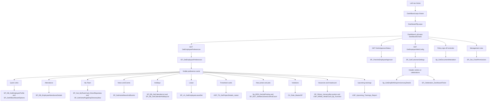
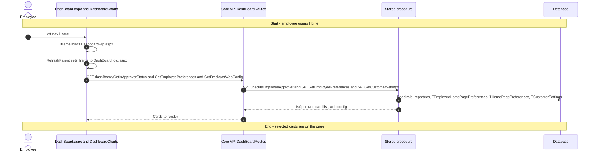
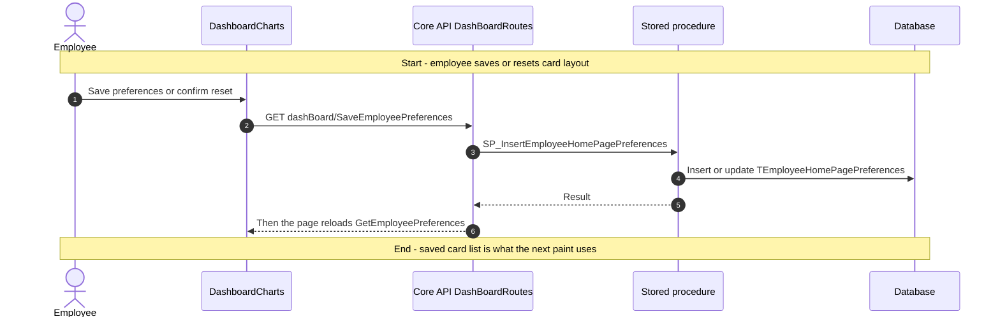
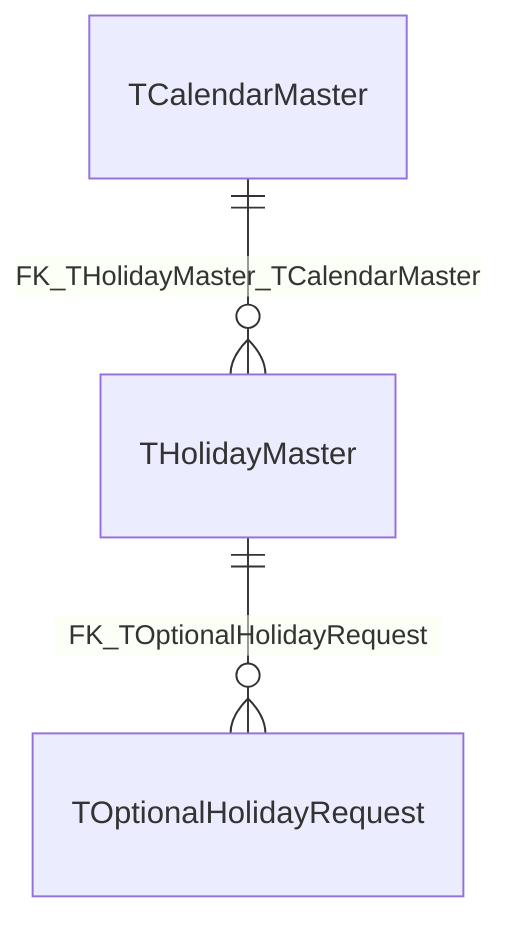

# Home

## Overview

Home is the page an employee lands on after they sign in. The left nav has no submenu. The shell is `DashBoard.aspx`. It only hosts an iframe. `DashboardFlip.aspx` then points that iframe at the React dashboard, and the route `DASHBOARD_HOMEPAGE` renders `DashboardCharts`.

What the employee sees is a set of preference cards, not a fixed layout. On load the page asks which cards this person has turned on, and whether they are an approver. Approvers get a team side on attendance, leave, and timesheet. Everyone else stays on their own numbers. The cards, in the order the employee has saved, are Quick Links, Attendance, My Team (directory and new colleagues), Allocated vs Logged Hours, New Joinee(s) / Refer a friend, Timesheet, News and Events, Holidays, Leave, Violation and Occurrence, Vacancies by location, Headcount by business unit, and Upcoming Trainings. A policy sign-off reminder sits above the cards when documents are waiting. The header can switch the same page to a management dashboard, or, when the employer has turned it on, to Celebrations.

Saving preferences writes the selected card ids back for that employee. Resetting stores an empty list so the next load uses the employer default. The management switch is a second layout on this same route. Its New Look is the one shown first. Individual management charts are a separate set of calls and are not part of the employee card story below.

The shell behaviour is the one described in `docs/SystemModels/SystemModel-2/experience/surfaces/surfaces.md`: `DashBoard.aspx` hosts the iframe, and navigation swaps `frmDashBoard`. Live Core API registration mounts `DashBoardRoutes.js` at `/dashBoard`. The `/v2/dashBoard` mount is the license reader, not this page. Preference and holiday rows are catalogued in `llm-wiki/reference/tables/hrms.md` (`TEmployeeHomePagePreferences`, `THomePagePreferences`, `THolidayMaster`, `TCustomerSettings`, `TChartPermissions`, `TNewsAndEvents`). There is no llm-wiki domain page for the home layout itself. Attendance and leave cards read the same day and leave records described in `llm-wiki/domain/attendance-lifecycle.md` and `llm-wiki/domain/leave-lifecycle.md`.

## Workflow

The employee can drag cards and hide them. Save calls `SP_InsertEmployeeHomePagePreferences`. Reset sends preference ids `0`, which that procedure stores as NULL.

## Request journey

Opening Home is one request chain from the menu to the cards. Saving the layout is a second request on the same page.

### Open Home

Each visible card then loads its own procedure. Those hops are in the workflow and in the call chain below. They are not a second copy of this opening request.

### Save dashboard preferences

Reset uses the same save route with preference ids `0`.

## Entry points

- Left nav **Home** opens `HRMS.Web/HRMS.Web/DashBoard.aspx`. The iframe `frmDashBoard` starts at `~/DashBoardFlip.aspx` (`DashBoard.aspx` line 4).
- `DashboardFlip.aspx.cs` lines 18-25 choose `HRM/DashBoard_React/DashBoard_old.aspx` when `employee.DashBoardType` is empty, and `Dashboard_old.aspx` when it is set. `DashboardFlip.aspx` lines 8-18 run `RefreshParent`, set the parent title to Home, and assign that path to `#MainContent_frmDashBoard`.
- React route `DASHBOARD_HOMEPAGE` is `/HRM/DashBoard_React/DashBoard_old.aspx` (`Common/routeConstants.js` line 3). `Areas/routes.js` line 113 renders `DashboardCharts` for that path.
- `DashboardCharts.js` lines 345-458 map preference names to cards. Lines 555-571 always mount the policy reminder and the header. Lines 572-660 switch among home cards, Celebrations, and the management dashboard.
- Core API `Routes/routeIndex.js` line 22 mounts `./DashBoardRoutes` at `/dashBoard`. That file is `DashBoardRoutes.js`, which uses `Controllers/dashboardController.js` and `Core/DataAccessLayer/dashBoardDAL.js`. `DashBoardRoutes_V2.js` and `DashBoardRoutes_V3.js` are not mounted on `/dashBoard`.

`docs/SystemModels/SystemModel-2/experience/surfaces/surfaces.md` describes this same shell: `DashBoard.aspx` is the iframe host under `SiteMain.Master`, and `DashboardFlip.aspx` runs under `Site.Master` before the React module replaces the iframe.

## Code → database call chain

File paths are under `HRMS.Web/HRMS.Web` unless noted. Procedure links are the database pages.

| What the page does | UI | API constant | Controller | DAL execute |
|---|---|---|---|---|
| Card list | `DashboardCharts.js` 114-116 | `apiURLConstants.js` 59 `GET_EMPLOYEE_PREFERENCES` | `dashboardController.js` 644-648 uses `req.EID` | `dashBoardDAL.js` 621 `SP_GetEmployeePreferences` |
| Approver flag | `DashboardCharts.js` 111-113 | `apiURLConstants.js` 56 `GET_ISAPPROVER_STATUS_FORCHARTS` | `dashboardController.js` 669-674 uses `req.EID` | `dashBoardDAL.js` 875 `SP_CheckIsEmployeeApprover` |
| Web config, celebration flag, management flag | `DashboardCharts.js` 202 and `TopHeader.js` 136 | `apiURLConstants.js` 87 | `dashboardController.js` 1096-1098 | `dashBoardDAL.js` 1081 `SP_GetCustomerSettings` |
| Save or reset cards | `Areas/Dashboard/Shared/api.js` 45-63 | `apiURLConstants.js` 27 `SAVE_PREFERENCES` | `dashboardController.js` 656-661 | `dashBoardDAL.js` 637 `SP_InsertEmployeeHomePagePreferences` |
| Quick Links profile | `EmployeeQuickLinks.js` 37 | `apiURLConstants.js` 40 | `dashboardController.js` 485-488 uses `req.EID` | `dashBoardDAL.js` 505 `SP_DB_GetEmployeeProfile` |
| Quick Links tiles | `EmployeeQuickLinks.js` 38 | `apiURLConstants.js` 41 module `Dashboard` | `dashboardController.js` 421-423 | `dashBoardDAL.js` 404 `SP_GetAllDashboardOptions` |
| Business-unit label | `EmployeeQuickLinks.js` 40 | `apiURLConstants.js` 563 | `dashboardController.js` 3590 | `dashBoardDAL.js` 4825 `SP_GetBusinessUnitByEmployerId` |
| My Team direct | `EmpDirectoryNewJoinee.js` 315 | `apiURLConstants.js` 32 | `dashboardController.js` 2590-2600 | `dashBoardDAL.js` 3979 `SP_Get_MyTeamCard_DirectReportees` |
| My Team indirect | `EmpDirectoryNewJoinee.js` 318 | `apiURLConstants.js` 33 | `dashboardController.js` 2607-2617 | `dashBoardDAL.js` 3979 `SP_Get_MyTeamCard_InDirectReportees` |
| My Team directory | `EmpDirectoryNewJoinee.js` 321 | `apiURLConstants.js` 31 | `dashboardController.js` 332-339 | `dashBoardDAL.js` 345 `SP_GetHomePageEmpDirectoryNew` |
| News | `NewsAndEvents.js` 306 | `apiURLConstants.js` 448 | `dashboardController.js` 2934 | `dashBoardDAL.js` 4460 `SP_GetHomeNewsAndEvents` |
| Holiday calendars | `HolidayList.js` 37 and 48 | `apiURLConstants.js` 45 and 47 | `dashboardController.js` 613-636 | `dashBoardDAL.js` 581 and 607 |
| Holiday dates | `HolidayList.js` 70 | `apiURLConstants.js` 46 | `dashboardController.js` 622-626 | `dashBoardDAL.js` 594 `SP_DB_GetCalenderHolidayList` |
| My attendance | `MyAttendence.js` 141 | `apiURLConstants.js` 42 | `dashboardController.js` 496-502 | `dashBoardDAL.js` 520 `SP_DB_EmployeeAttendanceDetails` |
| Team attendance | `TeamAttendance.js` 85 | `apiURLConstants.js` 34 | `dashboardController.js` 464-478 uses `req.EID` | `dashBoardDAL.js` 492 `SP_GetTeamAttendanceDetailsNew` |
| Attendance mode sentence | `MyAttendence.js` 177 | `apiURLConstants.js` 285 | `AttendanceController.js` 3270 | `AttendanceDAL.js` 3704 `USP_GetAttendanceModeChangedMessage` |
| Attendance action tabs | `AttendanceDetails.js` 65 | `apiURLConstants.js` 581 menu 1173 | `terminationController.js` 367-374 | `terminationDAL.js` 363 and 378 |
| My leave | `MyOwnLeaveChart.js` 51 | `apiURLConstants.js` 36 | `dashboardController.js` 72-82 | `dashBoardDAL.js` 62 `SP_LA_GetEmployeeLeaveDet` |
| Team leave | `TeamLeave.js` 50 | `apiURLConstants.js` 22, same route as monthly | `dashboardController.js` via `DashBoardRoutes.js` 14 | `dashBoardDAL.js` 94 `SP_GetTeamLeaveCard` |
| Timesheet projects | `DashboardCharts.js` 255 and `TimesheetResourceTypeMain.js` 57 | `apiURLConstants.js` 58 via `APIHelper.getTimeport` | Timeport `timeportController.js` 290 | `timeportDAL.js` 825 `USP_TS_GetProjectDetails_Latest` |
| Allocated vs logged, me | `TimesheetChart.js` 79 | `apiURLConstants.js` 53 | `timeportController.js` 420 | `timeportDAL.js` 1446 `Sp_gettimesheetdetailsbydatewise` |
| Allocated vs logged, team | `TimesheetChart.js` 93 | `apiURLConstants.js` 54 | `timeportController.js` 430 | `timeportDAL.js` 1461 `SP_TS_GetTeamTimePortDetails` |
| Job postings | `JobOpening.js` 48 | `apiURLConstants.js` 55 | `recruitmentController.js` 750 | `recruitmentDAL.js` 2223 `Sp_RRS_GetJobPosting` |
| New joinees | `JobOpening.js` 60 | `apiURLConstants.js` 62 | `recruitmentController.js` 2021 | `recruitmentDAL.js` 5500 `SP_GET_GetNewJoineeListAndCount` |
| Violations | `ViolationAndOccurrence.js` 48 | `apiURLConstants.js` 151 | `ViolationsOccurrenceController.js` 58 | `violationsOccurrenceDAL.js` 210 `OV_Rule_MasterSP` |
| Vacancies | `VacanciesByLocation.js` 112 | `apiURLConstants.js` 348 | `dashboardController.js` 1910 | `dashBoardDAL.js` 3134 `SP_Others_VacancyByLocation` |
| Headcount | `HeadCountByFunction.js` 111 | `apiURLConstants.js` 349 | `dashboardController.js` 2121 | `dashBoardDAL.js` 3166 `USP_HRMS_HeadCount_By_Function` |
| Trainings | `UpcomingTrainings.js` 30, 53, 69 | `apiURLConstants.js` 370-372 | `dashboardController.js` 2397, 2409, 2421 | `dashBoardDAL.js` 3731, 3764, 3782 |
| Policy list and sign-off | `PolicySignOffReminder.js` 607 and 1006 | `apiURLConstants.js` 60 and 61 | `MobileAPIController.js` 92 and 101 | `mobileAPIDAL.js` 113 and 129 |
| Wishes when hub is off | `TopHeader.js` 165 and 182 | `apiURLConstants.js` 132 and 25 | `dashboardController.js` 1901 and 299 | `dashBoardDAL.js` 3117 and 288 |
| Send a wish | `TopHeader.js` 224 | `apiURLConstants.js` 26 | `dashboardController.js` 311 | `dashBoardDAL.js` 305 `Sp_InsertEventDetails` |
| Celebration ticker | `TopHeader.js` 121 | `celebrationsApi.js` 73 | `Features/CelebrationsHub/feed/handlers.js` 399 | `SP_Celebration_DashboardTicker` |
| Celebration feed | `CelebrationsFeed.js` 231 | `celebrationsApi.js` 81 | `feed/handlers.js` 180 | `SP_Celebration_FeedList` plus `SP_Celebration_SettingsGet` |
| Management permission | `TopHeader.js` 83 and `useNewManagementDashboardBootstrap.js` 77 | `apiURLConstants.js` 306 module 0 | `dashboardController.js` 2198 | `dashBoardDAL.js` 3298 `SP_Get_ChartPermissions` |
| Employer switcher | bootstrap line 48 | `apiURLConstants.js` 93 | `dashboardController.js` 806 | `dashBoardDAL.js` 830 `SP_GetGlobalAccessEmployerList` |
| Classic management cards | `ManagementDashboard.js` 193 | `apiURLConstants.js` 373 and 374 | `dashboardController.js` 2433 and 2445 | `dashBoardDAL.js` 3861 and 3877 |

`dashBoardDAL.js` declares `GetIsApproverStatus` twice (lines 697 and 868). Both execute `SP_CheckIsEmployeeApprover`. The later declaration is the one that runs.

Timeport calls use `process.env.API_URL_Timeport` (`apiHelper.js` lines 11 and 356). That service mounts `TimeportRoutes.js` at `/timeport` (`HRMS.TimePort` `Routes/routeIndex.js` line 10), not the `/v2/timeport` router. The DAL string `Sp_gettimesheetdetailsbydatewise` is the procedure created as `SP_GetTimeSheetDetailsByDateWise` in HRM-TIMEPORT.

Training procedures are executed by the Core dashboard DAL on the HRMS connection. HRMS exposes them as synonyms to `Training.dbo` (`HRMS/SYNONYMS/Syn_USP_Upcoming_Trainings_Report.sql` and the matching assign and unenroll synonyms). The procedure bodies live in HRMS-TRAINING.

`GET_ISAPPROVER_STATUS_FORCHARTS` is called with a third `userRole` argument (`DashboardCharts.js` line 112). The constant only interpolates employer id and employee id (`apiURLConstants.js` line 56), so the role is not sent.

## API endpoints

Routes below are the ones this page calls for the opening load and the primary card read or save. Query names match the client constant. Where the controller replaces the employee id with `req.EID`, the token employee is what the procedure receives.

| Verb | Route | Params | Required | Where |
|---|---|---|---|---|
| GET | `/dashBoard/GetEmployeePreferences` | `employeeId`, `employerId` | Both sent. Procedure employee id is `req.EID` | `DashBoardRoutes.js` 48, `apiURLConstants.js` 59 |
| GET | `/dashBoard/GetIsApproverStatus` | `pEmployerId`, `pEmployeeID` | Both sent. Procedure employee id is `req.EID` | `DashBoardRoutes.js` 50, `apiURLConstants.js` 56 |
| GET | `/dashBoard/GetEmployerWebConfig` | `CustomerId` | Sent from `UserInfo.customerId` | `DashBoardRoutes.js` 69, `apiURLConstants.js` 87 |
| GET | `/dashBoard/SaveEmployeePreferences` | `EmployeeId`, `EmployerId`, `PreferenceIds` | All three. Reset sends `PreferenceIds=0` | `DashBoardRoutes.js` 49, `Shared/api.js` 45-63 |
| GET | `/dashBoard/GetEmployeeProfileDetails` | `employeeId` | Sent. Procedure uses `req.EID` | `DashBoardRoutes.js` 38 |
| GET | `/dashBoard/GetDynamicLinksDetail` | `employerId`, `module` | Both. Quick Links sends `module=Dashboard` | `DashBoardRoutes.js` 33 |
| GET | `/dashBoard/GetEmployerBusinessUnitLabel` | `employerId` | Sent | `DashBoardRoutes.js` 301 |
| GET | `/dashBoard/GetMyTeamDirectReportees` | `employeeName`, `pageNumber`, `pageSize` | Optional filters. Employee id is `req.EID` | `DashBoardRoutes.js` 228 |
| GET | `/dashBoard/GetMyTeamIndirectReportees` | same | same | `DashBoardRoutes.js` 229 |
| GET | `/dashBoard/GetEmployeeDirectoryTeamData` | `employerId`, `employeeId`, `employeeName`, `pageNumber`, `pageSize` | Employer and employee sent. Name and paging optional | `DashBoardRoutes.js` 31 |
| GET | `/dashBoard/GetHomeNewsAndEvents` | `Employeeid`, `Employerid`, `PageNumber`, `PageSize`, optional `UnreadMustReadOnly` | First four sent | `DashBoardRoutes.js` 262 |
| GET | `/dashBoard/GetCalendarList` | `employerId` | Sent | `DashBoardRoutes.js` 44 |
| GET | `/dashBoard/GetEmployeeCalendar` | `employeeId` | Sent | `DashBoardRoutes.js` 47 |
| GET | `/dashBoard/GetCalendarHolidayList` | `calendarId` | Sent after a calendar is chosen | `DashBoardRoutes.js` 46 |
| GET | `/dashBoard/GetEmployeeAttendanceDetails` | `employeeId`, `startDate`, `endDate` | All sent. DAL binds start and end as month and year | `DashBoardRoutes.js` 39, `dashBoardDAL.js` 518-519 |
| GET | `/dashBoard/GetAttendanceDetailsForTeam` | `employerId`, `employeeName`, `startDate`, `endDate`, `EmployeeIds`, `PageNumber`, `PageSize` | Employer and dates sent. Name, ids, and paging optional. Employee id is `req.EID` | `DashBoardRoutes.js` 37 |
| GET | `/attendance/GetAttendanceModeChangedMessage` | `EmployeeId` | Sent | `AttendanceRoutes.js` 123 |
| GET | `/termination/GetMenuOrTabAccess` | `employerId`, `userId`, `userRoleId`, `menuId`, `returnAllTabsFromMenu` | All sent. Menu id is `1173`, return-all is `1` | `TerminationRoutes.js` 34 |
| GET | `/dashBoard/getEmployeeLeavePlan` | `employeeId`, `startDate`, `endDate` | All sent | `DashBoardRoutes.js` 15 |
| GET | `/dashBoard/getTeamMonthlyLeavePlan` | `employeeId`, `startDate`, `endDate` | All sent. The team-leave constant uses this route | `DashBoardRoutes.js` 14, `apiURLConstants.js` 22 |
| GET | Timeport `/timeport/GetProjectsforCharts` | `pEmployerId`, `pEmployeeID`, `individual`, `EffectiveDate` | All sent | `TimeportRoutes.js` 54 |
| GET | Timeport `/timeport/GetEmpTimeSheetMonthWiseProjectDetails` | `EmployeeId`, `Month`, `Year` | All sent | `TimeportRoutes.js` 62 |
| GET | Timeport `/timeport/GetEmpTimeSheetMonthWiseProjectTeamDetails` | `EmployeeId`, `Month`, `Year` | All sent | `TimeportRoutes.js` 63 |
| GET | `/recruitment/getJobPostings` | `employerId`, `postingType` | `postingType` optional. The card passes the employee id in `employerId`. DAL binds it to `@EmployeeId` | `RecruitmentRoutes.js` 66, `recruitmentDAL.js` 2216 |
| GET | `/recruitment/getNewJoineeList` | `employerid`, `monthDate`, `pageNumber`, `pageSize`, `employeeId` | All sent by the card. `multiOrg` is not sent, so the DAL passes null | `RecruitmentRoutes.js` 170 |
| GET | `/violationsOccurrence/GetAllMasterRules` | `employerId`, `employeeId`, `RunFor` | See Known gaps. The card intends `RunFor=self` | `ViolationsOccurrenceRoutes.js` 12 |
| GET | `/dashBoard/GetVacanciesByLocation` | `employerId`, `buId`, `fromDate`, `toDate` | Employer sent. Business unit and dates optional | `DashBoardRoutes.js` 157 |
| GET | `/dashBoard/GetHeadcountByFunction` | same shape | same | `DashBoardRoutes.js` 158 |
| GET | `/dashBoard/GetTrainingsDetails` | `employeeId`, `employerId` | Both sent | `DashBoardRoutes.js` 213 |
| POST | `/dashBoard/AssignTraining` | JSON body of assignment fields | Sent on assign. DAL sets `pIsFromDashboard` to 1 | `DashBoardRoutes.js` 214, `dashBoardDAL.js` 3760 |
| POST | `/dashBoard/UnAssignTraining` | `TrainingID`, `EmployeeId`, `EmployerId` | Sent on unassign | `DashBoardRoutes.js` 215 |
| GET | `/mobileAPI/GetEmployeePolicyDocuments` | `Employeeid` | Sent | `MobileAPIRoutes.js` 13 |
| POST | `/mobileAPI/SignOffAttestedDocs` | `Employeeid`, `Documentids`, `Employerid`, optional `WorkflowId` and source | Ids sent. Source defaults to `BANNER` in the DAL | `MobileAPIRoutes.js` 18, `mobileAPIDAL.js` 128 |
| GET | `/dashBoard/GetEmployerWishesMessage` | `employerId` | Sent when the header composes a wish | `DashBoardRoutes.js` 156 |
| GET | `/dashBoard/GetBirthdayAnniversaryDetails` | `employerId`, `employeeId` | Sent when Celebrations Hub is off. Procedure login employee is `req.EID` | `DashBoardRoutes.js` 28 |
| POST | `/dashBoard/SendWishes` | body `EventType`, `employerId`, `toEmployeeId`, `fromEmployeeId`, `wishMessage` | Sent when the employee sends a wish | `DashBoardRoutes.js` 29 |
| GET | `/api/celebrations-hub/dashboard-ticker` | `employerId` | Sent when hub is on. Actor is `req.EID` | `Features/CelebrationsHub/router.js` 94. Client path is `/celebrations-hub/dashboard-ticker` |
| GET | `/api/celebrations-hub/feed` | `employerId`, optional `category`, `sort`, `search`, `aboutMe`, `page`, `pageSize` | Employer sent | `router.js` 93 |
| GET | `/dashBoard/GetChartPermissionsGridData` | `employerId`, `moduleId`, `employerIDs` | Employer sent. Header passes `moduleId=0` and `employerIDs=null` | `DashBoardRoutes.js` 167 |
| GET | `/dashBoard/getGlobalAccessEmployerList` | `employeeId` | Sent by the management bootstrap. The client constant spells the path `GetGlobalAccessEmployerList` | `DashBoardRoutes.js` 59, `apiURLConstants.js` 93 |
| GET | `/dashBoard/GetEmployeeManagementPreferences` | `employeeId`, `employerId` | Sent by the classic management view | `DashBoardRoutes.js` 218 |
| GET | `/dashBoard/SaveEmployeeManagementPreferences` | `EmployeeId`, `EmployerId`, `PreferenceIds` | Sent when classic management preferences are saved | `DashBoardRoutes.js` 219 |

`routeIndex.js` lines 48, 63, 118, 124, and 139 mount recruitment, mobile API, attendance, violations, and termination. `Utils/FeatureRegister.js` line 37 mounts the Celebrations router, which attaches `/api/celebrations-hub` in `Features/CelebrationsHub/router.js` lines 109-112. `routeIndex.js` line 263 mounts `/managementDashboard` for the New Look charts. Those chart routes are not listed here.

The WebForms shell is not only a redirect. `DashboardFlip.aspx` is a redirect into the React page. After that, the cards call the routes above.

## Stored procedures & tables involved

Pages below are the procedure or function this page calls, plus the procedures and functions those call directly. Deeper calls are named on the nested page and are not given their own page here.

| Procedure | Database | Page | What Home uses it for |
|---|---|---|---|
| `SP_GetEmployeePreferences` | hrms | [SP_GetEmployeePreferences](/docs/database/hrms/SP_GetEmployeePreferences) | Card list |
| `SP_InsertEmployeeHomePagePreferences` | hrms | [SP_InsertEmployeeHomePagePreferences](/docs/database/hrms/SP_InsertEmployeeHomePagePreferences) | Save and reset |
| `SP_CheckIsEmployeeApprover` | hrms | [SP_CheckIsEmployeeApprover](/docs/database/hrms/SP_CheckIsEmployeeApprover) | Team tabs |
| `SP_GetCustomerSettings` | hrms | [SP_GetCustomerSettings](/docs/database/hrms/SP_GetCustomerSettings) | Web config. Page already existed and was left as-is |
| `SP_DB_GetEmployeeProfile` | hrms | [SP_DB_GetEmployeeProfile](/docs/database/hrms/SP_DB_GetEmployeeProfile) | Quick Links profile |
| `SP_GetAllDashboardOptions` | hrms | [SP_GetAllDashboardOptions](/docs/database/hrms/SP_GetAllDashboardOptions) | Quick Links tiles |
| `SP_GetBusinessUnitByEmployerId` | hrms | [SP_GetBusinessUnitByEmployerId](/docs/database/hrms/SP_GetBusinessUnitByEmployerId) | Business-unit caption |
| `SP_Get_MyTeamCard_DirectReportees` | hrms | [SP_Get_MyTeamCard_DirectReportees](/docs/database/hrms/SP_Get_MyTeamCard_DirectReportees) | Direct reportees |
| `SP_Get_MyTeamCard_InDirectReportees` | hrms | [SP_Get_MyTeamCard_InDirectReportees](/docs/database/hrms/SP_Get_MyTeamCard_InDirectReportees) | Indirect reportees |
| `SP_GetHomePageEmpDirectoryNew` | hrms | [SP_GetHomePageEmpDirectoryNew](/docs/database/hrms/SP_GetHomePageEmpDirectoryNew) | Directory search |
| `SP_GetHomeNewsAndEvents` | hrms | [SP_GetHomeNewsAndEvents](/docs/database/hrms/SP_GetHomeNewsAndEvents) | News card |
| `SP_DB_GetCalendarList` | hrms | [SP_DB_GetCalendarList](/docs/database/hrms/SP_DB_GetCalendarList) | Holiday calendars |
| `SP_GetEmployeeCalendar` | hrms | [SP_GetEmployeeCalendar](/docs/database/hrms/SP_GetEmployeeCalendar) | Employee's calendar |
| `SP_DB_GetCalenderHolidayList` | hrms | [SP_DB_GetCalenderHolidayList](/docs/database/hrms/SP_DB_GetCalenderHolidayList) | Holiday dates |
| `SP_DB_EmployeeAttendanceDetails` | hrms | [SP_DB_EmployeeAttendanceDetails](/docs/database/hrms/SP_DB_EmployeeAttendanceDetails) | My attendance month |
| `SP_GetTeamAttendanceDetailsNew` | hrms | [SP_GetTeamAttendanceDetailsNew](/docs/database/hrms/SP_GetTeamAttendanceDetailsNew) | Team attendance |
| `USP_GetAttendanceModeChangedMessage` | hrms | [USP_GetAttendanceModeChangedMessage](/docs/database/hrms/USP_GetAttendanceModeChangedMessage) | Mode-changed sentence |
| `Sp_AdminRoleM_GetTabRoleDet` | hrms | [Sp_AdminRoleM_GetTabRoleDet](/docs/database/hrms/Sp_AdminRoleM_GetTabRoleDet) | Role tabs for menu 1173 |
| `Sp_GetTabUserDetails` | hrms | [Sp_GetTabUserDetails](/docs/database/hrms/Sp_GetTabUserDetails) | User tabs for menu 1173 |
| `SP_LA_GetEmployeeLeaveDet` | hrms | [SP_LA_GetEmployeeLeaveDet](/docs/database/hrms/SP_LA_GetEmployeeLeaveDet) | My leave |
| `SP_GetTeamLeaveCard` | hrms | [SP_GetTeamLeaveCard](/docs/database/hrms/SP_GetTeamLeaveCard) | Team leave |
| `USP_TS_GetProjectDetails_Latest` | hrm-timeport | [USP_TS_GetProjectDetails_Latest](/docs/database/hrm-timeport/USP_TS_GetProjectDetails_Latest) | Timesheet projects |
| `SP_GetTimeSheetDetailsByDateWise` | hrm-timeport | [SP_GetTimeSheetDetailsByDateWise](/docs/database/hrm-timeport/SP_GetTimeSheetDetailsByDateWise) | My allocated vs logged |
| `SP_TS_GetTeamTimePortDetails` | hrm-timeport | [SP_TS_GetTeamTimePortDetails](/docs/database/hrm-timeport/SP_TS_GetTeamTimePortDetails) | Team allocated vs logged |
| `Sp_RRS_GetJobPosting` | hrms | [Sp_RRS_GetJobPosting](/docs/database/hrms/Sp_RRS_GetJobPosting) | Job postings |
| `SP_GET_GetNewJoineeListAndCount` | hrms | [SP_GET_GetNewJoineeListAndCount](/docs/database/hrms/SP_GET_GetNewJoineeListAndCount) | New joinees |
| `OV_Rule_MasterSP` | hrms | [OV_Rule_MasterSP](/docs/database/hrms/OV_Rule_MasterSP) | Violation card |
| `SP_Others_VacancyByLocation` | hrms | [SP_Others_VacancyByLocation](/docs/database/hrms/SP_Others_VacancyByLocation) | Vacancies card |
| `USP_HRMS_HeadCount_By_Function` | hrms | [USP_HRMS_HeadCount_By_Function](/docs/database/hrms/USP_HRMS_HeadCount_By_Function) | Headcount card |
| `USP_Upcoming_Trainings_Report` | hrms-training | [USP_Upcoming_Trainings_Report](/docs/database/hrms-training/USP_Upcoming_Trainings_Report) | Upcoming trainings |
| `Sp_TR_InsertTrainingAssignment` | hrms-training | [Sp_TR_InsertTrainingAssignment](/docs/database/hrms-training/Sp_TR_InsertTrainingAssignment) | Assign from the card |
| `Sp_TR_UnenrollTraining` | hrms-training | [Sp_TR_UnenrollTraining](/docs/database/hrms-training/Sp_TR_UnenrollTraining) | Unassign from the card |
| `Sp_GetDocumentAttestation` | hrms | [Sp_GetDocumentAttestation](/docs/database/hrms/Sp_GetDocumentAttestation) | Policies to sign |
| `SP_InsertDocumentAttestation` | hrms | [SP_InsertDocumentAttestation](/docs/database/hrms/SP_InsertDocumentAttestation) | Sign-off |
| `USP_GetEmployerWishesMaster` | hrms | [USP_GetEmployerWishesMaster](/docs/database/hrms/USP_GetEmployerWishesMaster) | Default wish text |
| `Sp_GetEmpBirthDayAnniversaryDetails` | hrms | [Sp_GetEmpBirthDayAnniversaryDetails](/docs/database/hrms/Sp_GetEmpBirthDayAnniversaryDetails) | Header when hub is off |
| `Sp_InsertEventDetails` | hrms | [Sp_InsertEventDetails](/docs/database/hrms/Sp_InsertEventDetails) | Send a wish |
| `SP_Celebration_SettingsGet` | hrms | [SP_Celebration_SettingsGet](/docs/database/hrms/SP_Celebration_SettingsGet) | Hub settings for ticker and feed |
| `SP_Celebration_DashboardTicker` | hrms | [SP_Celebration_DashboardTicker](/docs/database/hrms/SP_Celebration_DashboardTicker) | Header ticker |
| `SP_Celebration_FeedList` | hrms | [SP_Celebration_FeedList](/docs/database/hrms/SP_Celebration_FeedList) | Celebrations view |
| `SP_Get_ChartPermissions` | hrms | [SP_Get_ChartPermissions](/docs/database/hrms/SP_Get_ChartPermissions) | Who may open management charts |
| `SP_GetGlobalAccessEmployerList` | hrms | [SP_GetGlobalAccessEmployerList](/docs/database/hrms/SP_GetGlobalAccessEmployerList) | Employer list. Page already existed and was left as-is |
| `SP_GetEmployeeChartPreferences` | hrms | [SP_GetEmployeeChartPreferences](/docs/database/hrms/SP_GetEmployeeChartPreferences) | Classic management cards |
| `SP_InsertEmployeeChartPreferences` | hrms | [SP_InsertEmployeeChartPreferences](/docs/database/hrms/SP_InsertEmployeeChartPreferences) | Save classic management cards |

Direct nested objects, with a page written unless noted:

- `SP_CheckIsEmployeeApprover` calls [USP_TFN_TUserEmployeeRole](/docs/database/hrms/USP_TFN_TUserEmployeeRole) and [Fn_DirectIndirectReportee](/docs/database/hrms/Fn_DirectIndirectReportee).
- Profile, holiday list, and wish send call [Sp_OpenEncryptionKeys](/docs/database/hrms/Sp_OpenEncryptionKeys) and [SP_CloseEncryptionKey](/docs/database/hrms/SP_CloseEncryptionKey). Those pages already existed.
- Name display calls [Fn_GetEmployeeName](/docs/database/hrms/Fn_GetEmployeeName). That page already existed.
- Team cards call [USP_LocationBU_GetEmployeeDetails](/docs/database/hrms/USP_LocationBU_GetEmployeeDetails) and [FN_LocationBU_GetEmployeeDetails](/docs/database/hrms/FN_LocationBU_GetEmployeeDetails). The function page already existed.
- Attendance month and team attendance call [SP_GetYearWeekNumber](/docs/database/hrms/SP_GetYearWeekNumber), [USP_Update_CalenderDays](/docs/database/hrms/USP_Update_CalenderDays), and [USP_OT_Tooltip_AttendanceCardText_Get](/docs/database/hrms/USP_OT_Tooltip_AttendanceCardText_Get), plus the shift, worked-minute, leave-check, weekly-off, and duration functions listed on those procedure pages.
- `Sp_InsertEventDetails` calls `SP_SendEmail`. No `CREATE PROCEDURE` for `SP_SendEmail` is in STOREPROCEDURE or FUNCTIONS.
- `SP_Celebration_FeedList` and `SP_Celebration_DashboardTicker` call [Fn_Celebration_EmployeeInSnapshot](/docs/database/hrms/Fn_Celebration_EmployeeInSnapshot).

Tables the card list itself reads and writes: `TEmployeeHomePagePreferences`, `THomePagePreferences`, `TEmployerDetails`, `TEmployerModule`. Holiday dates read `TCalendarMaster` and `THolidayMaster`. News reads `TNewsAndEvents` and the `TCelebration*` audience tables. Web config reads `TCustomerSettings`. The attendance and leave cards read the attendance, leave, and holiday tables named on their procedure pages. `llm-wiki/reference/tables/hrms.md` describes `TEmployeeHomePagePreferences`, `THomePagePreferences`, `THolidayMaster` (related table `TCalendarMaster`), `TCustomerSettings`, `TChartPermissions`, and `TNewsAndEvents`. It does not declare foreign keys.

## Table relationships

`THolidayMaster.CalendarId` has a declared foreign key to `TCalendarMaster.CalendarId` (`HRMS/TABLES/THolidayMaster.sql`, constraint `FK_THolidayMaster_TCalendarMaster`). `TOptionalHolidayRequest.HolidayId` has `FK_TOptionalHolidayRequest` to `THolidayMaster.HolidayId`. The attendance card reads optional-holiday requests. That edge is the leave request, not the holiday list.

No foreign key is declared in `HRMS/TABLES` between `TEmployeeHomePagePreferences` and `THomePagePreferences`, or between `TEmployeeChartPreferences` and `TChartPreferences`. The procedures join them by parsing `PreferenceIds`. No foreign key is declared there for `TChartPermissions`, `TNewsAndEvents`, or `TNewsAndEvents_EmployeeDetails`. `llm-wiki/reference/tables/hrms.md` lists `THolidayMaster` against `TCalendarMaster` and leaves the preference tables with no related table. That matches the DDL.

## Known gaps

- New Look management charts call `/managementDashboard/*` through `managementDashboardDAL.js`. Each chart has its own procedure. This page documents the permission check, the employer list, and the classic preference save. It does not document every chart procedure. The business-unit dropdown on that view (`loadManagementDashboardBuList.js`) is part of that unexpanded set.
- Headcount, vacancies, and several attendance charts post `GET_CHART_EMPLOYEE_DATA` for a drill-down. That second call is not traced here.
- The violation card's first call is `OV_Rule_MasterSP`. Category drill-downs (`OV_Rule_Employee_EmployeeMissingData_Card` and the other card procedures in `violationsOccurrenceDAL.js`) are not traced.
- `ViolationAndOccurrence.js` line 48 calls `GET_ALL_MASTER_RULE_SP(employerId, employeeId, RunFor)` while the constant's first parameter is interpolated as `employeeId` and its second as `employerId` (`apiURLConstants.js` line 151). The query string therefore swaps the two ids relative to the names in the constant.
- `Sp_InsertEventDetails` executes `SP_SendEmail`. No script in STOREPROCEDURE or FUNCTIONS creates `SP_SendEmail`.
- `FN_Get_EmployeeActualWorkedMinute` and `UFN_CalCulateEmployeeTotalCapacityProject` reference `UFN_GET_AttendanceCalDateAndShift`. No script for that function was found. Those are calls inside nested functions, so they are named on those pages and not expanded.
- Celebration feed and ticker also resolve the organisation timezone with an inline `SELECT` on `TEmployerDetails.TimeZoneId` (`Features/CelebrationsHub/resolveOrgTimezone.js` lines 28-35). That is not a stored procedure.
- The client constant for the employer list uses the path `GetGlobalAccessEmployerList`. The mounted route is `getGlobalAccessEmployerList` (`DashBoardRoutes.js` line 59).

## Reference

### SourceCode

- `docs/SystemModels/SystemModel-2/experience/surfaces/surfaces.md`
- `docs/SystemModels/SystemModel-2/domain/contexts/celebrations-hub.md`
- `HRMS.Web/HRMS.Web/DashBoard.aspx`
- `HRMS.Web/HRMS.Web/DashboardFlip.aspx`
- `HRMS.Web/HRMS.Web/DashboardFlip.aspx.cs`
- `HRMS.Web/HRMS.Web/HRM/DashBoard_React/Common/routeConstants.js`
- `HRMS.Web/HRMS.Web/HRM/DashBoard_React/Common/apiURLConstants.js`
- `HRMS.Web/HRMS.Web/HRM/DashBoard_React/Common/apiHelper.js`
- `HRMS.Web/HRMS.Web/HRM/DashBoard_React/Areas/routes.js`
- `HRMS.Web/HRMS.Web/HRM/DashBoard_React/Areas/Dashboard/Containers/DashboardCharts.js`
- `HRMS.Web/HRMS.Web/HRM/DashBoard_React/Areas/Dashboard/Containers/ManagementDashboard.js`
- `HRMS.Web/HRMS.Web/HRM/DashBoard_React/Areas/Dashboard/Containers/NewManagementDashboard.js`
- `HRMS.Web/HRMS.Web/HRM/DashBoard_React/Areas/Dashboard/Containers/CelebrationsFeed.js`
- `HRMS.Web/HRMS.Web/HRM/DashBoard_React/Areas/Dashboard/Shared/api.js`
- `HRMS.Web/HRMS.Web/HRM/DashBoard_React/Areas/Dashboard/Components/EmployeeQuickLinks.js`
- `HRMS.Web/HRMS.Web/HRM/DashBoard_React/Areas/Dashboard/Components/EmpDirectoryNewJoinee.js`
- `HRMS.Web/HRMS.Web/HRM/DashBoard_React/Areas/Dashboard/Components/NewsAndEvents.js`
- `HRMS.Web/HRMS.Web/HRM/DashBoard_React/Areas/Dashboard/Components/HolidayList.js`
- `HRMS.Web/HRMS.Web/HRM/DashBoard_React/Areas/Dashboard/Components/AttendanceDetails.js`
- `HRMS.Web/HRMS.Web/HRM/DashBoard_React/Areas/Dashboard/Components/MyAttendence.js`
- `HRMS.Web/HRMS.Web/HRM/DashBoard_React/Areas/Dashboard/Components/TeamAttendance.js`
- `HRMS.Web/HRMS.Web/HRM/DashBoard_React/Areas/Dashboard/Components/LeaveChart.js`
- `HRMS.Web/HRMS.Web/HRM/DashBoard_React/Areas/Dashboard/Components/MyOwnLeaveChart.js`
- `HRMS.Web/HRMS.Web/HRM/DashBoard_React/Areas/Dashboard/Components/TeamLeave.js`
- `HRMS.Web/HRMS.Web/HRM/DashBoard_React/Areas/Dashboard/Components/TimesheetChart.js`
- `HRMS.Web/HRMS.Web/HRM/DashBoard_React/Areas/Dashboard/Components/TimesheetResourceTypeMain.js`
- `HRMS.Web/HRMS.Web/HRM/DashBoard_React/Areas/Dashboard/Components/JobOpening.js`
- `HRMS.Web/HRMS.Web/HRM/DashBoard_React/Areas/Dashboard/Components/ViolationAndOccurrence.js`
- `HRMS.Web/HRMS.Web/HRM/DashBoard_React/Areas/Dashboard/Components/VacanciesByLocation.js`
- `HRMS.Web/HRMS.Web/HRM/DashBoard_React/Areas/Dashboard/Components/HeadCountByFunction.js`
- `HRMS.Web/HRMS.Web/HRM/DashBoard_React/Areas/Dashboard/Components/UpcomingTrainings.js`
- `HRMS.Web/HRMS.Web/HRM/DashBoard_React/Areas/Dashboard/Components/PolicySignOffReminder.js`
- `HRMS.Web/HRMS.Web/HRM/DashBoard_React/Areas/Dashboard/Components/TopHeader.js`
- `HRMS.Web/HRMS.Web/HRM/DashBoard_React/Areas/Dashboard/Components/CelebrationsHub/celebrationsApi.js`
- `HRMS.CoreAPI/HRMS.Core.WebAPI.Node/Routes/routeIndex.js`
- `HRMS.CoreAPI/HRMS.Core.WebAPI.Node/Routes/DashBoardRoutes.js`
- `HRMS.CoreAPI/HRMS.Core.WebAPI.Node/Controllers/dashboardController.js`
- `HRMS.CoreAPI/HRMS.Core.WebAPI.Node/Core/DataAccessLayer/dashBoardDAL.js`
- `HRMS.CoreAPI/HRMS.Core.WebAPI.Node/Core/DataAccessLayer/managementDashboardDAL.js`
- `HRMS.CoreAPI/HRMS.Core.WebAPI.Node/Features/CelebrationsHub/router.js`
- `HRMS.CoreAPI/HRMS.Core.WebAPI.Node/Features/CelebrationsHub/feed/handlers.js`
- `HRMS.CoreAPI/HRMS.Core.WebAPI.Node/Utils/FeatureRegister.js`
- `HRMS.TimePort/HRMS.TimePort.WebAPI.Node/Routes/routeIndex.js`
- `HRMS.TimePort/HRMS.TimePort.WebAPI.Node/Routes/TimeportRoutes.js`
- `HRMS.TimePort/HRMS.TimePort.WebAPI.Node/Core/DataAccessLayer/timeportDAL.js`

### TDG HRMS DB

- `llm-wiki/reference/tables/hrms.md`
- `llm-wiki/domain/attendance-lifecycle.md`
- `llm-wiki/domain/leave-lifecycle.md`
- `HRMS-DATABASE/HRMS/STOREPROCEDURE/SP_GetEmployeePreferences.sql`
- `HRMS-DATABASE/HRMS/STOREPROCEDURE/SP_InsertEmployeeHomePagePreferences.sql`
- `HRMS-DATABASE/HRMS/STOREPROCEDURE/SP_CheckIsEmployeeApprover.sql`
- `HRMS-DATABASE/HRMS/STOREPROCEDURE/SP_GetCustomerSettings.sql`
- `HRMS-DATABASE/HRMS/STOREPROCEDURE/SP_GetHomeNewsAndEvents.sql` is registered from `STOREPROCEDURE/179082/SP_GetHomeNewsAndEvents.sql`
- `HRMS-DATABASE/HRMS/STOREPROCEDURE/179082/SP_Celebration_DashboardTicker.sql`
- `HRMS-DATABASE/HRMS/STOREPROCEDURE/161632/SP_Celebration_FeedList.sql`
- `HRMS-DATABASE/HRMS/STOREPROCEDURE/161632/SP_Celebration_SettingsGet.sql`
- `HRMS-DATABASE/HRMS/TABLES/THolidayMaster.sql`
- `HRMS-DATABASE/HRMS/SYNONYMS/Syn_USP_Upcoming_Trainings_Report.sql`
- `HRMS-DATABASE/HRMS/SYNONYMS/Syn_Sp_TR_InsertTrainingAssignment.sql`
- `HRMS-DATABASE/HRMS/SYNONYMS/Syn_Sp_TR_UnenrollTraining.sql`
- `HRMS-DATABASE/HRM-TIMEPORT/STOREPROCEDURE/USP_TS_GetProjectDetails_Latest.sql`
- `HRMS-DATABASE/HRM-TIMEPORT/STOREPROCEDURE/SP_GetTimeSheetDetailsByDateWise.sql`
- `HRMS-DATABASE/HRM-TIMEPORT/STOREPROCEDURE/SP_TS_GetTeamTimePortDetails.sql`
- `HRMS-DATABASE/HRMS-TRAINING/STOREPROCEDURE/USP_Upcoming_Trainings_Report.sql`
