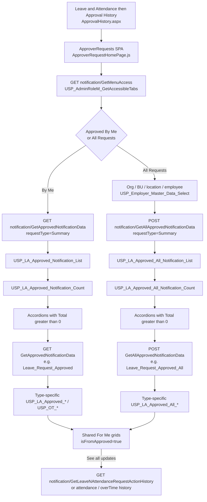
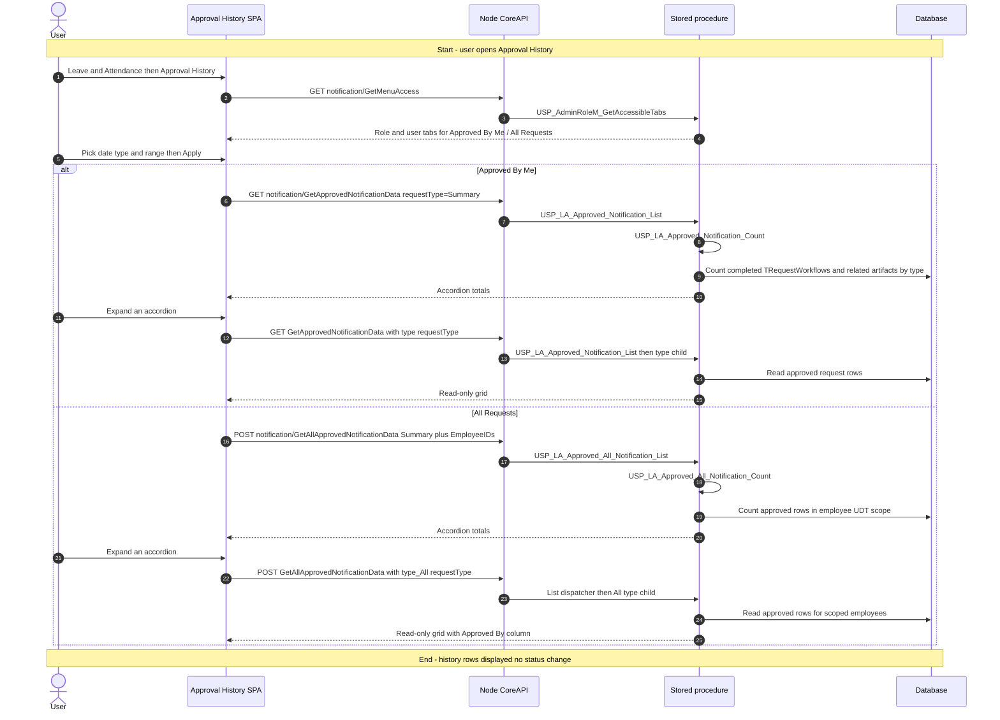
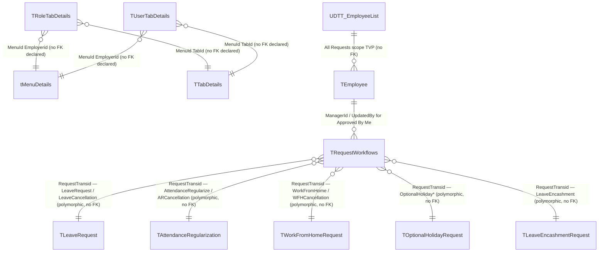

# Approval History

## Overview

A manager or HR user opens **Leave & Attendance → Approval History** to look up decisions that already happened — not to approve anything new. The page reuses the same For Me grid components as **Notifications**, but every accordion is mounted with `isFromApproved=true`, so approve / reject / reassign controls stay hidden and the grids call `GetApprovedNotificationData` / `GetAllApprovedNotificationData` instead of the pending-queue endpoints.

Two tabs (role-tab gated) split the view:

- **Request(s) Approved By Me** — rows this logged-in person previously completed (`ApproveStatus = 'C'` where they were the deciding manager, or matching status-history fallbacks).
- **All Request(s)** — org-scoped approved history for selected employees (BU / location / employee filters); the client posts a UDT of employee ids.

Both modes require a date range (Request Date or Approved Date, max 365 days). Accordions appear only when the Summary count for that request type is greater than zero. Expanding a section loads the matching detail list through the same Node routes with a type-specific `requestType` (for All Request the suffix `_All` is appended).

**Who's involved:**

- **Approver** — uses Approved By Me to audit their own past decisions.
- **HR / admin with All Requests tab** — searches across employees in scope.
- **Initiator** — does not act here; their pending inbox remains Notifications → By Me.

This page is the **history shelf**. Creating or deciding requests still lives on Leave Management / Attendance / Notifications. Shared pending-inbox docs: the sibling [Notifications](/docs/guides/leave-and-attendance/notifications) guide. Approve/reject engine: `llm-wiki/domain/approval-workflow.md`.

## Workflow

## Request journey

Approval History does not create or decide requests. The journey that starts here is a **filtered history lookup** that ends when approved rows are shown (or an empty accordion set).

## Entry points

> Live entry point matches the Notifications pattern: WebForms shell stamps session into hidden fields and loads `leave_attendance_module*.js` from `HRM/Leave_Dashboard/BuildJS/`. React Router maps `ApprovalHistory.aspx` to `ApproverRequests`.

| Entry point | Purpose | Live? |
|---|---|---|
| `HRM/Leaves/ApprovalHistory.aspx` (+ `.cs`) | WebForms shell; session → hidden fields; React bundle | Yes |
| React `ApproverRequests` (`Leave_Dashboard/Areas/ApproverRequests/Container/index.js`) | Router host for Approval History | Yes — `Areas/routes.js` path `LA_APPROVER_REQUEST` |
| `ApproverRequestHomePage.js` | Tabs, filters, Summary counts, mounts shared For Me grids with `isFromApproved={true}` | Yes |
| Shared For Me `*Grid.js` under `LeaveNotification/components/ForMe/ForMeGrids/` | Same components as Notifications; approved path when `isFromApproved` | Yes |
| `?NotificationId=<requestType>` | Deep link expands matching accordion `ModuleName` | Yes — query read in Container |
| Node CoreAPI `/notification/GetApprovedNotificationData`, `/notification/GetAllApprovedNotificationData`, `/notification/GetMenuAccess` | History reads + tab ACL | Yes |
| `LeaveAttendanceRoutes.js` `page === "ApprovedRequests"` | Alternate host path inside combined L&A dashboard | Yes (secondary) |

## Code → database call chain

`loggedInEmployeeId` on approved GETs is overwritten from the JWT (`req.EID`). POST All Request also forces `loggedInEmployeeId` from JWT; employee scope comes from body `employeeIds` → UDT.

| Step | Entry point | App code | Stored procedure |
|---|---|---|---|
| Page load | `ApprovalHistory.aspx` | `Page_Load` (`ApprovalHistory.aspx.cs:30-70`) — session → hidden fields, pick React bundle | none |
| Mount SPA | `Areas/routes.js:33-36` | `ApproverRequests` → `ApproverRequestHomePage` | none |
| Tab ACL | `ApproverRequestHomePage.js:280` | `NotificationController.GetMenuAccess` (`NotificationController.js:609`) → `NotificationDAL.GetMenuAccess` (`NotificationDAL.js:858`) | `USP_AdminRoleM_GetAccessibleTabs` |
| Org list (All filters) | `ApproverRequestHomePage.js:183` | `ApprovalHistoryAPI.getOrganizationList` → `dashBoard/GetGlobalAccessEmployerList` | `SP_GetGlobalAccessEmployerList` |
| BU / base / work location | `ApproverRequestHomePage.js:176-178` | `ApprovalHistoryAPI.getMasterData` → `overTime/OTManagementFetchMasterData` (`OverTimeDAL.js:1193`) | `USP_Employer_Master_Data_Select` |
| Employee search (All) | `ApproverRequestHomePage.js:192` | same `OTManagementFetchMasterData` with `requestType=EmployeeSearchWithEmployerName`, `feature=approverHistory` | `USP_Employer_Master_Data_Select` |
| Summary counts (By Me) | `ApproverRequestHomePage.js:643` | `NotificationController.GetApprovedNotificationData` (`NotificationController.js:582`) → `NotificationDAL.GetApprovedNotificationData` (`NotificationDAL.js:875`) with `requestType=Summary` | `USP_LA_Approved_Notification_List` → `USP_LA_Approved_Notification_Count` |
| Detail list (By Me) | e.g. `PendingLeaveRequestGrid.js:153-156` | same GET with type `requestType` (e.g. `Leave_Request_Approved`) | `USP_LA_Approved_Notification_List` → type child (e.g. `USP_LA_Approved_Leave_Request`) |
| Summary counts (All) | `ApproverRequestHomePage.js:665` | `NotificationController.GetAllApprovedNotificationData` (`NotificationController.js:595`) → `NotificationDAL.GetAllApprovedNotificationData` (`NotificationDAL.js:933`) | `USP_LA_Approved_All_Notification_List` → `USP_LA_Approved_All_Notification_Count` |
| Detail list (All) | same grids with `isFromAllRequest` | same POST with `Leave_Request_Approved_All` (etc.) | `USP_LA_Approved_All_Notification_List` → All type child |
| Action history | `ApproverRequestHomePage.js:327` | `GetLeaveNAttendanceRequestActionHistory` / AR / OT / claim-event history endpoints | `USP_LA_Status_History_*` and siblings (same as Notifications) |
| Grid column layout | grids `GET_GRID_CONFIG` / `SET_GRID_CONFIG` | `NotificationController.GetGridConfig` / `SetGridConfig` | `Sp_TS_GetGridConfig` / `Sp_TS_SetGridConfig` |

## API endpoints

This submenu is a React SPA over Node CoreAPI. There are no `[WebMethod]` / PageMethods on `ApprovalHistory.aspx`. Approved-history routes live on `NotificationRoutes.js:53-54`.

### History reads

| Verb | Route | Parameters | Purpose | Source |
|---|---|---|---|---|
| `GET` | `notification/GetApprovedNotificationData` | `requestType` (query, required — `Summary` or `*_Approved`); `fromDate`, `toDate` (`DD-MMM-YYYY`); `dateFilterType` (`RequestDate`\|`ApprovedDate`); `loggedInEmployeeId` (overwritten from JWT) | Approved By Me summary or type detail | `NotificationController.js:582` |
| `POST` | `notification/GetAllApprovedNotificationData` | Body: `requestType` (`Summary` or `*_Approved_All`); `fromDate`, `toDate`; `dateFilterType`; `loggedInEmployeeId` (JWT); `employeeIds` (comma-separated → `UDTT_EmployeeList`); optional org/BU/location filter fields used only to build that id list client-side | All Requests summary or type detail | `NotificationController.js:595` |
| `GET` | `notification/GetMenuAccess` | `employerId`, `userId`, `roleId` (query) | Role + user tab rows; UI keeps tabs named `Requests Approved by Me` / `All Requests` under menu `Approval History` | `NotificationController.js:609` |

### Filter / master data helpers

| Verb | Route | Parameters | Purpose | Source |
|---|---|---|---|---|
| `GET` | `dashBoard/GetGlobalAccessEmployerList` | `employeeId` | Organization multi-select | `ApprovalHistoryAPI.js:70` |
| `GET` | `overTime/OTManagementFetchMasterData` | `employerIds`, `requestType` (`BusinessUnit`\|`BaseLocation`\|`WorkLocation`\|`EmployeeSearchWithEmployerName`), optional search / status / BU / location, `feature=approverHistory` for empty search | Filter dropdowns and employee picker | `OverTimeDAL.js:1193` → `USP_Employer_Master_Data_Select` |
| `GET` | `recruitment/GetInterviewPanels` | `employeeId`, `employerId` | Legacy employee list into context (shared recruitment search) | `ApproverRequestHomePage.js:313` |

### History drawer (same as Notifications)

| Verb | Route | Purpose |
|---|---|---|
| `GET` | `notification/GetLeaveNAttendanceRequestActionHistory` | Leave / OH / WFH / CompOff / Locum / PH / Encashment |
| `GET` | `attendance/GetARRequestActionHistory` | AR |
| `GET` | `overTime/GetPreApprovalOTRequestActionHistory` | Pre-approval OT |
| `GET` | claim-event / deviation OT history helpers | Claim Event Leave / Deviation OT |

There is **no** approve/reject/reassign POST from this page when `isFromApproved=true` (select column and `ApproveRejectButtons` are omitted).

## Stored procedures & tables involved

| Object | Path | Role | llm-wiki |
|---|---|---|---|
| `USP_LA_Approved_Notification_List` | `HRMS-DATABASE/HRMS/STOREPROCEDURE/USP_LA_Approved_Notification_List.sql` | By Me dispatcher: builds `#AccessedEmployeeList` via `FN_LocationBU_GetEmployeeDetails`, then Summary → Count or type → detail SP | — |
| `USP_LA_Approved_Notification_Count` | `…/USP_LA_Approved_Notification_Count.sql` | Accordion totals for Approved By Me (`*_Approved` metrics) | — |
| `USP_LA_Approved_*` / `USP_OT_Notification_*_Approved_List` / `USP_ClaimEventLeave_Notification_*_Approved_List` | `…/STOREPROCEDURE/` | Per-type By Me detail lists nested from the List dispatcher | leave/attendance lifecycle pages where applicable |
| `USP_LA_Approved_All_Notification_List` | `…/USP_LA_Approved_All_Notification_List.sql` | All Requests dispatcher; loads `#AccessedEmployeeList` from `@EmployeeIDs` UDT | — |
| `USP_LA_Approved_All_Notification_Count` | `…/USP_LA_Approved_All_Notification_Count.sql` | Accordion totals with `_All` metric names | — |
| `USP_LA_Approved_All_*` / `USP_OT_Notification_*_ApprovedAll_List` | `…/STOREPROCEDURE/` | Per-type All Requests detail lists | — |
| `FN_LocationBU_GetEmployeeDetails` | `…/FUNCTIONS/` | Scope for By Me `#AccessedEmployeeList` (used by Count joins) | — |
| `USP_AdminRoleM_GetAccessibleTabs` | `…/STOREPROCEDURE/` | Role-tab and user-tab ACL for the two history modes | — |
| `USP_Employer_Master_Data_Select` | `…/STOREPROCEDURE/` | Org filter master data / employee search | — |
| `SP_GetGlobalAccessEmployerList` | `…/STOREPROCEDURE/` | Organizations the user can pick | — |
| `USP_LA_Status_History_*` (+ AR / OT / OD siblings) | `…/STOREPROCEDURE/` | See-all-updates drawer | — |
| `Sp_TS_GetGridConfig` / `Sp_TS_SetGridConfig` | `…/STOREPROCEDURE/` | Saved column layout on approved grid ids | — |
| `TRequestWorkflows` | `…/TABLES/` | Completed routing rows (`ApproveStatus='C'`) that drive most approved history | `domain/approval-workflow.md` |
| Request artifact tables (`TLeaveRequest`, `TAttendanceRegularization`, `TWorkFromHomeRequest`, `TOptionalHolidayRequest`, OT / locum / PH / encashment / event-leave, …) | `…/TABLES/` | Rows returned in detail grids | `domain/leave-lifecycle.md`, `domain/attendance-lifecycle.md` |
| `TRoleTabDetails`, `TUserTabDetails`, `tMenuDetails`, `TTabDetails` | `…/TABLES/` | Approval History tab visibility | — |
| `UDTT_EmployeeList` | `…/UDT/` | All Requests employee-id TVP | — |

## Table relationships

History is mostly polymorphic `TRequestWorkflows.RequestTransid` → request table by `RequestType`, same map as the pending inbox. Tab ACL uses menu/tab tables. All Requests scopes through a client-built employee list rather than a declared FK graph.

`USP_LA_Approved_Notification_Count` joins `#AccessedEmployeeList` (from `FN_LocationBU_GetEmployeeDetails`) when counting by-me rows; detail By Me SPs typically filter `TRequestWorkflows` where the logged-in employee is the completing manager. All Requests Count/list SPs join the UDT-backed `#AccessedEmployeeList` to the request employee id.

## Known gaps

- **Shared grids with Notifications.** For Me grid files take `isFromApproved` / `isFromAllRequest` and then hit `GetApprovedNotificationData`. Notifications never passes that flag — see the Notifications guide note. Do not treat pending-queue endpoints as part of Approval History.
- **All Requests does not auto-load.** Toggling to All Requests clears counts; the user must Apply Filter. Approved By Me Summary runs once on mount with the current calendar month.
- **L1 approved accordion is commented out** in `ApproverRequestHomePage.js` (`PendingL1ApprovalsLWFHAR` block around `:453`).
- **Tab labels vs toggle copy.** ACL looks for tab name `Requests Approved by Me`; the toggle label is `Request(s) Approved By Me`.
- **`#AccessedEmployeeList` contract.** Count SPs expect the temp table from the parent List dispatcher (their own create/insert blocks are commented). Calling Count alone fails.
- **List dispatcher vs file-name drift.** Some older sibling scripts exist (`USP_LA_Approved_ClaimOT_Request`, `USP_LA_Approved_PreApprovalOT_Request_Details`, All equivalents). Live List EXECs for OT go to `USP_OT_Notification_Claim_Approved_List` / `Planned` / `Deviation` (and `*ApprovedAll*`). Prefer the names in `USP_LA_Approved_Notification_List.sql` / `_All_…_List.sql`.
- **Deep link `NotificationId`** is matched to `gridBaseData.requestType` (e.g. `Leave_Request_Approved`), not the Notifications `RPI_*` codes.
- **No mutations.** This page cannot re-open a workflow or reverse an approval; recovery is elsewhere.

## Reference

Confidence is **high** for the React shell → Node DAL → `USP_LA_Approved_*` dispatcher chain (file:line on Summary/detail and tab ACL). Per-type detail SQL was inventoried from the List dispatchers; request-table lifecycle remains in llm-wiki.

### SourceCode

- `HRMS.Web/HRMS.Web/HRM/Leaves/ApprovalHistory.aspx` (+ `.cs`)
- `HRMS.Web/HRMS.Web/HRM/Leave_Dashboard/Areas/ApproverRequests/` (`Container/index.js`, `Components/ApproverRequestHomePage.js`, `ApprovalHistoryAPI.js`)
- `HRMS.Web/HRMS.Web/HRM/Leave_Dashboard/Areas/LeaveNotification/components/ForMe/ForMeGrids/` (shared grids)
- `HRMS.Web/HRMS.Web/HRM/Leave_Dashboard/Areas/routes.js`, `Common/routeConstants.js`, `Common/apiURLConstants.js`
- `HRMS.CoreAPI/HRMS.Core.WebAPI.Node/Routes/NotificationRoutes.js`
- `HRMS.CoreAPI/HRMS.Core.WebAPI.Node/Controllers/NotificationController.js`
- `HRMS.CoreAPI/HRMS.Core.WebAPI.Node/Core/DataAccessLayer/NotificationDAL.js`, `OverTimeDAL.js`, `dashBoardDAL.js`
- Sibling guide: `apps/backstage/content/guides/leave-and-attendance/notifications.md`

### TDG HRMS DB

- `llm-wiki/domain/approval-workflow.md`
- `llm-wiki/domain/leave-lifecycle.md`
- `llm-wiki/domain/attendance-lifecycle.md`
- `HRMS-DATABASE/HRMS/STOREPROCEDURE/USP_LA_Approved_Notification_List.sql`, `USP_LA_Approved_All_Notification_List.sql`, Count and type-specific children listed above
- `HRMS-DATABASE/HRMS/FUNCTIONS/FN_LocationBU_GetEmployeeDetails.sql`
- `HRMS-DATABASE/HRMS/STOREPROCEDURE/USP_AdminRoleM_GetAccessibleTabs.sql`, `USP_Employer_Master_Data_Select.sql`
