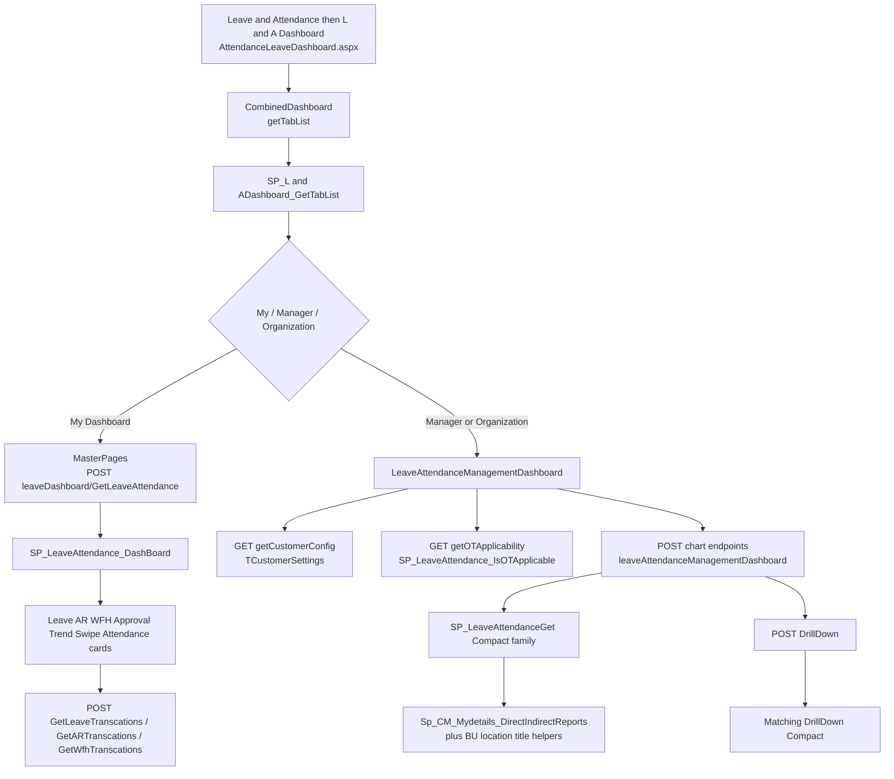
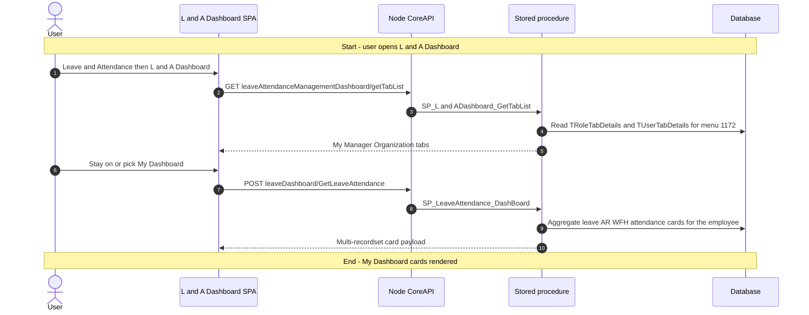
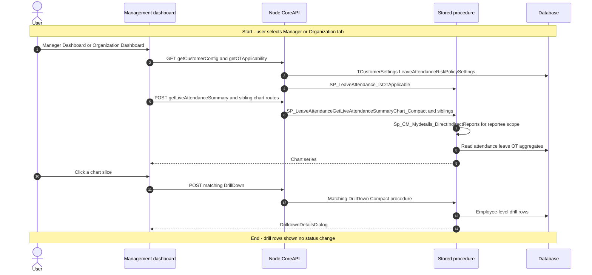
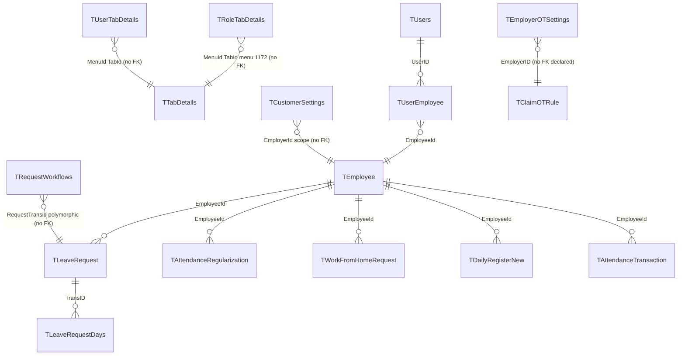

# L&A Dashboard

## Overview

A user opens **Leave & Attendance → L&A Dashboard** to see leave and attendance at a glance. The page title is **L & A Dashboard**. After load, role-tab ACL decides which view modes appear: **My Dashboard** (self cards for leave, AR, WFH, approval ratio, trends, swipe, attendance summary, and monthly calendar), **Manager Dashboard** (team charts for live attendance, leave pipeline, health alerts, capacity, OT, trends, utilization, and punch sources), and **Organization Dashboard** (same management charts with org-wide reporting type `-3`).

**Who's involved:**

- **Employee (My Dashboard)** — reads their own month and history metrics; card clicks open pending leave / AR / WFH transaction lists.
- **Manager** — filters reportees and drills into chart slices.
- **HR / admin with Organization Dashboard tab** — same widgets scoped across the employer.
- **Config** — risk thresholds come from `TCustomerSettings.LeaveAttendanceRiskPolicySettings`; OT calendar visibility from employer OT settings.

This leaf is **read-only analytics**. Apply / approve / cancel live on L&A Tasks and Notifications. Sibling misfiled guide [attendance.md](/docs/guides/leave-and-attendance/attendance) also carries `submenu: L&A Dashboard` but documents the attendance punch / AR / WFH lifecycle, not this SPA.

## Workflow

## Request journey

This page does not create leave or attendance requests. The journey that starts here is a **dashboard load** that ends when cards or charts are shown (or a drill-down dialog opens).

### Open L&A Dashboard and load My Dashboard

### Open Manager or Organization charts and drill down

## Entry points

> Live entry point: WebForms shell stamps session into hidden fields and loads `leave_attendance_module*.js` from `HRM/Leave_Dashboard/BuildJS/`. React Router maps `AttendanceLeaveDashboard.aspx` to `CombinedDashboard`.

| Entry point | Purpose | Live? |
|---|---|---|
| `HRM/Leaves/AttendanceLeaveDashboard.aspx` (+ `.cs`) | WebForms shell; page title "L & A Dashboard"; activity `LeaveAttendanceDashboard` = 298 | Yes |
| React `CombinedDashboard` (`LeaveAttendanceDashboardCombined/CombinedDashboard.js`) | Tab switcher + mounts My vs management views | Yes — `Areas/routes.js` path `LA_DASHBOARD` |
| `MasterPages` | My Dashboard card grid | Yes when My tab active |
| `LeaveAttendanceManagementDashboard` | Manager / Organization charts, filters, drill dialog | Yes when those tabs active |
| Node CoreAPI `/leaveDashboard/*` | My Dashboard aggregates and card transaction lists | Yes |
| Node CoreAPI `/leaveAttendanceManagementDashboard/*` | Tabs, filters, charts, drill-downs, OT gate, customer config | Yes |
| `termination/GetMenuOrTabAccess` with `menuId=1173` | Card-level Leave / AR / WFH tab ACL on My Dashboard | Yes (secondary) |

## Code → database call chain

`EmployeeID` / `managerId` on authenticated dashboard calls are overwritten from the JWT (`req.EID`) where the controller sets them. Filter body fields still come from the client.

| Step | Entry point | App code | Stored procedure |
|---|---|---|---|
| Page load | `AttendanceLeaveDashboard.aspx` | `Page_Load` (`AttendanceLeaveDashboard.aspx.cs:27-68`) — session → hidden fields, pick React bundle; activity 298 | none (activity via `CommonUtil.LogActivity`) |
| Mount SPA | `Areas/routes.js:23-27` | `CombinedDashboard` | none |
| Dashboard tabs | `CombinedDashboard.js:86-88` | `getTabList` → `leaveAttendanceManagementDashboardController.getTabList` (`:269`) → DAL `getTabList` (`:485`) | `SP_L&ADashboard_GetTabList` |
| My Dashboard cards | `MasterPages.js:89` | `GetLeaveAttendance` (`leaveDashboardController.js:8`) → `leaveDashboardDAL.GetLeaveAttendance` (`:16`) | `SP_LeaveAttendance_DashBoard` → nested `USP_LA_GetApplicableLeaveCode`, `USP_LA_Employee_Leave_CustomReport`, `USP_GetEmployeeLeaveAttendanceDetails` |
| Leave card transactions | `LeaveSummary/Transcations.js:46` | `GetLeaveTranscations` (`leaveDashboardController.js:19`) → DAL `:46` | `SP_LA_GetPendingLeaveDetails` |
| AR card transactions | `ARSummary/Transcations.js:54` | `GetARTranscations` (`:30`) → DAL `:62` | `SP_LA_GetAttendanceForRejection` |
| WFH card transactions | `WFHSummary/Transcations.js:50` | `GetWfhTranscations` (`:41`) → DAL `:79` | `SP_LA_GetWorkFromHomeRequests` |
| Calendar leave codes | `AttendanceCalenderCard.js:109` | `GetEmployeeLeaveAttendance` (`:52`) → DAL `:96` | `SP_EmployeeLeaveAttendance` |
| My Dashboard tab ACL | `MasterPages.js:140` | `termination/GetMenuOrTabAccess` → `GetTabsByRole` / `GetTabsByUser` | `Sp_AdminRoleM_GetTabRoleDet`, `Sp_GetTabUserDetails` |
| Risk / health config | `LeaveAttendanceManagementDashboard.js:239` | `getCustomerConfig` (`controller.js:252`) | inline `SELECT` on `TCustomerSettings` (no SP) |
| OT calendar gate | `LeaveAttendanceManagementDashboard.js:265` | `getOTApplicability` → DAL `:498` | `SP_LeaveAttendance_IsOTApplicable` |
| Live attendance | chart components via toolbox | `getLiveAttendanceSummary` → DAL `:109` | `SP_LeaveAttendanceGetLiveAttendanceSummaryChart_Compact` |
| Live attendance drill | same | DAL `:123` | `SP_LeaveAttendanceGetLiveAttendanceSummaryChart_DrillDown_Compact` |
| Leave pipeline | `LeavePipeline` | DAL `:138` | `SP_LeaveAttendanceGetPendingLeaveRequests` |
| Team health | `TeamHealthAlerts` | DAL `:152` / `:165` | `SP_LeaveAttendanceGetTeamHealthAlerts_Compact` / `_DrillDown_Compact` |
| Team availability | `TeamAvailabilityCapacity` | DAL `:229` / `:250` | `SP_LeaveAttendanceGetTeamAvailabilityCalendar_Compact` / DrillDown Compact |
| OT calendar | `OvertimeCalendar` | DAL `:271` / `:295` | `SP_LeaveAttendanceGetOTSummaryChart_Compact` / DrillDown Compact |
| Leave trend | `LeaveTrendAnalysis` | DAL `:317` / `:340` | `SP_LeaveAttendanceGetLeaveTrendAnalysis_Compact` / `_DrillDown_Compact` |
| Leave by type | `LeaveUtilizedByType` | DAL `:364` / `:387` | `SP_LeaveAttendanceGetLeaveUtilizedByType_Compact` / `_DrillDown_Compact` |
| Attendance source | `AttendanceSourceAnalysis` | DAL `:411` / `:434` | `SP_LeaveAttendanceGetAttendanceSourceAnalysis_Chart_Compact` / ChartDrillDown Compact |
| Filter option names | toolbox / natural language | DAL `:179` | `Sp_EmployeeDashboard_Chart_GenerateFilterOptions` |
| Filter option values | same | DAL `:193` | `Sp_EmployeeDashboard_Chart_GenerateAdditionalFilterValues` |
| Leave type filter | toolbox | DAL `:216` | `Sp_GetActiveLeaveTypesFormatted` |
| Reportee picker | toolbox | DAL `:461` | `SP_LeaveAttendance_GetReporteesByBusinessUnitIds` → `Sp_CM_DirectIndirectReports` |

Most management chart SPs also nest `SP_EmployeeDashboard_GetBusinessUnitByOrg_EmployeeId`, `SP_EmployeeDashboard_GetLocationByEmployeeId`, `SP_CM_GetTitle`, `Sp_CM_Mydetails_DirectIndirectReports`, and `UFN_WO_Employee_Weekly_Off_Details` when building reportee scope and weekly-off flags.

## API endpoints

This submenu is a React SPA over Node CoreAPI. There are no `[WebMethod]` / PageMethods on `AttendanceLeaveDashboard.aspx`.

### Shell / tabs / config

| Verb | Route | Parameters | Purpose | Source |
|---|---|---|---|---|
| `GET` | `leaveAttendanceManagementDashboard/getTabList` | `employerId`, `employeeId` (employee overwritten from JWT) | My / Manager / Organization tabs for menu 1172 | `leaveAttendanceManagementDashboardRoutes.js:91` |
| `GET` | `leaveAttendanceManagementDashboard/getCustomerConfig` | `employerId` | JSON risk policy settings | `Routes.js:87` — ORM select, not SP |
| `GET` | `leaveAttendanceManagementDashboard/getOTApplicability` | `employerId` | `{ isOTApplicable }` | `Routes.js:95` |

### My Dashboard (`/leaveDashboard`)

| Verb | Route | Parameters | Purpose | Source |
|---|---|---|---|---|
| `POST` | `leaveDashboard/GetLeaveAttendance` | Body date windows; `EmployeeID` forced from JWT | Multi-recordset card payload | `leaveDashboardRoutes.js:7` |
| `POST` | `leaveDashboard/GetLeaveTranscations` | JWT employee | Pending leave list for card | `Routes.js` |
| `POST` | `leaveDashboard/GetARTranscations` | JWT employee | AR list for card | `Routes.js` |
| `POST` | `leaveDashboard/GetWfhTranscations` | JWT employee | WFH list for card | `Routes.js` |
| `POST` | `leaveDashboard/GetEmployeeLeaveAttendance` | Year + JWT employee | Calendar leave/attendance codes | `Routes.js` |
| `GET` | `termination/GetMenuOrTabAccess` | `employerId`, `userId`, `userRoleId`, `menuId=1173`, `returnAllTabsFromMenu=1` | Show/hide Leave / AR / WFH cards | `MasterPages.js:140` |

### Management charts (`/leaveAttendanceManagementDashboard`)

All chart routes below are `POST` with a shared filter body (`managerId` from JWT via `request.EID`, `reportingType`, `employerId`, optional BU/location/demographic/leave/attendance/shift filters). Drill routes add type/date/period/code fields.

| Verb | Route | Purpose | Source |
|---|---|---|---|
| `POST` | `getLiveAttendanceSummary` | Live status counts | `Routes.js:9` |
| `POST` | `getLiveAttendanceSummaryDrillDown` | + `statusType` | `Routes.js:13` |
| `POST` | `getLeavePipeline` | Pending leave pipeline | `Routes.js:17` |
| `POST` | `getTeamHealthAndAlert` | Health alert tiles | `Routes.js:21` |
| `POST` | `getTeamHealthAndAlertDrillDown` | + `alertType` | `Routes.js:25` |
| `POST` | `getTeamAvailabilityAndCapacityChart` | + month/year / BU reporting | `Routes.js:29` |
| `POST` | `getTeamAvailabilityAndCapacityDrillDown` | + `statusType`, `date` | `Routes.js:33` |
| `POST` | `getOvertimeCalendarChart` | + month/year / optional reportees | `Routes.js:37` |
| `POST` | `getOvertimeCalendarDrillDown` | + `date` | `Routes.js:41` |
| `POST` | `getLeaveTrendAnalysisChart` | + from/to dates | `Routes.js:45` |
| `POST` | `getLeaveTrendAnalysisDrillDown` | + `period` | `Routes.js:49` |
| `POST` | `getLeaveUtilizedByTypeChart` | Leave hours/days by type | `Routes.js:53` |
| `POST` | `getLeaveUtilizedByTypeDrillDown` | + `code` | `Routes.js:57` |
| `POST` | `getAttendanceSourceAnalysisChart` | Punch-source mix | `Routes.js:61` |
| `POST` | `getAttendanceSourceAnalysisDrillDown` | + `attendanceMethod` | `Routes.js:65` |
| `GET` | `getFilterOptions` | `filterTypes[]`, `type` | `Routes.js:69` |
| `GET` | `getFilterOptionValues` | employer/employee/filter fields | `Routes.js:73` |
| `GET` | `getLeaveTypes` | `employerId` (picker access guard) | `Routes.js:77` |
| `POST` | `getReportees` | manager/reportingType/employer/optional BU ids | `Routes.js:83` |

There is **no** approve/reject POST from this page.

## Stored procedures & tables involved

| Object | Path | Role | page |
|---|---|---|---|
| `SP_L&ADashboard_GetTabList` | `HRMS-DATABASE/HRMS/STOREPROCEDURE/SP_L&ADashboard_GetTabList.sql` | Tab ACL for menu 1172 | [SP_L&ADashboard_GetTabList](/docs/database/hrms/SP_L&ADashboard_GetTabList) |
| `SP_LeaveAttendance_DashBoard` | `…/SP_LeaveAttendance_DashBoard.sql` | My Dashboard multi-card aggregate | [SP_LeaveAttendance_DashBoard](/docs/database/hrms/SP_LeaveAttendance_DashBoard) |
| `USP_LA_GetApplicableLeaveCode` / `USP_LA_Employee_Leave_CustomReport` / `USP_GetEmployeeLeaveAttendanceDetails` | nested from My Dashboard SP | Leave codes / custom report / monthly attendance detail | nested pages under database docs |
| `SP_LA_GetPendingLeaveDetails` / `SP_LA_GetAttendanceForRejection` / `SP_LA_GetWorkFromHomeRequests` / `SP_EmployeeLeaveAttendance` | STOREPROCEDURE | My Dashboard card transaction / calendar helpers | — |
| `SP_LeaveAttendanceGet*_Compact` (+ DrillDown siblings) | STOREPROCEDURE | Manager/Organization charts | matching `/docs/database/hrms/…` pages |
| `Sp_CM_Mydetails_DirectIndirectReports` | STOREPROCEDURE | Reportee scope for almost every management chart | [Sp_CM_Mydetails_DirectIndirectReports](/docs/database/hrms/Sp_CM_Mydetails_DirectIndirectReports) |
| `Sp_CM_DirectIndirectReports` | STOREPROCEDURE | Nested from reportee list SP | [Sp_CM_DirectIndirectReports](/docs/database/hrms/Sp_CM_DirectIndirectReports) |
| `SP_EmployeeDashboard_GetBusinessUnitByOrg_EmployeeId` / `SP_EmployeeDashboard_GetLocationByEmployeeId` / `SP_CM_GetTitle` | STOREPROCEDURE | Filter dimension lists inside chart SPs | existing employee-dashboard pages |
| `Sp_EmployeeDashboard_Chart_GenerateFilterOptions` / AdditionalFilterValues | STOREPROCEDURE | Toolbox filter metadata | existing pages |
| `Sp_GetActiveLeaveTypesFormatted` | STOREPROCEDURE | Leave type filter labels | [Sp_GetActiveLeaveTypesFormatted](/docs/database/hrms/Sp_GetActiveLeaveTypesFormatted) |
| `SP_LeaveAttendance_IsOTApplicable` | STOREPROCEDURE | OT calendar visibility | [SP_LeaveAttendance_IsOTApplicable](/docs/database/hrms/SP_LeaveAttendance_IsOTApplicable) |
| `SP_LeaveAttendance_GetReporteesByBusinessUnitIds` | STOREPROCEDURE | Reportee dropdown | [SP_LeaveAttendance_GetReporteesByBusinessUnitIds](/docs/database/hrms/SP_LeaveAttendance_GetReporteesByBusinessUnitIds) |
| `UFN_WO_Employee_Weekly_Off_Details` | FUNCTIONS | Weekly-off flags inside chart SQL | [UFN_WO_Employee_Weekly_Off_Details](/docs/database/hrms/UFN_WO_Employee_Weekly_Off_Details) |
| `TRoleTabDetails`, `TUserTabDetails`, `TTabDetails` | TABLES | Dashboard tab ACL (menu 1172 / card menu 1173) | — |
| `TCustomerSettings` | TABLES | `LeaveAttendanceRiskPolicySettings` JSON | — |
| `TLeaveRequest`, `TLeaveRequestDays`, `TAttendanceRegularization`, `TWorkFromHomeRequest`, `TAttendanceTransaction`, `TDailyRegisterNew`, `TRequestWorkflows`, `TEmployerOTSettings`, `TClaimOTRule`, `tLeaveTypeMaster` | TABLES | Card and chart sources | domain leave/attendance lifecycle pages where present |

## Table relationships

Dashboard reads are mostly polymorphic request/attendance facts scoped by employee or reportee roster. Tab ACL uses menu/tab tables. Management charts do not declare FKs from chart params to employee rows.

## Known gaps

- **Misfiled sibling guide.** [attendance.md](/docs/guides/leave-and-attendance/attendance) also sets `submenu: L&A Dashboard` while documenting the attendance lifecycle, not `AttendanceLeaveDashboard.aspx`. Features index will list both under this leaf until that frontmatter is corrected.
- **No SystemModel-2 page** specifically for this combined dashboard shell (attendance-leave context names the Notifications SPA, not this leaf).
- **`getCustomerConfig` is inline SQL** on `TCustomerSettings`, not a stored procedure.
- **Procedure name with `&`.** Live object is `SP_L&ADashboard_GetTabList`; URL slug encodes the ampersand.
- **Chart SP family is large and repetitive.** Compact and DrillDown siblings share the same reportee/filter preamble (`Sp_CM_Mydetails_DirectIndirectReports` + employee-dashboard helpers). Prefer the DAL execute name over older non-Compact scripts if any remain in the tree.
- **My Dashboard secondary POSTs** (`GetLeaveTranscations` / AR / WFH) still exist for card dialogs even though the initial card metrics come from `SP_LeaveAttendance_DashBoard` alone.
- **Read-only.** This page cannot approve, reject, or submit leave/AR/WFH.

## Reference

Confidence is **high** for the WebForms shell → `CombinedDashboard` → My (`leaveDashboardDAL`) and management (`leaveAttendanceManagementDashboardDAL`) → named Compact procedures (file:line on controllers/DAL). Nested chart SQL was inventoried from EXEC lists in the Compact scripts; leave/attendance lifecycle detail remains in domain docs where present.

### SourceCode

- `HRMS.Web/HRMS.Web/HRM/Leaves/AttendanceLeaveDashboard.aspx` (+ `.cs`)
- `HRMS.Web/HRMS.Web/HRM/Leave_Dashboard/Areas/LeaveAttendanceDashboardCombined/` (`CombinedDashboard.js`, `ViewModeSwitch.js`)
- `HRMS.Web/HRMS.Web/HRM/Leave_Dashboard/Areas/MasterPages/`
- `HRMS.Web/HRMS.Web/HRM/Leave_Dashboard/Areas/LeaveAttendanceManagementDashboard/`
- `HRMS.Web/HRMS.Web/HRM/Leave_Dashboard/Areas/routes.js`, `Common/routeConstants.js`, `Common/apiURLConstants.js`
- `HRMS.CoreAPI/HRMS.Core.WebAPI.Node/Routes/leaveDashboardRoutes.js`, `leaveAttendanceManagementDashboardRoutes.js`
- `HRMS.CoreAPI/HRMS.Core.WebAPI.Node/Controllers/leaveDashboardController.js`, `leaveAttendanceManagementDashboardController.js`
- `HRMS.CoreAPI/HRMS.Core.WebAPI.Node/Core/DataAccessLayer/leaveDashboardDAL.js`, `leaveAttendanceManagementDashboardDAL.js`
- `HRMS.Shared/HRMS.DataContract/Common/Enums.cs` (`LeaveAttendanceDashboard = 298`)

### TDG HRMS DB

- `HRMS-DATABASE/HRMS/STOREPROCEDURE/SP_L&ADashboard_GetTabList.sql`
- `HRMS-DATABASE/HRMS/STOREPROCEDURE/SP_LeaveAttendance_DashBoard.sql`
- `HRMS-DATABASE/HRMS/STOREPROCEDURE/SP_LeaveAttendanceGet*_Compact.sql` (chart + drill family)
- `HRMS-DATABASE/HRMS/STOREPROCEDURE/SP_LeaveAttendance_IsOTApplicable.sql`
- `HRMS-DATABASE/HRMS/STOREPROCEDURE/SP_LeaveAttendance_GetReporteesByBusinessUnitIds.sql`
- `HRMS-DATABASE/HRMS/STOREPROCEDURE/Sp_GetActiveLeaveTypesFormatted.sql`
- `HRMS-DATABASE/HRMS/STOREPROCEDURE/Sp_CM_Mydetails_DirectIndirectReports.sql`
