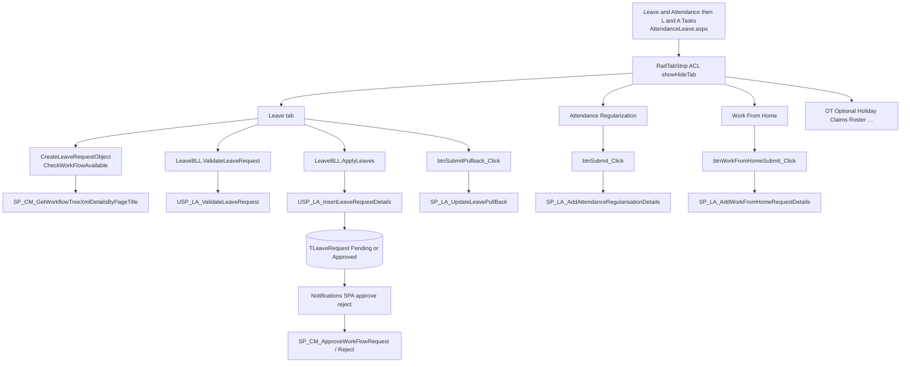
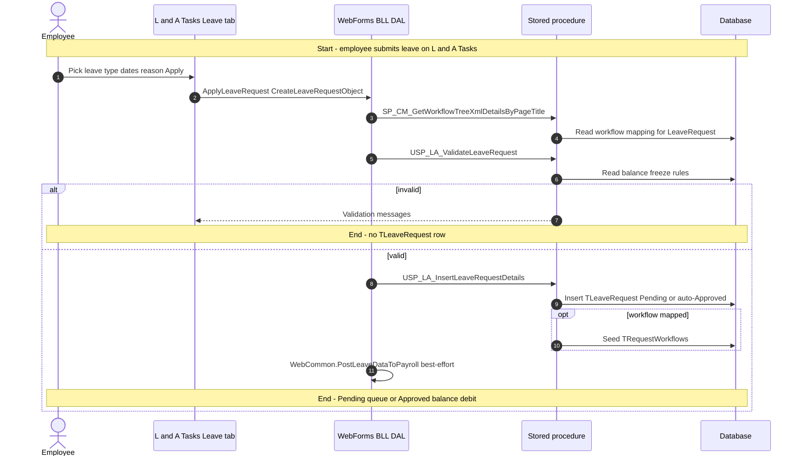
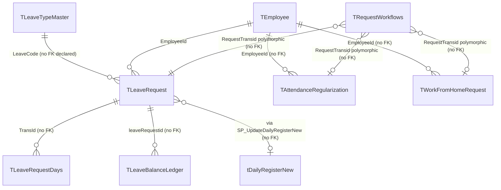

# L&A Tasks

## Overview

An employee opens **Leave & Attendance → L&A Tasks** (`AttendanceLeave.aspx`, page title **L & A Tasks**, menu id **1173**) to **apply** leave and attendance-related requests and manage their own history on one multi-tab shell. Tabs include Leave, Attendance Regularization, Work From Home, Overtime, Optional Holiday, Re-Assign Request, Claim Comp-Off / Locum / PH / Event Leave, Employee Summary, Attendance Summary, Custom Report, Employee / My Roster, geo-tracking reports, On Duty Request, and related claim surfaces. Role/tab ACL (`showHideTab`) decides which tabs appear.

On Leave, the employee picks a leave type and dates (full day, half day, or hourly), optional reason / support docs, and submits. The page validates against employer leave rules, then inserts a request that is either **auto-approved** (no workflow) or **Pending** for a manager. The same page still hosts **pullback** for the employee's own leave, and live **AR** / **WFH** apply postbacks. Manager **approve / reject / reassign** for other people's queues lives on **Notifications** (React SPA + Node CoreAPI), not on the live handlers in this code-behind.

**Who's involved:**

- **Employee** — applies Leave / AR / WFH (and other claim tabs); pullbacks their own pending or approved leave.
- **Manager / approver** — decides Pending rows on Notifications; may still use Re-Assign messaging that points at L&A Tasks when Notifications reassign is off.
- **HR / admin** — leave types, freeze dates, roster flags, customer settings that hide tabs (for example `IsShowShiftRoaster`).

Sibling guides cover deep leave apply ([leave-management.md](/docs/guides/leave-and-attendance/leave-management), same submenu historically), the manager inbox ([notifications.md](/docs/guides/leave-and-attendance/notifications)), and attendance punch / AR lifecycle detail ([attendance.md](/docs/guides/leave-and-attendance/attendance)). DB lifecycle depth is in `llm-wiki/domain/leave-lifecycle.md` and approval routing in `llm-wiki/domain/approval-workflow.md`.

## Workflow

## Request journey

Primary journey on this page is **employee applies leave**. Approve/reject is a different actor and page (Notifications).

AR and WFH follow the same shape on this page (`btnSubmit_Click` → `SP_LA_AddAttendanceRegularisationDetails`; `btnWorkFromHomeSubmit_Click` → `SP_LA_AddWorkFromHomeRequestDetails`) and end as Pending or auto-approved request rows. Leave pullback starts at `btnSubmitPullback_Click` and ends in `SP_LA_UpdateLeavePullBack` (`LeaveStatus` Pullback, or a cancellation workflow when already Approved).

## Entry points

> Live shell is WebForms `AttendanceLeave.aspx` (activity `LeaveAttendanceTasks` = 365). A React bundle (`dashboard_react.*.min.js`) mounts for Attendance Summary / selected claim surfaces via `#root`. Manager approve/reject handlers in this code-behind are largely commented out; the live inbox is Notifications.

| Entry point | Purpose | Live? |
|---|---|---|
| `HRM/Leaves/AttendanceLeave.aspx` (+ `.cs`) | Multi-tab L&A Tasks shell; menu 1173 | Yes |
| Leave tab apply / pullback | `btnSubmitApplyLeave_Click` / `btnSubmitPullback_Click` | Yes |
| AR tab apply | `btnSubmit_Click` → `AddAttendanceRegularisationDetails` | Yes |
| WFH tab apply | `btnWorkFromHomeSubmit_Click` → `AddWFHDetails` | Yes |
| `[WebMethod] GetRequestActionHistory` | Status history JSON for UI | Yes |
| Telerik search `GetEmployeeResults` / `GetAssignedEmployeeResults` | Employee pickers (`SearchBoxCommonMethods`) | Yes |
| React `#root` + `Dashboard_React/BuildJS` | Attendance Summary / selected React panels | Yes (partial) |
| Notification tab approve / reject / reroute handlers in `.cs` | Legacy For Me grids | No — methods commented; use Notifications |
| `LeaveApproval.aspx` | Legacy leave queue | No — stub |

## Code → database call chain

| Step | Entry point | App code | Stored procedure |
|---|---|---|---|
| Page load | `AttendanceLeave.aspx` | `Page_Load` (`AttendanceLeave.aspx.cs:142-144`) — activity 365; tab ACL; React build file | none (activity log only) |
| Resolve leave workflow | Leave apply | `CreateLeaveRequestObject` (`:3626`) → `genericWorkFlowBll.CheckWorkFlowAvailable` (`:3681`) → `GenericWorkFlowDal.GetWorkFlowTreeXml` (`GenericWorkFlowDAL.cs:30-37`) | `SP_CM_GetWorkflowTreeXmlDetailsByPageTitle` |
| Validate leave | `btnSubmitApplyLeave_Click` → `ApplyLeaveRequest` (`:3522`) | `leaveBLL.ValidateLeaveRequest` (`LeaveBLL.cs:100-102`) → `LeaveDAL.ValidateLeaveRequest` (`LeaveDAL.cs:347-356`) | `USP_LA_ValidateLeaveRequest` |
| Apply leave | same | `leaveBLL.ApplyLeaves(..., true)` (`LeaveBLL.cs:81-83`) → `LeaveDAL.ApplyLeaves` (`LeaveDAL.cs:177-189`) | `USP_LA_InsertLeaveRequestDetails` |
| Payroll sync on apply | `ApplyLeaveRequest` | `WebCommon.PostLeaveDataToPayroll` (`:3597-3605`) | external payroll API |
| Leave pullback | `btnSubmitPullback_Click` (`:1560`) | `leaveBLL.UpdateLeavePullBack` (`LeaveBLL.cs:52-54`) → `LeaveDAL.UpdateLeavePullBack` (`LeaveDAL.cs:85-97`) | `SP_LA_UpdateLeavePullBack` |
| AR apply | `btnSubmit_Click` (`:7530`) | `attendanceRegularizationBLL.AddAttendanceRegularisationDetails` (`AttendanceRegularizationBLL.cs:56-58`) → DAL (`AttendanceRegularizationDAL.cs:58-61`) | `SP_LA_AddAttendanceRegularisationDetails` |
| WFH apply | `btnWorkFromHomeSubmit_Click` (`:8799`) | `workFromHomeBLL.AddWFHDetails` (`WorkFromHomeBLL.cs:62-64`) → `WorkFromHomeDAL.AddWFHDetails` (`WorkFromHomeDAL.cs:85-88`) | `SP_LA_AddWorkFromHomeRequestDetails` |
| Approve / reject (not this page) | Notifications SPA | Node `attendance/ApproveRejectRequest` | `SP_CM_ApproveWorkFlowRequest` / `SP_CM_RejectWorkFlowRequest` |
| Re-Assign (legacy WebForms path) | commented `btnReroute*_Click` | Would call `WebCommon.ReRouteLeaveARWFHRequest` → `ApprovalRejectionDAL.ReRouteSelectedRequest` (`ApprovalRejectionDAL.cs:118-121`) | `SP_CM_RequestReRoute` — live reassign is Notifications |

## API endpoints

This submenu is primarily **WebForms postback**. There is no Node CoreAPI apply route owned by this page. AJAX surface is limited to page/search WebMethods.

| Verb | Route | Parameters | Purpose | Source |
|---|---|---|---|---|
| Postback | `AttendanceLeave.aspx` leave apply | Form fields + hidden leave code / duration | Validate + insert leave | `btnSubmitApplyLeave_Click` (`:1235`) → `ApplyLeaveRequest` |
| Postback | leave pullback | `hndTransIdLeavePullback`, reason | Pullback | `btnSubmitPullback_Click` (`:1560`) |
| Postback | AR apply | Category, dates/times, reason | Insert AR | `btnSubmit_Click` (`:7530`) |
| Postback | WFH apply | Category, dates, duration, reason | Insert WFH | `btnWorkFromHomeSubmit_Click` (`:8799`) |
| `WebMethod` | `GetRequestActionHistory` | `requestType` (string), `transId` (int) | Status history JSON | `AttendanceLeave.aspx.cs:524-530` |
| `WebMethod` | `GetEmployeeResultNotifications` | Telerik `SearchBoxContext` | Employee search (legacy notification UI) | `:515-521` |
| Telerik | `GetEmployeeResults` / `GetAssignedEmployeeResults` | Search context | Employee pickers | `SearchBoxCommonMethods.cs:107` / `:650` |

Manager queue HTTP APIs (`notification/*`, `attendance/ApproveRejectRequest`) are documented on [Notifications](/docs/guides/leave-and-attendance/notifications).

## Stored procedures & tables involved

| Object | Path | Role | page |
|---|---|---|---|
| `SP_CM_GetWorkflowTreeXmlDetailsByPageTitle` | `HRMS-DATABASE/HRMS/STOREPROCEDURE/…` | Resolve leave/AR/WFH workflow | [SP_CM_GetWorkflowTreeXmlDetailsByPageTitle](/docs/database/hrms/SP_CM_GetWorkflowTreeXmlDetailsByPageTitle) |
| `USP_LA_ValidateLeaveRequest` | STOREPROCEDURE | Pre-apply leave rules | [USP_LA_ValidateLeaveRequest](/docs/database/hrms/USP_LA_ValidateLeaveRequest) |
| `USP_LA_InsertLeaveRequestDetails` | STOREPROCEDURE | Insert leave (+ auto-approve branch) | [USP_LA_InsertLeaveRequestDetails](/docs/database/hrms/USP_LA_InsertLeaveRequestDetails) |
| `SP_LA_UpdateLeavePullBack` | STOREPROCEDURE | Leave pullback / cancel routing | [SP_LA_UpdateLeavePullBack](/docs/database/hrms/SP_LA_UpdateLeavePullBack) |
| `SP_LA_AddAttendanceRegularisationDetails` | STOREPROCEDURE | Insert AR | [SP_LA_AddAttendanceRegularisationDetails](/docs/database/hrms/SP_LA_AddAttendanceRegularisationDetails) |
| `SP_LA_AddWorkFromHomeRequestDetails` | STOREPROCEDURE | Insert WFH | [SP_LA_AddWorkFromHomeRequestDetails](/docs/database/hrms/SP_LA_AddWorkFromHomeRequestDetails) |
| `SP_CM_ApproveWorkFlowRequest` / `SP_CM_RejectWorkFlowRequest` | STOREPROCEDURE | Manager decision (Notifications) | [SP_CM_ApproveWorkFlowRequest](/docs/database/hrms/SP_CM_ApproveWorkFlowRequest) |
| `SP_CM_RequestReRoute` | STOREPROCEDURE | Reassign engine | used by Notifications / legacy WebCommon |
| `TLeaveRequest`, `TLeaveRequestDays`, `tLeaveBalance`, `TLeaveBalanceLedger` | TABLES | Leave artifact + balance | `llm-wiki/domain/leave-lifecycle.md` |
| `TAttendanceRegularization`, `TWorkFromHomeRequest` | TABLES | AR / WFH artifacts | attendance domain docs |
| `TRequestWorkflows` | TABLES | Pending approval rows | `llm-wiki/domain/approval-workflow.md` |
| `tDailyRegisterNew` | TABLES | Attendance register updates from nested SPs | — |

## Table relationships

Reuse of the leave-lifecycle ER (application-enforced; no declared FKs on these leave tables), plus AR/WFH/workflow siblings used by this shell.

## Known gaps

- **Sibling guide overlap.** [leave-management.md](/docs/guides/leave-and-attendance/leave-management) also uses `submenu: L&A Tasks` and documents leave apply in depth (older frontmatter includes `sources:`). Features index lists both under this leaf until that guide is retitled or frontmatter is corrected.
- **Approve / reject / reroute handlers commented** in `AttendanceLeave.aspx.cs` while markup still wires `btnArrpoveLeave_Click` / `btnRerouteLeave_Click` etc. Live decisions are on Notifications; aspx/handler drift is a maintenance risk.
- **Huge multi-tab surface.** OT, Optional Holiday, Claim Comp-Off / Locum / PH / Event Leave, Roster, Geo Tracking, On Duty are in-scope of the shell but only Leave / AR / WFH apply chains are fully traced here.
- **Legacy insert/validate SP names** (`SP_LA_InsertLeaveRequestDetails_New`, `SP_LA_ValidateLeaveRequest_New`) remain in `DBConstant`; live `true` overloads call `USP_LA_*`.
- **llm-wiki leave-lifecycle** still hedges which insert SP the app uses; SourceCode `LeaveDAL.ApplyLeaves(..., true)` confirms `USP_LA_InsertLeaveRequestDetails`.

## Reference

Confidence is **high** for the WebForms Leave / AR / WFH apply and leave pullback chains (file:line on page → BLL → DAL → named USP/SP). Manager approve/reject is cited from the Notifications path, not re-proven on this page. Nested SQL inside insert/validate procedures is inventoried on the database pages.

### SourceCode

- `HRMS.Web/HRMS.Web/HRM/Leaves/AttendanceLeave.aspx` (+ `.cs`)
- `HRMS.Shared/HRMS.BusinessLayer/LeaveAttendanceARWFH/LeaveBLL.cs`
- `HRMS.Shared/HRMS.DataAccessLayer/LeaveAttendanceARWFH/LeaveDAL.cs`
- `HRMS.Shared/HRMS.BusinessLayer/LeaveAttendanceARWFH/AttendanceRegularizationBLL.cs`
- `HRMS.Shared/HRMS.DataAccessLayer/LeaveAttendanceARWFH/AttendanceRegularizationDAL.cs`
- `HRMS.Shared/HRMS.BusinessLayer/LeaveAttendanceARWFH/WorkFromHomeBLL.cs`
- `HRMS.Shared/HRMS.DataAccessLayer/LeaveAttendanceARWFH/WorkFromHomeDAL.cs`
- `HRMS.Shared/HRMS.DataAccessLayer/GenericWorkFlowDAL/GenericWorkFlowDAL.cs`
- `HRMS.Web/HRMS.Web/Common/Web.Common.cs`
- `HRMS.Shared/HRMS.DataAccessLayer/ApprovalRejectionDAL.cs`
- `HRMS.Shared/HRMS.DataContract/Common/Enums.cs` (`LeaveAttendanceTasks = 365`)
- `HRMS.Web/HRMS.Web/HRM/CustomControls/SearchBoxCommonMethods.cs`

### TDG HRMS DB

- `HRMS-DATABASE/HRMS/DDL/42576_Leave & Attendance module_…_MenuCreation_Updation_Script.sql` (menu 1173 → `AttendanceLeave.aspx`)
- `HRMS-DATABASE/HRMS/STOREPROCEDURE/USP_LA_ValidateLeaveRequest.sql`
- `HRMS-DATABASE/HRMS/STOREPROCEDURE/USP_LA_InsertLeaveRequestDetails.sql`
- `HRMS-DATABASE/HRMS/STOREPROCEDURE/SP_LA_UpdateLeavePullBack.sql`
- `HRMS-DATABASE/HRMS/STOREPROCEDURE/SP_LA_AddAttendanceRegularisationDetails.sql`
- `HRMS-DATABASE/HRMS/STOREPROCEDURE/SP_LA_AddWorkFromHomeRequestDetails.sql`
- `HRMS-DATABASE/HRMS/STOREPROCEDURE/SP_CM_GetWorkflowTreeXmlDetailsByPageTitle.sql`
- `content/llm-wiki/domain/leave-lifecycle.md`
- `content/llm-wiki/domain/approval-workflow.md` (when present)
