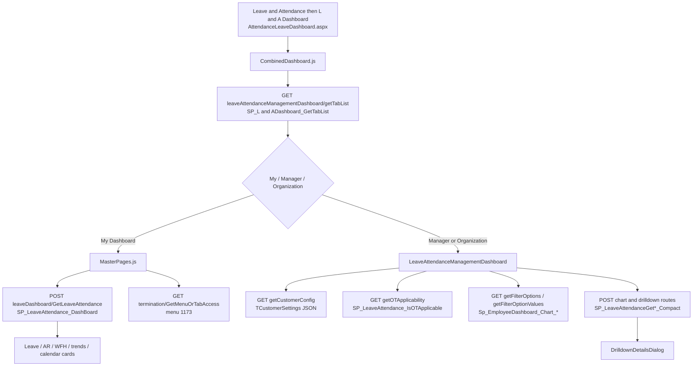
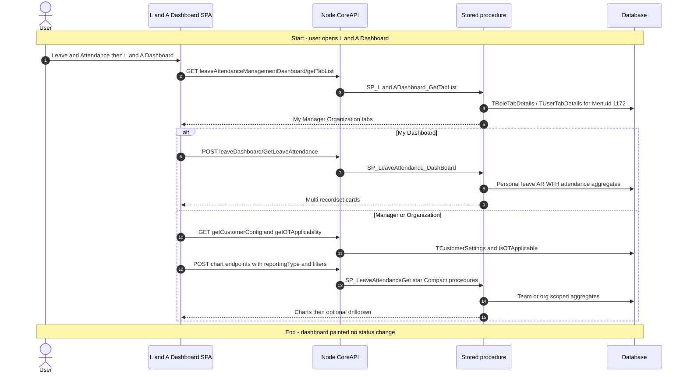
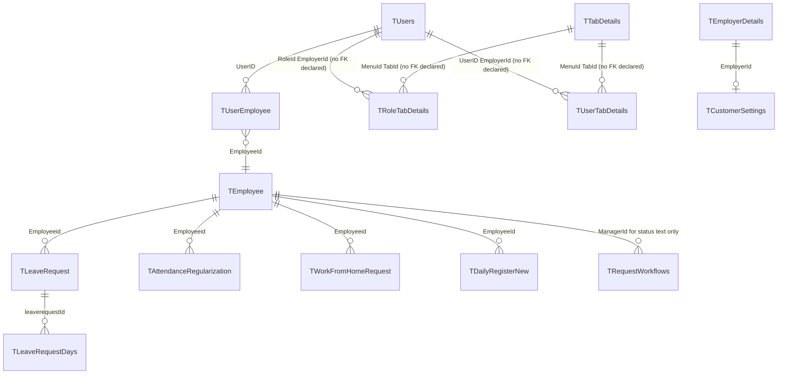

# L&A Dashboard

## Overview

An employee or manager opens **Leave & Attendance → L&A Dashboard** for charts and summaries — not to apply for leave or approve requests. The WebForms shell `AttendanceLeaveDashboard.aspx` stamps session identity into hidden fields and loads the shared `Leave_Dashboard` React bundle (`leave_attendance_module*.js`). React Router maps that aspx path to `CombinedDashboard`, which first loads role/user tabs for menu `1172` and then switches three modes:

- **My Dashboard** — personal leave / AR / WFH / approval-ratio / swipe / attendance cards fed by one multi-result-set call (`SP_LeaveAttendance_DashBoard`). Card visibility for Leave / AR / WFH still consults tab ACL on menu `1173` (Leave Management / Attendance tabs).
- **Manager Dashboard** — team charts (live attendance, leave pipeline, team health, availability, OT calendar when OT is on, leave trend / utilization, attendance source) with Reporting View (direct / indirect / all reportees) and org filters.
- **Organization Dashboard** — same management charts with `reportingType = -3` (employer-scoped population for HR/admin-style roles).

Risk thresholds for team-health tiles come from `TCustomerSettings.LeaveAttendanceRiskPolicySettings` (JSON). Overtime Calendar is shown only when `SP_LeaveAttendance_IsOTApplicable` says OT is on for the employer.

**Who's involved:**

- **Employee** — My Dashboard is their personal L&A picture.
- **Manager** — Manager Dashboard for direct/indirect reportees.
- **HR / role with Organization tab** — Organization Dashboard across employees in scope.

This page is **read-only analytics**. Apply/cancel lives on Leave Management / Attendance; the approval inbox is Notifications; completed decisions are Approval History.

## Workflow

## Request journey

This page does not create or decide leave/attendance requests. The journey that **starts** here is a filtered dashboard load that ends when chart/card result sets are painted (or empty).

## Entry points

> Live entry point: React `Leave_Dashboard` SPA hosted by `AttendanceLeaveDashboard.aspx`. Code-behind only stamps session into hidden fields and picks `leave_attendance_module*` / `runtime*` / `vendors*` from `HRM/Leave_Dashboard/BuildJS/`.

| Entry point | Purpose | Live? |
|---|---|---|
| `HRM/Leaves/AttendanceLeaveDashboard.aspx` (+ `.cs`) | WebForms shell; page title "L & A Dashboard"; root `#attendanceLeaveDashboardRoot` | Yes |
| React `CombinedDashboard` (`LeaveAttendanceDashboardCombined/CombinedDashboard.js`) | Tab switcher + hosts My vs management views | Yes — `Areas/routes.js` path `LA_DASHBOARD` |
| `MasterPages` (`Areas/MasterPages/Containers/MasterPages.js`) | My Dashboard cards | Yes when tab = My Dashboard |
| `LeaveAttendanceManagementDashboard` | Manager / Organization charts, filters, drilldowns | Yes when tab ≠ My Dashboard |
| Node CoreAPI `/leaveDashboard/*`, `/leaveAttendanceManagementDashboard/*` | Card bundle, charts, filters, tab list | Yes |
| `termination/GetMenuOrTabAccess` | My Dashboard Leave/AR/WFH card ACL (menu `1173`) | Yes (shared termination route) |

## Code → database call chain

`employeeId` / `managerId` on management-dashboard POSTs are overwritten from the JWT (`req.EID`) inside the DAL filter helper where `request.EID` is set. Tab list also prefers `req.EID`.

| Step | Entry point | App code | Stored procedure / SQL |
|---|---|---|---|
| Page load | `AttendanceLeaveDashboard.aspx` | `Page_Load` (`AttendanceLeaveDashboard.aspx.cs:27-68`) — session → hidden fields, pick React bundle | none |
| Mount SPA | `Leave_Dashboard/index.js:6` | `Routes` → `CombinedDashboard` for `AttendanceLeaveDashboard.aspx` | none |
| Tab list | `CombinedDashboard.js:86` | `leaveAttendanceManagementDashboardController.getTabList` (`leaveAttendanceManagementDashboardController.js:269`) → `leaveAttendanceManagementDashboardDAL.getTabList` (`leaveAttendanceManagementDashboardDAL.js:485`) | `SP_L&ADashboard_GetTabList` |
| My Dashboard cards | `MasterPages.js:89` | `leaveDashboardController.GetLeaveAttendance` (`leaveDashboardController.js:8`) → `leaveDashboardDAL.GetLeaveAttendance` (`leaveDashboardDAL.js:16`) | `SP_LeaveAttendance_DashBoard` (nests `USP_LA_GetApplicableLeaveCode`, `USP_LA_Employee_Leave_CustomReport`, `SP_DB_EmployeeAttendanceDetails`, `USP_GetEmployeeLeaveAttendanceDetails`) |
| My Dashboard card ACL | `MasterPages.js:140` | `terminationController.GetMenuOrTabAccess` → `TerminationDAL.GetTabsByRole` / `GetTabsByUser` | `Sp_AdminRoleM_GetTabRoleDet` / `Sp_GetTabUserDetails` |
| Leave transactions popup | `LeaveSummary/Transcations.js:46` | `leaveDashboardController.GetLeaveTranscations` (`leaveDashboardController.js:19`) → `leaveDashboardDAL.GetLeaveTranscations` (`leaveDashboardDAL.js:46`) | `SP_LA_GetPendingLeaveDetails` |
| AR transactions popup | `ARSummary/Transcations.js:54` | `GetARTranscations` (`leaveDashboardController.js:30`) → `leaveDashboardDAL.js:62` | `SP_LA_GetAttendanceForRejection` |
| WFH transactions popup | `WFHSummary/Transcations.js:50` | `GetWfhTranscations` (`leaveDashboardController.js:41`) → `leaveDashboardDAL.js:79` | `SP_LA_GetWorkFromHomeRequests` |
| Yearly leave/attendance refresh | `AttendanceCalenderCard.js:109` | `GetEmployeeLeaveAttendance` (`leaveDashboardController.js:52`) → `leaveDashboardDAL.js:96` | `SP_EmployeeLeaveAttendance` |
| Customer risk config | `LeaveAttendanceManagementDashboard.js:239` | `getCustomerConfig` (`leaveAttendanceManagementDashboardController.js:252`) | inline `SELECT LeaveAttendanceRiskPolicySettings FROM TCustomerSettings` (no SP) |
| OT chart gate | `LeaveAttendanceManagementDashboard.js:265` | `getOTApplicability` (`leaveAttendanceManagementDashboardController.js:280`) → `leaveAttendanceManagementDashboardDAL.js:498` | `SP_LeaveAttendance_IsOTApplicable` |
| Filter option names | filter toolbox / NL filter | `getFilterOptions` (`leaveAttendanceManagementDashboardController.js:198`) → DAL `:179` | `Sp_EmployeeDashboard_Chart_GenerateFilterOptions` |
| Filter option values | same | `getFilterOptionValues` (`…Controller.js:222`) → DAL `:193` | `Sp_EmployeeDashboard_Chart_GenerateAdditionalFilterValues` |
| Leave types filter | leave-type multi-select | `getLeaveTypes` (`…Controller.js:8`) → DAL `:216` | `Sp_GetActiveLeaveTypesFormatted` |
| Reportee picker | `useFilterDataCache` / reportee helpers | `getReportees` (`…Controller.js:241`) → DAL `:461` | `SP_LeaveAttendance_GetReporteesByBusinessUnitIds` |
| Live attendance | `LiveAttendance.js:68` / drilldown `:50` | `getLiveAttendanceSummary` / `…DrillDown` (`…Controller.js:19-31`) → DAL `:109` / `:123` | `SP_LeaveAttendanceGetLiveAttendanceSummaryChart_Compact` / `_DrillDown_Compact` |
| Leave pipeline | `LeavePipeline.js:50` | `getLeavePipeline` (`…Controller.js:43`) → DAL `:138` | `SP_LeaveAttendanceGetPendingLeaveRequests` |
| Team health | `TeamHealthAlerts.js:260` / `:319` | `getTeamHealthAndAlert` / drilldown → DAL `:152` / `:165` | `SP_LeaveAttendanceGetTeamHealthAlerts_Compact` / `_DrillDown_Compact` |
| Team availability | `TeamAvailabilityCapacity.js:136` / `:103` | chart / drilldown → DAL `:229` / `:250` | `SP_LeaveAttendanceGetTeamAvailabilityCalendar_Compact` / `…DrillDown_Compact` |
| Overtime calendar | `OvertimeCalendar.js:128` / `:103` | chart / drilldown → DAL `:270` / `:295` | `SP_LeaveAttendanceGetOTSummaryChart_Compact` / `…DrillDown_Compact` |
| Leave trend | `LeaveTrendAnalysis.js:130` / `:106` | chart / drilldown → DAL `:318` / `:341` | `SP_LeaveAttendanceGetLeaveTrendAnalysis_Compact` / `_DrillDown_Compact` |
| Leave utilized by type | `LeaveUtilizedByType.js:149` / `:125` | chart / drilldown → DAL `:365` / `:388` | `SP_LeaveAttendanceGetLeaveUtilizedByType_Compact` / `_DrillDown_Compact` |
| Attendance source | `AttendanceSourceAnalysis.js:150` / `:121` | chart / drilldown → DAL `:412` / `:435` | `SP_LeaveAttendanceGetAttendanceSourceAnalysis_Chart_Compact` / `…ChartDrillDown_Compact` |

## API endpoints

This submenu is a React SPA over Node CoreAPI. There are no `[WebMethod]` / PageMethods on `AttendanceLeaveDashboard.aspx`. Routes mount from `Routes/routeIndex.js` as `/leaveDashboard` and `/leaveAttendanceManagementDashboard`.

### Shell / My Dashboard

| Verb | Route | Parameters | Purpose | Source |
|---|---|---|---|---|
| `GET` | `leaveAttendanceManagementDashboard/getTabList` | `employerId` (query); `employeeId` (JWT preferred) | My / Manager / Organization tabs (`MenuId = 1172`) | `leaveAttendanceManagementDashboardController.js:269` |
| `POST` | `leaveDashboard/GetLeaveAttendance` | Body: `EmployeeID`, `CardID` (optional), `MonthFromDate` / `MonthToDate`, `HistoryFromDate` / `HistoryToDate`, optional current-period dates | Multi-recordset personal dashboard | `leaveDashboardController.js:8` |
| `POST` | `leaveDashboard/GetLeaveTranscations` | Body: `EmployeeID` | Leave card transaction popup | `leaveDashboardController.js:19` |
| `POST` | `leaveDashboard/GetARTranscations` | Body: `EmployeeID` | AR card transaction popup | `leaveDashboardController.js:30` |
| `POST` | `leaveDashboard/GetWfhTranscations` | Body: `EmployeeID` | WFH card transaction popup | `leaveDashboardController.js:41` |
| `POST` | `leaveDashboard/GetEmployeeLeaveAttendance` | Body: `EmployeeID`, `Year` | Yearly calendar refresh | `leaveDashboardController.js:52` |
| `GET` | `termination/GetMenuOrTabAccess` | `employerId`, `userId`, `userRoleId`, `menuId=1173`, `returnAllTabsFromMenu=1` | Hide Leave/AR/WFH cards when tabs disabled | `terminationController.js:367` |

### Management dashboard (Manager / Organization)

Shared chart body fields (via `_addFilterParametersToRequest`): `managerId` (JWT), `reportingType` (`0` direct, `1` indirect, `-2` all reportees, `-3` org), `employerId`, optional comma lists for BU / locations / demographics / leave / attendance / shift, optional DOJ date range.

| Verb | Route | Parameters | Purpose | Source |
|---|---|---|---|---|
| `GET` | `leaveAttendanceManagementDashboard/getCustomerConfig` | `employerId` | Risk / capacity threshold JSON | `…Controller.js:252` |
| `GET` | `leaveAttendanceManagementDashboard/getOTApplicability` | `employerId` | Show Overtime Calendar | `…Controller.js:280` |
| `GET` | `leaveAttendanceManagementDashboard/getFilterOptions` | `filterTypes[]`, `type` | Filter field catalogs | `…Controller.js:198` |
| `GET` | `leaveAttendanceManagementDashboard/getFilterOptionValues` | `employerId`, `employeeId` (JWT), `filterType`, `filterOption`, `type` | Filter value lists | `…Controller.js:222` |
| `GET` | `leaveAttendanceManagementDashboard/getLeaveTypes` | `employerId` (asserted) | Leave-type filter | `…Controller.js:8` |
| `POST` | `leaveAttendanceManagementDashboard/getReportees` | Body: `managerId`, `employerId`, `reportingType`, optional `businessUnitIds` | Reportee list for filters | `…Controller.js:241` |
| `POST` | `…/getLiveAttendanceSummary` | Shared filters | Live attendance chart | `…Controller.js:19` |
| `POST` | `…/getLiveAttendanceSummaryDrillDown` | Shared filters + `statusType` | Live attendance employees | `…Controller.js:31` |
| `POST` | `…/getLeavePipeline` | Shared filters | Pending leave pipeline | `…Controller.js:43` |
| `POST` | `…/getTeamHealthAndAlert` | Shared filters | Team health tiles | `…Controller.js:54` |
| `POST` | `…/getTeamHealthAndAlertDrillDown` | Shared filters + `alertType` | Team health employees | `…Controller.js:66` |
| `POST` | `…/getTeamAvailabilityAndCapacityChart` | Shared filters + `month`, `year`, optional `filteredBusinessUnits` | Availability calendar | `…Controller.js:78` |
| `POST` | `…/getTeamAvailabilityAndCapacityDrillDown` | Shared filters + `date`, `statusType`, optional filtered employees | Availability day detail | `…Controller.js:90` |
| `POST` | `…/getOvertimeCalendarChart` | Shared filters + `month`, `year` | OT calendar | `…Controller.js:102` |
| `POST` | `…/getOvertimeCalendarDrillDown` | Shared filters + `date` | OT day detail | `…Controller.js:114` |
| `POST` | `…/getLeaveTrendAnalysisChart` | Shared filters + `fromDate`, `toDate` | Leave trend | `…Controller.js:126` |
| `POST` | `…/getLeaveTrendAnalysisDrillDown` | Shared filters + dates + `period` | Leave trend detail | `…Controller.js:138` |
| `POST` | `…/getLeaveUtilizedByTypeChart` | Shared filters + dates | Leave by type | `…Controller.js:150` |
| `POST` | `…/getLeaveUtilizedByTypeDrillDown` | Shared filters + dates + `code` | Leave-by-type detail | `…Controller.js:162` |
| `POST` | `…/getAttendanceSourceAnalysisChart` | Shared filters + dates | Attendance source | `…Controller.js:174` |
| `POST` | `…/getAttendanceSourceAnalysisDrillDown` | Shared filters + dates + source fields | Attendance source detail | `…Controller.js:186` |

There is **no** approve/reject/reassign mutation on this page.

## Stored procedures & tables involved

| Object | Path | Role | llm-wiki |
|---|---|---|---|
| `SP_L&ADashboard_GetTabList` | `HRMS-DATABASE/HRMS/STOREPROCEDURE/SP_L&ADashboard_GetTabList.sql` | Role + user tabs for menu `1172` | — |
| `SP_LeaveAttendance_DashBoard` | `…/SP_LeaveAttendance_DashBoard.sql` | My Dashboard multi-card result sets | — |
| `USP_LA_GetApplicableLeaveCode` / `USP_LA_Employee_Leave_CustomReport` | `…/STOREPROCEDURE/` | Nested leave-code / custom report for leave summary card | `domain/leave-lifecycle.md` (adjacent) |
| `SP_DB_EmployeeAttendanceDetails` / `USP_GetEmployeeLeaveAttendanceDetails` | `…/STOREPROCEDURE/` | Nested yearly attendance / leave for calendar card | `domain/attendance-lifecycle.md` |
| `SP_LA_GetPendingLeaveDetails` / `SP_LA_GetAttendanceForRejection` / `SP_LA_GetWorkFromHomeRequests` | `…/STOREPROCEDURE/` | My Dashboard transaction popups | leave/attendance lifecycle |
| `SP_EmployeeLeaveAttendance` | `…/SP_EmployeeLeaveAttendance.sql` | Yearly leave/attendance refresh | — |
| `Sp_AdminRoleM_GetTabRoleDet` / `Sp_GetTabUserDetails` | `…/STOREPROCEDURE/` | My Dashboard Leave/AR/WFH card ACL | — |
| `SP_LeaveAttendanceGetLiveAttendanceSummaryChart_Compact` (+ DrillDown) | `…/STOREPROCEDURE/` | Live attendance chart / employees | — |
| `SP_LeaveAttendanceGetPendingLeaveRequests` | `…/STOREPROCEDURE/` | Leave pipeline | — |
| `SP_LeaveAttendanceGetTeamHealthAlerts_Compact` (+ DrillDown) | `…/STOREPROCEDURE/` | Team health tiles | — |
| `SP_LeaveAttendanceGetTeamAvailabilityCalendar_Compact` (+ DrillDown) | `…/STOREPROCEDURE/` | Team availability | — |
| `SP_LeaveAttendanceGetOTSummaryChart_Compact` (+ DrillDown) | `…/STOREPROCEDURE/` | Overtime calendar | — |
| `SP_LeaveAttendanceGetLeaveTrendAnalysis_Compact` (+ DrillDown) | `…/STOREPROCEDURE/` | Leave trend | — |
| `SP_LeaveAttendanceGetLeaveUtilizedByType_Compact` (+ DrillDown) | `…/STOREPROCEDURE/` | Leave by type | — |
| `SP_LeaveAttendanceGetAttendanceSourceAnalysis_Chart_Compact` (+ ChartDrillDown) | `…/STOREPROCEDURE/` | Attendance source | — |
| `Sp_CM_Mydetails_DirectIndirectReports` / `Sp_CM_DirectIndirectReports` | `…/STOREPROCEDURE/` | Nested reportee scope for charts / reportee list | — |
| `SP_EmployeeDashboard_GetBusinessUnitByOrg_EmployeeId` / `SP_EmployeeDashboard_GetLocationByEmployeeId` / `SP_CM_GetTitle` | `…/STOREPROCEDURE/` | Nested BU / location / designation filter seeds | — |
| `Sp_EmployeeDashboard_Chart_GenerateFilterOptions` / `…AdditionalFilterValues` | `…/STOREPROCEDURE/` | Filter catalogs / values (shared with Employee Dashboard) | — |
| `Sp_GetActiveLeaveTypesFormatted` | `…/Sp_GetActiveLeaveTypesFormatted.sql` | Active leave types for filter | — |
| `SP_LeaveAttendance_GetReporteesByBusinessUnitIds` | `…/STOREPROCEDURE/` | Reportee picker | — |
| `SP_LeaveAttendance_IsOTApplicable` | `…/STOREPROCEDURE/` | OT calendar visibility | — |
| `TRoleTabDetails`, `TUserTabDetails`, `TTabDetails` | `…/TABLES/` | Dashboard tab ACL (`MenuId` 1172 / 1173) | — |
| `TCustomerSettings` | `…/TABLES/` | `LeaveAttendanceRiskPolicySettings` JSON | — |
| `TEmployee`, `TLeaveRequest`, `TLeaveRequestDays`, `TAttendanceRegularization`, `TWorkFromHomeRequest`, `TDailyRegisterNew`, `TAttendance`, OT request tables | `…/TABLES/` | Fact tables behind cards and charts | `domain/leave-lifecycle.md`, `domain/attendance-lifecycle.md` |
| `TRequestWorkflows` | `…/TABLES/` | Status text on AR/WFH cards; not a mutation surface here | `domain/approval-workflow.md` |

## Table relationships

My Dashboard aggregates personal rows by `EmployeeId`. Management charts first build a reportee / org employee set (`Sp_CM_Mydetails_DirectIndirectReports` or org scope), then join attendance / leave facts. Tab ACL is menu/tab mapping. There is no write path from this page into request tables.

`reportingType` on management SPs: `0` direct, `1` indirect, `-2` direct+indirect, `-3` all employees for Organization Dashboard. Manager Dashboard defaults Reporting View to Direct Reportees (`0`).

## Known gaps

- **Procedure name contains `&`.** Live DAL executes `SP_L&ADashboard_GetTabList` exactly; scripts and docs must keep that spelling.
- **My Dashboard ACL uses a different menu** (`1173`) than the view-mode tabs (`1172`). A role can see Manager Dashboard while Leave/AR/WFH personal cards stay hidden.
- **`getCustomerConfig` is inline SQL**, not a stored procedure — risk JSON lives only in `TCustomerSettings.LeaveAttendanceRiskPolicySettings`.
- **Default tabs fallback.** If `getTabList` returns empty or errors, `CombinedDashboard` still shows My Dashboard only (`DEFAULT_TABS`).
- **Organization mode hard-codes `reportingType = -3`** and clears Reporting View; Manager mode owns the Reporting View filter.
- **OT Calendar is conditional.** Chart list inserts Overtime Calendar only after `getOTApplicability` returns true.
- **Shared Employee Dashboard filter SPs.** `Sp_EmployeeDashboard_Chart_GenerateFilterOptions` / `…AdditionalFilterValues` are reused; changing them affects Employee Dashboard too.
- **Hardcoded DB name in `SP_LeaveAttendance_DashBoard.sql` header** (`USE [HRM-CL-Prod]`) — Liquibase/deploy still runs the `CREATE OR ALTER` body in the current DB context; do not copy that `USE` into new scripts.
- **No mutations.** Approvals stay on Notifications; this page never calls `SP_CM_ApproveWorkFlowRequest`.
- **llm-wiki has no dedicated L&A Dashboard page**; OV_Rule_* dashboard generators mentioned in the module catalog are a different reporting family, not these `SP_LeaveAttendanceGet*_Compact` charts.

## Reference

Confidence is **high** for the React shell → Node DAL → stored-procedure chain (file:line on tab list, My Dashboard bundle, and each management chart). Nested chart helpers (`Sp_CM_Mydetails_DirectIndirectReports`, BU/location seeds) were inventoried from the Compact SQL scripts.

### SourceCode

- `HRMS.Web/HRMS.Web/HRM/Leaves/AttendanceLeaveDashboard.aspx` (+ `.cs`)
- `HRMS.Web/HRMS.Web/HRM/Leave_Dashboard/Areas/LeaveAttendanceDashboardCombined/` (`CombinedDashboard.js`, `ViewModeSwitch.js`)
- `HRMS.Web/HRMS.Web/HRM/Leave_Dashboard/Areas/MasterPages/` (`Containers/MasterPages.js`, card components)
- `HRMS.Web/HRMS.Web/HRM/Leave_Dashboard/Areas/LeaveAttendanceManagementDashboard/` (charts, filters, drilldown)
- `HRMS.Web/HRMS.Web/HRM/Leave_Dashboard/Areas/routes.js`, `Common/routeConstants.js`, `Common/apiURLConstants.js`
- `HRMS.CoreAPI/HRMS.Core.WebAPI.Node/Routes/leaveDashboardRoutes.js`, `leaveAttendanceManagementDashboardRoutes.js`, `routeIndex.js`
- `HRMS.CoreAPI/HRMS.Core.WebAPI.Node/Controllers/leaveDashboardController.js`, `leaveAttendanceManagementDashboardController.js`
- `HRMS.CoreAPI/HRMS.Core.WebAPI.Node/Core/DataAccessLayer/leaveDashboardDAL.js`, `leaveAttendanceManagementDashboardDAL.js`

### TDG HRMS DB

- `llm-wiki/domain/leave-lifecycle.md`, `llm-wiki/domain/attendance-lifecycle.md`, `llm-wiki/domain/approval-workflow.md`
- `HRMS-DATABASE/HRMS/STOREPROCEDURE/SP_L&ADashboard_GetTabList.sql`, `SP_LeaveAttendance_DashBoard.sql`, `SP_LeaveAttendanceGet*_Compact.sql`, and helpers listed above
