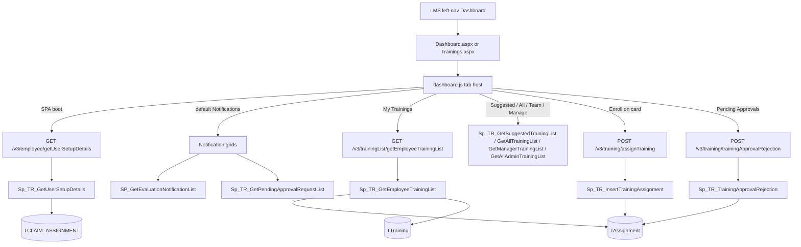
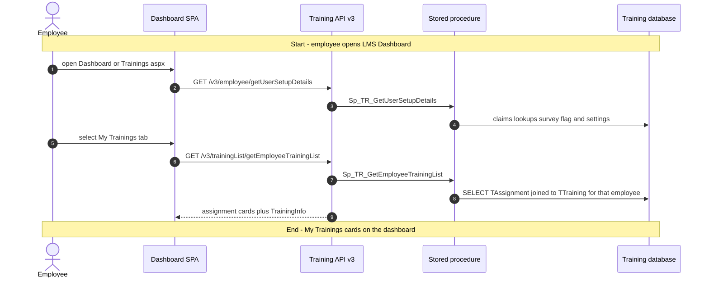
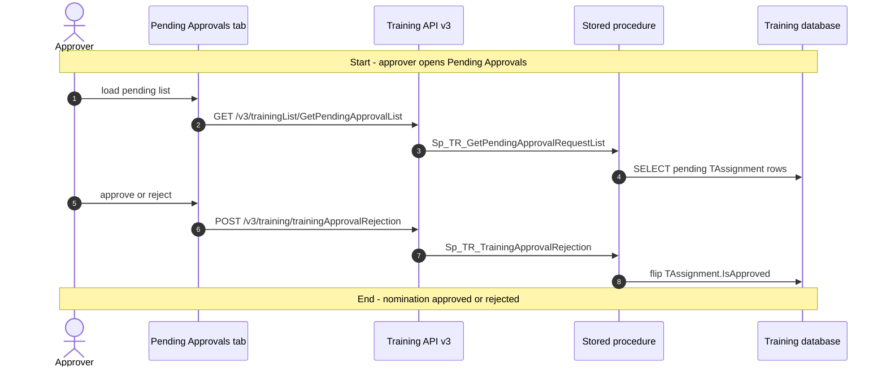
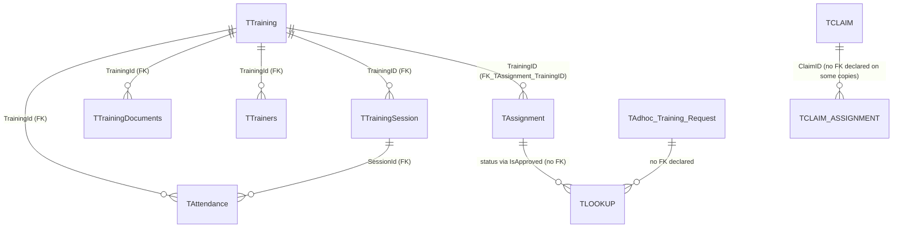

# Dashboard

## Overview

An employee opens **LMS → Dashboard** to see what training work is waiting on them: notifications (evaluations, nominations, TNI), their own enrolments on **My Trainings**, suggestions, team lists, pending classroom approvals, and (with the right claims) manage / requests / external / PMS TNI / miscellaneous tabs. The WebForms shell found for this leaf is `HRM/Training/Dashboard.aspx` (page title **Dashboard**, activity `LMSEmployeeDashboard` = 410). It only stamps session identity into hidden fields and loads the shared Training React bundle into `#root`.

The React container is `Areas/Dashboard/Containers/dashboard.js`. Its H1 and breadcrumb still say **Trainings**. The SPA route constant `TRAINING_DASHBOARD` is `/HRM/Training/Trainings.aspx`, so the path the router matches in production is usually **Trainings.aspx**, not `Dashboard.aspx`. `TDynamicMenuHierarchy` labels menu value `111` as **Trainings**. Core HRMS `USP_TR_GetDashboardAccess` still looks up `NavigateURL = '~/HRM/Training/Dashboard.aspx'`. Treat **Dashboard** / **Trainings** as the same tabbed LMS home UI with two aspx hosts and a naming split between menu XML, aspx title, and React route.

**Who's involved:**

- **Employee** — Notifications and My / Suggested / All Trainings; self-enroll from a card when allowed.
- **Manager** — Team Trainings (`TR002`) and Pending Approvals for reportees' classroom nominations.
- **LMS coordinator / admin** — Manage Trainings, Add new Training (`TR003` / `TR008`), assign/publish (documented in depth under the sibling **Trainings** guide).
- **Organiser / specialty roles** — External (`TR024` / `TR035`), PMS TNI (`TR025`), Miscellaneous (`TR036`).

There is **no** `llm-wiki/domain` lifecycle page for LMS. Table names and declared FKs come from `llm-wiki/reference/tables/training.md` and `llm-wiki/architecture/module-catalog.md` (Training satellite DB). Create / publish / content wizard depth lives in the sibling guide `content/guides/lms/trainings.md` — this page covers the dashboard shell, tab lists, enroll/unenroll, and approval.

## Workflow

Training type codes on `TTraining.TrainingTypeCD`: **4001** Online, **4002** Classroom, **4003** Quiz. `TAssignment.IsApproved` is **0** pending, **1** approved, **2** rejected.

## Request journey

The everyday request on this menu item is **opening the dashboard and loading My Trainings** (or the default Notifications tab). Classroom **approve/reject** is a second request type on the same shell.

### Employee — open Dashboard and load My Trainings

### Approver — classroom nomination on Pending Approvals

## Entry points

> `Dashboard.aspx` is the aspx titled **Dashboard** under `HRM/Training` (activity `LMSEmployeeDashboard`). The live React Router path for this UI is `RouteConstants.TRAINING_DASHBOARD` → `/HRM/Training/Trainings.aspx`. Both hosts load the same `TrainingBuildAssets` bundle. Sibling left-nav aspx files (`ManageTNISetup.aspx`, `Reports.aspx`, `TrainingCalendar.aspx`, `ManageGoalSetting.aspx`) share that bundle for other LMS menus.

| UI page / route | Purpose |
|---|---|
| `/HRM/Training/Dashboard.aspx` | Asx titled Dashboard; session stamp + React `#root`. Referenced by `USP_TR_GetDashboardAccess`. |
| `/HRM/Training/Trainings.aspx` | Live SPA route for the same `dashboard.js` tab host. |
| `/HRM/Training/ViewTraining` | Course detail from a card (`onViewFrom: 'Dashboard'`). |
| `/HRM/Training/ManageTraining` | Add new Training wizard (claim `TR008`) — see Trainings guide. |
| `/HRM/Training/AssignTraining` | Admin assign — see Trainings guide. |
| `/HRM/Training/AdHocTrainingPrograms` | Training Requests / Adhoc button. |
| `/HRM/Training/AddExternalTraining` | External Training button when `TR035`. |
| `/HRM/Training/DiscussionForum` | Discussion Forum header button. |
| `/HRM/Training/TakeSurvey` | ESAT Survey when setup returns `showSurveyButton`. |

Tab visibility is claim-gated in `dashboard.js` (`TR001` My/Notifications, `TR002` Team, `TR003` Manage, `TR008` Add, `TR022` global, `TR024` external, `TR025` PMS TNI, `TR035` organise, `TR036` miscellaneous). Default selected tab is Notifications (`CNST_NOTIFICATIONS_TAB`).

## Code → database call chain

Live SPA constants are **v3** (`apiURLConstants.js` v3 block). JWT middleware sets `req.EID`. Several list GETs also send employer ids and gate with `SP_Employer_CustNo_isValid` before the list procedure.

| Entry point | DAL / BLL method (`file:line`) | Stored procedure |
|---|---|---|
| Page load activity (`Dashboard.aspx.cs:21`) | `CommonUtil.LogActivity` | Activity helpers → `Sp_InsertActivityLog` (HRMS; type `LMSEmployeeDashboard` = 410) |
| SPA boot / `SetupUser` | `EmployeeDAL.GetUserSetupDetails` (`employeeDAL_v3.js:24`) via `employeeController_v3.js:9` | `Sp_TR_GetUserSetupDetails` |
| My Trainings tab | `TrainingListDAL.GetEmployeeTrainingList` (`trainingListDAL_v3.js:111`) via `trainingListController_v3.js:8` | `Sp_TR_GetEmployeeTrainingList` |
| My Trainings graph | `GetMyTrainingsGraphData` (`trainingListDAL_v3.js:323`) via `trainingListController_v3.js:119` | `Sp_TR_GetMyTrainingsGraphData` |
| Suggested Trainings | `GetSuggestedTrainingList` (`trainingListDAL_v3.js:241`) via `trainingListController_v3.js:69` | `Sp_TR_GetSuggestedTrainingList` |
| All Trainings | `GetAllTrainingList` (`trainingListDAL_v3.js:200`) via `trainingListController_v3.js:51` | `Sp_TR_GetAllTrainingList` |
| All Trainings graph | `GetAllTrainingsGraphData` (`trainingListDAL_v3.js:339`) | `Sp_TR_GetAllTrainingsGraphData` |
| Team Trainings | `GetManagerTrainingList` (`trainingListDAL_v3.js:285`) via `trainingListController_v3.js:87` | `Sp_TR_GetManagerTrainingList` |
| Manage Trainings | `GetAllAdminTrainingList` (`trainingListDAL_v3.js:171`) via `trainingListController_v3.js:23` | `Sp_TR_GetAllAdminTrainingList` |
| Pending Approvals list | `GetPendingApprovalList` (`trainingListDAL_v3.js:307`) via `trainingListController_v3.js:103` | `Sp_TR_GetPendingApprovalRequestList` |
| Notifications evaluation grid | `GetTrainingEvaluationList` → `SP_GetEvaluationNotificationList` (`trainingListDAL_v3.js:490`) | `SP_GetEvaluationNotificationList` |
| Notifications / Pending manager view | `GetManagerViewTrainingList` (`trainingListDAL_v3.js:149`) | `Sp_TR_GetManagerViewTrainingList` |
| Training Requests tab | `GetAdhocTrainingList` (`trainingDAL_v3.js:1139`) via `trainingController_v3.js:539` | `Sp_TR_GetAdhocTrainingsList` |
| Enroll / admin Assign from card flows | `AssignTraining` (`trainingDAL_v3.js:413`) via `trainingController_v3.js:157` | `Sp_TR_InsertTrainingAssignment` (`pIsFromDashboard` = 0 from this LMS SPA) |
| Unenroll | `UnAssignTraining` (`trainingDAL_v3.js:448`) via `trainingController_v3.js:169` | `Sp_TR_UnenrollTraining` |
| Approve / reject | `TrainingBLL.TrainingApprovalRejection` → DAL `trainingDAL_v3.js:1077` via `trainingController_v3.js:503` | `Sp_TR_TrainingApprovalRejection` |
| View Details | `TrainingBLL.ViewTrainingDetails` via `trainingController_v3.js:340` | `Sp_TR_ViewTrainingDetails` |

Call mechanism is **mssql** `request().execute(procName)` against the Training pool. Create / publish / content / attendance / quiz paths that leave this tab host are listed on the Trainings guide, not repeated here.

## API endpoints

No WebForms postback DAL — `Dashboard.aspx.cs` / `Trainings.aspx.cs` only copy session into hidden fields. Base path `/api` on the Training Node app; live SPA uses **v3**.

| Verb | Route | Parameters | Purpose | Source |
|---|---|---|---|---|
| `GET` | `/v3/employee/getUserSetupDetails` | query `roleId`, `EId`; employee from `req.EID` | Claims, lookups, reportees, survey button, certificate settings | `employeeRoutes_v3.js:8` / `employeeController_v3.js:9` |
| `GET` | `/v3/trainingList/getEmployeeTrainingList` | query `EId`, `Quarter`, `Year`, `TRType`, `Month`, `FromDate`, `ToDate`, `SortingType`, `SortingOrder` | My Trainings | `trainingListRoutes_v3.js:8` |
| `GET` | `/v3/trainingList/getSuggestedTrainingList` | query `EID`, `Quarter`, `Year`, `ClrTR`, `IsOlTR`, `IsUpcomingTR`, `SortingType`, `SortingOrder` | Suggested | `trainingListRoutes_v3.js:12` |
| `GET` | `/v3/trainingList/getAllTrainingList` | query filters including `BusinessUnit`, `ProductIds`, category, dates, sort | All Trainings | `trainingListRoutes_v3.js:11` |
| `GET` | `/v3/trainingList/GetMgrTrainingList` | query `EId`, quarter/year/type/BU/`EmployerIds` | Team Trainings | `trainingListRoutes_v3.js:13` |
| `GET` | `/v3/trainingList/getAllAdminTrainingList` | query `EID`, filters, `EmployerIds` | Manage Trainings | `trainingListRoutes_v3.js:10` |
| `GET` | `/v3/trainingList/GetPendingApprovalList` | query `EID`, filters, `EmployerIds` | Pending Approvals | `trainingListRoutes_v3.js:14` |
| `GET` | `/v3/trainingList/GetMyTrainingsGraphData` | query `EmployerId` | My Trainings hour/status chart | `trainingListRoutes_v3.js:15` |
| `GET` | `/v3/trainingList/GetAllTrainingsGraphData` | query `EmployerId` | All Trainings chart | `trainingListRoutes_v3.js:16` |
| `GET` | `/v3/trainingList/GetTrainingEvaluationList` | query `employerIds`, `employerId` | Notifications evaluation grid | `trainingListRoutes_v3.js:21` |
| `GET` | `/v3/training/getAdhocTrainingList` | query `employerId`, `EmployerIds` | Training Requests | `trainingRoutes_v3.js:52` |
| `GET` | `/v3/training/viewTrainingDetails` | query `TRId`, `EmployerId` | View Training | `trainingRoutes_v3.js:10` |
| `POST` | `/v3/training/assignTraining` | body assignment / enroll fields; `IsAssignedByAdmin` 0 or 1 | Enroll or admin assign | `trainingController_v3.js:157` |
| `POST` | `/v3/training/unAssignTraining` | body `TrainingID`, `EmployerId` | Unenroll | `trainingController_v3.js:169` |
| `POST` | `/v3/training/trainingApprovalRejection` | body `resourceDetails[]`, `isApproval`, optional `Comments` | Approve/reject | `trainingRoutes_v3.js:48` |

v3 `GET_USER_SETUP_DETAILS` in `apiURLConstants.js` is missing `&` before `EmpId` (same gap noted on the Trainings guide); the controller uses `req.EID` from JWT, so the broken query fragment is ignored for the employee id.

## Stored procedures & tables involved

> List and approval procedures live in **`HRMS-TRAINING`**. Encryption open/close and `Fn_GetEmployeeName` are Training synonyms to core HRMS. Activity log on `Dashboard.aspx` is core HRMS. Home upcoming-card assign uses the same `Sp_TR_InsertTrainingAssignment` with `pIsFromDashboard = 1` from Core `dashBoard` routes — that Home path is not this LMS left-nav item.

| Object | File path | Purpose | Wiki |
|---|---|---|---|
| `TTraining` | `HRMS-DATABASE/HRMS-TRAINING/TABLES/TTraining.sql` | Course header on every list card | `llm-wiki/reference/tables/training.md` |
| `TAssignment` | `…/TAssignment.sql` | Enrolment / approval state | same |
| `TTrainingSession` / `TTrainers` / `TTrainingDocuments` | TABLES | Session, trainer, thumbnail fields on lists | same |
| `TLOOKUP` / `TCLAIM` / `TCLAIM_ASSIGNMENT` | TABLES | Lookups and LMS claims | same |
| `TAdhoc_Training_Request` | TABLES | Training Requests tab | same |
| `TCustomerSettings` / `TTrainingSurvey` | TABLES / synonyms | Setup survey button and certificate flags | same |
| `Sp_TR_GetUserSetupDetails` | `STOREPROCEDURE/` | SPA bootstrap | — |
| `Sp_TR_GetEmployeeTrainingList` | same | My Trainings | — |
| `Sp_TR_GetSuggestedTrainingList` | same | Suggested | — |
| `Sp_TR_GetAllTrainingList` | same | All Trainings | — |
| `Sp_TR_GetManagerTrainingList` | same | Team Trainings | — |
| `Sp_TR_GetAllAdminTrainingList` | same | Manage Trainings | — |
| `Sp_TR_GetPendingApprovalRequestList` | same | Pending Approvals | — |
| `Sp_TR_GetAdhocTrainingsList` | same | Training Requests | — |
| `Sp_TR_GetMyTrainingsGraphData` / `Sp_TR_GetAllTrainingsGraphData` | same | Charts (nested `GetMinTrainingDateTime`, `GetMaxTrainingDateTime`, `GetTrainingSessionCount`) | — |
| `Sp_TR_GetManagerViewTrainingList` | same | Notification / pending helper list | — |
| `SP_GetEvaluationNotificationList` | same | Evaluation notification grid | — |
| `Sp_TR_InsertTrainingAssignment` / `Sp_TR_UnenrollTraining` | same | Enroll / unenroll | — |
| `Sp_TR_TrainingApprovalRejection` | same | Approve / reject | — |
| `Sp_TR_ViewTrainingDetails` | same | View Details | — |
| `USP_TR_GetDashboardAccess` | `HRMS-DATABASE/HRMS/STOREPROCEDURE/` | Role/user tab ids for `Dashboard.aspx` menu URL — not called from this SPA | — |

## Table relationships

Declared FKs from Training DDL / `llm-wiki/reference/tables/training.md`. Tables with no `FOREIGN KEY` are labelled as such.

## Known gaps

- **Menu name vs aspx vs React route.** Hierarchy XML says **Trainings** (111); aspx title and this guide's submenu are **Dashboard**; React route and breadcrumb use **Trainings.aspx** / "Trainings". Opening `Dashboard.aspx` alone does not match `TRAINING_DASHBOARD` unless the menu NavigateURL is `Trainings.aspx` or the router is changed.
- **Overlap with `content/guides/lms/trainings.md`.** Same `dashboard.js` UI; that guide owns create/publish/content. This guide owns the shell naming and tab list/approval call chain.
- **No SystemModel-2 / llm-wiki domain lifecycle** for LMS Dashboard.
- **`GET_USER_SETUP_DETAILS` missing `&` before `EmpId`** in v3 constants; employee id comes from JWT `req.EID`.
- **`pIsFromDashboard`** is hardcoded `0` in Training `AssignTraining` DAL; Home Core dashboard assign is a different caller with flag `1`.
- **`USP_TR_GetDashboardAccess`** is core HRMS and is not on the Training SPA call chain traced here.
- External / PMS TNI / Miscellaneous tab endpoints exist but are only summarised; deep documentation is left to those features when written.

## Reference

Confidence is **medium**: `Dashboard.aspx` and the React `dashboard.js` tab host were traced to v3 DAL `file:line` and Training list/approval procedures. Menu hierarchy text and the React route still say Trainings, which is called out above rather than forced into one name.

### SourceCode

- `HRMS.Web/HRMS.Web/HRM/Training/Dashboard.aspx` (+ `.cs`)
- `HRMS.Web/HRMS.Web/HRM/Training/Trainings.aspx` (+ `.cs`)
- `HRMS.Web/HRMS.Web/HRM/Training/Areas/routes.js`
- `HRMS.Web/HRMS.Web/HRM/Training/Areas/Dashboard/Containers/dashboard.js`
- `HRMS.Web/HRMS.Web/HRM/Training/Areas/Dashboard/Components/myTrainings.js`, `notification.js`, `pendingApprovalRequests.js`, `allTrainings.js`, `suggestedTrainings.js`, `teamTrainings.js`, `manageTrainings.js`, `adhocTrainings.js`
- `HRMS.Web/HRMS.Web/HRM/Training/Common/apiURLConstants.js`, `routeConstants.js`, `claimConstants.js`, `AppConstants.js`
- `HRMS.Shared/HRMS.DataContract/Common/Enums.cs` (`LMSEmployeeDashboard = 410`)
- `HRMS.Training/HRMS.Training.WebAPI.Node/Routes/trainingListRoutes_v3.js`, `trainingRoutes_v3.js`, `employeeRoutes_v3.js`
- `HRMS.Training/HRMS.Training.WebAPI.Node/Controllers/trainingListController_v3.js`, `trainingController_v3.js`, `employeeController_v3.js`
- `HRMS.Training/HRMS.Training.WebAPI.Node/Core/DataAccessLayer/trainingListDAL_v3.js`, `trainingDAL_v3.js`, `employeeDAL_v3.js`

### TDG HRMS DB

- `llm-wiki/architecture/module-catalog.md` — Training satellite
- `llm-wiki/reference/tables/training.md`
- `HRMS-DATABASE/HRMS-TRAINING/STOREPROCEDURE/Sp_TR_GetUserSetupDetails.sql`, `Sp_TR_GetEmployeeTrainingList.sql`, `Sp_TR_GetSuggestedTrainingList.sql`, `Sp_TR_GetAllTrainingList.sql`, `Sp_TR_GetManagerTrainingList.sql`, `Sp_TR_GetAllAdminTrainingList.sql`, `Sp_TR_GetPendingApprovalRequestList.sql`, `Sp_TR_GetAdhocTrainingsList.sql`, `Sp_TR_GetMyTrainingsGraphData.sql`, `Sp_TR_GetAllTrainingsGraphData.sql`, `Sp_TR_GetManagerViewTrainingList.sql`, `SP_GetEvaluationNotificationList.sql`, `Sp_TR_TrainingApprovalRejection.sql`, `Sp_TR_ViewTrainingDetails.sql`, `Sp_TR_InsertTrainingAssignment.sql`, `Sp_TR_UnenrollTraining.sql`
- `HRMS-DATABASE/HRMS/STOREPROCEDURE/USP_TR_GetDashboardAccess.sql`
