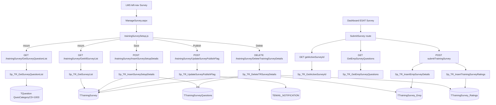
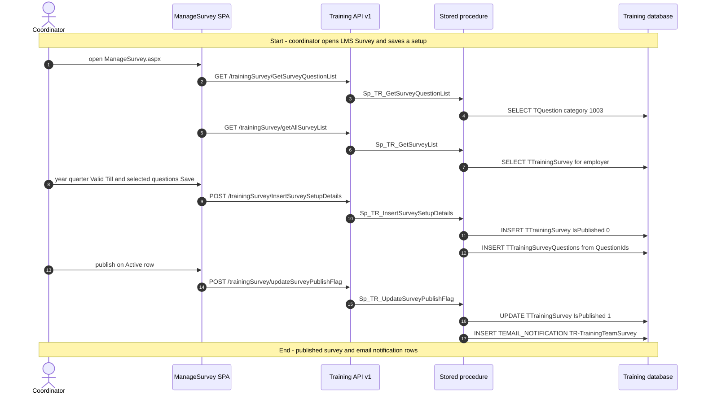
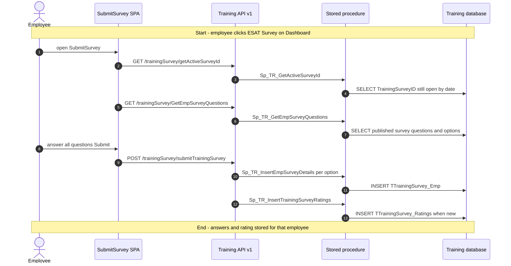
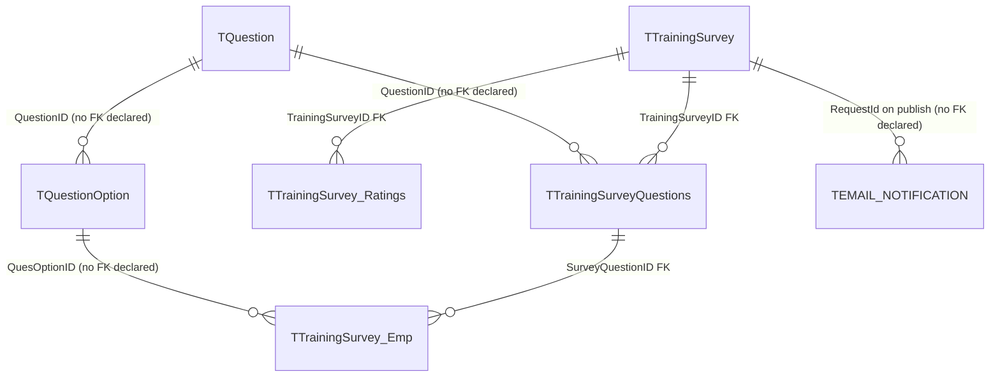

# Survey

## Overview

An LMS coordinator needs a short, organisation-wide questionnaire for a year and quarter — the ESAT-style training survey, not the separate top-level **Survey** module. They open **LMS → Survey** (`ManageSurvey.aspx`, activity `LMSSurvey`). The page loads the shared Training React bundle and mounts **Training Survey Setup**: pick year, one or more quarters, a **Valid Till** date, tick questions from the bank (category `QuesCategoryCD = 1003`), and **Save**. That writes an unpublished `TTrainingSurvey` row plus `TTrainingSurveyQuestions` links. While the survey is still **Active** (Valid Till ≥ today UTC), they can **publish** (claim check is intended to be `TR016`, same constant as TNI publish) or **delete**. Publish flips `IsPublished`, queues `TR-TrainingTeamSurvey` email rows for every active employee in that employer, and enables the **ESAT Survey** button on the Trainings / Dashboard shell for those employees. Employees open **Submit Survey** (`/HRM/Training/SubmitSurvey`), answer every question, and submit; answers land in `TTrainingSurvey_Emp` and a derived rating in `TTrainingSurvey_Ratings`. Only one Active+Published survey may be published at a time (SPA client check).

**Who's involved:**

- **LMS coordinator** — creates, publishes, and deletes survey setups on this left-nav leaf.
- **Employee** — takes the active published survey from the Dashboard **ESAT Survey** button (not this menu item).
- **Question author** — questions come from the Training question bank (`TQuestion` / Master Question Bank); this page only selects them.

There is **no** `llm-wiki/domain` lifecycle page for LMS Survey. Table blurbs live in `llm-wiki/reference/tables/training.md`. This is **not** `content/guides/survey/survey-list.md` (top-level Survey → Survey List / `HRMS-SURVEY`). Sibling / Calendar / TNI Setup share the same Training bundle but are separate menus.

## Workflow

`IsActive` on the grid is derived: Active when `OpenTill` date ≥ UTC today, else InActive. `IsPublished` is Yes/No from the bit. Employee take-survey is a client route; there is no `SubmitSurvey.aspx`.

## Request journey

### Coordinator — create and publish a training survey

### Employee — take the ESAT survey from Dashboard

## Entry points

> `ManageSurvey.aspx` is the live **LMS → Survey** shell (`TDynamicMenuHierarchy` value **119**). It loads `TrainingBuildAssets` like Trainings / Reports / Calendar / TNI Setup. `RouteConstants.MANAGE_SURVEY` is `/HRM/Training/ManageSurvey.aspx` → `trainingSurveySetup`. `RouteConstants.TAKE_SURVEY` is `/HRM/Training/SubmitSurvey` → `trainingSurvey` (client-only; no aspx). Neither route is wrapped in `Authorization([...])`. Publish UI is intended to use claim `TR016` (`CNST_PUBLISH_TNI`) — see Known gaps. Top-level **Survey → Survey List** is a different product (`HRMS.Survey` / `HRMS-SURVEY`).

| Entry | Purpose |
|---|---|
| `/HRM/Training/ManageSurvey.aspx` | LMS → Survey. Session hidden fields; hosts Training Survey Setup. Logs `LMSSurvey`. |
| `/HRM/Training/SubmitSurvey` | Employee take survey (from Dashboard **ESAT Survey** when `showSurveyButton` is true). |
| `/HRM/Training/Trainings.aspx` / `Dashboard.aspx` | **ESAT Survey** button only — not this menu leaf. |

## Code → database call chain

Live SPA constants are **v1** (`/trainingSurvey/…`). The v3 twins sit inside the block comment in `apiURLConstants.js` (`/*` at line 504 through `*/` at line 750), same fence as Calendar / Reports / Manage TNI.

| Entry point | DAL / BLL method (`file:line`) | Stored procedure |
|---|---|---|
| Page load — question grid | `GetSurveyQuestionList` (`trainingSurveyDAL.js:30`) via `trainingSurveyController.js:18` | `Sp_TR_GetSurveyQuestionList` (nests `Sp_OpenEncryptionKeys`, `Fn_GetEmployeeName`, `SP_CloseEncryptionKey` via Training synonyms) |
| Page load — Survey List | `GetSurveyList` (`trainingSurveyDAL.js:16`) via `trainingSurveyController.js:8` | `Sp_TR_GetSurveyList` |
| Save | `InsertSurveySetupDetails` (`trainingSurveyDAL.js:44`) via `trainingSurveyController.js:28` | `Sp_TR_InsertSurveySetupDetails` |
| Publish | `UpdateSurveyPublishFlag` (`trainingSurveyDAL.js:162`) via `trainingSurveyController.js:82` | `Sp_TR_UpdateSurveyPublishFlag` |
| Delete | `DeleteTrainingSurveyDetails` (`trainingSurveyDAL.js:147`) via `trainingSurveyController.js:70` | `Sp_TR_DeleteTRSurveyDetails` |
| Take survey — active id | `GetActiveSurveyId` (`trainingSurveyDAL.js:178`) via `trainingSurveyController.js:94` | `Sp_TR_GetActiveSurveyId` |
| Take survey — questions | `GetEmpSurveyQuestions` (`trainingSurveyDAL.js:66`) via `trainingSurveyController.js:38` | `Sp_TR_GetEmpSurveyQuestions` |
| Take survey — submit | `TrainingSurveyBLL.SubmitTrainingSurvey` (`trainingSurveyBLL.js:17`) → `AddEmpSurveyDetails` (`trainingSurveyDAL.js:89`) + `InsertTrainingSurveyRatings` (`trainingSurveyDAL.js:106`) | `Sp_TR_InsertEmpSurveyDetails`, `Sp_TR_InsertTrainingSurveyRatings` |

List / insert / publish / delete / question-list GETs have **no BLL** — controller → DAL. Submit is the only path that uses a transaction in BLL.

## API endpoints

The Training Node app mounts `/api/trainingSurvey`, `/api/v2/trainingSurvey`, and `/api/v3/trainingSurvey`. This leaf’s live constants are **v1**. There is no WebForms postback DAL — `ManageSurvey.aspx.cs` only stamps session and logs activity. Base path is `/api` (`app.js` → `routeIndex.js`). v1 `authMiddleware.js` does **not** currently verify JWT (the `jwt.verify` block is commented; it always `next()`).

| Verb | Route (as registered) | Parameters | Purpose | Source |
|---|---|---|---|---|
| `GET` | `/trainingSurvey/GetSurveyQuestionList` | query `REId` (int, required — root employer) | Question bank rows for category 1003 | `trainingSurveyController.js:18` |
| `GET` | `/trainingSurvey/getAllSurveyList` | query `EmployerId` (int, required) | Survey List grid | `trainingSurveyController.js:8` |
| `POST` | `/trainingSurvey/InsertSurveySetupDetails` | body `SurveyId`, `Year`, `Quarter`, `EmployerId`, `QuestionIds`, `CreatedBy`, `ValidTill` | Create setup | `trainingSurveyController.js:28` |
| `POST` | `/trainingSurvey/updateSurveyPublishFlag` | body `TrainingSurveyID`, `UpdatedBy` | Publish | `trainingSurveyController.js:82` |
| `DELETE` | `/trainingSurvey/DeleteTrainingSurveyDetails` | query `surveyId` (int, required) | Delete setup and responses | `trainingSurveyController.js:70` |
| `GET` | `/trainingSurvey/getActiveSurveyId` | query `EmployerId` (int, required) | Active open survey id(s) for take survey | `trainingSurveyController.js:94` |
| `GET` | `/trainingSurvey/GetEmpSurveyQuestions` | query `surveyId`, `empId` (int, required) | Questions/options for take survey | `trainingSurveyController.js:38` |
| `POST` | `/trainingSurvey/submitTrainingSurvey` | body `surveyId`, `employeeId`, `employerId`, `options[]` | Persist answers + rating | `trainingSurveyController.js:48` |

SPA constants use `GetAllSurveyList` and `UpdateSurveyPublishFlag` (Pascal case) while several v1 routes are camelCase (`getAllSurveyList`, `updateSurveyPublishFlag`). Express matching is case-sensitive unless the host normalises paths — see Known gaps.

`GET_SURVEY_REPORT_DATA` / `GetSurveyReportDataNew` (`Sp_TR_GetSurveyReportData` / `Sp_TR_GetSurveyReportData_57147`) belong to **LMS → Reports** (Training Survey report tab), not this left-nav leaf.

## Stored procedures & tables involved

> Live data is in the **Training** satellite DB (`HRMS-TRAINING`). Encryption open/close and `Fn_GetEmployeeName` are Training **synonyms** to core HRMS. No domain wiki page — cite `llm-wiki/reference/tables/training.md`.

| Object | File path | Purpose | llm-wiki |
|---|---|---|---|
| `TTrainingSurvey` | `HRMS-DATABASE/HRMS-TRAINING/TABLES/TTrainingSurvey.sql` | Survey header (year, quarter, `OpenTill`, `IsPublished`). No FK declared. | `llm-wiki/reference/tables/training.md` |
| `TTrainingSurveyQuestions` | `…/TTrainingSurveyQuestions.sql` | Selected questions; FK to `TTrainingSurvey`. | same |
| `TTrainingSurvey_Emp` | `…/TTrainingSurvey_Emp.sql` | Per-employee answers; FK to `TTrainingSurveyQuestions`. | same |
| `TTrainingSurvey_Ratings` | `…/TTrainingSurvey_Ratings.sql` | Per-employee rating; FK to `TTrainingSurvey`. | same |
| `TQuestion` / `TQuestionOption` / `TQUESTION_LOOKUP` | Training tables | Question bank filtered to `QuesCategoryCD = 1003`; lookups for category/answer type/complexity. | same |
| `TEMAIL_NOTIFICATION` | Training | Publish inserts `TR-TrainingTeamSurvey` rows. | — |
| `TEmployeeInfo` / `TEMPLOYEE` | synonyms / Training | Active employees for publish email. | core employee wiki |
| `Sp_TR_GetSurveyList` | `…/STOREPROCEDURE/Sp_TR_GetSurveyList.sql` | Admin grid. | — |
| `Sp_TR_GetSurveyQuestionList` | `…/Sp_TR_GetSurveyQuestionList.sql` | Questionnaire picker. | — |
| `Sp_TR_InsertSurveySetupDetails` | `…/Sp_TR_InsertSurveySetupDetails.sql` | Insert header + question links (`string_split`). | — |
| `Sp_TR_UpdateSurveyPublishFlag` | `…/Sp_TR_UpdateSurveyPublishFlag.sql` | Publish + email queue. | — |
| `Sp_TR_DeleteTRSurveyDetails` | `…/Sp_TR_DeleteTRSurveyDetails.sql` | Cascading delete answers → ratings → questions → header. | — |
| `Sp_TR_GetActiveSurveyId` | `…/Sp_TR_GetActiveSurveyId.sql` | Open-by-date survey id(s); no `IsPublished` filter. | — |
| `Sp_TR_GetEmpSurveyQuestions` | `…/Sp_TR_GetEmpSurveyQuestions.sql` | Three result sets for take survey (published only). | — |
| `Sp_TR_InsertEmpSurveyDetails` | `…/Sp_TR_InsertEmpSurveyDetails.sql` | One answer row. | — |
| `Sp_TR_InsertTrainingSurveyRatings` | `…/Sp_TR_InsertTrainingSurveyRatings.sql` | Rating insert if not duplicate. | — |

## Table relationships

Declared FKs from DDL / `llm-wiki/reference/tables/training.md` "Depends on". Edges without `FOREIGN KEY` are labelled rather than invented.

## Known gaps

- **No SystemModel-2 page** for LMS Survey, and **no** `llm-wiki/domain` lifecycle page — behaviour above is from SourceCode + procedure scripts.
- **Not the top-level Survey module.** `content/guides/survey/*` documents `HRMS.Survey` / `Sp_SV_*` / `HRMS-SURVEY`. This leaf is Training DB `Sp_TR_*`.
- **SPA talks v1, not v3.** Survey URLs in the v3 block of `apiURLConstants.js` are inside the comment fence. v1 auth does not verify JWT.
- **`canIPublishSurvey` is never called.** `trainingSurveySetup.js` uses `{canIPublishSurvey ? …}` (the function object is always truthy), so the publish icon is shown even without `TR016`. The delete column always shows for Active rows.
- **Insert ignores `@pSurveyId` for update.** `Sp_TR_InsertSurveySetupDetails` always INSERTs a new header; the SPA always posts `SurveyId: 0`. There is no edit flow.
- **Year overlap check is commented out** in `validateForm` — overlapping year/quarter setups can be saved.
- **`Sp_TR_GetActiveSurveyId` has no `IsPublished` filter and no `ORDER BY`.** Dashboard `ShowSurveyButton` requires published+open, but take-survey may pick an unpublished open row first; `GetEmpSurveyQuestions` then requires `IsPublished = 1` and can return an empty header.
- **Route casing** — SPA `GetAllSurveyList` / `UpdateSurveyPublishFlag` vs registered `getAllSurveyList` / `updateSurveyPublishFlag`.
- **`Sp_TR_GetSurveyReportData_57147`** is called from `GetSurveyReportDataNew` but has no script under `HRMS-TRAINING/STOREPROCEDURE/` in this tree (Reports path, not this leaf).
- **Publish email** uses synonym employee tables; hard-coded module page name `TR-TrainingTeamSurvey`.

## Reference

Confidence is **medium**: Manage Survey was traced to v1 `trainingSurveyDAL` / `trainingSurveyBLL` `file:line` and the `Sp_TR_*` survey procedures, whose table lists come from the procedure scripts and DDL. There is no domain `erDiagram` to reuse; FKs are from DDL / `llm-wiki/reference/tables/training.md`. The v1-vs-v3 live-path finding is from the current `apiURLConstants.js` comment fences. Distinction from top-level Survey is from separate aspx / API / DB folders.

### SourceCode

- `HRMS.Web/HRMS.Web/HRM/Training/ManageSurvey.aspx` (+ `.cs`)
- `HRMS.Web/HRMS.Web/HRM/Training/Areas/routes.js`
- `HRMS.Web/HRMS.Web/HRM/Training/Areas/TrainingSurvey/Containers/trainingSurveySetup.js`
- `HRMS.Web/HRMS.Web/HRM/Training/Areas/TrainingSurvey/Containers/trainingSurvey.js`
- `HRMS.Web/HRMS.Web/HRM/Training/Areas/Dashboard/Containers/dashboard.js` (ESAT Survey button)
- `HRMS.Web/HRMS.Web/HRM/Training/Common/apiURLConstants.js`, `routeConstants.js`, `claimConstants.js`
- `HRMS.Training/HRMS.Training.WebAPI.Node/Routes/trainingSurveyRoutes.js`
- `HRMS.Training/HRMS.Training.WebAPI.Node/Controllers/trainingSurveyController.js`
- `HRMS.Training/HRMS.Training.WebAPI.Node/Core/DataAccessLayer/trainingSurveyDAL.js`
- `HRMS.Training/HRMS.Training.WebAPI.Node/Core/BusinessLogicLayer/trainingSurveyBLL.js`
- v3 twins (not the live SPA path): `trainingSurveyRoutes_v3.js`, `trainingSurveyController_v3.js`, `trainingSurveyDAL_v3.js`

### TDG HRMS DB

- `llm-wiki/architecture/module-catalog.md` — `HRMS-TRAINING` / database `Training`
- `llm-wiki/reference/tables/training.md` — `TTrainingSurvey*` catalog and declared-FK "Depends on"
- `HRMS-DATABASE/HRMS/DML/Tmenudetails DML.sql` — LMS → Survey value **119** (after Reports, before Calendar)
- `HRMS-DATABASE/HRMS-TRAINING/TABLES/TTrainingSurvey.sql`, `TTrainingSurveyQuestions.sql`, `TTrainingSurvey_Emp.sql`, `TTrainingSurvey_Ratings.sql`
- `HRMS-DATABASE/HRMS-TRAINING/STOREPROCEDURE/Sp_TR_GetSurveyList.sql`, `Sp_TR_GetSurveyQuestionList.sql`, `Sp_TR_InsertSurveySetupDetails.sql`, `Sp_TR_UpdateSurveyPublishFlag.sql`, `Sp_TR_DeleteTRSurveyDetails.sql`, `Sp_TR_GetActiveSurveyId.sql`, `Sp_TR_GetEmpSurveyQuestions.sql`, `Sp_TR_InsertEmpSurveyDetails.sql`, `Sp_TR_InsertTrainingSurveyRatings.sql`
- Synonyms: `Sp_OpenEncryptionKeys`, `SP_CloseEncryptionKey`, `Fn_GetEmployeeName` → core HRMS
