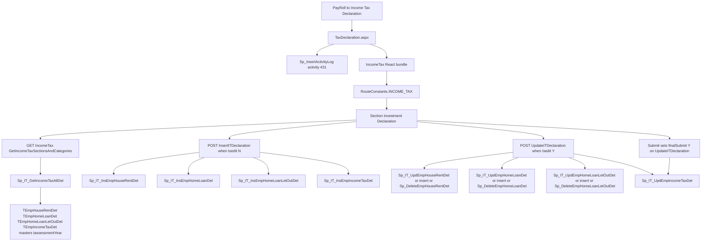
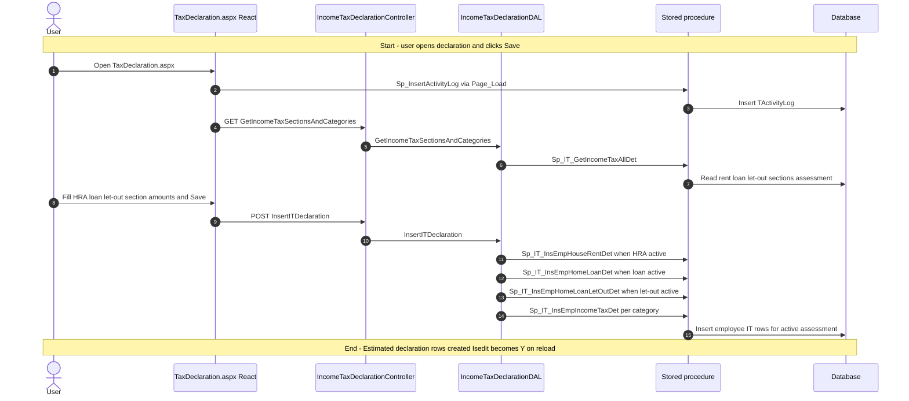
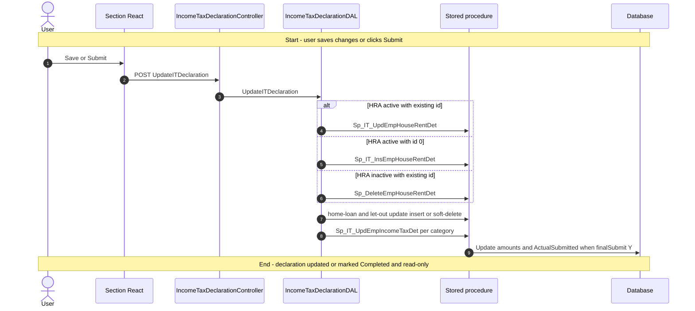
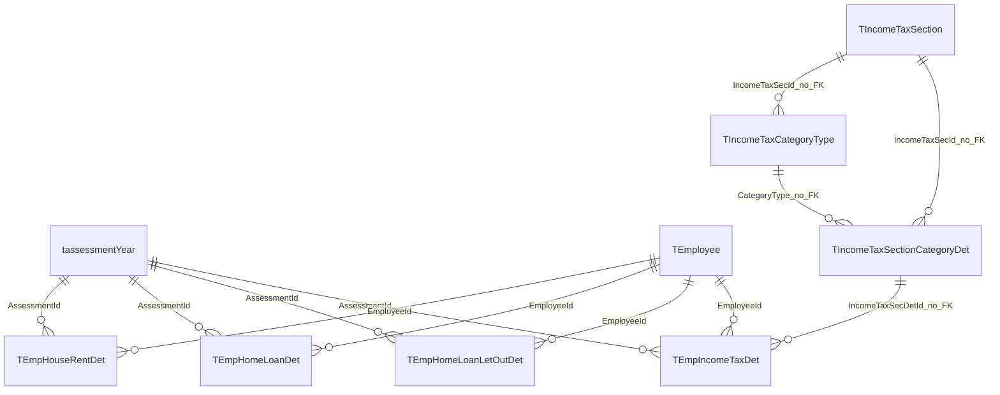

# Income Tax Declaration

## Overview

An employee (or an admin opening the form with `?employeeId=` / `?readonly=`) opens **PayRoll → Income Tax Declaration**. The left-nav leaf loads `~/HRM/IncomeTaxDeclaration/TaxDeclaration.aspx`, which stamps session identity into hidden fields, logs activity `IncomeTaxDeclaration` (431), and mounts the webpack Income Tax React bundle into `#root`.

The live screen is **Investment Declaration** (`IncomeTax` → `Section`). On load it pulls the active assessment year plus HRA, home-loan, let-out, and section-category amounts for the employee. First save inserts those rows; later saves update them. While the assessment window is still in estimated mode the user can keep editing; **Submit** sets `finalSubmit=Y` so section rows get `ActualSubmitted='Y'` and the form becomes read-only. There is no approval workflow on this leaf. Runtime database slug is **hrms**. Sibling PayRoll leaves **Setup Masters** (`SetupMaster.aspx`) and **Reports** (`Reports.aspx`) share the same bundle but different routes and are not documented here.

## Workflow

No WebForms `__doPostBack` binds the declaration form. Traffic uses Core Node `/api/IncomeTax/*` (`API_URL`).

## Request journey

### Employee — first save of Investment Declaration

### Employee — update or final Submit

## Entry points

| UI / API | Purpose |
|---|---|
| `HRM/IncomeTaxDeclaration/TaxDeclaration.aspx` | Left-nav host; session hidden fields; activity 431. |
| React route `RouteConstants.INCOME_TAX` (`/HRM/IncomeTaxDeclaration/TaxDeclaration.aspx`) | Mounts `IncomeTax` → `Section`. |
| Optional query `employeeId`, `readonly` | Load another employee or force read-only in `Section.componentDidMount`. |
| `GET /api/IncomeTax/GetIncomeTaxSectionsAndCategories` | Load form payload (5 recordsets). |
| `POST /api/IncomeTax/InsertITDeclaration` | First save. |
| `POST /api/IncomeTax/UpdateITDeclaration` | Later save / final Submit. |

Sibling entry points **not** in this guide: `SetupMaster.aspx` (section/category masters), `Reports.aspx` (`GetITReport` → `SP_RPT_EmployeeITDetails`).

## Code → database call chain

| Entry point | DAL / BLL method | Stored procedure |
|---|---|---|
| `TaxDeclaration.aspx.cs:22` `Page_Load` | `CommonUtil.LogActivity(IncomeTaxDeclaration)` → `LogUserActivity` / `ActivityHelper` | [`Sp_InsertActivityLog`](/docs/database/hrms/Sp_InsertActivityLog) (HRMS; activity 431) |
| `Section.js:121` → `GET GetIncomeTaxSectionsAndCategories` (`IncomeTaxDeclarationController.js:117`) | `IncomeTaxDeclarationDAL.GetIncomeTaxSectionsAndCategories` (`IncomeTaxDeclarationDAL.js:269`) | [`Sp_IT_GetIncomeTaxAllDet`](/docs/database/hrms/Sp_IT_GetIncomeTaxAllDet) |
| `Section.js:380` → `POST InsertITDeclaration` (`IncomeTaxDeclarationController.js:134`) | `InsertITDeclaration` → `InsertITRentHouseDetails` (`IncomeTaxDeclarationDAL.js:407`, `300`) | [`Sp_IT_InsEmpHouseRentDet`](/docs/database/hrms/Sp_IT_InsEmpHouseRentDet) |
| same Insert | `InsertITHouseLoanDetails` (`IncomeTaxDeclarationDAL.js:325`) | [`Sp_IT_InsEmpHomeLoanDet`](/docs/database/hrms/Sp_IT_InsEmpHomeLoanDet) |
| same Insert | `InsertITLetOutDetails` (`IncomeTaxDeclarationDAL.js:350`) | [`Sp_IT_InsEmpHomeLoanLetOutDet`](/docs/database/hrms/Sp_IT_InsEmpHomeLoanLetOutDet) |
| same Insert | `InsertITSectionDetails` (`IncomeTaxDeclarationDAL.js:385`) | [`Sp_IT_InsEmpIncomeTaxDet`](/docs/database/hrms/Sp_IT_InsEmpIncomeTaxDet) |
| `Section.js:393` → `POST UpdateITDeclaration` (`IncomeTaxDeclarationController.js:143`) | `UpdateITRentHouseDetails` (`IncomeTaxDeclarationDAL.js:425`) | [`Sp_IT_UpdEmpHouseRentDet`](/docs/database/hrms/Sp_IT_UpdEmpHouseRentDet) / insert / [`Sp_DeleteEmpHouseRentDet`](/docs/database/hrms/Sp_DeleteEmpHouseRentDet) |
| same Update | `UpdateITHouseLoanDetails` (`IncomeTaxDeclarationDAL.js:461`) | [`Sp_IT_UpdEmpHomeLoanDet`](/docs/database/hrms/Sp_IT_UpdEmpHomeLoanDet) / insert / [`Sp_DeleteEmpHomeLoanDet`](/docs/database/hrms/Sp_DeleteEmpHomeLoanDet) |
| same Update | `UpdateITLetOutDetails` (`IncomeTaxDeclarationDAL.js:496`) | [`Sp_IT_UpdEmpHomeLoanLetOutDet`](/docs/database/hrms/Sp_IT_UpdEmpHomeLoanLetOutDet) / insert / [`Sp_DeleteEmpHomeLoanLetOutDet`](/docs/database/hrms/Sp_DeleteEmpHomeLoanLetOutDet) |
| same Update | `UpdateITSectionDetails` (`IncomeTaxDeclarationDAL.js:542`) | [`Sp_IT_UpdEmpIncomeTaxDet`](/docs/database/hrms/Sp_IT_UpdEmpIncomeTaxDet) (`@ActualSubmitted` from `finalSubmit`) |

None of these declaration procedures call nested procedures or functions (one nested level: empty).

## API endpoints

Core Node mounts `router.use('/IncomeTax', …)` under `/api` (`app.js` → `routeIndex.js:45`). `Authorize` is imported in `IncomeTaxDeclarationRoutes.js` but **not** applied to these routes. The React client posts with cookies via `APIHelper` (`withCredentials: true`) to `process.env.API_URL`.

| Method | Path | Parameters | Purpose | Source |
|---|---|---|---|---|
| GET | `/api/IncomeTax/GetIncomeTaxSectionsAndCategories` | query `employerId` (int, required), `employeeId` (int, required) | Load rent, loan, let-out, section grid, assessment window | `IncomeTaxDeclarationRoutes.js:20`, controller `117` |
| POST | `/api/IncomeTax/InsertITDeclaration` | body `UserData`, `HRA`, `HLoan`, `LetOut`, `SectionDetails`, `finalSubmit` | First-time insert in one SQL transaction | `IncomeTaxDeclarationRoutes.js:22`, controller `134` |
| POST | `/api/IncomeTax/UpdateITDeclaration` | same body; `finalSubmit` `"Y"` on Submit | Update / soft-delete toggles / mark actual submitted | `IncomeTaxDeclarationRoutes.js:23`, controller `143` |

Master-setup and report endpoints on the same router (`IncomeTaxSection*`, `InsertCategories`, `GetITReport`, …) are used by **Setup Masters** / **Reports**, not by `TaxDeclaration.aspx`.

No ASPX `__doPostBack` for declaration data.

## Stored procedures & tables involved

| Procedure | Role | Database docs |
|---|---|---|
| [`Sp_InsertActivityLog`](/docs/database/hrms/Sp_InsertActivityLog) | Page-access log | existing (hrms) |
| [`Sp_IT_GetIncomeTaxAllDet`](/docs/database/hrms/Sp_IT_GetIncomeTaxAllDet) | Load declaration | written |
| [`Sp_IT_InsEmpHouseRentDet`](/docs/database/hrms/Sp_IT_InsEmpHouseRentDet) | Insert HRA | written |
| [`Sp_IT_InsEmpHomeLoanDet`](/docs/database/hrms/Sp_IT_InsEmpHomeLoanDet) | Insert home loan | written |
| [`Sp_IT_InsEmpHomeLoanLetOutDet`](/docs/database/hrms/Sp_IT_InsEmpHomeLoanLetOutDet) | Insert let-out | written |
| [`Sp_IT_InsEmpIncomeTaxDet`](/docs/database/hrms/Sp_IT_InsEmpIncomeTaxDet) | Insert section amounts | written |
| [`Sp_IT_UpdEmpHouseRentDet`](/docs/database/hrms/Sp_IT_UpdEmpHouseRentDet) | Update HRA | written |
| [`Sp_IT_UpdEmpHomeLoanDet`](/docs/database/hrms/Sp_IT_UpdEmpHomeLoanDet) | Update home loan | written |
| [`Sp_IT_UpdEmpHomeLoanLetOutDet`](/docs/database/hrms/Sp_IT_UpdEmpHomeLoanLetOutDet) | Update let-out | written |
| [`Sp_IT_UpdEmpIncomeTaxDet`](/docs/database/hrms/Sp_IT_UpdEmpIncomeTaxDet) | Update section amounts / ActualSubmitted | written |
| [`Sp_DeleteEmpHouseRentDet`](/docs/database/hrms/Sp_DeleteEmpHouseRentDet) | Soft-delete HRA | written |
| [`Sp_DeleteEmpHomeLoanDet`](/docs/database/hrms/Sp_DeleteEmpHomeLoanDet) | Soft-delete home loan | written |
| [`Sp_DeleteEmpHomeLoanLetOutDet`](/docs/database/hrms/Sp_DeleteEmpHomeLoanLetOutDet) | Soft-delete let-out | written |

Primary tables: `TEmpHouseRentDet`, `TEmpHomeLoanDet`, `TEmpHomeLoanLetOutDet`, `TEmpIncomeTaxDet`, `tassessmentYear`, master `TIncomeTaxSection` / `TIncomeTaxCategoryType` / `TIncomeTaxSectionCategoryDet`, plus `TEmployee` (FK) and `TActivityLog` (page log). Declared FKs exist from employee IT tables to `tassessmentYear` and `TEmployee`; section masters have no declared FKs in DDL (catalog notes logical `IncomeTaxSecId` / `CategoryType` links).

## Table relationships

## Known gaps

- **`Authorize` unused on Income Tax routes.** `IncomeTaxDeclarationRoutes.js` imports `Authorize` but does not wrap the declaration endpoints.
- **`Sp_IT_UpdEmpHomeLoanLetOutDet` WHERE bug.** Script updates with `where HomeLoanDetId=HomeLoanDetId` (always true), so a single update can touch every let-out row.
- **`Sp_IT_InsEmpIncomeTaxDet` duplicate check uses unset variables.** The `@Lv_cnt` SELECT references `@IncomeTaxSecId` / `@IncomeTaxCategoryTypeId` before they are assigned from `TIncomeTaxSectionCategoryDet`.
- **Get load ignores soft-delete flags.** `Sp_IT_GetIncomeTaxAllDet` does not filter `IsDeleted` on rent/loan/let-out tables after soft delete.
- **Insert path never sets `ActualSubmitted` from UI.** `InsertITSectionDetails` does not pass `finalSubmit`; only update/Submit can mark actual submitted.
- **`prepareFormObjectToPost` always posts logged-in `UserInfo.employeeId`.** Query-string `employeeId` is used only for the GET load, not for save `UserData.employeeid`.
- **No SystemModel-2 / llm-wiki domain page** for this leaf in the current checkouts; relationships derived from DDL + catalog notes.
- **Setup Masters / Reports** share the Income Tax SPA and `/api/IncomeTax` router but are separate menu leaves.

## Reference

### SourceCode

- `HRMS.Web/HRMS.Web/HRM/IncomeTaxDeclaration/TaxDeclaration.aspx` (+ `.cs`)
- `HRMS.Web/.../Areas/routes.js`, `Areas/IncomeTax/Containers/IncomeTax.js`, `Areas/IncomeTax/Components/Section.js`
- `HRMS.Web/.../Common/apiURLConstants.js`, `Common/apiHelper.js`, `Common/routeConstants.js`
- `HRMS.Web/.../Store/Reducers/authReducer.js`
- `HRMS.CoreAPI/HRMS.Core.WebAPI.Node/Routes/IncomeTaxDeclarationRoutes.js`
- `HRMS.CoreAPI/.../Controllers/IncomeTaxDeclarationController.js`
- `HRMS.CoreAPI/.../Core/DataAccessLayer/IncomeTaxDeclarationDAL.js`
- `HRMS.CoreAPI/.../Routes/routeIndex.js`, `app.js`
- `HRMS.Shared/HRMS.Common/Common.cs` (`LogActivity`), `HRMS.DataContract/Common/Enums.cs` (`IncomeTaxDeclaration = 431`)

### TDG HRMS DB

- `HRMS-DATABASE/HRMS/STOREPROCEDURE/Sp_IT_GetIncomeTaxAllDet.sql` and sibling `Sp_IT_Ins*` / `Sp_IT_Upd*` / `Sp_DeleteEmp*` declaration procedures
- `HRMS-DATABASE/HRMS/TABLES/TEmpHouseRentDet.sql`, `TEmpHomeLoanDet.sql`, `TEmpHomeLoanLetOutDet.sql`, `TEmpIncomeTaxDet.sql`, `tassessmentYear.sql`, `TIncomeTaxSection*.sql`
- `HRMS-DATABASE/HRMS/DML/TDataCatalog_DML.sql` (PayRoll > Income Tax Declaration table notes)
