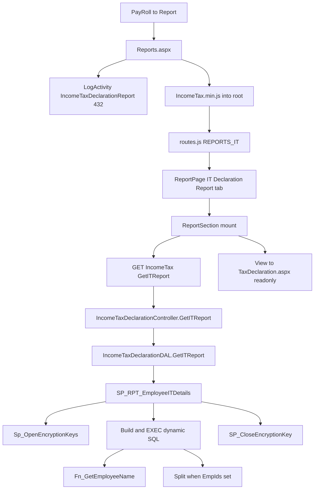
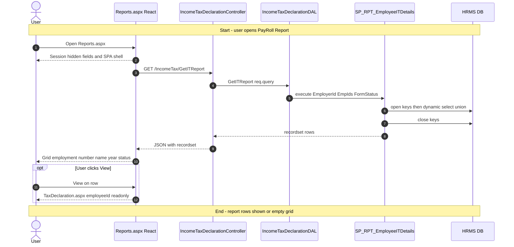
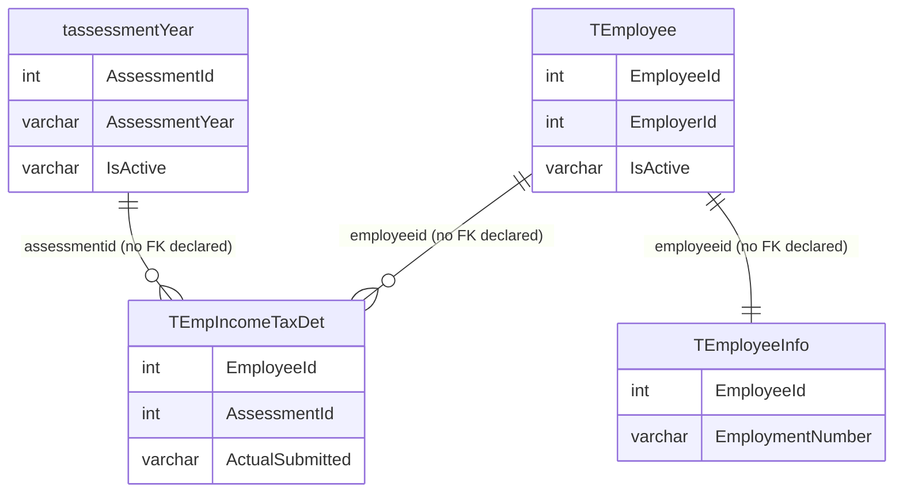

# Report

## Overview

**PayRoll → Report** is the left-nav leaf for the Income Tax Declaration report grid (`MenuId` **131**). DEV `TMenuDetails.NavigateURL` is `HRM\IncomeTaxDeclaration\Reports.aspx`. The WebForms host stamps session identity into hidden fields, logs activity `IncomeTaxDeclarationReport` (432), and loads the Income Tax webpack bundles into `#root`.

The live React route mounts `ReportPage` (one tab **IT Declaration Report**), which renders `ReportSection`. On mount the section calls Core Node `GET /IncomeTax/GetITReport`, which runs `SP_RPT_EmployeeITDetails` on the HRMS database (slug **hrms**). The grid shows employment number, employee name, active assessment-year label, and status (`Completed` / `Estimated` / `Pending`). **View** navigates to the sibling Income Tax declaration form in read-only mode.

There is no SystemModel-2 workflow page for this menu item in this checkout. Runtime truth is the ASPX host, React route, Core API, and the report procedure. Wiki catalog rows for `TEmpIncomeTaxDet` / `tassessmentYear` live in `llm-wiki/reference/tables/hrms.md`.

**Who's involved:**

- **Payroll / HR viewer** — opens PayRoll → Report to see declaration status for the employer’s employees in the active assessment year.
- **Employee** — not the primary actor on this leaf; their declaration work is on Income Tax Declaration. **View** opens that form read-only for one row.

## Workflow

Report rows are HTTP JSON from Core Node. The ASPX does not bind the grid or post back filters.

## Request journey

### Viewer — open PayRoll Report and load the grid

## Entry points

| UI / API | Purpose |
|---|---|
| `HRM/IncomeTaxDeclaration/Reports.aspx` | Left-nav host for PayRoll → Report (`MenuId` 131). |
| `Reports.aspx.cs` `Page_Load` | Session → hidden fields; activity log 432. |
| `Areas/routes.js` path `REPORTS_IT` | Mounts `ReportPage`. |
| `ReportPage.js` / `ReportSection.js` | Tab shell and report grid. |
| `GET /IncomeTax/GetITReport` | Report result set from Core Node. |
| `ActivityDescription.IncomeTaxDeclarationReport = 432` | Logged on host load. |

No WebForms `__doPostBack` drives the report grid. `IncomeTaxDeclarationRoutes.js` imports `Authorize` but does not attach it to `/GetITReport` (see Known gaps).

## Code → database call chain

| Entry point | DAL / BLL method | Stored procedure |
|---|---|---|
| `Reports.aspx.cs` `Page_Load` (`Reports.aspx.cs:20-33`) | Session stamp + `CommonUtil.LogActivity` — no report DB read | — |
| `Areas/routes.js:23` | `ReportPage` → `ReportSection` | — |
| `ReportSection.js` `componentDidMount` / `getITReportGridData` (`ReportSection.js:22-39`) | `APIHelper.get(GET_IT_DECLARTATION_REPORT)` | — |
| `GET /IncomeTax/GetITReport` (`IncomeTaxDeclarationRoutes.js:24`) | `IncomeTaxDeclarationController.GetITReport` (`IncomeTaxDeclarationController.js:155-161`) → `IncomeTaxDeclarationDAL.GetITReport` (`IncomeTaxDeclarationDAL.js:586-600`) | [`SP_RPT_EmployeeITDetails`](/docs/database/hrms/SP_RPT_EmployeeITDetails) |

Nested from the report procedure: [`Sp_OpenEncryptionKeys`](/docs/database/hrms/Sp_OpenEncryptionKeys), [`SP_CloseEncryptionKey`](/docs/database/hrms/SP_CloseEncryptionKey), [`Fn_GetEmployeeName`](/docs/database/hrms/Fn_GetEmployeeName), [`Split`](/docs/database/hrms/Split) (when `@EmpIds` is supplied). Dynamic `EXEC (@sql)` is unresolved on the SP page.

DAL uses the default HRMS connection factory (`IncomeTaxDeclarationDAL.js`).

## API endpoints

Core Node mounts `IncomeTaxDeclarationRoutes` at `/api/IncomeTax` (`routeIndex.js:45`). The SPA `API_URL` base is the Core WebAPI.

| Method | Path | Role on this page |
|---|---|---|
| GET | `/IncomeTax/GetITReport` | Report grid data (`recordset`) |

Query parameters expected by the DAL (from `req.query`): `employerId` (int), optional `empIds` (CSV), optional `formStatus`. The live `ReportSection` call uses the bare URL with **no** query string; filter inputs in the JSX are commented out.

No ASPX `__doPostBack` list binding. Sibling Setup Masters / Tax Declaration APIs are out of scope for this leaf.

## Stored procedures & tables involved

| Procedure / function | Role | Database docs |
|---|---|---|
| [`SP_RPT_EmployeeITDetails`](/docs/database/hrms/SP_RPT_EmployeeITDetails) | Main report result set for active assessment year | written |
| [`Sp_OpenEncryptionKeys`](/docs/database/hrms/Sp_OpenEncryptionKeys) | Open-key prelude (body currently no-op in repo script) | existing |
| [`SP_CloseEncryptionKey`](/docs/database/hrms/SP_CloseEncryptionKey) | Close-key epilogue (body currently no-op in repo script) | existing |
| [`Fn_GetEmployeeName`](/docs/database/hrms/Fn_GetEmployeeName) | Display name in dynamic select | existing |
| [`Split`](/docs/database/hrms/Split) | Optional employee-id CSV filter | existing |

| Table | Role |
|---|---|
| `TEmpIncomeTaxDet` | Declaration rows for the active assessment year (`Completed` / `Estimated`) |
| `TEmployee` | Employer scope, active flag, join key |
| `TEmployeeInfo` | Employment number |
| `tassessmentYear` | Active assessment year id and display year |

## Table relationships

Derived from joins in `SP_RPT_EmployeeITDetails` and catalog notes in `llm-wiki/reference/tables/hrms.md`. Many HRMS links have no declared FK.

## Known gaps

- **UI does not pass filters.** `ReportSection` GETs `/IncomeTax/GetITReport` with no `employerId` / `empIds` / `formStatus`. Comment blocks show intended search fields. DAL still binds those inputs; without `employerId` the SP filter string can be incomplete or fail depending on runtime coercion.
- **Authorize unused on Income Tax routes.** `IncomeTaxDeclarationRoutes.js` requires `Authorize` but does not apply it to `/GetITReport` (or sibling routes in that file).
- **Dynamic SQL.** The report procedure builds and `EXEC`s a string; injection risk if callers supply unsanitized `@EmpIds` / `@FormStatus`.
- **No SystemModel-2 page** for PayRoll → Report in this SourceCode checkout.
- **Sibling navigation only.** **View** opens `TaxDeclaration.aspx`; that form’s save/load SPs are not this menu’s call chain.

## Reference

- `HRMS.Web/HRMS.Web/HRM/IncomeTaxDeclaration/Reports.aspx` (+ `.cs`)
- `HRMS.Web/HRMS.Web/HRM/IncomeTaxDeclaration/Areas/routes.js`
- `HRMS.Web/HRMS.Web/HRM/IncomeTaxDeclaration/Areas/Reports/Containers/ReportPage.js`
- `HRMS.Web/HRMS.Web/HRM/IncomeTaxDeclaration/Areas/Reports/Components/ReportSection.js`
- `HRMS.Web/HRMS.Web/HRM/IncomeTaxDeclaration/Common/routeConstants.js`
- `HRMS.Web/HRMS.Web/HRM/IncomeTaxDeclaration/Common/apiURLConstants.js`
- `HRMS.CoreAPI/HRMS.Core.WebAPI.Node/Routes/routeIndex.js`
- `HRMS.CoreAPI/HRMS.Core.WebAPI.Node/Routes/IncomeTaxDeclarationRoutes.js`
- `HRMS.CoreAPI/HRMS.Core.WebAPI.Node/Controllers/IncomeTaxDeclarationController.js`
- `HRMS.CoreAPI/HRMS.Core.WebAPI.Node/Core/DataAccessLayer/IncomeTaxDeclarationDAL.js`
- `HRMS.Shared/HRMS.DataContract/Common/Enums.cs` (`IncomeTaxDeclarationReport = 432`)
- `HRMS-DATABASE/HRMS/STOREPROCEDURE/SP_RPT_EmployeeITDetails.sql`
- `HRMS-DATABASE/HRMS/DML/Tmenudetails DML.sql` (PayRoll 128 → Report 131)
- DEV `TMenuDetails` `MenuId = 131` → `HRM\IncomeTaxDeclaration\Reports.aspx`
- `llm-wiki/reference/tables/hrms.md` (`TEmpIncomeTaxDet`, `tassessmentYear`)
