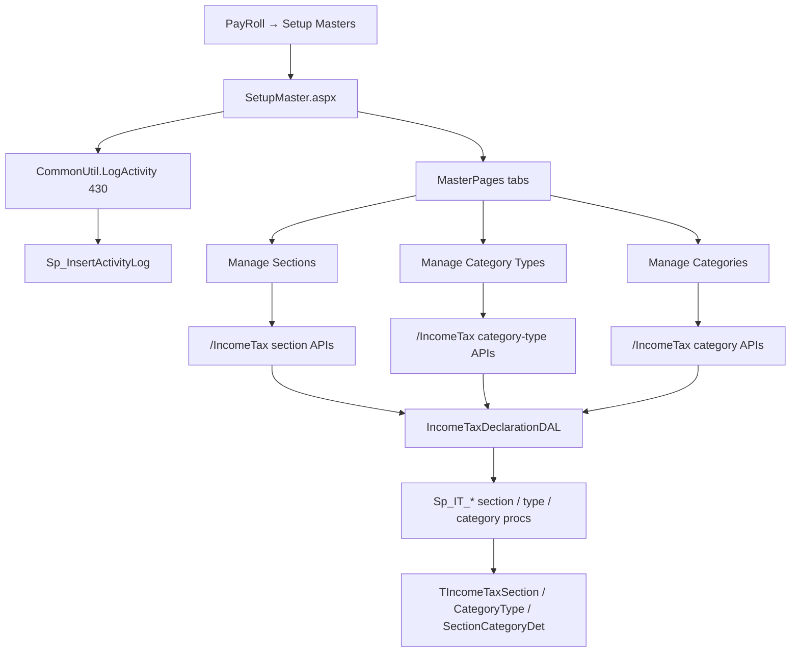
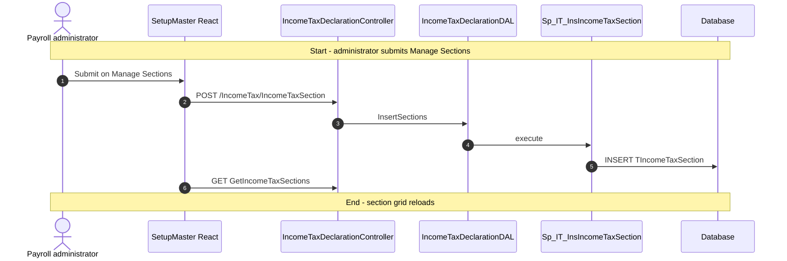
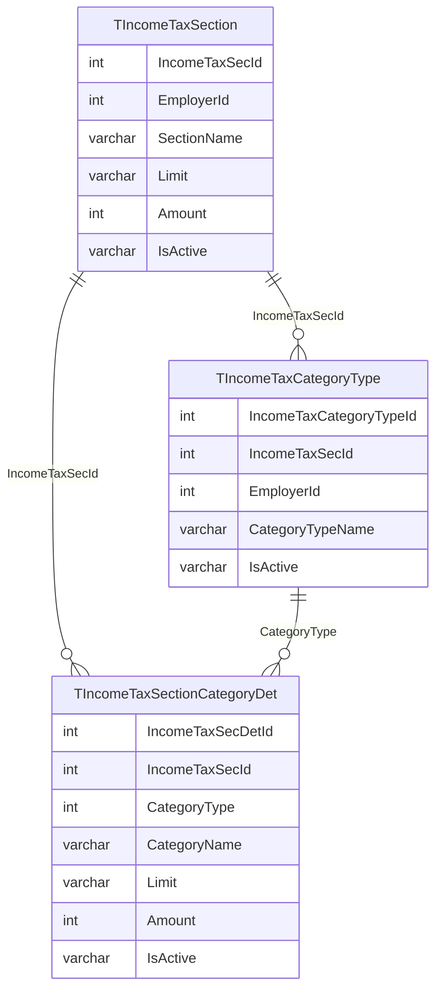

# Setup Masters

## Overview

A payroll administrator configures the income-tax declaration masters that employees later fill in under PayRoll. They open **PayRoll → Setup Masters** (`~/HRM/IncomeTaxDeclaration/SetupMaster.aspx`). The WebForms page only stamps activity type `PayrollSetupMaster` (430) and injects session employee/employer hidden fields. A React bundle (`IncomeTax.min.js`) mounts into `#root` and routes `MASTER_TAX` to `MasterPages`, which hosts three tabs: Manage Sections, Manage Category Types, and Manage Categories.

This screen is not Admin Configuration → Setup Masters (`MasterSetup.aspx?Id=1`). That host maintains calendars, locations, grades, and other organisation masters. Payroll Setup Masters only maintains `TIncomeTaxSection`, `TIncomeTaxCategoryType`, and `TIncomeTaxSectionCategoryDet` through the Core Node `/IncomeTax` API.

Who is involved:

- **Payroll / HR administrator** — creates and updates section, category-type, and category rows for the session employer.
- **Employee** — does not use this screen. They declare amounts against these masters on the Income Tax Declaration page.

SystemModel-2 has no workflow page for this menu. Table blurbs live in `llm-wiki/reference/tables/hrms.md` for the three income-tax master tables.

## Workflow

## Request journey

### Administrator — add an income-tax section

Category types and categories follow the same pattern with their insert/update endpoints and `Sp_IT_Ins*` / `Sp_IT_Upd*` procedures. Client-side duplicate-name checks run before the POST.

## Entry points

| Entry | Purpose |
|---|---|
| `~/HRM/IncomeTaxDeclaration/SetupMaster.aspx` | PayRoll Setup Masters host; activity log + React mount |
| React route `RouteConstants.MASTER_TAX` | Same path; renders `MasterPages` with three tabs |
| Distinct host `~/HRM/MasterSetup/MasterSetup.aspx?Id=1` | Admin Configuration Setup Masters — out of scope |

`Page_Load` in `SetupMaster.aspx.cs` sets hidden employee/employer fields from `Session["LoggedInUser"]` and calls `CommonUtil.LogActivity(PayrollSetupMaster)`.

## Code → database call chain

React calls Core API under `/IncomeTax` (mounted in `routeIndex.js`). The ASPX itself has no WebForms postbacks for masters.

| Entry | Method | Stored procedure |
|---|---|---|
| Page load | `Page_Load` (`SetupMaster.aspx.cs:20`) → `CommonUtil.LogActivity` (`Common.cs:52`) | `Sp_InsertActivityLog` |
| Manage Sections grid | `getRequestListGridData` (`ManageSections.js:49`) → `GetIncomeTaxSections` (`IncomeTaxDeclarationController.js:35`) → `GetIncomeTaxSections` (`IncomeTaxDeclarationDAL.js:47`) | `Sp_IT_GetIncomeTaxSectionDet` (`IncomeTaxDeclarationDAL.js:55`) |
| Manage Sections Insert | `submitHandler` (`ManageSections.js:105`) → `InsertSections` (`IncomeTaxDeclarationController.js:16`) → `InsertSections` (`IncomeTaxDeclarationDAL.js:19`) | `Sp_IT_InsIncomeTaxSection` (`IncomeTaxDeclarationDAL.js:34`) |
| Manage Sections Update | `submitHandler` (`ManageSections.js:114`) → `UpdateSections` (`IncomeTaxDeclarationController.js:25`) → `UpdateSections` (`IncomeTaxDeclarationDAL.js:79`) | `Sp_IT_UpdIncomeTaxSection` (`IncomeTaxDeclarationDAL.js:95`) |
| Category Types grid | `getRequestListGridData` (`ManageCategoryTypes.js:49`) → `GetIncomeTaxCategoryTypes` (`IncomeTaxDeclarationController.js:73`) → DAL (`IncomeTaxDeclarationDAL.js:135`) | `Sp_IT_GetIncomeTaxCategoryTypeDet` (`IncomeTaxDeclarationDAL.js:143`) |
| Category Types Insert | `submitHandler` (`ManageCategoryTypes.js:118`) → `InsertCategoryTypes` (`IncomeTaxDeclarationController.js:54`) → DAL (`IncomeTaxDeclarationDAL.js:108`) | `Sp_IT_InsIncomeTaxCategoryType` (`IncomeTaxDeclarationDAL.js:122`) |
| Category Types Update | `submitHandler` (`ManageCategoryTypes.js:127`) → `UpdateCategoryTypes` (`IncomeTaxDeclarationController.js:63`) → DAL (`IncomeTaxDeclarationDAL.js:151`) | `Sp_IT_UpdIncomeTaxCategoryType` (`IncomeTaxDeclarationDAL.js:165`) |
| Category Types / Categories section dropdown | `getSectionNamesData` (`ManageCategoryTypes.js:62`, `ManageCategories.js:69`) → `GetIncomeTaxActiveSections` (`IncomeTaxDeclarationController.js:125`) → DAL (`IncomeTaxDeclarationDAL.js:285`) | `Sp_IT_GetIncTaxSectionDropDown` (`IncomeTaxDeclarationDAL.js:292`) |
| Categories grid | `getRequestListGridData` (`ManageCategories.js:56`) → `GetIncomeTaxCategories` (`IncomeTaxDeclarationController.js:101`) → DAL (`IncomeTaxDeclarationDAL.js:207`) | `Sp_IT_GetIncomeTaxSecCategoryDet` (`IncomeTaxDeclarationDAL.js:215`) |
| Categories type dropdown | `getCategoryTypesData` (`ManageCategories.js:82`) → `GetIncomeTaxCategoryTypesBySection` (`IncomeTaxDeclarationController.js:109`) → DAL (`IncomeTaxDeclarationDAL.js:253`) | `Sp_IT_GetIncomeTaxCategoryType` (`IncomeTaxDeclarationDAL.js:261`) |
| Categories Insert | `submitHandler` (`ManageCategories.js:144`) → `InsertCategories` (`IncomeTaxDeclarationController.js:82`) → DAL (`IncomeTaxDeclarationDAL.js:178`) | `Sp_IT_InsIncomeTaxSecCategoryDet` (`IncomeTaxDeclarationDAL.js:194`) |
| Categories Update | `submitHandler` (`ManageCategories.js:153`) → `UpdateCategories` (`IncomeTaxDeclarationController.js:91`) → DAL (`IncomeTaxDeclarationDAL.js:223`) | `Sp_IT_UpdIncomeTaxSecCategoryDet` (`IncomeTaxDeclarationDAL.js:240`) |

Nested from the list SPs (one level): `Sp_OpenEncryptionKeys`, `SP_CloseEncryptionKey`, `Fn_GetEmployeeName`.

## API endpoints

No WebForms master postbacks. All master CRUD is HTTP to Core Node under `/IncomeTax` (`IncomeTaxDeclarationRoutes.js`, mounted at `/IncomeTax` in `routeIndex.js:45`).

| Method | Path | Purpose |
|---|---|---|
| GET | `/IncomeTax/GetIncomeTaxSections?employerId=` | Section grid |
| POST | `/IncomeTax/IncomeTaxSection` | Insert section |
| POST | `/IncomeTax/IncomeTaxSectionUpdate` | Update section |
| GET | `/IncomeTax/GetIncomeTaxCategoryTypes?employerId=` | Category-type grid |
| POST | `/IncomeTax/InsertCategoryTypes` | Insert category type |
| POST | `/IncomeTax/UpdateCategoryTypes` | Update category type |
| GET | `/IncomeTax/GetIncomeTaxActiveSections?employerId=` | Active section dropdown |
| GET | `/IncomeTax/GetIncomeTaxCategories?employerId=` | Category grid |
| GET | `/IncomeTax/GetIncomeTaxCategoryTypesBySection?sectionId=` | Types for selected section |
| POST | `/IncomeTax/InsertCategories` | Insert category |
| POST | `/IncomeTax/UpdateCategories` | Update category |

`GetIncomeTaxSectionNames` reuses `Sp_IT_GetIncomeTaxSectionDet` but is not called from the Setup Masters React tabs. Declaration/report endpoints (`InsertITDeclaration`, `GetITReport`, …) belong to other PayRoll screens.

## Stored procedures & tables involved

| Procedure | Role | Tables |
|---|---|---|
| `Sp_InsertActivityLog` | Page-open audit | `TActivityLog` |
| `Sp_IT_GetIncomeTaxSectionDet` | Section list | `TIncomeTaxSection` (read); uses `Fn_GetEmployeeName` |
| `Sp_IT_InsIncomeTaxSection` | Insert section | `TIncomeTaxSection` (write) |
| `Sp_IT_UpdIncomeTaxSection` | Update section | `TIncomeTaxSection` (write) |
| `Sp_IT_GetIncomeTaxCategoryTypeDet` | Category-type list | `TIncomeTaxCategoryType`, `TIncomeTaxSection` (read) |
| `Sp_IT_InsIncomeTaxCategoryType` | Insert category type | `TIncomeTaxCategoryType` (write) |
| `Sp_IT_UpdIncomeTaxCategoryType` | Update category type | `TIncomeTaxCategoryType` (write) |
| `Sp_IT_GetIncTaxSectionDropDown` | Active sections | `TIncomeTaxSection` (read) |
| `Sp_IT_GetIncomeTaxCategoryType` | Types by section | `TIncomeTaxCategoryType` (read) |
| `Sp_IT_GetIncomeTaxSecCategoryDet` | Category list | `TIncomeTaxSectionCategoryDet`, `TIncomeTaxSection`, `TIncomeTaxCategoryType` (read) |
| `Sp_IT_InsIncomeTaxSecCategoryDet` | Insert category | `TIncomeTaxSectionCategoryDet` (write) |
| `Sp_IT_UpdIncomeTaxSecCategoryDet` | Update category | `TIncomeTaxSectionCategoryDet` (write) |

## Table relationships

Logical FKs only — table scripts do not declare foreign-key constraints. Employee declaration rows in `TEmpIncomeTaxDet` reference these masters but are not written here.

## Known gaps

- After Insert/Update on Manage Sections and Manage Category Types, the UI reloads the grid with hardcoded `employerId` `1` instead of the session employer (`ManageSections.js`, `ManageCategoryTypes.js`). Manage Categories insert reload uses the session employer; its update path also passes `1`.
- DAL/SP parameter name is misspelled `IsAtive` throughout; category insert/update use `CateoryName`. Behaviour still works because names match between DAL and SQL.
- `Sp_IT_UpdIncomeTaxSecCategoryDet` accepts `@SectionId` but does not update `IncomeTaxSecId`, so changing section on edit is not persisted at the section FK.
- No delete APIs or procedures on this screen — inactive flags only.
- SystemModel-2 does not document PayRoll Setup Masters.
- Distinct from Admin Configuration Setup Masters; do not confuse the two hosts.

## Reference

- `HRMS.Web/HRMS.Web/HRM/IncomeTaxDeclaration/SetupMaster.aspx`
- `HRMS.Web/HRMS.Web/HRM/IncomeTaxDeclaration/SetupMaster.aspx.cs`
- `HRMS.Web/HRMS.Web/HRM/IncomeTaxDeclaration/Areas/routes.js`
- `HRMS.Web/HRMS.Web/HRM/IncomeTaxDeclaration/Areas/ManageSections/Containers/MasterPages.js`
- `HRMS.Web/HRMS.Web/HRM/IncomeTaxDeclaration/Areas/ManageSections/Components/ManageSections.js`
- `HRMS.Web/HRMS.Web/HRM/IncomeTaxDeclaration/Areas/ManageSections/Components/ManageCategoryTypes.js`
- `HRMS.Web/HRMS.Web/HRM/IncomeTaxDeclaration/Areas/ManageSections/Components/ManageCategories.js`
- `HRMS.Web/HRMS.Web/HRM/IncomeTaxDeclaration/Common/apiURLConstants.js`
- `HRMS.CoreAPI/HRMS.Core.WebAPI.Node/Routes/routeIndex.js`
- `HRMS.CoreAPI/HRMS.Core.WebAPI.Node/Routes/IncomeTaxDeclarationRoutes.js`
- `HRMS.CoreAPI/HRMS.Core.WebAPI.Node/Controllers/IncomeTaxDeclarationController.js`
- `HRMS.CoreAPI/HRMS.Core.WebAPI.Node/Core/DataAccessLayer/IncomeTaxDeclarationDAL.js`
- `HRMS.Shared/HRMS.Common/Common.cs`
- `HRMS-DATABASE/HRMS/STOREPROCEDURE/Sp_IT_*.sql`
- `HRMS-DATABASE/HRMS/TABLES/TIncomeTaxSection.sql`
- `HRMS-DATABASE/HRMS/TABLES/TIncomeTaxCategoryType.sql`
- `HRMS-DATABASE/HRMS/TABLES/TIncomeTaxSectionCategoryDet.sql`
- `llm-wiki/reference/tables/hrms.md`
- Admin Configuration counterpart (out of scope): `/docs/guides/admin-configuration/setup-masters`
