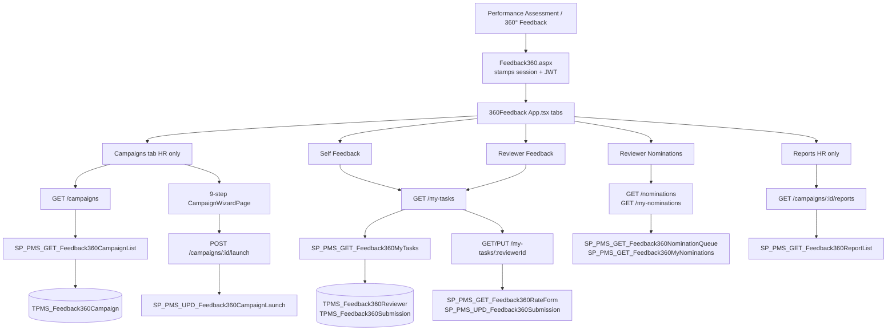
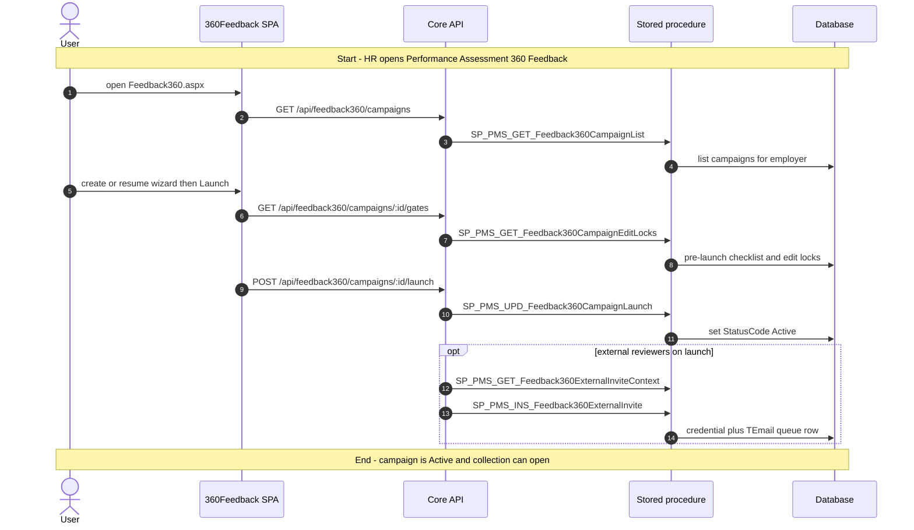
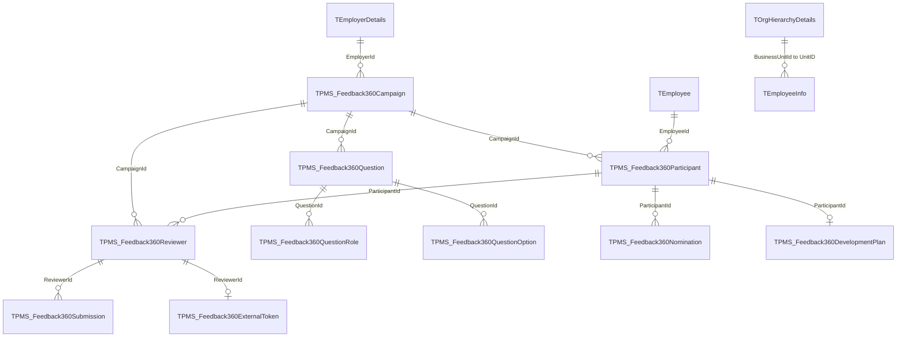

# 360° Feedback

## Overview

An HR admin (or any employee with module access) opens **Performance Assessment → 360° Feedback** at `~/HRM/PMS_React/Feedback360.aspx`. The WebForms host stamps session identity into hidden fields, mints a JWT into `localStorage['Authorization']`, and loads the Vite bundle from `HRM/360Feedback/BuildJS/feedback360.js` into `#root`. There is no WebForms postback DAL on this page.

The SPA (`HRM/360Feedback`) is a tabbed module under `/api/feedback360`:

- **Campaigns** (HR Admin role type only) — draft / launch / edit / close campaigns and the nine-step setup wizard.
- **Self Feedback** / **Reviewer Feedback** — rate forms for self and peer/manager/direct-report assignments.
- **Reviewer Nominations** — employee nominate, manager assign, and approver queue when the campaign nomination model needs it.
- **360 Feedback Reports** (HR only) — campaign report list, per-participant dashboard, release, development plan.

Non-HR users land on Self Feedback; HR lands on Campaigns. Deep links from PMS Notifications can force a tab via `?camefrom=Notification&panel=…`. External (client) reviewers use a separate sessionless entry (`external.tsx` + `/api/feedback360/external/*`), not this .aspx host.

## Workflow

## Request journey

Default HR landing load is the campaigns list. The journey below is **Launch campaign** after the wizard checklist passes (the write that moves Draft → Active).

Self / Reviewer Feedback submit uses `PUT /api/feedback360/my-tasks/:reviewerId` → `SP_PMS_UPD_Feedback360Submission` with `submit: true` in the body.

## Entry points

> Live UI is the 360Feedback Vite module hosted by `Feedback360.aspx`. PMS Notifications deep-links into the same page. External reviewers do not use this host.

| UI page / route | Purpose |
|---|---|
| `~/HRM/PMS_React/Feedback360.aspx` | Left-nav **Performance Assessment → 360° Feedback**. Stamps `hdnEmpId`, `hdnEmployerId`, `hdnUserRoleType`, and related identity fields; seeds JWT; hosts `#root`. |
| `HRM/360Feedback` React bundle | Tabs and wizard; HTTP base `API_BASE_URL/api/feedback360` (`src/core/http.ts`). |
| `PerformanceAssessment.aspx` notification panels | Deep link `Feedback360.aspx?camefrom=Notification&panel=self-feedback\|give-feedback\|nominations` via `sessionStorage` (`utils/deeplink.ts`). |
| External reviewer bundle (`external.tsx`) | Sessionless login / form under `/api/feedback360/external/*` (not the left-nav page). |

## Code → database call chain

SPA talks only to Core API Node (`Feedback360Routes.js` mounted at `/feedback360` in `routeIndex.js`). `Feedback360.aspx.cs` does not call SPs.

| Entry point | App method (`file:line`) | Stored procedure |
|---|---|---|
| Campaigns tab mount | `apis/campaigns.ts` `useCampaigns` (`42`) → `GET /campaigns` → `GetCampaignList` (`Feedback360Controller.js:63`) → DAL `GetCampaignList` (`34`) | `SP_PMS_GET_Feedback360CampaignList` |
| Resume / edit campaign | `useCampaign` (`58`) → `GetCampaign` (`70`) → DAL (`57`) | `SP_PMS_GET_Feedback360Campaign` |
| Wizard gates / launch checklist | `useCampaignGates` (`77`) → `GetCampaignGates` (`77`) → DAL (`222`) | `SP_PMS_GET_Feedback360CampaignEditLocks` |
| Create draft | `createCampaign` (`95`) → `CreateCampaign` (`84`) → DAL (`87`) | `SP_PMS_INS_Feedback360Campaign` |
| Save draft / settings | `updateCampaign` (`102`) → `UpdateCampaign` (`100`) → DAL (`147`) | `SP_PMS_UPD_Feedback360Campaign` |
| Launch | `launchCampaign` (`116`) → `LaunchCampaign` (`110`) → DAL (`172`); may invite externals | `SP_PMS_UPD_Feedback360CampaignLaunch` (+ invite SPs) |
| Close | `closeCampaign` (`149`) → `CloseCampaign` (`119`) → DAL (`199`) | `SP_PMS_UPD_Feedback360CampaignClose` |
| Reviewer rules | `updateReviewerRules` (`129`) → `UpdateReviewerRules` (`187`) → DAL (`252`) | `SP_PMS_UPD_Feedback360CampaignManagerTypes` |
| Questionnaire / scale | `apis/questionnaire.ts` → controller `133`–`176` → DAL question/scale methods | `SP_PMS_GET/INS/UPD/DEL_Feedback360Question*`, `SP_PMS_*_Feedback360RatingScale` |
| Competency dictionary | `GetCompetencies` (`244`) → DAL (`748`) | `Sp_AdminPMS_GetAllCompetency` |
| Business unit tree | `GetBusinessUnits` (`203`) → DAL (`506`) | `USP_Employer_Master_Data_Select` |
| Employees by BU | reviewer/participant pickers → DAL (`610`) | `SP_GeoTagging_GetEmployeesByBusinessUnit` |
| Direct reportees | reviewer picker → DAL (`546`) | `Sp_CM_DirectIndirectReports` |
| Participants | `apis/participants.ts` → controller `210`–`348` → DAL participant methods | `SP_PMS_GET/INS/UPD/DEL_Feedback360Participant*` |
| Assign reviewers | `apis/reviewers.ts` → controller `257`–`338` → DAL reviewer methods | `SP_PMS_GET/INS/UPD/DEL_Feedback360Reviewer*` |
| Self / Reviewer Feedback lists | `apis/tasks.ts` `useMyTasks` (`23`) → `GetMyTasks` (`401`) → DAL (`1141`) | `SP_PMS_GET_Feedback360MyTasks` |
| Rate form load / save | `useRateForm` / save → `GetRateForm` (`427`) / `SaveSubmission` (`442`) → DAL (`1166` / `1201`) | `SP_PMS_GET_Feedback360RateForm`, `SP_PMS_UPD_Feedback360Submission` |
| Nominations | `apis/nominations.ts` / `nominate.ts` → controller `545`–`637` | `SP_PMS_GET/INS/UPD/DEL_Feedback360Nomination*` |
| Reports | `apis/reports.ts` / `devplan.ts` → controller `464`–`531` | `SP_PMS_GET/UPD_Feedback360Report*`, DevelopmentPlan SPs |
| External invite (HR) | `InviteExternalReviewer` (`654`) → service builds mail → DAL (`1610`) | `SP_PMS_INS_Feedback360ExternalInvite` (writes `TEmail`) |
| External login / form | `ExternalLogin` / `GetExternalForm` / `SaveExternalSubmission` (`687`–`703`) | `SP_PMS_GET_Feedback360ExternalLogin`, `…ExternalForm`, `…UPD_Feedback360ExternalSubmission` |
| PMS Notifications panels | `GetNotificationPanel` (`418`) → service reuses my-tasks / nominations SPs (no extra SP) | same as tasks / nominations |

## API endpoints

All module routes are under `/api/feedback360` (`Feedback360Routes.js`). Internal routes use `Authorize` (JWT). External login is open; external form routes use `AuthorizeExternal`. There is no ASP.NET postback from `Feedback360.aspx`.

| Verb | Route | Purpose | Source |
|---|---|---|---|
| `GET` | `/campaigns` | Campaign list | `Feedback360Controller.js:63` |
| `GET` | `/campaigns/:campaignId` | One campaign | `70` |
| `GET` | `/campaigns/:campaignId/gates` | Launch checklist + edit locks | `77` |
| `POST` | `/campaigns` | Create draft | `84` |
| `PUT` | `/campaigns/:campaignId` | Update campaign / settings | `100` |
| `POST` | `/campaigns/:campaignId/launch` | Launch | `110` |
| `POST` | `/campaigns/:campaignId/close` | Close early | `119` |
| `GET` | `/competencies` | Competency dictionary | `244` |
| `GET`/`PUT`/`POST`/`DELETE` | `/campaigns/:id/questionnaire`, `rating-scale`, `questions…` | Questionnaire | `133`–`176` |
| `PUT` | `/campaigns/:id/reviewer-rules` | Peer/manager/DR/external counts | `187` |
| `GET` | `/business-units` | BU hierarchy | `203` |
| `GET`/`PUT` | `/campaigns/:id/participants…` | Participant selection | `210`–`348` |
| `GET`/`POST`/`PUT`/`DELETE` | `/campaigns/:id/reviewers…` | Assign reviewers | `257`–`338` |
| `GET`/`PUT` | `/campaigns/:id/settings…` | Visibility overrides | `362`–`377` |
| `GET` | `/my-tasks` | Self + reviewer task lists | `401` |
| `GET` | `/notification-panel` | Bell panel rows (filters existing reads) | `418` |
| `GET`/`PUT` | `/my-tasks/:reviewerId` | Rate form load / draft-or-submit | `427`, `442` |
| `GET`/`PUT` | `/nominations…` | Approver queue and decisions | `545`–`573` |
| `GET`/`POST`/`PUT`/`DELETE` | `/my-nominations…` | Employee nominate / manager assign | `591`–`637` |
| `GET`/`PUT` | `/campaigns/:id/reports…`, `/reports/:participantId…` | Reports, release, dashboard, development plan | `464`–`531` |
| `GET`/`POST` | `/reviewers/:id/invite…` | External invite status / send / preview | `654`–`672` |
| `POST`/`GET`/`PUT` | `/external/login`, `/external/form` | Sessionless external reviewer | `687`–`703` |

## Stored procedures & tables involved

Primary module procedures live under `HRMS-DATABASE/HRMS/STOREPROCEDURE/360Feedback/V1/`. Shared masters reused by the DAL are listed at the bottom. Nested encryption helpers (`Sp_OpenEncryptionKeys*`, `SP_CloseEncryptionKey*`) are documented on the calling procedure pages.

| Object | File path | Purpose | Page |
|---|---|---|---|
| `SP_PMS_GET_Feedback360CampaignList` | `…/360Feedback/V1/SP_PMS_GET_Feedback360CampaignList.sql` | HR campaigns list | [SP_PMS_GET_Feedback360CampaignList](/docs/database/hrms/SP_PMS_GET_Feedback360CampaignList) |
| `SP_PMS_GET_Feedback360Campaign` | `…/SP_PMS_GET_Feedback360Campaign.sql` | One campaign detail | [SP_PMS_GET_Feedback360Campaign](/docs/database/hrms/SP_PMS_GET_Feedback360Campaign) |
| `SP_PMS_GET_Feedback360CampaignEditLocks` | `…/SP_PMS_GET_Feedback360CampaignEditLocks.sql` | Gates / locks | [SP_PMS_GET_Feedback360CampaignEditLocks](/docs/database/hrms/SP_PMS_GET_Feedback360CampaignEditLocks) |
| `SP_PMS_INS_Feedback360Campaign` | `…/SP_PMS_INS_Feedback360Campaign.sql` | Create draft | [SP_PMS_INS_Feedback360Campaign](/docs/database/hrms/SP_PMS_INS_Feedback360Campaign) |
| `SP_PMS_UPD_Feedback360Campaign` | `…/SP_PMS_UPD_Feedback360Campaign.sql` | Update | [SP_PMS_UPD_Feedback360Campaign](/docs/database/hrms/SP_PMS_UPD_Feedback360Campaign) |
| `SP_PMS_UPD_Feedback360CampaignLaunch` | `…/SP_PMS_UPD_Feedback360CampaignLaunch.sql` | Launch | [SP_PMS_UPD_Feedback360CampaignLaunch](/docs/database/hrms/SP_PMS_UPD_Feedback360CampaignLaunch) |
| `SP_PMS_UPD_Feedback360CampaignClose` | `…/SP_PMS_UPD_Feedback360CampaignClose.sql` | Close | [SP_PMS_UPD_Feedback360CampaignClose](/docs/database/hrms/SP_PMS_UPD_Feedback360CampaignClose) |
| `SP_PMS_UPD_Feedback360CampaignManagerTypes` | `…/SP_PMS_UPD_Feedback360CampaignManagerTypes.sql` | Reviewer rules | [SP_PMS_UPD_Feedback360CampaignManagerTypes](/docs/database/hrms/SP_PMS_UPD_Feedback360CampaignManagerTypes) |
| `SP_PMS_GET/INS/UPD/DEL_Feedback360Question*` + rating scale | `…/360Feedback/V1/` | Questionnaire | linked under `/docs/database/hrms/` |
| `SP_PMS_*_Feedback360Participant*` | `…/360Feedback/V1/` | Participants | linked under `/docs/database/hrms/` |
| `SP_PMS_*_Feedback360Reviewer*` | `…/360Feedback/V1/` | Reviewer grid / assign | linked under `/docs/database/hrms/` |
| `SP_PMS_GET_Feedback360MyTasks` | `…/SP_PMS_GET_Feedback360MyTasks.sql` | Task lists | [SP_PMS_GET_Feedback360MyTasks](/docs/database/hrms/SP_PMS_GET_Feedback360MyTasks) |
| `SP_PMS_GET_Feedback360RateForm` | `…/SP_PMS_GET_Feedback360RateForm.sql` | Form load | [SP_PMS_GET_Feedback360RateForm](/docs/database/hrms/SP_PMS_GET_Feedback360RateForm) |
| `SP_PMS_UPD_Feedback360Submission` | `…/SP_PMS_UPD_Feedback360Submission.sql` | Draft / submit | [SP_PMS_UPD_Feedback360Submission](/docs/database/hrms/SP_PMS_UPD_Feedback360Submission) |
| `SP_PMS_*_Feedback360Nomination*` | `…/360Feedback/V1/` | Nominate / approve | linked under `/docs/database/hrms/` |
| `SP_PMS_*_Feedback360Report*` / DevelopmentPlan | `…/360Feedback/V1/` | Reporting | linked under `/docs/database/hrms/` |
| `SP_PMS_*_Feedback360External*` | `…/360Feedback/V1/` | External invite / login / form | linked under `/docs/database/hrms/` |
| `Sp_AdminPMS_GetAllCompetency` | `…/Sp_AdminPMS_GetAllCompetency.sql` | Competency picker | [Sp_AdminPMS_GetAllCompetency](/docs/database/hrms/Sp_AdminPMS_GetAllCompetency) |
| `USP_Employer_Master_Data_Select` | `…/USP_Employer_Master_Data_Select.sql` | BU tree + designation master | [USP_Employer_Master_Data_Select](/docs/database/hrms/USP_Employer_Master_Data_Select) |
| `SP_GeoTagging_GetEmployeesByBusinessUnit` | `…/SP_GeoTagging_GetEmployeesByBusinessUnit.sql` | Employees in selected BUs | [SP_GeoTagging_GetEmployeesByBusinessUnit](/docs/database/hrms/SP_GeoTagging_GetEmployeesByBusinessUnit) |
| `Sp_CM_DirectIndirectReports` | `…/Sp_CM_DirectIndirectReports.sql` | Direct reportees for DR picker | [Sp_CM_DirectIndirectReports](/docs/database/hrms/Sp_CM_DirectIndirectReports) |
| `TPMS_Feedback360Campaign` (+ period / settings columns) | `TABLES/360Feedback/V1/` | Campaign header | — |
| `TPMS_Feedback360Question` / Role / Option / Rating scale | questionnaire tables | Questions and scale | — |
| `TPMS_Feedback360Participant` (+ release / visibility) | participants | Included employees | — |
| `TPMS_Feedback360Reviewer` (+ questions / reminder) | reviewers | Assignments | — |
| `TPMS_Feedback360Submission` | answers | Draft / submitted feedback | — |
| `TPMS_Feedback360Nomination` (+ external) | nominations | Nominee rows | — |
| `TPMS_Feedback360ExternalToken` | external auth | Invite credentials | — |
| `TPMS_Feedback360DevelopmentPlan` | reports | Development actions | — |
| `TEmail` | core mail queue | External invite bodies (`EmailSent = 0`) | — |
| `TOrgHierarchyDetails` / `TTitle` / `TEmployee` / `TEmployeeInfo` | core HRMS | BU, designation, identity | — |

Scheduler-only reminder procedures (`SP_PMS_GET_Feedback360ReminderDue`, `SP_PMS_INS_Feedback360ReminderEmail`) are not called from this page.

## Table relationships

Edges below follow FK declarations and joins used by the Feedback360 procedures (campaign → participants → reviewers → submissions).

## Known gaps

- **No Liquibase menu script** for left-nav “360° Feedback” — menu rows exist on some environments by hand; a fresh customer DB may have no path to the module.
- **Notification emails incomplete** — external invite and reviewer reminder exist; nominee / approver / report-recipient mails are not fully wired (Phase 10b).
- **Export PDF** for reports is not delivered; reviewer-facing report export was removed from later prototype scope.
- **Reports tab is HR-only** in the SPA even though FRD 6.2 describes participant/manager views — those personas do not get the tab yet.
- **Scheduler reminder SPs** (`SP_PMS_GET_Feedback360ReminderDue`, `SP_PMS_INS_Feedback360ReminderEmail`) have no Backstage database pages yet (not called from this page’s DAL).
- **No SystemModel-2 workflow page** dedicated to this left-nav item; behaviour is from SourceCode + `360Feedback/V1` SQL.

## Reference

Confidence is high for the React host → Core API `/api/feedback360` → `Feedback360DAL` → SP chain. Nested encryption helpers and TVP shapes were not re-derived beyond one level.

### SourceCode

- `HRMS.Web/HRMS.Web/HRM/PMS_React/Feedback360.aspx` (+ `.aspx.cs`)
- `HRMS.Web/HRMS.Web/HRM/360Feedback/src/App.tsx`
- `HRMS.Web/HRMS.Web/HRM/360Feedback/src/core/http.ts`
- `HRMS.Web/HRMS.Web/HRM/360Feedback/src/apis/*.ts`
- `HRMS.CoreAPI/HRMS.Core.WebAPI.Node/Routes/Feedback360Routes.js`
- `HRMS.CoreAPI/HRMS.Core.WebAPI.Node/Controllers/Feedback360Controller.js`
- `HRMS.CoreAPI/HRMS.Core.WebAPI.Node/Core/BusinessLogicLayer/Feedback360Service.js`
- `HRMS.CoreAPI/HRMS.Core.WebAPI.Node/Core/DataAccessLayer/Feedback360DAL.js`
- `HRMS.Web/HRMS.Web/HRM/PMS_React/Areas/PerformanceAssessment/Containers/PerformanceAssessment.js` (notification deep links)

### TDG HRMS DB

- `HRMS-DATABASE/HRMS/STOREPROCEDURE/360Feedback/V1/*.sql`
- `HRMS-DATABASE/HRMS/TABLES/360Feedback/V1/*.sql`
- `HRMS-DATABASE/HRMS/STOREPROCEDURE/USP_Employer_Master_Data_Select.sql`
- `HRMS-DATABASE/HRMS/STOREPROCEDURE/SP_GeoTagging_GetEmployeesByBusinessUnit.sql`
- `HRMS-DATABASE/HRMS/STOREPROCEDURE/Sp_CM_DirectIndirectReports.sql`
- `HRMS-DATABASE/HRMS/STOREPROCEDURE/Sp_AdminPMS_GetAllCompetency.sql`
