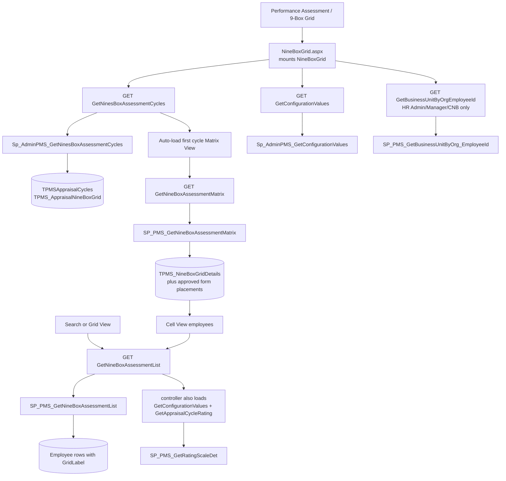
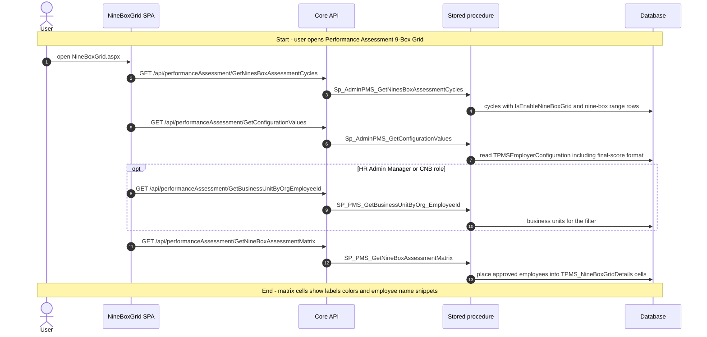
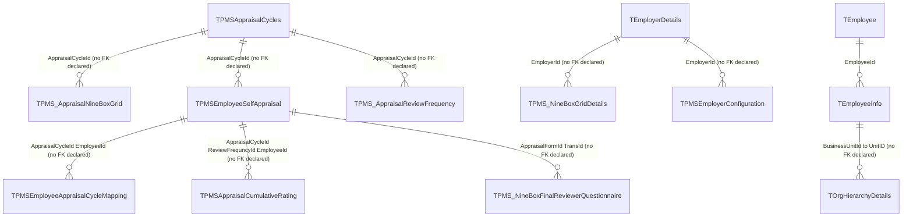

# 9-Box Grid

## Overview

An HR admin, compensation/benefits manager, or a manager with reportees opens **Performance Assessment → 9-Box Grid** to place people from a finished assessment cycle onto a 3×3 performance × potential matrix. The live shell is `~/HRM/PMS_React/NineBoxGrid.aspx`. It stamps session employee/employer ids into hidden fields and mounts the React `NineBoxGrid` route (`Areas/routes.js` → `Areas/NineBoxGrid/Containers/NineBoxGrid.js`). There is no save on this screen — every call is a GET that fills filters, the matrix cells, the employee list, or the cell popup.

On load the SPA asks for cycles that already have nine-box ranges (`IsEnableNineBoxGrid = 1` and rows in `TPMS_AppraisalNineBoxGrid`), loads employer final-score display format, and — for HR Admin / Manager / CNB roles only — the business-unit multi-select. It then selects the newest cycle and loads Matrix View by default. Search, Reset, and the Matrix/Grid radio buttons re-query. Clicking a matrix cell opens a popup that reuses the assessment list filtered client-side by that cell’s Low/Moderate/High performance and potential levels. Grid View also formats Final Rating with the cycle rating scale using `IsPMSFinalScoreDisplayFormat` (F / R / B).

Setup of cell labels/colors and cycle nine-box ranges is **Admin Configuration → Performance Management** (documented separately), not this menu. There is no SystemModel-2 workflow page and no llm-wiki domain page for this view; table names below come from the procedure scripts under `HRMS-DATABASE/HRMS/STOREPROCEDURE/`.

## Workflow

## Request journey

This screen has no write request. The journey below is the default Matrix View load after the cycle list returns (same path as Search in Matrix View).

Grid View and the cell popup use `GetNineBoxAssessmentList` instead of the matrix procedure; the list controller also enriches Final Rating via `Sp_AdminPMS_GetConfigurationValues` and `SP_PMS_GetRatingScaleDet`.

## Entry points

> Live UI is the PMS React shell. Legacy WebForms `HRM/PerformanceAssessment/NineBoxGrid.aspx` still exists and calls the same .NET BLL/DAL procedures, but left-nav for this feature points at `~/HRM/PMS_React/NineBoxGrid.aspx`. Admin setup of grid labels and questionnaires is on Performance Master Setup, not this page.

| UI page / route | Purpose |
|---|---|
| `~/HRM/PMS_React/NineBoxGrid.aspx` | Left-nav **Performance Assessment → 9-Box Grid**. Stamps `hdnNineBoxEmpId`, `hdnNineBoxEmployerId`, `hdnNineBoxBusinessUnitLabel`, `hdnNineBoxIsHrAdminManagerCNB`. Logs activity `NineBoxGrid`. Hosts `#root` for the SPA. |
| `RouteConstants.NINE_BOX_GRID` → `/HRM/PMS_React/NineBoxGrid.aspx` | Client route in `Areas/routes.js` mounting `NineBoxGrid` container. |
| `~/HRM/PerformanceAssessment/NineBoxGrid.aspx` | Legacy WebForms postback UI (same SPs via `PerformanceAssessmentBLL`). Not the React menu target. |

## Code → database call chain

SPA base URL is Core API `API_URL` with paths under `/api` (`app.js` → `routeIndex.js` → `/performanceAssessment`). No WebForms postback DAL on the React page — `NineBoxGrid.aspx.cs` only stamps session and logs activity.

| Entry point | App method (`file:line`) | Stored procedure |
|---|---|---|
| Page mount → cycle dropdown | `NineBoxGrid.js` `__bindAppraisalCycleList` (`155`) → `GET_NINES_BOX_ASSESSMENT_CYCLES` (`apiURLConstants.js:75`) → `GetNinesBoxAssessmentCycles` (`performanceAssessmentController.js:1452`) → DAL `1726` / execute `1732` | `Sp_AdminPMS_GetNinesBoxAssessmentCycles` |
| Page mount → final-score format | `NineBoxGrid.js` `__loadFinalScoreDisplayFormat` (`114`) → `GET_CONFIG_VALUES` (`apiURLConstants.js:23`) → `GetConfigurationValues` (`performanceAssessmentController.js:1299`) → DAL `1461` / execute `1467` | `Sp_AdminPMS_GetConfigurationValues` |
| Page mount (HR Admin/Manager/CNB) → BU filter | `NineBoxGrid.js` `__bindOrganisationUnit` (`179`) → `GET_BUSINESS_UNIT_BY_ORG_EMPLOYEE_ID` (`apiURLConstants.js:78`) → `GetBusinessUnitByOrgEmployeeId` (`performanceAssessmentController.js:1510`) → DAL `1774` / execute `1781` | `SP_PMS_GetBusinessUnitByOrg_EmployeeId` |
| Auto-load / Search / Matrix radio | `NineBoxGrid.js` `__bindDataToNineBoxMatrixGrid` (`219`) → `GET_NINE_BOX_ASSESSMENT_MATRIX` (`apiURLConstants.js:77`) → `GetNineBoxAssessmentMatrix` (`performanceAssessmentController.js:1501`) → DAL `1757` / execute `1766` | `SP_PMS_GetNineBoxAssessmentMatrix` |
| Search / Grid radio / cell popup | `NineBoxGrid.js` `__bindNineBoxGrid` (`200`) or `BindNineBoxEmployeeList` (`283`) → `GET_NINE_BOX_ASSESSMENT_LIST` (`apiURLConstants.js:76`) → `GetNineBoxAssessmentList` (`performanceAssessmentController.js:1461`) → DAL `1740` / execute `1749`; controller also `GetConfigurationValues` (`1472`) and `GetAppraisalCycleRating` (`1483`) | `SP_PMS_GetNineBoxAssessmentList`; enrichment `Sp_AdminPMS_GetConfigurationValues`, `SP_PMS_GetRatingScaleDet` |
| Grid View rating-scale rows (SPA parallel) | `NineBoxGrid.js` `__loadAppraisalCycleRatingScale` (`134`) → `GET_APPRAISAL_CYCLE_RATING` (`apiURLConstants.js:336`) → `GetAppraisalCycleRating` (`performanceAssessmentController.js:3272`) → DAL `5317` / execute `5323` | `SP_PMS_GetRatingScaleDet` |
| Legacy WebForms list/matrix/cycles | `PerformanceAssessmentBLL` → `PerformanceAssessmentDAL.cs` `1144` / `1155` / `1167` | same three primary SPs |

## API endpoints

All routes are `Authorize` GETs under `/api/performanceAssessment`. There is no postback or mutating API on this feature page.

| Verb | Route | Parameters | Purpose | Source |
|---|---|---|---|---|
| `GET` | `/api/performanceAssessment/GetNinesBoxAssessmentCycles` | query `employerId` (int, required) | Cycle dropdown | `performanceAssessmentController.js:1452` |
| `GET` | `/api/performanceAssessment/GetNineBoxAssessmentMatrix` | query `employerId`, `appraisalCycleId`, `organizationUnits` (comma list or empty), `employeeId` | Matrix cells with employee name snippets | `performanceAssessmentController.js:1501` |
| `GET` | `/api/performanceAssessment/GetNineBoxAssessmentList` | query `employerId`, `appraisalCycleId`, `organizationUnits`, `employeeId` | Flat employee list; controller formats Final Rating | `performanceAssessmentController.js:1461` |
| `GET` | `/api/performanceAssessment/GetConfigurationValues` | query `employerId` | `IsPMSFinalScoreDisplayFormat` and other PMS flags | `performanceAssessmentController.js:1299` |
| `GET` | `/api/performanceAssessment/GetBusinessUnitByOrgEmployeeId` | query `employeeId`, `employerId` | BU multi-select for HR Admin/Manager/CNB | `performanceAssessmentController.js:1510` |
| `GET` | `/api/performanceAssessment/GetAppraisalCycleRating` | query `appraisalCycleId`, `confirmationId` (0 here) | Rating/weightage scale rows for Final Rating display | `performanceAssessmentController.js:3272` |

## Stored procedures & tables involved

Primary procedures for this page; nested helpers one level down are linked on each procedure page. Admin setup procedures (`Sp_AdminPMS_GetNineBoxGridDetails`, `INSNineBox*`) are not called here.

| Object | File path | Purpose | Page |
|---|---|---|---|
| `Sp_AdminPMS_GetNinesBoxAssessmentCycles` | `HRMS-DATABASE/HRMS/STOREPROCEDURE/Sp_AdminPMS_GetNinesBoxAssessmentCycles.sql` | Cycles for the employer with nine-box enabled and range rows | [Sp_AdminPMS_GetNinesBoxAssessmentCycles](/docs/database/hrms/Sp_AdminPMS_GetNinesBoxAssessmentCycles) |
| `SP_PMS_GetNineBoxAssessmentMatrix` | `…/SP_PMS_GetNineBoxAssessmentMatrix.sql` | Role-scoped placement of approved employees into nine-box cells | [SP_PMS_GetNineBoxAssessmentMatrix](/docs/database/hrms/SP_PMS_GetNineBoxAssessmentMatrix) |
| `SP_PMS_GetNineBoxAssessmentList` | `…/SP_PMS_GetNineBoxAssessmentList.sql` | Role-scoped employee rows with performance/potential/`GridLabel` | [SP_PMS_GetNineBoxAssessmentList](/docs/database/hrms/SP_PMS_GetNineBoxAssessmentList) |
| `Sp_AdminPMS_GetConfigurationValues` | `…/Sp_AdminPMS_GetConfigurationValues.sql` | Employer PMS config including final-score display format | [Sp_AdminPMS_GetConfigurationValues](/docs/database/hrms/Sp_AdminPMS_GetConfigurationValues) |
| `SP_PMS_GetBusinessUnitByOrg_EmployeeId` | `…/SP_PMS_GetBusinessUnitByOrg_EmployeeId.sql` | Business units for the filter | [SP_PMS_GetBusinessUnitByOrg_EmployeeId](/docs/database/hrms/SP_PMS_GetBusinessUnitByOrg_EmployeeId) |
| `SP_PMS_GetRatingScaleDet` | `…/SP_PMS_GetRatingScaleDet.sql` | Cycle (or confirmation) rating/weightage scale detail | [SP_PMS_GetRatingScaleDet](/docs/database/hrms/SP_PMS_GetRatingScaleDet) |
| `TPMSAppraisalCycles` | PMS tables | Cycle header; `IsEnableNineBoxGrid` gates the dropdown | — |
| `TPMS_AppraisalNineBoxGrid` | `DDL/PMSRelease-P23/…` | Per-cycle Low/Moderate/High min–max for Performance and Potential | — |
| `TPMS_NineBoxGridDetails` | `DDL/PMSRelease-P23/TPMS_NineBoxGridDetails.sql` | Employer cell labels, definitions, colors (RowId/ColumnId) | — |
| `TPMS_NineBoxPotentialLevels` | PMS tables | Fallback potential labels when no Potential nine-box ranges exist | — |
| `TPMS_NineBoxFinalReviewerQuestionnaire` | PMS tables | Potential score average when `EmpPotentialByNineBoxValue` is 0 | — |
| `TPMSEmployeeSelfAppraisal` | PMS tables | Forms, `FormStatus`, `EmpPotentialByNineBoxValue` | — |
| `TPMSAppraisalCumulativeRating` | PMS tables | Final rating source for performance band | — |
| `TPMSEmployeeAppraisalForBellCurve` | PMS tables | Normalized rating when employer uses normalisation | — |
| `TPMSEmployerConfiguration` | PMS tables | Normalisation and final-score display flags | — |
| `TEmployee` / `TEmployeeInfo` / `TOrgHierarchyDetails` / `TORGChart` | core HRMS | Identity, BU, managers | — |

## Table relationships

No FK is declared on `TPMS_NineBoxGridDetails`. Edges below are the joins the live list/matrix procedures use.

## Known gaps

- **No SystemModel-2 or llm-wiki domain page** for 9-Box Grid viewing; behaviour is from SourceCode + SQL scripts.
- **Legacy WebForms sibling** `HRM/PerformanceAssessment/NineBoxGrid.aspx` still compiles and hits the same SPs via Enterprise Library DAL; React is the left-nav target documented here.
- **Admin setup is a different menu** (Performance Management tabs for grid details / questionnaire / cycle nine-box ranges). Those write procedures are out of scope for this guide.
- **List controller double-loads config/scale** while the SPA also calls `GetConfigurationValues` and `GetAppraisalCycleRating` for Grid View formatting — redundant GETs for the same enrichment.
- **Role branching inside list/matrix SPs** (RoleId 1/2/9 vs manager reportee filter) is not visible in the UI beyond the BU multi-select gate on `IsHrAdminManagerCNB`.
- **Matrix name HTML** (`<b>`, ` `) is produced in SQL and rendered by the React matrix component; changing cell markup requires SP + UI together.

## Reference

Confidence is high for the React → Core API → SP chain on this page. Nested encryption/name/scope helpers were not re-derived beyond one level.

### SourceCode

- `HRMS.Web/HRMS.Web/HRM/PMS_React/NineBoxGrid.aspx` (+ `.aspx.cs`)
- `HRMS.Web/HRMS.Web/HRM/PMS_React/Areas/NineBoxGrid/Containers/NineBoxGrid.js`
- `HRMS.Web/HRMS.Web/HRM/PMS_React/Areas/routes.js`
- `HRMS.Web/HRMS.Web/HRM/PMS_React/Common/apiURLConstants.js`
- `HRMS.CoreAPI/HRMS.Core.WebAPI.Node/Routes/performanceAssessmentRoutes.js`
- `HRMS.CoreAPI/HRMS.Core.WebAPI.Node/Controllers/performanceAssessmentController.js`
- `HRMS.CoreAPI/HRMS.Core.WebAPI.Node/Core/DataAccessLayer/performanceAssessmentDAL.js`
- `HRMS.Shared/HRMS.DataAccessLayer/ConfirmationAndPerformance/PerformanceAssessmentDAL.cs` (legacy)
- Sibling setup guide: `content/guides/admin-configuration/performance-management.md`

### TDG HRMS DB

- `HRMS-DATABASE/HRMS/STOREPROCEDURE/Sp_AdminPMS_GetNinesBoxAssessmentCycles.sql`
- `HRMS-DATABASE/HRMS/STOREPROCEDURE/SP_PMS_GetNineBoxAssessmentMatrix.sql`
- `HRMS-DATABASE/HRMS/STOREPROCEDURE/SP_PMS_GetNineBoxAssessmentList.sql`
- `HRMS-DATABASE/HRMS/STOREPROCEDURE/Sp_AdminPMS_GetConfigurationValues.sql`
- `HRMS-DATABASE/HRMS/STOREPROCEDURE/SP_PMS_GetBusinessUnitByOrg_EmployeeId.sql`
- `HRMS-DATABASE/HRMS/STOREPROCEDURE/SP_PMS_GetRatingScaleDet.sql`
- `HRMS-DATABASE/HRMS/DDL/PMSRelease-P23/TPMS_NineBoxGridDetails.sql`
