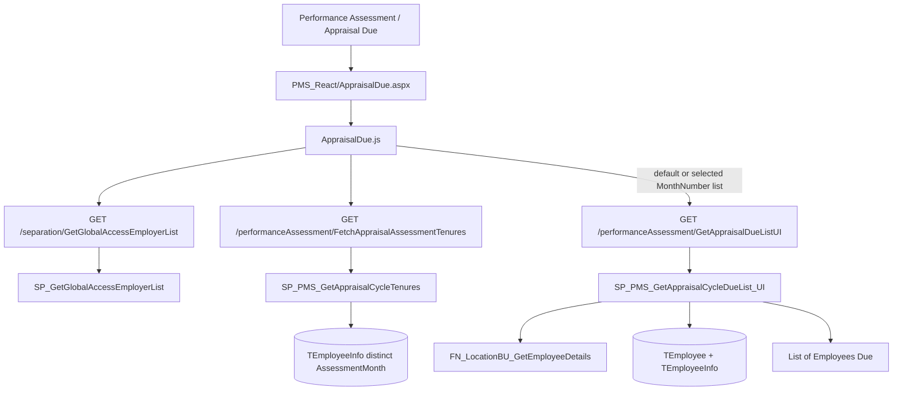
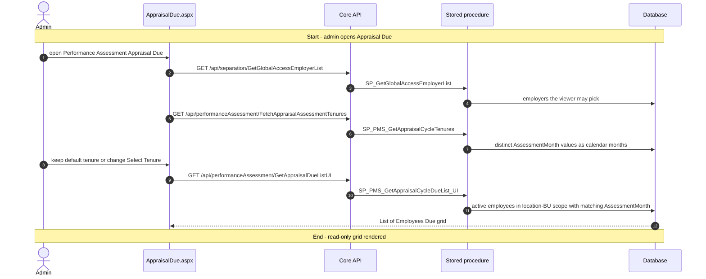
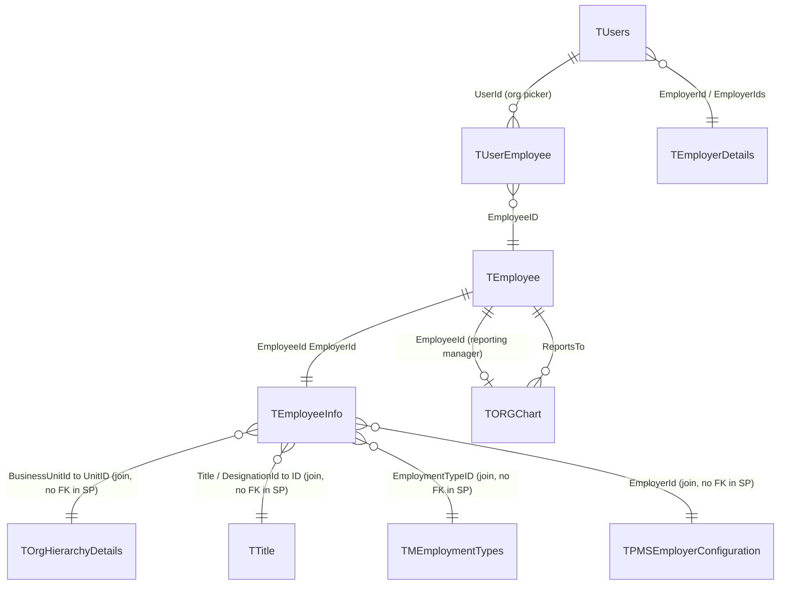

# Appraisal Due

## Overview

An HR or PMS admin opens **Performance Assessment → Appraisal Due** to see active employees whose assessment-tenure month matches the selected tenure(s) for an organisation. The left-nav leaf points at `~/HRM/PMS_React/AppraisalDue.aspx` (`HRMS-DATABASE/HRMS/DML/PMSRelease-React/MenuDetails.sql`; menu value `607`). The host stamps session employee/employer and business-unit label into hidden fields, logs activity `AppraisalDue` (373), and loads the PMS React bundle. The container `AppraisalDue` loads organisations, tenure months for the selected employer, then the due list. There is no save, initiate, or postback on this screen — read-only grid with quick search, column filter, and export.

**Who's involved:**

- **HR / PMS admin** — picks organisation and tenure months; views employees due for appraisal in that month.
- **Employee** — not a user of this leaf; they appear as rows when their `TEmployeeInfo.AssessmentMonth` matches and they fall in the viewer's location/BU scope.
- **Manager** — not a dedicated actor here; functional and reporting managers are display columns only.

This is **not** Confirmation Due (`Sp_CMS_GetConfirmationDueList` / Confirmation Assessment). It is **not** the scheduler job `EmployeeAppraisalDueNotification` (email helper), which is a separate path. Sibling left-nav items under Performance Assessment (Assessment Status, Create Assessment Cycle, Normalization, …) share the PMS React host pattern but are separate menu pages.

## Workflow

On first paint the SPA restores persisted organisation and tenure filters (`pageFiltersStorage` scope `AppraisalDue`). If none are stored, it prefers the current calendar month among tenure options (otherwise the first tenure). Changing organisation clears the grid and reloads tenures. Tenure multi-select is debounced 250 ms before calling the list API. Selecting no tenure clears the grid without a request.

## Request journey

The primary request that paints the employee grid is **GetAppraisalDueListUI** after tenure selection. Organisation and tenure loads are setup requests for the same screen.

## Entry points

| Entry point | Purpose | Live? |
|---|---|---|
| `HRM/PMS_React/AppraisalDue.aspx` | Left-nav host after React menu DML. Injects `hdnAppraisalDueEmpId` / `hdnAppraisalDueEmployerId` / `hdnAppraisalDueBusinessUnitLabel`. Logs `ActivityDescription.AppraisalDue` (373). Optional query `QSEmployerId` overrides employer when present. | Yes — menu leaf |
| `Areas/AppraisalDue/Containers/AppraisalDue.js` | React page — org picker, tenure multi-select, list GET | Yes |
| `Areas/AppraisalDue/Components/AppraisalDueListGrid.js` | `HrmsDataGrid` wrapper (quick search, filter, export) | Yes |
| `Areas/routes.js` route `APPRAISAL_DUE` | SPA route for `/HRM/PMS_React/AppraisalDue.aspx` | Yes |
| `HRM/PerformanceAssessment/AppraisalDue.aspx` | Legacy WebForms + RadGrid; code-behind calls `PerformanceAssessmentBLL.GetAppraisalDueListUI` | Superseded by menu DML; not the left-nav URL |

Menu seed historically used `~/HRM/PerformanceAssessment/AppraisalDue.aspx`. `DML/PMSRelease-React/MenuDetails.sql` updates NavigateURL to `~/HRM/PMS_React/AppraisalDue.aspx`. Hierarchy node text remains **Appraisal Due** value `607`.

## Code → database call chain

| Entry | HTTP | Controller | DAL | Stored procedure |
|---|---|---|---|---|
| Page load — org picker `AppraisalDue.js:65` | `GET /api/separation/GetGlobalAccessEmployerList` (`separationRoutes.js:57`) | `GetGlobalAccessEmployerList` (`separationController.js:958`) | `GetGlobalAccessEmployerList` (`separationDAL.js:989`, execute `separationDAL.js:994`) | `SP_GetGlobalAccessEmployerList` |
| Page load / org change — tenures `AppraisalDue.js:112` | `GET /api/performanceAssessment/FetchAppraisalAssessmentTenures` (`performanceAssessmentRoutes.js:156`) | `FetchAppraisalAssessmentTenures` (`performanceAssessmentController.js:1416`) | `FetchAppraisalAssessmentTenures` (`performanceAssessmentDAL.js:1668`, execute `performanceAssessmentDAL.js:1674`) | `SP_PMS_GetAppraisalCycleTenures` |
| Tenure selected — due list `AppraisalDue.js:180` | `GET /api/performanceAssessment/GetAppraisalDueListUI` (`performanceAssessmentRoutes.js:157`) | `GetAppraisalDueListUI` (`performanceAssessmentController.js:1425`) | `GetAppraisalDueListUI` (`performanceAssessmentDAL.js:1682`, execute `performanceAssessmentDAL.js:1690`) | `SP_PMS_GetAppraisalCycleDueList_UI` |

`apiURLConstants.js:39-41` builds the relative paths. `APIHelper` prefixes them with `process.env.API_URL` (Core API `/api`). The SPA org helper deliberately uses the **separation** route; a twin `GET /performanceAssessment/GetGlobalAccessEmployerList` exists (`performanceAssessmentRoutes.js:362`) but is unused by this page.

Grid columns bind `EmployeeName`, `EmployeeDesignation`, `BusinessUnit`, `EmploymentType`, `OrganizationName`, `FunctionalManager`, `ReportingManager` from the due-list result set. The BU column header uses the stamped business-unit label.

## API endpoints

No WebForms postback DAL on the React host. `AppraisalDue.aspx.cs` only stamps session fields and logs activity on load. There is no POST/PUT/DELETE for this leaf.

| Method | Path | Purpose |
|---|---|---|
| GET | `/api/separation/GetGlobalAccessEmployerList?employeeId=` | Organisations the viewer may select |
| GET | `/api/performanceAssessment/FetchAppraisalAssessmentTenures?employerId=` | Tenure months derived from `TEmployeeInfo.AssessmentMonth` for that employer |
| GET | `/api/performanceAssessment/GetAppraisalDueListUI?employerId=&assessmentMonth=&employeeId=` | Active employees due for the comma-separated month numbers, scoped by the viewer's location/BU access |

## Stored procedures & tables involved

| Procedure / function | Role on this page |
|---|---|
| `SP_GetGlobalAccessEmployerList` | Org picker rows (global-access employer list or own employer) |
| `SP_PMS_GetAppraisalCycleTenures` | Distinct assessment months for the employer, mapped to calendar month names / `MonthNumber` 1–12 |
| `SP_PMS_GetAppraisalCycleDueList_UI` | Due-list rows; joins location-BU scope; filters `AssessmentMonth` via `Split` |
| `FN_LocationBU_GetEmployeeDetails` | Nested — employees the viewer may see for the selected employer |
| `Fn_GetEmployeeName` | Nested — employee, functional manager, and reporting manager display names |
| `Fn_GetEmployeeDesignationByDesignationID` | Nested — designation title(s) from `TTitle` via `DesignationId` |
| `Split` | Nested — comma-separated `@AssessmentMonth` list |

| Table | How used |
|---|---|
| `TEmployeeInfo` | `AssessmentMonth` filter; employment number, BU, title, employment type, managers, designation id |
| `TEmployee` | Active flag (`IsActive = 'Y'`) |
| `TORGChart` | Reporting manager (`ReportsTo`) |
| `TOrgHierarchyDetails` | Business unit name |
| `TTitle` | Title / designation text |
| `TMEmploymentTypes` | Employment type label |
| `TPMSEmployerConfiguration` | Organisation name on the grid |
| `TUsers` / `TUserEmployee` / `TEmployerDetails` | Org picker via `SP_GetGlobalAccessEmployerList` |

Older siblings `SP_PMS_GetAppraisalCycleDueList` and `SP_PMS_GetAppraisalCycleDueList_New` are not on the React call chain.

## Table relationships

## Known gaps

- **No SystemModel-2 / llm-wiki domain page** for Appraisal Due — behaviour above is from SourceCode + procedure scripts.
- **Tenure `MonthNumber` vs raw `AssessmentMonth`.** `SP_PMS_GetAppraisalCycleTenures` maps `AssessmentMonth % 12` (with 0 → 12) into dropdown values 1–12. `SP_PMS_GetAppraisalCycleDueList_UI` filters `te.AssessmentMonth IN (those values)` without the same modulo. If any rows store `AssessmentMonth` outside 1–12, they can appear in the tenure list under a calendar month but miss the due-list filter for that month.
- **SPA org API is `/separation/…`, not `/performanceAssessment/…`.** Both hit `SP_GetGlobalAccessEmployerList`; only the separation URL is wired in `apiURLConstants.js:40`.
- **Legacy WebForms page remains** under `HRM/PerformanceAssessment/AppraisalDue.aspx` and still calls .NET BLL/`SP_PMS_GetAppraisalCycleDueList_UI`. Live left-nav is the PMS_React host.
- **Read-only.** No initiate appraisal, notify, or edit from this grid. Scheduler `EmployeeAppraisalDueNotification` is a separate job path.
- **Failed GETs only `console.log`.** Org/tenure/list errors leave empty or stale UI without a user-facing message.
- **Grid shows `EmployeeDesignation` from `DesignationId`**, not the parallel `Designation` column built from `te.Title` in the same procedure.

## Reference

- `HRMS.Web/HRMS.Web/HRM/PMS_React/AppraisalDue.aspx` (+ `.cs`)
- `HRMS.Web/HRMS.Web/HRM/PMS_React/Areas/AppraisalDue/Containers/AppraisalDue.js`
- `HRMS.Web/HRMS.Web/HRM/PMS_React/Areas/AppraisalDue/Components/AppraisalDueListGrid.js`
- `HRMS.Web/HRMS.Web/HRM/PMS_React/Areas/routes.js`
- `HRMS.Web/HRMS.Web/HRM/PMS_React/Common/apiURLConstants.js`, `routeConstants.js`
- `HRMS.CoreAPI/HRMS.Core.WebAPI.Node/Routes/routeIndex.js`, `performanceAssessmentRoutes.js`, `separationRoutes.js`
- `HRMS.CoreAPI/HRMS.Core.WebAPI.Node/Controllers/performanceAssessmentController.js`, `separationController.js`
- `HRMS.CoreAPI/HRMS.Core.WebAPI.Node/Core/DataAccessLayer/performanceAssessmentDAL.js`, `separationDAL.js`
- `HRMS.Shared/HRMS.DataContract/Common/Enums.cs` (`AppraisalDue = 373`)
- `HRMS-DATABASE/HRMS/DML/PMSRelease-React/MenuDetails.sql`
- `HRMS-DATABASE/HRMS/STOREPROCEDURE/SP_PMS_GetAppraisalCycleDueList_UI.sql`
- `HRMS-DATABASE/HRMS/STOREPROCEDURE/SP_PMS_GetAppraisalCycleTenures.sql`
- `HRMS-DATABASE/HRMS/STOREPROCEDURE/SP_GetGlobalAccessEmployerList.sql`
- `HRMS-DATABASE/HRMS/FUNCTIONS/FN_LocationBU_GetEmployeeDetails.sql`, `Fn_GetEmployeeName.sql`, `Fn_GetEmployeeDesignationByDesignationID.sql`, `Split.sql`
