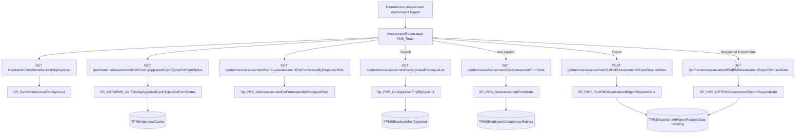
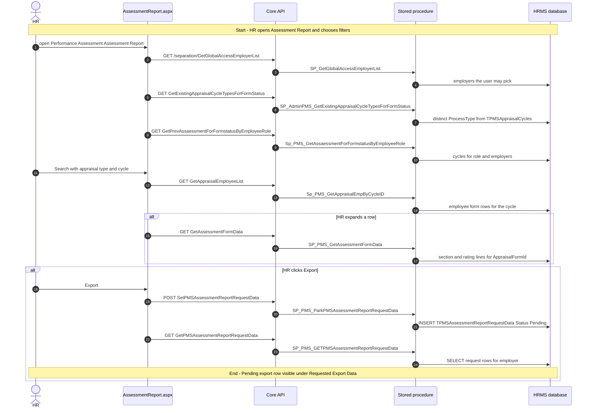
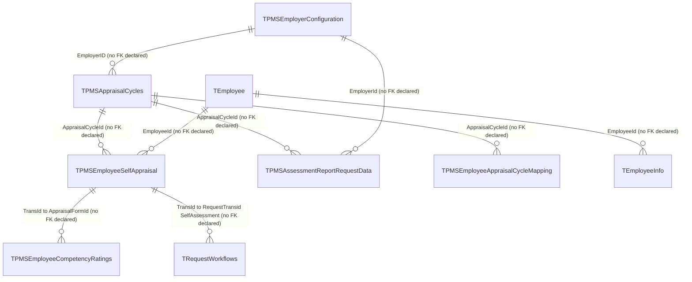

# Assessment Report

## Overview

An HR admin or manager opens **Performance Assessment → Assessment Report** to see every employee appraisal form for a chosen assessment cycle, with form status, who is next in the queue, final score, and rating definition. They pick one or more organisations they can access, choose an appraisal type (Competency, Goal, KRA, KRA & Competency, or Goal & Competency), pick a cycle, and click **Search**. Expanding a row loads that form’s section/competency (or KRA/goal) detail for the selected type. **Export** does not download immediately — it parks a `Pending` row so a background job can build the file; the **Requested Export Data** panel lists those requests and opens the completed file through `OpenFile.aspx`.

**Who's involved:**

- **HR / Admin / Manager CNB** — primary users of this screen. Organisation multi-select and Reset appear with global-access / CNB role flags stamped on the aspx. Search and Export are available to anyone who can open the menu item.
- **Employee** — not a user of this screen; their forms appear as rows when the viewer’s role and reportee rules allow it.
- **Scheduler (non-UI)** — processes parked export rows (`TPMSAssessmentReportRequestData`) and writes `FilePath` / status; that job is outside this page.

Live shell is React `HRM/PMS_React/AssessmentReport.aspx` (`AssessmentReport_React`), not the older WebForms `HRM/PerformanceAssessment/AssessmentReport.aspx`. There is no SystemModel-2 workflow page for this menu item. Table catalogue notes for `TPMSAssessmentReportRequestData` sit in `llm-wiki/reference/tables/hrms.md` (data catalog); relationships below are from DDL joins used by the procedures.

## Workflow

Organisation search rebinds appraisal types and cycles; the employee grid stays empty until **Search**. Export uses the first employer id from the comma list and the current process type. Completed export files open via `../../OpenFile.aspx?ShortListPath=…` (not an API).

## Request journey

The mutating request on this screen is **Export** — it creates the parked report row. Search and expand are reads; they appear as setup before Export.

File generation and `FilePath` update are done by a scheduler calling `SP_PMS_UPDPMSAssessmentReportRequestData` (not invoked from this SPA).

## Entry points

> Live left-nav item loads **`~/HRM/PMS_React/AssessmentReport.aspx`** (`AssessmentReport_React`). It mounts the PMS React bundle and client route `RouteConstants.ASSESSMENT_REPORT`. Sibling WebForms `HRM/PerformanceAssessment/AssessmentReport.aspx` still exists and calls the same BLL park/list methods, but the React shell is the current menu host. Activity logging for Assessment Status is commented out on the React code-behind.

| UI page / route | Purpose |
|---|---|
| `/HRM/PMS_React/AssessmentReport.aspx` | Performance Assessment → Assessment Report. Hidden fields stamp employee, employer, business-unit label, and HR/Admin/Manager CNB. Hosts filters, employee grid, and export request grid. |
| `/HRM/PerformanceAssessment/AssessmentReport.aspx` | Legacy WebForms twin. Same feature; not the React left-nav host. |
| `OpenFile.aspx?ShortListPath=…` | Opens a completed export file path stored on the request row. |

## Code → database call chain

SPA constants are under `PMS_React/Common/apiURLConstants.js`. Core API mounts `performanceAssessmentRoutes` at `/performanceAssessment` (and org list via `/separation`). Code-behind only stamps session values; there is no WebForms postback DAL on the React page.

| Entry point | DAL / BLL method (`file:line`) | Stored procedure |
|---|---|---|
| Page load — org multi-select | `GetGlobalAccessEmployerList` (`separationDAL.js:989`) via `separationController.js:958` | `SP_GetGlobalAccessEmployerList` |
| Page load / org search — appraisal type radios | `GetExistingAppraisalCycleTypesForFormStatus` (`performanceAssessmentDAL.js:1789`) via `performanceAssessmentController.js:1519` | `SP_AdminPMS_GetExistingAppraisalCycleTypesForFormStatus` |
| Page load / type change — cycle dropdown | `GetPrevAssaessmentForFormstatusByEmployeeRole` (`performanceAssessmentDAL.js:1803`) via `performanceAssessmentController.js:1528` | `Sp_PMS_GetAssaessmentForFormstatusByEmployeeRole` |
| Search — employee grid | `GetAppraisalEmployeeList` (`performanceAssessmentDAL.js:1818`) via `performanceAssessmentController.js:1537` | `Sp_PMS_GetAppraisalEmpByCycleID` |
| Row expand — form detail | `GetAssessmentFormData` (`performanceAssessmentDAL.js:1838`) via `performanceAssessmentController.js:1546` | `SP_PMS_GetAssessmentFormData` |
| Export | `SetPMSAssessmentReportRequestData` (`performanceAssessmentDAL.js:1853`) via `performanceAssessmentController.js:1555` | `SP_PMS_ParkPMSAssessmentReportRequestData` |
| Requested Export Data panel | `GETPMSAssessmentReportRequestData` (`performanceAssessmentDAL.js:1871`) via `performanceAssessmentController.js:1564` | `SP_PMS_GETPMSAssessmentReportRequestData` |

Assessment Report always calls `GetAppraisalEmployeeList` with empty `organizationUnits`, `goalSettingId` `'0'`, and both quick-view flags `false`.

## API endpoints

No WebForms postback on the React page. Base API path is `/api` → `routeIndex.js` mounts `/performanceAssessment` and `/separation`.

| Verb | Route | Parameters | Purpose | Source |
|---|---|---|---|---|
| `GET` | `/separation/GetGlobalAccessEmployerList` | query `employeeId` (int, required) | Organisations for the header multi-select | `separationController.js:958` |
| `GET` | `/performanceAssessment/GetExistingAppraisalCycleTypesForFormStatus` | query `employerIds` (comma varchar, required) | Distinct appraisal `ProcessType` codes that have cycles | `performanceAssessmentController.js:1519` |
| `GET` | `/performanceAssessment/GetPrevAssaessmentForFormstatusByEmployeeRole` | query `employeeId` (int), `employerIds` (comma varchar) | Assessment cycles for the type filter (SPA filters client-side by `processType`) | `performanceAssessmentController.js:1528` |
| `GET` | `/performanceAssessment/GetAppraisalEmployeeList` | query `employerIds`, `appraisalCycleId`, `organizationUnits` (empty here), `employeeId`, `goalSettingId` (`0`), `quickViewForAssessment` (`false`), `quickViewForGoalSettings` (`false`) | Master grid rows | `performanceAssessmentController.js:1537` |
| `GET` | `/performanceAssessment/GetAssessmentFormData` | query `appraisalFormId` (int), `assessmentType` (char, process type) | Expanded detail for one form | `performanceAssessmentController.js:1546` |
| `POST` | `/performanceAssessment/SetPMSAssessmentReportRequestData` | body `appraisalCycleId`, `employerId` (first selected org), `loginEmployeeId`, `status` (`Pending`), `assessmentType` | Park export request | `performanceAssessmentController.js:1555` |
| `GET` | `/performanceAssessment/GetPMSAssessmentReportRequestData` | query `employerId` (first selected org) | Export request grid (SPA filters by `AssessmentType`) | `performanceAssessmentController.js:1564` |

## Stored procedures & tables involved

> Export queue table is **`TPMSAssessmentReportRequestData`** (no FK declared in DDL). Grid reads centre on **`TPMSEmployeeSelfAppraisal`**, **`TPMSAppraisalCycles`**, and related mapping/rating tables. Org picker uses **`SP_GetGlobalAccessEmployerList`** (documented separately).

| Object | File path | Purpose | llm-wiki |
|---|---|---|---|
| `TPMSAssessmentReportRequestData` | `HRMS-DATABASE/HRMS/DDL/PMSRelease-P29/TPMSAssessmentReportRequestData.sql` | Parked export requests (`Status`, `IsProcessed`, `FilePath`, `AssessmentType`). No FK. | data catalog / `llm-wiki/reference/tables/hrms.md` |
| `TPMSAppraisalCycles` | `HRMS-DATABASE/HRMS/…` | Cycle list and process types (`C`/`K`/`G`/`B`/`T`). | same |
| `TPMSEmployeeSelfAppraisal` | same | Appraisal form header (`TransId` = `AppraisalFormId`), status, scores context. | same |
| `TPMSEmployeeCompetencyRatings` | same | Per-competency/KRA/goal rating lines for expand detail. | same |
| `TPMSEmployeeAppraisalCycleMapping` | same | Employee ↔ cycle mapping (managers, category). | same |
| `TPMSEmployerConfiguration` | same | Employer PMS flags and display name on cycles/export. | same |
| `TRequestWorkflows` | same | Pending-with / approval level text on the grid. | same |
| `SP_GetGlobalAccessEmployerList` | `HRMS-DATABASE/HRMS/STOREPROCEDURE/SP_GetGlobalAccessEmployerList.sql` | Org picker. | `/docs/database/hrms/SP_GetGlobalAccessEmployerList` |
| `SP_AdminPMS_GetExistingAppraisalCycleTypesForFormStatus` | `…/SP_AdminPMS_GetExistingAppraisalCycleTypesForFormStatus.sql` | Distinct process types (or default `C`). | `/docs/database/hrms/SP_AdminPMS_GetExistingAppraisalCycleTypesForFormStatus` |
| `Sp_PMS_GetAssaessmentForFormstatusByEmployeeRole` | `…/Sp_PMS_GetAssaessmentForFormstatusByEmployeeRole.sql` | Cycles by HR/Admin vs reportee role. | `/docs/database/hrms/Sp_PMS_GetAssaessmentForFormstatusByEmployeeRole` |
| `Sp_PMS_GetAppraisalEmpByCycleID` | `…/Sp_PMS_GetAppraisalEmpByCycleID.sql` | Employee assessment (and optional goal) list for the cycle. | `/docs/database/hrms/Sp_PMS_GetAppraisalEmpByCycleID` |
| `SP_PMS_GetAssessmentFormData` | `…/SP_PMS_GetAssessmentFormData.sql` | Pivoted Emp/L1–L4 detail by assessment type. | `/docs/database/hrms/SP_PMS_GetAssessmentFormData` |
| `SP_PMS_ParkPMSAssessmentReportRequestData` | `…/SP_PMS_ParkPMSAssessmentReportRequestData.sql` | Insert pending export request. | `/docs/database/hrms/SP_PMS_ParkPMSAssessmentReportRequestData` |
| `SP_PMS_GETPMSAssessmentReportRequestData` | `…/SP_PMS_GETPMSAssessmentReportRequestData.sql` | List export requests for an employer. | `/docs/database/hrms/SP_PMS_GETPMSAssessmentReportRequestData` |
| `SP_PMS_UPDPMSAssessmentReportRequestData` | `…/SP_PMS_UPDPMSAssessmentReportRequestData.sql` | Scheduler updates status/`FilePath` (not called from this SPA). | — |

## Table relationships

`TPMSAssessmentReportRequestData` declares **no FKs**. Edges below are the joins the live procedures use (or the catalog’s child-of note for cycle).

## Known gaps

- **No SystemModel-2 page** for Assessment Report; behaviour is from SourceCode + procedure scripts.
- **Legacy WebForms page still present** (`HRM/PerformanceAssessment/AssessmentReport.aspx`) with the same BLL park/list calls; left-nav React host is the documented live path.
- **Export completion is off-page.** SPA only parks `Pending` and lists rows. `SP_PMS_UPDPMSAssessmentReportRequestData` / scheduler (`PMSEmployee Appraisal Report Export` in the data catalog) write `FilePath` and final status; not traced end-to-end here.
- **Export uses only the first employer id** in the comma-separated org list when parking and listing requests, even if multiple orgs are selected for Search.
- **Activity log commented out** on React `AssessmentReport.aspx.cs` (`LogActivity` for Assessment Status).
- **`Sp_PMS_GetAppraisalEmpByCycleID` is shared** with Assessment Status / quick-view callers; this page always passes `goalSettingId=0` and both quick-view bits false, so the goal-setting union branch is unused here unless those ids are non-zero.
- **Column casing** — SPA normalizes SP result keys to lowercase because SQL column casing is inconsistent (`Appraisalformid`, `DesignatiOn`, etc.).

## Reference

Confidence is **medium**: React Assessment Report was traced to Core API `performanceAssessmentDAL` / `separationDAL` `file:line` and the seven procedures above. Nested helpers (`Split`, encryption open/close, `Fn_GetEmployeeName`, `Fn_DirectIndirectReportee`, `FN_LocationBU_GetEmployeeDetails`) already have database pages; `FN_TOrgHierarchyDetails_ByLevel` is documented with this run. Scheduler update of export files was not fully traced.

### SourceCode

- `HRMS.Web/HRMS.Web/HRM/PMS_React/AssessmentReport.aspx` (+ `.cs`)
- `HRMS.Web/HRMS.Web/HRM/PMS_React/Areas/AssessmentReport/Containers/AssessmentReport.js`
- `HRMS.Web/HRMS.Web/HRM/PMS_React/Areas/AssessmentReport/Components/AssessmentReportListGrid.js`
- `HRMS.Web/HRMS.Web/HRM/PMS_React/Areas/routes.js`, `Common/routeConstants.js`, `Common/apiURLConstants.js`
- `HRMS.Web/HRMS.Web/HRM/PerformanceAssessment/AssessmentReport.aspx` (+ `.cs`) — legacy twin
- `HRMS.CoreAPI/HRMS.Core.WebAPI.Node/Routes/routeIndex.js`, `performanceAssessmentRoutes.js`, `separationRoutes.js`
- `HRMS.CoreAPI/HRMS.Core.WebAPI.Node/Controllers/performanceAssessmentController.js`, `separationController.js`
- `HRMS.CoreAPI/HRMS.Core.WebAPI.Node/Core/DataAccessLayer/performanceAssessmentDAL.js`, `separationDAL.js`

### TDG HRMS DB

- `HRMS-DATABASE/HRMS/DDL/PMSRelease-P29/TPMSAssessmentReportRequestData.sql`
- `HRMS-DATABASE/HRMS/STOREPROCEDURE/SP_AdminPMS_GetExistingAppraisalCycleTypesForFormStatus.sql`
- `HRMS-DATABASE/HRMS/STOREPROCEDURE/Sp_PMS_GetAssaessmentForFormstatusByEmployeeRole.sql`
- `HRMS-DATABASE/HRMS/STOREPROCEDURE/Sp_PMS_GetAppraisalEmpByCycleID.sql`
- `HRMS-DATABASE/HRMS/STOREPROCEDURE/SP_PMS_GetAssessmentFormData.sql`
- `HRMS-DATABASE/HRMS/STOREPROCEDURE/SP_PMS_ParkPMSAssessmentReportRequestData.sql`
- `HRMS-DATABASE/HRMS/STOREPROCEDURE/SP_PMS_GETPMSAssessmentReportRequestData.sql`
- `HRMS-DATABASE/HRMS/STOREPROCEDURE/SP_GetGlobalAccessEmployerList.sql`
- `HRMS-DATABASE/HRMS/FUNCTIONS/FN_TOrgHierarchyDetails_ByLevel.sql`
- `HRMS-DATABASE/HRMS/DML/TDataCatalog_DML.sql` — `TPMSAssessmentReportRequestData` feature note (Assessment Report + scheduler)
