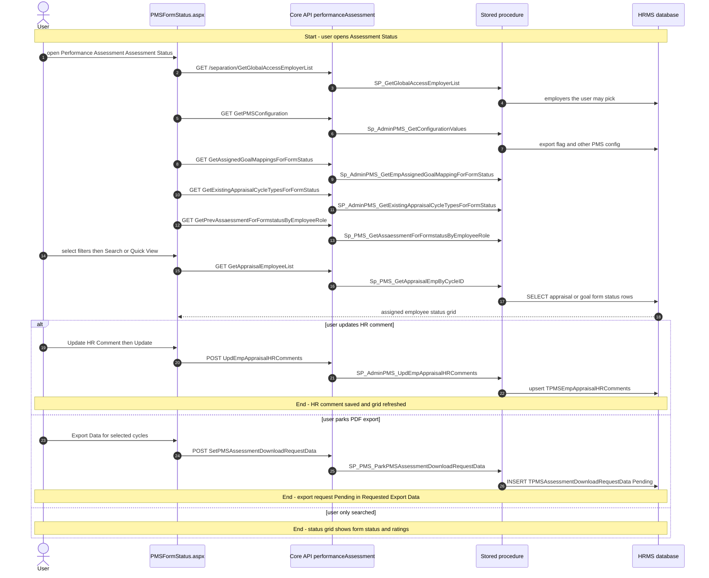
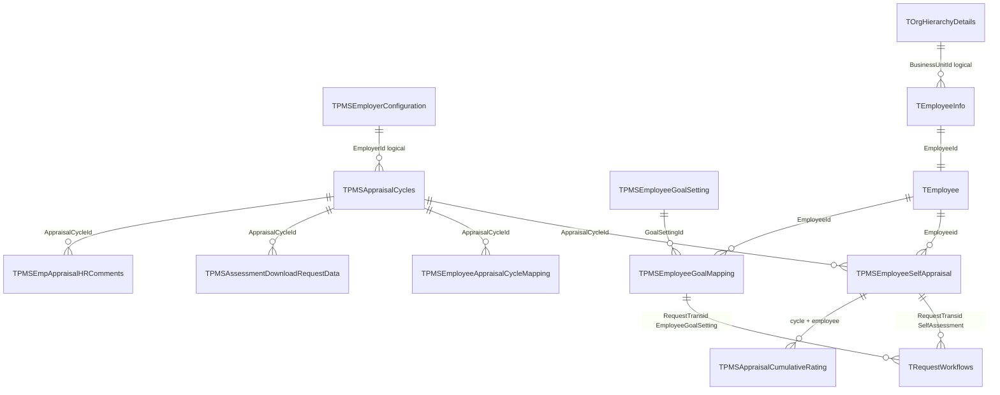

# Assessment Status

## Overview

An HR admin, administrator, or manager opens **Performance Assessment → Assessment Status** to see where every assigned appraisal form or goal form sits in the workflow — pending with the employee, pending with L1–L4, acknowledged, force-closed, and so on. The live host is `~/HRM/PMS_React/PMSFormStatus.aspx` (`PMSFormStatus_React`). It mounts the React container `Areas/PMSFormStatus/Containers/PMSFormStatus.js` (not WebForms postback). A legacy WebForms twin still exists under `HRM/PerformanceAssessment/PMSFormStatus.aspx`; the React page is what the left-nav targets.

The user picks organisation(s) (when global access returns more than one), Appraisal vs Goal, appraisal type (Competency / Goal / KRA / combinations), cycle or goal period, and optional business units, then **Search** (or Quick View Assessment / Goal). The grid shows employees with form status, pending-with, cumulative ratings by workflow level, and HR comments. From a row they can **View** the form (assessment or goal extract), **See all updates**, or **Update HR Comment**. When employer config `IsEnablePDFDownloadAssessmentRequest` is on, they can park bulk PDF download requests and later download the completed zip from **Requested Export Data**.

**Who's involved:**

- **HR Admin / Admin / Manager (CNB)** — primary users of this status screen; BU filter binds for HR Admin/Manager/CNB roles.
- **Employee** — not a user of this leaf; their forms appear as rows.
- **Scheduler** — processes parked rows in `TPMSAssessmentDownloadRequestData` (outside this page).

There is no llm-wiki domain lifecycle page for Assessment Status. Table blurbs for `TPMS*` objects appear in the data catalog / reference tables; this guide is the application call chain.

## Workflow

```mermaid
flowchart TD
  Menu["Performance Assessment / Assessment Status"] --> Page["PMS_React/PMSFormStatus.aspx"]
  Page --> React["PMSFormStatus.js"]
  React --> Orgs["GET /separation/GetGlobalAccessEmployerList"]
  Orgs --> OrgSP["SP_GetGlobalAccessEmployerList"]
  React --> Cfg["GET /performanceAssessment/GetPMSConfiguration"]
  Cfg --> CfgSP["Sp_AdminPMS_GetConfigurationValues"]
  React --> BU["GET GetBusinessUnitByOrgEmployeeId"]
  BU --> BUSP["SP_PMS_GetBusinessUnitByOrg_EmployeeId"]
  React --> Goals["GET GetAssignedGoalMappingsForFormStatus"]
  Goals --> GoalSP["Sp_AdminPMS_GetEmpAssignedGoalMappingForFormStatus"]
  React --> Types["GET GetExistingAppraisalCycleTypesForFormStatus"]
  Types --> TypeSP["SP_AdminPMS_GetExistingAppraisalCycleTypesForFormStatus"]
  React --> Cycles["GET GetPrevAssaessmentForFormstatusByEmployeeRole"]
  Cycles --> CycleSP["Sp_PMS_GetAssaessmentForFormstatusByEmployeeRole"]
  React --> Search["GET GetAppraisalEmployeeList"]
  Search --> ListSP["Sp_PMS_GetAppraisalEmpByCycleID"]
  ListSP --> Grid[("status grid rows")]
  React --> HR["POST UpdEmpAppraisalHRComments"]
  HR --> HRSP["SP_AdminPMS_UpdEmpAppraisalHRComments"]
  HRSP --> HRTbl[("TPMSEmpAppraisalHRComments")]
  React --> Park["POST SetPMSAssessmentDownloadRequestData"]
  Park --> ParkSP["SP_PMS_ParkPMSAssessmentDownloadRequestData"]
  ParkSP --> DLTbl[("TPMSAssessmentDownloadRequestData")]
  React --> View["ViewAssessments / ViewGoalFormData"]
  View --> Extract["GET GetAppraisalCycleEmployeeDataToExport"]
  Extract --> ExtSP["SP_AdminPMS_GetSelfAppDetForExtract"]
```

## Request journey

The request that fills the status grid is **Search** (or Quick View). **Update HR Comment** and **Export Data** are separate mutating requests on the same screen.

## Entry points

Live React host (prefer this). Legacy WebForms page remains in the tree but is not the left-nav target documented here.

| Entry | Purpose |
|---|---|
| `HRMS.Web/HRMS.Web/HRM/PMS_React/PMSFormStatus.aspx` | Left-nav Assessment Status host; injects hidden employer/employee flags and loads `BuildJS/PMS_React.min.js` |
| `Areas/PMSFormStatus/Containers/PMSFormStatus.js` | Filter bar, status grid, export panel, HR comment / updates dialogs |
| `Areas/PMSFormStatus/Components/ViewAssessments.js` | Read-only assessment extract dialog |
| `Areas/EmployeeGoalAssessment/Components/ViewGoalFormData.js` | Read-only goal form extract dialog |
| `HRM/PerformanceAssessment/PMSFormStatus.aspx` | Legacy WebForms sibling (not the React entry) |

## Code → database call chain

| UI / API action | Controller / DAL (`file:line`) | Stored procedure |
|---|---|---|
| Page load organisations | `separationController.GetGlobalAccessEmployerList` → DAL `SP_GetGlobalAccessEmployerList`; React `PMSFormStatus.js:200` via `/separation/GetGlobalAccessEmployerList` | `SP_GetGlobalAccessEmployerList` |
| Config / export flag | `performanceAssessmentController.js:1654` → `performanceAssessmentDAL.js:2045` | `Sp_AdminPMS_GetConfigurationValues` |
| Business unit filter | `performanceAssessmentController.js:1510` → DAL `:1774` | `SP_PMS_GetBusinessUnitByOrg_EmployeeId` |
| Goal period multiselect | `performanceAssessmentController.js:1694` → DAL `:2216` | `Sp_AdminPMS_GetEmpAssignedGoalMappingForFormStatus` |
| Appraisal type radios | `performanceAssessmentController.js:1519` → DAL `:1789` | `SP_AdminPMS_GetExistingAppraisalCycleTypesForFormStatus` |
| Cycle multiselect | `performanceAssessmentController.js:1528` → DAL `:1803` | `Sp_PMS_GetAssaessmentForFormstatusByEmployeeRole` |
| Search / Quick View grid | `performanceAssessmentController.js:1537` → DAL `:1818`; React `:497` | `Sp_PMS_GetAppraisalEmpByCycleID` |
| Update HR Comment | `performanceAssessmentController.js:1703` → DAL `:2230`; React `:853` | `SP_AdminPMS_UpdEmpAppraisalHRComments` |
| See all updates (assessment) | `performanceAssessmentController.js:1712` → DAL `:2247` | `Sp_PMS_GetEmployeeAllUpdates` |
| See all updates (goal) | `performanceAssessmentController.js:1721` → DAL `:2262` | `Sp_PMS_GetEmployeeGoalFormAllUpdates` |
| Park PDF download request | `performanceAssessmentController.js:1739` → DAL `:2301`; React `:714` | `SP_PMS_ParkPMSAssessmentDownloadRequestData` |
| Requested Export Data grid | `performanceAssessmentController.js:1748` → DAL `:2321`; React `:739` | `SP_PMS_GETPMSAssessmentDownloadRequestData` |
| Download completed zip | `performanceAssessmentController.js:1760` | No SP — zips `FilePath` after matching a Completed row |
| View assessment form | `ViewAssessments.js:94` → controller `:2288` → DAL `:3629` | `SP_AdminPMS_GetSelfAppDetForExtract` |
| View decline/ack version | `ViewAssessments.js:85` → controller `:1143` → DAL `:5238` | `SP_AdminPMS_GetDeclineSelfAppDetForExtractVersion` |
| View reject/resubmit version | `ViewAssessments.js:90` → controller `:1167` → DAL `:5256` | `SP_AdminPMS_GetRejectSelfAppDetForExtractVersion` |
| Custom labels on view | `ViewAssessments.js:98` → DAL `:3615` | `SP_AdminPMS_GetEmployerPMSCustomFields` |
| Rating scale on view | `ViewAssessments.js:103` → DAL `:5317` | `SP_PMS_GetRatingScaleDet` |
| View goal form | `ViewGoalFormData.js:263` | `SP_AdminPMS_GetSelfAppDetForExtract` (+ custom labels) |

## API endpoints

Core API routes under `/performanceAssessment/*` (except organisations, which call `/separation/GetGlobalAccessEmployerList`). No WebForms postback on the React host.

| Verb | Route | Parameters | Purpose | Source |
|---|---|---|---|---|
| GET | `/separation/GetGlobalAccessEmployerList` | `employeeId` (query, required) | Organisation multiselect | `apiURLConstants.js:40` |
| GET | `/performanceAssessment/GetPMSConfiguration` | `employerId` | Export-section flag | routes `:179`; controller `:1654` |
| GET | `/performanceAssessment/GetBusinessUnitByOrgEmployeeId` | `employeeId`, `employerId` | BU filter | routes `:163` |
| GET | `/performanceAssessment/GetAssignedGoalMappingsForFormStatus` | `employerIds` | Goal periods | routes `:183` |
| GET | `/performanceAssessment/GetExistingAppraisalCycleTypesForFormStatus` | `employerIds` | Appraisal type list | routes `:164` |
| GET | `/performanceAssessment/GetPrevAssaessmentForFormstatusByEmployeeRole` | `employeeId`, `employerIds` | Cycles for role | routes `:165` |
| GET | `/performanceAssessment/GetAppraisalEmployeeList` | `employerIds`, `appraisalCycleId`, `organizationUnits`, `employeeId`, `goalSettingId`, `quickViewForAssessment`, `quickViewForGoalSettings` | Status grid | routes `:166` |
| POST | `/performanceAssessment/UpdEmpAppraisalHRComments` | body `appraisalCycleId`, `employeeId`, `hrComments`, `createdBy` | Upsert HR comment | routes `:184` |
| GET | `/performanceAssessment/GetEmployeeAllUpdates` | `appraisalFormId` | Assessment timeline | routes `:185` |
| GET | `/performanceAssessment/GetEmployeeGoalFormAllUpdates` | `goalMappingId` | Goal timeline | routes `:186` |
| POST | `/performanceAssessment/SetPMSAssessmentDownloadRequestData` | body cycle/employer/login/status/type/BUs/imageUrl | Park export | routes `:188` |
| GET | `/performanceAssessment/GetPMSAssessmentDownloadRequestData` | `employerId` | Export request grid | routes `:189` |
| GET | `/performanceAssessment/DownloadPMSAssessmentExportFiles` | `employerId`, `filePath` | Zip stream (no SP) | routes `:190` |
| GET | `/performanceAssessment/GetAppraisalCycleEmployeeDataToExport` | cycle, employee, goal, review freq, logged-in | Form extract | routes `:246` |
| GET | `/performanceAssessment/GetDeclineSelfAppDetForExtractVersion` | + `acknowledgmentVersionId` | Ack/decline snapshot | routes `:339` |
| GET | `/performanceAssessment/GetResubmitFormSelfAppDetForExtractVersion` | + `rejectVersionId` | Reject snapshot | routes `:340` |
| GET | `/performanceAssessment/GetCustomLabelsData` | `employerId` | Extract labels | routes `:245` |
| GET | `/performanceAssessment/GetAppraisalCycleRating` | `appraisalCycleId`, `confirmationId` | Rating dropdown scale | routes `:331` |

## Stored procedures & tables involved

| Object | Path / note | Purpose |
|---|---|---|
| `SP_GetGlobalAccessEmployerList` | `STOREPROCEDURE/SP_GetGlobalAccessEmployerList.sql` | Orgs for picker |
| `Sp_AdminPMS_GetConfigurationValues` | `STOREPROCEDURE/Sp_AdminPMS_GetConfigurationValues.sql` | PMS employer config |
| `SP_PMS_GetBusinessUnitByOrg_EmployeeId` | `STOREPROCEDURE/SP_PMS_GetBusinessUnitByOrg_EmployeeId.sql` | BU list |
| `Sp_AdminPMS_GetEmpAssignedGoalMappingForFormStatus` | `STOREPROCEDURE/Sp_AdminPMS_GetEmpAssignedGoalMappingForFormStatus.sql` | Goal periods with mappings |
| `SP_AdminPMS_GetExistingAppraisalCycleTypesForFormStatus` | `STOREPROCEDURE/SP_AdminPMS_GetExistingAppraisalCycleTypesForFormStatus.sql` | Distinct process types |
| `Sp_PMS_GetAssaessmentForFormstatusByEmployeeRole` | `STOREPROCEDURE/Sp_PMS_GetAssaessmentForFormstatusByEmployeeRole.sql` | Cycles visible to role |
| `Sp_PMS_GetAppraisalEmpByCycleID` | `STOREPROCEDURE/Sp_PMS_GetAppraisalEmpByCycleID.sql` | Status grid |
| `SP_AdminPMS_UpdEmpAppraisalHRComments` | `STOREPROCEDURE/SP_AdminPMS_UpdEmpAppraisalHRComments.sql` | HR comments upsert |
| `Sp_PMS_GetEmployeeAllUpdates` | `STOREPROCEDURE/Sp_PMS_GetEmployeeAllUpdates.sql` | Assessment timeline |
| `Sp_PMS_GetEmployeeGoalFormAllUpdates` | `STOREPROCEDURE/Sp_PMS_GetEmployeeGoalFormAllUpdates.sql` | Goal timeline |
| `SP_PMS_ParkPMSAssessmentDownloadRequestData` | Live DEV/Prod only — **not** in Liquibase inventory | Insert download request |
| `SP_PMS_GETPMSAssessmentDownloadRequestData` | Live DEV/Prod only — **not** in Liquibase inventory | List download requests |
| `SP_AdminPMS_GetSelfAppDetForExtract` | `STOREPROCEDURE/SP_AdminPMS_GetSelfAppDetForExtract.sql` | Form extract |
| `SP_AdminPMS_GetDeclineSelfAppDetForExtractVersion` | Live DEV/Prod — no repo script | Ack/decline extract |
| `SP_AdminPMS_GetRejectSelfAppDetForExtractVersion` | Live DEV/Prod — no repo script | Reject extract |
| `SP_AdminPMS_GetEmployerPMSCustomFields` | inventoried | Custom labels |
| `SP_PMS_GetRatingScaleDet` | `STOREPROCEDURE/SP_PMS_GetRatingScaleDet.sql` | Rating/weightage scale |

Main tables: `TPMSEmployeeSelfAppraisal`, `TPMSEmployeeGoalMapping`, `TPMSAppraisalCycles`, `TPMSEmployeeGoalSetting`, `TPMSEmpAppraisalHRComments`, `TPMSAssessmentDownloadRequestData`, `TRequestWorkflows`, `TPMSAppraisalCumulativeRating`, `TPMSEmployerConfiguration`, `TEmployee` / `TEmployeeInfo`, `TOrgHierarchyDetails`.

## Table relationships

Declared FKs are sparse on PMS tables; links above are logical keys used by the Assessment Status procedures.

## Known gaps

- `SP_PMS_ParkPMSAssessmentDownloadRequestData` and `SP_PMS_GETPMSAssessmentDownloadRequestData` exist in DEV/Prod and are called by the Node DAL, but have **no** `.sql` under `HRMS-DATABASE/HRMS/STOREPROCEDURE` / Liquibase inventory (sibling *Report* request SPs are inventoried instead).
- `SP_AdminPMS_GetDeclineSelfAppDetForExtractVersion` and `SP_AdminPMS_GetRejectSelfAppDetForExtractVersion` likewise lack repo scripts; behaviour mirrors the large extract procedure with a version id.
- DAL `GetEmployeeAllUpdates` runs `__syncAssessmentAllUpdatesFromWorkflow` (inline SQL against `TPMS_AssessmentEmployeeAllUpdates` / `TRequestWorkflows`) before `Sp_PMS_GetEmployeeAllUpdates` — not a nested SP.
- Legacy `HRM/PerformanceAssessment/PMSFormStatus.aspx` still shares BLL names; this guide documents the React host only.
- No SystemModel-2 workflow page was found for Assessment Status.

## Reference

Confidence is medium because two download SPs and two versioned extract SPs are documented from live DEV definitions / parameters rather than Liquibase-inventoried scripts.

### SourceCode

- `HRMS.Web/HRMS.Web/HRM/PMS_React/PMSFormStatus.aspx` (+ `.cs`)
- `HRMS.Web/HRMS.Web/HRM/PMS_React/Areas/PMSFormStatus/Containers/PMSFormStatus.js`
- `HRMS.Web/HRMS.Web/HRM/PMS_React/Areas/PMSFormStatus/Components/{PMSFormStatusListGrid,UpdateHRCommentDialog,SeeAllUpdatesDialog,ViewAssessments}.js`
- `HRMS.Web/HRMS.Web/HRM/PMS_React/Areas/EmployeeGoalAssessment/Components/ViewGoalFormData.js`
- `HRMS.Web/HRMS.Web/HRM/PMS_React/Common/apiURLConstants.js`
- `HRMS.CoreAPI/HRMS.Core.WebAPI.Node/Routes/performanceAssessmentRoutes.js`
- `HRMS.CoreAPI/HRMS.Core.WebAPI.Node/Controllers/performanceAssessmentController.js`
- `HRMS.CoreAPI/HRMS.Core.WebAPI.Node/Core/DataAccessLayer/performanceAssessmentDAL.js`

### TDG HRMS DB

- `HRMS-DATABASE/HRMS/STOREPROCEDURE/Sp_PMS_GetAppraisalEmpByCycleID.sql`
- `HRMS-DATABASE/HRMS/STOREPROCEDURE/Sp_PMS_GetAssaessmentForFormstatusByEmployeeRole.sql`
- `HRMS-DATABASE/HRMS/STOREPROCEDURE/Sp_AdminPMS_GetEmpAssignedGoalMappingForFormStatus.sql`
- `HRMS-DATABASE/HRMS/STOREPROCEDURE/SP_AdminPMS_GetExistingAppraisalCycleTypesForFormStatus.sql`
- `HRMS-DATABASE/HRMS/STOREPROCEDURE/SP_AdminPMS_UpdEmpAppraisalHRComments.sql`
- `HRMS-DATABASE/HRMS/STOREPROCEDURE/Sp_PMS_GetEmployeeAllUpdates.sql`
- `HRMS-DATABASE/HRMS/STOREPROCEDURE/Sp_PMS_GetEmployeeGoalFormAllUpdates.sql`
- `HRMS-DATABASE/HRMS/STOREPROCEDURE/SP_AdminPMS_GetSelfAppDetForExtract.sql`
- `HRMS-DATABASE/HRMS/STOREPROCEDURE/SP_PMS_GetRatingScaleDet.sql`
- `HRMS-DATABASE/HRMS/DML/TDataCatalog_DML.sql` (catalog row for `TPMSAssessmentDownloadRequestData`)
