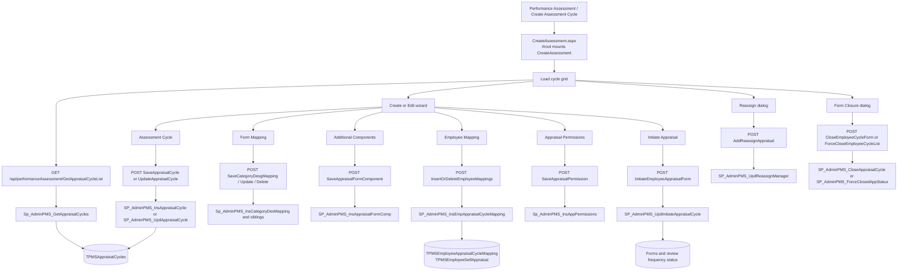
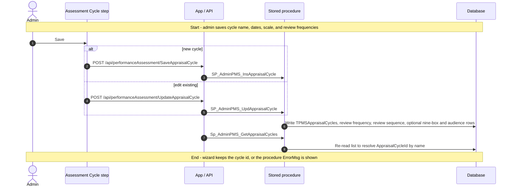
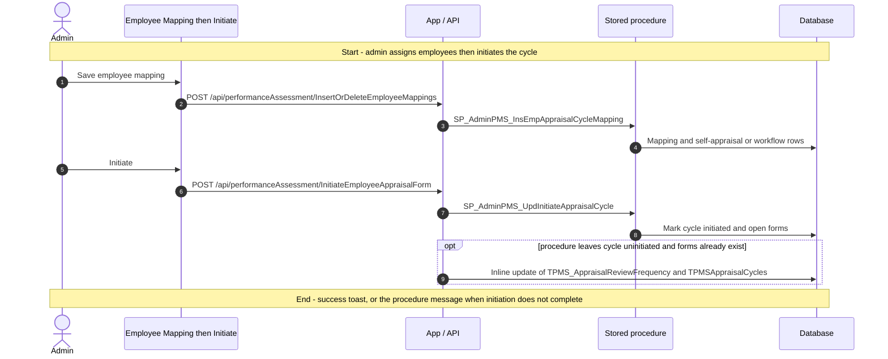
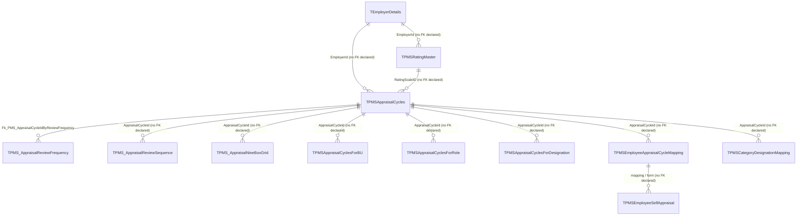

# Create Assessment Cycle

## Overview

An HR administrator needs a named appraisal window — dates, rating scale, process type (competency / KRA / goal / hybrids), review frequencies, and who is in scope — before anyone can fill a self-assessment or manager form. They open **Performance Assessment → Create Assessment Cycle**. The live host is `HRM/PMS_React/CreateAssessment.aspx`. It mounts the React list and a six-step wizard (Assessment Cycle → Form Mapping → Additional Components → Employee Mapping → Appraisal Permissions → Initiate Appraisal). List actions cover filter-by-status, delete, mapped employees, reassign, and form closure.

**Who's involved:**

- **HR / PMS admin** — creates and edits cycles, maps forms and employees, sets appraisal permissions, initiates the cycle, reassigns managers, and closes forms.
- **Employee / manager** — not users of this screen. After initiation they work on Employee Assessments / Goal Setting elsewhere.
- **Admin Configuration → Performance Management** — shares the same Core API and several step components (`AssessmentCycleStep` and siblings). That master setup embeds cycle work inside tabs; this left-nav item is the dedicated list + wizard.

Saving a cycle writes `TPMSAppraisalCycles` plus review-frequency, review-sequence, and optional nine-box / audience-mapping child rows. Mapping employees creates `TPMSEmployeeAppraisalCycleMapping` and self-appraisal / workflow rows. Initiate flips the cycle to initiated and opens forms. Form Closure and Reassign act on already-initiated work.

Table blurbs for the `TPMS*` masters are in `llm-wiki/reference/tables/hrms.md`. There is no separate llm-wiki domain lifecycle page for this screen. Sibling Admin Configuration guide: [Performance Management](/docs/guides/admin-configuration/performance-management).

## Workflow

## Request journey

The request that creates a runnable cycle is **Save on Assessment Cycle**, then later **Initiate**. Lookups that only fill dropdowns stay in the call-chain table.

### Save a new or edited assessment cycle

### Map employees and initiate

## Entry points

Menu DML `HRMS-DATABASE/HRMS/DML/PMSRelease-React/MenuDetails.sql` points `NavigateURL` at `~/HRM/PMS_React/CreateAssessment.aspx` (previously `~/HRM/PerformanceAssessment/CreateAssessment.aspx`). `PMS_React/Areas/routes.js` mounts `CreateAssessment` when the path ends with `/createassessment.aspx`. Code-behind only stamps hidden `EmployeeId`, `EmployerId`, and business-unit label from session.

| Entry point | Purpose | Live? |
|---|---|---|
| `HRM/PMS_React/CreateAssessment.aspx` | Left-nav host. Hidden fields supply employee, employer, BU label | Yes |
| `Areas/CreateAssessment/Containers/CreateAssessment.js` | List, filters, wizard open, delete, dialogs | Yes |
| `Areas/CreateAssessment/Components/AssessmentCycleWizard.js` | Six-step wizard shell | Yes |
| `HRM/PerformanceAssessment/CreateAssessment.aspx` | Legacy WebForms Create Assessment | Superseded by menu DML |
| `POST /api/performanceAssessment/*` on this screen | Core API used by the React steps | Yes |
| Admin Configuration → Performance Management Appraisal Cycle tab | Same cycle APIs / shared step components | Separate menu |

## Code → database call chain

React calls Core API under `/api`. The DAL column is the method that executes the procedure. Inline SQL is called out when present.

| Entry | HTTP | Controller | DAL | Stored procedure |
|---|---|---|---|---|
| List load `CreateAssessment.js:164` | `GET /api/performanceAssessment/GetAppraisalCycleList` (`performanceAssessmentRoutes.js:259`) | `GetAppraisalCycleList` (`performanceAssessmentController.js:2483`) | `GetAppraisalCycleList` (`performanceAssessmentDAL.js:3765`, execute `3770`) | `Sp_AdminPMS_GetAppraisalCycles` |
| Delete cycle `CreateAssessment.js:300` | `POST /api/performanceAssessment/DeleteAppraisalCycle` (`:262`) | `DeleteAppraisalCycle` (`:2506`) | `DeleteAppraisalCycle` (`:3792`, execute `3799`) | `SP_AdminPMS_DelAppraisalCycle` |
| Save cycle `AssessmentCycleStep.js:1456` | `POST /api/performanceAssessment/SaveAppraisalCycle` (`:284`) | `SaveAppraisalCycle` (`:2776`) | `__upsertAppraisalCycle` (`:5554`, execute `5658`); then `GetAppraisalCycleList` | `SP_AdminPMS_InsAppraisalCycle`; `Sp_AdminPMS_GetAppraisalCycles` |
| Update cycle `AssessmentCycleStep.js:1456` | `POST /api/performanceAssessment/UpdateAppraisalCycle` (`:285`) | `UpdateAppraisalCycle` (`:2787`) | `__upsertAppraisalCycle` (`:5554`, execute `5658`); then `GetAppraisalCycleList` | `SP_AdminPMS_UpdAppraisalCycle`; `Sp_AdminPMS_GetAppraisalCycles` |
| Map / unmap employees `EmployeeMappingStep.js:419` / `MappedEmployeesDialog.js:77` | `POST /api/performanceAssessment/InsertOrDeleteEmployeeMappings` (`:266`) | `InsertOrDeleteEmployeeMappings` (`:2547`) | `InsertOrDeleteEmployeeMappings` (`:3915`, execute `3924`) | `SP_AdminPMS_InsEmpAppraisalCycleMapping` |
| Mapped employees grid | `GET /api/performanceAssessment/GetAppraisalCycleMappedEmployees` | `GetAppraisalCycleMappedEmployees` (`:2536`) | `GetAppraisalCycleMappedEmployees` (`:3896`, execute `3904`) | `SP_AdminPMS_GetEmpByAppraisalCycle` |
| Employee search filters | `GET /api/performanceAssessment/EmployeeSearch` | `EmployeeSearch` (`:2747`) | `EmployeeSearch` (`:5415`, execute `5438`) | `SP_AdminPMS_EmployeeSearch` |
| Initiate `InitiateAppraisalStep.js:153` | `POST /api/performanceAssessment/InitiateEmployeeAppraisalForm` (`:283`) | `InitiateEmployeeAppraisalForm` (`:2764`) | `InitiateEmployeeAppraisalForm` (`:5448`, execute `5480`) plus inline SQL when needed | `SP_AdminPMS_UpdInitiateAppraisalCycle` |
| Initiate details | `GET /api/performanceAssessment/GetInitiateAppraisalCycleDetails` | `GetInitiateAppraisalCycleDetails` (`:2638`) | `GetInitiateAppraisalCycleDetails` (`:4144`, execute `4152`) | `Sp_AdminPMS_GetAppraisalCycleDet` |
| Form closure pending list | `GET /api/performanceAssessment/GetPendingCycleEmpDetails` | `GetPendingCycleEmpDetails` (`:2649`) | `GetPendingCycleEmpDetails` (`:4160`, execute `4169`) | `Sp_AdminPMS_GetPendingAppList` |
| Close form `FormClosureDialog.js:129` | `POST /api/performanceAssessment/CloseEmployeeCycleForm` (`:276`) | `CloseEmployeeCycleForm` (`:2667`) | `CloseEmployeeCycleForm` (`:4177`, execute `4185`) | `SP_AdminPMS_CloseAppraisalCycle` |
| Force close `FormClosureDialog.js:171` | `POST /api/performanceAssessment/ForceCloseEmployeeCycleList` (`:277`) | `ForceCloseEmployeeCycleList` (`:2701`) | `ForceCloseEmployeeCycleList` (`:4193`, execute `4204`) | `SP_AdminPMS_ForceClosedAppStatus` |
| Reassign search | `GET /api/performanceAssessment/GetEmployeeToReassignAppraisal` | `GetEmployeeToReassignAppraisal` (`:2592`) | `GetEmployeeToReassignAppraisal` (`:4077`, execute `4084`) | `SP_AdminPMS_SrchEmpByAppraisalCycle` |
| Reassign save `ReassignAppraisalDialog.js:138` | `POST /api/performanceAssessment/AddReassignAppraisal` (`:271`) | `AddReassignAppraisal` (`:2603`) | `AddReassignAppraisal` (`:4092`, execute `4099`) | `SP_AdminPMS_UpdReassignManager` |
| Form mapping save / update / delete | `POST SaveCategoryDesgMapping` / `UpdateCategoryDesgMapping` / `DeleteCategoryDesignationMapping` | matching controller actions | `SaveCategoryDesgMapping` (`5835`/`4366`), `UpdateCategoryDesgMapping` (`5860`/`5879`), `DeleteCategoryDesignationMapping` (`5895`) | `Sp_AdminPMS_InsCategoryDesMapping`; `Sp_AdminPMS_UpdCategoryDesMapping`; `Sp_AdminPMS_DelCategoryDesMapping` |
| Additional components CRUD | `POST SaveAppraisalFormComponent` / `Update` / `Delete` | matching controller actions | execute `5984` / `6013` / `6029` | `SP_AdminPMS_InsAppraisalFormComp`; `SP_AdminPMS_UpdAppraisalFormComp`; `SP_AdminPMS_DelAppraisalFormComp` |
| Appraisal permissions CRUD | `POST SaveAppraisalPermission` / `Update` / `Delete` | matching controller actions | execute `6152` / `6183` / `6196` | `Sp_AdminPMS_InsAppPermissions`; `Sp_AdminPMS_UpdAppPermissions`; `Sp_AdminPMS_DelAppPermissions` |
| Lookup scales / config / frequencies / orgs | various GETs under `/api/performanceAssessment` and dashboard helpers for employment type / location where used | matching controllers | see DAL lines `141`–`2342`, `3665`, `4048`–`4332`, `5397`, `5691`–`6122` | `Sp_PMS_GetRatingDetails`, `Sp_AdminPMS_GetWeightageDetails`, `Sp_AdminPMS_GetConfigurationValues`, `Sp_AdminPMS_GetReviewFrequencies`, `SP_AdminPMS_GetReviewFrequenciesPerCycleId`, `SP_AdminPMS_GetGoalFreezedSettingDetails`, `SP_AdminPMS_GetMeasureValAvailableForKRA`, `Sp_PMS_GetRatingIdsForOutcomeScale`, `Sp_AdminPMS_GetRatingScaleDetById`, `Sp_AdminPMS_GetGoalSettingReviewLevel`, `SP_AdminEMP_GetEmpListByOrg`, `SP_PMS_GetBusinessUnitByOrg_EmployeeId`, `SP_CM_GetEmploymentTypeList`, `Sp_AdminPMS_GetAllDesignationsForMapping`, `SP_AdminWM_GetLocationByOrg_EmployeeId`, `SP_GetAssignedEmployeeRoles`, `Sp_AdminPMS_GetAllCategoryDesMapping`, `SP_AdminPMS_GetCompetencyCategory`, category/permission lookup SPs |

## API endpoints

Routes mount from `app.js` at `/api`. This page has **no WebForms postback** for business data — only the aspx host and hidden fields. POST bodies are JSON. Procedure parameters are on the linked database pages.

| Verb | Route | Parameters | Purpose | Source |
|---|---|---|---|---|
| GET | `/api/performanceAssessment/GetAppraisalCycleList` | `employerId` query | Cycle grid | `performanceAssessmentController.js:2483` |
| POST | `/api/performanceAssessment/DeleteAppraisalCycle` | JSON body | Soft/hard delete cycle | `:2506` |
| POST | `/api/performanceAssessment/SaveAppraisalCycle` | JSON cycle payload + TVPs | Insert cycle | `:2776` |
| POST | `/api/performanceAssessment/UpdateAppraisalCycle` | JSON cycle payload + TVPs | Update cycle | `:2787` |
| POST | `/api/performanceAssessment/InsertOrDeleteEmployeeMappings` | JSON mapping | Assign or remove employees | `:2547` |
| GET | `/api/performanceAssessment/GetAppraisalCycleMappedEmployees` | cycle / employer / employee query | Mapped list | `:2536` |
| GET | `/api/performanceAssessment/EmployeeSearch` | filter query params | Search for mapping | `:2747` |
| POST | `/api/performanceAssessment/InitiateEmployeeAppraisalForm` | JSON body | Initiate cycle | `:2764` |
| GET | `/api/performanceAssessment/GetInitiateAppraisalCycleDetails` | employer / cycle / frequency query | Initiate step details | `:2638` |
| GET | `/api/performanceAssessment/GetPendingCycleEmpDetails` | cycle / frequency / employee / employer | Form Closure queue | `:2649` |
| POST | `/api/performanceAssessment/CloseEmployeeCycleForm` | JSON body | Close forms | `:2667` |
| POST | `/api/performanceAssessment/ForceCloseEmployeeCycleList` | JSON body | Force-close forms | `:2701` |
| GET | `/api/performanceAssessment/GetEmployeeToReassignAppraisal` | cycle / name / frequency | Reassign search | `:2592` |
| POST | `/api/performanceAssessment/AddReassignAppraisal` | JSON body | Reassign manager | `:2603` |
| POST | `/api/performanceAssessment/SaveCategoryDesgMapping` | JSON mapping | Form mapping insert | controller for SaveCategoryDesgMapping |
| POST | `/api/performanceAssessment/UpdateCategoryDesgMapping` | JSON mapping | Form mapping update | controller for UpdateCategoryDesgMapping |
| POST | `/api/performanceAssessment/DeleteCategoryDesignationMapping` | JSON body | Form mapping delete | controller for DeleteCategoryDesignationMapping |
| POST | `/api/performanceAssessment/IsDesignationMappingExists` | JSON body | Overlap check before save | uses cycle vs goal SP branch |
| GET / POST | Other `/api/performanceAssessment/*` lookups used by wizard steps | query or JSON | Scales, frequencies, permissions, components, org filters | `performanceAssessmentRoutes.js` |

## Stored procedures & tables involved

Direct procedures this page executes, plus one nested level already documented under `/docs/database/hrms/` unless noted. Nested from mapping / initiate / close / reassign / search include encryption open/close, workflow tree XML, homepage notification counts, workflow routing, and name/org helpers.

| Object | File path | Purpose | Page |
|---|---|---|---|
| `Sp_AdminPMS_GetAppraisalCycles` | `HRMS-DATABASE/HRMS/STOREPROCEDURE/Sp_AdminPMS_GetAppraisalCycles.sql` | List cycles for the employer | [Sp_AdminPMS_GetAppraisalCycles](/docs/database/hrms/Sp_AdminPMS_GetAppraisalCycles) |
| `SP_AdminPMS_InsAppraisalCycle` | `.../SP_AdminPMS_InsAppraisalCycle.sql` | Insert cycle and child rows | [SP_AdminPMS_InsAppraisalCycle](/docs/database/hrms/SP_AdminPMS_InsAppraisalCycle) |
| `SP_AdminPMS_UpdAppraisalCycle` | `.../SP_AdminPMS_UpdAppraisalCycle.sql` | Update cycle and child rows | [SP_AdminPMS_UpdAppraisalCycle](/docs/database/hrms/SP_AdminPMS_UpdAppraisalCycle) |
| `SP_AdminPMS_DelAppraisalCycle` | `.../SP_AdminPMS_DelAppraisalCycle.sql` | Delete cycle when allowed | [SP_AdminPMS_DelAppraisalCycle](/docs/database/hrms/SP_AdminPMS_DelAppraisalCycle) |
| `SP_AdminPMS_InsEmpAppraisalCycleMapping` | `.../SP_AdminPMS_InsEmpAppraisalCycleMapping.sql` | Map/unmap employees; nested workflow/encryption | [SP_AdminPMS_InsEmpAppraisalCycleMapping](/docs/database/hrms/SP_AdminPMS_InsEmpAppraisalCycleMapping) |
| `SP_AdminPMS_UpdInitiateAppraisalCycle` | `.../SP_AdminPMS_UpdInitiateAppraisalCycle.sql` | Initiate cycle; nested workflow/notifications | [SP_AdminPMS_UpdInitiateAppraisalCycle](/docs/database/hrms/SP_AdminPMS_UpdInitiateAppraisalCycle) |
| `SP_AdminPMS_CloseAppraisalCycle` | `.../SP_AdminPMS_CloseAppraisalCycle.sql` | Close appraisal forms | [SP_AdminPMS_CloseAppraisalCycle](/docs/database/hrms/SP_AdminPMS_CloseAppraisalCycle) |
| `SP_AdminPMS_ForceClosedAppStatus` | `.../SP_AdminPMS_ForceClosedAppStatus.sql` | Force-close; nested notifications | [SP_AdminPMS_ForceClosedAppStatus](/docs/database/hrms/SP_AdminPMS_ForceClosedAppStatus) |
| `SP_AdminPMS_UpdReassignManager` | `.../SP_AdminPMS_UpdReassignManager.sql` | Reassign manager; nested routing/notifications | [SP_AdminPMS_UpdReassignManager](/docs/database/hrms/SP_AdminPMS_UpdReassignManager) |
| `SP_AdminPMS_EmployeeSearch` | `.../SP_AdminPMS_EmployeeSearch.sql` | Filtered employee search for mapping | [SP_AdminPMS_EmployeeSearch](/docs/database/hrms/SP_AdminPMS_EmployeeSearch) |
| `FN_GetEmployeeDepartentOrBusinessUnit` | `HRMS-DATABASE/HRMS/FUNCTIONS/FN_GetEmployeeDepartentOrBusinessUnit.sql` | Nested from EmployeeSearch for BU/dept label | [FN_GetEmployeeDepartentOrBusinessUnit](/docs/database/hrms/FN_GetEmployeeDepartentOrBusinessUnit) |
| Form mapping / components / permissions SPs | matching `STOREPROCEDURE/` scripts | Category-desg mapping, form components, appraisal permissions | Existing pages under `/docs/database/hrms/` |
| Lookup SPs listed in the call chain | matching scripts | Scales, frequencies, org filters | Existing pages under `/docs/database/hrms/` |

Primary tables: `TPMSAppraisalCycles`, `TPMS_AppraisalReviewFrequency`, `TPMS_AppraisalReviewSequence`, `TPMS_AppraisalNineBoxGrid`, `TPMSAppraisalCyclesForBU` / `ForRole` / `ForDesignation`, `TPMSEmployeeAppraisalCycleMapping`, `TPMSEmployeeSelfAppraisal`, `TPMSCategoryDesignationMapping` (+ designation/role/BU children), `TPMSAppraisalFormComponents`, `TPMSAppraisalPermissions` (+ view-permission children), `TRequestWorkflows`.

## Table relationships

No llm-wiki domain `erDiagram` covers this screen. `llm-wiki/reference/tables/hrms.md` lists the catalog. Edges below use declared FKs where the table script has `REFERENCES`; otherwise the label says **no FK declared**.

## Known gaps

- **Legacy WebForms page remains in the tree.** `HRM/PerformanceAssessment/CreateAssessment.aspx` is still present. Menu DML points at the React host. `assessmentWizardConstants.js` still exports `LEGACY_CREATE_ASSESSMENT_URL`.
- **Same APIs as Admin Performance Management.** Appraisal Cycle / Employee Mapping / Initiate / Reassign / Form Closure on that admin screen share `performanceAssessmentDAL.js`. This guide only lists calls from `Areas/CreateAssessment/`.
- **Initiation is not only the stored procedure.** `InitiateEmployeeAppraisalForm` may run inline `UPDATE` on `TPMS_AppraisalReviewFrequency` and `TPMSAppraisalCycles` when the procedure leaves the cycle uninitiated and self-appraisal rows already exist.
- **Designation-mapping existence branches.** With an appraisal cycle id, DAL uses `Sp_AdminPMS_GetDesignationMappingExists`; otherwise `Sp_PMS_GetGoalFormMappingExists` (goal-period path — unexpected on this page if `appraisalCycleId` is missing).
- **`SP_AdminPMS_EmployeeSearch` database page omits some nested functions.** The SQL also calls `FN_GetEmployeeDepartentOrBusinessUnit` and `Fn_EncryptData`. Those pages exist; the EmployeeSearch page was not rewritten in this pass.
- **Most PMS masters have no declared foreign key.** Do not treat `EmployerId` / `AppraisalCycleId` as constraints unless a script has `REFERENCES`.
- **SystemModel-2 performance context** is cited by the Admin Performance Management guide; it may be absent from this SourceCode checkout. Live URL authority for this menu is the React aspx + menu DML.

## Reference

Confidence is high for the React host, Core API routes, and `execute` names in `performanceAssessmentDAL.js`. Gaps above are the legacy host and shared-admin overlap.

### SourceCode

- `HRMS.Web/HRMS.Web/HRM/PMS_React/CreateAssessment.aspx` — left-nav host and `#root`.
- `HRMS.Web/HRMS.Web/HRM/PMS_React/CreateAssessment.aspx.cs` — session hidden fields.
- `HRMS.Web/HRMS.Web/HRM/PMS_React/Areas/routes.js` — mounts `CreateAssessment`.
- `HRMS.Web/HRMS.Web/HRM/PMS_React/Areas/CreateAssessment/` — list, wizard, steps, dialogs.
- `HRMS.Web/HRMS.Web/HRM/PMS_React/Common/apiURLConstants.js` — `/performanceAssessment/...` paths.
- `HRMS.CoreAPI/HRMS.Core.WebAPI.Node/Routes/performanceAssessmentRoutes.js`.
- `HRMS.CoreAPI/HRMS.Core.WebAPI.Node/Controllers/performanceAssessmentController.js`.
- `HRMS.CoreAPI/HRMS.Core.WebAPI.Node/Core/DataAccessLayer/performanceAssessmentDAL.js`.
- `HRMS.Web/HRMS.Web/HRM/PerformanceAssessment/CreateAssessment.aspx` — superseded WebForms host.

### TDG HRMS DB

- `HRMS-DATABASE/HRMS/DML/PMSRelease-React/MenuDetails.sql` — menu URL → React host.
- `HRMS-DATABASE/HRMS/STOREPROCEDURE/` — `Sp_AdminPMS_*` / `SP_AdminPMS_*` / `SP_PMS_*` scripts this screen executes.
- `HRMS-DATABASE/HRMS/FUNCTIONS/FN_GetEmployeeDepartentOrBusinessUnit.sql`.
- `llm-wiki/reference/tables/hrms.md` — `TPMSAppraisalCycles` and related catalog blurbs.
- Procedure pages under `/docs/database/hrms/` for each object in the stored-procedures table.
