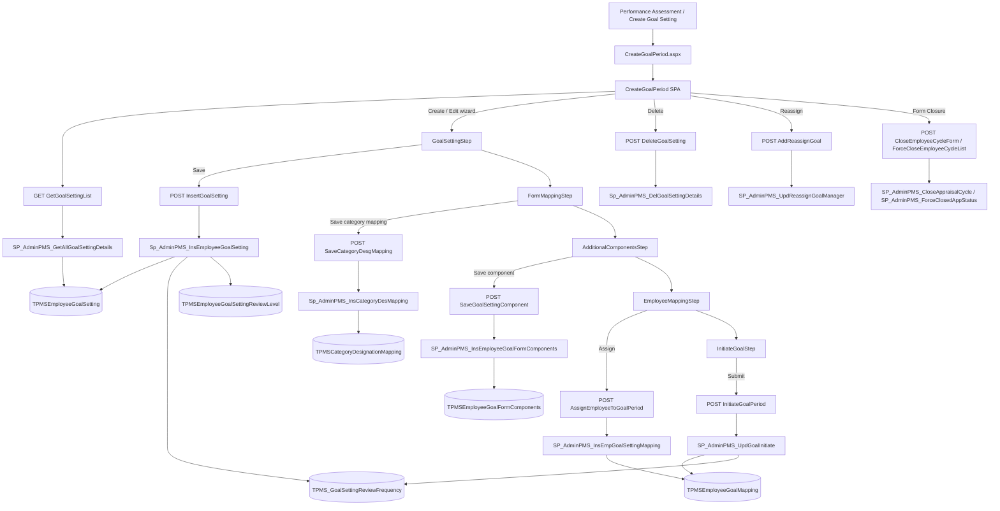
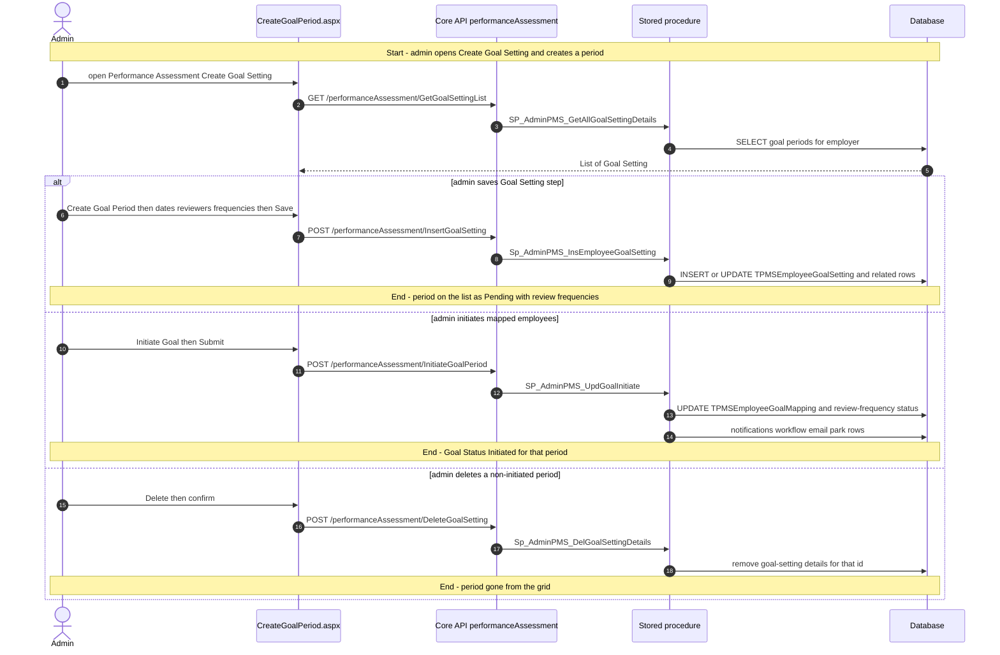
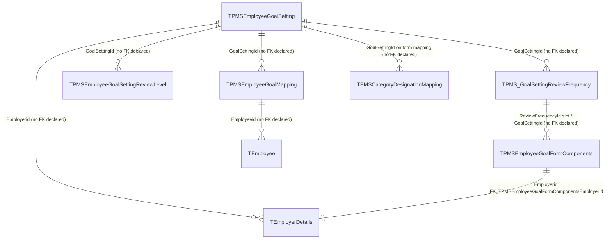

# Create Goal Period

## Overview

An HR performance administrator opens **Performance Assessment → Create Goal Setting** (left-nav menu id **622**; the live `TMenuDetails` / hierarchy leaf is **Create Goal Setting**, not “Create Goal Period”). The URL is still `~/HRM/PMS_React/CreateGoalPeriod.aspx`. The page hosts the PMS React bundle and mounts the `CreateGoalPeriod` SPA: a status-filterable **List of Goal Setting** plus a five-step wizard (Goal Setting → Form Mapping → Additional Components → Employee Mapping → Initiate Goal).

On the list they filter by status (Pending, Initiated, Closed, Freezed, Unfreezed), open **Mapped Employees**, edit a wizard step, **Reassign** managers, **Form Closure**, or **Delete** (blocked once Initiated or Closed). **Create Goal Period** starts the wizard. Step 1 saves the period name, dates, reviewer levels, and review-frequency grid into `TPMSEmployeeGoalSetting` and related rows. Later steps map forms by category/designation/role/BU, add optional form components, assign employees, and **Initiate** so mapped people get live goal forms, notifications, and workflow routing. Outcomes on the grid include Pending → Initiated (and Freezed / Closed via other actions).

**Who's involved:**

- **PMS / HR admin** — creates and manages goal periods on this menu leaf. Same wizard step components are also embedded under **Admin Configuration → Performance Management** (Goal Settings tab); that host is a different menu page.
- **Employee / manager** — not users of this screen. After initiate they work forms under Goal Setting / Employee Assessments elsewhere.
- **Legacy WebForms** — `HRM/PerformanceAssessment/CreateGoalPeriod.aspx` + `ucCreateGoalPeriod` still exist in SourceCode; the React aspx is the live NavigateURL after the PMS React menu DML.

There is **no** SystemModel-2 workflow page and **no** llm-wiki domain lifecycle for this leaf. Table blurbs for `TPMS*` objects are in `llm-wiki/reference/tables/hrms.md` / the data catalog; this guide is the application call chain those catalogs do not cover. Sibling menu items (Create Assessment Cycle, Goal Setting, Employee Assessments) share Core API `/performanceAssessment` but are separate guides.

## Workflow

## Request journey

The request that **creates** the period is **Save** on wizard step Goal Setting. **Initiate Goal** is a second write that flips mapped employees live. Delete / reassign / closure are separate list actions.

## Entry points

> Live left-nav leaf is **Create Goal Setting** (menu **622**). Shell is `CreateGoalPeriod.aspx` (`CreateGoalPeriod_React`), which stamps `hdnCreateGoalPeriodEmpId` / `hdnCreateGoalPeriodEmployerId` from session and loads `BuildJS/PMS_React.min.js`. Client route `RouteConstants.CREATE_GOAL_PERIOD` = `/HRM/PMS_React/CreateGoalPeriod.aspx` maps to `Areas/CreateGoalPeriod/Containers/CreateGoalPeriod`. Legacy WebForms `HRM/PerformanceAssessment/CreateGoalPeriod.aspx` remains in SourceCode; menu NavigateURL was pointed at the React path by `DML/PMSRelease-React/MenuDetails.sql`. The same wizard steps are reused inside Performance Master Setup — document that host under Admin Configuration → Performance Management, not here.

| UI page / route | Purpose |
|---|---|
| `/HRM/PMS_React/CreateGoalPeriod.aspx` | Live **Performance Assessment → Create Goal Setting** shell. List, wizard, mapped-employees / reassign / form-closure dialogs. |
| `/HRM/PerformanceAssessment/CreateGoalPeriod.aspx` | Legacy WebForms host + `ucCreateGoalPeriod`. Not the current menu URL. |

## Code → database call chain

No WebForms postback DAL on the React page — `CreateGoalPeriod.aspx.cs` only sets session employer/employee. All data goes through Core Node `/performanceAssessment` → `performanceAssessmentDAL.js`.

| Entry point | DAL method (`file:line`) | Stored procedure |
|---|---|---|
| List load / refresh | `GetGoalSettingList` (`performanceAssessmentDAL.js:3649`) via `performanceAssessmentController.js:2318` | `SP_AdminPMS_GetAllGoalSettingDetails` |
| Delete Goal Period | `DeleteGoalSetting` (`performanceAssessmentDAL.js:3680`) via controller `:2338` | `Sp_AdminPMS_DelGoalSettingDetails` |
| Mapped Employees popup | `GetGoalPeriodMappedEmployees` (`performanceAssessmentDAL.js:3694`) via `:2348` | `Sp_ADMINPMS_GetEmployeeDetailsByGoalID` |
| Remove mapped employee | `DeleteEmployeeFromGoalSetting` (`performanceAssessmentDAL.js:3727`) via `:2375` | `Sp_AdminPMS_DelEmployeeGoalMapping` |
| Wizard step 1 Save | `InsertGoalSetting` (`performanceAssessmentDAL.js:4230`) via `:2386` | `Sp_AdminPMS_InsEmployeeGoalSetting` |
| Goal Setting config / reviewers | `GetPMSConfiguration` (`:2045`), `GetReviewerTypesForGoal` (`:2335`), `GetReviewFrequenciesPerCycleId` (`:5397`) | `Sp_AdminPMS_GetConfigurationValues`, `Sp_AdminPMS_GetGoalSettingReviewLevel`, `SP_AdminPMS_GetReviewFrequenciesPerCycleId` |
| Form Mapping dropdowns / templates | `GetGoalPeriodListForMapping` (`:4280`), `GetGoalFormTemplates` (`:4291`), `GetDesignationsForFormMapping` (`:5766`), `GetAssignedEmpRoles` (`:5778`), `GetBusinessUnitByOrgEmployeeId` (`:1774`), `GetAllCategoryDesgMappings` (`:4338`) | `Sp_AdminPMS_GetEmployeeGoals`, `SP_PMS_GetGoalFormTemplates`, `Sp_AdminPMS_GetAllDesignationsForMapping`, `SP_GetAssignedEmployeeRoles`, `SP_PMS_GetBusinessUnitByOrg_EmployeeId`, `Sp_AdminPMS_GetAllCategoryDesMapping` |
| Form Mapping save / update / delete / exists | `SaveCategoryDesgMapping` (`:5835` / `:4349`), `UpdateCategoryDesgMapping` (`:5860`), `DeleteCategoryDesignationMapping` (`:5887`), `IsDesignationMappingExists` (`:5903`), category get helpers (`:5790+`) | `Sp_AdminPMS_InsCategoryDesMapping`, `Sp_AdminPMS_UpdCategoryDesMapping`, `Sp_AdminPMS_DelCategoryDesMapping`, `Sp_AdminPMS_GetDesignationMappingExists`, `Sp_AdminPMS_GetCategoryDesMapping` / `GetCategoryRoleMapping` / `GetCategoryBUMapping` |
| Additional Components | `GetReviewFrequenciesForGoal` (`:4373`), `GetGoalSettingComponents` (`:4399`), `SaveGoalSettingComponent` (`:4412`) / `UpdateGoalSettingComponent` (`:3584`), `DeleteGoalSettingComponent` (`:4442`) | `Sp_AdminPMS_GetReviewFrequencies`, `SP_AdminPMS_GetEmployeeGoalFormComponents`, `SP_AdminPMS_InsEmployeeGoalFormComponents` / `SP_AdminPMS_UpdEmployeeGoalFormComponents`, `SP_AdminPMS_DelEmployeeGoalFormComponents` |
| Employee Mapping search / assign | `EmployeeSearch` (`:5415`), lookup helpers (`GetEmploymentTypeListForMapping` `:4304`, locations `:4315`, designations `:4327`), `AssignEmployeeToGoalPeriod` (`:3710`) | `SP_AdminPMS_EmployeeSearch`, `SP_CM_GetEmploymentTypeList`, `SP_AdminWM_GetLocationByOrg_EmployeeId`, `Sp_AdminPMS_GetAllDesignationsForMapping`, `SP_AdminPMS_InsEmpGoalSettingMapping` |
| Initiate Goal | `GetEmpAssignedGoalMappingInit` (`:4468`), `GetGoalPeriodAssignedEmployees` (`:4479`), `InitiateGoalPeriod` (`:4495`) | `Sp_AdminPMS_GetEmpAssignedGoalMappingInit`, `Sp_AdminPMS_GetEmployeeGoalMapping`, `SP_AdminPMS_UpdGoalInitiate` |
| Reassign dialog | `GetReviewFrequencies` (`:2379`), `GetEmployeeListByOrganization` (`:4048`), `SearchEmpByGoalPeriod` (`:4110`), `AddReassignGoal` (`:4125`) | `Sp_AdminPMS_GetReviewFrequencies`, `SP_AdminEMP_GetEmpListByOrg`, `SP_AdminPMS_SrchEmpByGoalPeriod`, `SP_AdminPMS_UpdReassignGoalManager` |
| Form Closure dialog | `GetInitiateAppraisalCycleDetails` (`:4144`), `GetPendingCycleEmpDetails` (`:4160`), `CloseEmployeeCycleForm` (`:4177`), `ForceCloseEmployeeCycleList` (`:4193`) | `Sp_AdminPMS_GetAppraisalCycleDet`, `Sp_AdminPMS_GetPendingAppList`, `SP_AdminPMS_CloseAppraisalCycle`, `SP_AdminPMS_ForceClosedAppStatus` |

Nested (one level) from the main write procedures: `SP_AdminPMS_InsEmpGoalSettingMapping` / `SP_AdminPMS_UpdGoalInitiate` / `SP_AdminPMS_UpdReassignGoalManager` / `SP_AdminPMS_ForceClosedAppStatus` call `Sp_InsHomePageNotificationCnts`, and mapping/initiate/reassign also call `USP_WorkFlow_Routing_Levels` (mapping also `SP_CM_GetWorkflowTreeXmlDetailsByPageTitle`).

## API endpoints

React calls Core API under `/performanceAssessment` (`routeIndex.js` mounts `performanceAssessmentRoutes.js`). Routes use `Authorize`. There is **no** aspx postback for list/wizard data on the React host.

| Verb | Route | Parameters | Purpose | Source |
|---|---|---|---|---|
| `GET` | `/performanceAssessment/GetGoalSettingList` | query `employerId` (required), `goalSettingId` (0 = all) | List / single period | `performanceAssessmentRoutes.js` + controller `:2318` |
| `POST` | `/performanceAssessment/DeleteGoalSetting` | body `goalSettingId` | Delete period | controller `:2338` |
| `GET` | `/performanceAssessment/GetGoalPeriodMappedEmployees` | query `goalSettingId`, `employerId`, `employeeId` | Mapped Employees popup | `:2348` |
| `POST` | `/performanceAssessment/DeleteEmployeeFromGoalSetting` | body `goalSettingId`, `employeeIds` (comma list) | Unmap employees | `:2375` |
| `POST` | `/performanceAssessment/InsertGoalSetting` | body goal period fields, reviewer TVP payload, reviewFrequencies | Create / update period | `:2386` |
| `POST` | `/performanceAssessment/AssignEmployeeToGoalPeriod` | body `goalSettingId`, `employerId`, `employeeIds`, `createdBy` | Employee Mapping assign | `:2359` |
| `POST` | `/performanceAssessment/InitiateGoalPeriod` | body `goalSettingId`, `employeeList` | Initiate | `:2458` |
| `POST` | `/performanceAssessment/SaveGoalSettingComponent` | body component (or nested `component`); `transId` > 0 updates | Additional Components save | `:2422` |
| `POST` | `/performanceAssessment/DeleteGoalSettingComponent` | body `goalSettingId`, `employerId`, `transId`, `modifiedBy` | Delete component | `:2447` |
| `POST` | `/performanceAssessment/SaveCategoryDesgMapping` / `UpdateCategoryDesgMapping` / `DeleteCategoryDesignationMapping` | category, designation/role/BU lists, `goalSettingId`, `formType` | Form Mapping CRUD | routes + DAL `:5835+` |
| `POST` | `/performanceAssessment/AddReassignGoal` | mapping details, `newManagerId`, `createdBy` | Reassign | controller `:2626` |
| `POST` | `/performanceAssessment/CloseEmployeeCycleForm` | cycle / employee / review frequency / isAppraisalType | Soft close | `:2667` |
| `POST` | `/performanceAssessment/ForceCloseEmployeeCycleList` | employee ids, cycle, comments, updatedBy, flags | Force close | `:2701` |
| `GET` | supporting lookups | employer/employee/goalSetting/reviewFrequency ids as documented in `apiURLConstants.js` | Config, frequencies, templates, search, BU, roles, designations | various controller exports |

## Stored procedures & tables involved

> Primary tables are **`TPMSEmployeeGoalSetting`**, **`TPMS_GoalSettingReviewFrequency`**, **`TPMSEmployeeGoalSettingReviewLevel`**, **`TPMSEmployeeGoalMapping`**, form-mapping **`TPMSCategoryDesignationMapping`** (plus designation/role/BU mapping satellites), and **`TPMSEmployeeGoalFormComponents`**. DDL for `TPMSEmployeeGoalSetting` / mapping / review-frequency declares **no FKs** between those goal tables. Initiate and mapping also touch notification / workflow / email park tables via nested procedures.

| Object | File path | Purpose | llm-wiki |
|---|---|---|---|
| `TPMSEmployeeGoalSetting` | `HRMS-DATABASE/HRMS/TABLES/TPMSEmployeeGoalSetting.sql` | Goal period header (`GoalSettingId`, name, dates, freeze, `GoalType`) | `llm-wiki/reference/tables/hrms.md` / data catalog |
| `TPMS_GoalSettingReviewFrequency` | `…/TPMS_GoalSettingReviewFrequency.sql` | Per-period frequency rows and `Status` (Pending / Initiated, …) | same |
| `TPMSEmployeeGoalSettingReviewLevel` | `…/TPMSEmployeeGoalSettingReviewLevel.sql` | Reviewer-type labels L1–L5 for the period | same |
| `TPMSEmployeeGoalMapping` | `…/TPMSEmployeeGoalMapping.sql` | Employee ↔ period mapping, initiate flags, form status | same |
| `TPMSCategoryDesignationMapping` | `…/TPMSCategoryDesignationMapping.sql` | Form Mapping category ↔ designation/role/BU | same |
| `TPMSEmployeeGoalFormComponents` | `…/TPMSEmployeeGoalFormComponents.sql` | Additional Components; FK to `TEmployerDetails` | same |
| `SP_AdminPMS_GetAllGoalSettingDetails` | `HRMS-DATABASE/HRMS/STOREPROCEDURE/` | List grid | [page](/docs/database/hrms/SP_AdminPMS_GetAllGoalSettingDetails) |
| `Sp_AdminPMS_InsEmployeeGoalSetting` | same | Insert / update period | [page](/docs/database/hrms/Sp_AdminPMS_InsEmployeeGoalSetting) |
| `Sp_AdminPMS_DelGoalSettingDetails` | same | Delete period | [page](/docs/database/hrms/Sp_AdminPMS_DelGoalSettingDetails) |
| `SP_AdminPMS_InsEmpGoalSettingMapping` | same | Assign employees (nested notify / workflow) | [page](/docs/database/hrms/SP_AdminPMS_InsEmpGoalSettingMapping) |
| `SP_AdminPMS_UpdGoalInitiate` | same | Initiate period | [page](/docs/database/hrms/SP_AdminPMS_UpdGoalInitiate) |
| `Sp_AdminPMS_InsCategoryDesMapping` / Upd / Del | same | Form Mapping writes | [Ins](/docs/database/hrms/Sp_AdminPMS_InsCategoryDesMapping) |
| `SP_AdminPMS_InsEmployeeGoalFormComponents` / Upd / Del | same | Additional Components | [Ins](/docs/database/hrms/SP_AdminPMS_InsEmployeeGoalFormComponents) |
| `SP_AdminPMS_UpdReassignGoalManager` | same | Reassign | [page](/docs/database/hrms/SP_AdminPMS_UpdReassignGoalManager) |
| `SP_AdminPMS_CloseAppraisalCycle` / `SP_AdminPMS_ForceClosedAppStatus` | same | Form Closure (goal uses `IsAppraisalType` false path) | [Close](/docs/database/hrms/SP_AdminPMS_CloseAppraisalCycle), [Force](/docs/database/hrms/SP_AdminPMS_ForceClosedAppStatus) |
| Nested `Sp_InsHomePageNotificationCnts`, `USP_WorkFlow_Routing_Levels`, `SP_CM_GetWorkflowTreeXmlDetailsByPageTitle` | STOREPROCEDURE | Notify / route after map, initiate, reassign, force-close | existing `/docs/database/hrms/…` pages |

## Table relationships

Declared FKs on the goal header/mapping/frequency tables are largely absent — edges below follow how the live procedures join (same pattern as data-catalog prose). `TPMSEmployeeGoalFormComponents.Employerid` is a declared FK to `TEmployerDetails`.

## Known gaps

- **Leaf name vs page title.** Live menu / hierarchy text is **Create Goal Setting** (622). Aspx title, breadcrumb, React button, and Backstage `feature-menu.ts` still say **Create Goal Period**. This guide’s `submenu` follows the live MenuName.
- **No SystemModel-2 / llm-wiki domain page** for this leaf — behaviour is from React + Core API + STOREPROCEDURE scripts.
- **Legacy WebForms host still in tree** (`HRM/PerformanceAssessment/CreateGoalPeriod.aspx`) after NavigateURL moved to PMS_React.
- **Shared wizard with Performance Master Setup.** Goal Settings tab embeds the same step components; do not assume every call here is exclusive to menu 622.
- **Form Closure reuses appraisal-cycle procedures** (`SP_AdminPMS_CloseAppraisalCycle`, `SP_AdminPMS_ForceClosedAppStatus`) with goal `reviewFrequencyId` / `IsAppraisalType` flags — naming looks appraisal-centric.
- **Additional Components passes review-frequency id in the `goalSettingId` slot** for `SP_AdminPMS_GetEmployeeGoalFormComponents` (legacy parity noted in DAL).
- **Delete blocked** for Initiated / Closed on the SPA; exact DB residual rows after `Sp_AdminPMS_DelGoalSettingDetails` are defined only in that procedure (see its database page).
- **DEV menu SELECT was unavailable** during this analysis (connection error); MenuName **Create Goal Setting** is taken from inventoried DML / hierarchy XML (`Tmenudetails DML.sql`, PMSRelease-P29+, data catalog FeaturePaths).

## Reference

Confidence is **high** for the React → `/performanceAssessment` → `performanceAssessmentDAL` → named `Sp_AdminPMS_*` / `SP_AdminPMS_*` chain with `file:line`. Table relationships for the goal header family are join-based (no declared FKs in DDL). Nested notify/workflow callees were taken from the write procedure scripts.

### SourceCode

- `HRMS.Web/HRMS.Web/HRM/PMS_React/CreateGoalPeriod.aspx` (+ `.cs`)
- `HRMS.Web/HRMS.Web/HRM/PMS_React/Areas/routes.js`, `Common/routeConstants.js`, `Common/apiURLConstants.js`
- `HRMS.Web/HRMS.Web/HRM/PMS_React/Areas/CreateGoalPeriod/Containers/CreateGoalPeriod.js`
- `HRMS.Web/HRMS.Web/HRM/PMS_React/Areas/CreateGoalPeriod/Components/CreateGoalPeriodWizard.js`, `GoalSettingStep.js`, `FormMappingStep.js`, `AdditionalComponentsStep.js`, `EmployeeMappingStep.js`, `InitiateGoalStep.js`, `MappedEmployeesDialog.js`, `ReassignGoalDialog.js`, `FormClosureGoalDialog.js`, `goalWizardConstants.js`
- `HRMS.CoreAPI/HRMS.Core.WebAPI.Node/Routes/routeIndex.js`, `performanceAssessmentRoutes.js`
- `HRMS.CoreAPI/HRMS.Core.WebAPI.Node/Controllers/performanceAssessmentController.js`
- `HRMS.CoreAPI/HRMS.Core.WebAPI.Node/Core/DataAccessLayer/performanceAssessmentDAL.js`
- Legacy (not live menu URL): `HRMS.Web/HRMS.Web/HRM/PerformanceAssessment/CreateGoalPeriod.aspx`, `ucCreateGoalPeriod.ascx`

### TDG HRMS DB

- `HRMS-DATABASE/HRMS/DML/Tmenudetails DML.sql` — **Create Goal Setting** value 622
- `HRMS-DATABASE/HRMS/DML/PMSRelease-React/MenuDetails.sql` — NavigateURL → `~/HRM/PMS_React/CreateGoalPeriod.aspx`
- `HRMS-DATABASE/HRMS/DML/TDataCatalog_DML.sql` — FeaturePaths `Performance Assessment > Create Goal Setting`
- `HRMS-DATABASE/HRMS/TABLES/TPMSEmployeeGoalSetting.sql`, `TPMS_GoalSettingReviewFrequency.sql`, `TPMSEmployeeGoalSettingReviewLevel.sql`, `TPMSEmployeeGoalMapping.sql`, `TPMSEmployeeGoalFormComponents.sql`
- `HRMS-DATABASE/HRMS/STOREPROCEDURE/Sp_AdminPMS_InsEmployeeGoalSetting.sql`, `SP_AdminPMS_GetAllGoalSettingDetails.sql`, `SP_AdminPMS_UpdGoalInitiate.sql`, `SP_AdminPMS_InsEmpGoalSettingMapping.sql`, and the other procedures listed in the call chain
- Backstage database pages under `/docs/database/hrms/` for those objects (already published; not rewritten in this run)
