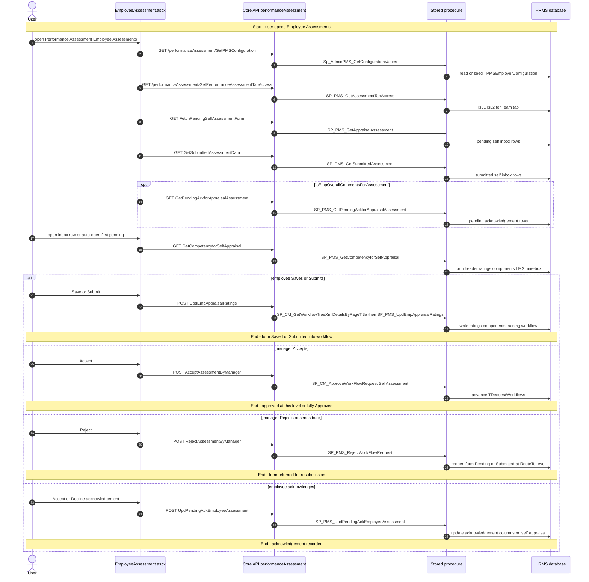
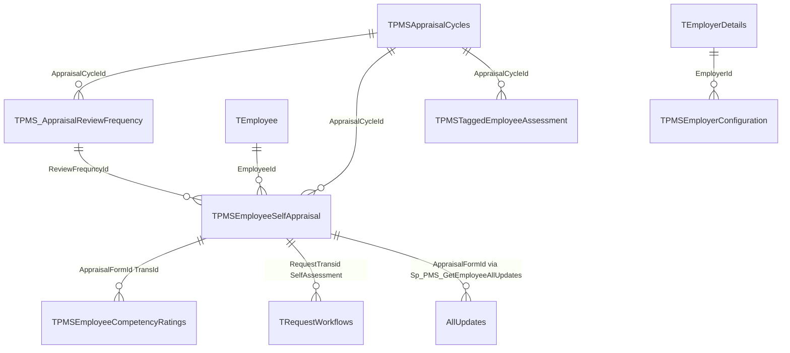

# Employee Assessments

## Overview

An employee (or their manager) opens **Performance Assessment → Employee Assessments** (left-nav value `603`) to fill, review, or acknowledge a performance appraisal form for an active cycle. The WebForms host is `HRM/PMS_React/EmployeeAssessment.aspx` (`~/HRM/PMS_React/EmployeeAssessment.aspx`). It stamps session employee/employer/role into hidden fields, decrypts deep-link query `id` / `mode` / `TabName`, logs activity `EmployeeAssessment` (369), and mounts the React SPA from `BuildJS/PMS_React.min.js` (`Areas/EmployeeAssessment/Containers/EmployeeAssessment.js`).

The page has two tabs:

- **Self Assessment** — pending / submitted / (optional) pending-acknowledgement inbox grids for the logged-in employee, then an **Assessment Details** form (`AssessmentForm.js`).
- **Team Assessment** — pending and past team appraisal grids for the manager; same form component in mode `ALL`.

This is **not** Confirmation Assessment’s sibling menu item (value `619`). That path uses confirmation SPs (`SP_CMS_*` / `SP_PMS_GetConfirmationAsessment`). Admin Configuration → Performance Management sets cycles, forms, and permissions; this screen consumes those mappings.

**Who's involved:**

- **Employee** — completes self ratings/comments, submits into workflow, optionally acknowledges when `IsEmpOverallCommentsForAssessment` is on.
- **Manager / approver** — Team tab (when `IsL1`/`IsL2` or deep-link), rates, accepts, rejects/sends back, or copies tagged assessments.
- **HR / admin** — not a primary actor on this page; they configure cycles elsewhere.

## Workflow

```mermaid
flowchart TD
  Nav["Performance Assessment Employee Assessments"] --> Page["EmployeeAssessment.aspx"]
  Page --> React["EmployeeAssessment.js"]
  React --> Cfg["GET GetPMSConfiguration"]
  Cfg --> CfgSP["Sp_AdminPMS_GetConfigurationValues"]
  React --> Tab["GET GetPerformanceAssessmentTabAccess"]
  Tab --> TabSP["SP_PMS_GetAssessmentTabAccess"]
  React --> SelfPend["GET FetchPendingSelfAssessmentForm"]
  SelfPend --> SelfPendSP["SP_PMS_GetAppraisalAssessment"]
  React --> SelfSub["GET GetSubmittedAssessmentData"]
  SelfSub --> SelfSubSP["SP_PMS_GetSubmittedAssessment"]
  React --> Ack["GET GetPendingAckforAppraisalAssessment"]
  Ack --> AckSP["SP_PMS_GetPendingAckforAppraisalAssessment"]
  React -->|"Team tab or deep-link"| TeamPend["GET FetchPendingApprisalAssessment"]
  TeamPend --> TeamPendSP["SP_PMS_GetAppraisalForApproval"]
  React --> TeamPast["GET GetPastPerformanceTeamAssessment"]
  TeamPast --> TeamPastSP["SP_PMS_GetPastTeamAppraisalAssessment"]
  React -->|"open row / deep-link"| Form["AssessmentForm.js"]
  Form --> Load["GET GetCompetencyforSelfAppraisal"]
  Load --> LoadSP["SP_PMS_GetCompetencyforSelfAppraisal"]
  Form -->|"Save or Submit"| Save["POST UpdEmpAppraisalRatings"]
  Save --> SaveSP["SP_PMS_UpdEmpAppraisalRatings"]
  Form -->|"manager Accept"| Acc["POST AcceptAssessmentByManager"]
  Acc --> AccSP["SP_CM_ApproveWorkFlowRequest"]
  Form -->|"manager Reject"| Rej["POST RejectAssessmentByManager"]
  Rej --> RejSP["SP_PMS_RejectWorkFlowRequest"]
  Form -->|"employee Ack"| AckPost["POST UpdPendingAckEmployeeAssessment"]
  AckPost --> AckPostSP["SP_PMS_UpdPendingAckEmployeeAssessment"]
```

Self inbox loads on first paint. Team inbox loads when the Team tab is selected, when `mode=ALL`, or when an approver deep-link opens. Config flag `IsShowPMSTeamAssessmentForEmployeeRole` can block Employee-role users from Team even on deep-links.

## Request journey

Primary employee journey is **open Self Assessment → fill form → Submit**. Manager Accept/Reject and employee acknowledgement are sibling terminals on the same form.

## Entry points

> Live shell is `EmployeeAssessment.aspx` under `HRM/PMS_React`. React route constant `RouteConstants.EMPLOYEE_ASSESSMENT` is `/HRM/PMS_React/EmployeeAssessment.aspx`. `PerformanceAssessmentRedirect.aspx` can deep-link into the same URL with encrypted query params. Confirmation Assessment uses a different aspx/menu value and is out of scope here.

| UI page / route | Purpose |
|---|---|
| `/HRM/PMS_React/EmployeeAssessment.aspx` | Performance Assessment → Employee Assessments. Hidden fields for employee, employer, BU label, role, decrypted `id`/`mode`/`TabName`. Hosts Self/Team inbox + AssessmentForm. |
| Notification / redirect deep-links | Same aspx with `appraisalId`, encrypted `id`/`mode`/`TabName`, `IsApprover`, `ApprovalLevel`, `requestTransId`, `camefrom`, etc. Opens Assessment Details without picking a grid row. |

## Code → database call chain

SPA calls Core Node under `/api/performanceAssessment/…` (`Authorize` on each route). `EmployeeAssessment.aspx.cs` has **no** postback DAL — only session stamp, decrypt, and activity log. Share-permission overlay on some inbox loads is inline SQL in DAL (`GetEmployeeAppraisalSharePermissions`), not a stored procedure.

| Entry point | DAL / controller method (`file:line`) | Stored procedure |
|---|---|---|
| Page load config | `GetPMSConfiguration` (`performanceAssessmentDAL.js:2045`) via `performanceAssessmentController.js:1654` | `Sp_AdminPMS_GetConfigurationValues` |
| Team tab visibility | `GetPerformanceAssessmentTabAccess` (`performanceAssessmentDAL.js:37`) via `…Controller.js:127` | `SP_PMS_GetAssessmentTabAccess` |
| Pending Self inbox | `FetchPendingSelfAssessmentForm` (`performanceAssessmentDAL.js:842`) via `…Controller.js:648` | `SP_PMS_GetAppraisalAssessment` |
| Submitted Self inbox | `GetSubmittedAssessmentData` (`performanceAssessmentDAL.js:4544`) via `…Controller.js:3102` | `SP_PMS_GetSubmittedAssessment` (+ overlay SQL) |
| Pending acknowledgement | `GetPendingAckforAppraisalAssessment` (`performanceAssessmentDAL.js:4691`) via `…Controller.js:1600` | `SP_PMS_GetPendingAckforAppraisalAssessment` (+ overlay SQL) |
| Pending Team inbox | `FetchPendingApprisalAssessment` (`performanceAssessmentDAL.js:65`) via `…Controller.js:145` | `SP_PMS_GetAppraisalForApproval` |
| Submitted Team inbox | `GetPastPerformanceTeamAssessment` (`performanceAssessmentDAL.js:4679`) via `…Controller.js:3111` | `SP_PMS_GetPastTeamAppraisalAssessment` |
| Open form | `GetCompetencyforSelfAppraisal` (`performanceAssessmentDAL.js:4883`) via `…Controller.js:3122` | `SP_PMS_GetCompetencyforSelfAppraisal` |
| Rating scale dropdown | `GetAppraisalCycleRating` (`performanceAssessmentDAL.js:5317`) via `…Controller.js:3272` | `SP_PMS_GetRatingScaleDet` |
| Measure bands | `GetAppraisalCycleMeasures` (`performanceAssessmentDAL.js:6274`) via `…Controller.js:3396` | `Sp_AdminPMS_GetMesureValueForApprisal` |
| Save / Submit | `UpdEmpAppraisalRatings` (`performanceAssessmentDAL.js:4978`) via `…Controller.js:3159` (resolves WF via `SP_CM_GetWorkflowTreeXmlDetailsByPageTitle` first) | `SP_PMS_UpdEmpAppraisalRatings` |
| Manager Accept | `AcceptAssessmentByManager` (`performanceAssessmentDAL.js:4927`) via `…Controller.js:3181` | `SP_CM_ApproveWorkFlowRequest` (`RequestType` SelfAssessment) |
| Manager Reject | `RejectPmsAssessmentWorkFlow` (`performanceAssessmentDAL.js:3421`) via `…Controller.js:3196` | `SP_PMS_RejectWorkFlowRequest` |
| Employee acknowledgement | `UpdPendingAckEmployeeAssessment` (`performanceAssessmentDAL.js:4905`) via `…Controller.js:3304` | `SP_PMS_UpdPendingAckEmployeeAssessment` |
| See All Updates | `GetEmployeeAllUpdates` (`performanceAssessmentDAL.js:4705`) via `…Controller.js:1712` | `Sp_PMS_GetEmployeeAllUpdates` |
| Reviewer overall comments | `UpdReviewerOverallComments` (`performanceAssessmentDAL.js:6247`) via `…Controller.js:3379` | `SP_PMS_UpdReviewerOverallComments` |
| Tag copy mapping | `InsertTaggedEmployeeAssessment` (`performanceAssessmentDAL.js:6204`) via `…Controller.js:3342` | `SP_PMS_InsTaggedEmployeeAssessment` (catalogued; SQL file not in Liquibase tree — see Known gaps) |

Nested one level from those procedures (when called): `Sp_OpenEncryptionKeys` / `SP_CloseEncryptionKey`, `Sp_AdminPMS_GetGoalSettingReviewLevel`, `USP_WorkFlow_Routing_Levels`, `Sp_InsHomePageNotificationCnts`, `SP_CM_GetDataForEmailNotification`.

## API endpoints

Base mount is `/api/performanceAssessment` (`routeIndex.js` → `performanceAssessmentRoutes.js`). All listed routes use `Authorize`. There is **no** WebForms postback for inbox or form writes on this page.

| Verb | Route | Parameters | Purpose | Source |
|---|---|---|---|---|
| `GET` | `/performanceAssessment/GetPMSConfiguration` | query `employerId` | Employer PMS flags (self required, team for employee role, ack, autosave, AI, export, …) | `performanceAssessmentController.js:1654` |
| `GET` | `/performanceAssessment/GetPerformanceAssessmentTabAccess` | query `employeeId` (employerId also sent by SPA; controller ignores it) | `IsL1` / `IsL2` for Team tab | `…Controller.js:127` |
| `GET` | `/performanceAssessment/FetchPendingSelfAssessmentForm` | query `employeeId`, `employerIds` | Pending Self grid | `…Controller.js:648` |
| `GET` | `/performanceAssessment/GetSubmittedAssessmentData` | query `employeeId` | Submitted Self grid | `…Controller.js:3102` |
| `GET` | `/performanceAssessment/GetPendingAckforAppraisalAssessment` | query `employeeId`, `employerIds` | Pending acknowledgement grid | `…Controller.js:1600` |
| `GET` | `/performanceAssessment/FetchPendingApprisalAssessment` | query `employeeId`, `employerIds` | Pending Team grid | `…Controller.js:145` |
| `GET` | `/performanceAssessment/GetPastPerformanceTeamAssessment` | query `employeeId` | Submitted Team grid | `…Controller.js:3111` |
| `GET` | `/performanceAssessment/GetCompetencyforSelfAppraisal` | query `employeeId`, `appraisalId`, `reviewFrequencyId`, `loggedInEmployeeId` | Full form payload (shaped tables) | `…Controller.js:3122` |
| `GET` | `/performanceAssessment/GetAppraisalCycleRating` | query `appraisalCycleId`, `confirmationId` | Rating/weightage scale rows | `…Controller.js:3272` |
| `GET` | `/performanceAssessment/GetAppraisalCycleMeasures` | query `appraisalCycleId`, `employeeId` | Measure value bands for KRAs | `…Controller.js:3396` |
| `POST` | `/performanceAssessment/UpdEmpAppraisalRatings` | body ratings/components/LMS/nine-box + `formStatus` Save/Submitted | Save or submit form | `…Controller.js:3159` |
| `POST` | `/performanceAssessment/AcceptAssessmentByManager` | body `requestTransId`, `employeeId`, `comments`, `requestType`, `employerId` | Approve workflow step | `…Controller.js:3181` |
| `POST` | `/mobileAPI/assessment/RejectAssessmentByManager` | body reject fields (SPA constant; also registered under `/performanceAssessment/RejectAssessmentByManager`) | Reject / send back | `…Controller.js:3196` |
| `POST` | `/performanceAssessment/UpdPendingAckEmployeeAssessment` | body form id, comments, Accept/Decline status, modifiedBy | Employee acknowledgement | `…Controller.js:3304` |
| `GET` | `/performanceAssessment/GetEmployeeAllUpdates` | query `appraisalFormId` | See All Updates dialog | `…Controller.js:1712` |
| `POST` | `/performanceAssessment/UpdReviewerOverallComments` | body cycle, frequency, employee, comments | Final reviewer overall comments | `…Controller.js:3379` |
| `POST` | `/performanceAssessment/InsertTaggedEmployeeAssessment` | body cycle, frequency, manager, copied from/to | Tag copy mapping rows | `…Controller.js:3342` |

Secondary form helpers (attachments, AI comments, comparative view, trainings dialogs, leave report, bulk tag accept) also call `/performanceAssessment/…` or Training APIs; they are not every row of the inbox call chain above.

## Stored procedures & tables involved

> Live appraisal header is **`TPMSEmployeeSelfAppraisal`**. Ratings live in **`TPMSEmployeeCompetencyRatings`**. Workflow queue is **`TRequestWorkflows`** with `RequestType = 'SelfAssessment'`. Employer flags are **`TPMSEmployerConfiguration`**.

| Object | File path | Purpose |
|---|---|---|
| `TPMSEmployeeSelfAppraisal` | `HRMS-DATABASE/HRMS/TABLES/` (or baseline) | One form instance per employee/cycle/frequency; FormStatus, acknowledgement, reviewer comments |
| `TPMSEmployeeCompetencyRatings` | same | Per-level competency/KRA ratings and comments |
| `TPMSAppraisalCycles` / `TPMS_AppraisalReviewFrequency` | same | Cycle header and review windows |
| `TPMSEmployerConfiguration` | same | Self required, team-for-employee, ack, decimal ratings, AI, export, … |
| `TRequestWorkflows` / `TWorkflowManagement` | same | Approver queue and SelfAssessment workflow definition |
| `TPMSTaggedEmployeeAssessment` | catalogued | Tag-copy relationships between employees on a cycle |
| `AllUpdates` (PMS assessment updates feed) | used by `Sp_PMS_GetEmployeeAllUpdates` | See All Updates timeline |
| `Sp_AdminPMS_GetConfigurationValues` | `…/STOREPROCEDURE/Sp_AdminPMS_GetConfigurationValues.sql` | Config read (seeds default row) |
| `SP_PMS_GetAssessmentTabAccess` | `…/SP_PMS_GetAssessmentTabAccess.sql` | Manager L1/L2 flags |
| `SP_PMS_GetAppraisalAssessment` | `…/SP_PMS_GetAppraisalAssessment.sql` | Pending self inbox |
| `SP_PMS_GetSubmittedAssessment` | `…/SP_PMS_GetSubmittedAssessment.sql` | Submitted self inbox |
| `SP_PMS_GetPendingAckforAppraisalAssessment` | `…/SP_PMS_GetPendingAckforAppraisalAssessment.sql` | Pending ack inbox |
| `SP_PMS_GetAppraisalForApproval` | `…/SP_PMS_GetAppraisalForApproval.sql` | Pending team inbox |
| `SP_PMS_GetPastTeamAppraisalAssessment` | `…/SP_PMS_GetPastTeamAppraisalAssessment.sql` | Past team inbox |
| `SP_PMS_GetCompetencyforSelfAppraisal` | `…/SP_PMS_GetCompetencyforSelfAppraisal.sql` | Form load DataSet |
| `SP_PMS_UpdEmpAppraisalRatings` | `…/SP_PMS_UpdEmpAppraisalRatings.sql` | Save/submit ratings |
| `SP_CM_ApproveWorkFlowRequest` | `…/SP_CM_ApproveWorkFlowRequest.sql` | Shared approve; SelfAssessment branch |
| `SP_PMS_RejectWorkFlowRequest` | `…/SP_PMS_RejectWorkFlowRequest.sql` | Assessment send-back |
| `SP_PMS_UpdPendingAckEmployeeAssessment` | `…/SP_PMS_UpdPendingAckEmployeeAssessment.sql` | Acknowledgement update |
| `SP_PMS_GetRatingScaleDet` | `…/SP_PMS_GetRatingScaleDet.sql` | Cycle rating/weightage scale |
| `Sp_AdminPMS_GetMesureValueForApprisal` | `…/Sp_AdminPMS_GetMesureValueForApprisal.sql` | Measure bands |
| `Sp_PMS_GetEmployeeAllUpdates` | `…/Sp_PMS_GetEmployeeAllUpdates.sql` | Updates timeline |
| `SP_PMS_UpdReviewerOverallComments` | `…/SP_PMS_UpdReviewerOverallComments.sql` | Final overall comments + Approved |

## Table relationships

Edges below are the joins the live assessment procedures and DAL use (declared FKs vary; many PMS tables use soft joins on `AppraisalCycleId` / `EmployeeId`).

## Known gaps

- **Confirmation Assessment is a different menu** (value `619`). Do not use this guide for confirmation self/team forms.
- **`SP_PMS_InsTaggedEmployeeAssessment` has no `.sql` in the Liquibase `STOREPROCEDURE` tree** (only catalog / DAL reference). Tag-copy behaviour cannot be verified from DB scripts in-repo.
- **`SP_PMS_UpdPendingAckEmployeeAssessment` in source is a simple UPDATE** of acknowledgement columns. `AssessmentForm.js` comments claim Decline/Accept last-approver restart logic lives in the SP (`IsDeclineAckForLastApprover`); that behaviour is not present in the inventoried script — treat as possible env drift.
- **Reject SPA URL is `/mobileAPI/assessment/RejectAssessmentByManager`** while the same controller is also mounted under `/performanceAssessment/RejectAssessmentByManager`. Live path depends on gateway routing for `mobileAPI`.
- **Share-permission overlay** (`ShowCommentsToEmp` / `ShowRatingsToEmp` / `MaxRoutePerminssions`) is inline DAL SQL, not a stored procedure; inbox SP columns alone can omit Functional Authority when self-assessment is not required.
- **Secondary form APIs** (attachments, AI comment generation, comparative view, bulk tag accept, trainings/leave dialogs) are large and only partially listed above.
- **No SystemModel-2 feature page** specifically for Employee Assessments was used; behaviour is from SourceCode + SP scripts.

## Reference

Confidence is **medium**: inbox and primary save/submit/approve/ack paths are traced to Core API `file:line` and matching `HRMS-DATABASE` procedures. Tag-copy SP script is missing; acknowledgement SP vs React comments disagree; Confirm/Reject routing and many form helper endpoints were not exhaustively verified end-to-end.

### SourceCode

- `HRMS.Web/HRMS.Web/HRM/PMS_React/EmployeeAssessment.aspx` (+ `.cs`)
- `HRMS.Web/HRMS.Web/HRM/PMS_React/Areas/EmployeeAssessment/Containers/EmployeeAssessment.js`
- `HRMS.Web/HRMS.Web/HRM/PMS_React/Areas/EmployeeAssessment/Components/AssessmentForm.js`
- `HRMS.Web/HRMS.Web/HRM/PMS_React/Areas/EmployeeAssessment/Components/EmployeeAssessmentInboxGrid.js`
- `HRMS.Web/HRMS.Web/HRM/PMS_React/Common/apiURLConstants.js`, `routeConstants.js`, `apiHelper.js`
- `HRMS.Web/HRMS.Web/HRM/PMS_React/Areas/routes.js`
- `HRMS.Web/HRMS.Web/HRM/PMS_React/PerformanceAssessmentRedirect.aspx.cs`
- `HRMS.CoreAPI/HRMS.Core.WebAPI.Node/Routes/performanceAssessmentRoutes.js`, `routeIndex.js`
- `HRMS.CoreAPI/HRMS.Core.WebAPI.Node/Controllers/performanceAssessmentController.js`
- `HRMS.CoreAPI/HRMS.Core.WebAPI.Node/Core/DataAccessLayer/performanceAssessmentDAL.js`

### TDG HRMS DB

- `HRMS-DATABASE/HRMS/DML/Tmenudetails DML.sql` — Performance Assessment → Employee Assessments value `603` (not Confirmation `619`)
- `HRMS-DATABASE/HRMS/STOREPROCEDURE/Sp_AdminPMS_GetConfigurationValues.sql`
- `HRMS-DATABASE/HRMS/STOREPROCEDURE/SP_PMS_GetAssessmentTabAccess.sql`
- `HRMS-DATABASE/HRMS/STOREPROCEDURE/SP_PMS_GetAppraisalAssessment.sql`
- `HRMS-DATABASE/HRMS/STOREPROCEDURE/SP_PMS_GetSubmittedAssessment.sql`
- `HRMS-DATABASE/HRMS/STOREPROCEDURE/SP_PMS_GetPendingAckforAppraisalAssessment.sql`
- `HRMS-DATABASE/HRMS/STOREPROCEDURE/SP_PMS_GetAppraisalForApproval.sql`
- `HRMS-DATABASE/HRMS/STOREPROCEDURE/SP_PMS_GetPastTeamAppraisalAssessment.sql`
- `HRMS-DATABASE/HRMS/STOREPROCEDURE/SP_PMS_GetCompetencyforSelfAppraisal.sql`
- `HRMS-DATABASE/HRMS/STOREPROCEDURE/SP_PMS_UpdEmpAppraisalRatings.sql`
- `HRMS-DATABASE/HRMS/STOREPROCEDURE/SP_CM_ApproveWorkFlowRequest.sql`
- `HRMS-DATABASE/HRMS/STOREPROCEDURE/SP_PMS_RejectWorkFlowRequest.sql`
- `HRMS-DATABASE/HRMS/STOREPROCEDURE/SP_PMS_UpdPendingAckEmployeeAssessment.sql`
- `HRMS-DATABASE/HRMS/STOREPROCEDURE/SP_PMS_GetRatingScaleDet.sql`
- `HRMS-DATABASE/HRMS/STOREPROCEDURE/Sp_AdminPMS_GetMesureValueForApprisal.sql`
- `HRMS-DATABASE/HRMS/STOREPROCEDURE/Sp_PMS_GetEmployeeAllUpdates.sql`
- `HRMS-DATABASE/HRMS/STOREPROCEDURE/SP_PMS_UpdReviewerOverallComments.sql`
