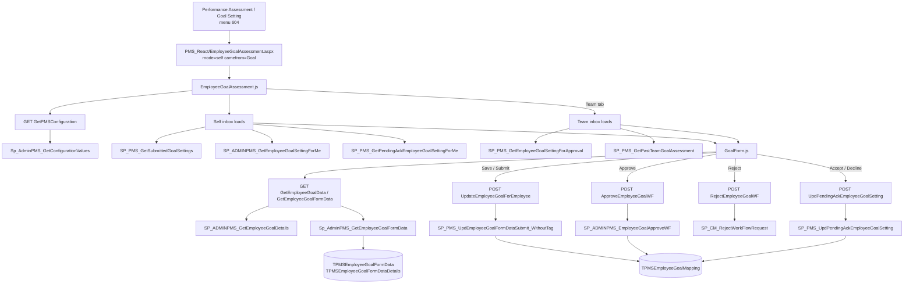
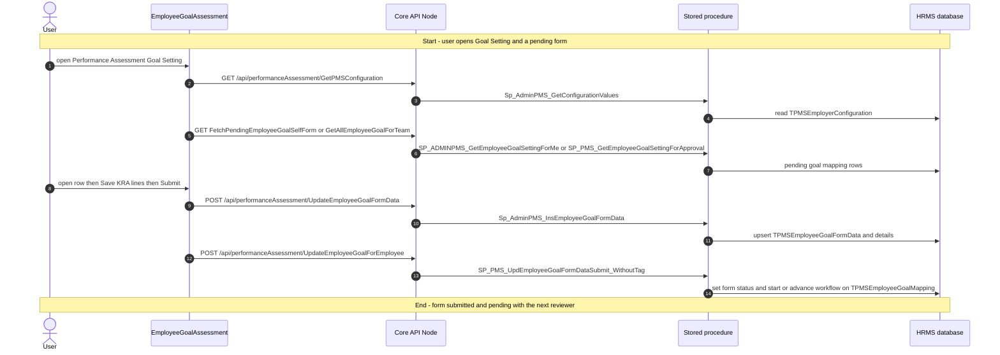
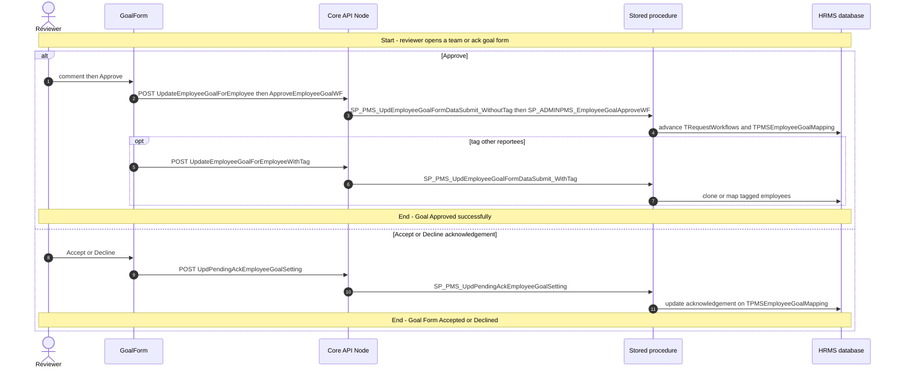
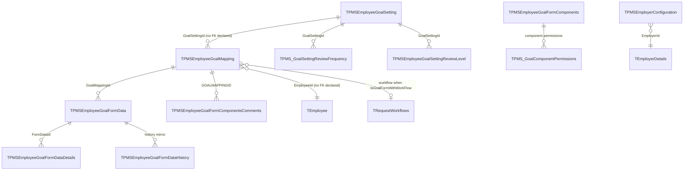

# Goal Setting

## Overview

An employee (or a manager reviewing a reportee) opens **Performance Assessment → Goal Setting** (menu value `604`) to work goal-period forms that HR already initiated. The live shell is `HRM/PMS_React/EmployeeGoalAssessment.aspx` with `?mode=self&&camefrom=Goal` (migrated from the WebForms `HRM/PerformanceAssessment/EmployeeGoalAssessment.aspx` twin). The host decrypts query `mode` / `TabName` / `id`, stamps employee and employer hidden fields, and mounts the React container `EmployeeGoalAssessment`.

On **Self-Goal Setting** the person sees Submitted, Pending, and Pending Acknowledgement inbox sections. On **Team Goal Setting** (when config and role allow) they see Submitted and Pending team grids. Opening a row loads the in-page `GoalForm`: define KRA lines and weightage, optional additional components, then Save, Submit, Approve / Reject (workflow), Accept / Decline (acknowledgement), Copy, or Export. Admin Create Goal Period and LMS Manage Goal Setting are different screens.

**Who's involved:**

- **Employee** — fills and submits self goal forms; accepts or declines after final approval when acknowledgement is required.
- **Manager / reviewer** — works Team Goal Setting; saves answers, approves or rejects through workflow, optionally tags the form to other reportees or designations.
- **HR / PMS admin** — not on this menu item. They create periods, map people, and initiate forms under Admin Configuration → Performance Management (or Create Goal Setting).

There is no llm-wiki domain lifecycle page for PMS goal setting. Table blurbs for `TPMSEmployeeGoal*` live in `llm-wiki/reference/tables/hrms.md`. Sibling left-nav items under Performance Assessment (Employee Assessments, Create Goal Setting, Assessment Status) share APIs and tables but are separate guides.

## Workflow

## Request journey

The employee (or manager) request that moves a goal form is **Submit** on `GoalForm`. Approve / Reject and Accept / Decline are separate request types on the same screen.

### Submit goal form

### Approve or acknowledge

## Entry points

> Live left-nav NavigateURL is `~/HRM/PMS_React/EmployeeGoalAssessment.aspx?mode=self&&camefrom=Goal` (`DML/PMSRelease-React/MenuDetails.sql`). The WebForms page under `HRM/PerformanceAssessment/` remains in source as the legacy twin the React port mirrors; this guide documents the React host and Core Node API path the SPA calls.

| UI page / route | Purpose |
|---|---|
| `/HRM/PMS_React/EmployeeGoalAssessment.aspx?mode=self&&camefrom=Goal` | Performance Assessment → Goal Setting. Activity log `EmployeeGoalAssessment`. Hidden fields for emp/employer/role/mode/goal employee. |
| Deep links with encrypted `id` / `TabName` / `goalSettingId` / ack flags | Notification and Assessment Status links open the same host with a pinned `GoalForm` context. |
| Legacy `/HRM/PerformanceAssessment/EmployeeGoalAssessment.aspx` | Pre-React twin; not the current NavigateURL. |

## Code → database call chain

React constants are `/performanceAssessment/...` on Core API (`app.js` mounts `/api` → `routeIndex` → `performanceAssessmentRoutes`). Host `EmployeeGoalAssessment.aspx.cs` only decrypts query strings and stamps session — no postback DAL.

| Entry point | DAL method (`file:line`) | Stored procedure |
|---|---|---|
| Page boot config | `GetPMSConfiguration` (`performanceAssessmentDAL.js:2045`) via controller `:1654` | `Sp_AdminPMS_GetConfigurationValues` |
| Custom labels | `GetCustomLabelsData` (`performanceAssessmentDAL.js:3615`) via `:2279` | `SP_AdminPMS_GetEmployerPMSCustomFields` |
| Submitted self inbox | `GetSubmittedGoalSettings` (`performanceAssessmentDAL.js:2796`) via `:2021` | `SP_PMS_GetSubmittedGoalSettings` |
| Pending self inbox | `FetchPendingEmployeeGoalSelfForm` (`performanceAssessmentDAL.js:1885`) via `:1573` | `SP_ADMINPMS_GetEmployeeGoalSettingForMe` |
| Pending acknowledgement | `GetPendingAckEmployeeGoalSettingForMe` (`performanceAssessmentDAL.js:1915`) via `:1591` | `SP_PMS_GetPendingAckEmployeeGoalSettingForMe` |
| Pending team inbox | `GetAllEmployeeGoalForTeam` (`performanceAssessmentDAL.js:1900`) via `:1582` | `SP_PMS_GetEmployeeGoalSettingForApproval` |
| Submitted team inbox | `GetPastTeamGoalAssessment` (`performanceAssessmentDAL.js:2858`) via `:2053` | `SP_PMS_GetPastTeamGoalAssessment` |
| Open form header / components | `GetEmployeeGoalData` (`performanceAssessmentDAL.js:3078`) via `:2062` | `SP_ADMINPMS_GetEmployeeGoalDetails` |
| Form grid / history / expand | `GetEmployeeGoalFormData` (`performanceAssessmentDAL.js:2810`) via `:2030` | `Sp_AdminPMS_GetEmployeeGoalFormData` |
| Form data history dialog | `GetEmployeeGoalFormDataHistory` (`performanceAssessmentDAL.js:2843`) via `:2039` | `Sp_AdminPMS_GetEmployeeGoalFormDataHistory` |
| Row-level KRA save | `UpdateEmployeeGoalFormData` (`performanceAssessmentDAL.js:3278`) via `:2161` | `Sp_AdminPMS_InsEmployeeGoalFormData` |
| Delete KRA line | `DeleteEmployeeGoalFormData` (`performanceAssessmentDAL.js:3462`) via `:2215` | `Sp_AdminPMS_DelEmployeeGoalFormData` |
| Save / Submit form | `UpdateEmployeeGoalForEmployee` (`performanceAssessmentDAL.js:3359`) via `:2179` | `SP_PMS_UpdEmployeeGoalFormDataSubmit_WithoutTag` |
| Approve workflow | `ApproveEmployeeGoalWF` (`performanceAssessmentDAL.js:3383`) via `:2188` | `SP_ADMINPMS_EmployeeGoalApproveWF` |
| Reject workflow | `RejectWorkFlowRequest` (`performanceAssessmentDAL.js:3401`) via `:2197` | `SP_CM_RejectWorkFlowRequest` |
| Tag reportees after approve | `UpdateEmployeeGoalForEmployeeWithTag` (`performanceAssessmentDAL.js:3438`) via `:2206` | `SP_PMS_UpdEmployeeGoalFormDataSubmit_WithTag` |
| Validate tag selection | `ValidateTaggedEmployeeGoalFormData` (`performanceAssessmentDAL.js:3257`) via `:2152` | `Sp_AdminPMS_ValidateTaggedEmployeeGoalFormData` |
| Accept / Decline ack | `UpdPendingAckEmployeeGoalSetting` (`performanceAssessmentDAL.js:3516`) via `:2242` | `SP_PMS_UpdPendingAckEmployeeGoalSetting` |
| Goal categories | `GetAllGoalCategories` / `Details` (`:3165` / `:3179`) | `SP_AdminPMS_GetAllGoalCategory` / `SP_AdminPMS_GetAllGoalCategoryDetails` |
| Additional components list / save | `GetGoalSettingComponents` / `SaveGoalSettingComponent` (`:4399` / `:4412`) | `SP_AdminPMS_GetEmployeeGoalFormComponents` / `SP_AdminPMS_InsEmployeeGoalFormComponents` |
| Copy goals | `GetEmployeeGoalCopyDetails` / `CopyEmployeeGoalFormData` (`:3479` / `:3497`) | `SP_ADMINPMS_GetEmployeeGoalCopyDetails` / `Sp_AdminPMS_CopyEmployeeGoalFormData` |
| Edit-enabled flag | `GetEmployeeGoalFormIsEnabledForEdit` (`:3193`) | `SP_PMS_GetEmployeeGoalFormIsEnabledForEdit` |
| Tag pickers | `GetPendingEmployeesForGoalSetting` / `GetPendingDesignationsForGoalSetting` (`:3226` / `:3209`) | `Sp_AdminPMS_GetPendingEmployeesForGoalSetting` / `Sp_AdminPMS_GetPendingDesignationsForGoalSetting` |
| See all updates | `GetEmployeeGoalFormAllUpdates` (`:2262`) | `Sp_PMS_GetEmployeeGoalFormAllUpdates` |
| Export PDF/data | `GetAppraisalCycleEmployeeDataToExport` (`:3629`) | `SP_AdminPMS_GetSelfAppDetForExtract` |
| Review frequencies | `GetReviewFrequenciesPerCycleId` (`:5397`) | `SP_AdminPMS_GetReviewFrequenciesPerCycleId` |
| Reviewer types for components | `GetReviewerTypesForGoal` (`:2335`) | `Sp_AdminPMS_GetGoalSettingReviewLevel` |
| Form-data exists check (submit gate) | `GetEmployeeGoalFormDataExist` (`:3316`) | inline SQL on `TPMSEmployeeGoalFormDataDetails` (no SP) |
| Reviewer level lookup | `GetEmployeeGoalSettingReviewerLevel` (`:3150`) | inline SQL on `TPMSEmployeeGoalMapping` (no SP) |

## API endpoints

Base path `/api/performanceAssessment` (`Authorize` middleware). No WebForms postback DAL on the React host.

| Verb | Route | Parameters | Purpose | Source |
|---|---|---|---|---|
| `GET` | `/GetPMSConfiguration` | query `employerId` | Tab and toolbar flags | `performanceAssessmentController.js:1654` |
| `GET` | `/GetCustomLabelsData` | query `employerId` | Goal field captions | `:2279` |
| `GET` | `/GetSubmittedGoalSettings` | query `employeeId` | Submitted self grid | `:2021` |
| `GET` | `/FetchPendingEmployeeGoalSelfForm` | query `employeeId`, `employerIds` | Pending self grid | `:1573` |
| `GET` | `/GetPendingAckEmployeeGoalSettingForMe` | query `employeeId`, `employerId` | Ack inbox | `:1591` |
| `GET` | `/GetAllEmployeeGoalForTeam` | query `employeeId`, `employerIds` | Pending team grid | `:1582` |
| `GET` | `/GetPastTeamGoalAssessment` | query `employeeId` | Submitted team grid (recordsets) | `:2053` |
| `GET` | `/GetEmployeeGoalData` | query `employeeId`, `goalSettingId`, `goalMappingId`, `loggedInEmployeeId` | Form header + components | `:2062` |
| `GET` | `/GetEmployeeGoalFormData` | query `employeeId`, `goalSettingId`, `goalMappingId` | KRA grid | `:2030` |
| `GET` | `/GetEmployeeGoalFormDataHistory` | query `employeeId`, `goalSettingId`, `goalMappingId`, `formDataId` | History dialog | `:2039` |
| `GET` | `/GetEmployeeGoalFormDataExist` | query `goalMappingId` | Submit gate (inline count) | `:2170` |
| `POST` | `/UpdateEmployeeGoalFormData` | body `employeeGoal`, `sectionId` | Save one KRA/detail row | `:2161` |
| `POST` | `/DeleteEmployeeGoalFormData` | body `formDataId`, `goalSettingId`, `formDataDetailsId` | Delete KRA line | `:2215` |
| `POST` | `/UpdateEmployeeGoalForEmployee` | body `employeeGoal`, `components` (UDT rows) | Save or Submit without tag | `:2179` |
| `POST` | `/ApproveEmployeeGoalWF` | body `requestTransId`, `employeeId`, `comments`, `requestType`, `employerId` | Approve workflow (`requestTransId` = goal mapping id) | `:2188` |
| `POST` | `/RejectEmployeeGoalWF` | body `requestTransId`, `rejectionReason`, `employeeId`, `requestType`, `employerId` | Reject via common WF SP | `:2197` |
| `POST` | `/UpdateEmployeeGoalForEmployeeWithTag` | body `employeeGoal`, `designationIds`, `employeeIds`, `comments`, `employerId` | Tag after approve | `:2206` |
| `POST` | `/ValidateTaggedEmployeeGoalFormData` | body goal/tag selection | Pre-check tag targets | `:2152` |
| `POST` | `/UpdPendingAckEmployeeGoalSetting` | body `goalMappingId`, `comments`, `acknowledgementStatus`, `modifiedBy` | Accept / Decline | `:2242` |
| `POST` | `/CopyEmployeeGoalFormData` | body copy ids | Copy KRA lines | `:2233` |
| `POST` | `/SaveGoalSettingComponent` | body component + permission TVPs | Add additional component | `:2251` / `:2422` |
| `GET` | `/GetGoalSettingComponents` | query `goalSettingId`, `employerId` | Additional components (uses review-frequency id in goalSettingId slot) | `:2419` |
| `GET` | `/GetAppraisalCycleEmployeeDataToExport` | query cycle/employee/goal/rf/logged-in | Export | `:2288` |

Supporting GETs used by the form (categories, copy details, pending employees/designations, all-updates, edit flag, review frequencies, reviewer types) are listed in the call-chain table.

## Stored procedures & tables involved

> Goal period master data is created elsewhere (`Sp_AdminPMS_InsEmployeeGoalSetting`, initiate SPs). This page mainly reads mappings and writes form data / workflow status on `TPMSEmployeeGoalMapping` and related form tables.

| Object | File path | Purpose | llm-wiki |
|---|---|---|---|
| `TPMSEmployeeGoalSetting` | `HRMS-DATABASE/HRMS/TABLES/...` | Goal period master | `llm-wiki/reference/tables/hrms.md` |
| `TPMSEmployeeGoalMapping` | same | Employee ↔ period; form status, ack, review levels | same |
| `TPMS_GoalSettingReviewFrequency` | same | Review-frequency windows for a period | same |
| `TPMSEmployeeGoalFormData` / `Details` / `History` | same | Saved KRA rows and history | same |
| `TPMSEmployeeGoalFormComponents` (+ comments / permissions) | same | Additional questions and answers | same |
| `TPMSEmployerConfiguration` | same | Self/team/workflow/toolbar flags | same |
| `TRequestWorkflows` / `TWorkflowManagement` | same | Goal workflow routing | same |
| `Sp_AdminPMS_GetConfigurationValues` | `STOREPROCEDURE/` | Config flags for tabs and buttons | — |
| `SP_PMS_GetSubmittedGoalSettings` | same | Submitted self inbox | — |
| `SP_ADMINPMS_GetEmployeeGoalSettingForMe` | same | Pending self inbox | — |
| `SP_PMS_GetPendingAckEmployeeGoalSettingForMe` | same | Ack inbox | — |
| `SP_PMS_GetEmployeeGoalSettingForApproval` | same | Pending team inbox | — |
| `SP_PMS_GetPastTeamGoalAssessment` | same | Submitted team inbox | — |
| `SP_ADMINPMS_GetEmployeeGoalDetails` | same | Form header and component payload | — |
| `Sp_AdminPMS_GetEmployeeGoalFormData` | same | KRA grid | — |
| `Sp_AdminPMS_InsEmployeeGoalFormData` | same | Upsert KRA detail | — |
| `SP_PMS_UpdEmployeeGoalFormDataSubmit_WithoutTag` | same | Save/Submit + workflow start | — |
| `SP_ADMINPMS_EmployeeGoalApproveWF` | same | Approve step | — |
| `SP_CM_RejectWorkFlowRequest` | same | Reject (shared WF; `EmployeeGoalSetting` request type) | — |
| `SP_PMS_UpdEmployeeGoalFormDataSubmit_WithTag` | same | Tag other employees/designations | — |
| `SP_PMS_UpdPendingAckEmployeeGoalSetting` | same | Accept / Decline | — |

## Table relationships

Declared FKs on many `TPMS*` goal tables are sparse in catalog notes; edges below follow the joins these procedures use plus Depends-on hints from `llm-wiki/reference/tables/hrms.md`.

## Known gaps

- **No SystemModel-2 workflow page** for Goal Setting; behaviour is from React + Node DAL + SQL scripts.
- **Legacy WebForms twin** still exists under `HRM/PerformanceAssessment/` and is the behavioural reference the React port comments cite; left-nav now points at `PMS_React`.
- **`GetEmployeeGoalFormDataExist` and `GetEmployeeGoalSettingReviewerLevel` are inline SQL** in Node DAL, not stored procedures.
- **`GetGoalSettingComponents` passes review-frequency id in the `GoalSettingId` parameter slot** (legacy parity); easy to misread against `SP_AdminPMS_GetEmployeeGoalFormComponents`.
- **Approve `requestTransId` is the goal mapping id**, not `WorkFlowTransId` / IsApprover flags (documented in `GoalForm.js`).
- **`SP_CM_RejectWorkFlowRequest` is shared** across leave, recruitment, FNF, and PMS; only the `EmployeeGoalSetting` branch applies here. Nested callees for other request types are out of this UI path.
- **Pending self `ReviewType = Viewer`** when `ValidTillDate` is past can hide Save/Submit; React remaps own-employee Viewer → Employee so extended submission dates still work (`camefrom=Goal` parity).
- **Team tab** may be hidden for Role Type Employee when `isShowPMSTeamAssessmentForEmployeeRole` is off; Self tab can still show when ack rows exist even if self-assessment-required is No.
- **LMS Manage Goal Setting** (`TTNI_EmployeeGoalSetup`) is unrelated training-hour targets.

## Reference

Confidence is **medium**: the React host and Node DAL `file:line` → procedure names were traced end to end; table lists come from procedure scripts and `llm-wiki/reference/tables/hrms.md`. There is no domain `erDiagram` to reuse. Workflow branching inside the large submit/approve procedures was sampled from the scripts, not exhaustively path-tested in an environment.

### SourceCode

- `HRMS.Web/HRMS.Web/HRM/PMS_React/EmployeeGoalAssessment.aspx` (+ `.cs`)
- `HRMS.Web/HRMS.Web/HRM/PMS_React/Areas/EmployeeGoalAssessment/Containers/EmployeeGoalAssessment.js`
- `HRMS.Web/HRMS.Web/HRM/PMS_React/Areas/EmployeeGoalAssessment/Components/GoalForm.js` (+ inbox/copy/history dialogs)
- `HRMS.Web/HRMS.Web/HRM/PMS_React/Common/apiURLConstants.js`, `apiHelper.js`
- `HRMS.Web/HRMS.Web/HRM/PerformanceAssessment/EmployeeGoalAssessment.aspx(.cs)` — legacy twin
- `HRMS.CoreAPI/HRMS.Core.WebAPI.Node/Routes/routeIndex.js`, `performanceAssessmentRoutes.js`
- `HRMS.CoreAPI/HRMS.Core.WebAPI.Node/Controllers/performanceAssessmentController.js`
- `HRMS.CoreAPI/HRMS.Core.WebAPI.Node/Core/DataAccessLayer/performanceAssessmentDAL.js`
- `HRMS.Shared/HRMS.DataAccessLayer/ConfirmationAndPerformance/PerformanceAssessmentDAL.cs` — .NET parity reference

### TDG HRMS DB

- `llm-wiki/reference/tables/hrms.md` — `TPMSEmployeeGoal*` table blurbs (no domain lifecycle page)
- `HRMS-DATABASE/HRMS/DML/Tmenudetails DML.sql` — Performance Assessment → Goal Setting value `604`
- `HRMS-DATABASE/HRMS/DML/PMSRelease-React/MenuDetails.sql` — NavigateURL to `PMS_React/EmployeeGoalAssessment.aspx`
- `HRMS-DATABASE/HRMS/STOREPROCEDURE/SP_PMS_GetSubmittedGoalSettings.sql`, `SP_ADMINPMS_GetEmployeeGoalSettingForMe.sql`, `SP_PMS_GetEmployeeGoalSettingForApproval.sql`, `SP_PMS_GetPendingAckEmployeeGoalSettingForMe.sql`, `SP_PMS_GetPastTeamGoalAssessment.sql`, `SP_ADMINPMS_GetEmployeeGoalDetails.sql`, `Sp_AdminPMS_GetEmployeeGoalFormData.sql`, `Sp_AdminPMS_InsEmployeeGoalFormData.sql`, `SP_PMS_UpdEmployeeGoalFormDataSubmit_WithoutTag.sql`, `SP_ADMINPMS_EmployeeGoalApproveWF.sql`, `SP_PMS_UpdEmployeeGoalFormDataSubmit_WithTag.sql`, `SP_PMS_UpdPendingAckEmployeeGoalSetting.sql`, `SP_CM_RejectWorkFlowRequest.sql`
