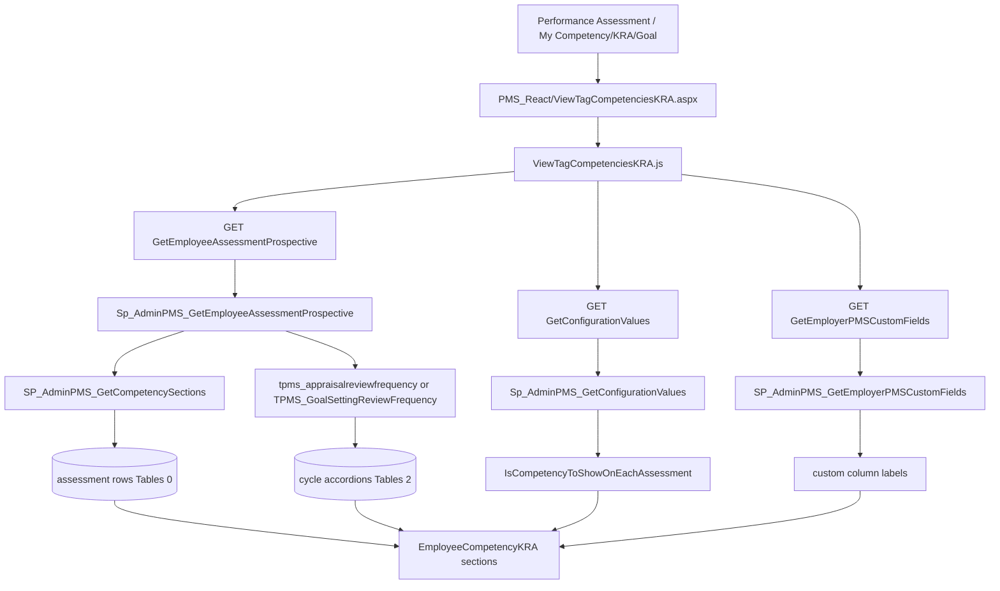
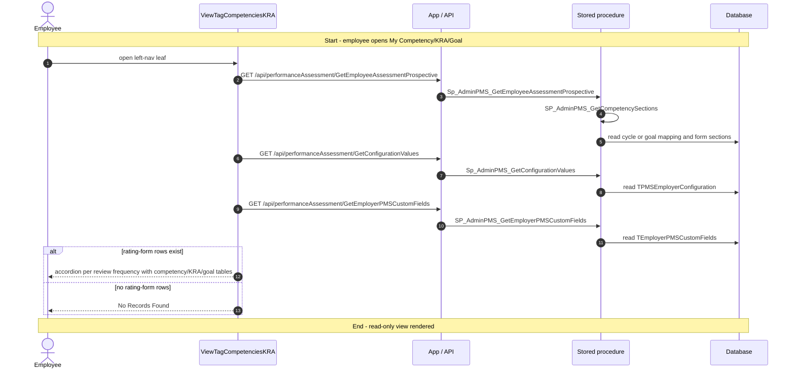
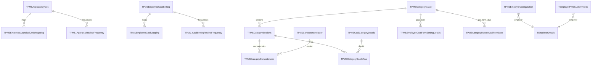

# My Competency/KRA/Goal

## Overview

An employee opens **Performance Assessment → My Competency/KRA/Goal** to see the competencies, KRAs, or goals tagged to them on their latest initiated or pending appraisal cycle or goal period. The left-nav leaf points at `~/HRM/PMS_React/ViewTagCompetenciesKRA.aspx` (`HRMS-DATABASE/HRMS/DML/PMSRelease-React/MenuDetails.sql`). That host mounts the React container `ViewTagCompetenciesKRA`, which loads three GETs in parallel and renders one accordion per review frequency. There is no save, edit, or postback on this screen — read-only display.

The heading text follows `FormAppraisalType` from the first assessment row (`C` My Competencies, `G` My KRAs, `B` My Competencies/KRAs, `P` My Goals, `T` My Competencies/Goals). Employer config `IsCompetencyToShowOnEachAssessment` controls whether competency sections appear on every review-frequency accordion or only the last one. Custom PMS labels (`IsCameFrom = P`) rename competency and KRA column headers.

**Who's involved:**

- **Employee** — views their tagged form components for the newer of their latest appraisal cycle vs goal period.
- **Admin / HR** — not a user of this leaf; they configure forms and cycles under Admin Configuration → Performance Management.

## Workflow

## Request journey

## Entry points

| Entry point | Purpose | Live? |
|---|---|---|
| `HRM/PMS_React/ViewTagCompetenciesKRA.aspx` | Left-nav host after React menu DML. Injects `hdnViewTagCompKRAEmpId` / `hdnViewTagCompKRAEmployerId` from session. Logs `ActivityDescription.MyCompetencyKRAGoal` (368). | Yes — menu leaf |
| `Areas/ViewTagCompetenciesKRA/Containers/ViewTagCompetenciesKRA.js` | React page — three parallel GETs and accordion shell | Yes |
| `Areas/ViewTagCompetenciesKRA/Components/EmployeeCompetencyKRA.js` | Per-cycle competency / KRA / goal section tables | Yes |
| `Areas/routes.js` route `VIEW_TAG_COMPETENCIES_KRA` | SPA route for `/HRM/PMS_React/ViewTagCompetenciesKRA.aspx` | Yes |
| `HRM/PerformanceAssessment/ViewTagCompetenciesKRA.aspx` | Legacy WebForms page (code-behind still calls BLL/DAL directly) | Superseded by menu DML; not the left-nav URL |

Menu seed historically used `~/HRM/PerformanceAssessment/ViewTagCompetenciesKRA.aspx` (`DML/PMSRelease-P25/TDynamicMenuHierarchy.sql`). `DML/PMSRelease-React/MenuDetails.sql` updates that NavigateURL to `~/HRM/PMS_React/ViewTagCompetenciesKRA.aspx`. The leaf label was corrected from `My Competeny/KRA/Goal` to `My Competency/KRA/Goal` in `DML/PMSRelease-P33/TPMSEmployerConfiguration_DML.sql`.

## Code → database call chain

| Entry | HTTP | Controller | DAL | Stored procedure |
|---|---|---|---|---|
| Page load — tagged form + cycles `ViewTagCompetenciesKRA.js:28` | `GET /api/performanceAssessment/GetEmployeeAssessmentProspective` (`performanceAssessmentRoutes.js:158`) | `GetEmployeeAssessmentProspective` (`performanceAssessmentController.js:1434`) | `GetEmployeeAssessmentProspective` (`performanceAssessmentDAL.js:1698`, execute `performanceAssessmentDAL.js:1704`) | `Sp_AdminPMS_GetEmployeeAssessmentProspective` → nested `SP_AdminPMS_GetCompetencySections` |
| Page load — show-competency-per-RF flag `ViewTagCompetenciesKRA.js:41` | `GET /api/performanceAssessment/GetConfigurationValues` (`performanceAssessmentRoutes.js:143`) | `GetConfigurationValues` (`performanceAssessmentController.js:1299`) | `GetConfigurationValues` (`performanceAssessmentDAL.js:1461`, execute `performanceAssessmentDAL.js:1467`) | `Sp_AdminPMS_GetConfigurationValues` |
| Page load — PMS custom labels `ViewTagCompetenciesKRA.js:52` | `GET /api/performanceAssessment/GetEmployerPMSCustomFields` (`performanceAssessmentRoutes.js:159`) | `GetEmployerPMSCustomFields` (`performanceAssessmentController.js:1443`) | `GetEmployerPMSCustomFields` (`performanceAssessmentDAL.js:1712`, execute `performanceAssessmentDAL.js:1718`) | `SP_AdminPMS_GetEmployerPMSCustomFields` |

`APIUrlConstants.js:73-74,23` builds the relative paths. `APIHelper` prefixes them with `process.env.API_URL` (Core API `/api`).

React consumes `recordsets[0]` as assessment rows and `recordsets[2]` as rating-form / cycle accordions. That third set is the review-frequency `SELECT` inside `Sp_AdminPMS_GetEmployeeAssessmentProspective`; set `[1]` is the goal-form-data result from `SP_AdminPMS_GetCompetencySections` and is unused on this page.

## API endpoints

No WebForms postback on the React host. Activity logging in `ViewTagCompetenciesKRA.aspx.cs:14` runs on page load only.

| Method | Path | Purpose |
|---|---|---|
| GET | `/api/performanceAssessment/GetEmployeeAssessmentProspective?employeeId=` | Form section rows + review-frequency accordion list |
| GET | `/api/performanceAssessment/GetConfigurationValues?employerId=` | `IsCompetencyToShowOnEachAssessment` (and other employer PMS flags) |
| GET | `/api/performanceAssessment/GetEmployerPMSCustomFields?employerId=` | Custom competency/KRA/goal labels; UI keeps rows where `IsCameFrom` is `P` |

## Stored procedures & tables involved

| Procedure | Role on this page |
|---|---|
| `Sp_AdminPMS_GetEmployeeAssessmentProspective` | Chooses latest initiated/pending appraisal cycle vs goal period by created date; returns form rows (via nested call) plus review-frequency cycle names |
| `SP_AdminPMS_GetCompetencySections` | Nested — competency, KRA, and goal section/weight rows for the chosen category/form id |
| `Sp_AdminPMS_GetConfigurationValues` | Employer PMS configuration; may insert a default `TPMSEmployerConfiguration` row when none exists |
| `SP_AdminPMS_GetEmployerPMSCustomFields` | Custom field labels from `TEmployerPMSCustomFields` |

| Table | How used |
|---|---|
| `TPMSEmployeeAppraisalCycleMapping` | Latest appraisal mapping for the employee |
| `TPMSAppraisalCycles` | Cycle status Initiated/Pending and created date |
| `TPMSEmployeeGoalMapping` | Latest goal mapping (script also uses `TPMSEmployeeGoalmapping`) |
| `TPMSEmployeeGoalSetting` | Goal period name and create date |
| `tpms_appraisalreviewfrequency` | CycleName + ReviewFrequency when appraisal is newer |
| `TPMS_GoalSettingReviewFrequency` | CycleName + ReviewFrequency when goal period is newer |
| `TPMSCategoryMaster` / `TPMSCategorySections` / `TPMSCategoryCompetencies` / `TPMSCompetencyMaster` | Competency section rows |
| `TPMSCategoryGoalKRAs` / `TPMSGoalCategoryDetails` | KRA section rows |
| `TPMSEmployeeGoalFormSettingDetails` / `TPMS_TEmployeeGoalSections` | Goal section layout and optional fields |
| `TPMSCategoryMasterGoalFormData` | Returned as nested result set; not consumed by this React page |
| `TPMSEmployerConfiguration` | Show-competency flag and KRA empty-field flags |
| `TEmployerPMSCustomFields` | Column header labels |

## Table relationships

## Known gaps

- React never reads `recordsets[1]` (`TPMSCategoryMasterGoalFormData` from `SP_AdminPMS_GetCompetencySections`).
- Legacy `HRM/PerformanceAssessment/ViewTagCompetenciesKRA.aspx` still exists and loads data via .NET BLL without the Core API; the live menu leaf is the PMS_React host.
- If the employee has no Initiated/Pending appraisal or goal mapping, or the review-frequency query returns no rows, the UI shows **No Records Found** with no further explanation.
- `Sp_AdminPMS_GetConfigurationValues` can insert a default configuration row on first read for an employer (side effect of a GET used for a display flag).
- Failed GETs only `console.log`; the page still clears the spinner and may show empty or partial content.
- No llm-wiki domain page specifically for this employee leaf; admin lifecycle context lives under Performance Management setup docs.

## Reference

- `HRMS.Web/HRMS.Web/HRM/PMS_React/ViewTagCompetenciesKRA.aspx`
- `HRMS.Web/HRMS.Web/HRM/PMS_React/ViewTagCompetenciesKRA.aspx.cs`
- `HRMS.Web/HRMS.Web/HRM/PMS_React/Areas/ViewTagCompetenciesKRA/Containers/ViewTagCompetenciesKRA.js`
- `HRMS.Web/HRMS.Web/HRM/PMS_React/Areas/ViewTagCompetenciesKRA/Components/EmployeeCompetencyKRA.js`
- `HRMS.Web/HRMS.Web/HRM/PMS_React/Common/apiURLConstants.js`
- `HRMS.Web/HRMS.Web/HRM/PMS_React/Areas/routes.js`
- `HRMS.CoreAPI/HRMS.Core.WebAPI.Node/Routes/performanceAssessmentRoutes.js`
- `HRMS.CoreAPI/HRMS.Core.WebAPI.Node/Controllers/performanceAssessmentController.js`
- `HRMS.CoreAPI/HRMS.Core.WebAPI.Node/Core/DataAccessLayer/performanceAssessmentDAL.js`
- `HRMS-DATABASE/HRMS/STOREPROCEDURE/Sp_AdminPMS_GetEmployeeAssessmentProspective.sql`
- `HRMS-DATABASE/HRMS/STOREPROCEDURE/SP_AdminPMS_GetCompetencySections.sql`
- `HRMS-DATABASE/HRMS/STOREPROCEDURE/Sp_AdminPMS_GetConfigurationValues.sql`
- `HRMS-DATABASE/HRMS/STOREPROCEDURE/SP_AdminPMS_GetEmployerPMSCustomFields.sql`
- `HRMS-DATABASE/HRMS/DML/PMSRelease-React/MenuDetails.sql`
- `HRMS.Shared/HRMS.DataContract/Common/Enums.cs` (`MyCompetencyKRAGoal = 368`)
