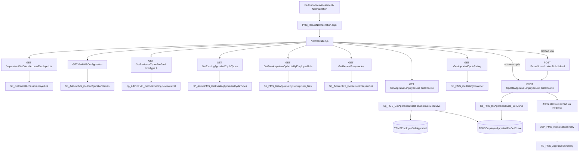
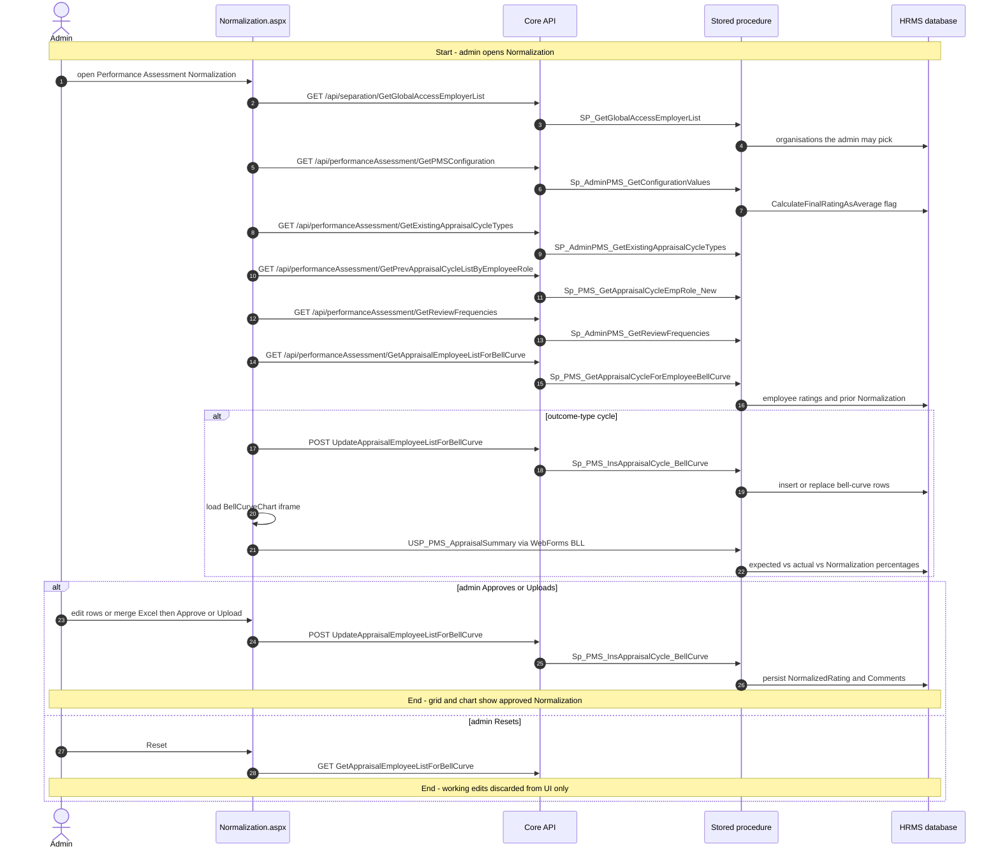
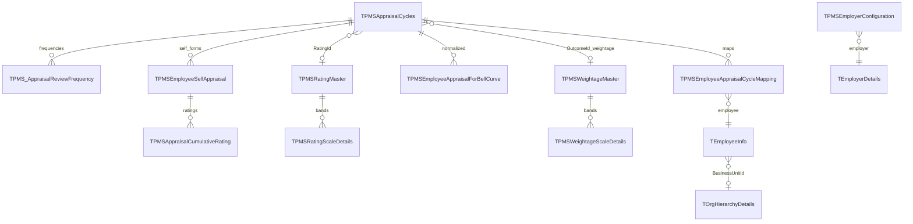

# Normalization

## Overview

HR / PMS admins open **Performance Assessment → Normalization** (left-nav value `606`) to adjust employee final ratings for an assessment cycle and review frequency against the organisation’s expected outcome distribution (bell curve). The live host is `~/HRM/PMS_React/Normalization.aspx`, which stamps session employee / employer / business-unit label into hidden fields and mounts the React container `Normalization`. Filters are organisation (global-access list), appraisal type (C/K/G/B/T), assessment cycle, and review frequency. Search loads the employee grid; for outcome-type cycles (`OutcomeId > 0`) the page also persists the working list, then shows a Live Bell Curve iframe. Admins may edit Normalization + Comments per row, Approve (persist TVP), Reset (reload without save), or bulk-upload an `.xlsx` template.

**Who's involved:**

- **HR / PMS admin** — selects cycle and frequency, edits or uploads normalized ratings, Approves to write `TPMSEmployeeAppraisalForBellCurve`.
- **Employee / manager** — not users of this screen; their ratings come from completed self-assessment workflows.

Legacy `HRM/PerformanceAssessment/Normalization.aspx` still exists; the menu leaf targets the React host.

## Workflow

## Request journey

The admin request that saves normalized ratings is **Approve** (or **Upload** after Excel merge). Search / auto-load for an outcome-type cycle also posts the same update with operation `BellCurve` so the chart can read persisted rows.

## Entry points

> `Normalization.aspx` is the live **Performance Assessment → Normalization** shell (`TMenuDetails` / hierarchy value `606`). It loads `BuildJS/PMS_React.min.js` and routes `RouteConstants.NORMALIZATION` (`/HRM/PMS_React/Normalization.aspx`) to `Areas/Normalization/Containers/Normalization.js`. Code-behind only logs `ActivityDescription.Normalization` (372) and stamps hidden fields — no WebForms postback DAL.

| UI page / route | Purpose |
|---|---|
| `/HRM/PMS_React/Normalization.aspx` | Left-nav host. Hidden `hdnNormalizationEmpId` / `hdnNormalizationEmployerId` / `hdnNormalizationBusinessUnitLabel`. |
| `/HRM/PMS_React/PerformanceAssessmentRedirect.aspx?src=BellCurve&acid=&rfId=` | Encrypts cycle id and redirects the Live Bell Curve iframe to `BellCurveChart.aspx`. |
| `/HRM/PerformanceAssessment/BellCurveChart.aspx` | Chart page; loads summary via .NET BLL (`USP_PMS_AppraisalSummary`). |
| `/HRM/PerformanceAssessment/Normalization.aspx` | Legacy WebForms Normalization. Not the current menu URL. |
| `~/Images/DataImport_Normalization.xlsx` | Static bulk-upload template (EmploymentNumber, Normalization, Comments). |

## Code → database call chain

`APIHelper` prefixes relative paths with `process.env.API_URL` (Core API `/api`). Org picker uses the **separation** route; all other Normalization calls use **performanceAssessment**.

| Entry point | DAL / BLL method (`file:line`) | Stored procedure |
|---|---|---|
| Org picker (`Normalization.js:153`) | `GetGlobalAccessEmployerList` (`separationDAL.js:989`) via `separationController.js:958` | `SP_GetGlobalAccessEmployerList` |
| Final-rating flag (`Normalization.js:208`) | `GetPMSConfiguration` (`performanceAssessmentDAL.js:2045`) via `performanceAssessmentController.js:1654` | `Sp_AdminPMS_GetConfigurationValues` |
| Approver column count (`Normalization.js:221`) | `GetReviewerTypesForGoal` (`performanceAssessmentDAL.js:2335`) via `performanceAssessmentController.js:1787` | `Sp_AdminPMS_GetGoalSettingReviewLevel` |
| Appraisal type radios (`Normalization.js:234`) | `GetExistingAppraisalCycleTypes` (`performanceAssessmentDAL.js:2350`) via `performanceAssessmentController.js:1796` | `SP_AdminPMS_GetExistingAppraisalCycleTypes` |
| Cycle dropdown (`Normalization.js:255`) | `GetPrevAppraisalCycleListByEmployeeRole` (`performanceAssessmentDAL.js:2364`) via `performanceAssessmentController.js:1805` | `Sp_PMS_GetAppraisalCycleEmpRole_New` |
| Review frequency (`Normalization.js:354`) | `GetReviewFrequencies` (`performanceAssessmentDAL.js:2379`) via `performanceAssessmentController.js:1814` | `Sp_AdminPMS_GetReviewFrequencies` |
| Employee grid Search / auto-load (`Normalization.js:415`) | `GetAppraisalEmployeeListForBellCurve` (`performanceAssessmentDAL.js:2395`) via `performanceAssessmentController.js:1823` | `Sp_PMS_GetAppraisalCycleForEmployeeBellCurve` |
| Rating min/max for edit dialog (`Normalization.js:125`) | `GetAppraisalCycleRating` (`performanceAssessmentDAL.js:5317`) via `performanceAssessmentController.js:3272` | `SP_PMS_GetRatingScaleDet` |
| Approve / outcome pre-persist / Upload save (`Normalization.js:761`) | `UpdateAppraisalEmployeeListForBellCurve` (`performanceAssessmentDAL.js:2414`) via `performanceAssessmentController.js:1832` | `Sp_PMS_InsAppraisalCycle_BellCurve` (`UDT_TPMSAppraisalCycleBellCurve` TVP) |
| Excel parse only (`Normalization.js:828`) | `ParseNormalizationBulkUpload` (`performanceAssessmentController.js:3085`) — xlsx in memory | *(no SP)* |
| Live Bell Curve iframe (`BellCurveChart.aspx.cs:57`) | `PerformanceAssessmentBLL.GetEmployeeAppraisalSummary` → `PerformanceAssessmentDAL.cs:572` | `USP_PMS_AppraisalSummary` → `FN_PMS_AppraisalSummary` / `FN_PMS_AppraisalSummaryFinalRating` |

## API endpoints

No WebForms postback on the React host. Activity logging in `Normalization.aspx.cs` runs on page load only. `Authorize` is on each Core API route below.

| Verb | Route | Parameters | Purpose |
|---|---|---|---|
| `GET` | `/api/separation/GetGlobalAccessEmployerList` | query `employeeId` | Organisation dropdown |
| `GET` | `/api/performanceAssessment/GetPMSConfiguration` | query `employerId` | `CalculateFinalRatingAsAverage` for Final Rating column |
| `GET` | `/api/performanceAssessment/GetReviewerTypesForGoal` | query `employerId`, `formType` (`A`) | Max `ApprovalLevel` → Approver columns |
| `GET` | `/api/performanceAssessment/GetExistingAppraisalCycleTypes` | query `employerId` | Appraisal type radios that have self-appraisal rows |
| `GET` | `/api/performanceAssessment/GetPrevAppraisalCycleListByEmployeeRole` | query `employeeId`, `employerId` | Non-pending cycles; SPA filters by `ProcessType` |
| `GET` | `/api/performanceAssessment/GetReviewFrequencies` | query `goalSettingId=0`, `appraisalCycleId`, `cameFromAppraisal=false` | Review frequency dropdown |
| `GET` | `/api/performanceAssessment/GetAppraisalEmployeeListForBellCurve` | query `employerId`, `appraisalCycleId`, `reviewFrequencyId`, `employeeId` | Grid rows |
| `GET` | `/api/performanceAssessment/GetAppraisalCycleRating` | query `appraisalCycleId`, `confirmationId=0` | Scale bands for Normalization min/max |
| `POST` | `/api/performanceAssessment/UpdateAppraisalEmployeeListForBellCurve` | body `appraisalCycleId`, `reviewFrequencyId`, `employeeList[]` | Persist / replace bell-curve TVP |
| `POST` | `/api/performanceAssessment/ParseNormalizationBulkUpload` | multipart `file` | Parse Sheet1 to JSON rows (no database) |

## Stored procedures & tables involved

| Object | Role on this page |
|---|---|
| `SP_GetGlobalAccessEmployerList` | Organisations the login employee may select |
| `Sp_AdminPMS_GetConfigurationValues` | Employer PMS config including final-rating average flag (may insert default row) |
| `Sp_AdminPMS_GetGoalSettingReviewLevel` | Assessment workflow approval levels (`FormType` `A`) |
| `SP_AdminPMS_GetExistingAppraisalCycleTypes` | Distinct `ProcessType` values that already have self-appraisal rows |
| `Sp_PMS_GetAppraisalCycleEmpRole_New` | Cycle list for the employer (non-deleted, not Pending) |
| `Sp_AdminPMS_GetReviewFrequencies` | Review frequencies for the selected cycle |
| `Sp_PMS_GetAppraisalCycleForEmployeeBellCurve` | Employee grid with manager ratings, final score, Normalization, `IsOutcomeType` |
| `SP_PMS_GetRatingScaleDet` | Rating / weightage / measure scale bands for the cycle |
| `Sp_PMS_InsAppraisalCycle_BellCurve` | Insert or delete+insert into `TPMSEmployeeAppraisalForBellCurve`; rejects cycles with `OutcomeId=0` |
| `USP_PMS_AppraisalSummary` | Bell curve Expected / Actual / Normalization percentages for the iframe |
| `FN_PMS_AppraisalSummary` | Nested — counts when bell-curve rows already exist |
| `FN_PMS_AppraisalSummaryFinalRating` | Nested — final-rating-only summary when no bell-curve rows yet |
| `UDT_TPMSAppraisalCycleBellCurve` | TVP for the update POST |
| `TPMSEmployeeAppraisalForBellCurve` | Persisted Normalization, Comments, FinalRating per employee / cycle / review frequency |
| `TPMSEmployeeSelfAppraisal` | Form status and weightage feeding the grid |
| `TPMSAppraisalCumulativeRating` | L1–L4 and final cumulative scores |
| `TPMSAppraisalCycles` | Cycle metadata, `OutcomeId`, `ScoreMethod`, `ProcessType` |
| `TPMS_AppraisalReviewFrequency` | Review frequency rows joined on search |
| `TPMSEmployeeAppraisalCycleMapping` | Employees mapped into the cycle |
| `TPMSEmployerConfiguration` | Org name / final-rating / scale display flags |
| `TPMSRatingScaleDetails` / `TPMSWeightageScaleDetails` / `TPMSGoalCategoryOutcomeDeatils` | Scale bands and colours |
| `TEmployeeInfo` / `TOrgHierarchyDetails` / `TTitle` / `TORGChart` | Names, designation, BU, L1/L2 managers |
| `TWorkflowManagement` / `TRequestWorkflows` | Routing level count for Approver columns |

## Table relationships

Edges follow the joins in `Sp_PMS_GetAppraisalCycleForEmployeeBellCurve` / `Sp_PMS_InsAppraisalCycle_BellCurve` / scale lookups. `TPMSEmployeeAppraisalForBellCurve` has no declared FK to the cycle or employee tables in the baseline `CREATE TABLE`.

## Known gaps

- **Legacy WebForms Normalization** (`HRM/PerformanceAssessment/Normalization.aspx`) remains in source; live left-nav uses PMS_React.
- **`@EmployeeID` on the grid SP is unused** on the active path — `FN_LocationBU_GetEmployeeDetails` join is commented out, so location-BU scoping does not filter the list.
- **Inventory `UDT_TPMSAppraisalCycleBellCurve.sql` omits** `L3ManagerRating`, `L4ManagerRating`, and `RoutingLevels` that `UpdateAppraisalEmployeeListForBellCurve` adds to the TVP; the insert SP also ignores L3/L4 TVP columns and does not write them to the table.
- **Baseline `TPMSEmployeeAppraisalForBellCurve` CREATE** lacks `ReviewFrequncyId`; column is added in `DDL/PMSRelease-Sprint15/TPMSEmployeeAppraisalForBellCurve.sql`.
- **Reset does not delete DB rows** — it only rebinds the grid (`operation === "Rejected"`). Prior Approve / BellCurve persists remain.
- **`ParseNormalizationBulkUpload` has no SP** — server only parses Excel; validation and merge happen in the SPA before the update POST.
- **`Sp_AdminPMS_GetConfigurationValues` can insert** a default `TPMSEmployerConfiguration` row on first read.
- **Bell curve iframe uses .NET BLL**, not Core API — separate auth/session path from the React GETs/POSTs.
- No llm-wiki domain lifecycle page specifically for Normalization; behaviour above is from SourceCode + procedure scripts.

## Reference

- `HRMS.Web/HRMS.Web/HRM/PMS_React/Normalization.aspx` (+ `.cs`)
- `HRMS.Web/HRMS.Web/HRM/PMS_React/Areas/Normalization/Containers/Normalization.js`
- `HRMS.Web/HRMS.Web/HRM/PMS_React/Areas/Normalization/Components/NormalizationListGrid.js`
- `HRMS.Web/HRMS.Web/HRM/PMS_React/Areas/Normalization/Components/UpdateNormalizationDialog.js`
- `HRMS.Web/HRMS.Web/HRM/PMS_React/Common/apiURLConstants.js`
- `HRMS.Web/HRMS.Web/HRM/PMS_React/Areas/routes.js`, `Common/routeConstants.js`
- `HRMS.Web/HRMS.Web/HRM/PMS_React/PerformanceAssessmentRedirect.aspx.cs`
- `HRMS.Web/HRMS.Web/HRM/PerformanceAssessment/BellCurveChart.aspx.cs`
- `HRMS.CoreAPI/HRMS.Core.WebAPI.Node/Routes/performanceAssessmentRoutes.js`, `separationRoutes.js`
- `HRMS.CoreAPI/HRMS.Core.WebAPI.Node/Controllers/performanceAssessmentController.js`, `separationController.js`
- `HRMS.CoreAPI/HRMS.Core.WebAPI.Node/Core/DataAccessLayer/performanceAssessmentDAL.js`, `separationDAL.js`
- `HRMS.Shared/HRMS.DataAccessLayer/ConfirmationAndPerformance/PerformanceAssessmentDAL.cs`
- `HRMS.Shared/HRMS.DataContract/Common/Enums.cs` (`Normalization = 372`)
- `HRMS-DATABASE/HRMS/STOREPROCEDURE/Sp_PMS_GetAppraisalCycleForEmployeeBellCurve.sql`
- `HRMS-DATABASE/HRMS/STOREPROCEDURE/Sp_PMS_InsAppraisalCycle_BellCurve.sql`
- `HRMS-DATABASE/HRMS/STOREPROCEDURE/USP_PMS_AppraisalSummary.sql`
- `HRMS-DATABASE/HRMS/FUNCTIONS/FN_PMS_AppraisalSummary.sql`, `FN_PMS_AppraisalSummaryFinalRating.sql`
- `HRMS-DATABASE/HRMS/TABLES/TPMSEmployeeAppraisalForBellCurve.sql`
- `HRMS-DATABASE/HRMS/UDT/UDT_TPMSAppraisalCycleBellCurve.sql`
- `HRMS-DATABASE/HRMS/DML/Tmenudetails DML.sql` (Normalization value 606)
