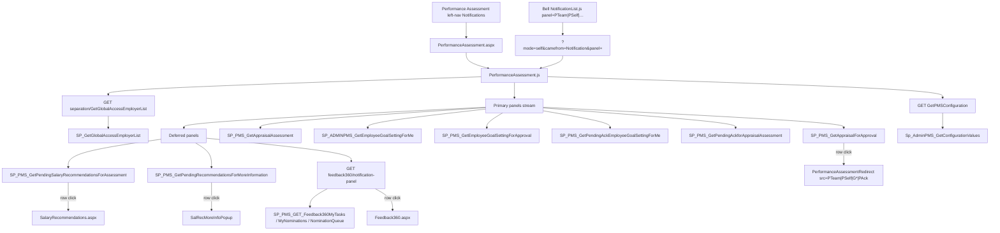
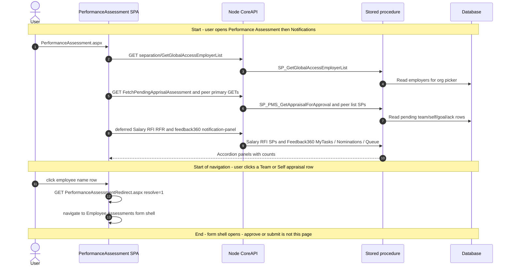
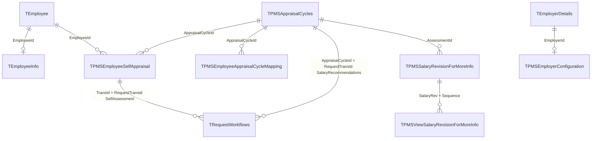

# Notifications

## Overview

A manager or employee opens **Performance Assessment → Notifications** when appraisal, goal-setting, salary-recommendation, or 360 Feedback work is waiting on them. The left-nav leaf is `~/HRM/PMS_React/PerformanceAssessment.aspx?mode=self&camefrom=Notification` (`DML/PMSRelease-React/MenuDetails.sql`). This is the **PMS** Notifications inbox — not Leave & Attendance Notifications, not Confirmation Assessment Notifications.

The host stamps session employee/employer/role into hidden fields, logs `ActivityDescription.PerformanceAssessmentNotifications`, and loads the PMS React bundle. `PerformanceAssessment.js` shows accordion panels only when each has rows; empty panels stay hidden. When every panel is empty after load, the page shows **No pending notifications.**

Primary panels stream first (PTeam, PSelf, GSelf, GTeam, GAck, PAck). Deferred panels (Salary, RFI, RFR, four 360 kinds) load after all primary requests settle. Organization multi-select (global-access employers) reloads the inbox on Search.

This shell does not save ratings, approve workflows, or submit forms. Row clicks leave for Employee Assessments, Goal Setting, Salary Recommendations, or Feedback360 via `PerformanceAssessmentRedirect.aspx` (encrypted) or a plain URL (salary / 360).

**Who's involved:**

- **Approver (Team)** — current `TRequestWorkflows` manager for pending SelfAssessment or goal-setting rows (`PTeam`, `GTeam`). Employee role can be blocked when `IsShowPMSTeamAssessmentForEmployeeRole` is on.
- **Employee (Self / Ack)** — pending self-appraisal (`PSelf`), goal self (`GSelf`), appraisal acknowledgement (`PAck`), goal acknowledgement (`GAck`).
- **Salary RFI actors** — pending salary-recommendation workflow (`Salary`) and RFI question/response panels (`RFI` / `RFR`); RFI opens an in-page popup, not a redirect.
- **360 Feedback actors** — self / reviewer / nominate / approve campaign rows (`F360*`), deferred with Salary/RFI.

Sibling left-nav items (Employee Assessments, Goal Setting, Appraisal Due, …) are separate pages. Filling and approving forms happens there, not here.

## Workflow

## Request journey

This page does not create or decide an appraisal. The action that **starts** here is opening a pending row (or answering an RFI in the popup). Loading the inbox is shown first so the read path is visible.

## Entry points

> The live shell is `HRM/PMS_React/PerformanceAssessment.aspx`, routed to `Areas/PerformanceAssessment/Containers/PerformanceAssessment.js`. Legacy WebForms under `HRM/PerformanceAssessment/` still exist beside it; left-nav and home-page bell target the PMS_React path.

| UI page / API endpoint | Purpose |
|---|---|
| `HRM/PMS_React/PerformanceAssessment.aspx` | WebForms shell. `Page_Load` stamps emp/employer/role, logs `PerformanceAssessmentNotifications`, loads `BuildJS/PMS_React.min.js` |
| `Areas/PerformanceAssessment/Containers/PerformanceAssessment.js` | Inbox SPA. Org multi-select, primary then deferred panels, expand from `?panel=`, row → redirect / popup / Feedback360 |
| `Areas/PerformanceAssessment/Components/PendingNotificationGrid.js` | Collapsible panel grid |
| `Areas/PerformanceAssessment/Components/SalRecMoreInfoPopup.js` | RFI question (`Q`) / response (`A`) popup; refresh RFI panels after submit/ack |
| `HRM/PMS_React/PerformanceAssessmentRedirect.aspx` | Encrypts destination for appraisal/goal panels; `resolve=1` returns JSON `{ url }` |
| `?mode=self&camefrom=Notification&panel=PTeam\|PSelf\|…` | Bell deep link from `NotificationList.js`. SPA expands `panel` when that grid has rows; it does not read `camefrom` or `mode` |

## Code → database call chain

There is **no write** on the inbox grids themselves (RFI popup POSTs are separate). Org list uses the Separation route. PMS lists go through `performanceAssessment` Node DAL. 360 panels go through `feedback360` (filter in service after list SPs).

| Entry point | DAL/BLL method (`file:line`) | Stored procedure |
|---|---|---|
| Page load | `PerformanceAssessment.aspx.cs` `Page_Load` (`PerformanceAssessment.aspx.cs:14-24`) | none |
| Organisation picker | `GetOrganizations` → `GET_GLOBAL_ACCESS_EMPLOYER_LIST` (`PerformanceAssessment.js:125-126`); `SeparationController.GetGlobalAccessEmployerList` (`separationController.js:958`); `separationDAL.GetGlobalAccessEmployerList` (`separationDAL.js:989-994`) | `SP_GetGlobalAccessEmployerList` |
| Team assess gate | `loadTeamAssessFlags` / `resolveTeamAssessFlag` (`PerformanceAssessment.js:160-190`); `GetPMSConfiguration` (`performanceAssessmentController.js:1654`); `performanceAssessmentDAL.GetPMSConfiguration` (`performanceAssessmentDAL.js:2045-2051`) | `Sp_AdminPMS_GetConfigurationValues` |
| PTeam | `getPerformanceAssessmentNotifications` (`PerformanceAssessment.js:218-219`); `FetchPendingApprisalAssessment` (`performanceAssessmentController.js:145-147`); `performanceAssessmentDAL.FetchPendingApprisalAssessment` (`performanceAssessmentDAL.js:65-73`) | `SP_PMS_GetAppraisalForApproval` |
| PSelf | (`PerformanceAssessment.js:220`); `FetchPendingSelfAssessmentForm` (`performanceAssessmentController.js:648-650`); DAL (`performanceAssessmentDAL.js:842-850`) | `SP_PMS_GetAppraisalAssessment` |
| GSelf | (`PerformanceAssessment.js:221`); `FetchPendingEmployeeGoalSelfForm` (`performanceAssessmentController.js:1573-1575`); DAL (`performanceAssessmentDAL.js:1885-1892`) | `SP_ADMINPMS_GetEmployeeGoalSettingForMe` |
| GTeam | (`PerformanceAssessment.js:222`); `GetAllEmployeeGoalForTeam` (`performanceAssessmentController.js:1582-1584`); DAL (`performanceAssessmentDAL.js:1900-1907`) | `SP_PMS_GetEmployeeGoalSettingForApproval` |
| GAck | per-employer (`PerformanceAssessment.js:223-224`); `GetPendingAckEmployeeGoalSettingForMe` (`performanceAssessmentController.js:1591-1593`); DAL (`performanceAssessmentDAL.js:1915-1922`) | `SP_PMS_GetPendingAckEmployeeGoalSettingForMe` |
| PAck | (`PerformanceAssessment.js:225`); `GetPendingAckforAppraisalAssessment` (`performanceAssessmentController.js:1600-1602`); DAL (`performanceAssessmentDAL.js:1930-1937`) | `SP_PMS_GetPendingAckforAppraisalAssessment` |
| Salary | deferred (`PerformanceAssessment.js:260-261`); `GetPendingSalaryRecommendationsForAssessment` (`performanceAssessmentController.js:1609-1611`); DAL (`performanceAssessmentDAL.js:1945-1952`) | `SP_PMS_GetPendingSalaryRecommendationsForAssessment` |
| RFI / RFR | deferred (`PerformanceAssessment.js:262-263`); `GetPendingRecommendationsForMoreInformation` (`performanceAssessmentController.js:1618-1620`); DAL (`performanceAssessmentDAL.js:1960-1968`) | `SP_PMS_GetPendingRecommendationsForMoreInformation` (`@Type` `Q` or `A`) |
| F360 panels | `getFeedback360RowsForEachEmployer` (`PerformanceAssessment.js:87-98`); `GetNotificationPanel` (`Feedback360Controller.js:418`); `getNotificationPanel` → `getMyTasks` / `getMyNominations` / `getNominationQueue` (`Feedback360Service.js:3049-3117`); DAL (`Feedback360DAL.js:1135-1141`, `1009-1015`, `912-918`) | `SP_PMS_GET_Feedback360MyTasks`, `SP_PMS_GET_Feedback360MyNominations`, `SP_PMS_GET_Feedback360NominationQueue` |
| Appraisal/goal row click | `redirectTo` (`PerformanceAssessment.js:316-345`) → `PerformanceAssessmentRedirect.aspx` | none (encrypt + navigate) |
| Salary row click | `SalaryRecommendations.aspx` (`PerformanceAssessment.js:417-418`) | none on this page |
| 360 row click | `Feedback360.aspx` (`PerformanceAssessment.js:360-385`) | none on this page |

## API endpoints

No WebForms postback data access on the inbox host. All panel reads are Node CoreAPI under `/performanceAssessment`, `/separation`, or `/feedback360`.

| Verb | Route | Parameters | Purpose | Source |
|---|---|---|---|---|
| `GET` | `separation/GetGlobalAccessEmployerList` | `employeeId` | Org multi-select | `separationRoutes.js:57` |
| `GET` | `performanceAssessment/GetPMSConfiguration` | `employerId` | Team-assess employee-role flag | `performanceAssessmentRoutes.js:179` |
| `GET` | `performanceAssessment/FetchPendingApprisalAssessment` | `employeeId`, `employerIds` | PTeam | `performanceAssessmentRoutes.js:14` |
| `GET` | `performanceAssessment/FetchPendingSelfAssessmentForm` | `employeeId`, `employerIds` | PSelf | `performanceAssessmentRoutes.js:60` |
| `GET` | `performanceAssessment/FetchPendingEmployeeGoalSelfForm` | `employeeId`, `employerIds` | GSelf | `performanceAssessmentRoutes.js:170` |
| `GET` | `performanceAssessment/GetAllEmployeeGoalForTeam` | `employeeId`, `employerIds` | GTeam | `performanceAssessmentRoutes.js:171` |
| `GET` | `performanceAssessment/GetPendingAckEmployeeGoalSettingForMe` | `employeeId`, `employerId` | GAck (one org per call) | `performanceAssessmentRoutes.js:172` |
| `GET` | `performanceAssessment/GetPendingAckforAppraisalAssessment` | `employeeId`, `employerIds` | PAck | `performanceAssessmentRoutes.js:173` |
| `GET` | `performanceAssessment/GetPendingSalaryRecommendationsForAssessment` | `employeeId`, `employerId` | Salary (one org per call) | `performanceAssessmentRoutes.js:174` |
| `GET` | `performanceAssessment/GetPendingRecommendationsForMoreInformation` | `employeeId`, `employerIds`, `type` (`Q`\|`A`) | RFI / RFR | `performanceAssessmentRoutes.js:175` |
| `GET` | `feedback360/notification-panel` | `kind` (`self`\|`reviewer`\|`nominate`\|`approve`), `employerId` | F360 panels | `Feedback360Routes.js:92` |
| `GET` | `PerformanceAssessmentRedirect.aspx?resolve=1&src=…` | `src`, ids per panel | JSON `{ url }` | `PerformanceAssessmentRedirect.aspx.cs` |

RFI popup also uses salary more-info GET/POST routes (`GetEmployeeSalaryRevisionForMoreinfo`, `UPD` / `ACK` / upload / download). Those writes are out of inbox-list scope; destination pages own form submit.

Mounted at `routeIndex.js` (`/performanceAssessment`, `/feedback360`) and the Separation router for the org list.

## Stored procedures & tables involved

| Object | Path | Role |
|---|---|---|
| `SP_GetGlobalAccessEmployerList` | `HRMS-DATABASE/HRMS/STOREPROCEDURE/` | Employers for header multi-select |
| `Sp_AdminPMS_GetConfigurationValues` | same | `IsShowPMSTeamAssessmentForEmployeeRole` for team click gate |
| `SP_PMS_GetAppraisalForApproval` | same | PTeam — pending SelfAssessment workflow for manager |
| `SP_PMS_GetAppraisalAssessment` | same | PSelf — viewer's pending self-appraisal when self-assessment required |
| `SP_ADMINPMS_GetEmployeeGoalSettingForMe` | same | GSelf |
| `SP_PMS_GetEmployeeGoalSettingForApproval` | same | GTeam |
| `SP_PMS_GetPendingAckEmployeeGoalSettingForMe` | same | GAck |
| `SP_PMS_GetPendingAckforAppraisalAssessment` | same | PAck — approved forms awaiting employee acknowledgement |
| `SP_PMS_GetPendingSalaryRecommendationsForAssessment` | same | Salary — pending `SalaryRecommendations` workflow |
| `SP_PMS_GetPendingRecommendationsForMoreInformation` | same | RFI (`Q`) / RFR (`A`) |
| `SP_PMS_GET_Feedback360MyTasks` | same | F360Self / F360Reviewer (filtered in service) |
| `SP_PMS_GET_Feedback360MyNominations` | same | F360Nominate |
| `SP_PMS_GET_Feedback360NominationQueue` | same | F360Approve |
| `FN_LocationBU_GetEmployeeDetails` | `FUNCTIONS/` | Nested by team appraisal SP (left join) |
| `Fn_GetEmployeeName` / `Split` | `FUNCTIONS/` | Display names / CSV employer split |
| `Sp_OpenEncryptionKeys` / `SP_CloseEncryptionKey` | `STOREPROCEDURE/` | Open/close around several list SPs |
| `TPMSEmployeeSelfAppraisal` | `TABLES/` | Appraisal form header (`FormStatus`, ack flags) |
| `TRequestWorkflows` | same | Pending SelfAssessment / SalaryRecommendations routing |
| `TPMSAppraisalCycles` / `TPMS_AppraisalReviewFrequency` | same | Cycle + review frequency window |
| `TPMSEmployeeAppraisalCycleMapping` | same | Functional / reporting managers |
| `TPMSEmployerConfiguration` | same | Self-assessment / ack / team-role flags |
| `TPMSSalaryRevisionForMoreInfo` / `TPMSViewSalaryRevisionForMoreInfo` | same | RFI rows |
| `TPMSSalaryRevForEmployeeAssessment` | same | Mapped employee count on Salary panel |

## Table relationships

Inbox reads hang off appraisal / salary headers and polymorphic `TRequestWorkflows` rows. Declared FKs are sparse; edges below match how the list SPs join.

`SP_PMS_GetAppraisalForApproval` joins self-appraisal to `TRequestWorkflows` where `RequestType = 'SelfAssessment'` and `ApproveStatus = 'P'` for `@ManagerId`. `SP_PMS_GetAppraisalAssessment` filters the same form table to `@EmployeeId`, `FormStatus = 'Pending'`, and `IsSelfassessmentIsRequired = 1`. Salary panel uses `RequestType = 'SalaryRecommendations'`.

## Known gaps

- **`camefrom=Notification` and `mode=self` are unused by the SPA.** The bell always appends them; `PerformanceAssessment.js` only reads `panel`. Destination mode is set again on row click via redirect `src`.
- **No approve/reject on this page.** Decision writes live on Employee Assessments / Goal Setting / Salary Recommendations / Feedback360, not under this submenu.
- **Legacy WebForms sibling** `HRM/PerformanceAssessment/PerformanceAssessment.aspx` still ships; left-nav / bell use PMS_React.
- **Team role gate** depends on SP column `IsShowPMSTeamAssessmentForEmployeeRole` and/or `GetPMSConfiguration`, plus session `hdnPerfAssessmentUserRole`.
- **`FN_LocationBU_GetEmployeeDetails` is left-joined in the team appraisal SP** without an obvious WHERE filter on the join alias — scoping may not exclude out-of-scope rows the way other PMS lists do.
- **RFI SP requires non-empty `@Employerids`** — the body only selects inside `if(len(@Employerids)>0)`; empty CSV yields no rows after key open/close.
- **360 panels are not SPs named “notification”** — `GET feedback360/notification-panel` filters `MyTasks` / `MyNominations` / `NominationQueue` in Node.
- **RFI popup write path** (UPD/ACK/upload) is reachable from this page but is documented lightly here; full form behaviour belongs with Salary Recommendations.
- Sibling `SP_PMS_GetAppraisalForApprovalAll` exists but this Notifications page never calls it.
- Nested callee database pages already existed for encryption keys, `Split`, `Fn_GetEmployeeName`, and `FN_LocationBU_GetEmployeeDetails`; their Callers tables may still omit the new procedure pages until a later refresh.

## Reference

Confidence is **high** for the live PMS_React inbox → Node DAL → stored-procedure chain (file:line on panel GETs and the redirect bridge). Form submit / workflow approve paths are out of scope and belong under Employee Assessments, Goal Setting, Salary Recommendations, or Feedback360.

### SourceCode

- `HRMS.Web/HRMS.Web/HRM/PMS_React/PerformanceAssessment.aspx` (+ `.cs`)
- `HRMS.Web/HRMS.Web/HRM/PMS_React/Areas/PerformanceAssessment/Containers/PerformanceAssessment.js`
- `HRMS.Web/HRMS.Web/HRM/PMS_React/Areas/PerformanceAssessment/Components/PendingNotificationGrid.js`
- `HRMS.Web/HRMS.Web/HRM/PMS_React/Areas/PerformanceAssessment/Components/SalRecMoreInfoPopup.js`
- `HRMS.Web/HRMS.Web/HRM/PMS_React/Common/apiURLConstants.js`
- `HRMS.Web/HRMS.Web/HRM/PMS_React/PerformanceAssessmentRedirect.aspx.cs`
- `HRMS.Web/HRMS.Web/HRM/ChatBot/Areas/Notification/Components/NotificationList.js` (bell deep links)
- `HRMS.CoreAPI/HRMS.Core.WebAPI.Node/Routes/performanceAssessmentRoutes.js`, `separationRoutes.js`, `Feedback360Routes.js`, `routeIndex.js`
- `HRMS.CoreAPI/HRMS.Core.WebAPI.Node/Controllers/performanceAssessmentController.js`, `Feedback360Controller.js`, `separationController.js`
- `HRMS.CoreAPI/HRMS.Core.WebAPI.Node/Core/DataAccessLayer/performanceAssessmentDAL.js`, `Feedback360DAL.js`, `separationDAL.js`
- `HRMS.CoreAPI/HRMS.Core.WebAPI.Node/Core/BusinessLogicLayer/Feedback360Service.js` (`getNotificationPanel`)

### TDG HRMS DB

- `HRMS-DATABASE/HRMS/DML/PMSRelease-React/MenuDetails.sql`
- `HRMS-DATABASE/HRMS/STOREPROCEDURE/SP_PMS_GetAppraisalForApproval.sql`
- `HRMS-DATABASE/HRMS/STOREPROCEDURE/SP_PMS_GetAppraisalAssessment.sql`
- `HRMS-DATABASE/HRMS/STOREPROCEDURE/SP_ADMINPMS_GetEmployeeGoalSettingForMe.sql`
- `HRMS-DATABASE/HRMS/STOREPROCEDURE/SP_PMS_GetEmployeeGoalSettingForApproval.sql`
- `HRMS-DATABASE/HRMS/STOREPROCEDURE/SP_PMS_GetPendingAckEmployeeGoalSettingForMe.sql`
- `HRMS-DATABASE/HRMS/STOREPROCEDURE/SP_PMS_GetPendingAckforAppraisalAssessment.sql`
- `HRMS-DATABASE/HRMS/STOREPROCEDURE/SP_PMS_GetPendingSalaryRecommendationsForAssessment.sql`
- `HRMS-DATABASE/HRMS/STOREPROCEDURE/SP_PMS_GetPendingRecommendationsForMoreInformation.sql`
- `HRMS-DATABASE/HRMS/STOREPROCEDURE/SP_GetGlobalAccessEmployerList.sql`
- `HRMS-DATABASE/HRMS/STOREPROCEDURE/Sp_AdminPMS_GetConfigurationValues.sql`
- `HRMS-DATABASE/HRMS/STOREPROCEDURE/SP_PMS_GET_Feedback360MyTasks.sql` (and MyNominations / NominationQueue)
