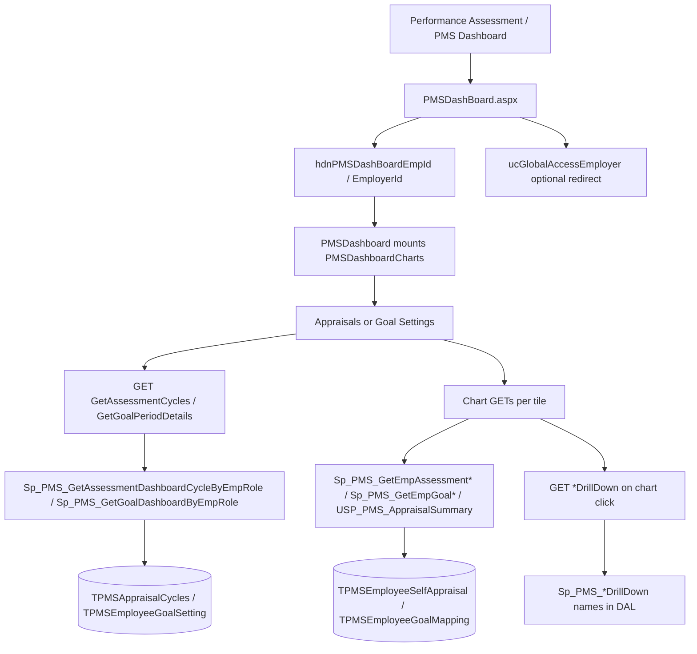
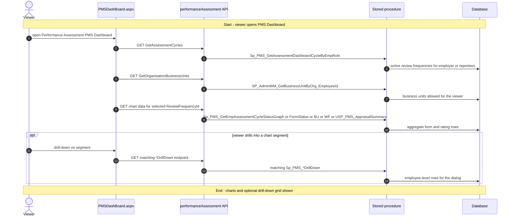
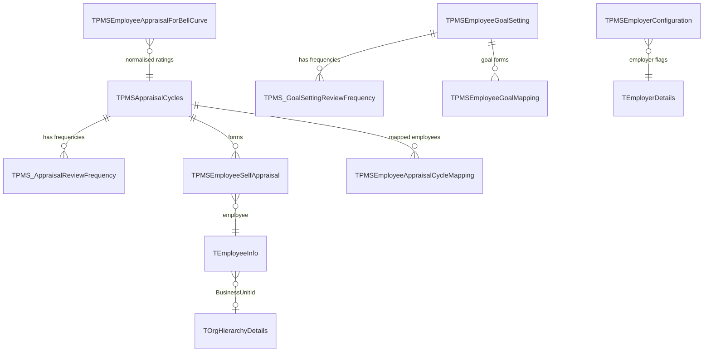

# PMS Dashboard

## Overview

An HR administrator or manager opens **Performance Assessment → PMS Dashboard** to see how appraisal and goal-setting forms are progressing for their organisation. The WebForms host is `~/HRM/PMS_React/PMSDashBoard.aspx`. It stamps the signed-in employee and selected employer into hidden fields, optionally shows the global-access organisation picker, and mounts the PMS React bundle into `#root`.

The live SPA (`PMSDashboard` → `PMSDashboardCharts`) toggles between **Appraisals** and **Goal Settings**. Appraisals shows assessment outcome, form status, business-unit form status, pending approvals by workflow level, bell-curve / normalisation summary, and employee growth. Goal Settings shows goal-period form status and business-unit goal form status. Charts load through Core Node `GET /api/performanceAssessment/…` reads. Double-click (or the mapped drill-down trigger) opens a dialog that calls a matching drill-down endpoint. Changing the organisation in the aspx control redirects with `QSEmployerId` and reloads the page; there is no chart write path on this screen.

SystemModel-2 `domain/contexts/performance.md` covers the appraisal lifecycle this dashboard summarises. Table blurbs for `TPMS*` objects are in `llm-wiki/reference/tables/hrms.md`. There is no llm-wiki domain page dedicated to this dashboard.

**Who's involved:**

- **HR / Admin roles (role ids 1, 2, 9 in the cycle/goal list procedures)** — see all active cycles or goal periods for the employer.
- **Other managers** — cycle and employee pickers are limited to direct/indirect reportees via `Fn_DirectIndirectReportee`.
- **Employee** — not the primary audience of this menu item; they complete forms elsewhere under Performance Assessment.

## Workflow

## Request journey

This screen is read-only. The request that fills the main Appraisals tiles is open + select cycle.

Goal Settings follows the same shape with `GetGoalPeriodDetails` → `Sp_PMS_GetGoalDashboardByEmpRole` and the goal form-status procedures. Organisation change is a WebForms redirect, not an API write.

## Entry points

> Live host is `PMSDashBoard.aspx` (capital B). `routeConstants.js` also lists `PMSDashboard.aspx` (lowercase b) for the React route match; IIS typically serves the aspx file that exists. Legacy chart components under `Areas/Dashboard/Components/Assessment*.js` remain in the tree but `PMSDashboard.js` only renders `PMSDashboardCharts` (`newPMSCharts.js`); the older `renderChart()` path is commented out.

| UI page / route | Purpose |
|---|---|
| `/HRM/PMS_React/PMSDashBoard.aspx` | Left-nav PMS Dashboard. Stamps employee/employer, global-access employer control, loads `BuildJS/PMS_React.min.js`. Logs activity `PMSDashboard`. |
| React route `RouteConstants.DASHBOARD_HOMEPAGE` | Client route that mounts `PMSDashboard`. |

## Code → database call chain

Base path is `/api` (`app.js` → `routeIndex.js` → `/performanceAssessment`). Controllers call `performanceAssessmentDAL.js` with `mssql` `.execute`. There is no mutating postback DAL on the aspx beyond organisation redirect.

| Entry point | DAL method (`file:line`) | Stored procedure |
|---|---|---|
| Assessment cycle dropdown (Appraisals charts) | `GetAssessmentCycles` (`performanceAssessmentDAL.js:1323`) via `performanceAssessmentController.js:1217` | `Sp_PMS_GetAssessmentDashboardCycleByEmpRole` |
| Business-unit dropdown | `GetOrganisationBusinessUnits` (`performanceAssessmentDAL.js:1338`) via `performanceAssessmentController.js:1226` | `SP_AdminWM_GetBusinessUnitByOrg_EmployeeId` |
| Assessment outcome chart | `GetAssessmentCycleStatus` (`performanceAssessmentDAL.js:1369`) via `performanceAssessmentController.js:1245` | `Sp_PMS_GetEmpAssessmentCycleStatusGraph` |
| Form-status lookup list | `GetAssessmentFormStatus` (`performanceAssessmentDAL.js:1385`) via `performanceAssessmentController.js:1254` | `SP_PMS_GetAssessmentFormStatus` |
| Assessment form-status chart | `GetEmpAssessmentFormStatusGraph` (`performanceAssessmentDAL.js:1398`) via `performanceAssessmentController.js:1263` | `Sp_PMS_GetEmpAssessmentFormStatusGraph` |
| BU-wise assessment form status | `GetEmpAssessmentBUWiseFormStatus` (`performanceAssessmentDAL.js:1429`) via `performanceAssessmentController.js:1281` | `Sp_PMS_GetEmpAssessmentBUWiseFormStatusGraph` |
| Bell-curve / normalisation chart | `GetEmpAssessmentBellCurve` (`performanceAssessmentDAL.js:1445`) via `performanceAssessmentController.js:1290` | `USP_PMS_AppraisalSummary` (DAL passes `@AppraisalCycleid = 0` and the selected review frequency) |
| Pending approvals by workflow level | `GetPendingEmpAssessmentWFGraph` (`performanceAssessmentDAL.js:1637`) via `performanceAssessmentController.js:1398` | `Sp_PMS_GetPendingEmpAssessmentWFGraph` |
| Employee picker for growth chart | `GetAssessmentEmployeeData` (`performanceAssessmentDAL.js:1354`) via `performanceAssessmentController.js:1235` | `sp_PMS_GetAssessmentEmployeeData` (script `SP_PMS_GetAssessmentEmployeeData.sql`) |
| Employee growth chart | `GetEmpAssessmentGrowthChart` (`performanceAssessmentDAL.js:1522`) via `performanceAssessmentController.js:1335` | `Sp_PMS_GetEmpAssessmentGrowthChart` |
| Goal period dropdown | `GetGoalPeriodDetails` (`performanceAssessmentDAL.js:1475`) via `performanceAssessmentController.js:1308` | `Sp_PMS_GetGoalDashboardByEmpRole` |
| Goal form-status chart | `GetEmpGoalFormStatusGraph` (`performanceAssessmentDAL.js:1490`) via `performanceAssessmentController.js:1317` | `Sp_PMS_GetEmpGoalFormStatusGraph` |
| Goal BU-wise form status | `GetEmpGoalAssessmentBUWiseFormStatus` (`performanceAssessmentDAL.js:1506`) via `performanceAssessmentController.js:1326` | `Sp_PMS_GetEmpGoalAssessmentBUWiseFormStatus` |
| Drill-down dialog (by chart category) | matching `*DrillDown` methods (`performanceAssessmentDAL.js:1537`–`1660`) | `Sp_PMS_GetAssessmentCycleStatusDrillDown`, `Sp_PMS_GetEmployeeAssessmentFormStatusDrillDown`, `Sp_PMS_GetEmpAssessmentBUWiseFormStatusDrillDown`, `Sp_PMS_GetEmpAssessmentBellCurveDrillDown`, `Sp_PMS_GetPendingEmpAssessmentWFGraphDrillDown`, `Sp_PMS_GetEmpGoalFormStatusGraphDrillDown`, `Sp_PMS_GetEmpGoalAssessmentBUWiseFormStatusDrillDown` |
| Page `useEffect` (legacy gating; chart tree commented) | `GetConfigurationValues` (`performanceAssessmentDAL.js:1461`) | `Sp_AdminPMS_GetConfigurationValues` |

## API endpoints

No WebForms chart postback. Organisation change redirects to the same aspx with `QSEmployerId`. Live SPA constants are under `/performanceAssessment/…` (mounted at `/api/performanceAssessment`).

| Verb | Route | Parameters | Purpose | Source |
|---|---|---|---|---|
| `GET` | `/api/performanceAssessment/GetAssessmentCycles` | query `employeeId` (int), `employerId` (int) | Assessment cycle / review-frequency options | `performanceAssessmentController.js:1217` |
| `GET` | `/api/performanceAssessment/GetOrganisationBusinessUnits` | query `employeeId`, `employerId` | BU filter options | `performanceAssessmentController.js:1226` |
| `GET` | `/api/performanceAssessment/GetAssessmentCycleStatus` | query `employerId`, `appraisalCycleId` (review frequency id string), `organizationUnits` | Outcome chart series | `performanceAssessmentController.js:1245` |
| `GET` | `/api/performanceAssessment/GetAssessmentFormStatus` | none used by DAL | Form-status lookup values | `performanceAssessmentController.js:1254` |
| `GET` | `/api/performanceAssessment/GetEmpAssessmentFormStatusGraph` | query `employerId`, `appraisalCycleId`, `formStatus` | Form-status chart | `performanceAssessmentController.js:1263` |
| `GET` | `/api/performanceAssessment/GetEmpAssessmentBUWiseFormStatus` | query `employerId`, `appraisalCycleId`, `organizationUnits` | BU-wise assessment form status | `performanceAssessmentController.js:1281` |
| `GET` | `/api/performanceAssessment/GetEmpAssessmentBellCurve` | query `employerId`, `appraisalCycleId`, `organizationUnits` | Bell-curve summary | `performanceAssessmentController.js:1290` |
| `GET` | `/api/performanceAssessment/GetPendingEmpAssessmentWFGraph` | query `employerId`, `appraisalCycleId` | Pending approvals by workflow level | `performanceAssessmentController.js:1398` |
| `GET` | `/api/performanceAssessment/GetAssessmentEmployeeData` | query `employerId`, `employeeId` | Growth-chart employee list | `performanceAssessmentController.js:1235` |
| `GET` | `/api/performanceAssessment/GetEmpAssessmentGrowthChart` | query `employerId`, `employeeId` | Growth series for one employee | `performanceAssessmentController.js:1335` |
| `GET` | `/api/performanceAssessment/GetGoalPeriodDetails` | query `employeeId`, `employerId` | Goal period options | `performanceAssessmentController.js:1308` |
| `GET` | `/api/performanceAssessment/GetEmpGoalFormStatusGraph` | query `employerId`, `goalReviewFreqId`, `formStatus` | Goal form-status chart | `performanceAssessmentController.js:1317` |
| `GET` | `/api/performanceAssessment/GetEmpGoalAssessmentBUWiseFormStatus` | query `employerId`, `goalReviewFreqId`, `organizationUnits` | Goal BU-wise form status | `performanceAssessmentController.js:1326` |
| `GET` | `/api/performanceAssessment/GetAssessmentCycleStatusDrillDown` | query `employerId`, `appraisalCycleId`, `organizationUnits`, `ratingDefination` | Outcome drill-down rows | `performanceAssessmentController.js:1380` |
| `GET` | `/api/performanceAssessment/GetEmployeeAssessmentFormStatusDrillDown` | query `employerId`, `appraisalCycleId`, `formStatus` | Form-status drill-down | `performanceAssessmentController.js:1344` |
| `GET` | `/api/performanceAssessment/GetEmpAssessmentBUWiseFormStatusDrillDown` | query `employerId`, `appraisalCycleId`, `organizationUnits`, `formStatus` | BU form-status drill-down | `performanceAssessmentController.js:1353` |
| `GET` | `/api/performanceAssessment/GetEmpAssessmentBellCurveDrillDown` | query `employerId`, `appraisalCycleId`, `organizationUnits`, `ratingDefination` | Bell-curve drill-down | `performanceAssessmentController.js:1389` |
| `GET` | `/api/performanceAssessment/GetPendingEmpAssessmentWFGraphDrillDown` | query `employerId`, `appraisalCycleId`, `formStatus` | Pending WF drill-down | `performanceAssessmentController.js:1407` |
| `GET` | `/api/performanceAssessment/GetEmpGoalFormStatusGraphDrillDown` | query `employerId`, `goalReviewFreqId`, `formStatus` | Goal form-status drill-down | `performanceAssessmentController.js:1362` |
| `GET` | `/api/performanceAssessment/GetEmpGoalAssessmentBUWiseFormStatusDrillDown` | query `employerId`, `goalReviewFreqId`, `organizationUnits`, `formStatus` | Goal BU drill-down | `performanceAssessmentController.js:1371` |
| `GET` | `/api/performanceAssessment/GetConfigurationValues` | query `employerId` | Still called from `PMSDashboard.js` `useEffect`; not used by live `PMSDashboardCharts` | `performanceAssessmentController.js:1299` |

## Stored procedures & tables involved

> Chart aggregates read appraisal and goal form rows. Nested encryption open/close, `Split`, `Fn_DirectIndirectReportee`, and `Fn_GetEmployeeName` are shared helpers. Drill-down and pending-WF procedure **names** are executed from the DAL but have **no** matching scripts under `HRMS-DATABASE/HRMS/STOREPROCEDURE/` (only catalog DML mentions) — see Known gaps.

| Object | File path | Purpose | llm-wiki |
|---|---|---|---|
| `Sp_PMS_GetAssessmentDashboardCycleByEmpRole` | `HRMS-DATABASE/HRMS/STOREPROCEDURE/Sp_PMS_GetAssessmentDashboardCycleByEmpRole.sql` | Assessment cycle options by role / reportees | — |
| `Sp_PMS_GetGoalDashboardByEmpRole` | `HRMS-DATABASE/HRMS/STOREPROCEDURE/Sp_PMS_GetGoalDashboardByEmpRole.sql` | Goal period options by role / reportees | — |
| `SP_AdminWM_GetBusinessUnitByOrg_EmployeeId` | `HRMS-DATABASE/HRMS/STOREPROCEDURE/SP_AdminWM_GetBusinessUnitByOrg_EmployeeId.sql` | BU picker | — |
| `Sp_PMS_GetEmpAssessmentCycleStatusGraph` | `HRMS-DATABASE/HRMS/STOREPROCEDURE/Sp_PMS_GetEmpAssessmentCycleStatusGraph.sql` | Outcome distribution | — |
| `SP_PMS_GetAssessmentFormStatus` | `HRMS-DATABASE/HRMS/STOREPROCEDURE/SP_PMS_GetAssessmentFormStatus.sql` | Static form-status list | — |
| `Sp_PMS_GetEmpAssessmentFormStatusGraph` | `HRMS-DATABASE/HRMS/STOREPROCEDURE/Sp_PMS_GetEmpAssessmentFormStatusGraph.sql` | Form-status counts | — |
| `Sp_PMS_GetEmpAssessmentBUWiseFormStatusGraph` | `HRMS-DATABASE/HRMS/STOREPROCEDURE/Sp_PMS_GetEmpAssessmentBUWiseFormStatusGraph.sql` | Form status by BU | — |
| `USP_PMS_AppraisalSummary` | `HRMS-DATABASE/HRMS/STOREPROCEDURE/USP_PMS_AppraisalSummary.sql` | Bell-curve percentages | — |
| `FN_PMS_AppraisalSummary` / `FN_PMS_AppraisalSummaryFinalRating` | `HRMS-DATABASE/HRMS/FUNCTIONS/` | Nested summary TVFs for the USP | — |
| `SP_PMS_GetAssessmentEmployeeData` | `HRMS-DATABASE/HRMS/STOREPROCEDURE/SP_PMS_GetAssessmentEmployeeData.sql` | Growth employee list | — |
| `Sp_PMS_GetEmpAssessmentGrowthChart` | `HRMS-DATABASE/HRMS/STOREPROCEDURE/Sp_PMS_GetEmpAssessmentGrowthChart.sql` | Growth ratings over cycles | — |
| `Sp_PMS_GetEmpGoalFormStatusGraph` | `HRMS-DATABASE/HRMS/STOREPROCEDURE/Sp_PMS_GetEmpGoalFormStatusGraph.sql` | Goal form-status counts | — |
| `Sp_PMS_GetEmpGoalAssessmentBUWiseFormStatus` | `HRMS-DATABASE/HRMS/STOREPROCEDURE/Sp_PMS_GetEmpGoalAssessmentBUWiseFormStatus.sql` | Goal form status by BU | — |
| `Sp_AdminPMS_GetConfigurationValues` | `HRMS-DATABASE/HRMS/STOREPROCEDURE/Sp_AdminPMS_GetConfigurationValues.sql` | Employer PMS flags (legacy page call) | — |
| `TPMSAppraisalCycles` / `TPMS_AppraisalReviewFrequency` | `HRMS-DATABASE/HRMS/TABLES/` | Cycle masters | `llm-wiki/reference/tables/hrms.md` |
| `TPMSEmployeeSelfAppraisal` | same | Assessment form rows | `llm-wiki/reference/tables/hrms.md` |
| `TPMSEmployeeGoalSetting` / `TPMSEmployeeGoalMapping` / `TPMS_GoalSettingReviewFrequency` | same | Goal period and form rows | `llm-wiki/reference/tables/hrms.md` |
| `TPMSEmployeeAppraisalForBellCurve` | same | Normalised rating inputs for bell curve | — |
| `TPMSEmployerConfiguration` | same | Employer PMS flags and labels | — |

## Table relationships

No llm-wiki `erDiagram` for this dashboard. Relationships below follow declared joins on the live read path (many HRMS tables have no FK).

## Known gaps

- Eight drill-down / pending-WF procedures are named in `performanceAssessmentDAL.js` but have **no** SQL file under `HRMS-DATABASE/HRMS/STOREPROCEDURE/` (and no Liquibase inventory entry). Only `DML/TDataCatalog_DML.sql` mentions some of the names. Pages could not be written for them from source scripts.
- `PMSDashboard.js` still calls `GetConfigurationValues` and `GetGoalPeriodDetails` on mount for the commented-out `renderChart()` path; live charts ignore those state values and load their own cycles/goals.
- `Sp_AdminPMS_GetEmpAssessmentOutComeColors` exists and has a DAL method, but live `AssesmentOutcomeChart` does not call it.
- `routeConstants.DASHBOARD_HOMEPAGE` uses `PMSDashboard.aspx` while the file on disk is `PMSDashBoard.aspx`.
- Growth-chart employee list for non-admin roles filters self-appraisal rows by reportees but the historical-growth union in the `ELSE` branch does not re-apply that filter.
- Confidence is medium because drill-down SQL is missing from the database repo and chart layout persistence inside `@hrms/hrms-components` `HrmsChartContainer` was not traced beyond this feature's props.

## Reference

Confidence medium — live React → Core Node → SP chain verified for chart GETs; drill-down SQL absent from the DB repo.

### SourceCode

- `HRMS.Web/HRMS.Web/HRM/PMS_React/PMSDashBoard.aspx`
- `HRMS.Web/HRMS.Web/HRM/PMS_React/PMSDashBoard.aspx.cs`
- `HRMS.Web/HRMS.Web/HRM/PMS_React/Areas/Dashboard/Containers/PMSDashboard.js`
- `HRMS.Web/HRMS.Web/HRM/PMS_React/Areas/Dashboard/Components/newPMSCharts.js`
- `HRMS.Web/HRMS.Web/HRM/PMS_React/Areas/Dashboard/Components/AssesmentOutcomeChart.js`
- `HRMS.Web/HRMS.Web/HRM/PMS_React/Areas/Dashboard/Components/AssesmentFormStatusChart.js`
- `HRMS.Web/HRMS.Web/HRM/PMS_React/Areas/Dashboard/Components/AssesmentBUWiseFormStatusChart.js`
- `HRMS.Web/HRMS.Web/HRM/PMS_React/Areas/Dashboard/Components/AssesmentBellCurveChart.js`
- `HRMS.Web/HRMS.Web/HRM/PMS_React/Areas/Dashboard/Components/PendingApprovalsByWorkflowLevelChart.js`
- `HRMS.Web/HRMS.Web/HRM/PMS_React/Areas/Dashboard/Components/AssessmentEmployeeGrowthChart.js`
- `HRMS.Web/HRMS.Web/HRM/PMS_React/Areas/Dashboard/Components/GoalSettingFormStatusChart.js`
- `HRMS.Web/HRMS.Web/HRM/PMS_React/Areas/Dashboard/Components/GoalAssessmentBUWiseFormStatusChart.js`
- `HRMS.Web/HRMS.Web/HRM/PMS_React/Common/apiURLConstants.js`
- `HRMS.CoreAPI/HRMS.Core.WebAPI.Node/Controllers/performanceAssessmentController.js`
- `HRMS.CoreAPI/HRMS.Core.WebAPI.Node/Core/DataAccessLayer/performanceAssessmentDAL.js`
- `HRMS.CoreAPI/HRMS.Core.WebAPI.Node/Routes/performanceAssessmentRoutes.js`
- `docs/SystemModels/SystemModel-2/domain/contexts/performance.md`

### TDG HRMS DB

- `HRMS-DATABASE/HRMS/STOREPROCEDURE/Sp_PMS_GetAssessmentDashboardCycleByEmpRole.sql` and the other chart procedures listed above
- `HRMS-DATABASE/HRMS/FUNCTIONS/FN_PMS_AppraisalSummary.sql`
- `HRMS-DATABASE/HRMS/FUNCTIONS/FN_PMS_AppraisalSummaryFinalRating.sql`
- `llm-wiki/reference/tables/hrms.md` (via Backstage mirror) for `TPMS*` table blurbs
