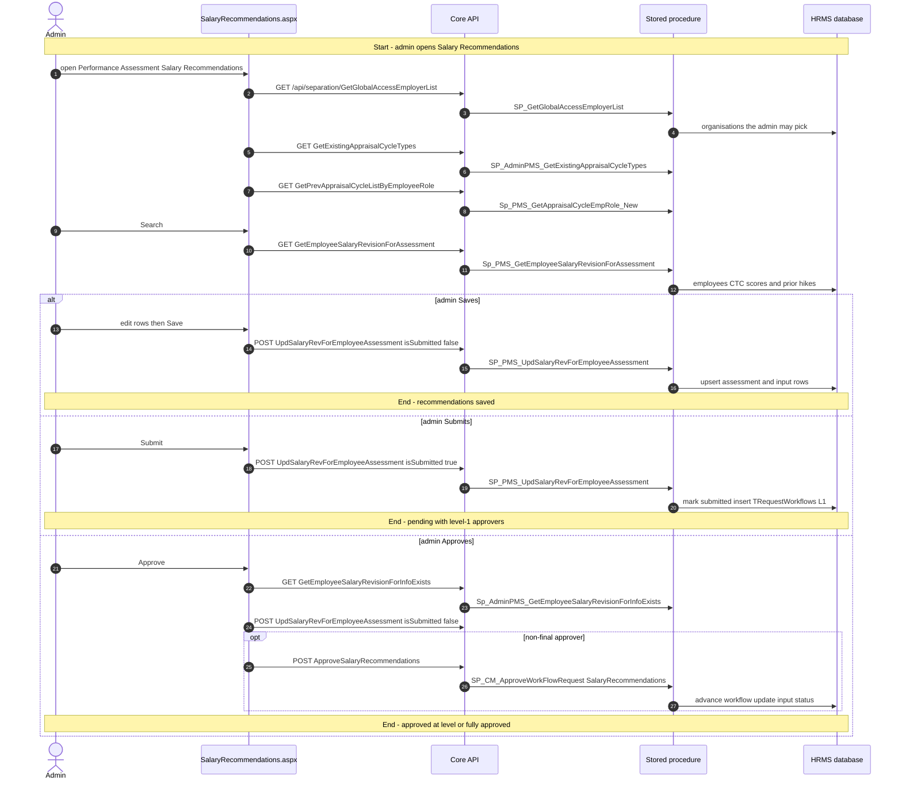
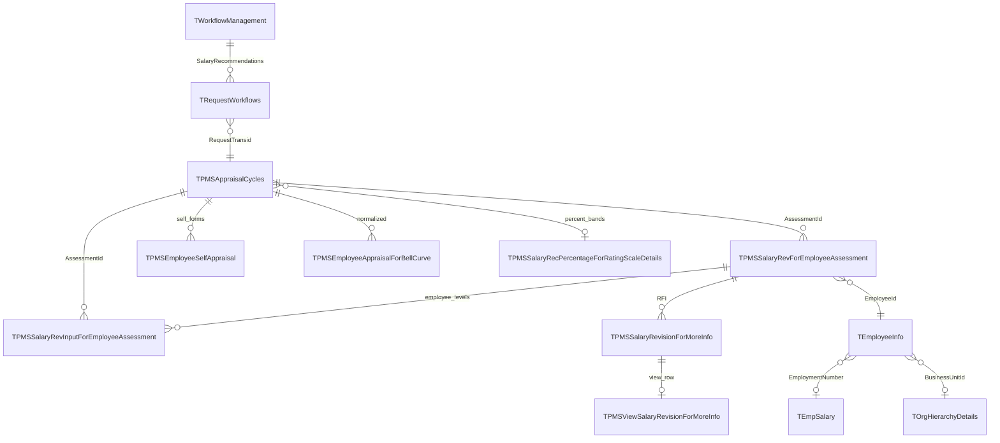

# Salary Recommendations

## Overview

HR / CNB admins and salary-recommendation workflow approvers open **Performance Assessment → Salary Recommendations** (left-nav value `624`) to recommend percent/amount/CTC hikes for employees in an assessment cycle, submit into the `SalaryRecommendations` workflow, approve levels, raise Request-for-Information (RFI) threads, pull back, or freeze the cycle. The live host is `~/HRM/PMS_React/SalaryRecommendations.aspx`, which stamps session employee / employer / business-unit label / CNB-role flag into hidden fields and mounts the React container `SalaryRecommendations`. Filters are organisation (global-access list), appraisal type (C/K/G/B/T), cycle, and (for HR Admin / Manager / CNB) business unit. Search loads the encrypted CTC / hike grid; Save / Submit / Approve / Pullback / Freeze / RFI / Revoke / History / Excel export-upload drive the rest.

**Who's involved:**

- **Initiator (typically HR / CNB)** — selects cycle, enters recommendations, Saves or Submits (creates `TRequestWorkflows` level-1 pending rows).
- **Workflow approvers** — Approve advances `SP_CM_ApproveWorkFlowRequest` for non-final levels; Final Approver saves without that call.
- **RFI participants** — ask/answer questions with optional evidence files under `SalaryRecommendations_RFI` document path.

Legacy `HRM/PerformanceAssessment/SalaryRecommendations.aspx` still exists; the React DML rewrote the menu URL to PMS_React. Pending tiles on the Performance Assessment dashboard deep-link here with `?appraisalId=&appraisalType=`.

## Workflow

```mermaid
flowchart TD
  Nav["Performance Assessment / Salary Recommendations"] --> Page["PMS_React/SalaryRecommendations.aspx"]
  Page --> React["SalaryRecommendations.js"]
  React --> Orgs["GET /separation/GetGlobalAccessEmployerList"]
  Orgs --> OrgSP["SP_GetGlobalAccessEmployerList"]
  React --> Fx["GET GetRupeeToDollarRate"]
  Fx --> ECB["ECB FX XML - no SP"]
  React -->|"CNB roles"| BU["GET GetBusinessUnitByOrgEmployeeId"]
  BU --> BuSP["SP_PMS_GetBusinessUnitByOrg_EmployeeId"]
  React --> Types["GET GetExistingAppraisalCycleTypes"]
  Types --> TypeSP["SP_AdminPMS_GetExistingAppraisalCycleTypes"]
  React --> Cycles["GET GetPrevAppraisalCycleListByEmployeeRole"]
  Cycles --> CycleSP["Sp_PMS_GetAppraisalCycleEmpRole_New"]
  React --> Grid["GET GetEmployeeSalaryRevisionForAssessment"]
  Grid --> GridSP["Sp_PMS_GetEmployeeSalaryRevisionForAssessment"]
  GridSP --> Rev[("TPMSSalaryRevForEmployeeAssessment")]
  GridSP --> Inp[("TPMSSalaryRevInputForEmployeeAssessment")]
  React --> PendingRFI["GET GetSalaryRevisionForPendingEmployees"]
  PendingRFI --> PendSP["Sp_AdminPMS_GetSalaryRevisionForPendingEmployees"]
  React -->|"Save / Submit"| Upd["POST UpdSalaryRevForEmployeeAssessment"]
  Upd --> UpdSP["SP_PMS_UpdSalaryRevForEmployeeAssessment"]
  UpdSP --> Inp
  UpdSP -->|"IsSubmitted"| WF[("TRequestWorkflows")]
  React -->|"Approve"| InfoChk["GET GetEmployeeSalaryRevisionForInfoExists"]
  InfoChk --> InfoSP["Sp_AdminPMS_GetEmployeeSalaryRevisionForInfoExists"]
  InfoChk --> Upd
  InfoChk -->|"non-final"| Appr["POST ApproveSalaryRecommendations"]
  Appr --> ApprSP["SP_CM_ApproveWorkFlowRequest"]
  React -->|"Pullback"| Pb["POST PullbackSalaryRevForEmployeeAssessment"]
  Pb --> PbSP["SP_PMS_PullbackSalaryRevForEmployeeAssessment"]
  React -->|"Freeze"| Frz["POST UpdSalaryRevFreezed"]
  Frz --> FrzSP["SP_AdminPMS_UpdSalaryRevFreezed"]
  React -->|"RFI dialog"| More["GET/POST MoreInfo SPs"]
  More --> MoreGet["Sp_PMS_GetEmployeeSalaryRevisionForMoreinfo"]
  More --> MoreUpd["SP_PMS_UPDSalaryRevisionForMoreInfo"]
  React -->|"Revoke / History"| Aud["GET Revoke/Audit SPs"]
  Aud --> RevSP["Sp_PMS_GetRevokeEmployeeSalaryRevisionForAssessment"]
  Aud --> AudSP["Sp_PMS_GetAuditSalaryRevisionForAssessment"]
  Aud --> RevokePost["SP_PMS_RevokeSalaryRevisionForMoreInfo"]
```

## Request journey

The primary mutating journey is **Submit** (start workflow) or **Approve** (advance / complete). Save alone persists TVP rows without routing. Approve is blocked while the login user’s raised RFIs are still unanswered.

## Entry points

> `SalaryRecommendations.aspx` is the live **Performance Assessment → Salary Recommendations** shell (`TMenuDetails` / hierarchy value `624`). It loads `BuildJS/PMS_React.min.js` and routes `RouteConstants.SALARY_RECOMMENDATIONS` (`/HRM/PMS_React/SalaryRecommendations.aspx`) to `Areas/SalaryRecommendations/Containers/SalaryRecommendations.js`. Code-behind only stamps hidden fields — no WebForms postback DAL.

| UI page / route | Purpose |
|---|---|
| `/HRM/PMS_React/SalaryRecommendations.aspx` | Left-nav host. Hidden `hdnSalaryRecommendationsEmpId` / `EmployerId` / `BusinessUnitLabel` / `IsHrAdminManagerCNB`. |
| `/HRM/PMS_React/SalaryRecommendations.aspx?appraisalId=&appraisalType=` | Deep link from Performance Assessment pending Salary Recommendations tile. |
| `/HRM/PerformanceAssessment/SalaryRecommendations.aspx` | Legacy WebForms host. Not the current menu URL. |
| Dashboard / For Me pending Salary Recommendations | Loads pending cycles via `GetPendingSalaryRecommendationsForAssessment` then navigates to this page (caller is the dashboard, not this shell). |

## Code → database call chain

`APIHelper` prefixes relative paths with `process.env.API_URL` (Core API `/api`). Org picker uses the **separation** route; all other Salary Recommendations calls use **performanceAssessment**.

| Entry point | DAL / BLL method (`file:line`) | Stored procedure |
|---|---|---|
| Org picker (`SalaryRecommendations.js:211`) | `GetGlobalAccessEmployerList` (`separationDAL.js:989`) via `separationController.js:958` | `SP_GetGlobalAccessEmployerList` |
| Dollar rate for Summary (`SalaryRecommendations.js:200`) | `GetRupeeToDollarRate` (`performanceAssessmentController.js:1943`) — ECB XML | *(no SP)* |
| Business units CNB (`SalaryRecommendations.js:246`) | `GetBusinessUnitByOrgEmployeeId` (`performanceAssessmentDAL.js:1774`) via `performanceAssessmentController.js:1510` | `SP_PMS_GetBusinessUnitByOrg_EmployeeId` |
| Appraisal type radios (`SalaryRecommendations.js:261`) | `GetExistingAppraisalCycleTypes` (`performanceAssessmentDAL.js:2350`) via `performanceAssessmentController.js:1796` | `SP_AdminPMS_GetExistingAppraisalCycleTypes` |
| Cycle dropdown (`SalaryRecommendations.js:279`) | `GetPrevAppraisalCycleListByEmployeeRole` (`performanceAssessmentDAL.js:2364`) via `performanceAssessmentController.js:1805` | `Sp_PMS_GetAppraisalCycleEmpRole_New` |
| Employee grid Search (`SalaryRecommendations.js:367`) | `GetEmployeeSalaryRevisionForAssessment` (`performanceAssessmentDAL.js:2479`) via `performanceAssessmentController.js:1849` | `Sp_PMS_GetEmployeeSalaryRevisionForAssessment` |
| Outstanding RFI banner (`SalaryRecommendations.js:472`) | `GetSalaryRevisionForPendingEmployees` (`performanceAssessmentDAL.js:2715`) via `performanceAssessmentController.js:1913` | `Sp_AdminPMS_GetSalaryRevisionForPendingEmployees` |
| Save / Submit / pre-Approve save (`SalaryRecommendations.js:685`) | `UpdSalaryRevForEmployeeAssessment` (`performanceAssessmentDAL.js:2508`) via `performanceAssessmentController.js:1859` | `SP_PMS_UpdSalaryRevForEmployeeAssessment` (`UDT_SalaryRevForEmployeeAssessment` TVP) |
| Approve RFI gate (`SalaryRecommendations.js:770`) | `GetEmployeeSalaryRevisionForInfoExists` (`performanceAssessmentDAL.js:2670`) via `performanceAssessmentController.js:1886` | `Sp_AdminPMS_GetEmployeeSalaryRevisionForInfoExists` |
| Approve workflow advance (`SalaryRecommendations.js:786`) | `ApproveWorkFlowRequest` (`performanceAssessmentDAL.js:2750`) via `performanceAssessmentController.js:1932` | `SP_CM_ApproveWorkFlowRequest` (`RequestType` `SalaryRecommendations`) |
| Pullback (`SalaryRecommendations.js:803`) | `PullbackSalaryRevForEmployeeAssessment` (`performanceAssessmentDAL.js:2655`) via `performanceAssessmentController.js:1877` | `SP_PMS_PullbackSalaryRevForEmployeeAssessment` |
| Freeze (`SalaryRecommendations.js:817`) | `UpdSalaryRevFreezed` (`performanceAssessmentDAL.js:2639`) via `performanceAssessmentController.js:1868` | `SP_AdminPMS_UpdSalaryRevFreezed` |
| RFI load (`RequestForInfoDialog.js:32`) | `GetEmployeeSalaryRevisionForMoreinfo` (`performanceAssessmentDAL.js:1977`) via `performanceAssessmentController.js:1627` | `Sp_PMS_GetEmployeeSalaryRevisionForMoreinfo` |
| RFI ask/answer (`RequestForInfoDialog.js:114`) | `UPDSalaryRevisionForMoreInfo` (`performanceAssessmentDAL.js:1991`) via `performanceAssessmentController.js:1636` | `SP_PMS_UPDSalaryRevisionForMoreInfo` (`UDT_SalaryRevisionForMoreInfo` TVP) |
| RFI attachment path (`performanceAssessmentController.js:1969`) | `GetDocumentPath` (`performanceAssessmentDAL.js:2768`) | `SP_CM_GetEmailTemplatesDocumentPath` (`SalaryRecommendations_RFI`) |
| RFI CustId path (`performanceAssessmentController.js:1970`) | `GetEmployeeFullInformation` (`performanceAssessmentDAL.js:2782`) | `SP_CM_GetEmployeeFullInformation` |
| Revoke list (`RevokeQuestionsDialog.js:20`) | `GetRevokeEmployeeSalaryRevisionForAssessment` (`performanceAssessmentDAL.js:2685`) via `performanceAssessmentController.js:1895` | `Sp_PMS_GetRevokeEmployeeSalaryRevisionForAssessment` |
| Revoke post (`RevokeQuestionsDialog.js:48`) | `RevokeSalaryRevisionForMoreInfo` (`performanceAssessmentDAL.js:2732`) via `performanceAssessmentController.js:1922` | `SP_PMS_RevokeSalaryRevisionForMoreInfo` |
| History (`ViewHistoryDialog.js:19`) | `GetAuditSalaryRevisionForAssessment` (`performanceAssessmentDAL.js:2700`) via `performanceAssessmentController.js:1904` | `Sp_PMS_GetAuditSalaryRevisionForAssessment` |
| Excel template (`SalaryRecommendations.js:890`) | `GenerateSalaryRecTemplate` (`performanceAssessmentController.js:3068`) — xlsx in memory | *(no SP)* |
| Excel parse (`SalaryRecommendations.js:935`) | `ParseNormalizationBulkUpload` — shared xlsx parser | *(no SP)* |

## API endpoints

No WebForms postback on the React host. `Authorize` is on each Core API route below.

| Verb | Route | Parameters | Purpose |
|---|---|---|---|
| `GET` | `/api/separation/GetGlobalAccessEmployerList` | query `employeeId` | Organisation dropdown |
| `GET` | `/api/performanceAssessment/GetRupeeToDollarRate` | *(none)* | INR per USD for Summary (ECB; default 85) |
| `GET` | `/api/performanceAssessment/GetBusinessUnitByOrgEmployeeId` | query `employeeId`, `employerId` | BU multi-select (CNB roles) |
| `GET` | `/api/performanceAssessment/GetExistingAppraisalCycleTypes` | query `employerId` | Appraisal type radios |
| `GET` | `/api/performanceAssessment/GetPrevAppraisalCycleListByEmployeeRole` | query `employeeId`, `employerId` | Cycle list; SPA filters by `ProcessType` |
| `GET` | `/api/performanceAssessment/GetEmployeeSalaryRevisionForAssessment` | query `employerIds`, `appraisalCycleId`, `organizationUnits`, `employeeId` | Grid rows (API decrypts CTC/hikes) |
| `GET` | `/api/performanceAssessment/GetSalaryRevisionForPendingEmployees` | query `appraisalCycleId`, `loggedInEmpId` | Outstanding RFI HTML message |
| `POST` | `/api/performanceAssessment/UpdSalaryRevForEmployeeAssessment` | body `appraisalCycleId`, `employeeList[]`, `modifiedBy`, `isSubmitted` | Save or Submit TVP |
| `GET` | `/api/performanceAssessment/GetEmployeeSalaryRevisionForInfoExists` | query `appraisalCycleId`, `loggedInEmpId` | Block Approve while RFI open |
| `POST` | `/api/performanceAssessment/ApproveSalaryRecommendations` | body `appraisalCycleId`, `employeeId`, `employerId`, `comments` | Workflow approve |
| `POST` | `/api/performanceAssessment/PullbackSalaryRevForEmployeeAssessment` | body `appraisalCycleId`, `modifiedBy` | Pull back submitted recommendations |
| `POST` | `/api/performanceAssessment/UpdSalaryRevFreezed` | body `appraisalCycleId`, `employerId`, `freezedBy` | Freeze cycle salary revision |
| `GET` | `/api/performanceAssessment/GetEmployeeSalaryRevisionForMoreinfo` | query `appraisalCycleId`, `employeeId` | RFI conversation + employee list |
| `POST` | `/api/performanceAssessment/UPDSalaryRevisionForMoreInfo` | body TVP fields + `questionId` | Ask or answer RFI |
| `GET` | `/api/performanceAssessment/DownloadSalaryRFIAttachment` | query file/employee/cycle/login | Download RFI evidence |
| `POST` | `/api/performanceAssessment/UploadSalaryRFIAttachment` | multipart | Upload RFI evidence |
| `GET` | `/api/performanceAssessment/GetRevokeEmployeeSalaryRevisionForAssessment` | query `appraisalCycleId`, `employeeId` | Unanswered questions to revoke |
| `POST` | `/api/performanceAssessment/RevokeSalaryRevisionForMoreInfo` | body `requestTransIds`, `appraisalCycleId`, `modifiedBy` | Soft-delete RFI questions |
| `GET` | `/api/performanceAssessment/GetAuditSalaryRevisionForAssessment` | query `appraisalCycleId`, `loggedInEmployeeId` | RFI history grid |
| `POST` | `/api/performanceAssessment/GenerateSalaryRecTemplate` | body `rows` | Export Excel (no DB) |
| `POST` | `/api/performanceAssessment/ParseNormalizationBulkUpload` | multipart `file` | Parse Excel for merge (no DB) |

## Stored procedures & tables involved

| Object | Role on this page |
|---|---|
| `SP_GetGlobalAccessEmployerList` | Organisations the login employee may select |
| `SP_PMS_GetBusinessUnitByOrg_EmployeeId` | Business units for CNB filter |
| `SP_AdminPMS_GetExistingAppraisalCycleTypes` | Distinct appraisal types with self-appraisal rows |
| `Sp_PMS_GetAppraisalCycleEmpRole_New` | Cycle list for the employer |
| `Sp_PMS_GetEmployeeSalaryRevisionForAssessment` | Main grid (seed from assessment or read saved revision) |
| `Sp_AdminPMS_GetSalaryRevisionForPendingEmployees` | Pending RFI names for the login user |
| `SP_PMS_UpdSalaryRevForEmployeeAssessment` | Persist TVP; on submit create workflow + notification |
| `Sp_AdminPMS_GetEmployeeSalaryRevisionForInfoExists` | Approve gate for open RFIs created by login |
| `SP_CM_ApproveWorkFlowRequest` | Advance / complete `SalaryRecommendations` workflow |
| `SP_PMS_PullbackSalaryRevForEmployeeAssessment` | Clear pending workflow and higher-level inputs |
| `SP_AdminPMS_UpdSalaryRevFreezed` | Set `TPMSAppraisalCycles.IsSalaryRevFreezed` |
| `Sp_PMS_GetEmployeeSalaryRevisionForMoreinfo` | RFI Q/A threads + employee name list |
| `SP_PMS_UPDSalaryRevisionForMoreInfo` | Insert/update RFI questions and answers |
| `Sp_PMS_GetRevokeEmployeeSalaryRevisionForAssessment` | Unprocessed questions raised by login |
| `SP_PMS_RevokeSalaryRevisionForMoreInfo` | Soft-delete RFI question + view rows |
| `Sp_PMS_GetAuditSalaryRevisionForAssessment` | Full RFI history for login |
| `SP_CM_GetEmailTemplatesDocumentPath` | `SalaryRecommendations_RFI` folder root |
| `SP_CM_GetEmployeeFullInformation` | CustId for RFI file path |
| `UDT_SalaryRevForEmployeeAssessment` | Save/Submit TVP |
| `UDT_SalaryRevisionForMoreInfo` | RFI TVP |
| `TPMSSalaryRevForEmployeeAssessment` | Per-employee assessment snapshot for the cycle |
| `TPMSSalaryRevInputForEmployeeAssessment` | Per review-level hike inputs and approval flags |
| `TPMSSalaryRevisionForMoreInfo` | RFI question/answer rows |
| `TPMSViewSalaryRevisionForMoreInfo` | Flattened RFI view used by history/revoke |
| `TPMSAppraisalCycles` | Cycle metadata and freeze flag |
| `TPMSEmployeeSelfAppraisal` / `TPMSEmployeeAppraisalForBellCurve` | Final / normalized scores seeding the grid |
| `TPMSSalaryRecPercentageForRatingScaleDetails` | Suggested `SalaryRevisionPercent` bands |
| `TEmpSalary` | Encrypted TotalCTC / currency |
| `TRequestWorkflows` / `TWorkflowManagement` | `SalaryRecommendations` routing |
| `TEmailNotification` / home-page notification helpers | Submit / pullback / approve notifications |
| `TEmployeeInfo` / `TOrgHierarchyDetails` / `TTitle` | Names, BU, designation |

## Table relationships

Edges follow the joins and writes in the salary-revision SPs. `TRequestWorkflows.RequestTransid` for this flow is the appraisal cycle id.

## Known gaps

- **Legacy WebForms Salary Recommendations** remains in source; live left-nav uses PMS_React.
- **`GetRupeeToDollarRate` has no SP** — Core API fetches ECB daily XML and defaults to `85` on failure.
- **Excel generate / parse have no SP** — template and bulk merge are in-memory; Save/Submit still go through `SP_PMS_UpdSalaryRevForEmployeeAssessment`.
- **Final Approver Approve** skips `SP_CM_ApproveWorkFlowRequest` after save; only non-final approvers call it.
- **`SP_CM_ApproveWorkFlowRequest` is shared** across many request types; this page only passes `RequestType = SalaryRecommendations` with `RequestTransId = appraisalCycleId`.
- **RFI file I/O** uses filesystem under `SP_CM_GetEmailTemplatesDocumentPath` + CustId — not a blob table.
- **Pending dashboard list** (`SP_PMS_GetPendingSalaryRecommendationsForAssessment`) is not called by this page; it only deep-links here.
- No llm-wiki domain lifecycle page specifically for Salary Recommendations; behaviour above is from SourceCode + procedure scripts.

## Reference

- `HRMS.Web/HRMS.Web/HRM/PMS_React/SalaryRecommendations.aspx` (+ `.cs`)
- `HRMS.Web/HRMS.Web/HRM/PMS_React/Areas/SalaryRecommendations/Containers/SalaryRecommendations.js`
- `HRMS.Web/HRMS.Web/HRM/PMS_React/Areas/SalaryRecommendations/Components/RequestForInfoDialog.js`
- `HRMS.Web/HRMS.Web/HRM/PMS_React/Areas/SalaryRecommendations/Components/RevokeQuestionsDialog.js`
- `HRMS.Web/HRMS.Web/HRM/PMS_React/Areas/SalaryRecommendations/Components/ViewHistoryDialog.js`
- `HRMS.Web/HRMS.Web/HRM/PMS_React/Areas/SalaryRecommendations/Components/SalaryRecListGrid.js`
- `HRMS.Web/HRMS.Web/HRM/PMS_React/Areas/SalaryRecommendations/Components/SalaryRecSummaryDialog.js`
- `HRMS.Web/HRMS.Web/HRM/PMS_React/Common/apiURLConstants.js`, `routeConstants.js`, `Areas/routes.js`
- `HRMS.CoreAPI/HRMS.Core.WebAPI.Node/Routes/performanceAssessmentRoutes.js`, `separationRoutes.js`
- `HRMS.CoreAPI/HRMS.Core.WebAPI.Node/Controllers/performanceAssessmentController.js`, `separationController.js`
- `HRMS.CoreAPI/HRMS.Core.WebAPI.Node/Core/DataAccessLayer/performanceAssessmentDAL.js`, `separationDAL.js`
- `HRMS-DATABASE/HRMS/STOREPROCEDURE/Sp_PMS_GetEmployeeSalaryRevisionForAssessment.sql`
- `HRMS-DATABASE/HRMS/STOREPROCEDURE/SP_PMS_UpdSalaryRevForEmployeeAssessment.sql`
- `HRMS-DATABASE/HRMS/STOREPROCEDURE/SP_CM_ApproveWorkFlowRequest.sql`
- `HRMS-DATABASE/HRMS/DML/PMSRelease-React/MenuDetails.sql` (NavigateURL rewrite)
- `HRMS-DATABASE/HRMS/DML/Tmenudetails DML.sql` (Salary Recommendations value 624)
