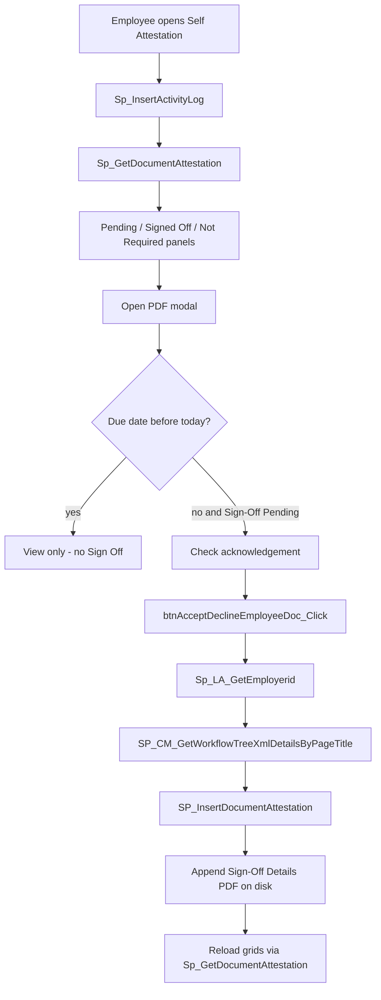
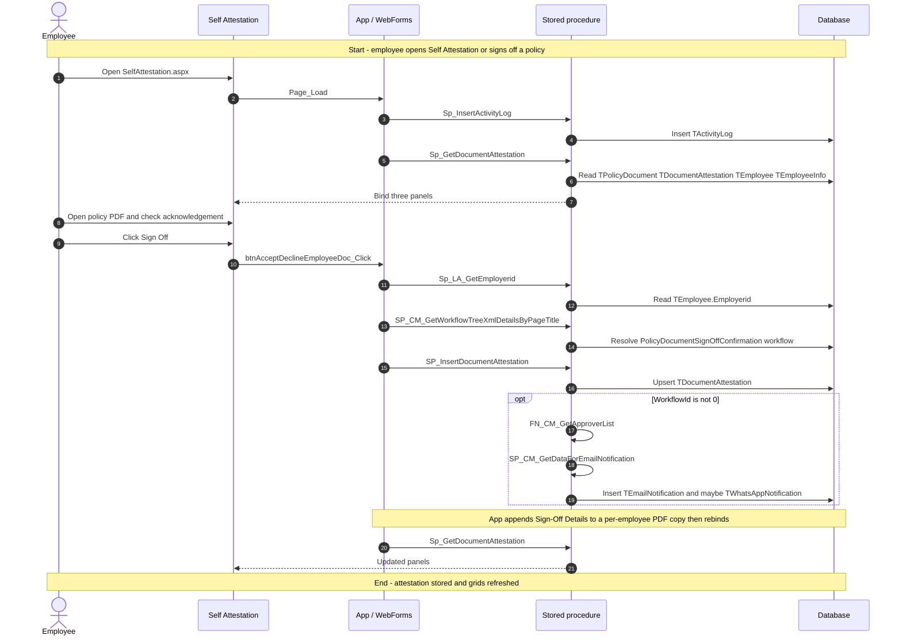
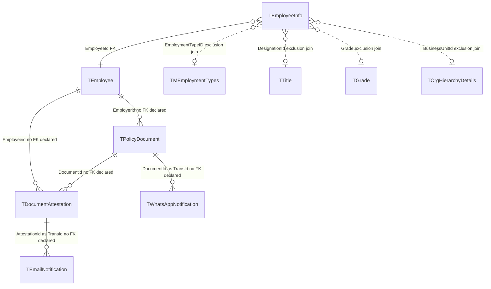

# Self Attestation

## Overview

An employee opens **Policy Documents → Self Attestation** to see active company policies for their employer and to sign off when sign-off is required. The page loads three RadPanelBar sections from one procedure result: policies still pending sign-off, policies already signed off, and policies that do not require sign-off. Opening a PDF shows a modal; when sign-off is still allowed, the employee checks the acknowledgement statement and clicks Sign Off. That path may attach a workflow id when Policy Document Sign-Off Confirmation is configured, writes or refreshes `TDocumentAttestation`, optionally queues email and WhatsApp, and appends a Sign-Off Details page to a per-employee copy of the PDF on disk.

`FilterType=PT` (from the Home policy reminder or notifications) keeps only the pending panel expanded and hides the other two. Past-due pending rows stay visible but cannot be signed (row tinted; sign-off UI hidden). Admin publish and maintenance stay on **Admin Configuration → Policy Documents Setup**, not this screen.

`docs/SystemModels/SystemModel-2` has no workflow page for Self Attestation. `llm-wiki/reference/tables/hrms.md` has one-line blurbs for `TPolicyDocument` and `TDocumentAttestation` with no declared parents.

## Workflow

## Request journey

## Entry points

Live left-nav item is **Self Attestation** under **Policy Documents**. The page uses menu id `66` for tab editability (`WebCommonTab.GetTabsByMenu(66)`). Activity type is `ActivityDescription.SelfAttestation` = `380`.

| Entry | Purpose |
|---|---|
| `~/HRM/EmployeePolicy/SelfAttestation.aspx` | Employee list and sign-off for assigned active policies. |
| `~/HRM/EmployeePolicy/SelfAttestation.aspx?filterType=PT` | Pending-only view used by the Home policy reminder and chatbot notification deep link. |
| `~/HRM/EmployeePolicy/PolicyDocumentsSetup.aspx` | Admin publish/update/delete. Out of scope for this guide. |

## Code → database call chain

There is no Self Attestation BLL. The page uses `SelfAttestationHelper` for policy list and sign-off, `CommonDAL` / `GenericWorkFlowBll` for employer and workflow, and activity logging helpers for the activity row. File open, download, and PDF append are disk I/O only.

| Entry | Method | Database |
|---|---|---|
| Every request, `SelfAttestation.aspx.cs:37` | `CommonUtil.LogActivity` (`Common.cs:52`) → `LogUserActivity.LogActivity` (`LogUserActivity.cs:36`) → `ActivityLog.LogActivityAsync` (`ActivityLog.cs:22`) → `ActivityHelper.LogActivity` (`ActivityHelper.cs:32`) | `Sp_InsertActivityLog`. Activity type id is `ActivityDescription.SelfAttestation` = 380 (`Enums.cs:323`). |
| First load and rebind, `SelfAttestation.aspx.cs:86`, `:97`, `:546`, `:599` | `SelfAttestationHelper.GetEmployeePolicyDocuments` (`SelfAttestationHelper.cs:13`) | `Sp_GetDocumentAttestation`. Query string `FilterType` (or empty) is passed through. |
| Grid NeedDataSource, `SelfAttestation.aspx.cs:603`, `:608`, `:613` | Same helper via `FilteredTable` / `GetAllPolicyDocs` | Same `Sp_GetDocumentAttestation` result, filtered in memory into the three panels. |
| Sign Off, `SelfAttestation.aspx.cs:529` | `CommonDAL.GetEmployerId` (`CommonDAL.cs:202`) | `Sp_LA_GetEmployerid`. |
| Sign Off, `SelfAttestation.aspx.cs:530` | `GenericWorkFlowBll.CheckWorkFlowAvailable` (`GenericWorkFlowBLL.cs:12`) → `GenericWorkFlowDal.CheckWorkFlowAvailable` / `GetWorkFlowTreeXml` (`GenericWorkFlowDAL.cs:14`, `:30`) | `SP_CM_GetWorkflowTreeXmlDetailsByPageTitle` with page title `PolicyDocumentSignOffConfirmation`. |
| Sign Off, `SelfAttestation.aspx.cs:536` / `:540` | `SelfAttestationHelper.AddAttestedPolicyDocuments` (`SelfAttestationHelper.cs:23`) | `SP_InsertDocumentAttestation` with `SignOffSource` default `POLICY_DOCUMENTS_MODULE`. Workflow id is `0` when no tree is available, otherwise the resolved workflow id. Nested when `@WorkflowId <> 0`: `FN_CM_GetApproverList`, `SP_CM_GetDataForEmailNotification`, and `dbo.Split`. |
| Sign Off after insert, `SelfAttestation.aspx.cs:544` | `AppendToPdf` (`SelfAttestation.aspx.cs:296`) | No stored procedure. Merges acknowledgement HTML into a per-employee PDF under the policy folder. |
| Edit permission, `SelfAttestation.aspx.cs:65` | `WebCommonTab.GetTabsByMenu(66)` | No stored procedure. Session tab lists only. |
| Open / download PDF, `SelfAttestation.aspx.cs:121`, `:618` | `OpenFileAttachment` / `DownloadFile` | No stored procedure. Streams from disk (`OpenFile.aspx?policydoc=` in the modal iframe). |

`InsertSignedDocFlag` (`SelfAttestation.aspx.cs:173`) is reached from `btnSubmit_Click`, but the call to `AddAttestedPolicyDocuments` inside it is commented out, so bulk checkbox submit does not persist attestation.

## API endpoints

This screen is a WebForms postback. It does not call HRMS Core API, and it has no page method or AJAX endpoint of its own. The modal uses client script plus a standard postback on Sign Off.

| Postback | Handler | What is posted | Purpose | Source |
|---|---|---|---|---|
| First load and every postback | `Page_Load` | Session employee; optional `FilterType` | Activity log; first load binds panels and expands pending when `FilterType` is `PT`. | `SelfAttestation.aspx.cs:35` |
| Sign Off | `btnAcceptDeclineEmployeeDoc_Click` | Hidden `DocumentId`, acknowledgement checkbox, download path, employee name, timestamp, acknowledgement text | Resolve workflow, insert attestation, append PDF, rebind. | `SelfAttestation.aspx.cs:522` |
| Acknowledgement checkbox | `chkHeaderFooter_CheckedChanged` | Checkbox state | Enables or disables the Sign Off button. No procedure. | `SelfAttestation.aspx.cs:510` |
| Submit (legacy bulk) | `btnSubmit_Click` | Checked pending rows | Shows success or validation message only; insert is commented out. | `SelfAttestation.aspx.cs:591` |
| Reset | `btnReset_Click` | None | Reloads panels via `Sp_GetDocumentAttestation`. | `SelfAttestation.aspx.cs:597` |
| Open attachment | `OpenAttachment_Click` | File path | Streams the file when it exists on disk. | `SelfAttestation.aspx.cs:121` |
| Download signed copy | `btndownloadPolicy_Click` | Per-employee file path | Streams the signed PDF when download is allowed. | `SelfAttestation.aspx.cs:618` |

## Stored procedures & tables involved

Direct procedures are the strings in `SelfAttestationHelper`, `CommonDAL` / `DBConstant`, activity logging, and `GenericWorkFlowDal`. Nested objects under `SP_InsertDocumentAttestation` are listed one level deep.

| Object | File | Purpose | Wiki |
|---|---|---|---|
| [Sp_GetDocumentAttestation](/docs/database/hrms/Sp_GetDocumentAttestation) | `HRMS-DATABASE/HRMS/STOREPROCEDURE/Sp_GetDocumentAttestation.sql` | Active, non-deleted policies for the employee’s employer, with exclusion filters and sign-off status. Non-empty `@FilterType` returns pending sign-off only. | `llm-wiki/reference/tables/hrms.md` (`TPolicyDocument`, `TDocumentAttestation`) |
| [SP_InsertDocumentAttestation](/docs/database/hrms/SP_InsertDocumentAttestation) | `HRMS-DATABASE/HRMS/STOREPROCEDURE/SP_InsertDocumentAttestation.sql` | Upserts attestation rows; when `@WorkflowId <> 0`, queues email and maybe WhatsApp. | `llm-wiki/reference/tables/hrms.md` (`TDocumentAttestation`) |
| [Sp_LA_GetEmployerid](/docs/database/hrms/Sp_LA_GetEmployerid) | `HRMS-DATABASE/HRMS/STOREPROCEDURE/Sp_LA_GetEmployerid.sql` | Employer id for the logged-in employee before the workflow check. | `llm-wiki/reference/tables/hrms.md` (`TEmployee`) |
| [SP_CM_GetWorkflowTreeXmlDetailsByPageTitle](/docs/database/hrms/SP_CM_GetWorkflowTreeXmlDetailsByPageTitle) | `HRMS-DATABASE/HRMS/STOREPROCEDURE/SP_CM_GetWorkflowTreeXmlDetailsByPageTitle.sql` | Whether `PolicyDocumentSignOffConfirmation` has a workflow tree for the employee. | Workflow tables via that page |
| [Sp_InsertActivityLog](/docs/database/hrms/Sp_InsertActivityLog) | `HRMS-DATABASE/HRMS/STOREPROCEDURE/Sp_InsertActivityLog.sql` | One activity row on every page request. | `llm-wiki/reference/tables/hrms.md` (`TActivityLog`) |
| [FN_CM_GetApproverList](/docs/database/hrms/FN_CM_GetApproverList) | `HRMS-DATABASE/HRMS/FUNCTIONS/FN_CM_GetApproverList.sql` | Approver list when a workflow id is present. Nested from insert. | Workflow details |
| [SP_CM_GetDataForEmailNotification](/docs/database/hrms/SP_CM_GetDataForEmailNotification) | `HRMS-DATABASE/HRMS/STOREPROCEDURE/SP_CM_GetDataForEmailNotification.sql` | Result set inserted into `TEmailNotification`. Nested from insert. | `llm-wiki/reference/tables/hrms.md` (`TEmailNotification`) |
| [Split](/docs/database/hrms/Split) | `HRMS-DATABASE/HRMS/FUNCTIONS/Split.sql` (or inventoried Split) | Splits comma-separated document ids inside the insert procedure. | — |
| `TPolicyDocument` | `HRMS-DATABASE/HRMS/TABLES/TPolicyDocument.sql` | Policy header, path, sign-off flags, exclusions, acknowledgement. | `llm-wiki/reference/tables/hrms.md` |
| `TDocumentAttestation` | `HRMS-DATABASE/HRMS/TABLES/TDocumentAttestation.sql` | Per-employee attestation date, version, and sign-off source. | `llm-wiki/reference/tables/hrms.md` |
| `TEmployee`, `TEmployeeInfo` | `HRMS-DATABASE/HRMS/TABLES/TEmployee.sql`, `TEmployeeInfo.sql` | Employer scope and exclusion attributes. | `llm-wiki/reference/tables/hrms.md` |
| `TEmailNotification` | `HRMS-DATABASE/HRMS/TABLES/TEmailNotification.sql` | Pending `PolicyDocumentSignOffConfirmation` mail when workflow exists. | `llm-wiki/reference/tables/hrms.md` |
| `TWhatsAppNotification` | `HRMS-DATABASE/HRMS/TABLES/TWhatsAppNotification.sql` | Pending `PolicySignOff` rows when WhatsApp is enabled. | Mentioned in domain wiki; no table catalog blurb |
| `TActivityLog` | via `Sp_InsertActivityLog` | Page open activity. | `llm-wiki/reference/tables/hrms.md` |

## Table relationships

`llm-wiki/reference/tables/hrms.md` lists `TPolicyDocument` and `TDocumentAttestation` with no referenced parents. The diagram uses joins the Self Attestation procedures perform. Declared foreign keys are labeled as such; other joins are not declared on the baseline scripts.

Baseline `TDocumentAttestation.sql` has identity `Attestationid` only. Later DDL adds `PolicyVersion`, `SignOffSource` (check `BANNER` / `LIST_MODAL` / `POLICY_DOCUMENTS_MODULE`), and unique index `(Employeeid, Documentid)`.

## Known gaps

- **No SystemModel-2 page.** Nothing under `docs/SystemModels/SystemModel-2` names Self Attestation. The call chain is from the WebForms page and helpers.
- **Bulk Submit does not persist.** `InsertSignedDocFlag` shows a success message for checked rows, but `AddAttestedPolicyDocuments` is commented out. Only the modal Sign Off path writes attestation.
- **`@FilterType` is declared as bare `varchar`.** In SQL Server that is `varchar(1)`. Non-empty filter values such as `PT` still work for the “not empty” branch, but longer filter codes cannot be stored in the parameter.
- **Past-due policies remain listed.** Rows with due date before today stay in Pending for Sign Off but cannot be signed from the UI.
- **Workflow employer vs session employer.** Workflow availability uses `CommonDAL.GetEmployerId` → `Sp_LA_GetEmployerid`. The insert passes `LoggedInEmployeeHelper.GetEmployerId()` from session, which can differ under global access.
- **WhatsApp config is outside this database.** Insert reads `[MSG-MESH].dbo.MessagingClientConfig` when a workflow id is present. That database is not in `HRMS-DATABASE`.
- **PDF append is not transactional with the insert.** Attestation is committed in SQL before `AppendToPdf`. A disk failure leaves the attestation without the signed PDF copy.
- **Admin setup is a different guide.** Publish, exclusion lists, and activation mail are covered under Policy Documents Setup.

## Reference

Confidence is high because `SelfAttestation.aspx(.cs)`, `SelfAttestationHelper`, the workflow/employer DAL path, and the direct procedure bodies on this path were read. Relationships follow those joins and the attestation DDL scripts.

### SourceCode

- `HRMS.Web/HRMS.Web/HRM/EmployeePolicy/SelfAttestation.aspx`
- `HRMS.Web/HRMS.Web/HRM/EmployeePolicy/SelfAttestation.aspx.cs`
- `HRMS.Shared/HRMS.DataAccessLayer/SelfAttestationHelper.cs`
- `HRMS.Shared/HRMS.DataAccessLayer/CommonDAL.cs`
- `HRMS.Shared/HRMS.DataAccessLayer/DBConstant.cs`
- `HRMS.Shared/HRMS.DataAccessLayer/GenericWorkFlowDAL/GenericWorkFlowDAL.cs`
- `HRMS.Shared/HRMS.BusinessLayer/GenericWorkFlow/GenericWorkFlowBLL.cs`
- `HRMS.Shared/HRMS.DataContract/Common/Enums.cs` (`SelfAttestation` 380)
- `HRMS.Shared/HRMS.DataContract/Common/Constants.cs` (`POLICYDOCUMENTSIGNOFFCONFIRMATION`)
- `HRMS.Shared/HRMS.Common/Common.cs`
- `HRMS.Shared/TDG.ActivityAuditLog/Activity/LogUserActivity.cs`
- `HRMS.Shared/TDG.ActivityAuditLog/ActivityLog/ActivityLog.cs`
- `HRMS.Shared/TDG.ActivityAuditLog/DAL/ActivityHelper.cs`
- `HRMS.Web/HRMS.Web/Common/Web.Common.Tab.cs`
- `HRMS.Web/HRMS.Web/HRM/DashBoard_React/Areas/Dashboard/Components/PolicySignOffReminder.js`
- `docs/SystemModels/SystemModel-2` has no page for this screen

### TDG HRMS DB

- `HRMS-DATABASE/HRMS/STOREPROCEDURE/Sp_GetDocumentAttestation.sql`
- `HRMS-DATABASE/HRMS/STOREPROCEDURE/SP_InsertDocumentAttestation.sql`
- `HRMS-DATABASE/HRMS/STOREPROCEDURE/Sp_LA_GetEmployerid.sql`
- `HRMS-DATABASE/HRMS/STOREPROCEDURE/SP_CM_GetWorkflowTreeXmlDetailsByPageTitle.sql`
- `HRMS-DATABASE/HRMS/STOREPROCEDURE/Sp_InsertActivityLog.sql`
- `HRMS-DATABASE/HRMS/STOREPROCEDURE/SP_CM_GetDataForEmailNotification.sql`
- `HRMS-DATABASE/HRMS/FUNCTIONS/FN_CM_GetApproverList.sql`
- `HRMS-DATABASE/HRMS/TABLES/TPolicyDocument.sql`
- `HRMS-DATABASE/HRMS/TABLES/TDocumentAttestation.sql`
- `HRMS-DATABASE/HRMS/DDL/TDocumentAttestation DDL.sql`
- `HRMS-DATABASE/HRMS/TABLES/TEmployee.sql`
- `HRMS-DATABASE/HRMS/TABLES/TEmployeeInfo.sql`
- `llm-wiki/reference/tables/hrms.md`
