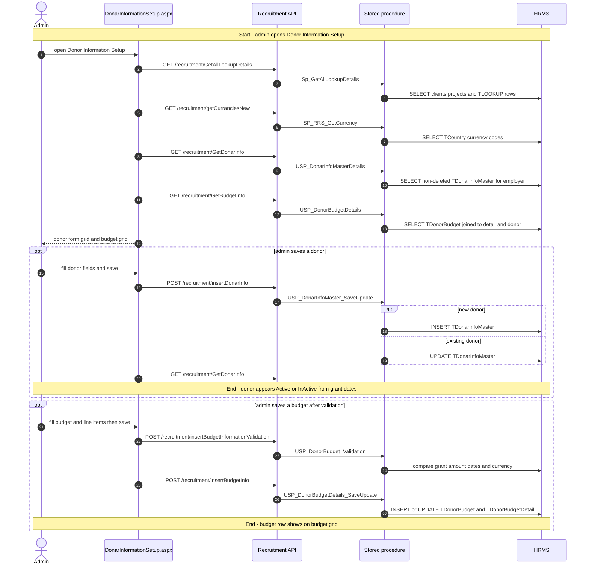
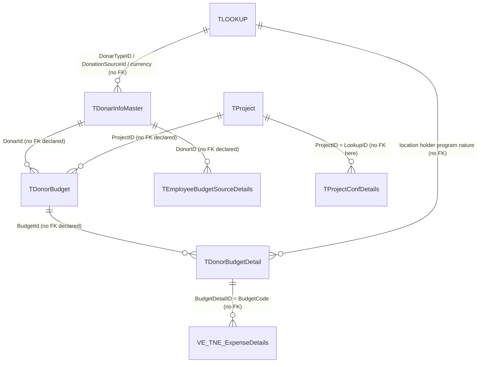

# Donor Information Setup

## Overview

A recruitment or finance admin opens **Recruitment → Donor Information Setup** to maintain grant donors and the project budgets funded by those donors. The shell is `DonarInformationSetup.aspx` (code spelling **Donar**), which hosts the Recruitment React SPA route `RouteConstants.DONAR_INFO` and the `DonorInfo` component. The page is a two-tab admin surface: **Donor & Budget Section** (CRUD for donors and budget lines) and a report tab that returns donor-wise / project-wise / budget-nature utilization.

On load the SPA fetches the employer’s donor master list, budget grid, lookup catalogues (donor type/source, budget location/holder/program, nature of expense, projects), and currency codes. Saving a donor inserts or updates `TDonarInfoMaster`. Saving a budget validates allocated and line amounts against the donor grant, then writes `TDonorBudget` plus `TDonorBudgetDetail` rows. Delete soft-deletes a donor (`IsDeleted = 1`) or calls the budget-delete procedure for a budget id.

**Who's involved:**

- **Recruitment admin / Administrator** — primary audience for this left-nav item. Creates donors, allocates project budgets, and runs utilization reports.
- **Recruiters / hiring managers** — do not use this screen for day-to-day hiring; they consume donor/budget data elsewhere (RRS budget source, My Details budget source, Travel & Expense) when the employer has donor details enabled.
- There is **no** employee self-service path on this page. Session employee/employer ids are stamped into hidden fields by the aspx code-behind and passed on API calls.

There is **no** `llm-wiki/domain` lifecycle page for donors. Table one-liners live in `llm-wiki/reference/tables/hrms.md` (`TDonarInfoMaster`, `TDonorBudget`, `TDonorBudgetDetail`, `TEmployeeBudgetSourceDetails`). This guide is the application call chain those catalogs do not cover.

Sibling left-nav Recruitment dashboards and RRS Creation can show budget-source fields when `SP_GetRRSDonorDetailsSettings` says `IsDonorDetails` is on; that settings call is **not** made from this setup page.

## Workflow

```mermaid
flowchart TD
  Nav["Recruitment left-nav Donor Information Setup"] --> ASPX["DonarInformationSetup.aspx"]
  ASPX --> SPA["DonorInfo React component"]

  SPA --> Look["GET /recruitment/GetAllLookupDetails"]
  Look --> LookSP["Sp_GetAllLookupDetails"]
  LookSP --> Lookup[("TLOOKUP / TClient / TProject")]

  SPA --> Cur["GET /recruitment/getCurranciesNew"]
  Cur --> CurSP["SP_RRS_GetCurrency"]
  CurSP --> Country[("TCountry")]

  SPA --> Donors["GET /recruitment/GetDonarInfo"]
  Donors --> DonorSP["USP_DonarInfoMasterDetails"]
  DonorSP --> DonorT[("TDonarInfoMaster")]

  SPA --> Budgets["GET /recruitment/GetBudgetInfo"]
  Budgets --> BudgetSP["USP_DonorBudgetDetails"]
  BudgetSP --> BudgetT[("TDonorBudget")]
  BudgetSP --> DetailT[("TDonorBudgetDetail")]
  BudgetSP --> DonorT

  SPA -->|"save donor"| SaveD["POST /recruitment/insertDonarInfo"]
  SaveD --> SaveDSP["USP_DonarInfoMaster_SaveUpdate"]
  SaveDSP --> DonorT

  SPA -->|"delete donor"| DelD["GET /recruitment/deleteDonarDetails"]
  DelD --> DelDSP["USP_DonarInfoMaster_DEL"]
  DelDSP --> DonorT

  SPA -->|"pick project"| ProjDates["GET /recruitment/getProjectDateDetails"]
  ProjDates --> ProjSP["USP_DonorBudget_ProjectDetails"]
  ProjSP --> ProjCfg[("TProjectConfDetails / TProject")]

  SPA -->|"validate then save budget"| Val["POST /recruitment/insertBudgetInformationValidation"]
  Val --> ValSP["USP_DonorBudget_Validation"]
  ValSP --> DonorT
  ValSP --> BudgetT
  Val --> SaveB["POST /recruitment/insertBudgetInfo"]
  SaveB --> SaveBSP["USP_DonorBudgetDetails_SaveUpdate"]
  SaveBSP --> BudgetT
  SaveBSP --> DetailT

  SPA -->|"delete budget"| DelB["GET /recruitment/deleteBudgetDetails"]
  DelB --> DelBSP["USP_DonarBudgetDetails_DEL"]
  DelBSP --> BudgetT

  SPA -->|"report tab / filters"| Rep["POST /recruitment/getDonorBudgetNatureProjectReport"]
  Rep --> RepSP["USP_Donor_BudgetNature_Project_Report"]
  RepSP --> DonorT
  RepSP --> BudgetT
  RepSP --> DetailT
  RepSP --> ExpView[("VE_TNE_ExpenseDetails")]
  RepSP --> EmpBudget[("TEmployeeBudgetSourceDetails")]

  SPA -->|"report donor filter"| ProjList["GET /recruitment/getDonorProjectList"]
  ProjList --> ProjListSP["USP_RRS_GetDonorProjectList"]
  SPA -->|"report project filter"| NatList["GET /recruitment/getDonorProjectBudgetNatureList"]
  NatList --> NatListSP["USP_RRS_GetDonorProjectBudgetNatureList"]
```

Tab 1 is **Donor & Budget Section**. Tab 2 loads a donor-wise report by default (`ReportType = Donor`). Report filters can switch to Project or Budget Nature and cascade donor → project → nature-of-expense lists.

## Request journey

The everyday write is **saving a donor** (insert when `DonarId` is 0/empty, otherwise update). Budget save is a second write that first validates against the donor grant.

Active/Inactive on the donor grid is computed in `USP_DonarInfoMasterDetails` from `IsActive` and whether today falls between `GrantStartDate` and `GrantEndDate`, not from the form status alone.

## Entry points

> `DonarInformationSetup.aspx` is the React shell for this menu. `RouteConstants.DONAR_INFO` is `/HRM/Recruitment_React/DonarInformationSetup.aspx`. The on-page breadcrumb labels the parent as **Admin Configuration**, but the left-nav placement documented for this guide is **Recruitment → Donor Information Setup**.

| UI page / route | Purpose |
|---|---|
| `/HRM/Recruitment_React/DonarInformationSetup.aspx` | Live Donor Information Setup SPA. Stamps employee, employer, role, global-access, email, and BU label into hidden fields, then loads the Vite recruitment bundle. |
| Recruitment React router `DONAR_INFO` | Lazy-loads `Areas/DonorInfo/donorInfo.js` inside the shared Recruitment SPA. |

`DonarInformationSetup.aspx.cs` only reads session values and optional encrypted `candId`; feature logic lives in `donorInfo.js` and the Node recruitment API. There are no PageMethods on this shell.

## Code → database call chain

The live SPA constants for this page resolve to `/recruitment/...` routes (duplicate `/v3/recruitment/...` keys earlier in `apiURLConstants.js` are overwritten by the plain `/recruitment/...` entries). `routeIndex.js` mounts only `RecruitmentRoutes.js` at `/recruitment`. There is **no BLL layer** on the Node path.

| Entry point | DAL / controller method (`file:line`) | Stored procedure |
|---|---|---|
| Page load — lookup dropdowns | `GetAllLookupDetails` (`recruitmentController.js:2738`, `recruitmentDAL.js:7201`) | `Sp_GetAllLookupDetails` |
| Page load — currency dropdown | `GetCurranciesNew` (`recruitmentController.js:2917`, `recruitmentDAL.js:7720`) | `SP_RRS_GetCurrency` |
| Page load — donor grid / donor dropdown | `GetDonarInfo` (`recruitmentController.js:2757`, `recruitmentDAL.js:7216`) | `USP_DonarInfoMasterDetails` |
| Page load — budget grid | `GetBudgetInfo` (`recruitmentController.js:2795`, `recruitmentDAL.js:7314`) | `USP_DonorBudgetDetails` |
| Save donor | `InsertDonarInfo` (`recruitmentController.js:2748`, `recruitmentDAL.js:7248`) | `USP_DonarInfoMaster_SaveUpdate` |
| Delete donor | `DeleteDonarDetails` (`recruitmentController.js:2767`, `recruitmentDAL.js:7232`) | `USP_DonarInfoMaster_DEL` |
| Budget form — project dates | `GetProjectDateDetails` (`recruitmentController.js:2908`, `recruitmentDAL.js:7706`) | `USP_DonorBudget_ProjectDetails` |
| Save budget — validate | `InsertBudgetInformationValidation` (`recruitmentController.js:3046`, `recruitmentDAL.js:8090`) | `USP_DonorBudget_Validation` |
| Save budget — persist | `InsertBudgetInfo` (`recruitmentController.js:2786`, `recruitmentDAL.js:7346`) | `USP_DonorBudgetDetails_SaveUpdate` |
| Delete budget | `DeleteBudgetDetails` (`recruitmentController.js:2805`, `recruitmentDAL.js:7330`) | `USP_DonarBudgetDetails_DEL` |
| Report tab / filters | `getDonorBudgetNatureProjectReport` (`recruitmentController.js:2983`, `recruitmentDAL.js:7928`) | `USP_Donor_BudgetNature_Project_Report` |
| Report — projects for donor | `getDonorProjectList` (`recruitmentController.js:2992`, `recruitmentDAL.js:7946`) | `USP_RRS_GetDonorProjectList` |
| Report — budget natures for donor+project | `getDonorProjectBudgetNatureList` (`recruitmentController.js:3001`, `recruitmentDAL.js:7961`) | `USP_RRS_GetDonorProjectBudgetNatureList` |

The WebForms code-behind does not make data-access calls.

## API endpoints

| Verb | Route | Parameters | Purpose | Source |
|---|---|---|---|---|
| `GET` | `/recruitment/GetAllLookupDetails` | query `employerId` | Client / project / `TLOOKUP` catalogue for donor and budget dropdowns | `RecruitmentRoutes.js:232`, `recruitmentController.js:2738` |
| `GET` | `/recruitment/getCurranciesNew` | none | Currency codes from `TCountry` | `RecruitmentRoutes.js:250`, `recruitmentController.js:2917` |
| `GET` | `/recruitment/GetDonarInfo` | query `employerId`, `employeeId` | Donor master list for the employer | `RecruitmentRoutes.js:234`, `recruitmentController.js:2757` |
| `POST` | `/recruitment/insertDonarInfo` | body `donarObject` field wrappers | Insert or update donor | `RecruitmentRoutes.js:233`, `recruitmentController.js:2748` |
| `GET` | `/recruitment/deleteDonarDetails` | query `donarId`, `employeeId` | Soft-delete donor | `RecruitmentRoutes.js:235`, `recruitmentController.js:2767` |
| `GET` | `/recruitment/GetBudgetInfo` | query `employerId`, `employeeId` (employee unused in DAL) | Budget grid | `RecruitmentRoutes.js:237`, `recruitmentController.js:2795` |
| `POST` | `/recruitment/insertBudgetInformationValidation` | body allocated amount, dates, currency, UDT line items | Validate budget against donor grant | `RecruitmentRoutes.js:264`, `recruitmentController.js:3046` |
| `POST` | `/recruitment/insertBudgetInfo` | body `budgetDetails` + `projectFundedDetails` UDT | Insert or update budget header and lines | `RecruitmentRoutes.js:236`, `recruitmentController.js:2786` |
| `GET` | `/recruitment/deleteBudgetDetails` | query `budgetId`, `employeeId` | Delete budget (procedure name `USP_DonarBudgetDetails_DEL`) | `RecruitmentRoutes.js:238`, `recruitmentController.js:2805` |
| `GET` | `/recruitment/getProjectDateDetails` | query `projectId`, `employerId` | Prefill project start/end on budget form | `RecruitmentRoutes.js:249`, `recruitmentController.js:2908` |
| `POST` | `/recruitment/getDonorBudgetNatureProjectReport` | body `ReportType`, optional `DonorIDs` / `ProjectIDs` / `BudgetNatureIDs`, `EmployerId` | Utilization report | `RecruitmentRoutes.js:257`, `recruitmentController.js:2983` |
| `GET` | `/recruitment/getDonorProjectList` | query `donorId`, `employerId` | Active projects for selected donors | `RecruitmentRoutes.js:258`, `recruitmentController.js:2992` |
| `GET` | `/recruitment/getDonorProjectBudgetNatureList` | query `donorId`, `projectId`, `employerId` | Nature-of-expense options for report filters | `RecruitmentRoutes.js:259`, `recruitmentController.js:3001` |

This feature uses Node recruitment routes only. There are no PageMethods on the React shell.

## Stored procedures & tables involved

> Live donor and budget rows are in core **`HRMS`**. Report utilization also reads Travel & Expense–style expense view `VE_TNE_ExpenseDetails` and employee budget-source CTC via `TEmployeeBudgetSourceDetails`. Table meanings reuse `llm-wiki/reference/tables/hrms.md`.

| Object | File path | Purpose | llm-wiki |
|---|---|---|---|
| `TDonarInfoMaster` | `HRMS-DATABASE/HRMS/TABLES/TDonarInfoMaster.sql` | Donor / grant master. PK `DonarId` | `llm-wiki/reference/tables/hrms.md` |
| `TDonorBudget` | `HRMS-DATABASE/HRMS/TABLES/TDonorBudget.sql` | Project budget header against a donor. PK `BudgetId`. No FK declared to donor | `llm-wiki/reference/tables/hrms.md` |
| `TDonorBudgetDetail` | `HRMS-DATABASE/HRMS/TABLES/TDonorBudgetDetail.sql` | Line items (location, holder, program, expense nature, amount). PK `BudgetDetailID`. No FK declared | `llm-wiki/reference/tables/hrms.md` |
| `TLOOKUP` | catalogued in wiki | Donor type (`27500`), donor source (`5000`), budget location/holder/program, nature of expense (`15000`), legacy project parent (`2000`) | `llm-wiki/reference/tables/hrms.md` |
| `TProject` / `TProjectConfDetails` / `TClient` | catalogued in wiki | Project and client lookups; project date prefill | `llm-wiki/reference/tables/hrms.md` |
| `TCountry` | catalogued in wiki | Currency codes for grant / allocated amount | `llm-wiki/reference/tables/hrms.md` |
| `TEmployeeBudgetSourceDetails` / `TCTC` | catalogued in wiki | Salary utilization branch of the report | `llm-wiki/reference/tables/hrms.md` |
| `VE_TNE_ExpenseDetails` | view (not inventoried as a guide table file here) | Approved expense amounts keyed by `BudgetCode` = `BudgetDetailID` | — |
| `USP_DonarInfoMasterDetails` | `HRMS-DATABASE/HRMS/STOREPROCEDURE/USP_DonarInfoMasterDetails.sql` | Donor list with computed Active/InActive | — |
| `USP_DonarInfoMaster_SaveUpdate` | `HRMS-DATABASE/HRMS/STOREPROCEDURE/USP_DonarInfoMaster_SaveUpdate.sql` | Insert or update donor | — |
| `USP_DonarInfoMaster_DEL` | `HRMS-DATABASE/HRMS/STOREPROCEDURE/USP_DonarInfoMaster_DEL.sql` | Soft-delete donor (`IsDeleted = 1`) | — |
| `USP_DonorBudgetDetails` | `HRMS-DATABASE/HRMS/STOREPROCEDURE/USP_DonorBudgetDetails.sql` | Budget grid | — |
| `USP_DonorBudgetDetails_SaveUpdate` | `HRMS-DATABASE/HRMS/STOREPROCEDURE/USP_DonorBudgetDetails_SaveUpdate.sql` | Insert/update budget + UDT lines | — |
| `USP_DonorBudget_Validation` | `HRMS-DATABASE/HRMS/STOREPROCEDURE/USP_DonorBudget_Validation.sql` | Grant amount / date / currency checks | — |
| `USP_DonarBudgetDetails_DEL` | **missing from `HRMS-DATABASE` checkout** | Called by delete-budget API | — |
| `USP_DonorBudget_ProjectDetails` | `HRMS-DATABASE/HRMS/STOREPROCEDURE/USP_DonorBudget_ProjectDetails.sql` | Project start/end for budget form | — |
| `USP_Donor_BudgetNature_Project_Report` | `HRMS-DATABASE/HRMS/STOREPROCEDURE/USP_Donor_BudgetNature_Project_Report.sql` | Donor / project / nature utilization | — |
| `USP_RRS_GetDonorProjectList` | `HRMS-DATABASE/HRMS/STOREPROCEDURE/USP_RRS_GetDonorProjectList.sql` | Active budget projects for donors | — |
| `USP_RRS_GetDonorProjectBudgetNatureList` | `HRMS-DATABASE/HRMS/STOREPROCEDURE/USP_RRS_GetDonorProjectBudgetNatureList.sql` | Nature options for report filters | — |
| `Sp_GetAllLookupDetails` | `HRMS-DATABASE/HRMS/STOREPROCEDURE/Sp_GetAllLookupDetails.sql` | Shared lookup catalogue | — |
| `SP_RRS_GetCurrency` | `HRMS-DATABASE/HRMS/STOREPROCEDURE/SP_RRS_GetCurrency.sql` | Currency picker | — |
| `UDT_DonorBudgetDetails` | `HRMS-DATABASE/HRMS/UDT/UDT_DonorBudgetDetails.sql` | Table type for budget line payload | — |

None of the direct procedures above call another stored procedure (no nested SP level on this page’s chain).

## Table relationships

The project does not have a donor-feature ER diagram to reuse, so this diagram is derived from `llm-wiki/reference/tables/hrms.md` plus the procedure-level table usage above. Where the catalog or DDL does not declare a foreign key, the relationship is labelled as such instead of being invented.

## Known gaps

- Breadcrumb on the React page says **Admin Configuration → Donor Information Setup**, while this guide’s left-nav frontmatter is **Recruitment → Donor Information Setup**. Live `TMenuDetails.NavigateURL` was not queried in DEV for this run.
- `USP_DonarBudgetDetails_DEL` is executed by `DeleteBudgetDetails` but has **no matching `.sql` file** under `HRMS-DATABASE/HRMS/STOREPROCEDURE/` in this checkout, so no database doc page was written for it.
- Code spelling is inconsistently **Donar** (tables/SPs/routes) vs UI label **Donor**.
- `GET_BUDGET_INFO` / `DELETE_BUDGET_DETAILS` URL templates in `apiURLConstants.js` include a trailing comma inside the `deleteBudgetDetails` query string template; worth verifying at runtime.
- `InsertBudgetInfo` DAL always passes `BudgetStatus = 1` because of `request.budgetStatus.value == "Y" || "Active"` (the string `"Active"` is always truthy).
- `USP_DonorBudgetDetails_SaveUpdate` always sends `BudgetDetailID = 0` from `projectFundedList`, so every save path inserts new detail rows rather than updating existing ones by id.
- Report procedure `USP_Donor_BudgetNature_Project_Report` still joins project names from `TLOOKUP` (parent `2000`) for Project / BudgetNature report types, while list/grid procedures were moved to `TProject` (work item 75923). Project-type report rows can disagree with the budget grid’s project names.
- `RecruitmentRoutes_V2.js` / `RecruitmentRoutes_V3.js` exist on disk and are not mounted; only `/recruitment` is live.
- `SP_GetRRSDonorDetailsSettings` / `USP_Check_Donor_Validity` exist for other features and are not called from this page.
- None of the direct SPs nest other procedures, so there are no nested-level database pages beyond the direct list.

## Reference

Confidence is **medium**: the live React page was traced to v1 DAL `file:line` and named procedures plus table DDL. Declared PK names come from table scripts; no donor FKs are declared. Confidence is not high because menu NavigateURL was not queried, budget-delete SQL is missing from the repo, and Donar/Donor naming plus report lookup drift remain.

### SourceCode

- `HRMS.Web/HRMS.Web/HRM/Recruitment_React/DonarInformationSetup.aspx`
- `HRMS.Web/HRMS.Web/HRM/Recruitment_React/DonarInformationSetup.aspx.cs`
- `HRMS.Web/HRMS.Web/HRM/Recruitment_React/Areas/routes.js`
- `HRMS.Web/HRMS.Web/HRM/Recruitment_React/Common/routeConstants.js`
- `HRMS.Web/HRMS.Web/HRM/Recruitment_React/Common/apiURLConstants.js`
- `HRMS.Web/HRMS.Web/HRM/Recruitment_React/Common/AppConstants.js`
- `HRMS.Web/HRMS.Web/HRM/Recruitment_React/Common/VaribaleConstants.js`
- `HRMS.Web/HRMS.Web/HRM/Recruitment_React/Areas/DonorInfo/donorInfo.js`
- `HRMS.CoreAPI/HRMS.Core.WebAPI.Node/Routes/routeIndex.js`
- `HRMS.CoreAPI/HRMS.Core.WebAPI.Node/Routes/RecruitmentRoutes.js`
- `HRMS.CoreAPI/HRMS.Core.WebAPI.Node/Controllers/recruitmentController.js`
- `HRMS.CoreAPI/HRMS.Core.WebAPI.Node/Core/DataAccessLayer/recruitmentDAL.js`

### TDG HRMS DB

- `llm-wiki/reference/tables/hrms.md`
- `HRMS-DATABASE/HRMS/TABLES/TDonarInfoMaster.sql`
- `HRMS-DATABASE/HRMS/TABLES/TDonorBudget.sql`
- `HRMS-DATABASE/HRMS/TABLES/TDonorBudgetDetail.sql`
- `HRMS-DATABASE/HRMS/UDT/UDT_DonorBudgetDetails.sql`
- `HRMS-DATABASE/HRMS/STOREPROCEDURE/USP_DonarInfoMasterDetails.sql`
- `HRMS-DATABASE/HRMS/STOREPROCEDURE/USP_DonarInfoMaster_SaveUpdate.sql`
- `HRMS-DATABASE/HRMS/STOREPROCEDURE/USP_DonarInfoMaster_DEL.sql`
- `HRMS-DATABASE/HRMS/STOREPROCEDURE/USP_DonorBudgetDetails.sql`
- `HRMS-DATABASE/HRMS/STOREPROCEDURE/USP_DonorBudgetDetails_SaveUpdate.sql`
- `HRMS-DATABASE/HRMS/STOREPROCEDURE/USP_DonorBudget_Validation.sql`
- `HRMS-DATABASE/HRMS/STOREPROCEDURE/USP_DonorBudget_ProjectDetails.sql`
- `HRMS-DATABASE/HRMS/STOREPROCEDURE/USP_Donor_BudgetNature_Project_Report.sql`
- `HRMS-DATABASE/HRMS/STOREPROCEDURE/USP_RRS_GetDonorProjectList.sql`
- `HRMS-DATABASE/HRMS/STOREPROCEDURE/USP_RRS_GetDonorProjectBudgetNatureList.sql`
- `HRMS-DATABASE/HRMS/STOREPROCEDURE/Sp_GetAllLookupDetails.sql`
- `HRMS-DATABASE/HRMS/STOREPROCEDURE/SP_RRS_GetCurrency.sql`
