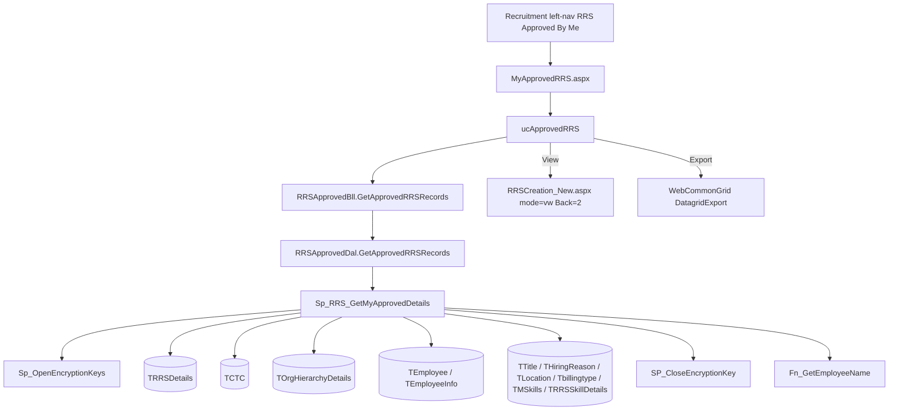
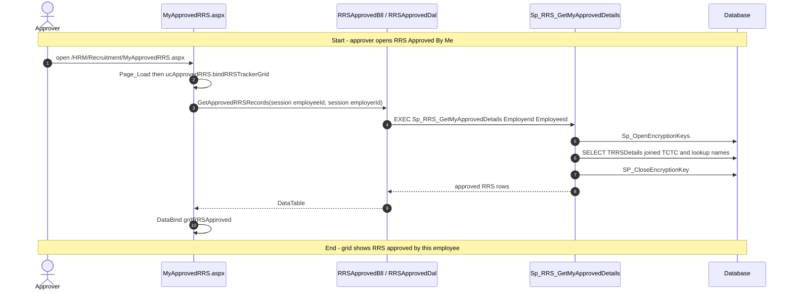
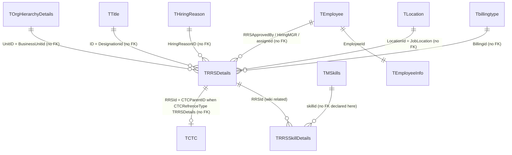

# RRS Approved By Me

## Overview

An approver opens **Recruitment → RRS Approved By Me** to see recruitment requisitions (RRS) they personally approved, then open one in read-only view or export the grid. The left-nav target is classic WebForms `HRM/Recruitment/MyApprovedRRS.aspx` (`MenuId` **75** under parent Recruitment **69**). Sampled DEV `TMenuDetails.NavigateURL` values (employers 2–8) are `~/HRM/Recruitment/MyApprovedRRS.aspx` with `PageName` `MyApprovedRRS.aspx`. The aspx shell’s `Page_Load` is empty; all logic lives in user control `ucApprovedRRS`, which binds a Telerik grid from `RRSApprovedBll.GetApprovedRRSRecords` → `RRSApprovedDal.GetApprovedRRSRecords` → `Sp_RRS_GetMyApprovedDetails`.

On first load (and on every grid `NeedDataSource`) the control loads rows where `TRRSDetails.RRSApprovedBy` equals the session employee and `RRSStatus` is not `Pending` or `Submitted`, for the session employer. **View** stores the current page index in session and redirects to React RRS Creation (`RRSCreation_New.aspx`) with `mode=vw&Back=2&rrsid=`. Export uses `WebCommonGrid.DatagridExport` for Excel / PDF / Word without another database round-trip.

There is **no** Recruitment React route or Node `/recruitment` endpoint for this leaf. Sibling **RRS Dashboard** is a separate menu page for broader RRS work. Legacy `RecruitmentMasterDBHelper.GetMyRRSSRecords` still references a differently named procedure (`Sp_GetRRSMyApprovedDetails`) and is **not** called from `ucApprovedRRS`.

**Who's involved:**

- **RRS approver** — primary audience. Anyone with menu 75 who has approved requisitions sees those rows (`RRSApprovedBy` = logged-in employee).
- **Hiring manager / recruiters** — appear as display columns (hiring manager, assigned-to names) but do not act on this screen.
- There is **no** employee self-service path beyond the left-nav item; session employee/employer ids come from `LoggedInEmployeeHelper`.

There is **no** `llm-wiki/domain` lifecycle page for this leaf. Table one-liners live in `llm-wiki/reference/tables/hrms.md` (`TRRSDetails`, related masters). This guide is the WebForms call chain those catalogs do not cover.

## Workflow

The procedure returns requisitions approved by `@Employeeid` for `@Employerid`, excluding status `Pending` / `Submitted`, ordered by `RRSCreationDate` descending. Display title is derived by taking the segment after the last `_` in `RRSTitle`. CTC min/max come from `TCTC` where `CTCRefrenceType = 'TRRSDetails'`.

## Request journey

The characteristic request is **opening the grid and loading approved RRS rows**. It starts when the approver opens the menu and ends with the Telerik grid bound from `Sp_RRS_GetMyApprovedDetails`.

**View** is a separate postback. It does not call another procedure on this page; it redirects to `RRSCreation_New.aspx?mode=vw&Back=2&rrsid=` (React RRS Creation read-only). Legacy WebForms `RRSCreation.aspx` knows `Back=2` as return to `MyApprovedRRS.aspx?pageIndex=yes`. Export reuses already-bound grid rows.

## Entry points

> Sampled DEV `TMenuDetails` for `MenuId` **75** (`MenuName` RRS Approved By Me) has `NavigateURL` `~/HRM/Recruitment/MyApprovedRRS.aspx`. No `Employerid = 0` row was present in DEV for this menu id. Shared constant `URL_RRS_CREATION` points at the React view target. There is no React `RouteConstants` entry for this leaf itself.

| UI page / route | Purpose |
|---|---|
| `/HRM/Recruitment/MyApprovedRRS.aspx` | Left-nav host. `Page_Load` is empty; logic is in `ucApprovedRRS`. |
| `ucApprovedRRS.ascx` | Grid, View button, export handlers. |
| `/HRM/Recruitment_React/RRSCreation_New.aspx?mode=vw&Back=2&rrsid=` | View RRS redirect target (`URL_RRS_CREATION`). |
| `/HRM/Recruitment/RRSCreation.aspx` | Legacy WebForms RRS creation; defines return URL to My Approved RRS. **Not** the left-nav leaf. |
| `/HRM/Recruitment/RRSDashboard.aspx` / React RRS Dashboard | Sibling **RRS Dashboard** menu — not this leaf. |

## Code → database call chain

This leaf is **WebForms → BLL → DAL → stored procedure**. No Node recruitment route and no PageMethods on the aspx shell.

| Entry point | DAL / BLL method (`file:line`) | Stored procedure |
|---|---|---|
| Page load / grid NeedDataSource | `ucApprovedRRS.getRRSApprovedData` (`ucApprovedRRS.ascx.cs:121`) → `RRSApprovedBll.GetApprovedRRSRecords` (`RRSApprovedBLL.cs:20`) → `RRSApprovedDal.GetApprovedRRSRecords` (`RRSApprovedDAL.cs:27`) | `Sp_RRS_GetMyApprovedDetails` (`ConstantStoredProcedure.SP_GETRRSMYAPPROVEDDETAILS`) |
| View RRS | `btnRRSViewClick` (`ucApprovedRRS.ascx.cs:91`) | none on this page (redirect only) |
| Export Excel / PDF / Word | `grdRRSApproved_ItemCommand` → `WebCommonGrid.DatagridExport` (`ucApprovedRRS.ascx.cs:66`) | none (grid export of already-bound rows) |

DAL binds `Employerid` and `Employeeid` (`RRSApprovedDAL.cs:31-32`). Unused sibling helper `RecruitmentMasterDBHelper.GetMyRRSSRecords` (`RecruitmentMasterDBHelper.cs:1625`) hard-codes procedure name `Sp_GetRRSMyApprovedDetails` (different object) and is not on this page’s call chain.

## API endpoints

No REST / Node recruitment endpoints are used by this menu leaf. Data access is Enterprise Library `ExecuteDataSet` against `Sp_RRS_GetMyApprovedDetails` on postback (initial load and grid callbacks). There are no `[WebMethod]` / PageMethods on `MyApprovedRRS.aspx`.

| Mechanism | Surface | Parameters | Purpose | Source |
|---|---|---|---|---|
| WebForms postback | `ucApprovedRRS` load / `NeedDataSource` | session `EmployeeId`, session `EmployerId` | Bind approved-RRS grid | `ucApprovedRRS.ascx.cs:121-124`, `RRSApprovedDAL.cs:27-38` |
| WebForms redirect | `btnRRSViewClick` | `rrsid` query; `mode=vw`; `Back=2` | Open React RRS Creation read-only | `ucApprovedRRS.ascx.cs:91-98` |
| Grid command | Export buttons | command name via Telerik | Excel / PDF / Word export | `ucApprovedRRS.ascx.cs:66-69` |

## Stored procedures & tables involved

> Live RRS rows are in core **`HRMS`**. This page is read-only against `TRRSDetails` (plus lookups / CTC). Approval writes happen on RRS workflow screens, not here. Table meanings reuse `llm-wiki/reference/tables/hrms.md`.

| Object | File path | Purpose | llm-wiki |
|---|---|---|---|
| `TRRSDetails` | `HRMS-DATABASE/HRMS/TABLES/TRRSDetails.sql` | Requisition header; filter on `RRSApprovedBy`, `RRSStatus`, `EmployerId` | `llm-wiki/reference/tables/hrms.md` |
| `TCTC` | catalogued / used by procedure | Min/Max CTC for `CTCParentID = RRSId` and `CTCRefrenceType = 'TRRSDetails'` | — |
| `TOrgHierarchyDetails` | catalogued in wiki | Business unit display name | `llm-wiki/reference/tables/hrms.md` |
| `TEmployee` / `TEmployeeInfo` | catalogued in wiki | Approver, hiring manager, L1/L2, assigned-to display names and employment numbers | `llm-wiki/reference/tables/hrms.md` |
| `TTitle` | catalogued in wiki | Designation title | `llm-wiki/reference/tables/hrms.md` |
| `THiringReason` | catalogued in wiki | Hiring reason name | `llm-wiki/reference/tables/hrms.md` |
| `TLocation` | catalogued in wiki | Job location name (`LocationId` = `JobLocation`) | `llm-wiki/reference/tables/hrms.md` |
| `Tbillingtype` | catalogued in wiki | Billing type label | `llm-wiki/reference/tables/hrms.md` |
| `TMSkills` / `TRRSSkillDetails` | catalogued in wiki | Aggregated skill names for the RRS | `llm-wiki/reference/tables/hrms.md` |
| `Sp_RRS_GetMyApprovedDetails` | `HRMS-DATABASE/HRMS/STOREPROCEDURE/Sp_RRS_GetMyApprovedDetails.sql` | List RRS approved by the logged-in employee for the employer | [Sp_RRS_GetMyApprovedDetails](/docs/database/hrms/Sp_RRS_GetMyApprovedDetails) |
| `Sp_OpenEncryptionKeys` | nested from procedure | Open-key step (currently no-op in script) | [Sp_OpenEncryptionKeys](/docs/database/hrms/Sp_OpenEncryptionKeys) |
| `SP_CloseEncryptionKey` | nested from procedure | Close-key step | [SP_CloseEncryptionKey](/docs/database/hrms/SP_CloseEncryptionKey) |
| `Fn_GetEmployeeName` | nested from procedure | Employee display name in several columns | [Fn_GetEmployeeName](/docs/database/hrms/Fn_GetEmployeeName) |
| `Sp_GetRRSMyApprovedDetails` | `HRMS-DATABASE/HRMS/STOREPROCEDURE/Sp_GetRRSMyApprovedDetails.sql` | Older/sibling procedure used only by unused `GetMyRRSSRecords` helper — **not** this leaf | — |

## Table relationships

Derived from `llm-wiki/reference/tables/hrms.md` and procedure joins. Where no FK is declared, the relationship is labelled as such.

## Known gaps

- **No React replacement for menu 75.** NavigateURL remains classic `MyApprovedRRS.aspx`; View jumps into React RRS Creation only.
- **Duplicate procedure names.** Live control uses `Sp_RRS_GetMyApprovedDetails`. Unused `RecruitmentMasterDBHelper.GetMyRRSSRecords` / `RecruitmentHelper.GetMyRRSSRecords` still call `Sp_GetRRSMyApprovedDetails` (sibling script with different title/location column handling).
- **Sibling `Sp_GetRRSMyApprovedDetails`** joins `TJobLocation.JobLocationName` while `Sp_RRS_GetMyApprovedDetails` joins `TLocation.LocationName` for `JobLocation` — the two scripts are not identical.
- **No `Employerid = 0` menu row** for MenuId 75 in DEV; documentation relies on sampled tenant rows (2–8) plus P31 hierarchy Value 75.
- **Status filter** excludes only `Pending` and `Submitted`; Closed / Cancelled / other statuses still appear if `RRSApprovedBy` matches.
- **`RRSTitle` display transform** strips everything through the last `_`; titles without `_` can render oddly via the `REVERSE`/`CHARINDEX` expression.
- There is **no** SystemModel-2 / `llm-wiki/domain` page dedicated to RRS Approved By Me.
- `TCTC` is used by the procedure but has no one-liner row under that exact name in the sampled `llm-wiki/reference/tables/hrms.md` excerpt used for this guide.

## Reference

Confidence is **medium**: DEV menu NavigateURL (sampled employers) and the WebForms → BLL → DAL → `Sp_RRS_GetMyApprovedDetails` chain are verified with `file:line` and the inventoried SQL script. Confidence is not high because employer-0 menu seeding is missing in DEV, View depends on React RRS Creation (documented separately), and a dead helper still points at a sibling procedure.

### SourceCode

- `HRMS.Web/HRMS.Web/HRM/Recruitment/MyApprovedRRS.aspx`
- `HRMS.Web/HRMS.Web/HRM/Recruitment/MyApprovedRRS.aspx.cs`
- `HRMS.Web/HRMS.Web/HRM/Recruitment/ucApprovedRRS.ascx`
- `HRMS.Web/HRMS.Web/HRM/Recruitment/ucApprovedRRS.ascx.cs`
- `HRMS.Shared/HRMS.BusinessLayer/Recruitment/RRSApprovedBLL.cs`
- `HRMS.Shared/HRMS.DataAccessLayer/Recruitment/RRSApprovedDAL.cs`
- `HRMS.Shared/HRMS.DataAccessLayer/DBConstant.cs` (`SP_GETRRSMYAPPROVEDDETAILS`)
- `HRMS.Shared/HRMS.DataContract/Common/Constants.cs` (`URL_RRS_CREATION`, `RRSApprovedByMe`)
- `HRMS.Shared/HRMS.DataAccessLayer/RecruitmentMasterDBHelper.cs` (unused `GetMyRRSSRecords`)
- `HRMS.Shared/HRMS.BusinessLayer/RecruitmentHelper.cs` (unused `GetMyRRSSRecords`)
- `HRMS.Web/HRMS.Web/HRM/Recruitment/RRSCreation.aspx.cs` (`URL_MY_APPROVED_RRS` return path)

### TDG HRMS DB

- `llm-wiki/reference/tables/hrms.md`
- `HRMS-DATABASE/HRMS/STOREPROCEDURE/Sp_RRS_GetMyApprovedDetails.sql`
- `HRMS-DATABASE/HRMS/STOREPROCEDURE/Sp_GetRRSMyApprovedDetails.sql`
- `HRMS-DATABASE/HRMS/DML/PMSRelease-P31/TDynamicMenuHierarchy.sql` (Recruitment leaf order, Value 75)
