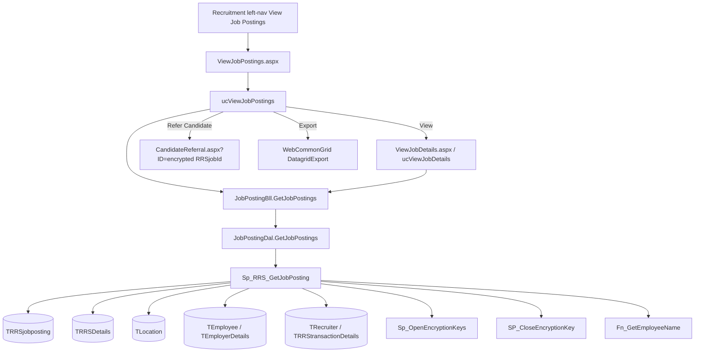
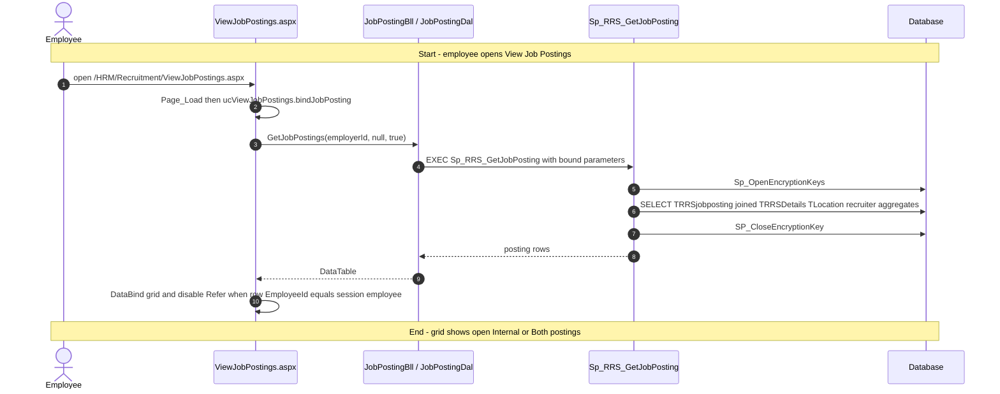
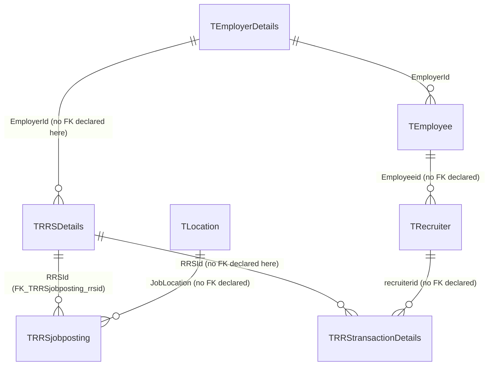

# View Job Postings

## Overview

An employee opens **Recruitment → View Job Postings** to browse open internal / both job postings published by recruiters, open a job-details popup, export the grid, or start a referral for a selected posting. The left-nav target is classic WebForms `HRM/Recruitment/ViewJobPostings.aspx` (`MenuId` **72** under parent Recruitment **69**). DEV `TMenuDetails.NavigateURL` for employer `0` (and sampled employers) is `~/HRM/Recruitment/ViewJobPostings.aspx`. The page hosts user control `ucViewJobPostings`, which binds a Telerik grid from `JobPostingBll.GetJobPostings` → `JobPostingDal.GetJobPostings` → `Sp_RRS_GetJobPosting`.

On first load (and on every grid `NeedDataSource`) the control loads active postings for the selected global-access organisation (or the session employer when none is selected), disables **Refer Candidate** on rows whose recruiter `EmployeeId` equals the logged-in employee, and supports Excel / PDF / Word export via `WebCommonGrid`. **View** encrypts RRS number and RRS id and opens `ViewJobDetails.aspx` in a RadWindow; that popup reloads the same posting list and filters client-side. **Refer Candidate** redirects to legacy `CandidateReferral.aspx?ID=` with the encrypted `RRSjobId`.

There is **no** Recruitment React route for this leaf. `RouteConstants.JOB_POSTING` / `JobPosting_New.aspx` is the recruiter **Create Job Posting** surface, not this menu. Sibling **Candidate Referral** (`CandidateReferral_New.aspx`) is the React referral SPA and is documented separately.

**Who's involved:**

- **Employee** — primary audience per the user manual. Anyone with menu 72 can list postings, view details, export, and refer.
- **Recruiter** — appears on each row as `EmployeeId` / name / email from `TRecruiter` + `TRRStransactionDetails`. The refer button is disabled when that recruiter is the current user.
- **Global-access user** — organisation picker `ucGlobalAccessEmployer`; changing org redirects back to `ViewJobPostings.aspx`.

There is **no** `llm-wiki/domain` lifecycle page for job postings. Table one-liners live in `llm-wiki/reference/tables/hrms.md`. This guide is the WebForms call chain those catalogs do not cover.

## Workflow

The procedure (repo script) returns non-deleted postings with `PostingType` in `Both` / `Internal`, active when `@isactive = 1`, for employers under the root employer of `@EmployeeId`, excluding RRS status `Closed` / `Cancelled`. Live DEV also has optional `@RRSId` / `@ATSJobId` and may branch to `Sp_RRS_ats_GetJobPosting` when `TCustomerSettings.IntegrateAtsIntoHrms = 1` (that ATS procedure is not in `HRMS-DATABASE` STOREPROCEDURE in this checkout).

## Request journey

The characteristic request is **opening the grid and loading postings**. It starts when the employee opens the menu and ends with the Telerik grid bound from `Sp_RRS_GetJobPosting`.

**View** and **Refer Candidate** are separate postbacks on the same control. View does not call another procedure; it opens `ViewJobDetails.aspx`, which calls the same `GetJobPostings` again and filters by decrypted `RRSId` / `RRSNumber`. Refer leaves this page for WebForms Candidate Referral.

## Entry points

> DEV `TMenuDetails` for `MenuId` **72** (`MenuName` View Job Postings, `Employerid` 0) has `NavigateURL` `~/HRM/Recruitment/ViewJobPostings.aspx` and `PageName` `ViewJobPostings.aspx`. Shared constant `URL_RECRUITMENT_VIEWJOBPOSTING` matches that path. There is no React `RouteConstants` entry for View Job Postings.

| UI page / route | Purpose |
|---|---|
| `/HRM/Recruitment/ViewJobPostings.aspx` | Left-nav host. `Page_Load` is empty; logic is in `ucViewJobPostings`. |
| `ucViewJobPostings.ascx` | Grid, global-access org picker, View / Refer / export handlers. |
| `/HRM/Recruitment/ViewJobDetails.aspx` | RadWindow / popup job details (`ucViewJobDetails`). Same BLL read, client filter. |
| `/HRM/Recruitment/CandidateReferral.aspx?ID=` | Refer Candidate redirect target (`URL_REFER_CANDIDATE`). Legacy WebForms referral, not the React `_New` SPA. |
| `/HRM/Recruitment_React/JobPosting_New.aspx` | Recruiter create-posting SPA (`RouteConstants.JOB_POSTING`). **Not** this menu leaf. |

## Code → database call chain

This leaf is **WebForms → BLL → DAL → stored procedure**. No Node recruitment route and no PageMethods on the aspx shell.

| Entry point | DAL / BLL method (`file:line`) | Stored procedure |
|---|---|---|
| Page load / grid NeedDataSource | `ucViewJobPostings.bindJobPosting` (`ucViewJobPostings.ascx.cs:76`) → `JobPostingBll.GetJobPostings` (`JobPostingBLL.cs:22`) → `JobPostingDal.GetJobPostings` (`JobPostingDAL.cs:27`) | `Sp_RRS_GetJobPosting` (`ConstantStoredProcedure.SP_GETRRSJOBPOSTING`) |
| View details popup load | `ucViewJobDetails.getAndAppendJobDetails` (`ucViewJobDetails.ascx.cs:56`) → same BLL/DAL | `Sp_RRS_GetJobPosting` |
| Refer Candidate | `btnReferCandidate_Click` (`ucViewJobPostings.ascx.cs:126`) | none on this page (redirect only) |
| Export Excel / PDF / Word | `grdJobPosting_ItemCommand` → `WebCommonGrid.DatagridExport` (`ucViewJobPostings.ascx.cs:160`) | none (grid export of already-bound rows) |

DAL binds parameters named `employerId`, `PostingType`, and `isactive` (`JobPostingDAL.cs:31-33`). The repo and live procedure signature use `@EmployeeId`, `@PostingType`, `@isactive` (live DEV also `@RRSId`, `@ATSJobId`). See Known gaps.

## API endpoints

No REST / Node recruitment endpoints are used by this menu leaf. Data access is Enterprise Library `ExecuteDataSet` against `Sp_RRS_GetJobPosting` on postback (initial load and grid callbacks). There are no `[WebMethod]` / PageMethods on `ViewJobPostings.aspx` or `ViewJobDetails.aspx`.

| Mechanism | Surface | Parameters | Purpose | Source |
|---|---|---|---|---|
| WebForms postback | `ucViewJobPostings` load / `NeedDataSource` | session / global-access `employerId`; `jobPostingType` null; `isActive` true | Bind posting grid | `ucViewJobPostings.ascx.cs:76-84`, `JobPostingDAL.cs:27-36` |
| WebForms postback | `btnViewJobDetails_Click` | encrypted `RRSNumber`, `RRSId` | Open details popup | `ucViewJobPostings.ascx.cs:109-117` |
| WebForms redirect | `btnReferCandidate_Click` | encrypted `RRSjobId` query `ID` | Start legacy referral | `ucViewJobPostings.ascx.cs:126-132` |
| Grid command | Export buttons | command name via Telerik | Excel / PDF / Word export | `ucViewJobPostings.ascx.cs:160-163` |

Sibling React Candidate Referral uses `GET /recruitment/getJobPostings` → the same procedure with `@EmployeeId` bound correctly from the Node DAL (`recruitmentDAL.js:2210`). That path is not this leaf.

## Stored procedures & tables involved

> Live posting rows are in core **`HRMS`**. `Sp_RRS_GetJobPosting` reads `TRRSjobposting` and related masters. This page does not insert or update postings (create/update/delete live on recruiter Job Posting / RRS flows). Table meanings reuse `llm-wiki/reference/tables/hrms.md`.

| Object | File path | Purpose | llm-wiki |
|---|---|---|---|
| `TRRSjobposting` | `HRMS-DATABASE/HRMS/TABLES/TRRSjobposting.sql` | Published posting row. Declared FK `FK_TRRSjobposting_rrsid` | `llm-wiki/reference/tables/hrms.md` |
| `TRRSDetails` | `HRMS-DATABASE/HRMS/TABLES/TRRSDetails.sql` | Requisition title, number, priority, education, experience, status | `llm-wiki/reference/tables/hrms.md` |
| `TLocation` | catalogued in wiki | `JobLocationName` via `JobLocation` | `llm-wiki/reference/tables/hrms.md` |
| `TEmployee` / `TEmployerDetails` | catalogued in wiki | Root-employer scope; recruiter email aggregate; employer name | `llm-wiki/reference/tables/hrms.md` |
| `TRecruiter` / `TRRStransactionDetails` | catalogued in wiki | Recruiter employee id / name / email for the RRS | `llm-wiki/reference/tables/hrms.md` |
| `TQualificationName` + `split` | catalogued / helper | Required education display names | — |
| `Sp_RRS_GetJobPosting` | `HRMS-DATABASE/HRMS/STOREPROCEDURE/Sp_RRS_GetJobPosting.sql` | List Internal / Both active postings for root employer of `@EmployeeId` | [Sp_RRS_GetJobPosting](/docs/database/hrms/Sp_RRS_GetJobPosting) |
| `Sp_OpenEncryptionKeys` | nested from procedure | Open-key step (currently no-op in script) | [Sp_OpenEncryptionKeys](/docs/database/hrms/Sp_OpenEncryptionKeys) |
| `SP_CloseEncryptionKey` | nested from procedure | Close-key step | [SP_CloseEncryptionKey](/docs/database/hrms/SP_CloseEncryptionKey) |
| `Fn_GetEmployeeName` | nested from procedure | Recruiter display name | [Fn_GetEmployeeName](/docs/database/hrms/Fn_GetEmployeeName) |
| `Sp_RRS_InsertJobPosting` / `Sp_RRS_UpdateJobPosting` / `Sp_RRS_DeleteJobPosting` | STOREPROCEDURE / `DBConstant.cs` | Recruiter create/edit/delete posting — **not** called from this leaf | — |
| `Sp_RRS_ats_GetJobPosting` | live DEV only (not in STOREPROCEDURE checkout) | Optional ATS branch inside live `Sp_RRS_GetJobPosting` | — |

## Table relationships

Derived from `llm-wiki/reference/tables/hrms.md`, `TRRSjobposting` DDL (`FK_TRRSjobposting_rrsid`), and procedure joins. Where no FK is declared, the relationship is labelled as such.

## Known gaps

- **Parameter name mismatch.** WebForms `JobPostingDal` / `RecruitmentMasterDBHelper.GetJobPostings` bind `@employerId` (the selected **employer** id). Repo and live `Sp_RRS_GetJobPosting` require `@EmployeeId` and resolve root employer from that employee. Node `recruitmentDAL.GetJobPostings` binds `@EmployeeId` correctly. This page may fail or return empty depending on Enterprise Library / SQL binding behaviour.
- **No React replacement for menu 72.** NavigateURL remains classic `ViewJobPostings.aspx`. Create Job Posting (`JobPosting_New.aspx`) and Candidate Referral React are different leaves.
- **Refer Candidate** still targets legacy `CandidateReferral.aspx`, not `CandidateReferral_New.aspx`.
- **Live DEV procedure drift.** Live `Sp_RRS_GetJobPosting` adds `@RRSId` / `@ATSJobId` and can `EXEC Sp_RRS_ats_GetJobPosting`. That ATS procedure and the live body are not present under `HRMS-DATABASE/HRMS/STOREPROCEDURE` in this checkout; the documented script is the repo file used by [Sp_RRS_GetJobPosting](/docs/database/hrms/Sp_RRS_GetJobPosting).
- **`@PostingType` unused for filtering in the repo script.** The procedure hard-filters `Both` / `Internal` regardless of the null `PostingType` passed from this page.
- **View details re-queries the full list** and filters in LINQ; it does not pass `RRSId` into the procedure (even though live DEV accepts `@RRSId`).
- **`enableReferCandidateButton`** compares grid `EmployeeId` (first recruiter on the RRS) to the session employee; multi-recruiter RRS behaviour is ambiguous.
- There is **no** SystemModel-2 / `llm-wiki/domain` page dedicated to View Job Postings.

## Reference

Confidence is **medium**: DEV menu NavigateURL and the WebForms → BLL → DAL → `Sp_RRS_GetJobPosting` chain are verified with `file:line` and a live `TMenuDetails` read. Confidence is not high because of the `@employerId` vs `@EmployeeId` bind mismatch, live ATS procedure drift without a repo script, and the legacy referral redirect.

### SourceCode

- `HRMS.Web/HRMS.Web/HRM/Recruitment/ViewJobPostings.aspx`
- `HRMS.Web/HRMS.Web/HRM/Recruitment/ViewJobPostings.aspx.cs`
- `HRMS.Web/HRMS.Web/HRM/Recruitment/ucViewJobPostings.ascx`
- `HRMS.Web/HRMS.Web/HRM/Recruitment/ucViewJobPostings.ascx.cs`
- `HRMS.Web/HRMS.Web/HRM/Recruitment/ViewJobDetails.aspx`
- `HRMS.Web/HRMS.Web/HRM/Recruitment/ViewJobDetails.aspx.cs`
- `HRMS.Web/HRMS.Web/HRM/Recruitment/ucViewJobDetails.ascx.cs`
- `HRMS.Shared/HRMS.BusinessLayer/Recruitment/JobPostingBLL.cs`
- `HRMS.Shared/HRMS.DataAccessLayer/Recruitment/JobPostingDAL.cs`
- `HRMS.Shared/HRMS.DataAccessLayer/DBConstant.cs`
- `HRMS.Shared/HRMS.DataContract/Common/Constants.cs` (`URL_RECRUITMENT_VIEWJOBPOSTING`, `URL_REFER_CANDIDATE`)
- `HRMS.Web/HRMS.Web/HRM/Recruitment_React/Common/routeConstants.js` (`JOB_POSTING` is create-posting only)
- `HRMS.CoreAPI/HRMS.Core.WebAPI.Node/Core/DataAccessLayer/recruitmentDAL.js` (sibling Node bind of `@EmployeeId`)

### TDG HRMS DB

- `llm-wiki/reference/tables/hrms.md`
- `HRMS-DATABASE/HRMS/TABLES/TRRSjobposting.sql`
- `HRMS-DATABASE/HRMS/STOREPROCEDURE/Sp_RRS_GetJobPosting.sql`
- `HRMS-DATABASE/HRMS/DML/PMSRelease-P31/TDynamicMenuHierarchy.sql` (Recruitment leaf order, Value 72)
