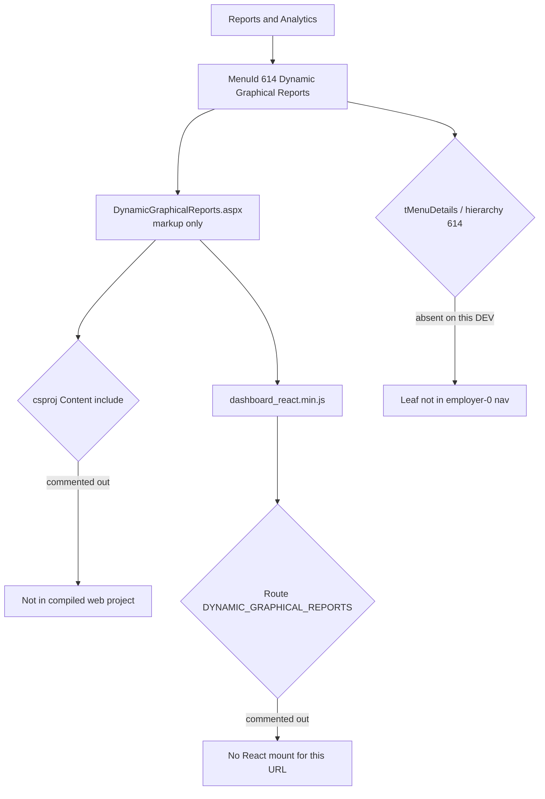
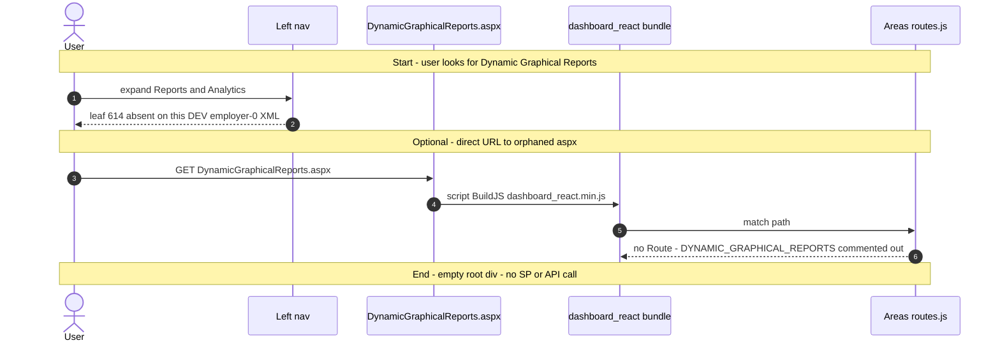
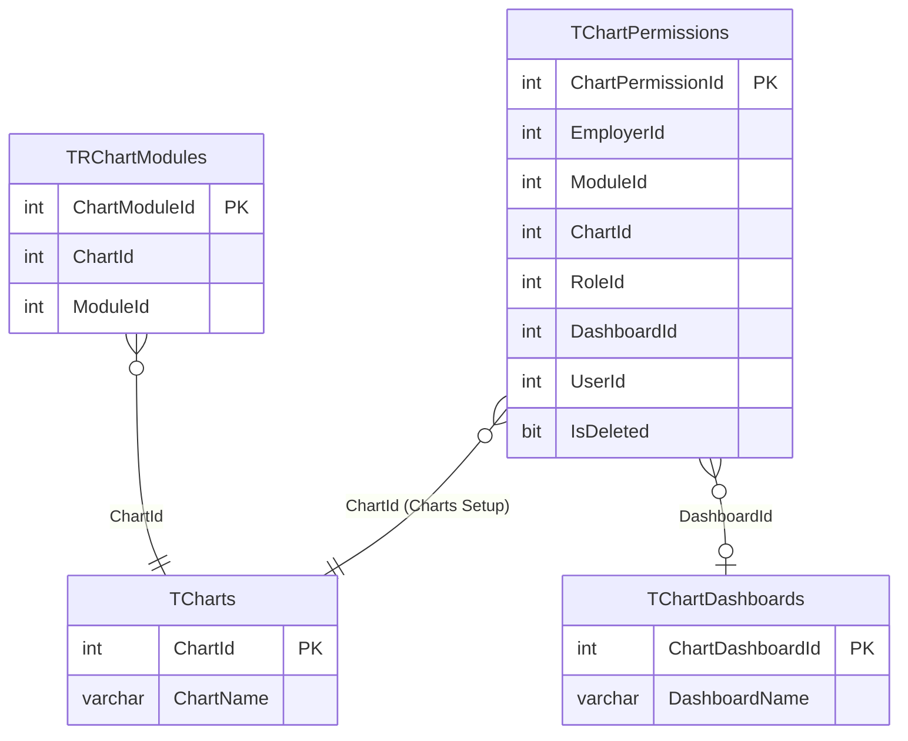

# Dynamic Graphical Reports

## Overview

Canonical hierarchy DML places **Dynamic Graphical Reports** as MenuId **614** under Reports & Analytics, immediately after **SSRS Reports** (154) and before **Report Designer**. The leaf was meant to host a React chart/reporting surface at `~/HRM/DashBoard_React/DynamicGraphicalReports.aspx` (same `dashboard_react` bundle family as **Admin Configuration → Charts Setup**).

In this SourceCode checkout the leaf is **dormant**. The aspx markup file still exists, but:

- `HRMS.Web.csproj` comments out both the aspx `Content` include and the code-behind / designer `Compile` includes.
- No `DynamicGraphicalReports.aspx.cs` (or `.designer.cs`) file is on disk.
- `routeConstants.js` comments out `DYNAMIC_GRAPHICAL_REPORTS`.
- `Areas/routes.js` comments out the lazy import of `./SetupCharts/DynamicGraphicalReports` and its `<Route>`.
- The React component file `Areas/SetupCharts/DynamicGraphicalReports` is **missing**.
- This session's DEV `tMenuDetails` has **no** MenuId 614 / name Dynamic Graphical Reports (any employer). Employer-0 `TDynamicMenuHierarchy` XML under Reports & Analytics lists Report Builder, Static Reports, Manage Reports, Report Designer, Traditional Reports, and Report Center only — **no** 614 and **no** 154.

There is therefore **no live HRMS database call chain** for this left-nav leaf. Chart **permission** maintenance lives on **Charts Setup** (menu 613). Chart **rendering** for home dashboards lives on **Home** (`DashBoard_old.aspx` → `DashboardCharts`). Neither of those is this menu item.

**Who's involved (intended):**

- **Report / analytics consumer** — would open Reports & Analytics → Dynamic Graphical Reports to view graphical extracts (never wired in the current checkout).
- **Charts admin** — uses **Admin Configuration → Charts Setup** to grant role/employee chart permissions (`TChartPermissions`). That screen is the live sibling, not this leaf.

There is **no** `llm-wiki/domain` page for this leaf. Chart table one-liners live in `llm-wiki/reference/tables/hrms.md` (`TChartPermissions`, `TCharts`, `TChartDashboards`, `TRChartModules`).

## Workflow

Nothing on this leaf inserts, updates, or selects chart rows. Sibling **Charts Setup** owns permission CRUD; **Home** dashboard owns chart paint.

## Request journey

No authenticated request journey reaches a stored procedure from this leaf in the current checkout. The sequence below records what happens if someone still hits the orphaned aspx path (for example a bookmarked URL after manually restoring content).

### User — open Dynamic Graphical Reports (current checkout)

Intended (never completed here) path would have been aspx session hid fields → React `DynamicGraphicalReports` → `/dashBoard` chart APIs. That component and route constant are commented or missing; do not invent a SP chain for it.

## Entry points

Hierarchy templates (`HRMS-DATABASE/HRMS/DML/Tmenudetails DML.sql`, Customer License DML, PMSRelease hierarchy scripts, and siblings) list MenuId **614** **Dynamic Graphical Reports** under Reports & Analytics after SSRS Reports. Insert scripts such as `DML/123448-Update Script to QA.sql` seed `(614,'Dynamic Graphical Reports',NULL,NULL,…)` — **NavigateURL is NULL**.

Inferred host (from aspx title / commented `routeConstants`): `~/HRM/DashBoard_React/DynamicGraphicalReports.aspx` (URL casing in comments often uses `Dashboard_React`).

| UI page / artifact | Purpose |
|---|---|
| `HRMS.Web/HRMS.Web/HRM/DashBoard_React/DynamicGraphicalReports.aspx` | **This feature (stub).** Markup + hidden session fields + `dashboard_react.min.js`. |
| `HRMS.Web/HRMS.Web/HRMS.Web.csproj` | Comments out Content + Compile for this aspx / code-behind. |
| `HRMS.Web/.../DashBoard_React/Common/routeConstants.js` | `DYNAMIC_GRAPHICAL_REPORTS` constant **commented out**. |
| `HRMS.Web/.../DashBoard_React/Areas/routes.js` | Lazy import + `<Route>` for `SetupCharts/DynamicGraphicalReports` **commented out**. |
| `HRMS.Web/.../DashBoard_React/Areas/SetupCharts/DynamicGraphicalReports` | **Missing** — intended React leaf (import path only). |
| `HRMS.Web/.../DashBoard_React/SetupCharts.aspx` | **Not this menu item.** Sibling **Charts Setup** (Admin Configuration, MenuId **613**). |
| `HRMS.Web/.../DashBoard_React/DashBoard_old.aspx` + `DashboardCharts.js` | **Not this menu item.** Home dashboard chart consumer. |

No `ActivityDescription` enum value for Dynamic Graphical Reports was found (`SetupCharts = 344` is the Charts Setup host only).

## Code → database call chain

**None for this leaf.** The aspx has no code-behind in the project; the React route that would call Core API is disabled; no WebMethod / postback SP path exists on the markup.

| Entry | Layer | Stored procedure / API |
|---|---|---|
| Left-nav MenuId 614 | `tMenuDetails` / `TDynamicMenuHierarchy` DML templates | No live DEV row; NavigateURL often NULL |
| Orphaned aspx markup `DynamicGraphicalReports.aspx:1` | Would need `DynamicGraphicalReports.aspx.cs` (commented out of csproj; file absent) | No `Page_Load` SP — file missing |
| Commented route `routes.js:42` / `:128` | Would lazy-load `./SetupCharts/DynamicGraphicalReports` | Component file absent — no `/dashBoard` calls |
| Sibling Charts Setup (out of scope for this submenu) | `SetupCharts.aspx.cs:29` → `dashBoardDAL` chart permission methods | `SP_Get_ChartPermissions`, `SP_InsUpd_ChartPermissions`, `SP_Delete_ChartPermissions`, `uspGetCharts`, … — documented under Charts Setup |
| Sibling Home dashboard (out of scope) | `DashboardCharts.js` preferences / chart helpers | Preferencing / dashboard APIs — not mounted from MenuId 614 |

## API endpoints

> No REST API and no WebForms postback for this leaf. The commented route would have lived under the shared `dashboard_react` SPA; chart permission endpoints under `/dashBoard` belong to **Charts Setup**, not to this Reports & Analytics item.

| Verb | Route | Note |
|---|---|---|
| — | — | No endpoint is registered for Dynamic Graphical Reports. |
| (sibling) | `/dashBoard/GetChartPermissionsGridData` etc. | Charts Setup only — see Admin Configuration guide. |

## Stored procedures & tables involved

No procedure is invoked from this left-nav leaf. Menu seed rows and chart catalog tables are listed for orientation only.

| Object | File path | Purpose | Wiki |
|---|---|---|---|
| `tMenuDetails` / `TDynamicMenuHierarchy` | DML templates | Sidebar leaf 614 Dynamic Graphical Reports (often NavigateURL NULL). | `hrms.md` (`TDynamicMenuHierarchy`) |
| `TCharts` / `TRChartModules` / `TChartDashboards` / `TChartPermissions` | `HRMS-DATABASE/HRMS/TABLES/…` | Chart catalog + permissions used by **Charts Setup** / dashboards — **not** called from this leaf. | `llm-wiki/reference/tables/hrms.md` |
| Charts Setup SPs (`uspGetCharts`, `SP_Get_ChartPermissions`, …) | `…/STOREPROCEDURE/` | Documented on [Charts Setup](/docs/guides/admin-configuration/charts-setup) and existing `/docs/database/hrms/*` pages. **Skipped** here (no direct call from 614). | — |

No new database explanation pages were written for this guide: there are no direct SPs on the leaf call chain.

## Table relationships

No domain `erDiagram` for this leaf. Chart permission relationships are owned by Charts Setup; reproduced here only as context for the intended product area (join keys, not declared FKs on `TChartPermissions`).

This leaf does not read or write those tables in the current checkout.

## Known gaps

- **DEV menu row missing.** No `tMenuDetails` row for MenuId **614** / Dynamic Graphical Reports on this DEV; employer-0 hierarchy XML omits the node. Hierarchy DML templates still list it after SSRS Reports.
- **NavigateURL NULL in seed scripts.** Even where 614 is inserted, URL is often NULL — same pattern as historical SSRS 154 seeds.
- **Aspx excluded from csproj.** Markup remains on disk; Content and Compile includes are HTML-commented, so a normal web build does not ship or compile the page.
- **Code-behind absent.** `DynamicGraphicalReports.aspx` references `.aspx.cs`, but the file is not in the tree; restoring Content alone would not compile.
- **React route and component removed.** Constant, lazy import, and `<Route>` are commented; `SetupCharts/DynamicGraphicalReports` module is missing — empty `#root` if the orphaned aspx were forced to load.
- **No activity log / no Core API surface for this leaf.** Only `ActivityDescription.SetupCharts` (344) exists for the Admin Charts Setup host.
- **Product intent unclear from code.** Comments point at a Reports & Analytics graphical viewer next to Charts Setup permissions; actual chart paint remains on Home `DashboardCharts`. SystemModel-2 has no page naming MenuId 614.
- **Path casing drift.** Comments use `/HRM/Dashboard_React/...` while the folder and sibling SetupCharts NavigateURL use `DashBoard_React`.

## Reference

Confidence is **medium**: high for the dormant aspx / commented route / missing component evidence; medium for historical menu intent from DML (absent on this DEV employer-0). No SP call chain to validate.

### SourceCode

- `HRMS.Web/HRMS.Web/HRM/DashBoard_React/DynamicGraphicalReports.aspx`
- `HRMS.Web/HRMS.Web/HRMS.Web.csproj` (commented Content / Compile for DynamicGraphicalReports)
- `HRMS.Web/HRMS.Web/HRM/DashBoard_React/Common/routeConstants.js`
- `HRMS.Web/HRMS.Web/HRM/DashBoard_React/Areas/routes.js`
- `HRMS.Web/HRMS.Web/HRM/DashBoard_React/SetupCharts.aspx` (+ `.cs`) — sibling Charts Setup
- `HRMS.Web/HRMS.Web/HRM/DashBoard_React/Areas/SetupCharts/SetupChartsSettings.js`
- `HRMS.Web/HRMS.Web/HRM/DashBoard_React/Areas/Dashboard/Containers/DashboardCharts.js` — Home chart consumer
- `HRMS.Shared/HRMS.DataContract/Common/Enums.cs` (`SetupCharts = 344`)

### TDG HRMS DB

- `llm-wiki/reference/tables/hrms.md` (`TChartPermissions`, `TCharts`, `TChartDashboards`, `TRChartModules`, `TDynamicMenuHierarchy`)
- `HRMS-DATABASE/HRMS/DML/Tmenudetails DML.sql` (Reports & Analytics → Dynamic Graphical Reports Value 614)
- `HRMS-DATABASE/HRMS/DML/Customer License Dashboard/TMenuDetails DML.sql` (leaf after SSRS Reports)
- `HRMS-DATABASE/HRMS/DML/123448-Update Script to QA.sql` (MenuId 614 insert with NULL NavigateURL)
