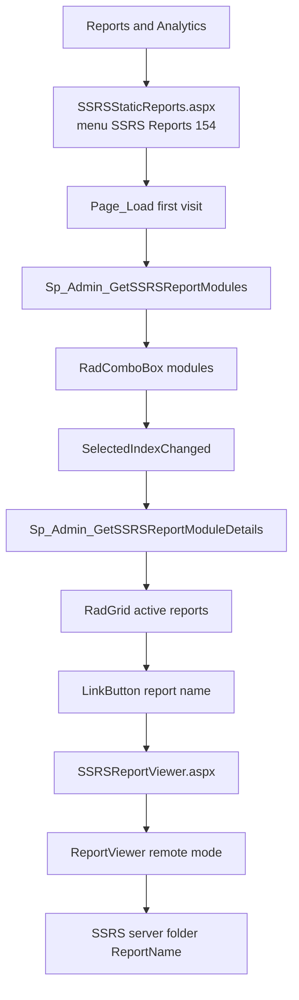
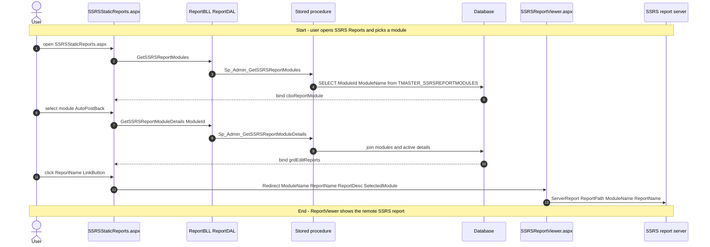
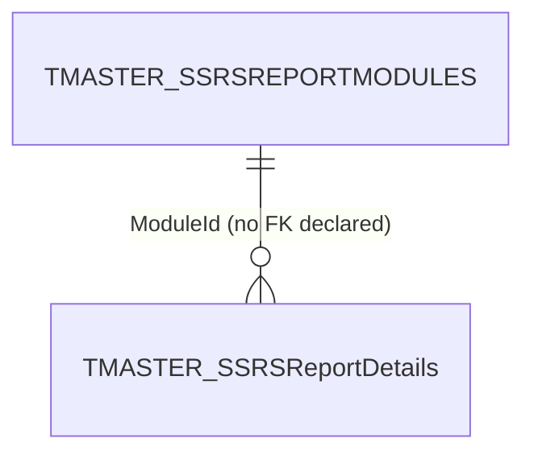

# SSRS Reports

## Overview

An HR or analytics user needs a **published SQL Server Reporting Services (SSRS) report** that is not built through Report Builder / Report Designer. They open **Reports & Analytics → SSRS Reports**, pick a report module from the dropdown, see the active report names for that module, and click a name. The browser redirects to `SSRSReportViewer.aspx`, which hosts the Microsoft ReportViewer control in **remote** mode against the configured report server folder. The page header on the picker says **Analytics**; the left-nav leaf is **SSRS Reports**.

Nothing on this screen inserts or updates employee data. The HRMS database calls are read-only catalog SELECTs against `TMASTER_SSRSREPORTMODULES` and `TMASTER_SSRSReportDetails`. The actual extract runs on the SSRS server (path `/{SSRSReportModule}/{ReportName}`). Building an `EmployerId` report parameter is present in code but **commented out**, so the viewer does not currently push session employer into SSRS.

**Who's involved:**

- **Report consumer** — picks module, opens a report link, views/exports inside ReportViewer.
- **SSRS / ops admin** — publishes RDL folders on the report server named by `Web.config` `SSRSReportModule` (sample value `HRMS_PROD`) and keeps credentials in `SSRSReportUsername` / `SSRSReportPassword` / `SSRSReportDomainName`.
- **Catalog maintainer** — rows in `TMASTER_SSRSREPORTMODULES` / `TMASTER_SSRSReportDetails` (no writer SP is called from this page; soft-delete exists as `Sp_Admin_DelSSRSReportModuleDetails` elsewhere).

Canonical hierarchy DML places **SSRS Reports** as MenuId **154** under Reports & Analytics (after Report Builder / Static Reports / Manage Reports). Live page is `~/HRM/Reports/SSRSStaticReports.aspx`. There is **no** `llm-wiki/domain` page for this leaf. Table one-liners live in `llm-wiki/reference/tables/hrms.md`.

## Workflow

Picker postbacks only load catalog. Opening a report is a `Response.Redirect`, not a postback that executes an HRMS report SP.

## Request journey

Catalog load is SELECT. Opening a report leaves HRMS for the SSRS ReportViewer host.

### User — open an SSRS report

Back from the viewer (`btnDashBoard_click`) redirects to `SSRSStaticReports.aspx` with optional `SelectedModule`, which reloads the grid via `getReportDetails` on `Page_Load`.

## Entry points

Hierarchy templates (`HRMS-DATABASE/HRMS/DML/Tmenudetails DML.sql`, Customer License DML, and siblings) list MenuId **154** **SSRS Reports** under Reports & Analytics. Several insert scripts set `NavigateURL` to **NULL** for 154. The compiled host is `HRM/Reports/SSRSStaticReports.aspx` (in `HRMS.Web.csproj`; also listed in `web.prod.config` AllowedPages). Viewer sibling is `SSRSReportViewer.aspx`.

This DEV checkout's `tMenuDetails` and employer-0 `TDynamicMenuHierarchy` XML currently **omit** MenuId 154 — see Known gaps.

| UI page / API | Purpose |
|---|---|
| `HRMS.Web/HRMS.Web/HRM/Reports/SSRSStaticReports.aspx` | **This feature.** Module combo + report grid. |
| `HRMS.Web/HRMS.Web/HRM/Reports/SSRSStaticReports.aspx.cs` | Code-behind catalog bind and redirect. |
| `HRMS.Web/HRMS.Web/HRM/Reports/SSRSReportViewer.aspx` | ReportViewer remote host for one report. |
| `HRMS.Shared/HRMS.BusinessLayer/Reports/ReportBLL.cs` | Thin wrappers `GetSSRSReportModules` / `GetSSRSReportModuleDetails`. |
| `HRMS.Shared/HRMS.DataAccessLayer/Reports/ReportDAL.cs` | Enterprise Library `GetStoredProcCommand` for the two Sp_Admin_* procedures. |
| `HRMS.Web/HRMS.Web/HRM/Reports/StaticReports.aspx` | **Not this menu item.** Sibling Static Reports (Telerik / custom extracts). |
| `HRMS.Web/HRMS.Web/HRM/Reports/PowerBiReports.aspx` | Power BI catalog (removed from many hierarchy XMLs); reuses SSRS module AppSetting name only. |

No `ActivityDescription` enum value for SSRS Reports was found. Global-access employer control is commented out on the aspx.

## Code → database call chain

WebForms postbacks + one redirect. No Node `/api` routes.

| Entry | BLL / DAL | Stored procedure / remote |
|---|---|---|
| `Page_Load` → `_getReportModuleData` `SSRSStaticReports.aspx.cs:17` / `:29` | `ReportBLL.GetSSRSReportModules` `ReportBLL.cs:205` → `ReportDAL.GetSSRSReportModules` `ReportDAL.cs:1528` | `Sp_Admin_GetSSRSReportModules` |
| `cboReportModule_SelectedIndexChanged` `:42` → `getReportDetails` `:72` | `ReportBLL.GetSSRSReportModuleDetails` `ReportBLL.cs:218` → `ReportDAL.GetSSRSReportModuleDetails` `ReportDAL.cs:1536` | `Sp_Admin_GetSSRSReportModuleDetails` `@ModuleId` |
| `Page_Load` with `?SelectedModule=` `:20` → `getReportDetails` | same as above | same details SP |
| `downloadFileName_Click` `:50` | no DAL | `Response.Redirect` to `SSRSReportViewer.aspx` with `ModuleName` from AppSettings `SSRSReportModule`, plus `ReportName`, `ReportDesc`, `SelectedModule` |
| `SSRSReportViewer.Page_Load` `SSRSReportViewer.aspx.cs:11` | no DAL | Microsoft ReportViewer `ProcessingMode.Remote`; `ReportServerUrl` = `SSRSReportServerURL`; credentials = `SSRSReportUsername` / `SSRSReportPassword` / `SSRSReportDomainName`; `ReportPath` = `/{ModuleName}/{ReportName}` |
| `SSRSReportViewer` EmployerId parameter `:42` | — | `ReportParameter("EmployerId", …)` is built; `SetParameters` / `Refresh` are **commented out** |

Neither catalog procedure nests another procedure or function.

## API endpoints

> No REST API. Catalog and navigation are WebForms postbacks / redirects. Report payload is served by the remote SSRS endpoint configured in `Web.config` (`SSRSReportServerURL`), not by HRMS Core Node.

## Stored procedures & tables involved

No domain wiki page covers this feature. Catalog one-liners cite `llm-wiki/reference/tables/hrms.md`.

| Object | File path | Purpose | Wiki |
|---|---|---|---|
| `TMASTER_SSRSREPORTMODULES` | `HRMS-DATABASE/HRMS/TABLES/TMASTER_SSRSREPORTMODULES.sql` | Module dropdown (`ModuleId`, `ModuleName`). No PK/FK declared in the checked-in CREATE. | `llm-wiki/reference/tables/hrms.md` |
| `TMASTER_SSRSReportDetails` | `…/TABLES/TMASTER_SSRSReportDetails.sql` | Report rows per module; `IsActive` filters the grid. No FK declared. | same |
| `Sp_Admin_GetSSRSReportModules` | `…/STOREPROCEDURE/Sp_Admin_GetSSRSReportModules.sql` | Ordered module list. [Sp_Admin_GetSSRSReportModules](/docs/database/hrms/Sp_Admin_GetSSRSReportModules) | — |
| `Sp_Admin_GetSSRSReportModuleDetails` | `…/STOREPROCEDURE/Sp_Admin_GetSSRSReportModuleDetails.sql` | Active reports for one module. [Sp_Admin_GetSSRSReportModuleDetails](/docs/database/hrms/Sp_Admin_GetSSRSReportModuleDetails) | — |
| `Sp_Admin_DelSSRSReportModuleDetails` | `…/STOREPROCEDURE/Sp_Admin_DelSSRSReportModuleDetails.sql` | Soft-deactivates a detail row. **Not called** from this page. | — |
| `USP_SSRS_RPT_*` family | `…/STOREPROCEDURE/USP_SSRS_RPT_*.sql` | Dataset procs used by published SSRS RDLs. **Not** invoked from `ReportDAL` on this page. | — |
| `tMenuDetails` / `TDynamicMenuHierarchy` | DML templates | Sidebar leaf 154 SSRS Reports. | `hrms.md` (`TDynamicMenuHierarchy`) |

## Table relationships

No domain `erDiagram` exists. Edge below is logical (`ModuleId`); the checked-in CREATE scripts declare **no FK**.

`Sp_Admin_GetSSRSReportModuleDetails` inner-joins on `ModuleId` and requires `sd.IsActive = 1`. Inactive detail rows stay in the table but never appear on this grid.

## Known gaps

- **DEV menu row missing.** This session's DEV `tMenuDetails` has no MenuId **154** / name SSRS Reports, and employer-0 `TDynamicMenuHierarchy` XML does not contain the SSRS node. Hierarchy DML templates still list it. NavigateURL is often NULL in insert scripts; the live aspx path is inferred from the compiled page and AllowedPages, not from a live DEV NavigateURL.
- **EmployerId not passed to SSRS.** `SSRSReportViewer.aspx.cs` builds `ReportParameter("EmployerId", …)` then comments out `SetParameters` / `Refresh`, so remote reports that expect employer scoping may show unfiltered or empty data depending on RDL defaults.
- **Module folder name is AppSettings, not DB.** Redirect uses `SSRSReportModule` for the SSRS folder segment, not `TMASTER_SSRSREPORTMODULES.ModuleName`. A mismatch between config folder and published path breaks every report link.
- **No activity log / no Node API.** Unlike Static Reports (`ActivityDescription.StaticReports`), this picker has no matching activity enum found. There is no Core Node mirror of this catalog.
- **SSRS dataset procs out of page chain.** Dozens of `USP_SSRS_RPT_*` procedures exist in HRMS-DATABASE; they are not called by `SSRSStaticReports` / `ReportDAL`. Documenting each RDL dataset is out of scope of this left-nav leaf.
- **Soft-delete SP unused here.** `Sp_Admin_DelSSRSReportModuleDetails` soft-sets `IsActive = 0` but has no caller on this screen (DataCatalog note also says no writer UI found for modules).
- **Page chrome vs menu name.** On-page section header is **Analytics**; breadcrumb/menu leaf is **SSRS Reports**. Sibling Survey **Analytics** is a different menu.

## Reference

Confidence is **medium** for menu presence on this DEV (row/XML absent) and **high** for the WebForms catalog → redirect → ReportViewer call chain once the page is reached.

### SourceCode

- `HRMS.Web/HRMS.Web/HRM/Reports/SSRSStaticReports.aspx` (+ `.cs`, `.designer.cs`)
- `HRMS.Web/HRMS.Web/HRM/Reports/SSRSReportViewer.aspx` (+ `.cs`)
- `HRMS.Shared/HRMS.BusinessLayer/Reports/ReportBLL.cs`
- `HRMS.Shared/HRMS.DataAccessLayer/Reports/ReportDAL.cs`
- `HRMS.Web/HRMS.Web/Web.config` (`SSRSReportServerURL`, `SSRSReportModule`, credential keys)
- `HRMS.Web/HRMS.Web/web.prod.config` (AllowedPages includes SSRS aspx files)

### TDG HRMS DB

- `llm-wiki/reference/tables/hrms.md` (`TMASTER_SSRSREPORTMODULES`, `TMASTER_SSRSReportDetails`)
- `HRMS-DATABASE/HRMS/TABLES/TMASTER_SSRSREPORTMODULES.sql`
- `HRMS-DATABASE/HRMS/TABLES/TMASTER_SSRSReportDetails.sql`
- `HRMS-DATABASE/HRMS/STOREPROCEDURE/Sp_Admin_GetSSRSReportModules.sql`
- `HRMS-DATABASE/HRMS/STOREPROCEDURE/Sp_Admin_GetSSRSReportModuleDetails.sql`
- `HRMS-DATABASE/HRMS/STOREPROCEDURE/Sp_Admin_DelSSRSReportModuleDetails.sql`
- `HRMS-DATABASE/HRMS/DML/Tmenudetails DML.sql` (Reports & Analytics → SSRS Reports Value 154)
- `HRMS-DATABASE/HRMS/DML/Customer License Dashboard/TMenuDetails DML.sql` (same leaf order)
