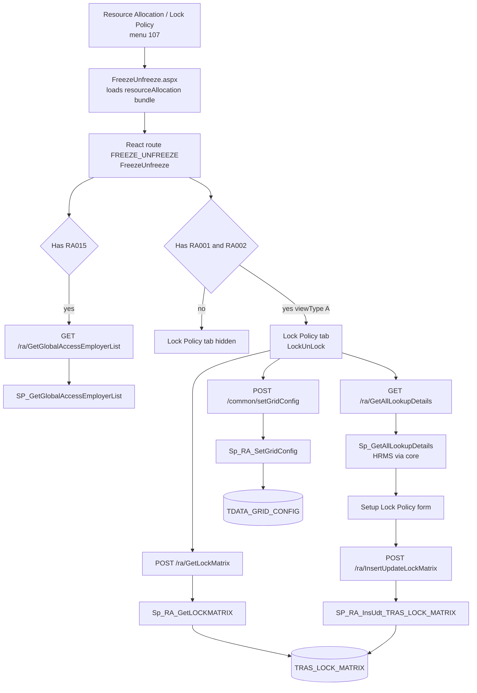
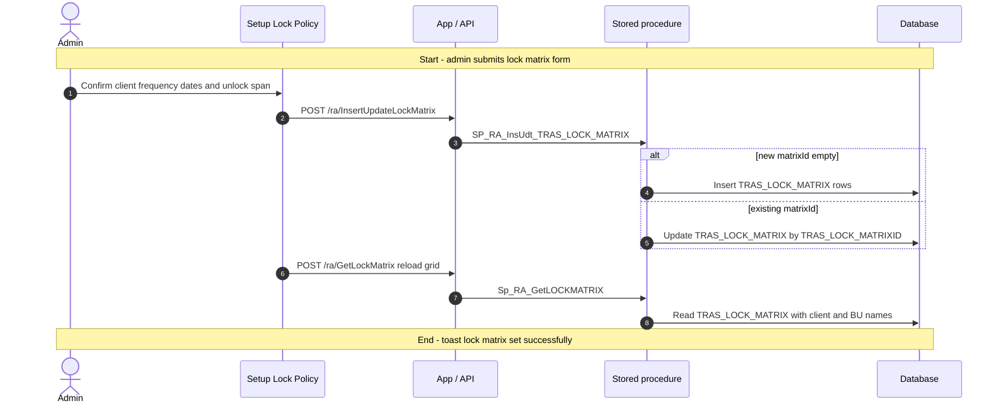
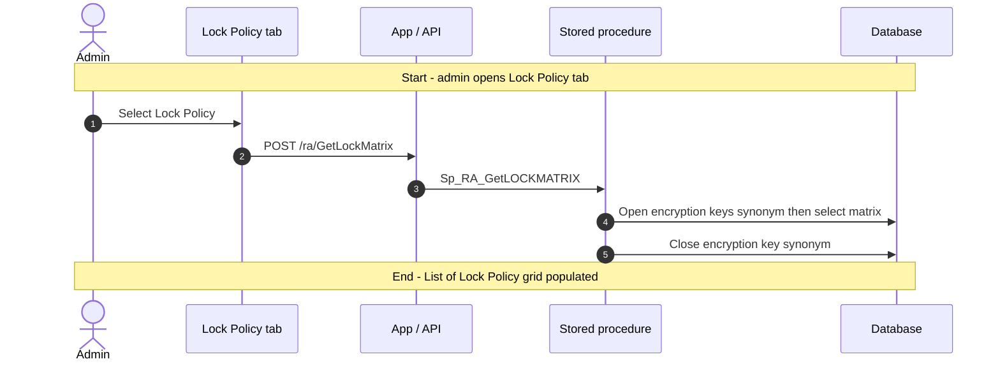
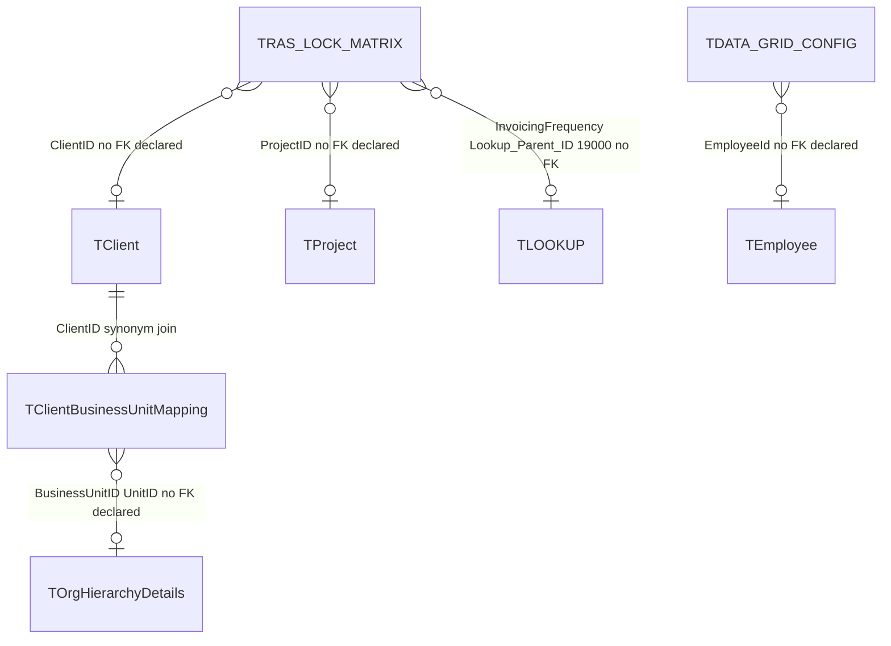

# Lock Policy

## Overview

An administrator with Resource Allocation claims needs to define when allocation periods lock for invoicing (client, invoice frequency, effective date, lock-after days, manager alert days, unlock span). On **Resource Allocation → Lock Policy** (menu node **107**) they open `FreezeUnfreeze.aspx`, which seeds session hidden fields and loads the webpack Resource Allocation React app. The React route `FREEZE_UNFREEZE` mounts **FreezeUnfreeze**. The **Lock Policy** tab (eventKey 2) appears only when the user has both `RA001` (view my resource) and `RA002` (view all resource); it renders **LockUnLock** → **SetupLockMatrix** (create/edit form) and **LockSchedules** (grid). Users with claim `RA015` also get an organisation multi-select that calls `SP_GetGlobalAccessEmployerList`.

Saving a policy posts to `InsertUpdateLockMatrix`, which runs `SP_RA_InsUdt_TRAS_LOCK_MATRIX` against `TRAS_LOCK_MATRIX` in the Resource Allocation database. The grid loads via `GetLockMatrix` → `Sp_RA_GetLOCKMATRIX`. Client dropdown data comes from HRMS `Sp_GetAllLookupDetails` over the Node `core` connection. This tab does **not** handle unlock request notifications (sibling **Notifications** tab).

**Who's involved:**

- **Administrator** with both `RA001` and `RA002` — opens Lock Policy, creates or edits lock matrix rows, saves grid column config.
- **Global-access administrator** (claim `RA015`) — filters employers via the organisation multi-select.
- **Manager / resource owner** — affected by freeze dates elsewhere; they do not configure policy on this tab.

There is no SystemModel-2 domain page for Resource Allocation Lock Policy.

## Workflow

## Request journey

### Save or update lock policy

### Load Lock Policy grid

## Entry points

> The live screen is the WebForms host `HRM/ResourceAllocation/FreezeUnfreeze.aspx`. It does not post back for lock matrix or grid config. Lock Policy work goes through the Resource Allocation Node Web API (`ra` / `common` routes). The Notifications tab on the same host is out of scope for this guide.

| Entry point | Purpose | Live? |
|---|---|---|
| `~/HRM/ResourceAllocation/FreezeUnfreeze.aspx` (`RouteConstants.FREEZE_UNFREEZE`, menu **107**) | Host page; seeds employee/employer/role hidden fields; loads React | Yes |
| Lock Policy tab (`FreezeUnfreeze` eventKey 2) | Setup form + List of Lock Policy grid | Yes when `RA001` and `RA002` |
| Setup Lock Policy (`SetupLockMatrix`) | Create or edit one matrix row | Yes |
| List of Lock Policy (`LockSchedules`) | Grid, edit action, column config export | Yes |
| Organisation multi-select (`OrganizationMultiSelectDropDown`) | Multi-employer filter when `RA015` | Yes |
| `CommonUtil.LogActivity(LockUnLock)` on `Page_Load` | Activity type **409** | Yes |
| Notifications tab (eventKey 1) | Unlock requests — sibling, not Lock Policy | Yes (separate flow) |

## Code → database call chain

The React UI calls `APIHelper` → Resource Allocation Node API (active V1 constants in `apiURLConstants.js`). Lock matrix read/write goes Controller → DAL (insert/update uses a DAL transaction). Lookup clients use the `core` (HRMS) connection.

| Step | Entry point | App code | Stored procedure |
|---|---|---|---|
| Activity on open | `FreezeUnfreeze.aspx.cs:29` | `CommonUtil.LogActivity` | `Sp_InsertActivityLog` (HRMS; activity **409**) |
| Organisation list when `RA015` | `organizationMultiSelectDropDown.js:34` | `raController.GetGlobalAccessEmployerList` (`raController.js:225`) → `raDAL.GetGlobalAccessEmployerList` (`raDAL.js:509`) | `SP_GetGlobalAccessEmployerList` (HRMS; synonym in ResourceAllocation) |
| Client lookup for form | `SetupLockMatrix.js:131` | `raController.GetAllLookupDetails` (`raController.js:56`) → `raDAL.GetAllLookupDetails` (`raDAL.js:466`) | `Sp_GetAllLookupDetails` (HRMS via `core`) |
| Load / reload grid | `LockUnLock.js:31` / `:68` | `raController.GetLockMatrix` (`raController.js:256`) → `raDAL.GetLockMatrix` (`raDAL.js:551`) | `Sp_RA_GetLOCKMATRIX` |
| Save matrix | `SetupLockMatrix.js:398` | `raController.InsertUpdateLockMatrix` (`raController.js:276`) → `raDAL.InsertUpdateLockMatrix` (`raDAL.js:606`) | `SP_RA_InsUdt_TRAS_LOCK_MATRIX` |
| Persist grid columns | `LockSchedules.js:58` | `commonController.SetGridConfig` (`commonController.js:19`) → `commonDAL.SetGridConfig` (`commonDAL.js:50`) | `Sp_RA_SetGridConfig` |

## API endpoints

This screen is not a WebForms postback for lock matrix data. The ASPX only loads the React shell. Traffic is HTTP to the Resource Allocation Node API (`APIHelper` base URL), with auth middleware on the `ra` / `common` routers. Active URL constants are the V1 block at the bottom of `apiURLConstants.js` (V2/V3 blocks are commented out).

| Method | Path | Purpose | Caller | Handler |
|---|---|---|---|---|
| GET | `/ra/GetGlobalAccessEmployerList?employeeId=` | Organisations for global-access admins | `organizationMultiSelectDropDown.js` | `raController.GetGlobalAccessEmployerList` |
| GET | `/ra/GetAllLookupDetails?employerId=` | Client (and lookup) catalogue for the form | `SetupLockMatrix.js` `loadAllDropdowndata` | `raController.GetAllLookupDetails` |
| POST | `/ra/GetLockMatrix` | List of Lock Policy rows | `LockUnLock.js` | `raController.GetLockMatrix` |
| POST | `/ra/InsertUpdateLockMatrix` | Insert or update one matrix | `SetupLockMatrix.js` `handleSubmit` | `raController.InsertUpdateLockMatrix` |
| POST | `/common/setGridConfig` | Save LockSchedules column visibility | `LockSchedules.js` `saveGridConfig` | `commonController.SetGridConfig` |

## Stored procedures & tables involved

Inventory paths are under `HRMS-DATABASE/HRMS-RESOURCEALLOCATION/` unless noted. Procedure pages for Resource Allocation objects are under `/docs/database/hrms-resourceallocation/`. Shared HRMS objects keep the `hrms` slug.

| Object | File | Purpose | Database page |
|---|---|---|---|
| `Sp_RA_GetLOCKMATRIX` | `STOREPROCEDURE/Sp_RA_GetLOCKMATRIX.sql` | List lock matrix rows for employer id list, optional client | [Sp_RA_GetLOCKMATRIX](/docs/database/hrms-resourceallocation/Sp_RA_GetLOCKMATRIX) |
| `SP_RA_InsUdt_TRAS_LOCK_MATRIX` | `STOREPROCEDURE/SP_RA_InsUdt_TRAS_LOCK_MATRIX.sql` | Insert or update `TRAS_LOCK_MATRIX` | [SP_RA_InsUdt_TRAS_LOCK_MATRIX](/docs/database/hrms-resourceallocation/SP_RA_InsUdt_TRAS_LOCK_MATRIX) |
| `Sp_RA_SetGridConfig` | `STOREPROCEDURE/Sp_RA_SetGridConfig.sql` | Upsert `TDATA_GRID_CONFIG` for LockSchedules | [Sp_RA_SetGridConfig](/docs/database/hrms-resourceallocation/Sp_RA_SetGridConfig) |
| `Sp_GetAllLookupDetails` | `HRMS/STOREPROCEDURE/Sp_GetAllLookupDetails.sql` | Client/project/lookup catalogue for the form | [Sp_GetAllLookupDetails](/docs/database/hrms/Sp_GetAllLookupDetails) |
| `SP_GetGlobalAccessEmployerList` | `HRMS/STOREPROCEDURE/SP_GetGlobalAccessEmployerList.sql` (synonym in ResourceAllocation) | Global-access organisation list | [SP_GetGlobalAccessEmployerList](/docs/database/hrms/SP_GetGlobalAccessEmployerList) |
| `Sp_InsertActivityLog` | `HRMS/STOREPROCEDURE/Sp_InsertActivityLog.sql` | Page-open activity **409** | [Sp_InsertActivityLog](/docs/database/hrms/Sp_InsertActivityLog) |

Tables these procedures read or write in Resource Allocation: `TRAS_LOCK_MATRIX`, `TDATA_GRID_CONFIG`, `TLOOKUP` (invoice frequency text). Synonym / cross-db reads include `TClient`, `TProject`, `TClientBusinessUnitMapping`, `TOrgHierarchyDetails`, plus encryption open/close synonyms used by `Sp_RA_GetLOCKMATRIX`.

Direct nested callees (one level) already have HRMS pages: `Sp_OpenEncryptionKeys`, `SP_CloseEncryptionKey` (ResourceAllocation synonyms → HRMS).

## Table relationships

`TRAS_LOCK_MATRIX` has no declared foreign keys in its table script. Columns the procedures join without a foreign key are labeled **no FK declared**.

## Known gaps

- SourceCode `docs/SystemModels/SystemModel-2` has no Resource Allocation or Lock Policy domain page.
- Active V1 `raDAL.InsertUpdateLockMatrix` does not bind `@ProjectID`, but inventory `SP_RA_InsUdt_TRAS_LOCK_MATRIX` requires `@ProjectID VARCHAR(5000)`. V2/V3 DAL still pass `projectId`; live DB may differ from inventory.
- Project multi-select UI in `SetupLockMatrix` is commented out; inserts that still need project ids cannot be driven from the current form.
- `GetAllLookupDetails` and save bind `employerId` as `Int`, while the organisation multi-select can pass a comma-separated list — multi-org lookup/save can fail or coerce incorrectly. `Sp_RA_GetLOCKMATRIX` correctly accepts `VARCHAR` employer lists.
- `FreezeUnfreeze.js` tab guard `(this.state.viewType === "M" || "A")` is always truthy, so Notifications always renders; Lock Policy correctly gates on `viewType === "A"`.
- Menu label has been **Lock Policy** or **FreezeUnFreeze** across DML eras; node value remains **107** → `FreezeUnfreeze.aspx`.
- Several RA scripts begin with `USE [ResourceAllocation]`.
- Page-open `Sp_InsertActivityLog` for activity **409** runs through shared HRMS logging.
- V2/V3 API URL blocks in `apiURLConstants.js` are commented out; this guide documents the active V1 constants.
- Sibling Notifications unlock-request APIs (`GetAllUnlockRequestDetails`, `InsertUpdateLockRequest`) are not called from the Lock Policy tab.

## Reference

High confidence on the React → Node API → DAL → Resource Allocation procedure chain for lock matrix load/save and grid config. Lookup and global-access lists resolve to HRMS procedures via `core` connection or synonyms.

### SourceCode

- `HRMS.Web/HRMS.Web/HRM/ResourceAllocation/FreezeUnfreeze.aspx` and `FreezeUnfreeze.aspx.cs`
- `HRMS.Web/HRMS.Web/HRM/ResourceAllocation/Areas/FreezeUnfreeze/Containers/FreezeUnfreeze.js`
- `HRMS.Web/HRMS.Web/HRM/ResourceAllocation/Areas/FreezeUnfreeze/Components/LockUnLock.js`
- `HRMS.Web/HRMS.Web/HRM/ResourceAllocation/Areas/FreezeUnfreeze/Components/SetupLockMatrix.js`
- `HRMS.Web/HRMS.Web/HRM/ResourceAllocation/Areas/FreezeUnfreeze/Components/LockSchedules.js`
- `HRMS.Web/HRMS.Web/HRM/ResourceAllocation/SharedComponent/UI/OrganizationMultiSelectDropDown/organizationMultiSelectDropDown.js`
- `HRMS.Web/HRMS.Web/HRM/ResourceAllocation/Common/apiURLConstants.js`, `apiHelper.js`, `routeConstants.js`, `claimConstants.js`
- `HRMS.Web/HRMS.Web/HRM/ResourceAllocation/Areas/routes.js`
- `HRMS.ResourceAllocation/HRMS.ResourceAllocation.WebAPI.Node/Controllers/raController.js`
- `HRMS.ResourceAllocation/HRMS.ResourceAllocation.WebAPI.Node/Controllers/commonController.js`
- `HRMS.ResourceAllocation/HRMS.ResourceAllocation.WebAPI.Node/Core/DataAccessLayer/raDAL.js`
- `HRMS.ResourceAllocation/HRMS.ResourceAllocation.WebAPI.Node/Core/DataAccessLayer/commonDAL.js`
- `HRMS.Shared/HRMS.DataContract/Common/Enums.cs` (`LockUnLock = 409`)

### TDG HRMS DB

- `HRMS-DATABASE/HRMS-RESOURCEALLOCATION/TABLES/TRAS_LOCK_MATRIX.sql`, `TDATA_GRID_CONFIG.sql`
- `HRMS-DATABASE/HRMS-RESOURCEALLOCATION/SYNONYMS/TClient.sql`, `TProject.sql`, `Sp_OpenEncryptionKeys.sql`, `SP_CloseEncryptionKey.sql`
- Procedure scripts listed in the table above
- `HRMS-DATABASE/HRMS/DML/Tmenudetails DML.sql` (Lock Policy node **107**)
- `HRMS-DATABASE/HRMS/DML/37744/37744.sql` (`FreezeUnfreeze.aspx` menu path)
