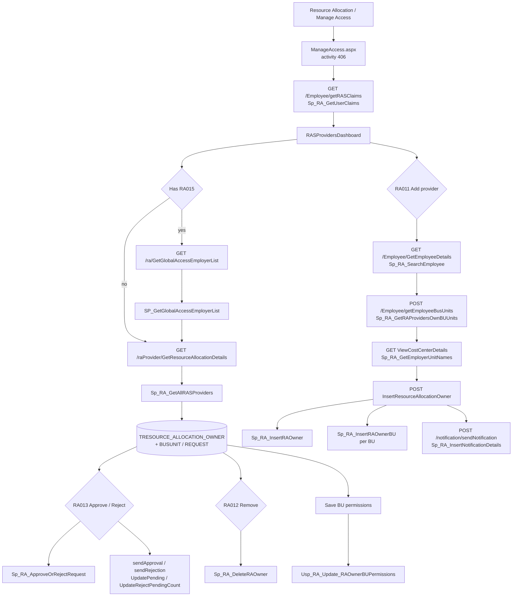
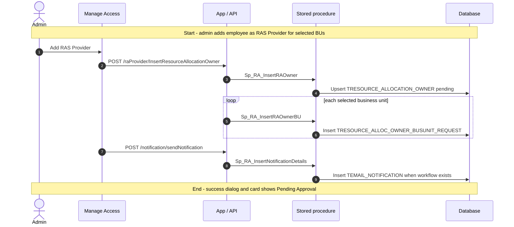
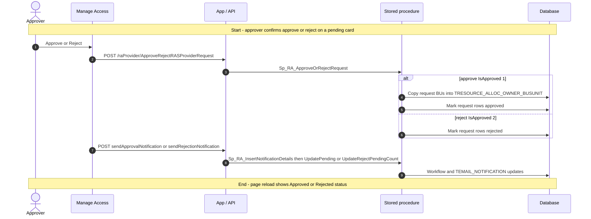
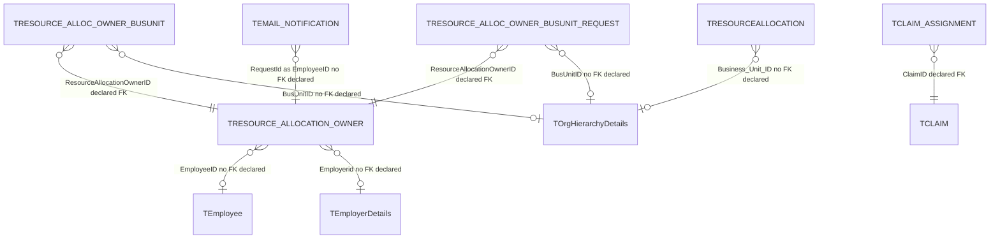

# Manage Access

## Overview

An administrator (or other user with RAS Provider claims) needs to designate **RAS Providers** — employees who own resource allocation for one or more business units — and control their per-BU View / Edit / Confirm permissions. On **Resource Allocation → Manage Access** they open `ManageAccess.aspx`, which logs activity **406**, seeds hidden session fields, and loads the Resource Allocation React bundle. The React route `RAS_PROVIDERS_DASHBOARD` mounts **RASProvidersDashboard** titled **Manage Access**.

Users with claim `RA015` (global access) pick organisations, then browse existing RAS Provider cards. With claim `RA011` they search an employee, choose business units, and **Add / Update RAS Provider**, which creates or reopens a pending owner request and queues an approval email. Approvers with `RA013` approve or reject pending cards; `RA012` can soft-delete an owner. Flipping a card shows BU permission toggles saved via `Usp_RA_Update_RAOwnerBUPermissions`.

**Who's involved:**

- **Administrator / RAS manager** with `RA010` (view) and usually `RA011` / `RA012` / `RA013` — adds, removes, and approves RAS Providers.
- **Global-access user** (`RA015`) — organisation multi-select fed by `SP_GetGlobalAccessEmployerList`.
- **Approver** — decides pending BU-assignment requests (`IsApproved` 0 → 1 approved or 2 rejected).
- **RAS Provider employee** — does not use this screen for self-service; they appear as cards once assigned.

There is no SystemModel-2 page for Manage Access. Table catalog prose for owner/BU tables is in `llm-wiki/reference/tables/resourceallocation.md`.

## Workflow

## Request journey

### Add RAS Provider

### Approve or reject RAS Provider request

## Entry points

> Live host is `HRM/ResourceAllocation/ManageAccess.aspx` (code-behind class `RASProviders`). It does not post back for RAS Provider data. All work goes through the Resource Allocation Node Web API. SourceCode SystemModel-2 has no Manage Access page.

| Entry point | Purpose | Live? |
|---|---|---|
| `~/HRM/ResourceAllocation/ManageAccess.aspx` (`RouteConstants.RAS_PROVIDERS_DASHBOARD`) | Host page; seeds hidden fields; loads React | Yes |
| React `RASProvidersDashboard` (claim `RA010`) | Manage Access UI | Yes |
| `userWidget.js` permission flip + Save | Per-BU View/Edit/Confirm | Yes |
| `CommonUtil.LogActivity(ManageAccess)` on `Page_Load` | Activity type **406** | Yes |
| Shared Allocation / Excel config `raProvider` routes | Other RA features | Not used on this screen |

## Code → database call chain

The React UI calls `APIHelper` → Resource Allocation Node API (active V1 constants in `apiURLConstants.js`). Insert owner uses Controller → BLL transaction → DAL. Other calls are Controller → DAL.

| Step | Entry point | App code | Stored procedure |
|---|---|---|---|
| Activity on open | `ManageAccess.aspx.cs:22` | `CommonUtil.LogActivity` | `Sp_InsertActivityLog` (HRMS; activity **406**) |
| Load RA claims | `setupUser.js:25` | `employeeController.GetRASClaims` (`employeeController.js:28`) → `employeeDAL.GetRASClaims` (`employeeDAL.js:55`) | `Sp_RA_GetUserClaims` |
| Organisation list when `RA015` | `organizationMultiSelectDropDown.js:34` | `raController.GetGlobalAccessEmployerList` (`raController.js:225`) → `raDAL.GetGlobalAccessEmployerList` (`raDAL.js:509`) | `SP_GetGlobalAccessEmployerList` (HRMS; synonym in ResourceAllocation) |
| List RAS Provider cards | `RASProvidersDashboard.js:150` | `raProviderController.GetResourceAllocationDetails` (`raProviderController.js:8`) → `raProviderDAL.GetResourceAllocationDetails` (`raProviderDAL.js:16`) | `Sp_RA_GetAllRASProviders` |
| Employee search | `employeeSearch.js:69` | `employeeController.GetEmployeeDetails` (`employeeController.js:8`) → `employeeDAL.GetEmployeeDetails` (`employeeDAL.js:16`) | `Sp_RA_SearchEmployee` |
| Existing owner BUs on select | `RASProvidersDashboard.js:260` | `employeeController.GetEmployeeBusUnits` (`employeeController.js:18`) → `employeeDAL.GetEmployeeBusUnits` (`employeeDAL.js:37`) | `Sp_RA_GetRAProvidersOwnBUUnits` |
| Business unit picker | `businessUnitSearch.js:109` | `employeeController.ViewCostCenterDetails` (`employeeController.js:39`) → `employeeDAL.ViewCostCenterDetails` (`employeeDAL.js:73`) | `Sp_RA_GetEmployerUnitNames` |
| Add / update RAS Provider | `RASProvidersDashboard.js:375` | `raProviderController.InsertResourceAllocationOwner` (`raProviderController.js:22`) → `raProviderBLL.InsertResourceAllocationOwner` (`raProviderBLL.js:17`) → `InsertResourceAllocationOwner` / `InsertResourceAllocationOwnerBU` (`raProviderDAL.js:59`, `174`) | `Sp_RA_InsertRAOwner` then `Sp_RA_InsertRAOwnerBU` per BU |
| Notify after add | `RASProvidersDashboard.js:391` | `notificationController.InsertNotificationDetails` (`notificationController.js:6`) → `notificationDAL.InsertNotificationDetails` (`notificationDAL.js:15`) | `Sp_RA_InsertNotificationDetails` |
| Soft-delete owner | `RASProvidersDashboard.js:436` | `raProviderController.DeleteResourceAllocationOwner` (`raProviderController.js:35`) → `raProviderDAL.DeleteResourceAllocationOwner` (`raProviderDAL.js:137`) | `Sp_RA_DeleteRAOwner` |
| Approve / reject | `RASProvidersDashboard.js:501` / `547` | `raProviderController.ApproveRejectRASProviderRequest` (`raProviderController.js:49`) → `raProviderDAL.ApproveRejectRASProviderRequest` (`raProviderDAL.js:155`) | `Sp_RA_ApproveOrRejectRequest` |
| Approval / rejection mail + workflow | `RASProvidersDashboard.js:516` / `562` | `notificationController.UpdatePendingCount` / `UpdateRejectPendingCount` (`notificationController.js:28` / `42`) → `notificationDAL` (`notificationDAL.js:61` / `82`) | `Sp_RA_InsertNotificationDetails` then `Sp_RA_UpdatePendingCount` or `Sp_RA_UpdateRejectPendingCount` |
| Save BU permissions | `userWidget.js:65` | `raProviderController.SaveResourceOwnerBUPermissions` (`raProviderController.js:101`) → `raProviderDAL.SaveResourceOwnerBUPermissions` (`raProviderDAL.js:192`) | `Usp_RA_Update_RAOwnerBUPermissions` |

## API endpoints

This screen is not a WebForms postback for RAS Provider data. The ASPX only loads the React shell. Traffic is HTTP to the Resource Allocation Node API (`APIHelper` base URL), with auth middleware on the Employee / ra / raProvider / notification routers. Active URL constants are the V1 block at the bottom of `apiURLConstants.js` (V2/V3 blocks are commented out).

| Method | Path | Purpose | Caller | Handler |
|---|---|---|---|---|
| GET | `/Employee/getRASClaims?roleid=&employerId=&employeeId=` | Effective RA claims for UI gates | `setupUser.js` | `employeeController.GetRASClaims` |
| GET | `/ra/GetGlobalAccessEmployerList?employeeId=` | Organisations when `RA015` | `organizationMultiSelectDropDown.js` | `raController.GetGlobalAccessEmployerList` |
| GET | `/raProvider/GetResourceAllocationDetails?employerId=` | RAS Provider card payload (V1 URL omits `employeeId` / `viewType` query params even though the dashboard passes them) | `RASProvidersDashboard.js` `loadResourceOwnerDetails` | `raProviderController.GetResourceAllocationDetails` |
| GET | `/Employee/GetEmployeeDetails?...` | Employee search rows | `employeeSearch.js` | `employeeController.GetEmployeeDetails` |
| POST | `/Employee/getEmployeeBusUnits` | Approved BUs already owned by the selected employee | `RASProvidersDashboard.js` `handleEmployeeSelect` | `employeeController.GetEmployeeBusUnits` |
| GET | `/Employee/ViewCostCenterDetails?employerId=&employeeId=&viewType=` | BU picker options | `businessUnitSearch.js` | `employeeController.ViewCostCenterDetails` |
| POST | `/raProvider/InsertResourceAllocationOwner` | Create / reopen RAS Provider + request BUs | `RASProvidersDashboard.js` `handleInsert` | `raProviderController.InsertResourceAllocationOwner` |
| DELETE | `/raProvider/DeleteResourceAllocationOwner?employeeId=&employerId=&editedBy=` | Soft-delete owner | `RASProvidersDashboard.js` `handleDataDelete` | `raProviderController.DeleteResourceAllocationOwner` |
| POST | `/raProvider/ApproveRejectRASProviderRequest` | Approve (`IsApproved` 1) or reject (`2`) | `RASProvidersDashboard.js` | `raProviderController.ApproveRejectRASProviderRequest` |
| POST | `/raProvider/SaveResourceOwnerBUPermissions` | Persist View/Edit/Confirm flags | `userWidget.js` | `raProviderController.SaveResourceOwnerBUPermissions` |
| POST | `/notification/sendNotification` | Queue approval-request notification after add | `RASProvidersDashboard.js` | `notificationController.InsertNotificationDetails` |
| POST | `/notification/sendApprovalNotification` | Email + pending-count update on approve | `RASProvidersDashboard.js` | `notificationController.UpdatePendingCount` |
| POST | `/notification/sendRejectionNotification` | Email + pending-count update on reject | `RASProvidersDashboard.js` | `notificationController.UpdateRejectPendingCount` |

## Stored procedures & tables involved

Inventory paths are under `HRMS-DATABASE/HRMS-RESOURCEALLOCATION/` unless noted. Procedure pages for Resource Allocation objects are under `/docs/database/hrms-resourceallocation/`. Shared HRMS objects keep the `hrms` slug.

| Object | File | Purpose | Database page |
|---|---|---|---|
| `Sp_RA_GetUserClaims` | `STOREPROCEDURE/Sp_RA_GetUserClaims.sql` | Role- and employee-scoped claim list for the signed-in user | [Sp_RA_GetUserClaims](/docs/database/hrms-resourceallocation/Sp_RA_GetUserClaims) |
| `Sp_RA_GetAllRASProviders` | `STOREPROCEDURE/Sp_RA_GetAllRASProviders.sql` | RAS Provider cards with BU stats and permissions | [Sp_RA_GetAllRASProviders](/docs/database/hrms-resourceallocation/Sp_RA_GetAllRASProviders) |
| `Sp_RA_SearchEmployee` | `STOREPROCEDURE/Sp_RA_SearchEmployee.sql` | Employee picker rows | [Sp_RA_SearchEmployee](/docs/database/hrms-resourceallocation/Sp_RA_SearchEmployee) |
| `Sp_RA_GetRAProvidersOwnBUUnits` | `STOREPROCEDURE/Sp_RA_GetRAProvidersOwnBUUnits.sql` | Approved BUs for an existing owner | [Sp_RA_GetRAProvidersOwnBUUnits](/docs/database/hrms-resourceallocation/Sp_RA_GetRAProvidersOwnBUUnits) |
| `Sp_RA_GetEmployerUnitNames` | `STOREPROCEDURE/Sp_RA_GetEmployerUnitNames.sql` | Active org-hierarchy units for the BU picker | [Sp_RA_GetEmployerUnitNames](/docs/database/hrms-resourceallocation/Sp_RA_GetEmployerUnitNames) |
| `Sp_RA_InsertRAOwner` | `STOREPROCEDURE/Sp_RA_InsertRAOwner.sql` | Upsert `TRESOURCE_ALLOCATION_OWNER` | [Sp_RA_InsertRAOwner](/docs/database/hrms-resourceallocation/Sp_RA_InsertRAOwner) |
| `Sp_RA_InsertRAOwnerBU` | `STOREPROCEDURE/Sp_RA_InsertRAOwnerBU.sql` | Insert pending BU request row | [Sp_RA_InsertRAOwnerBU](/docs/database/hrms-resourceallocation/Sp_RA_InsertRAOwnerBU) |
| `Sp_RA_DeleteRAOwner` | `STOREPROCEDURE/Sp_RA_DeleteRAOwner.sql` | Soft-delete owner (`IsDeleted = 1`) | [Sp_RA_DeleteRAOwner](/docs/database/hrms-resourceallocation/Sp_RA_DeleteRAOwner) |
| `Sp_RA_ApproveOrRejectRequest` | `STOREPROCEDURE/Sp_RA_ApproveOrRejectRequest.sql` | Promote or reject pending BU requests | [Sp_RA_ApproveOrRejectRequest](/docs/database/hrms-resourceallocation/Sp_RA_ApproveOrRejectRequest) |
| `Usp_RA_Update_RAOwnerBUPermissions` | `STOREPROCEDURE/Usp_RA_Update_RAOwnerBUPermissions.sql` | Update View/Edit/Confirm on approved BU rows | [Usp_RA_Update_RAOwnerBUPermissions](/docs/database/hrms-resourceallocation/Usp_RA_Update_RAOwnerBUPermissions) |
| `Sp_RA_InsertNotificationDetails` | `STOREPROCEDURE/Sp_RA_InsertNotificationDetails.sql` | Queue `TEMAIL_NOTIFICATION` (or auto-approve if no workflow) | [Sp_RA_InsertNotificationDetails](/docs/database/hrms-resourceallocation/Sp_RA_InsertNotificationDetails) |
| `Sp_RA_UpdatePendingCount` | `STOREPROCEDURE/Sp_RA_UpdatePendingCount.sql` | Advance approval workflow after approve | [Sp_RA_UpdatePendingCount](/docs/database/hrms-resourceallocation/Sp_RA_UpdatePendingCount) |
| `Sp_RA_UpdateRejectPendingCount` | `STOREPROCEDURE/Sp_RA_UpdateRejectPendingCount.sql` | Mark workflow rejected | [Sp_RA_UpdateRejectPendingCount](/docs/database/hrms-resourceallocation/Sp_RA_UpdateRejectPendingCount) |
| `Sp_RA_InsertRequestStatus` | `STOREPROCEDURE/Sp_RA_InsertRequestStatus.sql` | Nested status write for approve/reject notifications | [Sp_RA_InsertRequestStatus](/docs/database/hrms-resourceallocation/Sp_RA_InsertRequestStatus) |
| `SP_GetGlobalAccessEmployerList` | `HRMS/STOREPROCEDURE/SP_GetGlobalAccessEmployerList.sql` (synonym in ResourceAllocation) | Global-access organisation list | [SP_GetGlobalAccessEmployerList](/docs/database/hrms/SP_GetGlobalAccessEmployerList) |

Core tables: `TRESOURCE_ALLOCATION_OWNER`, `TRESOURCE_ALLOC_OWNER_BUSUNIT`, `TRESOURCE_ALLOC_OWNER_BUSUNIT_REQUEST`, `TRESOURCEALLOCATION` (counts), `TCLAIM` / `TCLAIM_ASSIGNMENT` (claims), `TEMAIL_NOTIFICATION`, plus synonym reads of HRMS org/employee tables. Declared FKs: `TRESOURCE_ALLOC_OWNER_BUSUNIT` and `TRESOURCE_ALLOC_OWNER_BUSUNIT_REQUEST` → `TRESOURCE_ALLOCATION_OWNER`.

Direct nested callees already documented under `hrms`: `Sp_OpenEncryptionKeys`, `SP_CloseEncryptionKey`, `Fn_GetEmployeeName`, `Sp_InsHomePageNotificationCnts`, `Fn_GetHomePageNotificationIdByRequestType`, `Sp_InsertActivityLog`, `SP_GetGlobalAccessEmployerList`.

## Table relationships

Declared foreign keys are labeled as such. Columns procedures join without a foreign key are labeled **no FK declared**.

## Known gaps

- SourceCode `docs/SystemModels/SystemModel-2` has no Resource Allocation Manage Access domain page.
- V1 `GET_RESOURCE_ALLOCATION_DETAILS` builds `?employerId=` only; dashboard passes `employeeId` and `viewType` but they never reach the query string, so `Sp_RA_GetAllRASProviders` often runs with null `@pEmployeeId` / `@pViewType`.
- DAL card grouping expects a **Fixed Price** series, but `Sp_RA_GetAllRASProviders` pivots only Billable / NonBillable — Fixed Price badges stay empty.
- `Sp_RA_InsertRAOwnerBU` hard-codes `IS_PRIME_OWNER = 1` when `BusinessUnitId = 65`.
- Soft-delete (`Sp_RA_DeleteRAOwner`) marks the owner deleted but does not clear BU mapping or pending request rows in the same procedure.
- `Usp_RA_Get_RAOwnerBUPermissions` exists on `raProvider` routes but is not called from Manage Access; permissions come from `Sp_RA_GetAllRASProviders`.
- Approve/reject notification path can also flip `TRESOURCE_ALLOCATION_OWNER.IsApproved` inside `Sp_RA_InsertRequestStatus`, overlapping `Sp_RA_ApproveOrRejectRequest`.
- `Sp_RA_InsertNotificationDetails` auto-approves the owner when module `RA-ApproveRAProvider` has no active workflow mapping (`@COUNT = 0`).
- Notification / homepage helpers resolve through ResourceAllocation synonyms into HRMS; several scripts begin with `USE [ResourceAllocation]`.
- V2/V3 API URL blocks in `apiURLConstants.js` are commented out; this guide documents the active V1 constants.

## Reference

High confidence on the React → Node API → DAL/BLL → Resource Allocation procedure chain for Manage Access. Nested encryption, name, and homepage helpers resolve through ResourceAllocation synonyms into HRMS.

### SourceCode

- `HRMS.Web/HRMS.Web/HRM/ResourceAllocation/ManageAccess.aspx` and `ManageAccess.aspx.cs`
- `HRMS.Web/HRMS.Web/HRM/ResourceAllocation/Areas/RASProviders/Containers/RASProvidersDashboard.js`
- `HRMS.Web/HRMS.Web/HRM/ResourceAllocation/Areas/RASProviders/Components/userWidget.js`
- `HRMS.Web/HRMS.Web/HRM/ResourceAllocation/setupUser.js`
- `HRMS.Web/HRMS.Web/HRM/ResourceAllocation/SharedComponent/UI/EmployeeSearch/employeeSearch.js`
- `HRMS.Web/HRMS.Web/HRM/ResourceAllocation/SharedComponent/UI/BusinessUnitSearch/businessUnitSearch.js`
- `HRMS.Web/HRMS.Web/HRM/ResourceAllocation/SharedComponent/UI/OrganizationMultiSelectDropDown/organizationMultiSelectDropDown.js`
- `HRMS.Web/HRMS.Web/HRM/ResourceAllocation/Common/apiURLConstants.js`, `routeConstants.js`, `claimConstants.js`, `AppConstants.js`
- `HRMS.Web/HRMS.Web/HRM/ResourceAllocation/Areas/routes.js`
- `HRMS.ResourceAllocation/HRMS.ResourceAllocation.WebAPI.Node/Controllers/raProviderController.js`
- `HRMS.ResourceAllocation/HRMS.ResourceAllocation.WebAPI.Node/Controllers/employeeController.js`
- `HRMS.ResourceAllocation/HRMS.ResourceAllocation.WebAPI.Node/Controllers/raController.js`
- `HRMS.ResourceAllocation/HRMS.ResourceAllocation.WebAPI.Node/Controllers/notificationController.js`
- `HRMS.ResourceAllocation/HRMS.ResourceAllocation.WebAPI.Node/Core/BusinessLogicLayer/raProviderBLL.js`
- `HRMS.ResourceAllocation/HRMS.ResourceAllocation.WebAPI.Node/Core/DataAccessLayer/raProviderDAL.js`
- `HRMS.ResourceAllocation/HRMS.ResourceAllocation.WebAPI.Node/Core/DataAccessLayer/employeeDAL.js`
- `HRMS.ResourceAllocation/HRMS.ResourceAllocation.WebAPI.Node/Core/DataAccessLayer/raDAL.js`
- `HRMS.ResourceAllocation/HRMS.ResourceAllocation.WebAPI.Node/Core/DataAccessLayer/notificationDAL.js`
- `HRMS.Shared/HRMS.DataContract/Common/Enums.cs` (`ManageAccess = 406`)

### TDG HRMS DB

- `HRMS-DATABASE/HRMS-RESOURCEALLOCATION/TABLES/TRESOURCE_ALLOCATION_OWNER.sql`, `TRESOURCE_ALLOC_OWNER_BUSUNIT.sql`, `TRESOURCE_ALLOC_OWNER_BUSUNIT_REQUEST.sql`
- Procedure scripts listed in the table above
- `apps/backstage/content/llm-wiki/reference/tables/resourceallocation.md`
