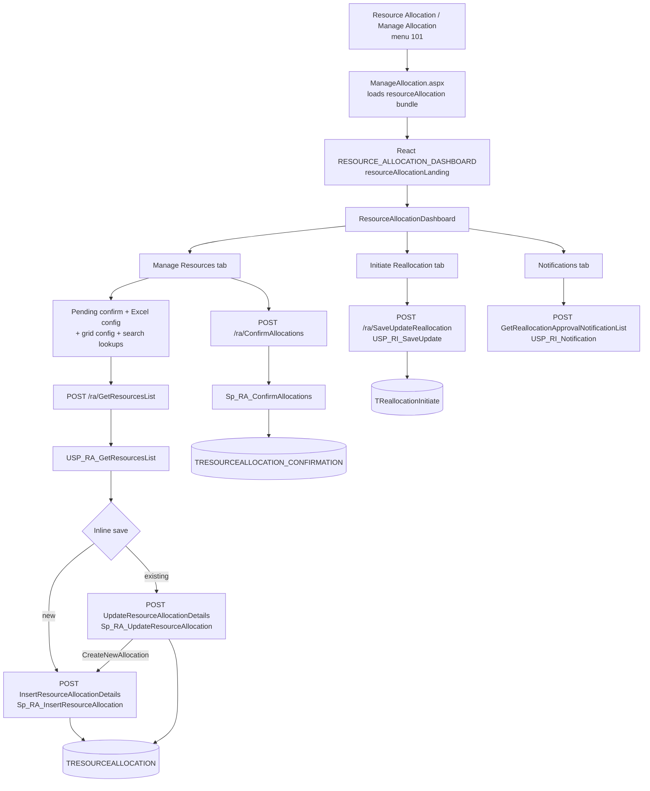
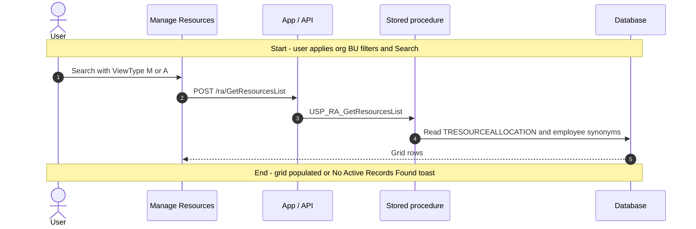
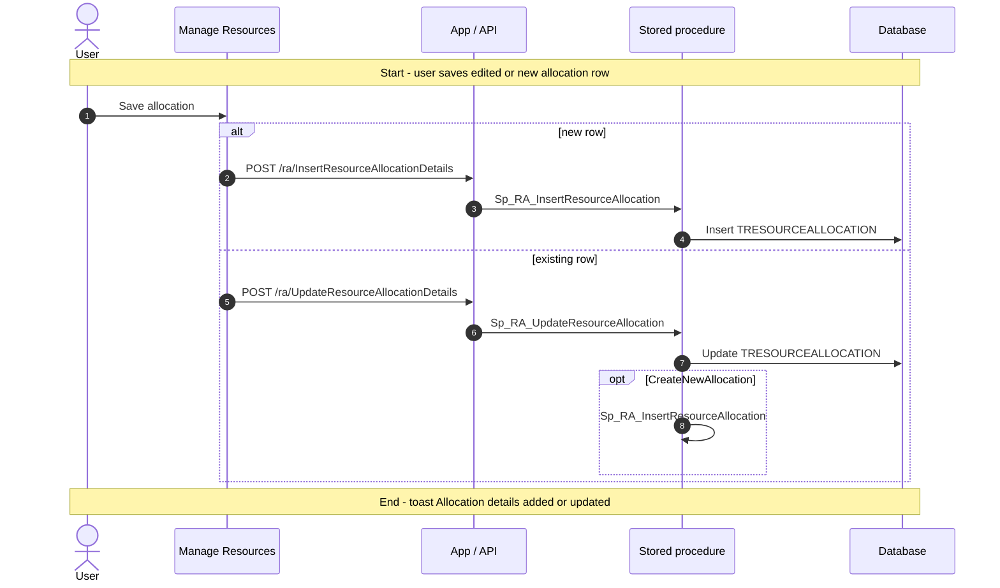
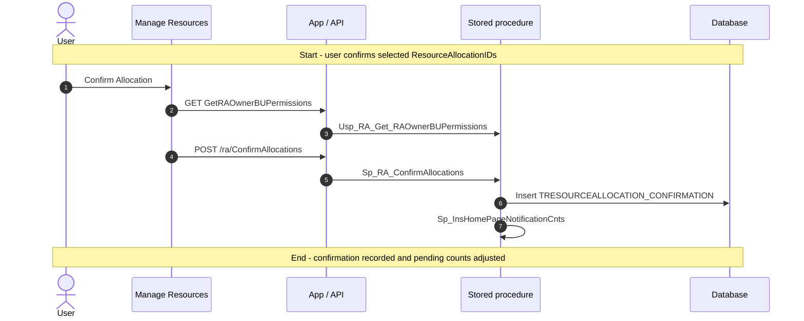
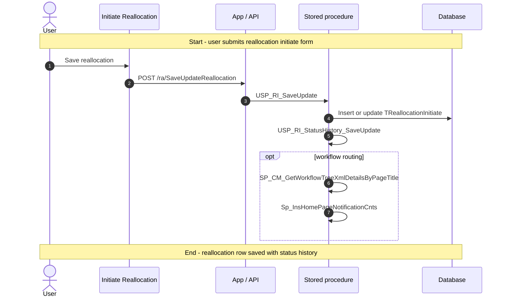
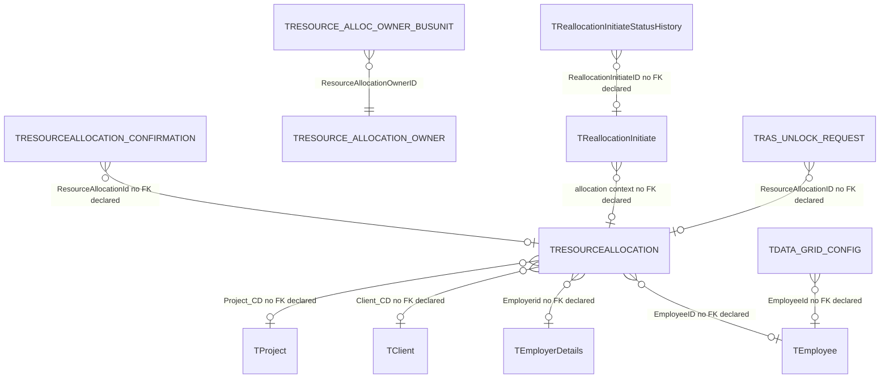

# Manage Allocation

## Overview

A resource owner, RAS provider, or administrator needs to search employee allocations, edit rows inline, confirm published allocations, start reallocation requests, and clear pending notification work. On **Resource Allocation → Manage Allocation** (menu node **101**) they open `ManageAllocation.aspx`, which seeds hidden session fields and loads the webpack Resource Allocation React app. The React route `RESOURCE_ALLOCATION_DASHBOARD` mounts **resourceAllocationLanding** → **ResourceAllocationDashboard** with three tabs: **Manage Resources**, **Initiate Reallocation** (claim-gated), and **Notifications**.

On Manage Resources they pick organisations and business units, search with `ViewType` `M` (my) or `A` (all), edit allocation fields on the grid, save via insert/update, and confirm selected rows. Pending confirmation banners come from homepage notification counts. Query-string deep links (`pendingType`, `displayType`, `Type`/`Val`) open Confirm / End / Update filters or jump to Initiate Reallocation / Notifications.

**Who's involved:**

- **Resource owner / RAS provider** with Manage Allocation claims — searches and edits allocations for owned BUs, confirms allocations, may initiate reallocation.
- **Administrator / all-resources viewer** (claim view-all) — All Resources radio, broader org BU pickers.
- **Approver** — Notifications tab and Initiate Reallocation approval mode for pending reallocation workflow.
- **Employee being allocated** — never uses this screen as the subject; their rows appear in the grid.

There is no SystemModel-2 domain page for Manage Allocation. Menu **101** lives under Resource Allocation **100** in `Tmenudetails` / `TDynamicMenuHierarchy`.

## Workflow

## Request journey

### Search Manage Resources grid

### Save inline allocation

### Confirm allocations

### Initiate reallocation save

## Entry points

> The live screen is the WebForms host `HRM/ResourceAllocation/ManageAllocation.aspx`. It does not post back for allocation or reallocation data. Work goes through the Resource Allocation Node Web API (`ra` / `Employee` / `raProvider` / `common` routes) against the Resource Allocation database (with HRMS synonyms). Create / Edit / Bulk Update are separate React routes on the same SPA host, not this left-nav page default tab.

| Entry point | Purpose | Live? |
|---|---|---|
| `~/HRM/ResourceAllocation/ManageAllocation.aspx` (`RouteConstants.RESOURCE_ALLOCATION_DASHBOARD`, menu **101**) | Host page; seeds employee/employer/role and pending/filter hidden fields; loads React | Yes |
| Manage Resources tab (`ResourceAllocationDashboard` selectedTab 1) | Search / edit / confirm allocation grid | Yes |
| Initiate Reallocation tab (selectedTab 2, claim `CNST_VIEW_INITIATE_REALLOCATION`) | Create / approve / pull back reallocation | Yes |
| Notifications tab (selectedTab 3) | Pending reallocation approval notifications | Yes |
| Query `pendingType=IR` / `PIR` | Opens Notifications (and can switch into Initiate) | Yes |
| Query `pendingType=PC` / `LD` with `displayType`; email `Type`/`Val` filters | Pending confirm / lock deep links into Manage Resources filters | Yes |
| ChatBot notification links to `ManageAllocation.aspx?pendingType=...` | Same deep links from homepage notifications | Yes |
| `CommonUtil.LogActivity(ManageAllocation)` on `Page_Load` | Activity type **405** | Yes |
| `CreateResourceAllocation` / `EditResourceAllocation` / bulk routes | Separate SPA routes from Allocate / Bulk buttons | Yes (not the left-nav landing tab) |

## Code → database call chain

The React UI calls `APIHelper` → Resource Allocation Node API (active V1 constants in `apiURLConstants.js`). Reads go Controller → DAL. Insert/update allocation go Controller → BLL (transaction) → DAL.

| Step | Entry point | App code | Stored procedure |
|---|---|---|---|
| Activity on open | `ManageAllocation.aspx.cs:29` | `CommonUtil.LogActivity` | `Sp_InsertActivityLog` (HRMS; activity **405**) |
| Pending confirm banner | `myResourcesList.js:1209` | `raController.CheckConfirmationPending` → `raDAL.CheckConfirmationPending` (`raDAL.js:231`) | `SP_RA_CheckPendingConfirmation` |
| Excel field settings | `myResourcesList.js:582` | `raProviderController.GetExcelConfigList` → `raProviderDAL.GetExcelConfigList` | `SP_RAS_GetExcelConfigList` |
| Grid column config | `myResourcesList.js:4020` | `commonController` → `commonDAL.GetGridConfig` (`commonDAL.js:22`) | `Sp_RA_GetGridConfig` |
| Persist grid config | `myResourcesList.js:4055` | `commonDAL.SetGridConfig` (`commonDAL.js:60`) | `Sp_RA_SetGridConfig` |
| Search filter lookups | `myResourcesList.js:988` | `raController` → `raDAL` (`raDAL.js:807`) | `Sp_RA_GetSearchAllLookupDetails` |
| Org employee picker seed | `myResourcesList.js:535` | `employeeController.GetEmployeeListByOrg` → `employeeDAL.GetEmployeeListByOrg` (`employeeDAL.js:236`) | `USP_EmployeeListBySiblingEmployers` (HRMS via synonym) |
| Business unit list | `myResourcesList.js:365` | `employeeController.ViewCostCenterDetails` → `employeeDAL.ViewCostCenterDetails` (`employeeDAL.js:81`) | `Sp_RA_GetEmployerUnitNames` |
| Owner BU list (org change) | `myResourcesList.js:450` | `employeeDAL` `getEmployeeBusUnits` (`employeeDAL.js:46`) | `SP_RA_GetRAProvidersOwnBUUnits` |
| Resource grid search | `myResourcesList.js:849` | `raController.GetResourcesList` → `raDAL.GetResourcesList` (`raDAL.js:38`) | `USP_RA_GetResourcesList` |
| Inline insert | `myResourcesList.js:2721` | `raController.InsertResourceAllocationDetails` → BLL → `raDAL.InsertResourceAllocationDetails` (`raDAL.js:397`) | `Sp_RA_InsertResourceAllocation` |
| Inline update | `myResourcesList.js:2708` | `raController.UpdateResourceAllocationDetails` → BLL → `raDAL.UpdateResourceAllocationDetails` (`raDAL.js:154`) | `Sp_RA_UpdateResourceAllocation` (may nest insert) |
| Confirm selected | `myResourcesList.js:10241` | `raController.ConfirmAllocations` → `raDAL.ConfirmResourceAllocations` (`raDAL.js:501`) | `Sp_RA_ConfirmAllocations` |
| Confirm BU permission gate | `myResourcesList.js:1271` | `raProviderDAL` (`raProviderDAL.js:237`) | `Usp_RA_Get_RAOwnerBUPermissions` |
| Upcoming lock matrix | `myResourcesList.js:1453` | `raDAL` (`raDAL.js:578`) | `Sp_RA_GetUpcomingLockMatrixDetails` / inventory `Sp_RA_GetUpComingLOCKMATRIXDetails` |
| Unfreeze request | `Unfreeze.js:97` | `raDAL` (`raDAL.js:687`) | `SP_RA_InsUdt_TRAS_UNLOCK_REQUEST` |
| Employer name (IR / Notifications) | `resourceAllocationDashboard.js:180` | `raDAL.GetEmployerName` (`raDAL.js:458`) | `Sp_RA_GetEmployerName` |
| Reallocation list / approval mode | `resourceAllocationDashboard.js:130` | `raDAL` (`raDAL.js:894`) | `USP_RI_List` |
| Save / update reallocation | `InitiateReallocation.js:2680` | `raDAL` (`raDAL.js:878`) | `USP_RI_SaveUpdate` |
| Pull back / delete / history | `InitiateReallocation.js` | `raDAL` (`raDAL.js:910` / `927` / `940`) | `USP_RI_Delete`, `USP_RI_PullBack`, `USP_RI_History` |
| Employee detail for RI | `InitiateReallocation.js:1051` | `raDAL` (`raDAL.js:840`) | `USP_RI_GetEmployeeDetails` |
| RRS picker | `InitiateReallocation.js:1302` | `raDAL` (`raDAL.js:826`) | `Sp_RRS_GetDashboard` (HRMS) |
| Approve / reject RI | `InitiateReallocation.js:712` / `759` | `raDAL` (`raDAL.js:972` / `989`) | `SP_CM_ApproveWorkFlowRequest`, `SP_CM_RejectWorkFlowRequest` |
| Notifications list | `Notifications.js:110` | `raDAL` (`raDAL.js:955`) | `USP_RI_Notification` |
| RAS lookup / client BU (edit helpers) | `myResourcesList.js:952` / `964` | `raDAL` (`raDAL.js:428` / `443`) | `Sp_RA_GetAllLookupDetails`, `Sp_RA_GetClientBUs` (DAL name; inventory script missing) |

## API endpoints

This screen is not a WebForms postback for allocation data. The ASPX only loads the React shell. Traffic is HTTP to the Resource Allocation Node API (`APIHelper` base URL), with auth middleware on the `ra` / `Employee` / `raProvider` / `common` routers. Active URL constants are the V1 block at the bottom of `apiURLConstants.js` (V2/V3 blocks are commented out).

| Method | Path | Purpose | Caller | Handler |
|---|---|---|---|---|
| POST | `/ra/GetResourcesList` | Manage Resources grid | `myResourcesList.js` `loadMyResourceAllocationList` | `raController.GetResourcesList` |
| POST | `/ra/InsertResourceAllocationDetails` | New allocation row | `myResourcesList.js` save | `raController.InsertResourceAllocationDetails` |
| POST | `/ra/UpdateResourceAllocationDetails` | Update / reallocate row | `myResourcesList.js` save | `raController.UpdateResourceAllocationDetails` |
| POST | `/ra/ConfirmAllocations` | Confirm selected IDs | `myResourcesList.js` confirm | `raController.ConfirmAllocations` |
| GET | `/ra/CheckConfirmationPending?employeeId=&employerId=` | Pending confirm banner | `showConfirmationPendingMessage` | `raController.CheckConfirmationPending` |
| POST | `/ra/getSearchAllLookupDetails` | Client/project/title search filters | `loadSearchAllDropdowndata` | `raController` |
| GET | `/ra/GetAllLookupDetailsRAS?employeeId=` | RAS lookup items | `myResourcesList.js` | `raController.GetAllLookupDetailsRAS` |
| GET | `/ra/GetClientBusinessUnitsRAS?employeeId=` | Client-BU map for RAS | `myResourcesList.js` | `raController.GetClientBusinessUnitsRAS` |
| POST | `/ra/GetEmployerName` | Employer display name | `resourceAllocationDashboard.js` | `raController.GetEmployerName` |
| POST | `/ra/GetUpcomingLockMatrixDetails` | Lock window checks | `myResourcesList.js` | `raController` |
| POST | `/ra/InsertUpdateLockRequest` | Unfreeze request | `Unfreeze.js` | `raController` |
| POST | `/ra/SaveUpdateReallocation` | Initiate / update RI | `InitiateReallocation.js` | `raController` |
| POST | `/ra/GetReallocationList` | RI detail / approval payload | dashboard / Initiate | `raController` |
| POST | `/ra/GetReallocationApprovalNotificationList` | Notifications tab | `Notifications.js` | `raController` |
| POST | `/ra/ApproveReallocationRequest` / `RejectReallocationRequest` | Workflow approve/reject | `InitiateReallocation.js` | `raController` |
| POST | `/ra/PullbackReallocationInitiate` / `DeleteReallocationInitiate` | Pull back / soft delete | `InitiateReallocation.js` | `raController` |
| GET | `/ra/getRRSDetailsById?...` | RRS dashboard row | `InitiateReallocation.js` | `raController` |
| GET | `/Employee/ViewCostCenterDetails?...` | BU picker | `myResourcesList.js` | `employeeController` |
| GET | `/Employee/GetEmployeeListByOrg?...` | Org employee seed | `myResourcesList.js` | `employeeController` |
| POST | `/Employee/getEmployeeBusUnits` | Owner BUs | `myResourcesList.js` | `employeeController` |
| GET | `/common/getGridConfig?...` / POST `/common/setGridConfig` | Grid personalization | `myResourcesList.js` | `commonController` |
| GET | `/raProvider/getExcelConfigList?employerId=` | Excel mandatory flags | `getExcelConfigList` | `raProviderController` |
| GET | `/raProvider/GetRAOwnerBUPermissions?employeeId=` | Confirm permission by BU | confirm handler | `raProviderController` |

## Stored procedures & tables involved

Inventory paths are under `HRMS-DATABASE/HRMS-RESOURCEALLOCATION/` unless noted. Procedure pages for Resource Allocation objects are under `/docs/database/hrms-resourceallocation/`. Shared HRMS objects keep the `hrms` slug.

| Object | File | Purpose | Database page |
|---|---|---|---|
| `USP_RA_GetResourcesList` | `STOREPROCEDURE/USP_RA_GetResourcesList.sql` | Manage Resources grid | [USP_RA_GetResourcesList](/docs/database/hrms-resourceallocation/USP_RA_GetResourcesList) |
| `Sp_RA_InsertResourceAllocation` | `STOREPROCEDURE/Sp_RA_InsertResourceAllocation.sql` | Insert allocation row | [Sp_RA_InsertResourceAllocation](/docs/database/hrms-resourceallocation/Sp_RA_InsertResourceAllocation) |
| `Sp_RA_UpdateResourceAllocation` | `STOREPROCEDURE/Sp_RA_UpdateResourceAllocation.sql` | Update allocation; may nest insert | [Sp_RA_UpdateResourceAllocation](/docs/database/hrms-resourceallocation/Sp_RA_UpdateResourceAllocation) |
| `Sp_RA_ConfirmAllocations` | `STOREPROCEDURE/Sp_RA_ConfirmAllocations.sql` | Confirm selected allocations | [Sp_RA_ConfirmAllocations](/docs/database/hrms-resourceallocation/Sp_RA_ConfirmAllocations) |
| `SP_RA_CheckPendingConfirmation` | `STOREPROCEDURE/SP_RA_CheckPendingConfirmation.sql` | Pending publish count + last confirm date | [SP_RA_CheckPendingConfirmation](/docs/database/hrms-resourceallocation/SP_RA_CheckPendingConfirmation) |
| `Sp_RA_GetSearchAllLookupDetails` | `STOREPROCEDURE/Sp_RA_GetSearchAllLookupDetails.sql` | Search filter lookups | [Sp_RA_GetSearchAllLookupDetails](/docs/database/hrms-resourceallocation/Sp_RA_GetSearchAllLookupDetails) |
| `Sp_RA_GetAllLookupDetails` | `STOREPROCEDURE/Sp_RA_GetAllLookupDetails.sql` | Client/project lookups for RAS | [Sp_RA_GetAllLookupDetails](/docs/database/hrms-resourceallocation/Sp_RA_GetAllLookupDetails) |
| `Sp_RA_GetGridConfig` / `Sp_RA_SetGridConfig` | matching `STOREPROCEDURE/` files | Grid personalization | [Sp_RA_GetGridConfig](/docs/database/hrms-resourceallocation/Sp_RA_GetGridConfig), [Sp_RA_SetGridConfig](/docs/database/hrms-resourceallocation/Sp_RA_SetGridConfig) |
| `Sp_RA_GetEmployerUnitNames` | `STOREPROCEDURE/Sp_RA_GetEmployerUnitNames.sql` | BU picker | [Sp_RA_GetEmployerUnitNames](/docs/database/hrms-resourceallocation/Sp_RA_GetEmployerUnitNames) |
| `SP_RA_GetRAProvidersOwnBUUnits` | `STOREPROCEDURE/Sp_RA_GetRAProvidersOwnBUUnits.sql` | Owner BU list | [SP_RA_GetRAProvidersOwnBUUnits](/docs/database/hrms-resourceallocation/SP_RA_GetRAProvidersOwnBUUnits) |
| `Usp_RA_Get_RAOwnerBUPermissions` | `STOREPROCEDURE/Usp_RA_Get_RAOwnerBUPermissions.sql` | View/edit/confirm flags by BU | [Usp_RA_Get_RAOwnerBUPermissions](/docs/database/hrms-resourceallocation/Usp_RA_Get_RAOwnerBUPermissions) |
| `Sp_RA_GetUpComingLOCKMATRIXDetails` | `STOREPROCEDURE/Sp_RA_GetUpComingLOCKMATRIXDetails.sql` | Upcoming lock windows | [Sp_RA_GetUpComingLOCKMATRIXDetails](/docs/database/hrms-resourceallocation/Sp_RA_GetUpComingLOCKMATRIXDetails) |
| `SP_RA_InsUdt_TRAS_UNLOCK_REQUEST` | `STOREPROCEDURE/SP_RA_InsUdt_TRAS_UNLOCK_REQUEST.sql` | Unfreeze request | [SP_RA_InsUdt_TRAS_UNLOCK_REQUEST](/docs/database/hrms-resourceallocation/SP_RA_InsUdt_TRAS_UNLOCK_REQUEST) |
| `Sp_RA_GetEmployerName` | `STOREPROCEDURE/Sp_RA_GetEmployerName.sql` | Employer display name | [Sp_RA_GetEmployerName](/docs/database/hrms-resourceallocation/Sp_RA_GetEmployerName) |
| `USP_RI_*` family | matching `STOREPROCEDURE/` files | Initiate Reallocation + Notifications | under `/docs/database/hrms-resourceallocation/` |
| `Sp_RA_InsertPendingCount` / `Sp_RA_UpdatePendingCount` | nested from unlock request | Homepage pending counts | [Sp_RA_InsertPendingCount](/docs/database/hrms-resourceallocation/Sp_RA_InsertPendingCount), [Sp_RA_UpdatePendingCount](/docs/database/hrms-resourceallocation/Sp_RA_UpdatePendingCount) |
| `FN_RA_LockStatus` / `TFN_RA_LockDates` | `FUNCTIONS/` | Nested lock helpers from resources list | [FN_RA_LockStatus](/docs/database/hrms-resourceallocation/FN_RA_LockStatus), [TFN_RA_LockDates](/docs/database/hrms-resourceallocation/TFN_RA_LockDates) |
| `SP_RAS_GetExcelConfigList` | existing | Excel config | [SP_RAS_GetExcelConfigList](/docs/database/hrms-resourceallocation/SP_RAS_GetExcelConfigList) |
| `USP_EmployeeListBySiblingEmployers` | HRMS | Org employee list | [USP_EmployeeListBySiblingEmployers](/docs/database/hrms/USP_EmployeeListBySiblingEmployers) |
| `Sp_RRS_GetDashboard` | HRMS | RRS picker | [Sp_RRS_GetDashboard](/docs/database/hrms/Sp_RRS_GetDashboard) |
| `SP_CM_ApproveWorkFlowRequest` / `SP_CM_RejectWorkFlowRequest` | HRMS | RI approve/reject | [SP_CM_ApproveWorkFlowRequest](/docs/database/hrms/SP_CM_ApproveWorkFlowRequest), [SP_CM_RejectWorkFlowRequest](/docs/database/hrms/SP_CM_RejectWorkFlowRequest) |
| `Sp_InsertActivityLog` | HRMS | Page-open activity **405** | [Sp_InsertActivityLog](/docs/database/hrms/Sp_InsertActivityLog) |

Core tables: `TRESOURCEALLOCATION`, `TRESOURCEALLOCATION_CONFIRMATION`, `TRESOURCE_ALLOCATION_OWNER`, `TRESOURCE_ALLOC_OWNER_BUSUNIT`, `TReallocationInitiate`, `TReallocationInitiateStatusHistory`, `TRAS_LOCK_MATRIX`, `TRAS_UNLOCK_REQUEST`, `TDATA_GRID_CONFIG`, `TClient` / `TProject` / `TLOOKUP`. Synonym / cross-db reads include employee, org, homepage notification, and workflow tables.

Direct nested callees already documented under HRMS (skipped here): `Sp_OpenEncryptionKeys`, `SP_CloseEncryptionKey`, `Fn_GetEmployeeName`, `FN_LocationBU_GetEmployeeDetails`, `Sp_InsHomePageNotificationCnts`, `USP_RI_StatusHistory_SaveUpdate`, `SP_CM_GetWorkflowTreeXmlDetailsByPageTitle`, `SP_CM_GetDataforRequestWorkFlows`, `SP_CM_RejectWorkFlowRequest`, `SP_RAS_GetExcelConfigList`, `Sp_InsertActivityLog`, `Sp_GetAllLookupDetails`, `Sp_GetAllLookupDetailsByEmployee`.

## Table relationships

Declared foreign keys are labeled as such. Columns the procedures join without a foreign key are labeled **no FK declared**.

## Known gaps

- SourceCode `docs/SystemModels/SystemModel-2` has no Manage Allocation / Resource Allocation domain page.
- DAL executes `Sp_RA_GetClientBUs` but no matching script was found under `HRMS-RESOURCEALLOCATION/STOREPROCEDURE/` (inventory gap).
- DAL executes `Sp_RA_GetUpcomingLockMatrixDetails`; inventory file is `Sp_RA_GetUpComingLOCKMATRIXDetails.sql` (case / naming drift only on SQL Server).
- Create / Edit / Bulk Update / Bulk Extension are separate React routes from buttons on this page; their full call chains are out of scope of this left-nav landing guide.
- `Sp_RA_GetResourcesList.sql` exists beside `USP_RA_GetResourcesList.sql`; the live Node DAL calls `USP_RA_GetResourcesList`.
- Several RA scripts begin with `USE [ResourceAllocation]`.
- V2/V3 API URL blocks in `apiURLConstants.js` are commented out; this guide documents the active V1 constants.
- Nested encryption / name / workflow helpers are documented one level only.
- `USP_RI_NonEmployeesByEmployers` and some lock-matrix admin SPs exist on the DAL but are only lightly used from Initiate Reallocation non-employee paths.

## Reference

High confidence on the React → Node API → DAL → Resource Allocation procedure chain for Manage Resources search/save/confirm and Initiate Reallocation / Notifications. Nested HRMS workflow and notification helpers resolve through ResourceAllocation synonyms.

### SourceCode

- `HRMS.Web/HRMS.Web/HRM/ResourceAllocation/ManageAllocation.aspx` and `ManageAllocation.aspx.cs`
- `HRMS.Web/HRMS.Web/HRM/ResourceAllocation/Areas/ResourceAllocationList/Containers/resourceAllocationLanding.js`
- `HRMS.Web/HRMS.Web/HRM/ResourceAllocation/Areas/ResourceAllocationList/Containers/resourceAllocationDashboard.js`
- `HRMS.Web/HRMS.Web/HRM/ResourceAllocation/Areas/ResourceAllocationList/Components/myResourcesList.js`
- `HRMS.Web/HRMS.Web/HRM/ResourceAllocation/Areas/ResourceAllocationList/Components/InitiateReallocation.js`
- `HRMS.Web/HRMS.Web/HRM/ResourceAllocation/Areas/ResourceAllocationList/Components/Notifications.js`
- `HRMS.Web/HRMS.Web/HRM/ResourceAllocation/Areas/ResourceAllocationList/Components/Unfreeze.js`
- `HRMS.Web/HRMS.Web/HRM/ResourceAllocation/Common/apiURLConstants.js`, `apiHelper.js`, `routeConstants.js`, `claimConstants.js`
- `HRMS.Web/HRMS.Web/HRM/ResourceAllocation/Areas/routes.js`
- `HRMS.ResourceAllocation/HRMS.ResourceAllocation.WebAPI.Node/Controllers/raController.js`
- `HRMS.ResourceAllocation/HRMS.ResourceAllocation.WebAPI.Node/Core/DataAccessLayer/raDAL.js`
- `HRMS.ResourceAllocation/HRMS.ResourceAllocation.WebAPI.Node/Core/DataAccessLayer/employeeDAL.js`
- `HRMS.ResourceAllocation/HRMS.ResourceAllocation.WebAPI.Node/Core/DataAccessLayer/commonDAL.js`
- `HRMS.ResourceAllocation/HRMS.ResourceAllocation.WebAPI.Node/Core/DataAccessLayer/raProviderDAL.js`
- `HRMS.ResourceAllocation/HRMS.ResourceAllocation.WebAPI.Node/Core/BusinessLogicLayer/raBLL.js`
- `HRMS.Shared/HRMS.DataContract/Common/Enums.cs` (`ManageAllocation = 405`)

### TDG HRMS DB

- `HRMS-DATABASE/HRMS-RESOURCEALLOCATION/TABLES/` allocation, owner, confirmation, reallocation, lock, grid-config scripts
- Procedure / function scripts listed in the table above
- `HRMS-DATABASE/HRMS/DML/Tmenudetails DML.sql` (Manage Allocation node **101** under Resource Allocation **100**)
