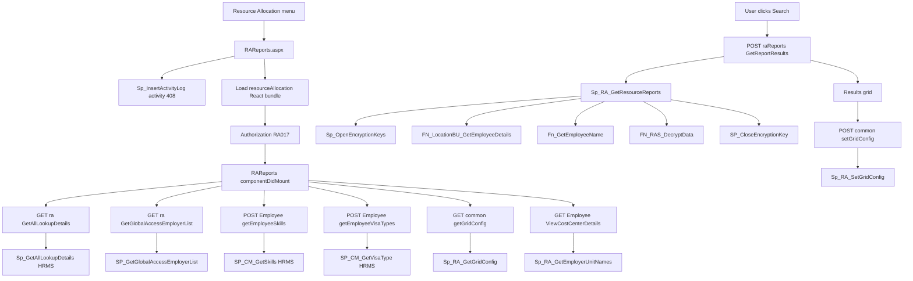
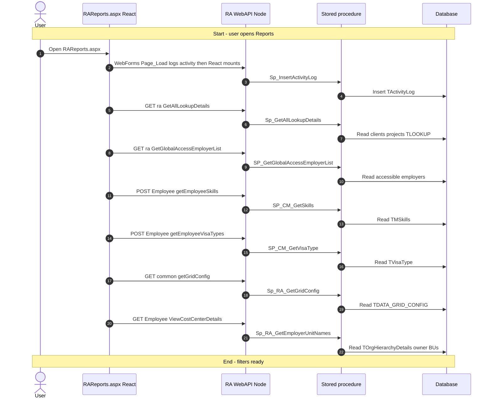
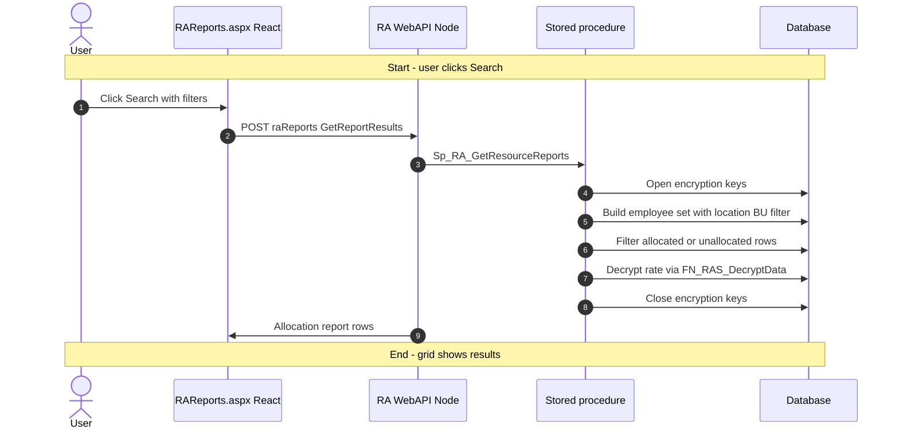
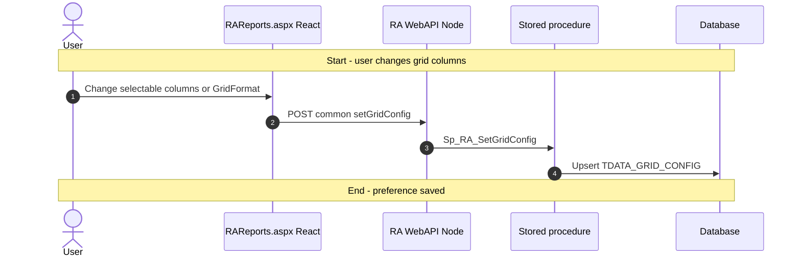
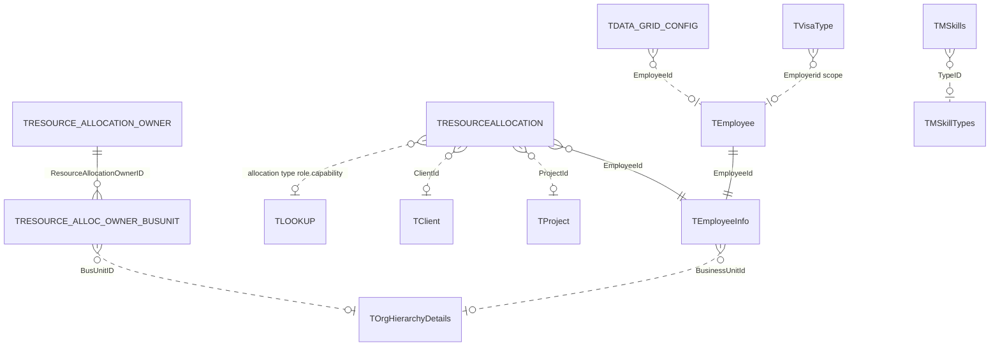

# Reports

## Overview

A Resource Allocation user with claim `RA017` (`CNST_SHOW_RA_REPORT`) opens **Resource Allocation → Reports** to search and export allocation rows. The left-nav leaf maps to `~/HRM/ResourceAllocation/RAReports.aspx` (`RouteConstants.MANAGE_REPORTS`). The React H1 and breadcrumb say **RAS Reports**.

The host is a WebForms shell that seeds session identity into hidden fields, logs activity `RAReports` (408), and loads the webpack Resource Allocation React bundle into `#root`. Filters include organisations (claim `RA015` global access), business units, allocation dates, project, allocation type, reallocation flag, capability rating, invoice approver, archive, skills, experience bands, and visa type/expiry. Search posts to Resource Allocation WebAPI `/raReports/GetReportResults`, which executes `Sp_RA_GetResourceReports` on the Resource Allocation database (`hrms-resourceallocation`). Lookups, skills, and visa lists use the same API against HRMS (`core` connection) or RA. The code-behind does not bind report rows.

There is no `docs/SystemModels/SystemModel-2` page for this screen. Active UI constants export the unversioned (V1) paths; V2/V3 blocks in `apiURLConstants.js` are commented out.

## Workflow

This page is a React SPA hosted in WebForms. Report traffic uses JWT/`Authorization` on the Resource Allocation Node API. No WebForms postback binds the grid.

## Request journey

### Load screen — lookups, orgs, skills, visa, grid config, BUs

### Search allocations

### Save column / format config

## Entry points

| Entry | Purpose |
|---|---|
| `~/HRM/ResourceAllocation/RAReports.aspx` | Menu leaf **Reports**. Host for the React RAS Reports screen. |
| React route `RouteConstants.MANAGE_REPORTS` | Same path; mounts `RAReports` behind claim `RA017` (`Areas/routes.js`). |

## Code → database call chain

| Entry | Method | Database |
|---|---|---|
| Page load, `RAReports.aspx.cs:24` | `CommonUtil.LogActivity` → activity helpers | `Sp_InsertActivityLog`. Activity type `RAReports` = 408 (`Enums.cs`). HRMS DB. |
| Mount, `RAReports.js:250` | `loadAllDropdowndata` → `APIHelper.get(GET_ALL_LOOKUPITEMS)` → `raController.GetAllLookupDetails:56` → `raDAL.GetAllLookupDetails:466` | `Sp_GetAllLookupDetails` (`raDAL.js:472`). HRMS via `core` connection. |
| Org picker mount, `organizationMultiSelectDropDown.js:34` | `getAllEmployerList` → `GET_ALL_EMPLOYER_LIST` → `raController.GetGlobalAccessEmployerList:225` → `raDAL.GetGlobalAccessEmployerList:509` | `SP_GetGlobalAccessEmployerList` (`raDAL.js:515`). RA DB (synonym / shared). |
| BU search, `businessUnitSearch.js:109` | `GET_BUSINESSUNIT_DETAILS` → `employeeController.ViewCostCenterDetails:39` → `employeeDAL.ViewCostCenterDetails:73` | `Sp_RA_GetEmployerUnitNames` (`employeeDAL.js:81`). RA DB. |
| Mount, `RAReports.js:894-901` | `getEmployeeSkills` → `POST GET_EMPLOYEE_SKILLS` → `employeeController.GetEmployeeSkills:141` → `employeeDAL.GetEmployeeSkills:257` | `SP_CM_GetSkills` (`employeeDAL.js:262`). HRMS via `core`. Nested `Fn_GetEmployeeName`. |
| Mount, `RAReports.js:924-930` | `getEmployeeVisaTypes` → `POST GET_EMPLOYEE_VISA_TYPES` → `employeeController.GetEmployeeVisaTypes:150` → `employeeDAL.GetEmployeeVisaTypes:270` | `SP_CM_GetVisaType` (`employeeDAL.js:275`). HRMS via `core`. |
| Mount, `RAReports.js:441-442` and `953-954` | `getGridFormat` / `getGridConfig` → `GET_GRID_CONFIG` → `commonController.GetGridConfig:6` → `commonDAL.GetGridConfig:14` | `Sp_RA_GetGridConfig` (`commonDAL.js:22`). RA DB. GridId `resourceAllocationReport_Grid`. |
| Search, `RAReports.js:743` | `searchHandler` → `POST GET_RA_REPORT` → `raReportsController.GetReportResults:6` → `raReportsDAL.GetReportResults:14` | `Sp_RA_GetResourceReports` (`raReportsDAL.js:43`). Nested `Sp_OpenEncryptionKeys`, `FN_LocationBU_GetEmployeeDetails`, `Fn_GetEmployeeName`, `FN_RAS_DecryptData`, `SP_CloseEncryptionKey`. |
| Column save, `RAReports.js:981-989` | `saveGridConfig` → `POST SET_GRID_CONFIG` → `commonController.SetGridConfig:19` → `commonDAL.SetGridConfig:50` | `Sp_RA_SetGridConfig` (`commonDAL.js:60`). RA DB. |

## API endpoints

No WebForms postback binds report data. All business calls go to the Resource Allocation Node API with `Authorize`. Active UI uses unversioned V1 paths from `apiURLConstants.js` (V2/V3 exports are commented).

| Verb | Route | Parameters | Purpose | Source |
|---|---|---|---|---|
| GET | `/ra/GetAllLookupDetails` | `employerId` | Project, allocation type, capability rating dropdowns. | `raRoutes.js:11` |
| GET | `/ra/GetGlobalAccessEmployerList` | `employeeId` | Organisation multi-select when claim `RA015`. | `raRoutes.js:27` |
| GET | `/Employee/ViewCostCenterDetails` | `employerId`, `employeeId`, `viewType` | Business unit search. | `employeeRoutes.js:10` |
| POST | `/Employee/getEmployeeSkills` | body `EmployerId` | Skill multi-select. | `employeeRoutes.js:20` |
| POST | `/Employee/getEmployeeVisaTypes` | body `EmployerId` | Visa type multi-select. | `employeeRoutes.js:21` |
| GET | `/common/getGridConfig` | `gridId`, `employeeId` | Saved column / GridFormat config. | `commonRoutes.js:7` |
| POST | `/common/setGridConfig` | JSON config | Persist column / format preference. | `commonRoutes.js:8` |
| POST | `/raReports/GetReportResults` | filter body incl. employers, BUs, dates, skills, visa | Main report grid. | `raReportsRoutes.js:9` |

## Stored procedures & tables involved

| Object | File | Purpose | Wiki |
|---|---|---|---|
| `Sp_InsertActivityLog` | `HRMS/STOREPROCEDURE/Sp_InsertActivityLog.sql` | Page-access log. | [Sp_InsertActivityLog](/docs/database/hrms/Sp_InsertActivityLog) |
| `Sp_GetAllLookupDetails` | `HRMS/STOREPROCEDURE/Sp_GetAllLookupDetails.sql` | Filter dropdown lookups. | [Sp_GetAllLookupDetails](/docs/database/hrms/Sp_GetAllLookupDetails) |
| `SP_GetGlobalAccessEmployerList` | `HRMS/STOREPROCEDURE/SP_GetGlobalAccessEmployerList.sql` | Organisation picker. | [SP_GetGlobalAccessEmployerList](/docs/database/hrms/SP_GetGlobalAccessEmployerList) |
| `Sp_RA_GetEmployerUnitNames` | `HRMS-RESOURCEALLOCATION/STOREPROCEDURE/Sp_RA_GetEmployerUnitNames.sql` | Business unit list (admin vs owner view). | [Sp_RA_GetEmployerUnitNames](/docs/database/hrms-resourceallocation/Sp_RA_GetEmployerUnitNames) |
| `SP_CM_GetSkills` | `HRMS/STOREPROCEDURE/SP_CM_GetSkills.sql` | Skill filter options. | [SP_CM_GetSkills](/docs/database/hrms/SP_CM_GetSkills) |
| `SP_CM_GetVisaType` | `HRMS/STOREPROCEDURE/SP_CM_GetVisaType.sql` | Visa type filter options. | [SP_CM_GetVisaType](/docs/database/hrms/SP_CM_GetVisaType) |
| `Sp_RA_GetGridConfig` | `HRMS-RESOURCEALLOCATION/STOREPROCEDURE/Sp_RA_GetGridConfig.sql` | Load grid column config. | [Sp_RA_GetGridConfig](/docs/database/hrms-resourceallocation/Sp_RA_GetGridConfig) |
| `Sp_RA_SetGridConfig` | `HRMS-RESOURCEALLOCATION/STOREPROCEDURE/Sp_RA_SetGridConfig.sql` | Save grid column config. | [Sp_RA_SetGridConfig](/docs/database/hrms-resourceallocation/Sp_RA_SetGridConfig) |
| `Sp_RA_GetResourceReports` | `HRMS-RESOURCEALLOCATION/STOREPROCEDURE/Sp_RA_GetResourceReports.sql` | Main report result set. | [Sp_RA_GetResourceReports](/docs/database/hrms-resourceallocation/Sp_RA_GetResourceReports) |
| `Sp_OpenEncryptionKeys` / `SP_CloseEncryptionKey` | HRMS STOREPROCEDURE (synonyms on RA) | Open/close keys around name/rate reads. | existing HRMS pages |
| `Fn_GetEmployeeName` | HRMS FUNCTIONS (synonym on RA) | Display names. | [Fn_GetEmployeeName](/docs/database/hrms/Fn_GetEmployeeName) |
| `FN_LocationBU_GetEmployeeDetails` | HRMS FUNCTIONS (synonym on RA) | Location/BU-scoped employee set. | [FN_LocationBU_GetEmployeeDetails](/docs/database/hrms/FN_LocationBU_GetEmployeeDetails) |
| `FN_RAS_DecryptData` | `HRMS-RESOURCEALLOCATION/FUNCTIONS/FN_RAS_DecryptData.sql` | Rate decrypt (currently pass-through). | [FN_RAS_DecryptData](/docs/database/hrms-resourceallocation/FN_RAS_DecryptData) |
| `TRESOURCEALLOCATION`, `TRESOURCE_ALLOCATION_OWNER`, `TRESOURCE_ALLOC_OWNER_BUSUNIT`, `TDATA_GRID_CONFIG`, `TClient` / `TProject` / `TLOOKUP`, `TEmployee` / `TEmployeeInfo`, `TOrgHierarchyDetails`, `TMSkills` / `TVisaType` | matching scripts / synonyms | Allocations, owners, grid prefs, lookups, people, skills, visas. | RA / HRMS catalogs |

## Table relationships

Declared FKs from CREATE TABLE scripts are sparse. The diagram shows joins the report and filter procedures actually use; undeclared links are dotted.

## Known gaps

- **No SystemModel-2 page** for Resource Allocation Reports.
- **Active UI is V1 paths**; commented V2/V3 `apiURLConstants` blocks and `raReportsDAL_V3` exist but are not what `export default` serves.
- **`getGridFormat` and `getGridConfig` both call `GET_GRID_CONFIG` on mount** (`RAReports.js:244-245`), duplicating the same round-trip.
- **`FN_RAS_DecryptData` returns the input string unchanged** in the inventoried function script (no real decrypt).
- **Inventory script header still has `USE [ResourceAllocation]`** on several RA STOREPROCEDURE / FUNCTION files.
- **Organisation multi-select is claim-gated** (`RA015`); without it the filter uses the session employer only.
- **BusinessUnitSearch `IsRAReports` prop is commented** in the JSX (`RAReports.js:1498`), so the special admin “show all BUs” branch may not run as the comment intended.

## Reference

Confidence is **high** for the ASPX host, React `RAReports` container, Resource Allocation WebAPI routes/DAL `file:line` hops, and the STOREPROCEDURE / FUNCTION scripts listed above.

### SourceCode

- `HRMS.Web/HRMS.Web/HRM/ResourceAllocation/RAReports.aspx`
- `HRMS.Web/HRMS.Web/HRM/ResourceAllocation/RAReports.aspx.cs`
- `HRMS.Web/HRMS.Web/HRM/ResourceAllocation/Areas/Reports/RAReports.js`
- `HRMS.Web/HRMS.Web/HRM/ResourceAllocation/Areas/routes.js`
- `HRMS.Web/HRMS.Web/HRM/ResourceAllocation/Common/apiURLConstants.js`
- `HRMS.Web/HRMS.Web/HRM/ResourceAllocation/Common/routeConstants.js`
- `HRMS.Web/HRMS.Web/HRM/ResourceAllocation/Common/claimConstants.js`
- `HRMS.Web/HRMS.Web/HRM/ResourceAllocation/SharedComponent/UI/OrganizationMultiSelectDropDown/organizationMultiSelectDropDown.js`
- `HRMS.Web/HRMS.Web/HRM/ResourceAllocation/SharedComponent/UI/BusinessUnitSearch/businessUnitSearch.js`
- `HRMS.ResourceAllocation/HRMS.ResourceAllocation.WebAPI.Node/Routes/raReportsRoutes.js`
- `HRMS.ResourceAllocation/HRMS.ResourceAllocation.WebAPI.Node/Controllers/raReportsController.js`
- `HRMS.ResourceAllocation/HRMS.ResourceAllocation.WebAPI.Node/Core/DataAccessLayer/raReportsDAL.js`
- `HRMS.ResourceAllocation/HRMS.ResourceAllocation.WebAPI.Node/Core/DataAccessLayer/raDAL.js`
- `HRMS.ResourceAllocation/HRMS.ResourceAllocation.WebAPI.Node/Core/DataAccessLayer/employeeDAL.js`
- `HRMS.ResourceAllocation/HRMS.ResourceAllocation.WebAPI.Node/Core/DataAccessLayer/commonDAL.js`
- `HRMS.Shared/HRMS.DataContract/Common/Enums.cs`

### TDG HRMS DB

- `HRMS-DATABASE/HRMS-RESOURCEALLOCATION/STOREPROCEDURE/Sp_RA_GetResourceReports.sql`
- `HRMS-DATABASE/HRMS-RESOURCEALLOCATION/STOREPROCEDURE/Sp_RA_GetEmployerUnitNames.sql`
- `HRMS-DATABASE/HRMS-RESOURCEALLOCATION/STOREPROCEDURE/Sp_RA_GetGridConfig.sql`
- `HRMS-DATABASE/HRMS-RESOURCEALLOCATION/STOREPROCEDURE/Sp_RA_SetGridConfig.sql`
- `HRMS-DATABASE/HRMS-RESOURCEALLOCATION/FUNCTIONS/FN_RAS_DecryptData.sql`
- `HRMS-DATABASE/HRMS/STOREPROCEDURE/Sp_GetAllLookupDetails.sql`
- `HRMS-DATABASE/HRMS/STOREPROCEDURE/SP_CM_GetSkills.sql`
- `HRMS-DATABASE/HRMS/STOREPROCEDURE/SP_CM_GetVisaType.sql`
- `HRMS-DATABASE/HRMS/STOREPROCEDURE/SP_GetGlobalAccessEmployerList.sql`
- `HRMS-DATABASE/HRMS/STOREPROCEDURE/Sp_InsertActivityLog.sql`
