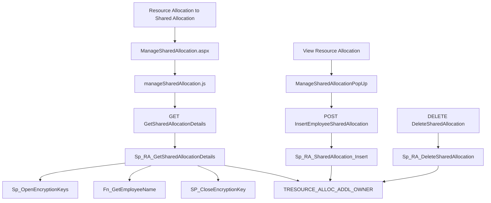
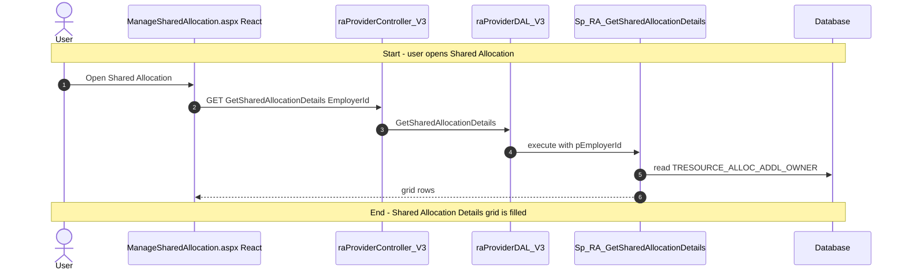
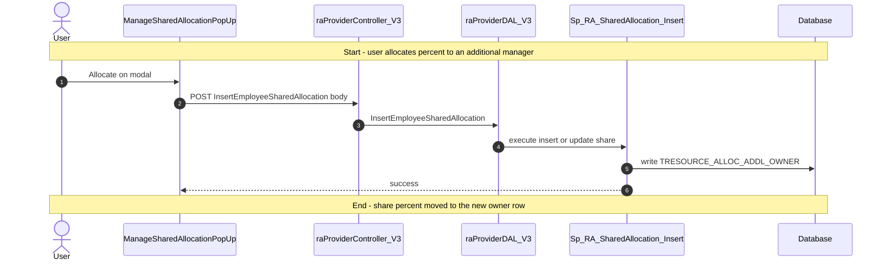
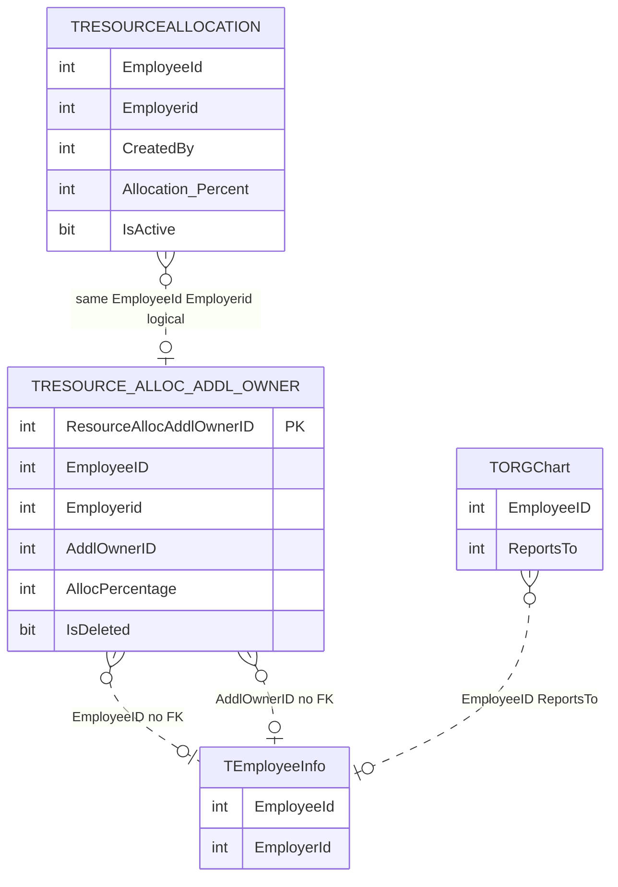

# Shared Allocation

## Overview

A resource-allocation admin opens **Resource Allocation → Shared Allocation**. The left-nav item loads `HRM/ResourceAllocation/ManageSharedAllocation.aspx`, which stamps session identity into hidden fields, logs activity type ManageSharedAllocation (407), and mounts the React SPA. The live screen is a **read-only grid** of additional-owner share rows for the signed-in employer: employee, allocation percent, manager (additional owner), created date, and comments.

Creating or adjusting a share is not done on that list page. From an employee’s **View Resource Allocation** screen (claim `RA014`), **Manage Shared Allocation** opens a modal: pick a current owner who still has available percent, choose an additional manager, enter percent and optional comments, then **Allocate**. That posts an insert that moves percent from the current owner row to the new (or existing) additional-owner row in `TRESOURCE_ALLOC_ADDL_OWNER`. Soft-delete of a share is exposed on the WebAPI but no React caller was found under Resource Allocation.

**Who's involved:**

- **RA admin / claim holder (`RA014`)** — opens Shared Allocation list; on View Resource Allocation, opens the manage modal when the employee is active.
- **Reporting manager** — appears as the non-additional owner in the modal chart/table (`IsAdditionalOwner = 0`).
- **Additional / functional managers** — receive or hold percent rows in `TRESOURCE_ALLOC_ADDL_OWNER`.

No SystemModel-2 workflow page for this menu item was found. Runtime truth is the React host plus Resource Allocation WebAPI Node against database slug **hrms-resourceallocation**. Table catalogue prose: `content/llm-wiki/reference/tables/resourceallocation.md` (`TRESOURCE_ALLOC_ADDL_OWNER`).

## Workflow

List and mutate calls are HTTP to the RA WebAPI (`/V3/raProvider/...` in UI constants). The ASPX host does not bind the grid or post back allocation data.

## Request journey

### Admin — open Shared Allocation and load the grid

### Admin — allocate share percent from View Resource Allocation

## Entry points

| Entry | Purpose |
|---|---|
| Left-nav **Resource Allocation → Shared Allocation** → `ManageSharedAllocation.aspx` | Host page; React route `MANAGE_SHARED_ALLOCATION`; claim `RA014`. |
| React `ManageSharedAllocation` | Employer-scoped shared-allocation grid. |
| React `viewResourceAllocation` → **Manage Shared Allocation** button | Opens `ManageSharedAllocationPopUp` when claim `RA014` and employee is active. |
| `ManageSharedAllocationPopUp` | Creates/adjusts a share via insert API. |

## Code → database call chain

| Entry | App / DAL (file:line) | Stored procedure |
|---|---|---|
| Page load activity | `ManageSharedAllocation.aspx.cs:24` → `CommonUtil.LogActivity` → `ActivityHelper` | `Sp_InsertActivityLog` (HRMS) |
| Shared Allocation grid | `manageSharedAllocation.js:27` → `GET_SHARED_RESOURCE_ALLOCATION_LIST` (`apiURLConstants.js:58`) → `raProviderController_V3.js:75` → `raProviderDAL_V3.js:99` | `Sp_RA_GetSharedAllocationDetails` |
| Allocate in modal | `manageSharedAllocationPopUp.js:50` → `ADD_SHARED_ALLOCATION` (`apiURLConstants.js:60`) → `raProviderController_V3.js:62` → `raProviderDAL_V3.js:116` | `Sp_RA_SharedAllocation_Insert` |
| Delete share (API only) | `DELETE_SHARED_ALLOCATION` (`apiURLConstants.js:61`) → `raProviderController_V3.js:88` → `raProviderDAL_V3.js:82` | `Sp_RA_DeleteSharedAllocation` |
| Modal owner chart data (View RA) | View allocation details → owner allocation payload (not the Shared Allocation list SP) | `Sp_RA_GetResourceOwnerDetails` (adjacent; powers popup rows) |

Legacy C# `ResourceAllocationDAL.cs` also maps the same three procedure names (`:19-21`, `:124-213`) but the React UI targets the Node WebAPI.

## API endpoints

No WebForms postback binds shared-allocation data. UI constants use `/V3/raProvider/...` with `Authorize`. In this checkout, `routeIndex.js` mounts `/raProvider` and `/V2/raProvider` only; V3 controller/DAL and swagger paths exist but `/V3/raProvider` is not `router.use`’d.

| Verb | Route (UI / swagger) | Parameters | Purpose | Source |
|---|---|---|---|---|
| GET | `/V3/raProvider/GetSharedAllocationDetails` | query `EmployerId` (required); UI may also send `employeeId` | List non-deleted additional-owner rows for employer. | `apiURLConstants.js:58`, `raProviderController_V3.js:75`, `raProviderDAL_V3.js:99` |
| POST | `/V3/raProvider/InsertEmployeeSharedAllocation` | body `EmployeeId`, `EmployerId`, `NewOwnerId`, `AllocationPercent`, `Comments`, `CreatedBy`, `IsActualOwner`, `CurrentOwnerId` | Move percent from current owner to new/existing additional owner. | `apiURLConstants.js:60`, `raProviderController_V3.js:62`, `raProviderDAL_V3.js:116` |
| DELETE | `/V3/raProvider/DeleteSharedAllocation` | query `allocationId`, `employerId` | Soft-delete (`isDeleted = 1`) one addl-owner row. | `apiURLConstants.js:61`, `raProviderController_V3.js:88`, `raProviderDAL_V3.js:82` |

Registered Express paths on the mounted routers use camelCase (`/getSharedAllocationDetails`, `/insertEmployeeSharedAllocation`, `/deleteSharedAllocation`) in `raProviderRoutes.js:12-14` and `raProviderRoutes_V2.js:12-14`.

## Stored procedures & tables involved

| Object | File | Purpose | Wiki / DB page |
|---|---|---|---|
| `Sp_RA_GetSharedAllocationDetails` | `HRMS-RESOURCEALLOCATION/STOREPROCEDURE/Sp_RA_GetSharedAllocationDetails.sql` | Employer list of active addl-owner shares with decrypted names. | [Sp_RA_GetSharedAllocationDetails](/docs/database/hrms-resourceallocation/Sp_RA_GetSharedAllocationDetails) |
| `Sp_RA_SharedAllocation_Insert` | `HRMS-RESOURCEALLOCATION/STOREPROCEDURE/Sp_RA_SharedAllocation_Insert.sql` | Insert/update new owner percent; reduce or delete current owner row. | [Sp_RA_SharedAllocation_Insert](/docs/database/hrms-resourceallocation/Sp_RA_SharedAllocation_Insert) |
| `Sp_RA_DeleteSharedAllocation` | `HRMS-RESOURCEALLOCATION/STOREPROCEDURE/Sp_RA_DeleteSharedAllocation.sql` | Soft-delete by `ResourceAllocAddlOwnerID`. | [Sp_RA_DeleteSharedAllocation](/docs/database/hrms-resourceallocation/Sp_RA_DeleteSharedAllocation) |
| `Sp_OpenEncryptionKeys` / `SP_CloseEncryptionKey` | HRMS STOREPROCEDURE (synonyms on RA) | Open/close keys around name reads. | [Sp_OpenEncryptionKeys](/docs/database/hrms/Sp_OpenEncryptionKeys), [SP_CloseEncryptionKey](/docs/database/hrms/SP_CloseEncryptionKey) |
| `Fn_GetEmployeeName` | HRMS FUNCTIONS (synonym on RA) | Employee display name. | [Fn_GetEmployeeName](/docs/database/hrms/Fn_GetEmployeeName) |
| `Sp_InsertActivityLog` | `HRMS/STOREPROCEDURE/Sp_InsertActivityLog.sql` | Page-access activity. | [Sp_InsertActivityLog](/docs/database/hrms/Sp_InsertActivityLog) |
| `TRESOURCE_ALLOC_ADDL_OWNER` | `HRMS-RESOURCEALLOCATION/TABLES/TRESOURCE_ALLOC_ADDL_OWNER.sql` | Additional owner share rows. | `llm-wiki/reference/tables/resourceallocation.md` |
| `TRESOURCEALLOCATION` | RA TABLES | Live allocation percent by creator (owner chart). | same catalogue |
| `TORGChart` / `TEmployeeInfo` | synonyms / HRMS | Reporting manager for owner chart SP. | — |

## Table relationships

No FK is declared on `TRESOURCE_ALLOC_ADDL_OWNER`. Links below are how the shared-allocation procedures and the adjacent owner-details SP join in practice.

## Known gaps

- **`/V3/raProvider` not mounted** in `Routes/routeIndex.js` (only `/raProvider` and `/V2/raProvider`); V3 controller, DAL, and `swagger_V3doc.json` paths exist without a `router.use('/V3/raProvider', …)` in this tree.
- **List page passes only `employerId`** into `GET_SHARED_RESOURCE_ALLOCATION_LIST`, so `employeeId` in the query string is `undefined` (`manageSharedAllocation.js:27`).
- **V3 DAL sends `@LoginEmployeeId`** on get (`raProviderDAL_V3.js:106`) but inventoried `Sp_RA_GetSharedAllocationDetails.sql` declares only `@pEmployerId`.
- **No React caller** for `DELETE_SHARED_ALLOCATION` under Resource Allocation (constant only).
- **C# DAL insert params** (`@pOwnerId` only) do not match Node/SQL (`@pNewOwnerId`, `@pIsActualOwner`, `@pCurrentOwnerId`); live UI path is Node.
- **When `@pIsActualOwner = 1`**, insert SP skips creating/updating the new-owner row and only reduces/deletes the current-owner row.
- **No SystemModel-2** page for Shared Allocation; no llm-wiki domain workflow page beyond the table catalogue row.

## Reference

Confidence is **medium** for the ASPX + React list/popup and the three RA shared-allocation procedures. V3 routing mount vs UI `/V3` constants is unresolved in this checkout.

### SourceCode

- `HRMS.Web/HRMS.Web/HRM/ResourceAllocation/ManageSharedAllocation.aspx`
- `HRMS.Web/HRMS.Web/HRM/ResourceAllocation/ManageSharedAllocation.aspx.cs`
- `HRMS.Web/HRMS.Web/HRM/ResourceAllocation/Areas/ManageSharedAllocation/manageSharedAllocation.js`
- `HRMS.Web/HRMS.Web/HRM/ResourceAllocation/Areas/ManageSharedAllocation/manageSharedAllocationPopUp.js`
- `HRMS.Web/HRMS.Web/HRM/ResourceAllocation/Areas/ManageSharedAllocation/sharedAllocationDetails.js`
- `HRMS.Web/HRMS.Web/HRM/ResourceAllocation/Areas/CreateResourceAllocation/Containers/viewResourceAllocation.js`
- `HRMS.Web/HRMS.Web/HRM/ResourceAllocation/Areas/routes.js`
- `HRMS.Web/HRMS.Web/HRM/ResourceAllocation/Common/apiURLConstants.js`
- `HRMS.Web/HRMS.Web/HRM/ResourceAllocation/Common/routeConstants.js`
- `HRMS.Web/HRMS.Web/HRM/ResourceAllocation/Common/claimConstants.js`
- `HRMS.ResourceAllocation/HRMS.ResourceAllocation.WebAPI.Node/Controllers/raProviderController_V3.js`
- `HRMS.ResourceAllocation/HRMS.ResourceAllocation.WebAPI.Node/Core/DataAccessLayer/raProviderDAL_V3.js`
- `HRMS.ResourceAllocation/HRMS.ResourceAllocation.WebAPI.Node/Routes/raProviderRoutes.js`
- `HRMS.ResourceAllocation/HRMS.ResourceAllocation.WebAPI.Node/Routes/routeIndex.js`
- `HRMS.ResourceAllocation/HRMS.ResourceAllocation.DAL/ResourceAllocationDAL.cs`
- `HRMS.Shared/HRMS.DataContract/Common/Enums.cs`

### TDG HRMS DB

- `HRMS-DATABASE/HRMS-RESOURCEALLOCATION/STOREPROCEDURE/Sp_RA_GetSharedAllocationDetails.sql`
- `HRMS-DATABASE/HRMS-RESOURCEALLOCATION/STOREPROCEDURE/Sp_RA_SharedAllocation_Insert.sql`
- `HRMS-DATABASE/HRMS-RESOURCEALLOCATION/STOREPROCEDURE/Sp_RA_DeleteSharedAllocation.sql`
- `HRMS-DATABASE/HRMS-RESOURCEALLOCATION/TABLES/TRESOURCE_ALLOC_ADDL_OWNER.sql`
- `HRMS-DATABASE/HRMS-RESOURCEALLOCATION/STOREPROCEDURE/Sp_RA_GetResourceOwnerDetails.sql`
- `HRMS-DATABASE/HRMS-RESOURCEALLOCATION/SYNONYMS/Sp_OpenEncryptionKeys.sql`
- `HRMS-DATABASE/HRMS-RESOURCEALLOCATION/SYNONYMS/SP_CloseEncryptionKey.sql`
- `HRMS-DATABASE/HRMS-RESOURCEALLOCATION/SYNONYMS/Fn_GetEmployeeName.sql`
- Backstage mirror: `content/llm-wiki/reference/tables/resourceallocation.md`
