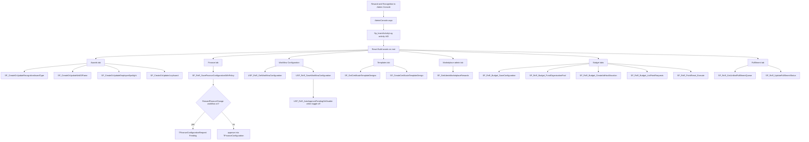
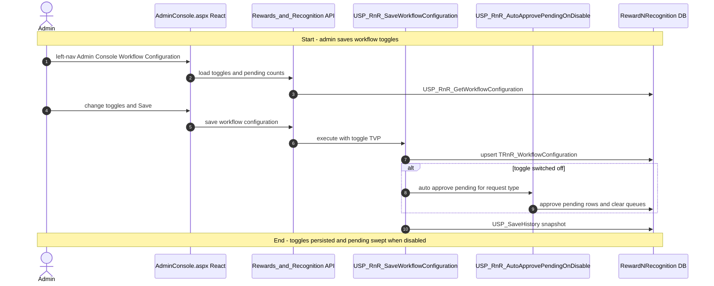
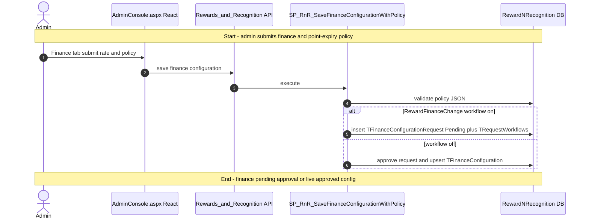

# Admin Console

## Overview

An administrator opens **Reward & Recognition → Admin Console** (menu id **1245**) to configure the RnR programme for their employer. The live host is `~/HRM/RewardsAndRecognition/AdminConsole.aspx` (WebForms page under `HRMS.Web`). Customer License Dashboard menu XML places Admin Console after Notifications.

The aspx only logs activity type **443** (`ActivityDescription.AdminConsole`), copies session `LoggedInUser` into hidden fields, and mounts the shared RnR React bundle (`Build/assets/index.js` on `#root`). There is no WebForms postback for admin CRUD on this page. Tabs under menu **1245** (seeded / ensured by RnR Phase 2 and `RnR_EnsureAdminConsoleAndSocialFeedTabs.sql`) include Awards, Finance, Admin Dashboard, Templates, Marketplace, Workflow Configuration, Points Master / Budget surfaces (Organisation Pool, Point Reset, Configuration, Scheduled / Ad-hoc Allocations, Employee Balances, Point Requests), and Fulfillment.

Module pages bound to this host for workflow titles include `RewardFinanceChange`, `RecognitionAward`, `JuryAward`, `SpotlightAward`, and `WallOfFameAward` (`RnR_EnsureModulePages.sql`). Approvals for those entities land on RnR Notifications (separate guide). The React Build folder and the separate `Rewards_and_Recognition` Node backend are not present in the current SourceCode tree. SystemModel-2 has no Admin Console page.

**Who's involved:**

- **Administrator** — configures award types, finance/budget, workflows, marketplace inventory, templates, and fulfillment on this console.
- **Approver** — when workflow toggles are on, decides pending Admin Console artifacts on Notifications.
- **Employees** — consume configured awards / marketplace / budgets on other RnR leaves (Give Recognition, Marketplace, My Rewards, Recognition Dashboard).

## Workflow



## Request journey

### Admin — save Workflow Configuration toggles



### Admin — submit Finance configuration change



### Admin — create recognition award type

```mermaid
sequenceDiagram
  autonumber
  actor Admin
  participant UI as AdminConsole.aspx React
  participant App as Rewards_and_Recognition API
  participant Create as SP_CreateOrUpdateRecognitionAwardType
  participant DB as RewardNRecognition DB

  Note over Admin,DB: Start - admin creates or updates a recognition award type
  Admin->>UI: Awards tab submit award type
  UI->>App: create or update recognition award
  App->>Create: execute
  alt RecognitionAward workflow on
    Create->>DB: insert pending TRecognitionAwardTypesMaster and TRequestWorkflows
  else workflow off
    Create->>DB: insert approved award type
  end
  Note over Admin,DB: End - award type pending or approved for Give Recognition
```

## Entry points

| Entry | Purpose |
|---|---|
| `~/HRM/RewardsAndRecognition/AdminConsole.aspx` | Left-nav **Admin Console**. Mounts shared RnR React on `#root`. |
| Left-nav menu id **1245** under parent **1240** | `tMenuDetails` / Customer License Dashboard menu XML |
| Tabs under MenuId **1245** | Awards, Finance, Admin Dashboard, Templates, Marketplace (**525**), Workflow Configuration, Budget surfaces, Fulfillment (`RnR_EnsureAdminConsoleAndSocialFeedTabs.sql`, RnR Phase 2) |
| Module pages `RecognitionAward` / `JuryAward` / `SpotlightAward` / `WallOfFameAward` / `RewardFinanceChange` → `AdminConsole.aspx` | Workflow page titles (`RnR_EnsureModulePages.sql`) |
| RnR Notifications | Approvers act on pending Admin Console workflow items (separate guide) |

Activity type id is `ActivityDescription.AdminConsole` = `443`.

## Code → database call chain

ASPX only logs activity and bootstraps React. Admin traffic is expected to go through the external `Rewards_and_Recognition` Node API against database `RewardNRecognition` (slug `hrms-rewardnrecognition`). Controller file:line is unavailable until that repo is on disk.

| Entry | Method | Database |
|---|---|---|
| Every page load, `AdminConsole.aspx.cs:26` | `CommonUtil.LogActivity` (`Common.cs:52`) → `LogUserActivity.LogActivity` (`LogUserActivity.cs:36`) → `ActivityLog.LogActivityAsync` (`ActivityLog.cs:22`) → `ActivityHelper.LogActivity` (`ActivityHelper.cs:32`) | `Sp_InsertActivityLog` (HRMS). Activity type `443`. |
| Seed hidden fields, `AdminConsole.aspx.cs:28-41` | Session `LoggedInUser` → aspx hidden inputs | None |
| Load React shell, `AdminConsole.aspx:6`, `:26` | Script/link to `Build/assets/*` | None in host |
| Awards create/update (inferred) | Node API → execute | `SP_CreateOrUpdateRecognitionAwardType`, `SP_CreateOrUpdateWallOfFame`, `SP_CreateOrUpdateEmployeeSpotlight`, `SP_CreateOrUpdateJuryAward`. Nested when workflow on: `SP_CM_GetWorkflowTreeXmlDetailsByPageTitle`, `SP_CM_GetDataforRequestWorkFlows`, `SP_CM_GetDataForEmailNotification`, `FN_CM_GetMgrFromRequestWorkflows`, `FN_GetEmployeeName_Multi`, `FN_CM_GetApproverList`, `USP_SaveHistory` (synonym). |
| Awards lists (inferred) | Node API → execute | `SP_GetRecognitionAwardTypesMaster`, `SP_GetWallOfFame`, `SP_GetEmployeeSpotlights`, `SP_GetJuryAwards`. |
| Finance load / save (inferred) | Node API → execute | `SP_GetFinanceConfiguration`, `SP_RnR_SaveFinanceConfigurationWithPolicy` → nested `SP_RnR_PointExpiry_ValidatePolicyJson` plus workflow helpers when enabled. |
| Workflow Configuration (inferred) | Node API → execute | `USP_RnR_GetWorkflowConfiguration`, `USP_RnR_SaveWorkflowConfiguration` → nested `USP_RnR_AutoApprovePendingOnDisable` when a toggle turns off; `USP_SaveHistory`. |
| Templates (inferred) | Node API → execute | `SP_GetCertificateTemplateDesigns`, `SP_CreateCertificateTemplateDesign`. |
| Marketplace admin inventory (inferred) | Node API → execute | `SP_GetAdminMarketplaceRewards` (writes such as `SP_UpsertRedemptionOption` exist but are not inventoried as primary pages here). |
| Budget Configuration / Pool / Ad-hoc / Point Requests / Reset (inferred) | Node API → execute | `SP_RnR_Budget_GetConfiguration`, `SP_RnR_Budget_SaveConfiguration` → nested `SP_RnR_Budget_GetConfiguration`; `SP_RnR_Budget_FundOrganisationPool` → nested `SP_RnR_Budget_GetOrganisationPool`; `SP_RnR_Budget_CreateAdHocAllocation` → nested `SP_RnR_Budget_ResolveAdHocTargetEmployees`, `SP_RnR_Budget_AllocateEmployeeJson`; `SP_RnR_Budget_ListPointRequests`; `SP_RnR_PointReset_Preview`; `SP_RnR_PointReset_Execute` → nested `SP_RnR_PointReset_GetRun`. |
| Fulfillment queue (inferred) | Node API → execute | `SP_RnR_GetUnifiedFulfillmentQueue`, `SP_RnR_UpdateFulfillmentStatus`. |

## API endpoints

This screen is **not** a WebForms postback for admin data. The aspx only logs activity and mounts the React shell.

Feature HTTP routes live in the missing `Rewards_and_Recognition` backend / `Build/assets/index.js` client. They are **not** present under `HRMS.CoreAPI` or `HRMS.Web/.../RewardsAndRecognition` in this checkout. `TDataCatalog` publishes these Admin Console-related paths:

| Method | Path | Purpose | Source |
|---|---|---|---|
| Page load | `AdminConsole.aspx` | Activity log + React bootstrap | `AdminConsole.aspx.cs:26` |
| Catalog | `GET /api/v1/rewards/admin/recognition-award` | Award types admin | `TDataCatalog_DML.sql` |
| Catalog | `GET /api/v1/rewards/admin/wall-of-fame` | Wall of Fame admin | `TDataCatalog_DML.sql` |
| Catalog | `GET /api/v1/rewards/admin/spotlight-award` | Spotlight admin | `TDataCatalog_DML.sql` |
| Catalog | `GET /api/v1/rewards/admin/jury-awards` | Jury awards admin | `TDataCatalog_DML.sql` |
| Catalog | `GET /api/v1/admin/finance/config` | Finance configuration | `TDataCatalog_DML.sql` |
| Catalog | `GET /api/v1/rewards/admin/workflow-configuration` | Workflow toggles | `TDataCatalog_DML.sql` |
| Catalog | `GET /api/v1/rewards/admin/certificate-template-designs` | Certificate templates | `TDataCatalog_DML.sql` |
| Catalog | `GET /api/v1/marketplace/admin/rewards` | Marketplace inventory | `TDataCatalog_DML.sql` |
| Catalog | `GET /api/v1/marketplace/admin/fulfillments` | Legacy redemption fulfillments | `TDataCatalog_DML.sql` |
| Catalog | `GET /api/v1/fulfillment/admin/queue` | Unified fulfillment queue | `TDataCatalog_DML.sql` |
| Catalog | `GET /api/v1/open-marketplace/admin/orders` | Provider / open-marketplace orders | `TDataCatalog_DML.sql` |
| Inferred | budget / point-reset / schedule / allocation routes | Budget tabs | Not in workspace — see Known gaps |

## Stored procedures & tables involved

Direct procedures are those the Admin Console host/tabs are expected to call. Nested objects are one level deep. Database slug is `hrms-rewardnrecognition` unless noted.

| Object | File | Purpose | Wiki |
|---|---|---|---|
| [Sp_InsertActivityLog](/docs/database/hrms/Sp_InsertActivityLog) | HRMS | Page open activity | `TActivityLog` |
| [SP_CreateOrUpdateRecognitionAwardType](/docs/database/hrms-rewardnrecognition/SP_CreateOrUpdateRecognitionAwardType) | `…/SP_CreateOrUpdateRecognitionAwardType.sql` | Create/update award type | `TRecognitionAwardTypesMaster` |
| [SP_CreateOrUpdateWallOfFame](/docs/database/hrms-rewardnrecognition/SP_CreateOrUpdateWallOfFame) | `…/SP_CreateOrUpdateWallOfFame.sql` | Create/update Wall of Fame | `TWallOfFame` |
| [SP_CreateOrUpdateEmployeeSpotlight](/docs/database/hrms-rewardnrecognition/SP_CreateOrUpdateEmployeeSpotlight) | `…/SP_CreateOrUpdateEmployeeSpotlight.sql` | Create/update Spotlight | `TEmployeeSpotlights` |
| [SP_CreateOrUpdateJuryAward](/docs/database/hrms-rewardnrecognition/SP_CreateOrUpdateJuryAward) | `…/SP_CreateOrUpdateJuryAward.sql` | Create/update Jury award | `TJuryAwards` |
| [SP_GetRecognitionAwardTypesMaster](/docs/database/hrms-rewardnrecognition/SP_GetRecognitionAwardTypesMaster) | `…/SP_GetRecognitionAwardTypesMaster.sql` | Award type list | `TRecognitionAwardTypesMaster` |
| [SP_GetWallOfFame](/docs/database/hrms-rewardnrecognition/SP_GetWallOfFame) | `…/SP_GetWallOfFame.sql` | Wall of Fame list | `TWallOfFame` |
| [SP_GetEmployeeSpotlights](/docs/database/hrms-rewardnrecognition/SP_GetEmployeeSpotlights) | `…/SP_GetEmployeeSpotlights.sql` | Spotlight list | `TEmployeeSpotlights` |
| [SP_GetJuryAwards](/docs/database/hrms-rewardnrecognition/SP_GetJuryAwards) | `…/SP_GetJuryAwards.sql` | Jury awards list | `TJuryAwards` |
| [SP_GetFinanceConfiguration](/docs/database/hrms-rewardnrecognition/SP_GetFinanceConfiguration) | `…/SP_GetFinanceConfiguration.sql` | Live finance config | `TFinanceConfiguration` |
| [SP_RnR_SaveFinanceConfigurationWithPolicy](/docs/database/hrms-rewardnrecognition/SP_RnR_SaveFinanceConfigurationWithPolicy) | `…/SP_RnR_SaveFinanceConfigurationWithPolicy.sql` | Finance + expiry policy save | `TFinanceConfigurationRequest` |
| [USP_RnR_GetWorkflowConfiguration](/docs/database/hrms-rewardnrecognition/USP_RnR_GetWorkflowConfiguration) | `…/USP_RnR_GetWorkflowConfiguration.sql` | Workflow toggles + pending counts | `TRnR_WorkflowConfiguration` |
| [USP_RnR_SaveWorkflowConfiguration](/docs/database/hrms-rewardnrecognition/USP_RnR_SaveWorkflowConfiguration) | `…/USP_RnR_SaveWorkflowConfiguration.sql` | Save toggles | `TRnR_WorkflowConfiguration` |
| [USP_RnR_AutoApprovePendingOnDisable](/docs/database/hrms-rewardnrecognition/USP_RnR_AutoApprovePendingOnDisable) | `…/USP_RnR_AutoApprovePendingOnDisable.sql` | Nested sweep when toggle off | pending artifacts |
| [SP_GetCertificateTemplateDesigns](/docs/database/hrms-rewardnrecognition/SP_GetCertificateTemplateDesigns) | `…/SP_GetCertificateTemplateDesigns.sql` | Certificate design list | `TCertificateCustomTemplates` |
| [SP_CreateCertificateTemplateDesign](/docs/database/hrms-rewardnrecognition/SP_CreateCertificateTemplateDesign) | `…/SP_CreateCertificateTemplateDesign.sql` | Create certificate design | `TCertificateCustomTemplates` |
| [SP_GetAdminMarketplaceRewards](/docs/database/hrms-rewardnrecognition/SP_GetAdminMarketplaceRewards) | `…/SP_GetAdminMarketplaceRewards.sql` | Admin gift-card inventory | `TRedemptionOption` |
| [SP_RnR_GetUnifiedFulfillmentQueue](/docs/database/hrms-rewardnrecognition/SP_RnR_GetUnifiedFulfillmentQueue) | `…/SP_RnR_GetUnifiedFulfillmentQueue.sql` | Fulfillment queue page | `TRnR_FulfillmentItem` |
| [SP_RnR_UpdateFulfillmentStatus](/docs/database/hrms-rewardnrecognition/SP_RnR_UpdateFulfillmentStatus) | `…/SP_RnR_UpdateFulfillmentStatus.sql` | Status transitions | `TRnR_FulfillmentItem` |
| [SP_RnR_Budget_GetConfiguration](/docs/database/hrms-rewardnrecognition/SP_RnR_Budget_GetConfiguration) | `…/SP_RnR_Budget_GetConfiguration.sql` | Budget flags | `TRnRBudgetConfiguration` |
| [SP_RnR_Budget_SaveConfiguration](/docs/database/hrms-rewardnrecognition/SP_RnR_Budget_SaveConfiguration) | `…/SP_RnR_Budget_SaveConfiguration.sql` | Save budget flags | `TRnRBudgetConfiguration` |
| [SP_RnR_Budget_FundOrganisationPool](/docs/database/hrms-rewardnrecognition/SP_RnR_Budget_FundOrganisationPool) | `…/SP_RnR_Budget_FundOrganisationPool.sql` | Manual pool funding | `TRnROrganisationPool` |
| [SP_RnR_Budget_GetOrganisationPool](/docs/database/hrms-rewardnrecognition/SP_RnR_Budget_GetOrganisationPool) | `…/SP_RnR_Budget_GetOrganisationPool.sql` | Nested pool read | `TRnROrganisationPool` |
| [SP_RnR_Budget_CreateAdHocAllocation](/docs/database/hrms-rewardnrecognition/SP_RnR_Budget_CreateAdHocAllocation) | `…/SP_RnR_Budget_CreateAdHocAllocation.sql` | Ad-hoc wallet allocation | `TRnRBudgetAllocationRun` |
| [SP_RnR_Budget_ResolveAdHocTargetEmployees](/docs/database/hrms-rewardnrecognition/SP_RnR_Budget_ResolveAdHocTargetEmployees) | `…/SP_RnR_Budget_ResolveAdHocTargetEmployees.sql` | Nested filter resolve | targeting |
| [SP_RnR_Budget_AllocateEmployeeJson](/docs/database/hrms-rewardnrecognition/SP_RnR_Budget_AllocateEmployeeJson) | `…/SP_RnR_Budget_AllocateEmployeeJson.sql` | Nested allocate | wallet batches |
| [SP_RnR_Budget_ListPointRequests](/docs/database/hrms-rewardnrecognition/SP_RnR_Budget_ListPointRequests) | `…/SP_RnR_Budget_ListPointRequests.sql` | Admin point-request list | `TRnRPointRequest` |
| [SP_RnR_PointReset_Preview](/docs/database/hrms-rewardnrecognition/SP_RnR_PointReset_Preview) | `…/SP_RnR_PointReset_Preview.sql` | Preview points to reset | `TEmployeeRecognition` |
| [SP_RnR_PointReset_Execute](/docs/database/hrms-rewardnrecognition/SP_RnR_PointReset_Execute) | `…/SP_RnR_PointReset_Execute.sql` | Execute point reset | `TRnRPointResetRun` |
| [SP_RnR_PointReset_GetRun](/docs/database/hrms-rewardnrecognition/SP_RnR_PointReset_GetRun) | `…/SP_RnR_PointReset_GetRun.sql` | Nested run detail | reset run tables |
| [SP_RnR_PointExpiry_ValidatePolicyJson](/docs/database/hrms-rewardnrecognition/SP_RnR_PointExpiry_ValidatePolicyJson) | `…/SP_RnR_PointExpiry_ValidatePolicyJson.sql` | Nested finance policy validate | — |
| [SP_CM_GetWorkflowTreeXmlDetailsByPageTitle](/docs/database/hrms/SP_CM_GetWorkflowTreeXmlDetailsByPageTitle) | HRMS | Nested workflow tree | workflow |
| [SP_CM_GetDataforRequestWorkFlows](/docs/database/hrms/SP_CM_GetDataforRequestWorkFlows) | HRMS | Nested approver rows | `TRequestWorkflows` |
| [SP_CM_GetDataForEmailNotification](/docs/database/hrms/SP_CM_GetDataForEmailNotification) | HRMS | Nested email seed | `TEmailNotification` |
| `USP_SaveHistory` | Synonym → HRMS | Nested history snapshot (SQL body not in Liquibase tree) | history tables |
| `TRnR_WorkflowConfiguration` / `_History` | config | — | catalog |
| `TFinanceConfiguration` / `TFinanceConfigurationRequest` | finance | — | catalog |
| `TRecognitionAwardTypesMaster`, `TWallOfFame`, `TEmployeeSpotlights`, `TJuryAwards` | awards | — | catalog |
| `TCertificateCustomTemplates` | templates | — | catalog |
| `TRedemptionOption`, `TRnR_FulfillmentItem` | marketplace / fulfillment | — | catalog |
| `TRnRBudgetConfiguration`, `TRnROrganisationPool`, `TRnRPointResetRun` | budget | — | — |

## Table relationships

Edges follow Admin Console writers. Many RnR links are application-enforced (no FK scripts in baseline).

```mermaid
erDiagram
  TRnR_WorkflowConfiguration ||--o{ TRnR_WorkflowConfiguration_History : "WorkflowConfigId"
  TRnR_WorkflowConfiguration ||--o{ TRecognitionAwardTypesMaster : "RecognitionAward toggle"
  TRnR_WorkflowConfiguration ||--o{ TFinanceConfigurationRequest : "RewardFinanceChange toggle"
  TRecognitionAwardTypesMaster ||--o{ TRequestWorkflows : "id as RequestTransid"
  TWallOfFame ||--o{ TRequestWorkflows : "WallOfFameAward"
  TEmployeeSpotlights ||--o{ TRequestWorkflows : "SpotlightAward"
  TJuryAwards ||--o{ TRequestWorkflows : "JuryAward"
  TFinanceConfigurationRequest ||--o{ TFinanceConfigurationRequestStatusHistory : "RequestID"
  TFinanceConfigurationRequest ||--o| TFinanceConfiguration : "approved applies live"
  TCertificateCustomTemplates ||--o{ TRecognitionAwardTypesMaster : "certificate_template_id"
  TRedemptionCategory ||--o{ TRedemptionOption : "RedemptionCategoryID"
  TRnR_FulfillmentItem ||--o{ TRnR_FulfillmentStatusHistory : "fulfillment_item_id"
  TRnRBudgetConfiguration ||--o| TRnROrganisationPool : "EmployerId"
  TRnROrganisationPool ||--o{ TRnROrganisationPoolMovement : "EmployerId"
  TRnRBudgetAllocationRun ||--o{ TRnRGiveWalletBatch : "AdHoc allocation"
  TRnRPointResetRun ||--o{ TRnRPointResetRunEmployee : "ResetRunId"
  TRnRPointResetRun ||--o{ TRnRPointResetRunRecognition : "ResetRunId"
  TEmployeeRecognition ||--o{ TRnRPointResetRunRecognition : "RecognitionId"
```



## Known gaps

- **`HRM/RewardsAndRecognition/Build/` is missing** from this SourceCode checkout, so React tab routes and API client calls for Admin Console cannot be traced to `file:line`.
- **`Rewards_and_Recognition` Node backend** referenced by `TDataCatalog` is not a folder under this workspace; no controller or DAL for admin procedures is available to cite.
- **Budget / point-reset / schedule HTTP route strings** are not published in the inventoried `TDataCatalog` rows the way awards/finance/fulfillment paths are.
- **`USP_SaveHistory`** is only a synonym in RewardNRecognition pointing at HRMS; the procedure body is not present as `USP_SaveHistory.sql` in the Liquibase tree (only MultiID / MultiFilter variants), so no dedicated database page was written.
- **Marketplace write SPs** (`SP_UpsertRedemptionOption`, `SP_BulkCreateRedemptionOptions`, provider-order USPs) and **scheduled allocation** SPs exist but are outside this guide’s primary inventory.
- **No SystemModel-2** page for Admin Console.
- **Host does not gate menu access**; it only logs activity and seeds hidden fields when `LoggedInUser` is present.

## Reference

Confidence is **medium**: the ASPX host, activity **443**, menu **1245**, Admin Console tabs, and RewardNRecognition admin procedures were read from source/SQL. The React UI and feature HTTP handlers are not in this checkout.

### SourceCode

- `HRMS.Web/HRMS.Web/HRM/RewardsAndRecognition/AdminConsole.aspx`
- `HRMS.Web/HRMS.Web/HRM/RewardsAndRecognition/AdminConsole.aspx.cs`
- `HRMS.Shared/HRMS.DataContract/Common/Enums.cs` (`AdminConsole` 443)
- `HRMS.Shared/HRMS.Common/Common.cs`
- `HRMS.Shared/TDG.ActivityAuditLog/Activity/LogUserActivity.cs`
- `HRMS.Shared/TDG.ActivityAuditLog/ActivityLog/ActivityLog.cs`
- `HRMS.Shared/TDG.ActivityAuditLog/DAL/ActivityHelper.cs`

### TDG HRMS DB

- `HRMS-DATABASE/HRMS/DML/RnR Phase2/Index.sql`
- `HRMS-DATABASE/HRMS/DML/RnR_EnsureAdminConsoleAndSocialFeedTabs.sql`
- `HRMS-DATABASE/HRMS/DML/RnR_EnsureModulePages.sql`
- `HRMS-DATABASE/HRMS/DML/Customer License Dashboard/TMenuDetails DML.sql`
- `HRMS-DATABASE/HRMS/DML/TDataCatalog_DML.sql`
- `HRMS-DATABASE/HRMS/STOREPROCEDURE/Sp_InsertActivityLog.sql`
- `HRMS-DATABASE/HRMS-RewardNRecognition/STORED_PROCEDURE/` (admin procs listed above)
- `HRMS-DATABASE/HRMS-RewardNRecognition/SYNONYMS/USP_SaveHistory.sql`
