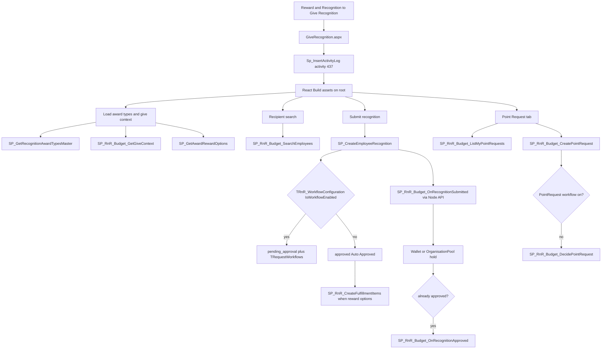
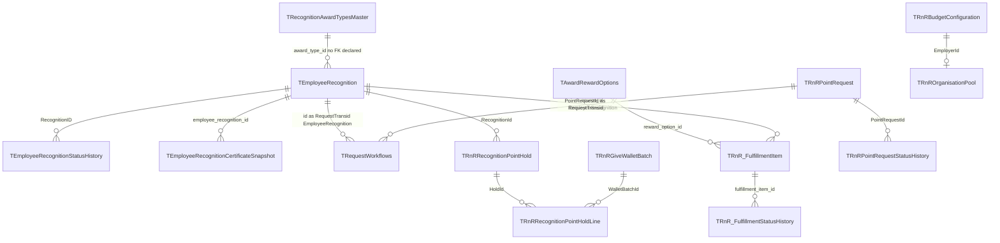

# Give Recognition

## Overview

An employee opens **Reward & Recognition → Give Recognition** (`~/HRM/RewardsAndRecognition/GiveRecognition.aspx`) to recognise a colleague: pick a recipient, choose an approved recognition type (points and optional reward options / monetary value), write a message and optional title/core values, then submit. When the employer has EmployeeRecognition workflow enabled, the row stays pending approval; when the toggle is off, `SP_CreateEmployeeRecognition` auto-approves and may create fulfillment items. Budget Control (when on) holds points from the giver’s wallet via a follow-on funding proc; when off, points come from the organisation pool (with optional direct-issue caps).

The same ASPX also hosts the **Point Request** module page (`PointRequest` in `TModulePages`): when Budget Control and Point Requests are enabled, the giver can request more give-points. Approvals for recognitions and point requests land on RnR Notifications (separate guide).

The WebForms host only logs activity and injects session identity into hidden fields, then mounts the shared RnR React bundle (`Build/assets/index.js` on `#root`). That Build folder and the separate `Rewards_and_Recognition` Node backend are not present in the current SourceCode tree. SystemModel-2 has no Give Recognition page. Table blurbs live in `TDataCatalog_DML` for `RewardNRecognition`; there is no llm-wiki domain `erDiagram` to reuse.

**Who's involved:**

- **Giver (employee)** — selects recipient and award type, submits recognition or a point request.
- **Approver** — when workflow is on, decides EmployeeRecognition / PointRequest on Notifications.
- **Admin** — configures award types, finance/budget, and workflows on Admin Console (out of scope here).

## Workflow



## Request journey

### Employee — submit a recognition

```mermaid
sequenceDiagram
  autonumber
  actor User
  participant UI as GiveRecognition.aspx React
  participant App as Rewards_and_Recognition API
  participant Create as SP_CreateEmployeeRecognition
  participant Fund as SP_RnR_Budget_OnRecognitionSubmitted
  participant DB as RewardNRecognition DB

  Note over User,DB: Start - user submits Give Recognition form
  User->>UI: left-nav Give Recognition
  UI->>App: load award types give context reward options
  App->>DB: SP_GetRecognitionAwardTypesMaster and SP_RnR_Budget_GetGiveContext
  User->>UI: pick recipient type points message Submit
  UI->>App: create employee recognition
  App->>Create: execute
  Create->>DB: insert TEmployeeRecognition and status history
  alt workflow enabled
    Create->>DB: insert TRequestWorkflows and email notification rows
  else workflow off
    Create->>DB: set approved and optional fulfillment items
  end
  App->>Fund: fund submitted recognition
  Fund->>DB: hold wallet or organisation pool points
  Note over User,DB: End - recognition pending or auto approved with funding status
```

### Employee — request more give points

```mermaid
sequenceDiagram
  autonumber
  actor User
  participant UI as GiveRecognition.aspx React
  participant App as Rewards_and_Recognition API
  participant Create as SP_RnR_Budget_CreatePointRequest
  participant Decide as SP_RnR_Budget_DecidePointRequest
  participant DB as RewardNRecognition DB

  Note over User,DB: Start - user submits a Point Request from Give Recognition
  User->>UI: open Point Request and submit points reason
  UI->>App: create point request
  App->>Create: execute
  Create->>DB: insert TRnRPointRequest Pending
  alt PointRequest workflow on
    Create->>DB: insert TRequestWorkflows for approvers
  else workflow off
    Create->>Decide: auto approve
    Decide->>DB: allocate wallet batch and mark Approved
  end
  Note over User,DB: End - point request pending or wallet credited
```

## Entry points

| Entry | Purpose |
|---|---|
| `~/HRM/RewardsAndRecognition/GiveRecognition.aspx` | Left-nav **Give Recognition**. Mounts shared RnR React on `#root`. |
| Module page `EmployeeRecognition` → `GiveRecognition.aspx` | Workflow page title used by `SP_CreateEmployeeRecognition` (`RnR_EnsureModulePages.sql`). |
| Module page `PointRequest` → `GiveRecognition.aspx` | Point Request flows share this host. |
| RnR Notifications | Approvers act on pending EmployeeRecognition / PointRequest (separate screen). |

Activity type id is `ActivityDescription.GiveRecognition` = `437`. Menu node text is **Give Recognition** (value `1242` in menu DML).

## Code → database call chain

ASPX only logs activity and bootstraps React. Recognition and budget traffic is expected to go through the external `Rewards_and_Recognition` Node API against database `RewardNRecognition` (slug `hrms-rewardnrecognition`). Controller file:line is unavailable until that repo is on disk.

| Entry | Method | Database |
|---|---|---|
| Every page load, `GiveRecognition.aspx.cs:26` | `CommonUtil.LogActivity` (`Common.cs:52`) → `ActivityHelper.LogActivity` (`ActivityHelper.cs:32`) | `Sp_InsertActivityLog` (HRMS). Activity type `437`. |
| Form load (inferred) | Node API → execute | `SP_GetRecognitionAwardTypesMaster`, `SP_RnR_Budget_GetGiveContext`, `SP_GetAwardRewardOptions`. |
| Recipient search (inferred) | Node API → execute | `SP_RnR_Budget_SearchEmployees` → nested `FN_GetEmployeeName_Multi`. |
| Submit recognition (inferred) | Node API → execute | `SP_CreateEmployeeRecognition`. Nested when workflow on: `SP_CM_GetWorkflowTreeXmlDetailsByPageTitle`, `SP_CM_GetDataforRequestWorkFlows`, `SP_CM_GetDataForEmailNotification`, `FN_CM_GetMgrFromRequestWorkflows`, `FN_GetEmployeeName_Multi`, `FN_CM_GetApproverList`. Nested when workflow off + reward options: `SP_RnR_CreateFulfillmentItems`. |
| After create (inferred; not `EXEC` inside create SP) | Node API → execute | `SP_RnR_Budget_OnRecognitionSubmitted` → nested `SP_RnR_Budget_OnRecognitionApproved` when status already approved. |
| Point Request list / create (inferred) | Node API → execute | `SP_RnR_Budget_ListMyPointRequests`, `SP_RnR_Budget_CreatePointRequest` → nested `UFN_CM_GetWorkflowTreeXmlDetailsByPageTitle`, `SP_CM_GetDataforRequestWorkFlows`, or `SP_RnR_Budget_DecidePointRequest` when workflow off. |

## API endpoints

This screen is not a WebForms postback for recognition data. The host is ASP.NET; the SPA is expected to call the Rewards_and_Recognition Node API under `/api/v1/...` (catalog examples). Exact create / give-context / point-request routes were not verified in source because the backend repo is missing.

| Method | Path | Purpose | Source |
|---|---|---|---|
| Page load | `GiveRecognition.aspx` | Activity log + React bootstrap | `GiveRecognition.aspx.cs:26` |
| Catalog example | `GET /api/v1/employee-recognitions/my-recognitions` | Listed on `TEmployeeRecognition` (My Recognitions primary; not this form’s submit) | `TDataCatalog_DML.sql` |
| Catalog example | `GET /api/v1/rewards/admin/recognition-award` | Award-type admin surface; same master table as give form | `TDataCatalog_DML.sql` |
| Inferred | create employee recognition + budget give-context + point-request routes | Give form and Point Request | Not in workspace — see Known gaps |

## Stored procedures & tables involved

Direct procedures are those the Give Recognition host/form is expected to call. Nested objects are one level deep. Database slug is `hrms-rewardnrecognition` unless noted.

| Object | File | Purpose | Wiki |
|---|---|---|---|
| [Sp_InsertActivityLog](/docs/database/hrms/Sp_InsertActivityLog) | HRMS | Page open activity | `TActivityLog` |
| [SP_GetRecognitionAwardTypesMaster](/docs/database/hrms-rewardnrecognition/SP_GetRecognitionAwardTypesMaster) | `HRMS-RewardNRecognition/STORED_PROCEDURE/SP_GetRecognitionAwardTypesMaster.sql` | Award types for the form | `TRecognitionAwardTypesMaster` |
| [SP_RnR_Budget_GetGiveContext](/docs/database/hrms-rewardnrecognition/SP_RnR_Budget_GetGiveContext) | `…/SP_RnR_Budget_GetGiveContext.sql` | Wallet / pool affordability per award type | budget tables |
| [SP_GetAwardRewardOptions](/docs/database/hrms-rewardnrecognition/SP_GetAwardRewardOptions) | `…/SP_GetAwardRewardOptions.sql` | Active reward option catalog | `TAwardRewardOptions` |
| [SP_RnR_Budget_SearchEmployees](/docs/database/hrms-rewardnrecognition/SP_RnR_Budget_SearchEmployees) | `…/SP_RnR_Budget_SearchEmployees.sql` | Recipient typeahead | `TEmployee` synonym |
| [SP_CreateEmployeeRecognition](/docs/database/hrms-rewardnrecognition/SP_CreateEmployeeRecognition) | `…/SP_CreateEmployeeRecognition.sql` | Insert recognition + workflow / auto-approve | `TEmployeeRecognition` |
| [SP_RnR_CreateFulfillmentItems](/docs/database/hrms-rewardnrecognition/SP_RnR_CreateFulfillmentItems) | `…/SP_RnR_CreateFulfillmentItems.sql` | Nested fulfillment on auto-approve | `TRnR_FulfillmentItem` |
| [SP_RnR_Budget_OnRecognitionSubmitted](/docs/database/hrms-rewardnrecognition/SP_RnR_Budget_OnRecognitionSubmitted) | `…/SP_RnR_Budget_OnRecognitionSubmitted.sql` | Hold / issue funding after create | wallet / pool |
| [SP_RnR_Budget_OnRecognitionApproved](/docs/database/hrms-rewardnrecognition/SP_RnR_Budget_OnRecognitionApproved) | `…/SP_RnR_Budget_OnRecognitionApproved.sql` | Nested settle hold when already approved | funding |
| [SP_RnR_Budget_ListMyPointRequests](/docs/database/hrms-rewardnrecognition/SP_RnR_Budget_ListMyPointRequests) | `…/SP_RnR_Budget_ListMyPointRequests.sql` | Giver’s point request history | `TRnRPointRequest` |
| [SP_RnR_Budget_CreatePointRequest](/docs/database/hrms-rewardnrecognition/SP_RnR_Budget_CreatePointRequest) | `…/SP_RnR_Budget_CreatePointRequest.sql` | Submit point request | `TRnRPointRequest` |
| [SP_RnR_Budget_DecidePointRequest](/docs/database/hrms-rewardnrecognition/SP_RnR_Budget_DecidePointRequest) | `…/SP_RnR_Budget_DecidePointRequest.sql` | Nested auto-approve when PointRequest workflow off | wallet allocation |
| [SP_CM_GetWorkflowTreeXmlDetailsByPageTitle](/docs/database/hrms/SP_CM_GetWorkflowTreeXmlDetailsByPageTitle) | HRMS | Nested workflow for EmployeeRecognition | workflow |
| [SP_CM_GetDataforRequestWorkFlows](/docs/database/hrms/SP_CM_GetDataforRequestWorkFlows) | HRMS | Nested approver rows | `TRequestWorkflows` |
| [SP_CM_GetDataForEmailNotification](/docs/database/hrms/SP_CM_GetDataForEmailNotification) | HRMS | Nested email notification seed | `TEmailNotification` |
| [UFN_CM_GetWorkflowTreeXmlDetailsByPageTitle](/docs/database/hrms/UFN_CM_GetWorkflowTreeXmlDetailsByPageTitle) | HRMS | Nested PointRequest workflow id | workflow |
| [FN_GetEmployeeName_Multi](/docs/database/hrms/FN_GetEmployeeName_Multi) | HRMS | Nested display names | — |
| `TEmployeeRecognition` | recognition header | — | catalog |
| `TEmployeeRecognitionStatusHistory` | status trail | — | catalog |
| `TEmployeeRecognitionCertificateSnapshot` | cert design snapshot | — | catalog Give Recognition |
| `TRecognitionAwardTypesMaster` | award type rules | — | catalog |
| `TAwardRewardOptions` | reward option master | — | catalog |
| `TRnR_WorkflowConfiguration` | per-request-type workflow toggle | — | catalog |
| `TRnRGiveWalletBatch` / `TRnROrganisationPool` | give budget | — | — |
| `TRnRPointRequest` | point requests | — | — |

## Table relationships

Edges follow inserts/joins in the give and point-request procedures. Many RnR links are application-enforced (no FK scripts in baseline).



## Known gaps

- **React `Build/assets` is missing** under `HRMS.Web/.../RewardsAndRecognition/`; SPA routes and component file:line cannot be cited.
- **`Rewards_and_Recognition` Node backend is not in the workspace**; API verbs/paths for create, give-context, and point-request are inferred from catalog + SP names, not controller source.
- **`SP_RnR_Budget_OnRecognitionSubmitted` is not `EXEC`’d inside `SP_CreateEmployeeRecognition`** — comments say the Node layer calls it after create; confirm when the backend is available.
- **SystemModel-2 / llm-wiki** have no dedicated Give Recognition domain page or `erDiagram`.
- **Approval UI** (Notifications) and Admin Console award-type setup are separate guides; approve/reject SPs are not inventoried here beyond nested funding settle.
- **`SP_RnR_Budget_AllocateEmployeeJson`** (nested from `SP_RnR_Budget_DecidePointRequest`) is outside the one-nested-level page set for this pass.

## Reference

Confidence is medium because the ASPX host and RewardNRecognition SQL were read end-to-end, but the SPA bundle and Node API that actually invoke the SPs are absent from SourceCode.

### SourceCode

- `HRMS.Web/HRMS.Web/HRM/RewardsAndRecognition/GiveRecognition.aspx`
- `HRMS.Web/HRMS.Web/HRM/RewardsAndRecognition/GiveRecognition.aspx.cs`
- `HRMS.Shared/HRMS.DataContract/Common/Enums.cs` (`GiveRecognition` 437)
- `HRMS.Shared/HRMS.Common/Common.cs` (`LogActivity`)
- `HRMS.Shared/TDG.ActivityAuditLog/DAL/ActivityHelper.cs`
- `hrms/sql/seeding/workflow/reward-and-recognition/EmployeeRecognition.sql`

### TDG HRMS DB

- `HRMS-DATABASE/HRMS/DML/RnR_EnsureModulePages.sql`
- `HRMS-DATABASE/HRMS/DML/TDataCatalog_DML.sql` (RewardNRecognition / Give Recognition rows)
- `HRMS-DATABASE/HRMS-RewardNRecognition/STORED_PROCEDURE/SP_CreateEmployeeRecognition.sql`
- `HRMS-DATABASE/HRMS-RewardNRecognition/STORED_PROCEDURE/SP_RnR_Budget_GetGiveContext.sql`
- `HRMS-DATABASE/HRMS-RewardNRecognition/STORED_PROCEDURE/SP_GetRecognitionAwardTypesMaster.sql`
- `HRMS-DATABASE/HRMS-RewardNRecognition/STORED_PROCEDURE/SP_GetAwardRewardOptions.sql`
- `HRMS-DATABASE/HRMS-RewardNRecognition/STORED_PROCEDURE/SP_RnR_Budget_SearchEmployees.sql`
- `HRMS-DATABASE/HRMS-RewardNRecognition/STORED_PROCEDURE/SP_RnR_Budget_OnRecognitionSubmitted.sql`
- `HRMS-DATABASE/HRMS-RewardNRecognition/STORED_PROCEDURE/SP_RnR_Budget_OnRecognitionApproved.sql`
- `HRMS-DATABASE/HRMS-RewardNRecognition/STORED_PROCEDURE/SP_RnR_CreateFulfillmentItems.sql`
- `HRMS-DATABASE/HRMS-RewardNRecognition/STORED_PROCEDURE/SP_RnR_Budget_CreatePointRequest.sql`
- `HRMS-DATABASE/HRMS-RewardNRecognition/STORED_PROCEDURE/SP_RnR_Budget_ListMyPointRequests.sql`
- `HRMS-DATABASE/HRMS-RewardNRecognition/STORED_PROCEDURE/SP_RnR_Budget_DecidePointRequest.sql`
