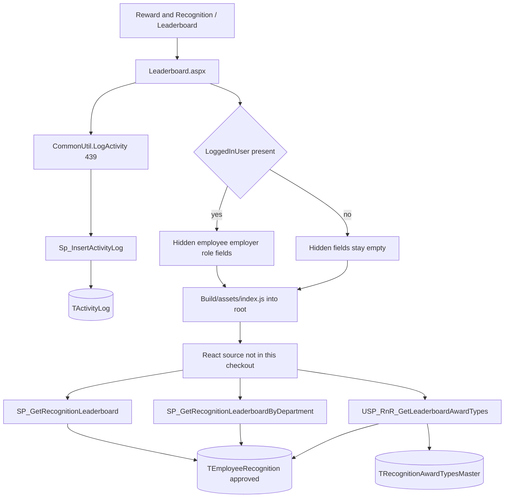
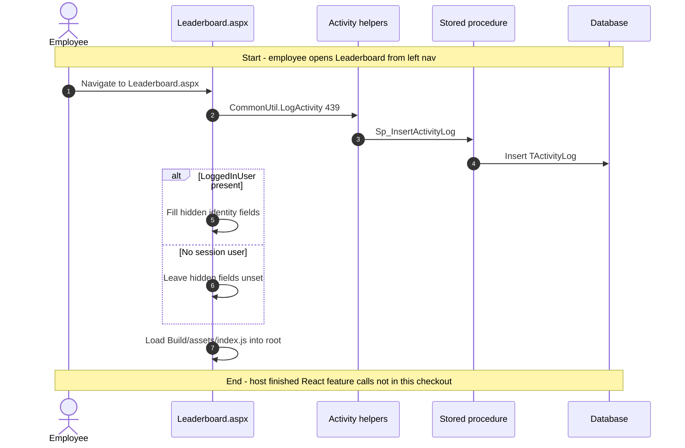
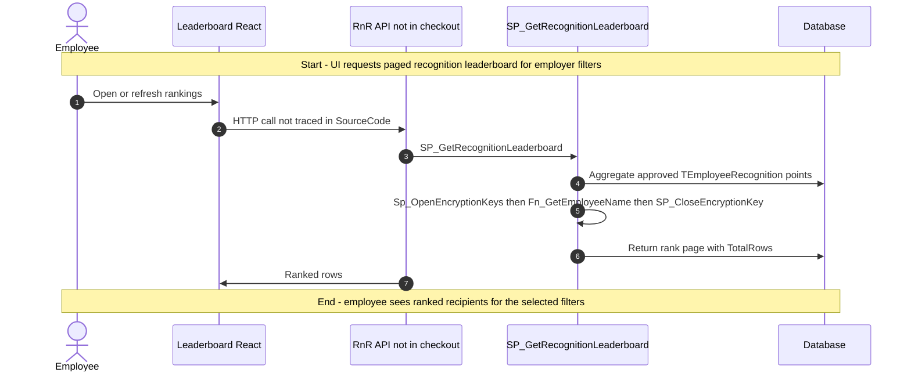
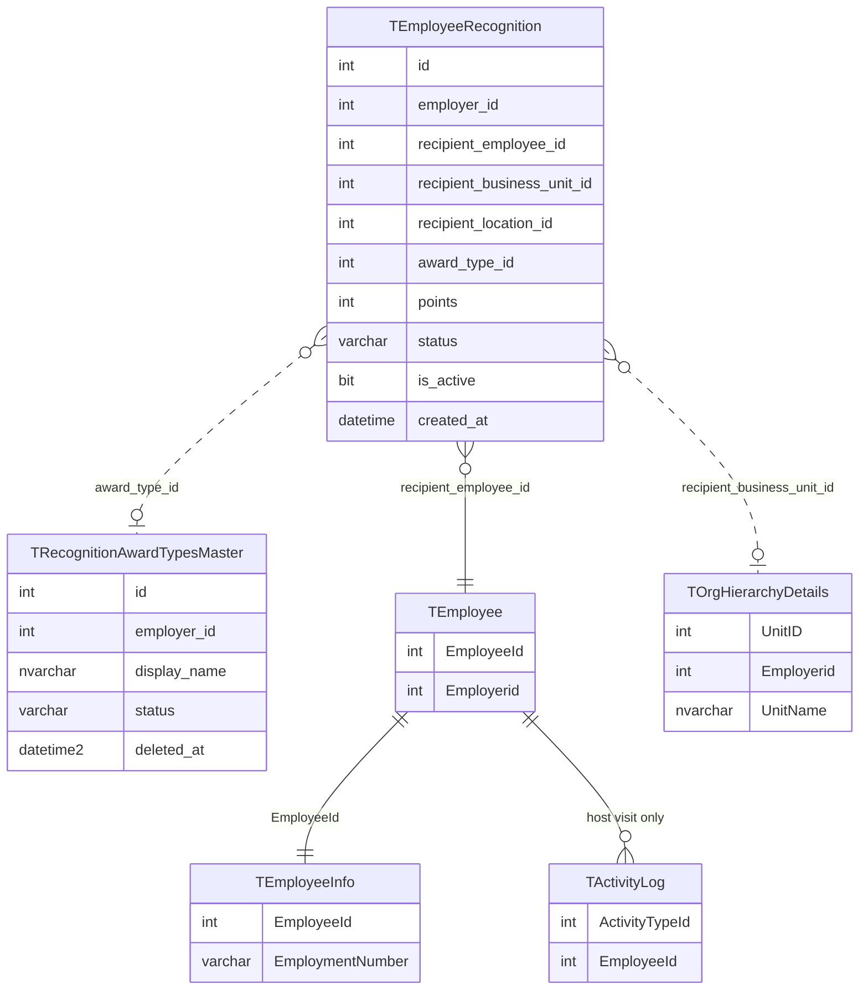

# Leaderboard

## Overview

An employee opens **Reward & Recognition → Leaderboard** (menu id **1257**) to rank peers by approved recognition points and to see top business units. The live NavigateURL is `~/HRM/RewardsAndRecognition/Leaderboard.aspx` (`DML/RnR Phase2/Index.sql`). Customer License Dashboard menu XML places Leaderboard immediately after Social Feed (then Marketplace, My Rewards, Notifications, Admin Console).

`Leaderboard.aspx` is a thin WebForms host. On `Page_Load` it logs activity type **439** (`ActivityDescription.Leaderboard`), copies the session `LoggedInUser` into hidden fields (`hdnEmpId`, employer, role, global-access flag, email, user id), and loads `Build/assets/index.js` into `#root`. There is no WebForms postback for leaderboard data on this page.

The Ranked list, department board, and recognition-type filter are implemented by RewardNRecognition procedures `SP_GetRecognitionLeaderboard`, `SP_GetRecognitionLeaderboardByDepartment`, and `USP_RnR_GetLeaderboardAwardTypes` (PBI **162321** on the award-types procedure). The React Build tree and the separate `Rewards_and_Recognition` Node backend named in `TDataCatalog` are **not** in this SourceCode checkout, so controller/DAL `file:line` hops for those HTTP calls cannot be cited here.

**Who's involved:**

- **Employee / manager** — opens Leaderboard from the left nav when menu 1257 is granted; views ranked recipients and department totals for their employer context.
- **Recognition giver / approver** — does not act on this screen; their approved `TEmployeeRecognition` rows are the data the leaderboard aggregates.
- **Administrator** — configures award types elsewhere (Admin Console); approved (and historically awarded) types feed the Leaderboard type dropdown via `USP_RnR_GetLeaderboardAwardTypes`.

There is no SystemModel-2 page for Leaderboard.

## Workflow

## Request journey

### Employee — open Leaderboard

### Employee — load ranked leaderboard (intended SP path)

No WebForms save journey exists on this aspx. Mutations of recognition rows happen on other RnR leaves (for example Give Recognition / Notifications).

## Entry points

| Entry point | Purpose | Live? |
|---|---|---|
| `~/HRM/RewardsAndRecognition/Leaderboard.aspx` | Host page; activity 439; hidden session fields; React mount | Yes |
| Left-nav menu id **1257** under parent **1240** | `tMenuDetails` / `TMenuHierarchy` / `TModuleMenuMapping` from RnR Phase 2 DML | Yes |
| `Build/assets/index.js` + `Build/assets/styles.css` | Client shell loaded by the aspx | Build folder not in this checkout |
| Sibling RnR aspx pages (Give Recognition, Social Feed, Marketplace, …) | Other module leaves; same Build pattern | Yes (separate guides) |

## Code → database call chain

Verified host chain uses WebForms + shared activity audit only. Feature procedures are the RewardNRecognition scripts whose parameters and headers match a Leaderboard screen; app callers for those SPs are not in this workspace.

| Step | Entry point | App code | Stored procedure |
|---|---|---|---|
| Activity on open | `Leaderboard.aspx.cs:27` | `CommonUtil.LogActivity` (`Common.cs:52`) → `LogUserActivity.LogActivity` (`LogUserActivity.cs:36`) → `ActivityLog.LogActivityAsync` (`ActivityLog.cs:22`) → `ActivityHelper.LogActivity` (`ActivityHelper.cs:32`) | `Sp_InsertActivityLog` (HRMS; activity **439**) |
| Seed hidden fields | `Leaderboard.aspx.cs:28-42` | Session `LoggedInUser` → aspx hidden inputs | None |
| Load React shell | `Leaderboard.aspx:6`, `:26` | Script/link to `Build/assets/*` | None in host |
| Ranked employee leaderboard (intended) | React / RnR API **not in checkout** | Catalog associates SP with `TEmployeeRecognition` | `SP_GetRecognitionLeaderboard` → nested `Sp_OpenEncryptionKeys`, `Fn_GetEmployeeName`, `SP_CloseEncryptionKey` (HRMS via synonyms) |
| Top departments (intended) | React / RnR API **not in checkout** | Same catalog association | `SP_GetRecognitionLeaderboardByDepartment` |
| Recognition type filter options (intended) | React / RnR API **not in checkout** | SP header PBI 162321 Leaderboard dropdown | `USP_RnR_GetLeaderboardAwardTypes` |

`ActivityDescription.Leaderboard` is `439` in `Enums.cs:382`.

## API endpoints

This screen is **not** a WebForms postback for leaderboard grids or filters. The aspx only logs activity and mounts the React shell.

Feature HTTP routes live in the missing `Rewards_and_Recognition` backend / `Build/assets/index.js` client. They are **not** present under `HRMS.CoreAPI` or `HRMS.Web/.../RewardsAndRecognition` in this checkout, so no Method / Path / Handler table can be cited from source. `TDataCatalog` lists related Reward & Recognition `/api/v1/...` surfaces and names the three leaderboard procedures among `TEmployeeRecognition` / `TRecognitionAwardTypesMaster` consumers, without publishing a dedicated leaderboard route string in those rows.

## Stored procedures & tables involved

| Object | File | Purpose | Wiki |
|---|---|---|---|
| `Sp_InsertActivityLog` | `HRMS/STOREPROCEDURE/Sp_InsertActivityLog.sql` | Page-open activity type 439 | [Sp_InsertActivityLog](/docs/database/hrms/Sp_InsertActivityLog) |
| `SP_GetRecognitionLeaderboard` | `HRMS-RewardNRecognition/STORED_PROCEDURE/SP_GetRecognitionLeaderboard.sql` | Paged employee ranks by approved points | [SP_GetRecognitionLeaderboard](/docs/database/hrms-rewardnrecognition/SP_GetRecognitionLeaderboard) |
| `SP_GetRecognitionLeaderboardByDepartment` | `HRMS-RewardNRecognition/STORED_PROCEDURE/SP_GetRecognitionLeaderboardByDepartment.sql` | Top 5 business units by points | [SP_GetRecognitionLeaderboardByDepartment](/docs/database/hrms-rewardnrecognition/SP_GetRecognitionLeaderboardByDepartment) |
| `USP_RnR_GetLeaderboardAwardTypes` | `HRMS-RewardNRecognition/STORED_PROCEDURE/USP_RnR_GetLeaderboardAwardTypes.sql` | Recognition type filter dropdown | [USP_RnR_GetLeaderboardAwardTypes](/docs/database/hrms-rewardnrecognition/USP_RnR_GetLeaderboardAwardTypes) |
| `Sp_OpenEncryptionKeys` / `SP_CloseEncryptionKey` | HRMS STOREPROCEDURE (synonyms on RewardNRecognition) | Open/close keys around name decrypt in employee leaderboard | [Sp_OpenEncryptionKeys](/docs/database/hrms/Sp_OpenEncryptionKeys), [SP_CloseEncryptionKey](/docs/database/hrms/SP_CloseEncryptionKey) |
| `Fn_GetEmployeeName` | HRMS FUNCTIONS (synonym on RewardNRecognition) | Display name for each ranked employee | [Fn_GetEmployeeName](/docs/database/hrms/Fn_GetEmployeeName) |
| `TEmployeeRecognition`, `TRecognitionAwardTypesMaster` | RewardNRecognition TABLES | Approved points and award-type master | RewardNRecognition catalog |
| `TEmployee`, `TEmployeeInfo`, `TOrgHierarchyDetails` | RewardNRecognition synonyms → HRMS | Active employees, employment number, BU names | HRMS tables via synonym |

## Table relationships

Declared FKs among these objects are sparse in the CREATE scripts. The diagram shows joins the leaderboard procedures use (including synonyms into HRMS).

## Known gaps

- **`HRM/RewardsAndRecognition/Build/` is missing** from this SourceCode checkout, so React routes, filters, and API client calls for Leaderboard cannot be traced to `file:line`.
- **`Rewards_and_Recognition` Node backend** referenced by `TDataCatalog` (for example budget/points cron paths) is not a folder under this workspace; no controller or DAL for the three leaderboard procedures is available to cite.
- **No dedicated `/api/v1/.../leaderboard` string** appears in the inventoried `TDataCatalog` rows that list these SPs; exact HTTP paths remain unknown until the backend is checked in.
- **No SystemModel-2** page for Leaderboard.
- **Host does not gate menu access** the way some other thin hosts do (for example MsgMesh); it only logs activity and seeds hidden fields when `LoggedInUser` is present.
- Guides for Recognition Dashboard, Give Recognition, My Recognitions, and Social Feed were empty in `content/guides/reward-and-recognition/` at analysis time; this leaf is the next after Social Feed in Customer License Dashboard menu order.

## Reference

Confidence is **medium**: the ASPX host, activity **439**, menu **1257**, and the three RewardNRecognition leaderboard procedures were read from source/SQL. The React UI and feature HTTP handlers are not in this checkout.

### SourceCode

- `HRMS.Web/HRMS.Web/HRM/RewardsAndRecognition/Leaderboard.aspx`
- `HRMS.Web/HRMS.Web/HRM/RewardsAndRecognition/Leaderboard.aspx.cs`
- `HRMS.Shared/HRMS.DataContract/Common/Enums.cs`
- `HRMS.Shared/HRMS.Common/Common.cs`
- `HRMS.Shared/TDG.ActivityAuditLog/Activity/LogUserActivity.cs`
- `HRMS.Shared/TDG.ActivityAuditLog/ActivityLog/ActivityLog.cs`
- `HRMS.Shared/TDG.ActivityAuditLog/DAL/ActivityHelper.cs`

### TDG HRMS DB

- `HRMS-DATABASE/HRMS/DML/RnR Phase2/Index.sql`
- `HRMS-DATABASE/HRMS/DML/Customer License Dashboard/TMenuDetails DML.sql`
- `HRMS-DATABASE/HRMS/DML/TDataCatalog_DML.sql` (`TEmployeeRecognition`, `TRecognitionAwardTypesMaster`)
- `HRMS-DATABASE/HRMS/STOREPROCEDURE/Sp_InsertActivityLog.sql`
- `HRMS-DATABASE/HRMS-RewardNRecognition/STORED_PROCEDURE/SP_GetRecognitionLeaderboard.sql`
- `HRMS-DATABASE/HRMS-RewardNRecognition/STORED_PROCEDURE/SP_GetRecognitionLeaderboardByDepartment.sql`
- `HRMS-DATABASE/HRMS-RewardNRecognition/STORED_PROCEDURE/USP_RnR_GetLeaderboardAwardTypes.sql`
- `HRMS-DATABASE/HRMS-RewardNRecognition/TABLES/TEmployeeRecognition.sql`
- `HRMS-DATABASE/HRMS-RewardNRecognition/TABLES/TRecognitionAwardTypesMaster.sql`
- `HRMS-DATABASE/HRMS-RewardNRecognition/SYNONYMS/RnR_CoreSynonyms_HRM-CL-Prod.sql`
