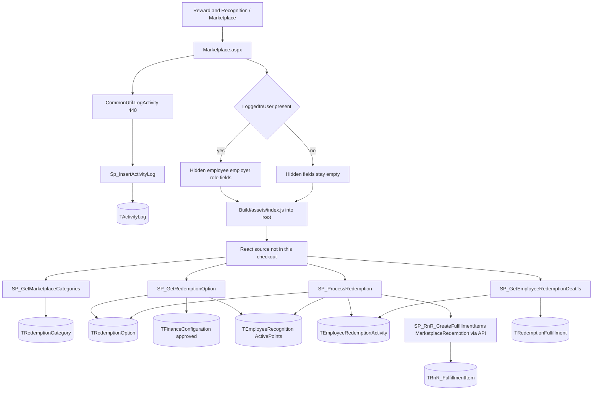
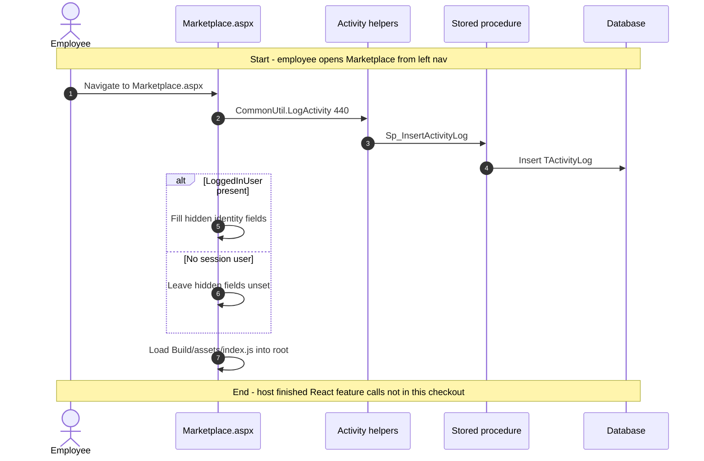
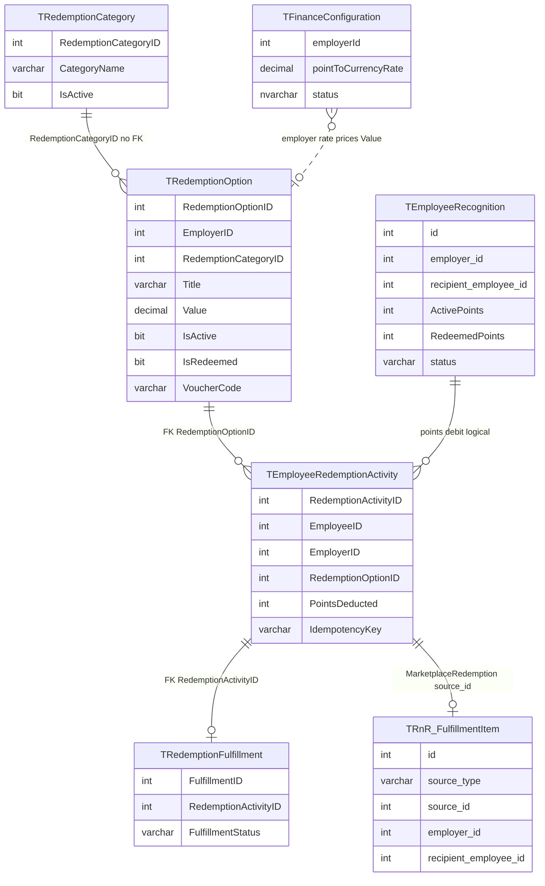

# Marketplace

## Overview

An employee opens **Reward & Recognition → Marketplace** (menu id **1258**) to browse gift-card style redemption options and spend approved recognition points. The live NavigateURL is `~/HRM/RewardsAndRecognition/Marketplace.aspx` (`DML/RnR Phase2/Index.sql`). Customer License Dashboard menu XML places Marketplace immediately after Leaderboard (then My Rewards, Notifications, Admin Console).

`Marketplace.aspx` is a thin WebForms host. On `Page_Load` it logs activity type **440** (`ActivityDescription.Marketplace`), copies the session `LoggedInUser` into hidden fields (`hdnEmpId`, employer, role, global-access flag, email, user id), and loads `Build/assets/index.js` into `#root`. There is no WebForms postback for catalog or redeem on this page.

Catalog browse, point quote, redeem, and redemption history are implemented by RewardNRecognition procedures `SP_GetMarketplaceCategories`, `SP_GetRedemptionOption`, `SP_ProcessRedemption`, and `SP_GetEmployeeRedemptionDeatils` (procedure name spelling as inventoried). `TDataCatalog` marks `TEmployeeRedemptionActivity` as **Reward & Recognition > Marketplace** and lists those procedures among consumers. After a successful redeem, the separate Node API may create a fulfillment queue row via `SP_RnR_CreateFulfillmentItems` with `@SourceType = 'MarketplaceRedemption'` (not `EXEC`’d inside `SP_ProcessRedemption`). The React Build tree and the `Rewards_and_Recognition` Node backend are **not** in this SourceCode checkout, so controller/DAL `file:line` hops for those HTTP calls cannot be cited here.

Admin Console’s Marketplace **tab** (TabId **525**) configures reward inventory and fulfillment; that admin surface is out of scope for this left-nav leaf.

**Who's involved:**

- **Employee** — opens Marketplace when menu 1258 is granted; browses active gift-card options priced from the approved finance point-to-currency rate; redeems when they have enough `ActivePoints` on approved `TEmployeeRecognition` rows.
- **Administrator** — seeds categories / redemption options and handles fulfillment elsewhere (Admin Console); not this leaf’s primary actor.
- **Finance approver** — must leave an approved `TFinanceConfiguration.pointToCurrencyRate` for the employer, or catalog and redeem throw.

There is no SystemModel-2 page for Marketplace.

## Workflow



## Request journey

### Employee — open Marketplace



### Employee — browse catalog and redeem (intended SP path)

```mermaid
sequenceDiagram
  autonumber
  actor Emp as Employee
  participant UI as Marketplace React
  participant App as RnR API not in checkout
  participant Cat as SP_GetMarketplaceCategories
  participant Opt as SP_GetRedemptionOption
  participant Redeem as SP_ProcessRedemption
  participant Ful as SP_RnR_CreateFulfillmentItems
  participant DB as Database

  Note over Emp,DB: Start - employee loads gift card catalog then redeems with idempotency key
  Emp->>UI: Open Marketplace filters
  UI->>App: HTTP call not traced in SourceCode
  App->>Cat: SP_GetMarketplaceCategories
  Cat->>DB: Active TRedemptionCategory rows
  App->>Opt: SP_GetRedemptionOption
  Opt->>DB: Gift card options priced from finance rate plus ActivePoints
  Emp->>UI: Confirm redeem
  UI->>App: HTTP redeem not traced in SourceCode
  App->>Redeem: SP_ProcessRedemption
  Redeem->>DB: Lock option deduct points insert TEmployeeRedemptionActivity
  App->>Ful: SP_RnR_CreateFulfillmentItems MarketplaceRedemption
  Ful->>DB: Insert pending TRnR_FulfillmentItem when missing
  App->>UI: Voucher and activity id
  Note over Emp,DB: End - points charged voucher returned fulfillment may be queued
```

No WebForms save journey exists on this aspx. Admin inventory CRUD and fulfillment status updates belong to Admin Console (separate guide).

## Entry points

| Entry point | Purpose | Live? |
|---|---|---|
| `~/HRM/RewardsAndRecognition/Marketplace.aspx` | Host page; activity 440; hidden session fields; React mount | Yes |
| Left-nav menu id **1258** under parent **1240** | `tMenuDetails` / `TMenuHierarchy` / `TModuleMenuMapping` from RnR Phase 2 DML | Yes |
| `Build/assets/index.js` + `Build/assets/styles.css` | Client shell loaded by the aspx | Build folder not in this checkout |
| Admin Console tab **Marketplace** (TabId **525**) | Admin inventory / fulfillment — not this leaf | Yes (separate guide) |
| Sibling RnR aspx pages (Leaderboard, My Rewards, …) | Other module leaves; same Build pattern | Yes (separate guides) |

## Code → database call chain

Verified host chain uses WebForms + shared activity audit only. Feature procedures are the RewardNRecognition scripts whose parameters and `TDataCatalog` screens match the Marketplace leaf; app callers for those SPs are not in this workspace.

| Step | Entry point | App code | Stored procedure |
|---|---|---|---|
| Activity on open | `Marketplace.aspx.cs:26` | `CommonUtil.LogActivity` (`Common.cs:52`) → `LogUserActivity.LogActivity` (`LogUserActivity.cs:36`) → `ActivityLog.LogActivityAsync` (`ActivityLog.cs:22`) → `ActivityHelper.LogActivity` (`ActivityHelper.cs:32`) | `Sp_InsertActivityLog` (HRMS; activity **440**) |
| Seed hidden fields | `Marketplace.aspx.cs:27-41` | Session `LoggedInUser` → aspx hidden inputs | None |
| Load React shell | `Marketplace.aspx:6`, `:26` | Script/link to `Build/assets/*` | None in host |
| Category filter list (intended) | React / RnR API **not in checkout** | Catalog associates categories with Marketplace SPs | `SP_GetMarketplaceCategories` |
| Gift-card catalog + balance (intended) | React / RnR API **not in checkout** | `TRedemptionOption` / Marketplace screens | `SP_GetRedemptionOption` |
| Redeem gift card (intended) | React / RnR API **not in checkout** | `TEmployeeRedemptionActivity` writer | `SP_ProcessRedemption` → nested `sys.sp_getapplock` |
| Queue fulfillment after redeem (intended; not `EXEC` inside redeem SP) | React / RnR API **not in checkout** | `MarketplaceRedemption` source type in SP | `SP_RnR_CreateFulfillmentItems` |
| Redemption history (intended) | React / RnR API **not in checkout** | Catalog lists SP on redemption activity | `SP_GetEmployeeRedemptionDeatils` |

`ActivityDescription.Marketplace` is `440` in `Enums.cs:383`.

## API endpoints

This screen is **not** a WebForms postback for catalog browse or redeem. The aspx only logs activity and mounts the React shell.

Feature HTTP routes live in the missing `Rewards_and_Recognition` backend / `Build/assets/index.js` client. They are **not** present under `HRMS.CoreAPI` or `HRMS.Web/.../RewardsAndRecognition` in this checkout, so no employee Method / Path / Handler table can be cited from source. `TDataCatalog` publishes admin Marketplace paths (`GET /api/v1/marketplace/admin/rewards`, `GET /api/v1/marketplace/admin/fulfillments`, `GET /api/v1/open-marketplace/admin/orders`) and names the employee redeem procedures among `TRedemptionOption` / `TEmployeeRedemptionActivity` consumers, without publishing a dedicated employee marketplace redeem route string in those rows.

## Stored procedures & tables involved

| Object | File | Purpose | Wiki |
|---|---|---|---|
| `Sp_InsertActivityLog` | `HRMS/STOREPROCEDURE/Sp_InsertActivityLog.sql` | Page-open activity type 440 | [Sp_InsertActivityLog](/docs/database/hrms/Sp_InsertActivityLog) |
| `SP_GetMarketplaceCategories` | `HRMS-RewardNRecognition/STORED_PROCEDURE/SP_GetMarketplaceCategories.sql` | Active redemption categories | [SP_GetMarketplaceCategories](/docs/database/hrms-rewardnrecognition/SP_GetMarketplaceCategories) |
| `SP_GetRedemptionOption` | `HRMS-RewardNRecognition/STORED_PROCEDURE/SP_GetRedemptionOption.sql` | Gift-card catalog priced from finance rate; second set = ActivePoints | [SP_GetRedemptionOption](/docs/database/hrms-rewardnrecognition/SP_GetRedemptionOption) |
| `SP_ProcessRedemption` | `HRMS-RewardNRecognition/STORED_PROCEDURE/SP_ProcessRedemption.sql` | Idempotent redeem; deducts points; marks option redeemed | [SP_ProcessRedemption](/docs/database/hrms-rewardnrecognition/SP_ProcessRedemption) |
| `SP_GetEmployeeRedemptionDeatils` | `HRMS-RewardNRecognition/STORED_PROCEDURE/SP_GetEmployeeRedemptionDeatils.sql` | Employee redemption history (name spelling as in SQL) | [SP_GetEmployeeRedemptionDeatils](/docs/database/hrms-rewardnrecognition/SP_GetEmployeeRedemptionDeatils) |
| `SP_RnR_CreateFulfillmentItems` | `HRMS-RewardNRecognition/STORED_PROCEDURE/SP_RnR_CreateFulfillmentItems.sql` | Optional follow-on queue row for `MarketplaceRedemption` | [SP_RnR_CreateFulfillmentItems](/docs/database/hrms-rewardnrecognition/SP_RnR_CreateFulfillmentItems) |
| `TRedemptionCategory`, `TRedemptionOption`, `TEmployeeRedemptionActivity`, `TRedemptionFulfillment` | RewardNRecognition TABLES | Category / inventory / redeem activity / legacy fulfillment | RewardNRecognition catalog |
| `TFinanceConfiguration` | RewardNRecognition TABLES | Approved `pointToCurrencyRate` for pricing and charge | RewardNRecognition catalog |
| `TEmployeeRecognition` | RewardNRecognition TABLES | Approved `ActivePoints` balance and debit source | RewardNRecognition catalog |
| `TRnR_FulfillmentItem`, `TRnR_FulfillmentStatusHistory` | RewardNRecognition TABLES | Unified fulfillment queue for MarketplaceRedemption | RewardNRecognition catalog |

## Table relationships

Declared FKs: activity → option, fulfillment → activity. Category → option and finance → employer are application-enforced in the inventoried CREATE scripts (no FK on `TRedemptionOption.RedemptionCategoryID`).



## Known gaps

- **`HRM/RewardsAndRecognition/Build/` is missing** from this SourceCode checkout, so React routes, filters, and API client calls for Marketplace cannot be traced to `file:line`.
- **`Rewards_and_Recognition` Node backend** referenced by `TDataCatalog` is not a folder under this workspace; no controller or DAL for the redeem procedures is available to cite.
- **No employee `/api/v1/marketplace/...` route string** appears in the inventoried `TDataCatalog` rows for redeem/browse; only admin marketplace/open-marketplace paths are published.
- **`SP_RnR_CreateFulfillmentItems` is not `EXEC`’d inside `SP_ProcessRedemption`** — MarketplaceRedemption branch exists for a follow-on API call; confirm when the backend is available.
- **Open-marketplace / provider order SPs** (`USP_RnR_*Provider*`) are catalogued under Admin Console fulfillment, not this employee leaf.
- **No SystemModel-2** page for Marketplace.
- **Host does not gate menu access**; it only logs activity and seeds hidden fields when `LoggedInUser` is present.

## Reference

Confidence is **medium**: the ASPX host, activity **440**, menu **1258**, and the RewardNRecognition marketplace redeem procedures were read from source/SQL. The React UI and feature HTTP handlers are not in this checkout.

### SourceCode

- `HRMS.Web/HRMS.Web/HRM/RewardsAndRecognition/Marketplace.aspx`
- `HRMS.Web/HRMS.Web/HRM/RewardsAndRecognition/Marketplace.aspx.cs`
- `HRMS.Shared/HRMS.DataContract/Common/Enums.cs`
- `HRMS.Shared/HRMS.Common/Common.cs`
- `HRMS.Shared/TDG.ActivityAuditLog/Activity/LogUserActivity.cs`
- `HRMS.Shared/TDG.ActivityAuditLog/ActivityLog/ActivityLog.cs`
- `HRMS.Shared/TDG.ActivityAuditLog/DAL/ActivityHelper.cs`

### TDG HRMS DB

- `HRMS-DATABASE/HRMS/DML/RnR Phase2/Index.sql`
- `HRMS-DATABASE/HRMS/DML/Customer License Dashboard/TMenuDetails DML.sql`
- `HRMS-DATABASE/HRMS/DML/TDataCatalog_DML.sql` (`TEmployeeRedemptionActivity`, `TRedemptionOption`, `TRedemptionCategory`)
- `HRMS-DATABASE/HRMS/STOREPROCEDURE/Sp_InsertActivityLog.sql`
- `HRMS-DATABASE/HRMS-RewardNRecognition/STORED_PROCEDURE/SP_GetMarketplaceCategories.sql`
- `HRMS-DATABASE/HRMS-RewardNRecognition/STORED_PROCEDURE/SP_GetRedemptionOption.sql`
- `HRMS-DATABASE/HRMS-RewardNRecognition/STORED_PROCEDURE/SP_ProcessRedemption.sql`
- `HRMS-DATABASE/HRMS-RewardNRecognition/STORED_PROCEDURE/SP_GetEmployeeRedemptionDeatils.sql`
- `HRMS-DATABASE/HRMS-RewardNRecognition/STORED_PROCEDURE/SP_RnR_CreateFulfillmentItems.sql`
- `HRMS-DATABASE/HRMS-RewardNRecognition/TABLES/TRedemptionCategory.sql`
- `HRMS-DATABASE/HRMS-RewardNRecognition/TABLES/TRedemptionOption.sql`
- `HRMS-DATABASE/HRMS-RewardNRecognition/TABLES/TEmployeeRedemptionActivity.sql`
- `HRMS-DATABASE/HRMS-RewardNRecognition/TABLES/TRedemptionFulfillment.sql`
- `HRMS-DATABASE/HRMS-RewardNRecognition/TABLES/TFinanceConfiguration.sql`
